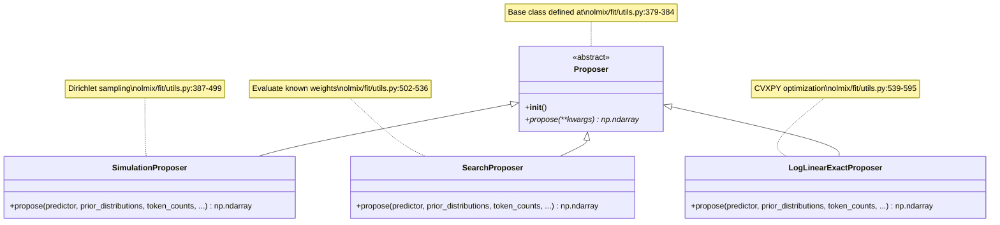
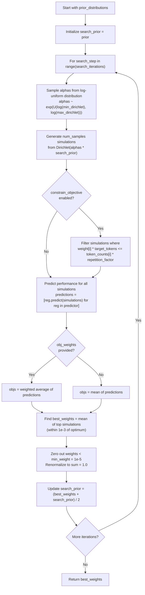
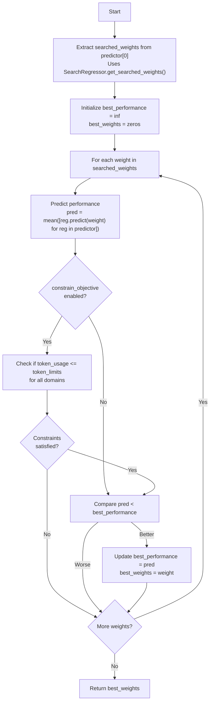
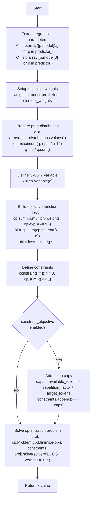
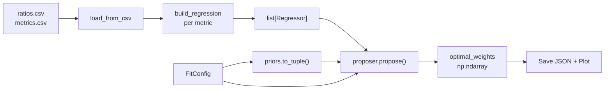

<!-- source: DeepWiki mcp.deepwiki.com · repo allenai/olmix · page 9.2 Proposer Classes · fetched 2026-10-26 -->

# Proposer Classes

<details>
<summary>Relevant source files</summary>

The following files were used as context for generating this wiki page:

- [olmix/fit/cli.py](olmix/fit/cli.py)
- [olmix/fit/utils.py](olmix/fit/utils.py)
- [olmix/plots/plotting.py](olmix/plots/plotting.py)

</details>


This page provides detailed API reference documentation for the proposer classes in olmix. Proposers are responsible for optimizing data mixture weights using trained regression models to predict performance metrics. For conceptual information about proposers and their usage patterns, see [Proposers](#4.2). For information about the regression models that proposers use to make predictions, see [Regression Classes](#9.1).

## Overview

All proposer classes inherit from the abstract `Proposer` base class and implement a `propose()` method that takes regression predictors and prior distributions as input and returns optimal mixture weights as output. The three concrete implementations represent different optimization strategies:

- **SimulationProposer**: Monte Carlo sampling with iterative refinement
- **SearchProposer**: Direct evaluation of previously-seen mixture weights
- **LogLinearExactProposer**: Convex optimization with KL regularization (requires log-linear regression)

## Class Hierarchy



**Sources:** [olmix/fit/utils.py:379-598]()

## Base Class: `Proposer`

The abstract base class defines the interface that all proposer implementations must follow.

### Class Definition

[olmix/fit/utils.py:379-384]()

```python
class Proposer:
    def __init__(self):
        pass

    def propose(self, **kwargs):
        raise NotImplementedError("Subclasses must implement this method")
```

### Method Signature

All concrete proposers implement `propose()` with the following common parameters:

| Parameter | Type | Description |
|-----------|------|-------------|
| `predictor` | `list[Regressor]` | List of fitted regression models, one per metric |
| `prior_distributions` | `dict[str, float]` | Prior mixture weights keyed by domain name |
| `token_counts` | `dict[str, int]` | Available tokens per domain for constraint checking |
| `seed` | `int` | Random seed for reproducibility (SimulationProposer only) |
| `constrain_objective` | `bool` | Whether to enforce token availability constraints |
| `target_tokens` | `int \| None` | Target token budget for the full-scale run |
| `repetition_factor` | `float` | Maximum allowed repetition multiplier (default: 4.0) |
| `obj_weights` | `list \| None` | Metric importance weights for multi-objective optimization |

**Returns:** `np.ndarray` of shape `(n_domains,)` representing optimal mixture weights (sum to 1.0)

**Sources:** [olmix/fit/utils.py:379-384](), [olmix/fit/cli.py:99-112]()

## `SimulationProposer`

The simulation proposer uses Monte Carlo sampling from Dirichlet distributions to explore the mixture space and identify optimal weights through iterative refinement.

### Algorithm Overview



**Sources:** [olmix/fit/utils.py:387-499]()

### Class Definition

[olmix/fit/utils.py:387-499]()

### Key Parameters

| Parameter | Type | Default | Description |
|-----------|------|---------|-------------|
| `search_iterations` | `int` | `10` | Number of iterative refinement steps |
| `temperature` | `float \| None` | `None` | Temperature for prior adjustment: `prior^temperature` |
| `make_worst_mix` | `bool` | `False` | If True, find worst instead of best mixture |
| `min_weight` | `float` | `1e-5` | Minimum weight threshold (hard-coded internally) |
| `min_dirichlet` | `float` | `1` | Minimum Dirichlet concentration (hard-coded) |
| `max_dirichlet` | `float` | `100` | Maximum Dirichlet concentration (hard-coded) |
| `num_samples` | `int` | `100000` | Simulations per search iteration (hard-coded) |

### Temperature Adjustment

When `temperature` is provided, the prior is adjusted before sampling:

```python
if temperature is not None:
    search_prior = search_prior**temperature
    search_prior = search_prior / np.sum(search_prior)
```

Temperature < 1.0 flattens the prior (more exploration), while temperature > 1.0 sharpens it (more exploitation).

### Constraint Enforcement

When `constrain_objective=True`, the proposer filters simulations to ensure token availability constraints:

```python
# token_usage[i] must be <= available_tokens[i] * repetition_factor
token_usage = simulations * desired_tokens
token_limits = np.array(list(available_tokens_per_source.values())) * repetition_factor
valid_mask = (token_usage <= token_limits).all(axis=1)
simulations = simulations[valid_mask]
```

This prevents proposing mixtures that would require repeating data sources more than `repetition_factor` times at the target scale.

**Sources:** [olmix/fit/utils.py:387-499]()

## `SearchProposer`

The search proposer directly evaluates all previously-seen mixture weights (from the swarm experiments) and selects the one with the best predicted performance.

### Algorithm Overview



**Sources:** [olmix/fit/utils.py:502-536]()

### Class Definition

[olmix/fit/utils.py:502-536]()

### Usage Requirements

The `SearchProposer` has a critical requirement:

- **Must be used with `SearchRegressor`**: The proposer calls `predictor[0].get_searched_weights()` to retrieve the evaluated mixture weights. This method only exists on `SearchRegressor` objects.

Attempting to use `SearchProposer` with other regression types will result in an `AttributeError`. The CLI validates this constraint:

[olmix/fit/cli.py:71-72]()

```python
if cfg.proposer.type == "search" and cfg.regression.type != "search":
    raise click.UsageError("proposer.type 'search' only works with regression.type 'search'")
```

### Optimization Strategy

Unlike `SimulationProposer`, this proposer performs no sampling or exploration. It simply:

1. Retrieves all mixture weights that were evaluated during the swarm experiments
2. Uses the regression models to predict their performance
3. Selects the best-performing weight vector

This is useful when you want to select the best configuration from your experiments without extrapolating to unseen mixtures.

**Sources:** [olmix/fit/utils.py:502-536](), [olmix/fit/cli.py:71-72]()

## `LogLinearExactProposer`

The exact proposer uses convex optimization (via CVXPY) to find optimal mixture weights analytically. It only works with log-linear regression models.

### Mathematical Formulation

The proposer solves the following convex optimization problem:

$$
\min_{x} \sum_{i=1}^{n} w_i \cdot e^{A_i^T x} + \lambda \cdot \text{KL}(x \| q)
$$

Subject to:
- $x \geq 0$ (non-negativity)
- $\sum_i x_i = 1$ (probability simplex)
- $x_i \leq \text{cap}_i$ (token availability constraints, if enabled)

Where:
- $x \in \mathbb{R}^d$ is the mixture weight vector
- $A \in \mathbb{R}^{n \times d}$ contains the log-linear regression coefficients
- $w \in \mathbb{R}^n$ are the objective weights (metric importance)
- $q \in \mathbb{R}^d$ is the prior distribution
- $\lambda$ is the KL regularization coefficient
- $\text{KL}(x \| q) = \sum_i x_i \log(x_i / q_i)$ is the KL divergence

### Algorithm Implementation



**Sources:** [olmix/fit/utils.py:539-595]()

### Class Definition

[olmix/fit/utils.py:539-595]()

### Key Parameters

| Parameter | Type | Required | Description |
|-----------|------|----------|-------------|
| `kl_reg` | `float \| None` | **Yes** | KL divergence regularization coefficient (typically 0.05) |
| `obj_weights` | `list \| None` | No | Metric importance weights; defaults to uniform (1/n for each metric) |

### Usage Requirements

The `LogLinearExactProposer` has specific requirements:

- **Must be used with `LogLinearRegressor`**: The proposer directly accesses `predictor[i].model[0]` (intercept) and `predictor[i].model[1:]` (coefficients) which are specific to the log-linear scaling law parametrization.
- **Requires `kl_reg` parameter**: The CLI validates this:

[olmix/fit/cli.py:73-74]()

```python
if cfg.proposer.kl_reg is not None and cfg.proposer.type != "exact":
    raise click.UsageError("proposer.kl_reg requires proposer.type 'exact'")
```

### KL Regularization Behavior

The KL regularization term `kl_reg * KL(x || q)` pulls the optimal mixture towards the prior distribution `q`. Higher values of `kl_reg` result in solutions closer to the prior, while lower values prioritize performance optimization. This is useful for:

- **Stability**: Preventing extreme weight allocations
- **Generalization**: Avoiding overfitting to proxy model predictions
- **Domain constraints**: Respecting natural token availability

### Solver Configuration

The proposer uses CVXPY with the ECOS solver:

```python
prob.solve(solver="ECOS", verbose=True)
```

ECOS is a second-order cone programming solver well-suited for problems with exponential cones (from the `cp.exp()` and `cp.rel_entr()` functions). Alternative solvers like SCS can also be used if ECOS fails to converge.

**Sources:** [olmix/fit/utils.py:539-595](), [olmix/fit/cli.py:73-74]()

## Proposer Registry

The `PROPOSER_TYPES` dictionary provides a registry for looking up proposer classes by string identifiers.

### Registry Definition

[olmix/fit/utils.py:598]()

```python
PROPOSER_TYPES = {
    "simulation": SimulationProposer,
    "search": SearchProposer,
    "exact": LogLinearExactProposer
}
```

### Usage Pattern

The registry is used in the fit workflow to instantiate the appropriate proposer based on configuration:

```python
# From fit configuration
proposer_type = cfg.proposer.type  # e.g., "simulation", "search", or "exact"
proposer_class = PROPOSER_TYPES[proposer_type]
proposer = proposer_class()

# Call propose with configuration parameters
optimal_weights = proposer.propose(
    predictor=predictors,
    prior_distributions=prior_dists,
    token_counts=token_counts,
    **additional_params
)
```

This pattern enables the CLI to support all three proposer types through a single configuration interface.

**Sources:** [olmix/fit/utils.py:598](), [olmix/fit/cli.py:99]()

## Proposer Comparison

The following table summarizes the key differences between proposer implementations:

| Feature | SimulationProposer | SearchProposer | LogLinearExactProposer |
|---------|-------------------|----------------|------------------------|
| **Optimization Method** | Monte Carlo sampling | Exhaustive evaluation | Convex optimization |
| **Regression Compatibility** | All types | SearchRegressor only | LogLinearRegressor only |
| **Exploration** | Yes (Dirichlet sampling) | No (only seen weights) | Yes (continuous optimization) |
| **Stochasticity** | Yes (requires seed) | No | No |
| **KL Regularization** | No | No | Yes (required) |
| **Token Constraints** | Filter-based | Filter-based | Native CVXPY constraints |
| **Computational Cost** | High (100k samples/iter) | Low (N evaluations) | Medium (convex solver) |
| **Convergence** | Iterative refinement | Single pass | Guaranteed optimal |
| **Use Case** | General-purpose | Quick selection | Analytical solution |

### When to Use Each Proposer

**SimulationProposer:**
- Works with any regression type
- Good for exploring unseen mixture regions
- Suitable when analytical solution is unavailable
- Configurable exploration-exploitation tradeoff via temperature

**SearchProposer:**
- Fastest option for selecting among evaluated mixtures
- No extrapolation risk
- Useful for final validation or simple selection tasks
- Limited to SearchRegressor

**LogLinearExactProposer:**
- Guaranteed optimal solution for log-linear models
- Principled KL regularization
- Native constraint handling via CVXPY
- Best when log-linear regression fits well

**Sources:** [olmix/fit/utils.py:387-595]()

## Integration with Fit Workflow

The proposers are invoked during the `olmix fit` command as the final stage of the optimization pipeline:



The output is saved to disk using the plotting utilities:

[olmix/plots/plotting.py:247-286]()

This generates:
- `*_optimal.json`: JSON array of domain-weight pairs
- `*_optimal.png`: Bar chart comparing prior vs. optimal weights

**Sources:** [olmix/fit/cli.py:47-113](), [olmix/plots/plotting.py:247-286]()

## Return Value Format

All proposers return optimal mixture weights as a NumPy array:

```python
optimal_weights: np.ndarray  # shape: (n_domains,)
```

**Properties:**
- Non-negative: `optimal_weights >= 0`
- Normalized: `np.sum(optimal_weights) == 1.0` (within floating-point tolerance)
- Same ordering as `prior_distributions.keys()`

**Example:**

```python
# Input
prior_distributions = {
    "dclm": 0.4,
    "stack": 0.3,
    "arxiv": 0.3
}

# Output
optimal_weights = np.array([0.35, 0.45, 0.20])
# Corresponds to: dclm=0.35, stack=0.45, arxiv=0.20
```

The output directory saving logic handles converting this array back to the domain-weight dictionary format for JSON serialization.

**Sources:** [olmix/fit/utils.py:379-595](), [olmix/plots/plotting.py:260-285]()

---

