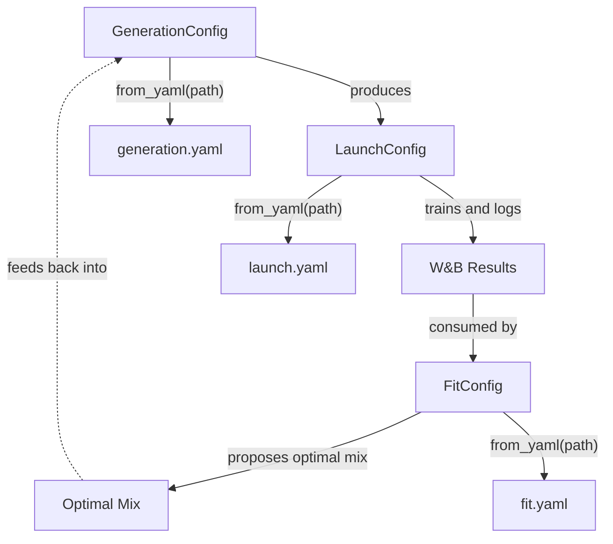
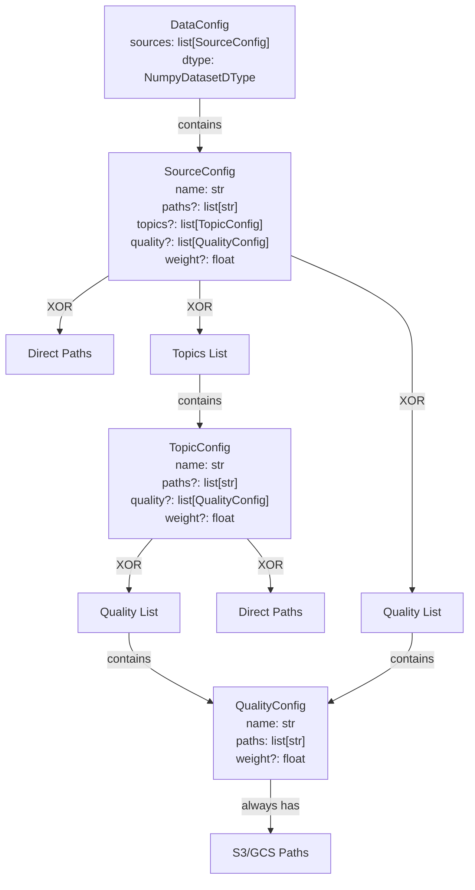
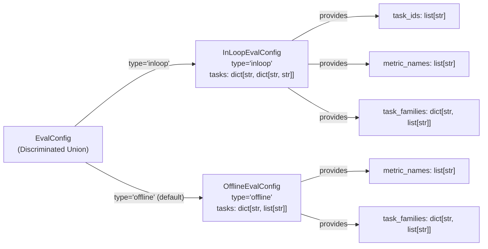
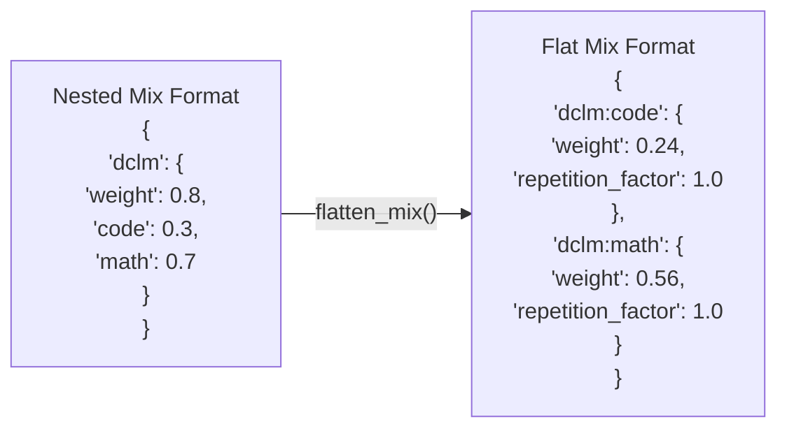
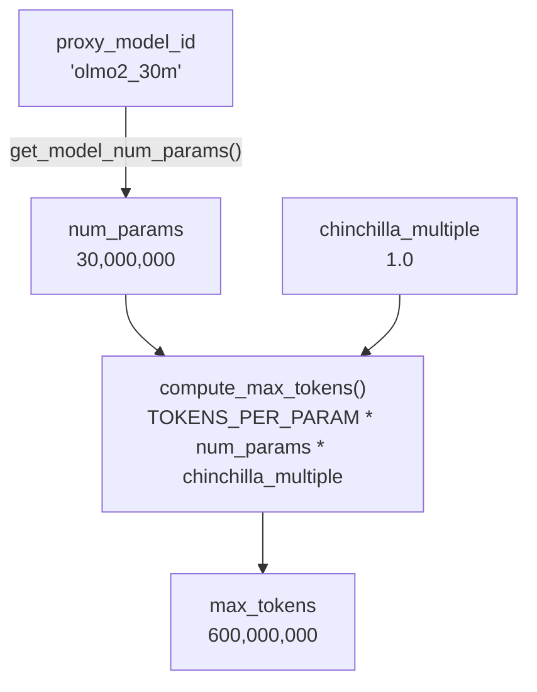
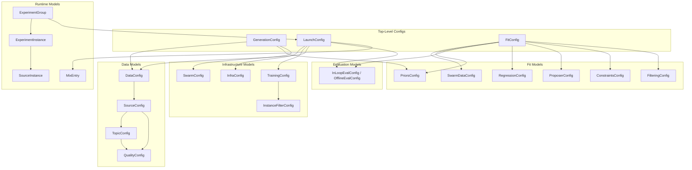

<!-- source: DeepWiki mcp.deepwiki.com · repo allenai/olmix · page 9.3 Configuration Models · fetched 2026-10-26 -->

# Configuration Models

<details>
<summary>Relevant source files</summary>

The following files were used as context for generating this wiki page:

- [olmix/aliases.py](olmix/aliases.py)
- [olmix/cli.py](olmix/cli.py)
- [olmix/generate/synthesize_mixture.py](olmix/generate/synthesize_mixture.py)
- [olmix/generate/utils.py](olmix/generate/utils.py)
- [olmix/launch/utils.py](olmix/launch/utils.py)
- [tests/test_fit_config.py](tests/test_fit_config.py)

</details>


This page provides detailed API reference documentation for all Pydantic configuration models in olmix. These models define the structure and validation logic for YAML configuration files and runtime objects throughout the system.

For high-level guidance on using configurations, see [Configuration System](#3). For examples of specific config types, see [GenerationConfig](#3.1), [LaunchConfig](#3.2), and [FitConfig](#3.3).

## Model Organization

All configuration models are Pydantic `BaseModel` subclasses that provide:
- Automatic YAML/JSON serialization and deserialization
- Field validation and type checking
- Default values and optional fields
- Custom validation logic via model validators

The models are organized into three primary files:
- **olmix/aliases.py**: Core models for generation, launching, and data hierarchy
- **olmix/fit/config.py**: Models specific to the optimization pipeline
- Model interdependencies are managed through Python imports

## Core Configuration Models

### Primary Config Types

These three models represent the top-level configurations used by the main CLI commands:



**Diagram: Configuration lifecycle and primary config types**

Sources: [olmix/aliases.py:211-226](), [olmix/aliases.py:299-326](), [tests/test_fit_config.py:1-16]()

#### GenerationConfig

| Field | Type | Required | Description |
|-------|------|----------|-------------|
| `name` | `str` | No | Name for the experiment group (defaults to empty string) |
| `data` | `DataConfig` | Yes | Data landscape defining available sources |
| `priors` | `PriorsConfig` | Yes | Token counts and relative sizes for each domain |
| `swarm` | `SwarmConfig` | No | Sampling parameters (defaults to `SwarmConfig()`) |
| `max_tokens` | `int` | Yes | Total training budget for proxy models |

**Key methods:**
- `from_yaml(path: PathType) -> GenerationConfig`: Load from YAML file

Sources: [olmix/aliases.py:211-226]()

#### LaunchConfig

| Field | Type | Required | Description |
|-------|------|----------|-------------|
| `name` | `str` | Yes | Experiment name |
| `description` | `str` | No | Human-readable description |
| `infra` | `InfraConfig` | Yes | Beaker infrastructure settings |
| `training` | `TrainingConfig` | Yes | Model and training parameters |
| `data` | `DataConfig` | Yes | Data landscape definition |
| `eval` | `InLoopEvalConfig` | Yes | Evaluation task configuration |
| `mix` | `dict[str, MixEntry] \| None` | No | Explicit mixture weights (flat or nested) |
| `group_id` | `str \| None` | No | Group identifier for tracking related experiments |

**Special features:**
- `_resolve_nested_mix` validator: Automatically flattens nested mix dictionaries into leaf-level `MixEntry` objects using `flatten_mix()` function
- `from_yaml(path: PathType) -> LaunchConfig`: Load from YAML file

Sources: [olmix/aliases.py:299-326](), [olmix/aliases.py:267-297]()

#### FitConfig

Located in `olmix/fit/config.py`, this model controls the optimization pipeline:

| Field | Type | Required | Default |
|-------|------|----------|---------|
| `swarm` | `SwarmDataConfig` | Yes | - |
| `priors` | `PriorsConfig` | Yes | - |
| `eval` | `InLoopEvalConfig \| OfflineEvalConfig` | Yes | - |
| `regression` | `RegressionConfig` | No | `RegressionConfig()` |
| `proposer` | `ProposerConfig` | No | `ProposerConfig()` |
| `constraints` | `ConstraintsConfig` | No | `ConstraintsConfig()` |
| `filtering` | `FilteringConfig` | No | `FilteringConfig()` |

**Key methods:**
- `from_yaml(path: PathType) -> FitConfig`: Load from YAML file

Sources: [tests/test_fit_config.py:41-95]()

## Data Hierarchy Models

The data configuration system uses a three-level hierarchy: **Source → Topic → Quality**, with each level optionally having explicit paths.



**Diagram: Data hierarchy model structure**

Sources: [olmix/aliases.py:84-122](), [olmix/aliases.py:178-183]()

### DataConfig

Top-level container for the data landscape.

| Field | Type | Default | Description |
|-------|------|---------|-------------|
| `sources` | `list[SourceConfig]` | Required | All available data sources |
| `dtype` | `NumpyDatasetDType` | `uint32` | Token dtype for numpy arrays |

Sources: [olmix/aliases.py:178-183]()

### SourceConfig

Represents a top-level data source (e.g., "dclm", "stack", "wikipedia").

| Field | Type | Description |
|-------|------|-------------|
| `name` | `str` | Source identifier |
| `paths` | `list[str] \| None` | Direct S3/GCS paths (mutually exclusive with topics/quality) |
| `topics` | `list[TopicConfig] \| None` | Topic subdivisions (mutually exclusive with paths/quality) |
| `quality` | `list[QualityConfig] \| None` | Quality buckets (mutually exclusive with paths/topics) |
| `weight` | `float \| None` | Explicit fixed weight (optional) |

**Validation:**
- `model_post_init`: Ensures exactly one of `paths`, `topics`, or `quality` is provided

Sources: [olmix/aliases.py:109-121]()

### TopicConfig

Represents a topic within a source (e.g., "dclm:code", "stack:math").

| Field | Type | Description |
|-------|------|-------------|
| `name` | `str` | Topic identifier |
| `paths` | `list[str] \| None` | Direct paths (mutually exclusive with quality) |
| `quality` | `list[QualityConfig] \| None` | Quality buckets (mutually exclusive with paths) |
| `weight` | `float \| None` | Explicit fixed weight (optional) |

**Validation:**
- `model_post_init`: Ensures exactly one of `paths` or `quality` is provided

Sources: [olmix/aliases.py:95-107]()

### QualityConfig

Represents a quality level or bucket (e.g., "vigintile_0001", "high").

| Field | Type | Description |
|-------|------|-------------|
| `name` | `str` | Quality level identifier |
| `paths` | `list[str]` | S3/GCS glob patterns (required, always a leaf node) |
| `weight` | `float \| None` | Explicit fixed weight for upsampling experiments (optional) |

Sources: [olmix/aliases.py:84-93]()

### Leaf Domain Naming Convention

Leaf domains are identified by colon-separated paths:
- Source only: `"wikipedia"`
- Source + topic: `"dclm:code"`
- Source + quality: `"stack:vigintile_0001"`
- Source + topic + quality: `"dclm:code:vigintile_0015"`

These keys are used throughout the system in mixture dictionaries, priors, and CSV exports.

## Infrastructure and Training Models

### InfraConfig

Defines Beaker cluster and resource requirements.

| Field | Type | Default | Description |
|-------|------|---------|-------------|
| `budget` | `str` | Required | Beaker budget name |
| `workspace` | `str` | Required | Beaker workspace name |
| `cluster` | `str` | Required | Beaker cluster identifier |
| `priority` | `Priority` | `normal` | Job priority (low/normal/high/urgent) |
| `preemptible` | `bool` | `True` | Allow preemption |
| `nodes` | `int` | Required | Number of nodes |
| `gpus` | `int` | Required | GPUs per node |
| `weka` | `bool` | `False` | Use Weka filesystem |
| `shared_filesystem` | `bool` | `False` | Use shared filesystem |
| `wandb_debug` | `bool` | `False` | Enable W&B debug logging |

Sources: [olmix/aliases.py:138-151]()

### TrainingConfig

Defines model architecture and training hyperparameters.

| Field | Type | Default | Description |
|-------|------|---------|-------------|
| `proxy_model_id` | `str` | Required | Model size identifier (e.g., "olmo2_30m") |
| `tokenizer` | `str` | Required | Tokenizer name |
| `chinchilla_multiple` | `float` | Required | Training duration multiplier |
| `seed` | `int` | Required | Random seed |
| `device_batch_size` | `int` | `4` | Batch size per device |
| `global_batch_size` | `int \| None` | `None` | Total batch size across all devices |
| `checkpoint_path` | `str \| None` | `None` | Checkpoint to resume from |
| `train_type` | `TrainType` | `pretrain` | Training type (pretrain/anneal) |
| `eval_interval` | `int` | `1000` | Steps between evaluations |
| `no_eval` | `bool` | `False` | Disable downstream evaluations |
| `instance_filter` | `InstanceFilterConfig \| None` | `None` | Filter for repetitive sequences |

**Key methods:**
- `get_max_tokens() -> int`: Computes total training tokens from `chinchilla_multiple` and model size

**Model size mapping:**
The `MODEL_NUM_PARAMS` dictionary maps model IDs to parameter counts:

```python
MODEL_NUM_PARAMS = {
    "olmo2_30m": 30_000_000,
    "olmo3_30m": 30_000_000,
    "olmo2_1b": 1_000_000_000,
    # ... etc
}
```

Sources: [olmix/aliases.py:153-176](), [olmix/aliases.py:14-51]()

### SwarmConfig

Controls Dirichlet sampling parameters for mixture generation.

| Field | Type | Default | Description |
|-------|------|---------|-------------|
| `seed` | `int` | `42` | Random seed for Dirichlet sampling |
| `variants` | `int` | `1` | Number of mixture variants to generate |
| `mix_temperature` | `float` | `1.0` | Temperature for all levels (if not overridden) |
| `source_mix_temperature` | `float \| None` | `None` | Source-level temperature override |
| `topic_mix_temperature` | `float \| None` | `None` | Topic-level temperature override |
| `min_strength` | `float` | `0.1` | Minimum Dirichlet alpha (if not overridden) |
| `max_strength` | `float` | `5.0` | Maximum Dirichlet alpha (if not overridden) |
| `min_source_strength` | `float \| None` | `None` | Source-level min alpha override |
| `max_source_strength` | `float \| None` | `None` | Source-level max alpha override |
| `min_topic_strength` | `float \| None` | `None` | Topic-level min alpha override |
| `max_topic_strength` | `float \| None` | `None` | Topic-level max alpha override |
| `minimum_weight` | `float \| None` | `None` | Minimum weight threshold for all levels |
| `minimum_source_weight` | `float \| None` | `None` | Source-level minimum weight |
| `minimum_topic_weight` | `float \| None` | `None` | Topic-level minimum weight |
| `nonzero_weight` | `list[str] \| None` | `None` | Domains that must have nonzero weight |
| `manual_prior` | `dict[str, float] \| None` | `None` | Manual source-level priors |
| `manual_topic_prior` | `dict[str, float] \| None` | `None` | Manual topic-level priors |
| `sample_multiplier` | `int \| None` | `None` | Oversampling factor for filtering |
| `existing_mix_file` | `str \| None` | `None` | Path to existing mixes to avoid |
| `repetition_factor` | `float` | `1.0` | Maximum data repetition allowed |
| `enable_bound` | `bool` | `True` | Enable token-based weight bounds |

Sources: [olmix/aliases.py:185-209]()

## Fit Configuration Models

Models specific to the optimization pipeline, located in `olmix/fit/config.py`.

### PriorsConfig

Stores token counts and relative sizes for KL regularization.

| Field | Type | Description |
|-------|------|-------------|
| `relative_sizes` | `dict[str, float]` | Fraction of total tokens per domain (sums to 1.0) |
| `token_counts` | `dict[str, int]` | Absolute token count per domain |

**Key methods:**
- `to_tuple() -> tuple[dict[str, float], dict[str, int]]`: Returns copies of both fields

Sources: [tests/test_fit_config.py:155-177]()

### SwarmDataConfig

Points to CSV files containing swarm experiment results.

| Field | Type | Required |
|-------|------|----------|
| `ratios` | `str` | Yes |
| `metrics` | `str` | Yes |

Sources: [tests/test_fit_config.py:179-188]()

### RegressionConfig

Controls regression model training.

| Field | Type | Default | Description |
|-------|------|---------|-------------|
| `type` | `str` | `"log_linear"` | Model type (log_linear/lightgbm/gp/autoscale/bimix/search) |
| `seed` | `int` | `0` | Random seed |
| `n_test` | `int` | `0` | Number of test samples (0 = no test split) |
| `train_split` | `float` | `1.0` | Fraction of data for training |
| `aggregate_task_families` | `bool` | `False` | Average metrics within task families |

Sources: [tests/test_fit_config.py:190-195]()

### ProposerConfig

Controls optimization algorithm.

| Field | Type | Default | Description |
|-------|------|---------|-------------|
| `type` | `str` | `"exact"` | Proposer type (exact/simulation/search) |
| `temperature` | `float \| None` | `None` | Sampling temperature for simulation proposer |
| `kl_reg` | `float \| None` | `None` | KL regularization strength |
| `fit_only` | `bool` | `False` | Only fit models, skip proposal |
| `make_worst_mix` | `bool` | `False` | Propose worst mixture instead of best |

Sources: [tests/test_fit_config.py:197-202]()

### ConstraintsConfig

Defines optimization constraints.

| Field | Type | Default | Description |
|-------|------|---------|-------------|
| `enabled` | `bool` | `False` | Enable constraint enforcement |
| `target_tokens` | `int \| None` | `None` | Total token budget for production |
| `repetition_factor` | `float` | `4.0` | Maximum allowed data repetition |

Sources: [tests/test_fit_config.py:204-209]()

### FilteringConfig

Controls metric filtering and weighting.

| Field | Type | Default | Description |
|-------|------|---------|-------------|
| `drop_metrics` | `list[str]` | `[]` | Metrics to exclude from optimization |
| `obj_weights` | `dict[str, float]` | `{}` | Per-metric importance weights |

Sources: [tests/test_fit_config.py:211-215]()

### EvalConfig (Discriminated Union)

Uses Pydantic discriminated unions to handle two evaluation modes:



**Diagram: EvalConfig discriminated union structure**

Sources: [tests/test_fit_config.py:217-291]()

#### InLoopEvalConfig

For evaluations performed during training (logged to W&B).

| Field | Type | Default | Description |
|-------|------|---------|-------------|
| `type` | `Literal["inloop"]` | `"inloop"` | Discriminator field |
| `tasks` | `dict[str, dict[str, str]]` | Required | Map: family → (task_id → metric_name) |

**Computed properties:**
- `task_ids: list[str]`: Flattened list of all task IDs
- `metric_names: list[str]`: Flattened list of all W&B metric names
- `task_families: dict[str, list[str]]`: Map from family to metric names

Sources: [tests/test_fit_config.py:217-242]()

#### OfflineEvalConfig

For offline post-training evaluations.

| Field | Type | Default | Description |
|-------|------|---------|-------------|
| `type` | `Literal["offline"]` | `"offline"` | Discriminator field |
| `tasks` | `dict[str, list[str]]` | Required | Map: family → [metric_name, ...] |

**Computed properties:**
- `metric_names: list[str]`: Flattened list of all metric names
- `task_families: dict[str, list[str]]`: Direct copy of tasks dict

Sources: [tests/test_fit_config.py:244-266]()

## Mixture Representation Models

### MixEntry

Represents a single domain's weight and repetition in a mixture.

| Field | Type | Description |
|-------|------|-------------|
| `weight` | `float` | Fractional weight (typically sums to 1.0 across all domains) |
| `repetition_factor` | `float` | Number of times to repeat the data (≥ 1.0) |

**Usage in LaunchConfig:**
```python
mix: dict[str, MixEntry] = {
    "dclm:code": MixEntry(weight=0.3, repetition_factor=1.5),
    "stack:math": MixEntry(weight=0.2, repetition_factor=1.0),
    "wikipedia": MixEntry(weight=0.5, repetition_factor=1.0),
}
```

Sources: [olmix/aliases.py:228-233]()

### flatten_mix Function

Converts nested mixture dictionaries into flat leaf-level entries:



**Diagram: Nested to flat mix transformation**

**Function signature:**
```python
def flatten_mix(mix: dict[str, Any]) -> dict[str, Any]
```

**Behavior:**
- Detects nested structures (keys contain dicts with child keys beyond "weight"/"repetition_factor")
- Recursively multiplies weights along paths
- Inherits `repetition_factor` from nearest ancestor that sets it
- Returns flat dict where keys are colon-separated paths

Sources: [olmix/aliases.py:235-297]()

### SourceInstance

Runtime representation of a data source for training.

| Field | Type | Description |
|-------|------|-------------|
| `name` | `str` | Domain identifier (colon-separated path) |
| `paths` | `list[str]` | S3/GCS paths to load |
| `ratio` | `float` | Sampling weight |
| `repetition_factor` | `float` | Data repetition multiplier |

**Created by:** `mk_source_instances()` function which converts `DataConfig + mix` into trainable instances

Sources: [olmix/aliases.py:123-128](), [olmix/launch/utils.py:12-86]()

## Helper Functions and Utilities

### Model Loading

All top-level configs support YAML loading:

```python
@classmethod
def from_yaml(cls, path: PathType) -> "ConfigType":
    """Load a config from a YAML file."""
    with open(path) as f:
        data = yaml.safe_load(f)
    return cls(**data)
```

Sources: [olmix/aliases.py:220-225](), [olmix/aliases.py:321-325]()

### Chinchilla Scaling Utilities



**Diagram: Chinchilla scaling calculation flow**

| Function | Signature | Description |
|----------|-----------|-------------|
| `get_model_num_params` | `(proxy_model_id: str) -> int` | Looks up parameter count in `MODEL_NUM_PARAMS` |
| `compute_max_tokens` | `(chinchilla_multiple: float, num_params: int) -> int` | Calculates training tokens |

**Constants:**
- `TOKENS_PER_PARAM = 20`: Chinchilla optimal ratio
- `MODEL_NUM_PARAMS`: Dict mapping model IDs to parameter counts

Sources: [olmix/aliases.py:14-68]()

### mk_source_instances

Converts data hierarchy + mixture weights into trainable source instances:

```python
def mk_source_instances(
    sources: list[SourceConfig], 
    mix_map: dict[str, MixEntry]
) -> list[SourceInstance]
```

**Process:**
1. Traverses data hierarchy (source → topic → quality)
2. Looks up weights in `mix_map` using colon-separated keys
3. Filters out zero-weight domains
4. Creates `SourceInstance` objects with resolved paths

Sources: [olmix/launch/utils.py:12-86]()

## Complete Model Dependency Graph



**Diagram: Complete configuration model dependency graph**

Sources: [olmix/aliases.py:1-341](), [tests/test_fit_config.py:1-303]()

## Validation Patterns

### Mutually Exclusive Fields

Several models enforce XOR constraints using `model_post_init`:

**SourceConfig validation:**
```python
def model_post_init(self, __context) -> None:
    """Validate that exactly one of paths, topics, or quality is provided."""
    options = [self.paths is not None, self.topics is not None, self.quality is not None]
    if sum(options) != 1:
        raise ValueError("SourceConfig must have exactly one of 'paths', 'topics', or 'quality'")
```

**TopicConfig validation:**
```python
def model_post_init(self, __context) -> None:
    """Validate that exactly one of paths or quality is provided."""
    if self.paths is not None and self.quality is not None:
        raise ValueError("TopicConfig cannot have both 'paths' and 'quality'")
    if self.paths is None and self.quality is None:
        raise ValueError("TopicConfig must have either 'paths' or 'quality'")
```

Sources: [olmix/aliases.py:101-107](), [olmix/aliases.py:116-121]()

### Discriminated Unions

FitConfig uses Pydantic's discriminated union for EvalConfig:

```python
eval: InLoopEvalConfig | OfflineEvalConfig
```

The discriminator field is `type`, which defaults to `"offline"`:
- `type="inloop"` → `InLoopEvalConfig`
- `type="offline"` → `OfflineEvalConfig`

Sources: [tests/test_fit_config.py:268-291]()

### Pre-validators

LaunchConfig uses a `@model_validator(mode="before")` to transform nested mix formats:

```python
@model_validator(mode="before")
@classmethod
def _resolve_nested_mix(cls, data: Any) -> Any:
    """Auto-flatten nested mix dicts into leaf-level MixEntry dicts."""
    if isinstance(data, dict) and isinstance(data.get("mix"), dict):
        data = dict(data)
        data["mix"] = flatten_mix(data["mix"])
    return data
```

This allows users to write nested mixes in YAML but ensures the model always stores flat representations.

Sources: [olmix/aliases.py:311-319]()

## Usage Examples

### Loading and Validating Configs

```python
# Load top-level configs
gen_config = GenerationConfig.from_yaml("configs/generation.yaml")
launch_config = LaunchConfig.from_yaml("configs/launch.yaml")
fit_config = FitConfig.from_yaml("configs/fit.yaml")

# Access nested fields
num_params = get_model_num_params(launch_config.training.proxy_model_id)
max_tokens = launch_config.training.get_max_tokens()

# Extract priors
relative_sizes, token_counts = fit_config.priors.to_tuple()
```

### Programmatic Config Creation

```python
# Build a minimal LaunchConfig
config = LaunchConfig(
    name="test-experiment",
    infra=InfraConfig(
        budget="my-budget",
        workspace="my-workspace",
        cluster="jupiter-cirrascale-2",
        gpus=1,
    ),
    training=TrainingConfig(
        proxy_model_id="olmo2_30m",
        tokenizer="allenai/gpt-neox-olmo-dolma-v1_5",
        chinchilla_multiple=1.0,
        seed=42,
    ),
    data=DataConfig(
        sources=[
            SourceConfig(
                name="dclm",
                paths=["s3://ai2-llm/pretraining-data/sources/dclm/**/*.npy"]
            )
        ]
    ),
    eval=InLoopEvalConfig(
        tasks={
            "math": {
                "gsm8k": "eval/downstream/gsm8k_gold_bpb_5shot (BPB v2)"
            }
        }
    ),
)
```

### Mix Serialization

```python
# Flat format (as stored)
flat_mix = {
    "dclm:code": MixEntry(weight=0.3, repetition_factor=1.0),
    "dclm:math": MixEntry(weight=0.2, repetition_factor=1.0),
    "wikipedia": MixEntry(weight=0.5, repetition_factor=1.0),
}

# Nested format (YAML-friendly)
nested_mix = {
    "dclm": {
        "weight": 0.5,
        "code": 0.6,  # 0.6 * 0.5 = 0.3
        "math": 0.4,  # 0.4 * 0.5 = 0.2
    },
    "wikipedia": 0.5,
}

# Both are equivalent after flatten_mix() is applied
```

Sources: [olmix/aliases.py:267-297]()

---

