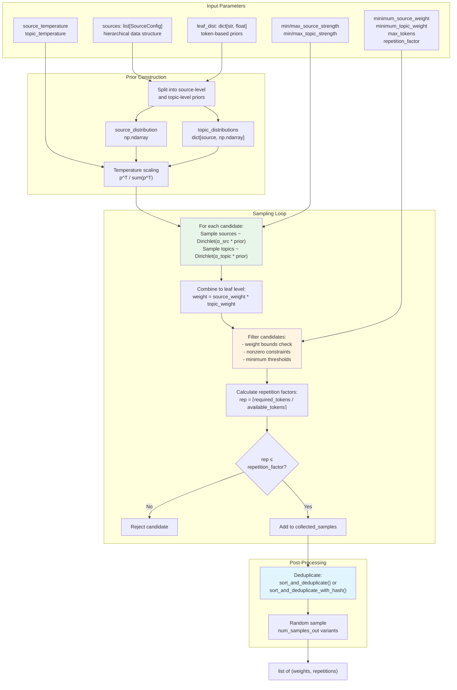
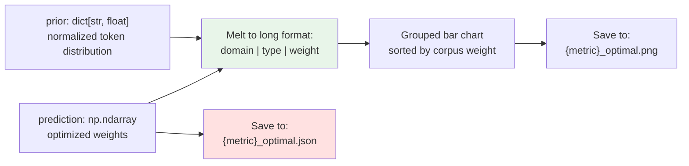
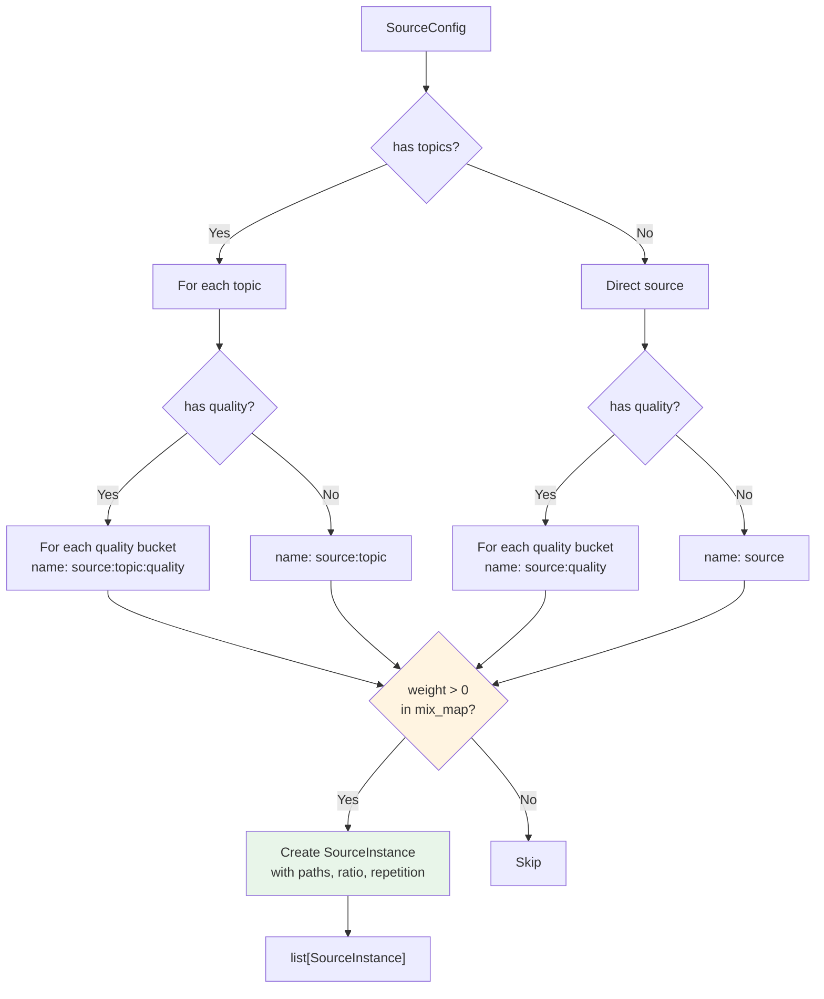

<!-- source: DeepWiki mcp.deepwiki.com · repo allenai/olmix · page 9.4 Utility Functions · fetched 2026-10-26 -->

# Utility Functions

<details>
<summary>Relevant source files</summary>

The following files were used as context for generating this wiki page:

- [olmix/aliases.py](olmix/aliases.py)
- [olmix/cli.py](olmix/cli.py)
- [olmix/fit/cli.py](olmix/fit/cli.py)
- [olmix/fit/utils.py](olmix/fit/utils.py)
- [olmix/generate/synthesize_mixture.py](olmix/generate/synthesize_mixture.py)
- [olmix/generate/utils.py](olmix/generate/utils.py)
- [olmix/launch/utils.py](olmix/launch/utils.py)
- [olmix/plots/plotting.py](olmix/plots/plotting.py)

</details>


This page documents helper functions and utility modules used throughout the olmix codebase. These functions support the core regression, proposer, and configuration systems documented in [Regression Classes](#9.1), [Proposer Classes](#9.2), and [Configuration Models](#9.3).

The utilities are organized into several functional categories: regression building, prior calculation, mixture generation, weight manipulation, data loading, file system operations, output management, visualization, and task aggregation.

---

## Regression Building Utilities

The `build_regression()` function provides a unified interface for constructing regression models.

**Function Signature**

```python
def build_regression(
    idx: int,
    Y_train: np.ndarray,
    X_train: np.ndarray,
    regression_type: str,
    early_stopping: float,
    requested_tokens: int | None = None,
) -> Regressor
```

This function instantiates the appropriate regressor class based on `regression_type` (one of `"lightgbm"`, `"log_linear"`, `"search"`, `"gp"`, `"autoscale"`, `"bimix"`), trains it on the specified data columns, and returns the fitted model.

**Mixing Law**

The core scaling law function used by log-linear regression:

```python
def mixing_law(x, param, **kwargs):
    log_c_i = param[0]
    t_i = param[1:]
    result = torch.exp(log_c_i) + torch.exp(torch.matmul(x, t_i))
    return result
```

This implements the parametric form `c_i + exp(t · x)` where `x` is a mixture weight vector and `param` contains the learned scaling law coefficients. The function is defined at [olmix/fit/utils.py:347-351]().

**Parameter Initialization**

```python
def init_params_log_linear_law(idx, num_domains=3)
```

Generates initial parameter guesses for log-linear regression by yielding multiple combinations of `log_c_i` values (log-space constant term) and domain coefficients `t_i`. The function uses a heuristic: the target domain (specified by `idx`) gets a negative coefficient (lower is better), while other domains get small positive coefficients.

Sources: [olmix/fit/utils.py:623-634](), [olmix/fit/utils.py:347-351](), [olmix/fit/utils.py:354-358]()

---

## Prior Calculation

Prior calculation scans data sources to determine token counts and relative proportions for mixture sampling.

### Core Function: `calculate_priors()`

```python
def calculate_priors(
    source_configs: list[SourceConfig],
    dtype: NumpyDatasetDType,
    use_cache: bool
) -> tuple[dict[str, float], int, dict[str, int]]
```

This function:
1. Flattens the hierarchical `SourceConfig` structure to leaf-level units (source, source:topic, source:topic:quality)
2. Expands glob patterns in S3/GCS paths
3. Counts tokens across all files in parallel using `ThreadPoolExecutor`
4. Caches results to `cache/priors_cache_{hash}.json` to avoid repeated scans
5. Returns `(relative_sizes, total_tokens, token_counts)` where `relative_sizes` is a normalized distribution

The implementation is at [olmix/generate/synthesize_mixture.py:696-799]().

### Manual Prior Override: `calculate_priors_with_manual()`

```python
def calculate_priors_with_manual(
    source_configs: list[SourceConfig],
    dtype,
    use_cache: bool,
    manual_prior: dict[str, float] | None = None,
    fixed_source_weights: dict[str, float] | None = None,
) -> tuple[tuple[dict[str, float], int, dict[str, int]], tuple[dict[str, float], int, dict[str, int]]]
```

This wrapper around `calculate_priors()` applies manual weight overrides and handles mixture reuse patterns. It:
- Computes natural priors from token counts
- Applies `manual_prior` weights to specified sources
- Handles topic-level weight specifications (via `TopicConfig.weight` or `target_ratio`)
- Collapses conditioned topic weights into source-level entries for optimization
- Returns both the collapsed prior (for proposers) and the original prior (for weight expansion)

**Key Pattern: Mixture Reuse**

When topics have explicit `weight` or `target_ratio` fields, their proportions within the source are frozen. The source itself can still vary during sampling, but the relative topic distribution is fixed. This enables iterative refinement: optimize a source-level mixture, then freeze those weights while exploring new domains.

Sources: [olmix/fit/utils.py:775-848](), [olmix/generate/synthesize_mixture.py:696-799]()

---

## Mixture Generation Utilities

### High-Level Interface: `mk_mixes()`

```python
def mk_mixes(config: GenerationConfig, group_uuid: str | None = None) -> list[dict[str, MixEntry]]
```

This is the main entry point called by the `olmix generate` CLI command. It:
1. Calls `mk_mixtures()` to generate mixture variants
2. Logs nested summaries showing source totals and topic breakdowns
3. Optionally saves per-domain weight histograms to `cache/swarms/{group_uuid}/`
4. Returns a list of mixture dictionaries (domain → `MixEntry`)

Implementation at [olmix/generate/utils.py:17-53]().

### Core Sampling: `generate_weights_dirichlet()`

This is the most complex utility function in olmix, implementing two-level Dirichlet sampling with constraints:



**Diagram: Dirichlet Sampling Pipeline**

The function signature:

```python
def generate_weights_dirichlet(
    sources: list[SourceConfig],
    leaf_dist: dict[str, float],
    minimum_source_weight: float,
    minimum_topic_weight: float,
    num_samples_out: int,
    source_temperature: float,
    topic_temperature: float,
    min_source_strength: float,
    max_source_strength: float,
    min_topic_strength: float,
    max_topic_strength: float,
    max_tokens: int,
    leaf_tokens: dict[str, int],
    repetition_factor: float,
    manual_prior: dict[str, float] | None,
    manual_topic_prior: dict[str, float] | None,
    sample_multiplier: int | None,
    enable_bound: bool = True,
    nonzero_weight: list[str] | None = None,
    existing_mix_file: str | None = None,
) -> np.ndarray
```

**Key Steps:**

1. **Prior Construction** ([olmix/generate/synthesize_mixture.py:176-303]()): Splits leaf-level priors into source-level and topic-level distributions, applying manual overrides and temperature scaling
2. **Strength Sampling** ([olmix/generate/synthesize_mixture.py:361-412]()): Samples from Dirichlet distributions with varying concentration parameters (log-spaced between min/max strength)
3. **Constraint Filtering** ([olmix/generate/synthesize_mixture.py:414-460]()): Applies weight bounds (derived from token availability), minimum thresholds, and nonzero requirements
4. **Repetition Calculation** ([olmix/generate/synthesize_mixture.py:473-488]()): Computes how many times each domain must be repeated to meet token targets
5. **Deduplication** ([olmix/generate/synthesize_mixture.py:490-504]()): Removes near-identical mixtures using hash-based or pairwise comparison

Sources: [olmix/generate/synthesize_mixture.py:131-510]()

### Wrapper: `mk_mixtures()`

```python
def mk_mixtures(
    config: GenerationConfig,
    group_uuid: str | None = None,
) -> list[dict[str, MixEntry]]
```

This function extracts parameters from `GenerationConfig`, calls `generate_weights_dirichlet()`, converts the raw numpy arrays to `MixEntry` dictionaries, and optionally saves weight distribution histograms.

Sources: [olmix/generate/synthesize_mixture.py:513-640]()

---

## Weight Manipulation Utilities

### Flattening Nested Mixes: `flatten_mix()`

```python
def flatten_mix(mix: dict[str, Any]) -> dict[str, Any]
```

Converts nested mixture specifications (used in hand-written configs) to flat colon-separated keys:

**Input (Nested):**
```yaml
mix:
  dclm:
    weight: 0.98
    code:
      weight: 0.5
```

**Output (Flat):**
```python
{"dclm:code": {"weight": 0.49, "repetition_factor": 1.0}}
```

The flattening algorithm ([olmix/aliases.py:235-296]()) recursively walks the tree, multiplying weights along the path from root to leaf. The `repetition_factor` is inherited from the nearest ancestor that specifies it.

### Aggregating Leaf Weights: `leaf_to_source()`

```python
def leaf_to_source(leaf_weights: np.ndarray, domains: list[str]) -> dict[str, float]
```

Aggregates leaf-level weights (e.g., `"dclm:math"`, `"wikipedia"`) to source-level totals. This is used during constraint checking to verify that source-level minimum weights are met.

Sources: [olmix/aliases.py:235-296](), [olmix/generate/synthesize_mixture.py:40-50]()

### Expanding Collapsed Weights: `expand_collapsed_weights()`

```python
def expand_collapsed_weights(
    opt_weights: dict[str, float],
    original_prior: dict[str, float],
    collapsed_prior: dict[str, float],
) -> dict[str, float]
```

When mixture reuse is used, topic-level weights are collapsed into source-level weights during optimization. This function expands them back out proportionally:

```python
# If collapsed_prior has "dclm": 0.5 but original_prior has "dclm:code", "dclm:math"
# and opt_weights proposes "dclm": 0.6
# Then expand to: "dclm:code": 0.6 * (original["dclm:code"] / 0.5)
#                 "dclm:math": 0.6 * (original["dclm:math"] / 0.5)
```

This preserves the relative proportions of frozen topics while applying the optimized source-level weight.

Sources: [olmix/fit/utils.py:733-749]()

---

## Data Loading Utilities

### WandB API Integration: `get_runs_from_api()`

```python
def get_runs_from_api(
    api,
    workspace: str,
    groups: list[str],
    cache_path: Path,
    no_cache: bool,
    eval_metrics: list[str],
) -> list[RunInstance]
```

Fetches experiment runs from WandB for a list of group IDs:
1. Queries the WandB API with regex filters on `display_name`
2. Deduplicates by run name (last writer wins)
3. Extracts summary metrics using `mk_run_history()`
4. Caches results as JSON to avoid repeated API calls
5. Returns a list of `RunInstance` objects

The `RunInstance` dataclass contains run metadata and a pandas DataFrame of evaluation metrics.

### Run Construction Helpers

```python
def mk_run_history(run: Run, eval_metrics: list[str]) -> RunInstance
def mk_run_instance(run: Run, history: list[Any]) -> RunInstance
def mk_run_from_json(run: dict) -> RunInstance
```

These functions convert between WandB API objects, JSON cache files, and the internal `RunInstance` representation.

### Config Loading: `swarm_config_from_path()`

```python
def swarm_config_from_path(config: str) -> LaunchConfig
```

A simple wrapper that loads a `LaunchConfig` from a YAML file path.

Sources: [olmix/fit/utils.py:637-702](), [olmix/fit/utils.py:679-702](), [olmix/fit/utils.py:939-950]()

---

## File System Utilities

### Glob Expansion

```python
def expand_globs(
    fs: s3fs.S3FileSystem | gcsfs.GCSFileSystem | None,
    sources: list[str] | None = None
) -> list[str]
```

Expands glob patterns in file paths, supporting both local and remote (S3/GCS) filesystems. The function delegates to `_expand_local()` or `_expand_remote()` based on the URL scheme.

### Filesystem Factory: `get_filesystem_for_scheme()`

```python
def get_filesystem_for_scheme(scheme: str)
```

Returns the appropriate filesystem object for a URL scheme:

| Scheme | Filesystem | Configuration |
|--------|-----------|---------------|
| `s3` | `s3fs.S3FileSystem` | Uses `AWS_PROFILE` environment variable |
| `weka` | `s3fs.S3FileSystem` | Custom endpoint via `WEKA_ENDPOINT_URL` |
| `gs` | `gcsfs.GCSFileSystem` | Uses `GOOGLE_CLOUD_PROJECT` |
| `local` | `None` | Standard Python file I/O |

The function is defined at [olmix/generate/synthesize_mixture.py:839-891]().

### Token Counting

```python
def count_tokens(paths: list[str], dtype: NumpyDatasetDType, fs) -> int
```

Counts total tokens across a list of paths (with glob expansion). For each file, it uses `get_file_size()` from olmo-core and divides by the dtype's item size to get token counts.

### Leaf Config Extraction: `get_leaf_configs()`

```python
def get_leaf_configs(source_config: SourceConfig) -> list[tuple[str, list[str]]]
```

Flattens a hierarchical `SourceConfig` into leaf-level (name, paths) tuples, handling all nesting levels:
- `source.paths` → `("source", paths)`
- `source.quality[].paths` → `("source:quality", paths)`
- `source.topics[].paths` → `("source:topic", paths)`
- `source.topics[].quality[].paths` → `("source:topic:quality", paths)`

This is used by `calculate_priors()` to determine what units to count tokens for.

Sources: [olmix/generate/synthesize_mixture.py:655-663](), [olmix/generate/synthesize_mixture.py:839-891](), [olmix/generate/synthesize_mixture.py:665-693]()

---

## Output Management

### Directory Management: `get_output_dir()`

```python
def get_output_dir(groups: list[str]) -> str
```

Constructs a standardized output directory path by joining group IDs with underscores and prepending `BASE_OUTPUT_DIR` (default: `"output/"`).

### Config Saving: `save_fit_config()`

```python
def save_fit_config(fit_config: dict, output_dir: str, custom_name: str | None = None) -> str
```

Serializes a fit configuration to JSON and saves it in a hashed subdirectory:
1. Computes SHA-256 hash of the JSON-serialized config (first 16 hex digits)
2. Creates `{output_dir}/{hash}/` directory
3. Saves config as `config.json`
4. Returns the full directory path

This enables deterministic output paths based on configuration content.

### Output Path Generation: `mk_output_prefix()`

```python
def mk_output_prefix(
    output_dir: str,
    metric: str,
    regression_type: str,
    train_split: float,
    n_test: int,
    split_seed: int,
) -> str
```

Generates a standardized filename prefix for plots and results, encoding key experimental parameters:

```
{output_dir}/{sanitized_metric}_log_linear_reg_trainsplit_0.8_ntest_10_seed_42
```

This ensures that files from different configurations don't collide.

Sources: [olmix/fit/utils.py:619-620](), [olmix/fit/utils.py:752-772](), [olmix/plots/plotting.py:38-58]()

---

## Visualization Utilities

### Correlation Plots: `plot_correlation()`

```python
def plot_correlation(
    Y_test: np.ndarray,
    X_test: np.ndarray,
    Y_train: np.ndarray,
    X_train: np.ndarray,
    index: int,
    predictors: list[Regressor],
    train_split: float,
    n_test: int,
    split_seed: int,
    metric_name: str,
    regression_type: str,
    output_dir: str = BASE_OUTPUT_DIR,
    average_bpb: bool = False,
    test_ratios_path: tuple[str, ...] = (),
)
```

Creates scatter plots showing predicted vs. actual values for both train and test sets, with:
- Linear regression lines (dashed for train, dotted for test)
- Pearson correlation coefficients in the legend
- Proper styling with grid lines
- JSON file of correlation values saved alongside the plot

The function supports averaging across multiple BPB metrics when `average_bpb=True`.

### Interaction Matrix: `plot_interaction_matrix()`

```python
def plot_interaction_matrix(
    output_dir: str,
    predictors: list[Regressor],
    regression_type: str,
    domain_names: list[str],
    metric_names: list[str],
    ratios: pd.DataFrame,
)
```

Generates a heatmap showing the interaction between domains (columns) and metrics (rows):
- For `lightgbm`: uses `feature_importances_`
- For `log_linear`: uses learned coefficients `t_i` (excluding the constant term)
- Each cell is annotated with the coefficient value (`β=...`)
- Uses a coolwarm colormap with symmetric value limits
- Saves both PNG and NPY files

This visualization reveals which domains most strongly influence each evaluation metric.

### Weight Comparison: `plot_and_log_weights()`

```python
def plot_and_log_weights(
    prior: dict[str, float],
    original_prior: dict[str, float],
    prediction: np.ndarray,
    metric_name: str,
    regression_type: str,
    train_split: float,
    n_test: int,
    split_seed: int,
    domain_cols: list[str],
    output_dir: str = BASE_OUTPUT_DIR,
    expand_collapsed_weights_fn=None,
)
```

Creates a side-by-side bar chart comparing corpus weights (token-based priors) to optimal weights (proposed by the optimizer):
- Bars are grouped by domain and colored by type (corpus vs. optimal)
- Domains are sorted by corpus weight (descending)
- Saves JSON file of optimal weights for downstream use
- Handles weight expansion when priors have been collapsed for optimization



**Diagram: Weight Comparison Visualization Pipeline**

Sources: [olmix/plots/plotting.py:61-179](), [olmix/plots/plotting.py:181-245](), [olmix/plots/plotting.py:247-355]()

---

## Task Aggregation: `aggregate_mmlu()`

```python
def aggregate_mmlu(metrics: pd.DataFrame, metrics_to_index: list)
```

Aggregates 57 individual MMLU subtasks into 4 macro-categories (STEM, Other, Social Sciences, Humanities) using weighted averages:

1. Defines weight dictionaries for each category (e.g., `stem_weights`, `social_sciences_weights`)
2. For each category, computes `df.dot(weight_series)` to get weighted average
3. Drops individual subtask columns from the DataFrame
4. Adds new aggregate columns
5. Returns updated metrics and metric list

The weights are derived from the MMLU paper's category definitions and reflect the number of questions per subtask. The implementation spans [olmix/fit/utils.py:851-936]() and includes hardcoded weight dictionaries for all 57 subtasks.

**Usage in Fit Pipeline:**

When `regression.aggregate_task_families=True` in `FitConfig`, the fit CLI calls this function to reduce the number of metrics before regression fitting. This is useful when the full 60-metric space is too high-dimensional.

Sources: [olmix/fit/utils.py:851-936]()

---

## Deduplication Utilities

### Pairwise Deduplication: `sort_and_deduplicate()`

```python
def sort_and_deduplicate(
    samples: list[tuple[np.ndarray, np.ndarray]], 
    threshold=1e-5
) -> list[tuple[np.ndarray, np.ndarray]]
```

Removes duplicate mixture variants using pairwise comparison with `np.allclose()`. Complexity is O(n²) where n is the number of samples.

### Hash-Based Deduplication: `sort_and_deduplicate_with_hash()`

```python
def sort_and_deduplicate_with_hash(
    samples: list[tuple[np.ndarray, np.ndarray]], 
    threshold=1e-5
) -> list[tuple[np.ndarray, np.ndarray]]
```

For large sample sets (>10,000), this function uses hash-based deduplication:
1. Rounds weight vectors to the nearest `threshold` increment
2. Converts to integer tuples (hash keys)
3. Adds to set if not seen before
4. Complexity is O(n) with higher constant factor

Both functions log how many duplicates were filtered.

Sources: [olmix/generate/synthesize_mixture.py:802-836]()

---

## Source Instance Creation: `mk_source_instances()`

```python
def mk_source_instances(sources: list[SourceConfig], mix_map: dict[str, MixEntry]) -> list[SourceInstance]
```

Converts hierarchical `SourceConfig` structures and a flat `mix_map` (domain → `MixEntry`) into a list of `SourceInstance` objects for training. Each instance has:
- `name`: Domain identifier (source, source:topic, or source:topic:quality)
- `paths`: List of data file paths
- `ratio`: Mixture weight
- `repetition_factor`: How many times to repeat the data

The function filters out zero-weight domains and correctly handles all three levels of hierarchy (source, topic, quality).

**Mapping Rules:**



**Diagram: Source Instance Creation Logic**

This function bridges the configuration space (hierarchical `SourceConfig` with optional nesting) and the training space (flat list of weighted data sources).

Sources: [olmix/launch/utils.py:12-85]()

---

## Utility Function Dependencies

The following diagram shows how utility functions depend on each other:

```mermaid
graph TB
    subgraph "CLI Entry Points"
        Generate["olmix generate"]
        Launch["olmix launch run"]
        Fit["olmix fit"]
        Priors["olmix priors compute"]
    end
    
    subgraph "High-Level Orchestration"
        MkMixes["mk_mixes()"]
        MkMixtures["mk_mixtures()"]
        RunFit["run_fit() [core.py]"]
    end
    
    subgraph "Prior Calculation"
        CalcPriors["calculate_priors()"]
        CalcPriorsManual["calculate_priors_with_manual()"]
        CountTokens["count_tokens()"]
        GetLeaf["get_leaf_configs()"]
        GetFS["get_filesystem_for_scheme()"]
        ExpandGlobs["expand_globs()"]
    end
    
    subgraph "Mixture Sampling"
        GenWeights["generate_weights_dirichlet()"]
        LeafToSource["leaf_to_source()"]
        ClipByLevel["clip_candidates_by_level()"]
        CheckRequired["sample_has_required_sources_and_topics()"]
        SortDedup["sort_and_deduplicate()"]
        SortDedupHash["sort_and_deduplicate_with_hash()"]
    end
    
    subgraph "Regression & Optimization"
        BuildReg["build_regression()"]
        MixingLaw["mixing_law()"]
        InitParams["init_params_log_linear_law()"]
        Propose["Proposer.propose()"]
    end
    
    subgraph "Weight Manipulation"
        FlattenMix["flatten_mix()"]
        ExpandCollapsed["expand_collapsed_weights()"]
    end
    
    subgraph "Data Loading"
        GetRuns["get_runs_from_api()"]
        MkRunHistory["mk_run_history()"]
        MkRunInstance["mk_run_instance()"]
        LoadFromCSV["load_from_csv()"]
    end
    
    subgraph "Visualization"
        PlotCorr["plot_correlation()"]
        PlotInteraction["plot_interaction_matrix()"]
        PlotWeights["plot_and_log_weights()"]
        MkPrefix["mk_output_prefix()"]
    end
    
    subgraph "Output Management"
        SaveConfig["save_fit_config()"]
        GetOutputDir["get_output_dir()"]
    end
    
    Generate --> MkMixes
    MkMixes --> MkMixtures
    MkMixtures --> GenWeights
    
    Priors --> CalcPriors
    Generate --> CalcPriorsManual
    CalcPriorsManual --> CalcPriors
    
    CalcPriors --> GetLeaf
    CalcPriors --> GetFS
    CalcPriors --> ExpandGlobs
    CalcPriors --> CountTokens
    
    GenWeights --> LeafToSource
    GenWeights --> ClipByLevel
    GenWeights --> CheckRequired
    GenWeights --> SortDedup
    GenWeights --> SortDedupHash
    
    Fit --> RunFit
    RunFit --> LoadFromCSV
    RunFit --> GetRuns
    RunFit --> BuildReg
    RunFit --> Propose
    RunFit --> PlotCorr
    RunFit --> PlotInteraction
    RunFit --> PlotWeights
    RunFit --> SaveConfig
    
    GetRuns --> MkRunHistory
    MkRunHistory --> MkRunInstance
    
    BuildReg --> InitParams
    InitParams --> MixingLaw
    
    PlotCorr --> MkPrefix
    PlotWeights --> MkPrefix
    PlotWeights --> ExpandCollapsed
    
    Launch --> FlattenMix
    
    style GenWeights fill:#e8f5e9
    style BuildReg fill:#e1f5ff
    style CalcPriors fill:#fff4e1
```



**Diagram: Utility Function Call Graph**

This dependency graph shows the flow from CLI commands through high-level orchestration functions down to low-level utilities. The three main pipelines (generation, fitting, launching) each use different subsets of utility functions.

Sources: Multiple files across [olmix/]()