# Page: Overview

# Overview

<details>
<summary>Relevant source files</summary>

The following files were used as context for generating this wiki page:

- [README.md](README.md)
- [olmix/aliases.py](olmix/aliases.py)
- [olmix/cli.py](olmix/cli.py)
- [olmix/generate/synthesize_mixture.py](olmix/generate/synthesize_mixture.py)
- [olmix/generate/utils.py](olmix/generate/utils.py)
- [olmix/launch/utils.py](olmix/launch/utils.py)

</details>


## Purpose and Scope

**olmix** is a toolkit for optimizing pretraining data mixtures through systematic experimentation and statistical modeling. It enables researchers to determine optimal data mixing ratios by training small proxy models (typically 30M parameters) on diverse mixture variants ("swarms"), fitting regression models to the results, and proposing optimized mixtures for full-scale training runs.

This page provides a high-level overview of the olmix system architecture, workflow, and core components. For detailed information on specific subsystems:
- Installation and getting started: see [Installation and Setup](#1.2) and [Quick Start Tutorial](#1.3)
- Individual CLI commands: see [CLI Reference](#2)
- Configuration file formats: see [Configuration System](#3)
- Regression and optimization details: see [Regression and Optimization](#4)
- Training infrastructure: see [Training Infrastructure](#5)

**Sources:** [README.md:1-11]()

---

## System Architecture

olmix implements a four-phase iterative optimization cycle:

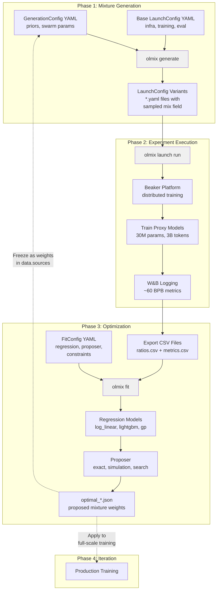

**Diagram: Four-Phase Optimization Cycle**

This architecture enables iterative refinement: each optimization cycle (Phase 3) identifies improved mixture weights, which can be frozen in the next generation cycle (Phase 1) using the **mixture reuse** pattern. This allows efficient exploration by fixing previously-optimized portions of the mixture while varying only new or underexplored domains.

**Sources:** [README.md:10-11](), [olmix/cli.py:1-454]()

---

## CLI Command Structure

The olmix CLI exposes four main command groups, each backed by dedicated modules:

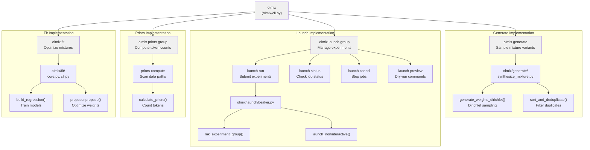

**Diagram: CLI Command Hierarchy and Implementation Modules**

Each command group is implemented as a separate module with clear separation of concerns:

| Command Group | Purpose | Key Module | Main Entry Point |
|--------------|---------|------------|------------------|
| `generate` | Sample mixture variants from priors | `olmix/generate/synthesize_mixture.py` | `mk_mixtures()` |
| `launch` | Submit and manage Beaker training jobs | `olmix/launch/beaker.py` | `launch_noninteractive()` |
| `priors` | Compute token distributions from data paths | `olmix/generate/synthesize_mixture.py` | `calculate_priors()` |
| `fit` | Fit regression models and propose optimal mixtures | `olmix/fit/core.py` | `fit_main()` |

**Sources:** [olmix/cli.py:101-453](), [olmix/generate/synthesize_mixture.py:1-950]()

---

## Configuration System

olmix uses a three-tier configuration system built on Pydantic models defined in `olmix/aliases.py`:

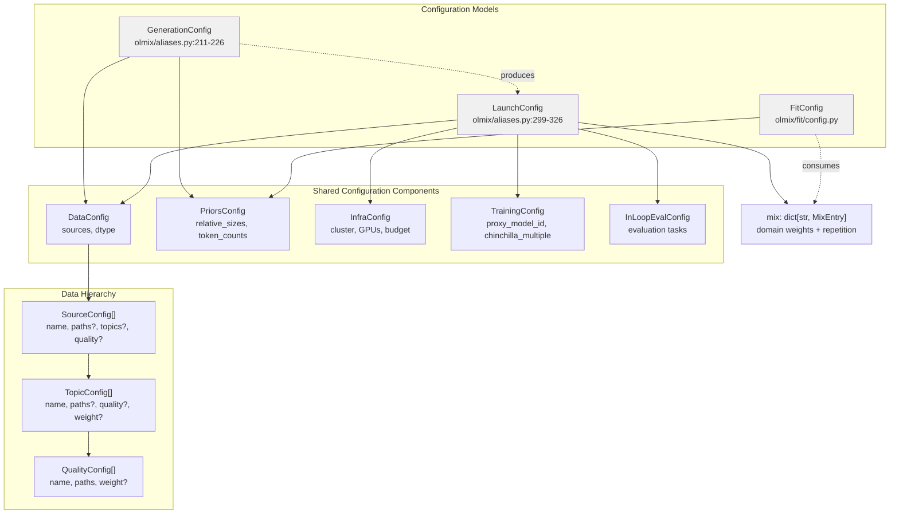

**Diagram: Configuration Model Relationships**

**Key Configuration Types:**

- **`GenerationConfig`**: Defines sampling parameters for mixture generation. Contains `DataConfig`, `PriorsConfig`, and `SwarmConfig`. Used by `olmix generate`.

- **`LaunchConfig`**: Self-contained experiment specification. Contains all settings needed for training: infrastructure (`InfraConfig`), model/training (`TrainingConfig`), data landscape (`DataConfig`), evaluation (`InLoopEvalConfig`), and the specific mixture weights (`mix` field). Generated by `olmix generate` and consumed by `olmix launch`.

- **`FitConfig`**: Optimization configuration. Specifies regression model type, proposer type, constraints, and paths to swarm results. Used by `olmix fit`.

All three share a common **`DataConfig`** schema that describes the hierarchical organization of data sources:

```
sources (SourceConfig[])
  ├─ name: string
  └─ One of:
      ├─ paths: list[string]               # Flat source
      ├─ topics: TopicConfig[]             # Nested topics
      │   ├─ name: string
      │   ├─ weight?: float                # Optional fixed weight
      │   └─ paths or quality[]
      └─ quality: QualityConfig[]          # Source-level quality buckets
```

See [Configuration System](#3) for detailed specifications of each configuration type.

**Sources:** [olmix/aliases.py:1-341](), [olmix/fit/config.py]()

---

## Core Workflow

A typical olmix experiment follows this sequence:

### 1. Compute Priors

Calculate the natural token distribution and absolute token counts for all data sources:

```bash
olmix priors compute --config generation_config.yaml
```

This scans S3/GCS paths specified in `data.sources` and outputs a `priors:` block containing `relative_sizes` (fractional weights) and `token_counts` (absolute counts). The `calculate_priors()` function uses multithreaded file scanning and caches results based on a config hash.

**Sources:** [olmix/cli.py:387-437](), [olmix/generate/synthesize_mixture.py:696-799]()

### 2. Generate Mixture Variants

Sample N mixture variants from a Dirichlet distribution centered on the priors:

```bash
olmix generate \
  --config generation_config.yaml \
  --base base_launch_config.yaml \
  --output output/variants/
```

Each variant becomes a self-contained `LaunchConfig` YAML file with a unique `mix` field. The `mk_mixtures()` function performs hierarchical Dirichlet sampling (source-level, then topic-level), applies constraints (minimum weights, repetition bounds), and deduplicates similar mixtures.

**Sources:** [olmix/cli.py:112-165](), [olmix/generate/synthesize_mixture.py:513-640]()

### 3. Launch Training Experiments

Submit all variants to Beaker for distributed training:

```bash
olmix launch run --variants output/variants/
```

This creates a Beaker experiment group where each variant trains a proxy model (typically 30M parameters on 3B tokens). The `launch_noninteractive()` function converts `LaunchConfig` to Beaker launch specifications and submits them. All runs share a `group_id` and log to W&B.

**Sources:** [olmix/cli.py:178-261](), [olmix/launch/beaker.py]()

### 4. Export Metrics

Once training completes, export results to CSV format (manually or programmatically via W&B API). Two files are required:

- **`ratios.csv`**: Domain weights per run (rows are runs, columns are domains, values sum to ~1.0)
- **`metrics.csv`**: Evaluation metrics per run (rows are runs, columns are metrics, lower is better for BPB)

**Sources:** [README.md:20-44]()

### 5. Fit Regression and Propose Optimal Mixture

Fit regression models to predict metric performance from mixture weights, then optimize:

```bash
olmix fit --config fit_config.yaml --output-dir output/fit/
```

The `fit_main()` function loads the CSV data, builds one regression model per metric, and uses a proposer to search for optimal weights. The most common setup is `log_linear` regression (parametric scaling law) with `exact` proposer (convex optimization with KL regularization).

Output includes `*_optimal.json` files with proposed weights and visualization plots.

**Sources:** [README.md:46-181](), [olmix/fit/core.py]()

### 6. Iterate with Mixture Reuse

For the next optimization cycle, freeze the optimized domains by setting explicit `weight` fields in `data.sources` or `data.topics`. The generator will only vary domains without fixed weights, enabling efficient exploration of new data sources while preserving good baseline mixtures.

**Sources:** [README.md:263-290](), [olmix/generate/synthesize_mixture.py:303-342]()

---

## Key Design Principles

### Hierarchical Data Organization

Data is organized in a three-level hierarchy: **source → topic → quality**, where each level is optional. This enables flexible mixture specification at different granularities:

- **Source-level**: `{"wikipedia": 0.3, "books": 0.7}`
- **Topic-level**: `{"dclm:code": 0.2, "dclm:math": 0.3, "wikipedia": 0.5}`
- **Quality-level**: `{"dclm:code:vigintile_0018": 0.1, "dclm:code:vigintile_0019": 0.1, ...}`

The `flatten_mix()` function in [olmix/aliases.py:267-296]() normalizes both flat and nested mix representations into a canonical form.

**Sources:** [olmix/aliases.py:84-121]()

### Self-Contained Launch Configs

Each `LaunchConfig` YAML file produced by `olmix generate` is completely self-contained: it includes all infrastructure settings, training hyperparameters, data sources, evaluation configuration, and the specific mixture weights for that variant. This design ensures:

- **Reproducibility**: The YAML file alone is sufficient to recreate the exact training run
- **Portability**: Configs can be inspected, edited, and launched independently
- **Transparency**: All experiment details are visible in a single human-readable file

**Sources:** [olmix/aliases.py:299-326](), [olmix/cli.py:144-161]()

### Chinchilla Scaling Automation

Training duration is automatically computed from the model size using Chinchilla scaling laws. The `TrainingConfig.get_max_tokens()` method calculates total training tokens as:

```
max_tokens = 20 * num_params * chinchilla_multiple
```

Where `chinchilla_multiple` controls the compute budget relative to Chinchilla optimal (0.5× = undertrained proxy, 2× = overtrained proxy). The `TransformerConfigBuilder` further derives batch size, learning rate, and training steps from this budget. See [TransformerConfigBuilder](#5.2) for details.

**Sources:** [olmix/aliases.py:14-50](), [olmix/aliases.py:168-176]()

### Mixture Reuse Pattern

The configuration system supports **partial freezing** of mixture weights through optional `weight` fields on `SourceConfig` and `TopicConfig`. When weights are set:

- Those domains maintain fixed relative proportions
- Only domains without weights are resampled from the Dirichlet
- This enables iterative refinement: optimize a baseline mix, freeze it, then explore new domains

The `generate_weights_dirichlet()` function handles frozen weights by constructing fixed topic distributions when `source.topics[0].weight is not None`.

**Sources:** [README.md:263-290](), [olmix/generate/synthesize_mixture.py:303-342]()

### Regression-Based Optimization

Rather than grid search or random search, olmix uses **surrogate modeling**: fit a regression model to predict downstream performance from mixture weights, then optimize that model. This enables:

- **Sample efficiency**: Good proposals from relatively few training runs (~50-100)
- **Interpretability**: Regression coefficients show which domains help/hurt each metric
- **Flexibility**: Multiple regression types supported (log-linear, LightGBM, GP, etc.)
- **Constrained optimization**: Exact proposer supports KL regularization and token budgets

See [Regression and Optimization](#4) for details on available models and proposers.

**Sources:** [olmix/fit/core.py]()

---

## Repository Structure

```
olmix/
├── olmix/
│   ├── cli.py                    # Main CLI entry point
│   ├── aliases.py                # Configuration models (Pydantic)
│   ├── generate/
│   │   ├── synthesize_mixture.py # Dirichlet sampling, priors computation
│   │   └── utils.py              # Mixture formatting utilities
│   ├── launch/
│   │   ├── beaker.py            # Beaker experiment creation and submission
│   │   ├── train.py             # Training script (executed on Beaker)
│   │   └── utils.py             # Launch utilities
│   └── fit/
│       ├── cli.py               # Fit command implementation
│       ├── core.py              # Main fit logic
│       ├── config.py            # FitConfig model
│       ├── regression.py        # Regression model implementations
│       └── proposer.py          # Proposer implementations
├── configs/                      # Example configuration files
└── tests/                        # Test suite
```

**Sources:** Repository structure

---

## Next Steps

- For hands-on experience, see [Quick Start Tutorial](#1.3)
- To understand key concepts in depth, see [Core Concepts](#1.1)
- For command-line usage reference, see [CLI Reference](#2)
- For configuration file specifications, see [Configuration System](#3)

---

# Page: Core Concepts

# Core Concepts

<details>
<summary>Relevant source files</summary>

The following files were used as context for generating this wiki page:

- [README.md](README.md)
- [olmix/fit/cli.py](olmix/fit/cli.py)
- [olmix/fit/config.py](olmix/fit/config.py)
- [olmix/fit/core.py](olmix/fit/core.py)
- [olmix/fit/utils.py](olmix/fit/utils.py)
- [olmix/plots/plotting.py](olmix/plots/plotting.py)

</details>


## Purpose and Scope

This page explains the fundamental concepts underlying olmix's approach to data mixture optimization. It covers the core methodology, mathematical formulations, and iterative workflow that enable efficient exploration of the mixture space.

For installation instructions, see [Installation and Setup](#1.2). For hands-on usage, see [Quick Start Tutorial](#1.3). For detailed command documentation, see [CLI Reference](#2).

---

## Data Mixtures

A **data mixture** is a weighted combination of data sources used during language model pretraining. Each source receives a sampling weight that determines its representation in the training corpus.

### Representation in Code

Mixtures are represented as dictionaries mapping domain keys to fractional weights (summing to 1.0):

```python
mix = {
    "dclm:science_math_and_technology": 0.55,
    "dclm:software_development": 0.30,
    "dclm:entertainment": 0.10,
    "wikipedia": 0.05
}
```

In configuration files, mixtures are specified through the `mix` field of `LaunchConfig` using `MixEntry` objects that include both weights and repetition constraints:

| Field | Type | Purpose |
|-------|------|---------|
| `weight` | `float` | Fractional sampling weight (0-1) |
| `repetition` | `int \| None` | Maximum times this domain's data can be repeated |

**Sources:** [olmix/aliases.py:1-100](), [README.md:28-35]()

---

## The Swarm Methodology

### Proxy Models

Olmix evaluates candidate mixtures by training **proxy models**—small-scale language models that serve as cheap approximations of full-scale training behavior. The default configuration uses:

| Parameter | Value | Rationale |
|-----------|-------|-----------|
| Model size | 30M parameters | Small enough to train quickly |
| Training tokens | 3B (0.5-5x Chinchilla) | Enough to observe mixture effects |
| Evaluation | 60 downstream BPB metrics | Comprehensive coverage of capabilities |

### Swarms

A **swarm** is a collection of proxy model training runs, each using a different mixture sampled from a Dirichlet distribution. Typical swarms contain 50-200 variants, providing sufficient data for regression fitting while remaining computationally tractable.

**Diagram: Swarm Generation and Training**

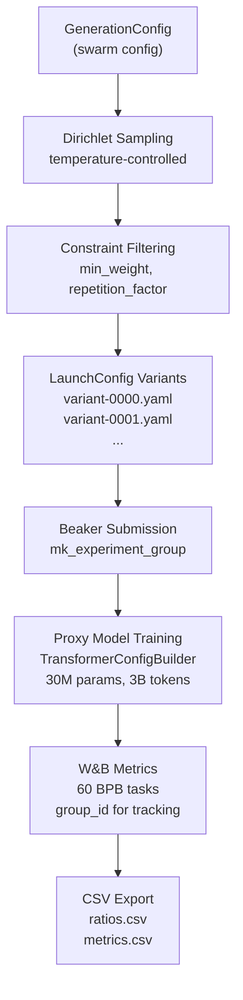

**Sources:** [olmix/generate/synthesize_mixture.py:1-300](), [olmix/launch/train.py:1-200](), [README.md:184-246]()

---

## Priors and Token Distributions

### Natural Priors

The **prior distribution** represents the natural occurrence frequency of each domain in the available corpus. It is computed by scanning data paths and counting tokens:

```bash
olmix priors compute --config config.yaml
```

This produces two components:

| Component | Purpose | Example |
|-----------|---------|---------|
| `relative_sizes` | Fractional token distribution (sums to 1.0) | Used as Dirichlet center for sampling |
| `token_counts` | Absolute token counts per domain | Used for repetition constraints |

### Role in Optimization

Priors serve two critical functions:

1. **Sampling Center**: The Dirichlet distribution is centered at the prior, so swarm variants naturally explore around the natural corpus distribution
2. **KL Regularization**: During optimization, the `exact` proposer penalizes proposed mixtures that diverge too far from the prior using KL divergence

**Sources:** [olmix/generate/synthesize_mixture.py:100-200](), [olmix/fit/config.py:23-31]()

---

## Scaling Laws and Regression

### The Log-Linear Mixing Law

Olmix's default regression type fits a parametric **log-linear scaling law** that models how mixture weights affect each evaluation metric:

```
f(p) = exp(c) + exp(β · p)
```

Where:
- `p` is the mixture weight vector (domains)
- `β` is the coefficient vector learned per metric
- `c` is the bias term

This functional form is implemented in the `mixing_law` function:

**Code Mapping: Scaling Law Implementation**

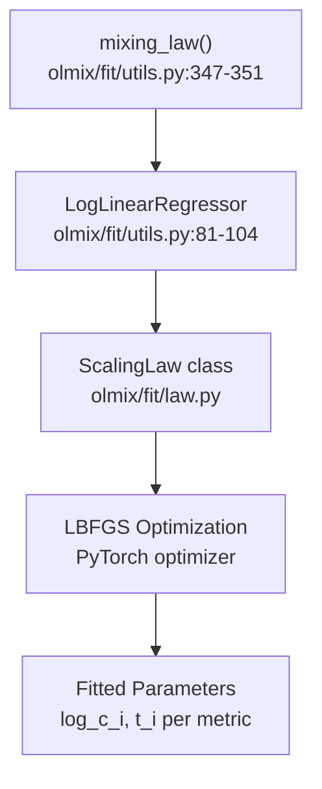

**Sources:** [olmix/fit/utils.py:347-351](), [olmix/fit/utils.py:81-104](), [olmix/fit/law.py:1-100]()

### Alternative Regression Types

Olmix supports six regression models, defined in `REGRESSION_TYPES`:

| Type | Implementation | Use Case |
|------|---------------|----------|
| `log_linear` | `LogLinearRegressor` | Default; parametric scaling law |
| `lightgbm` | `LightGBMRegressor` | Gradient-boosted trees for non-linear patterns |
| `gp` | `GPRegressor` | Gaussian process for uncertainty quantification |
| `autoscale` | `AutoscaleRegressor` | Power-law autoscaling (N0 + N*p)^(-γ) |
| `bimix` | `BimixRegressor` | BiMix-style power law Σ F_i * x_i^(-α_i) |
| `search` | `SearchRegressor` | Lookup table (exact reuse of swarm results) |

Each regressor fits one model per metric, producing a list of predictors used by the proposer.

**Sources:** [olmix/fit/utils.py:369-376](), [olmix/fit/utils.py:67-342]()

---

## Optimization and Proposers

### Proposer Architecture

After regression fitting, a **proposer** searches for optimal mixture weights by minimizing (or maximizing) predicted performance. The proposer uses the fitted regression models as a surrogate objective function.

**Diagram: Proposer Types and Workflow**

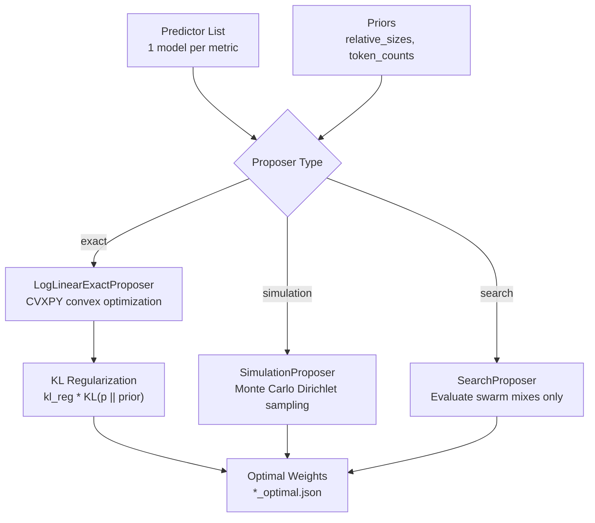

**Sources:** [olmix/fit/utils.py:379-598](), [olmix/fit/core.py:405-429]()

### Proposer Types

| Proposer | Method | Requirements | Configuration Field |
|----------|--------|--------------|---------------------|
| `exact` | Convex optimization (CVXPY) | `log_linear` regression only | `proposer.kl_reg` |
| `simulation` | Monte Carlo sampling from Dirichlet | Any regression type | `proposer.temperature` |
| `search` | Exhaustive evaluation of swarm points | `search` regression only | — |

The `exact` proposer solves:

```
minimize: Σ w_i * exp(β_i · p) + λ * KL(p || prior)
subject to: p ≥ 0, Σ p = 1, optional token constraints
```

Where `w_i` are objective weights (`filtering.obj_weights`) and `λ` is KL regularization strength (`proposer.kl_reg`).

**Sources:** [olmix/fit/utils.py:539-596](), [olmix/fit/config.py:44-52]()

---

## Constraints and Token Budgets

### Repetition Constraints

When `constraints.enabled = true`, the proposer enforces that no domain exceeds its available data:

```
p_i * target_tokens ≤ token_counts[i] * repetition_factor
```

This prevents solutions that require repeating a small domain hundreds of times. The default `repetition_factor = 4.0` allows 4x repetition.

### Implementation

Constraints are applied differently by each proposer:

- **SimulationProposer**: Filters out sampled candidates that violate constraints ([olmix/fit/utils.py:446-464]())
- **LogLinearExactProposer**: Adds constraint to CVXPY problem ([olmix/fit/utils.py:556-561]())
- **SearchProposer**: Checks constraints during evaluation loop ([olmix/fit/utils.py:524-530]())

**Sources:** [olmix/fit/config.py:54-60](), [olmix/fit/utils.py:388-537]()

---

## Iterative Refinement and Mixture Reuse

### The Optimization Loop

Olmix enables iterative mixture improvement through a **mixture reuse** pattern:

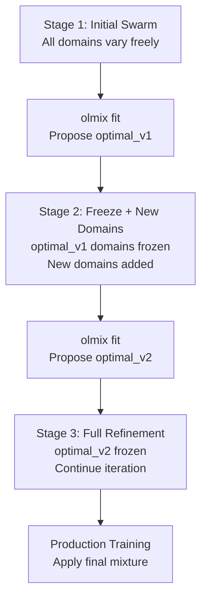

**Sources:** [README.md:263-291](), [olmix/aliases.py:100-200]()

### Freezing Weights with the `weight` Field

To freeze portions of the mixture, add explicit `weight` values to topics or sources in `GenerationConfig`:

```yaml
data:
  sources:
  - name: existing
    topics:
    - name: dclm:science
      weight: 0.55      # Frozen from stage 1
    - name: dclm:code
      weight: 0.30      # Frozen from stage 1
    - name: wikipedia   # No weight → varies in stage 2
      paths: [...]
  - name: stack-edu     # New source added in stage 2
    topics: [...]
```

The `calculate_priors_with_manual` function collapses frozen topics into source-level priors, removing them from the optimization variables:

**Code Mapping: Mixture Reuse Logic**

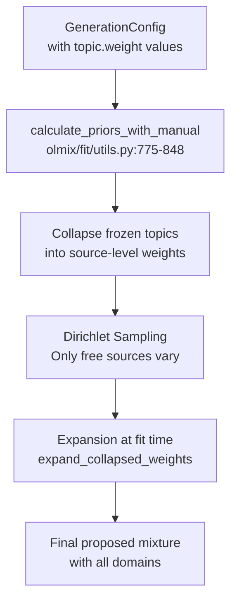

**Sources:** [olmix/fit/utils.py:775-848](), [olmix/fit/utils.py:733-749](), [README.md:263-291]()

---

## Configuration Model Hierarchy

### Core Configuration Types

Olmix uses three primary Pydantic configuration models that correspond to the three CLI commands:

| Config Class | Purpose | Primary CLI Command | File Location |
|--------------|---------|---------------------|---------------|
| `GenerationConfig` | Swarm sampling parameters | `olmix generate` | [olmix/aliases.py:300-400]() |
| `LaunchConfig` | Self-contained experiment specification | `olmix launch run` | [olmix/aliases.py:200-300]() |
| `FitConfig` | Regression and optimization settings | `olmix fit` | [olmix/fit/config.py:131-176]() |

### Shared Schema: DataConfig

All three configs share a common `DataConfig` hierarchy for describing data sources:

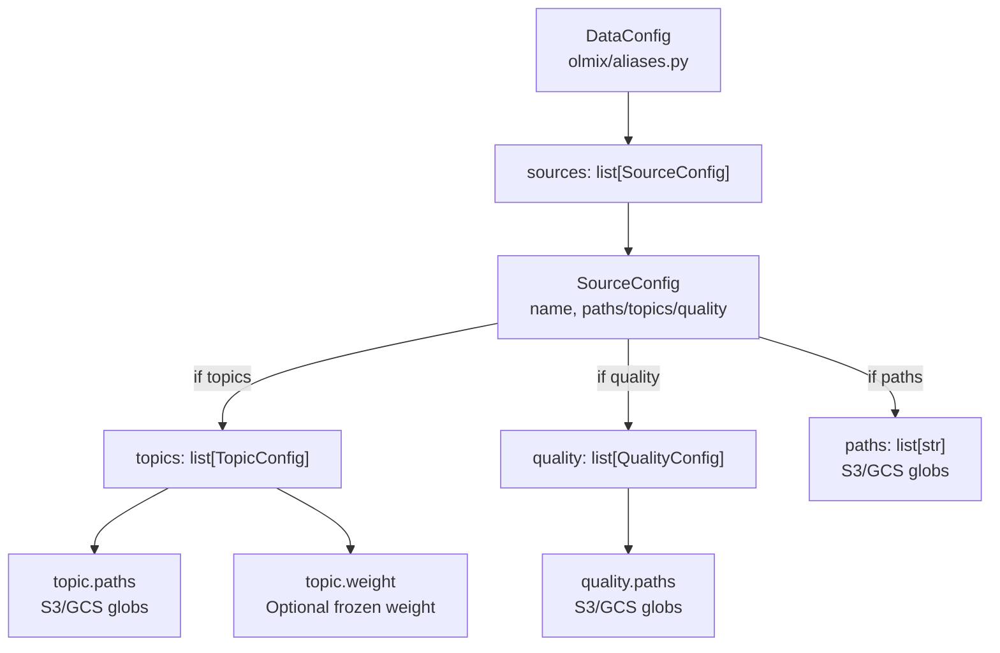

This hierarchical structure enables flexible organization:
- **Flat sources**: `paths` directly in `SourceConfig`
- **Topic subdivision**: `topics` list with nested `TopicConfig`
- **Quality levels**: `quality` list for vigintile bucketing

**Sources:** [olmix/aliases.py:1-400](), [README.md:260-289]()

---

## The Complete Workflow

### End-to-End Pipeline

**Diagram: From Generation to Optimization**

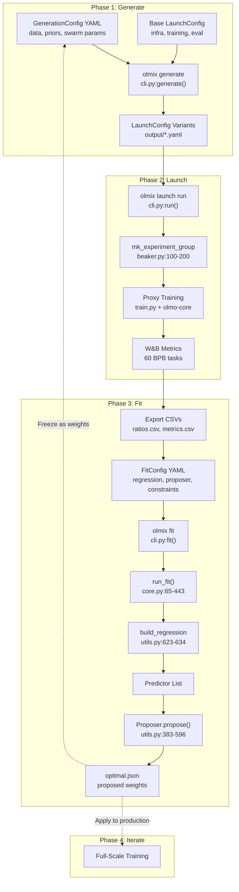

**Sources:** [olmix/cli.py:1-300](), [olmix/fit/cli.py:32-114](), [olmix/fit/core.py:65-443]()

---

## Key Data Structures

### Ratios and Metrics DataFrames

After swarm training and CSV export, the canonical data format is:

**ratios.csv structure:**

| Column Type | Purpose | Example Values |
|-------------|---------|----------------|
| `run` or `run_id` | Required join key | `hz0dfydj`, `pj0hxxl7` |
| `name` | Optional display name | `my-swarm-0000` |
| `index` | Optional sequential index | `0`, `1`, `2` |
| Domain columns | Mixture weights (sum ≈ 1.0) | `0.45`, `0.30`, `0.25` |

**metrics.csv structure:**

| Column Type | Purpose | Example Values |
|-------------|---------|----------------|
| `run` or `run_id` | Required join key | `hz0dfydj`, `pj0hxxl7` |
| `name` | Optional display name | `my-swarm-0000` |
| `index` | Optional sequential index | `0`, `1`, `2` |
| Metric columns | Evaluation scores (lower = better for BPB) | `1.23`, `0.87`, `1.45` |

The `load_from_csv` function extracts domain and metric column names automatically by excluding metadata columns:

**Sources:** [olmix/fit/loaders.py:1-100](), [README.md:24-44]()

### RunInstance

When loading from WandB instead of CSV, results are packaged into `RunInstance` objects:

```python
@dataclass
class RunInstance:
    id: str                  # WandB run ID
    display_name: str        # Human-readable name
    config: dict             # Full run configuration
    samples: pd.DataFrame    # Metrics at final step
    state: str               # "finished", "crashed", "running"
```

**Sources:** [olmix/fit/utils.py:601-617]()

---

## Summary: Core Concepts Recap

| Concept | Key Point | Code Entry Point |
|---------|-----------|------------------|
| Data Mixture | Weighted combination of sources (dict mapping domain → weight) | `LaunchConfig.mix` |
| Swarm | Collection of proxy runs with diverse mixtures | `olmix generate` |
| Proxy Model | 30M param LM trained on 3B tokens | `TransformerConfigBuilder` |
| Priors | Natural token distribution (`relative_sizes`, `token_counts`) | `calculate_priors` |
| Scaling Law | Log-linear parametric model: `exp(c) + exp(β·p)` | `mixing_law`, `ScalingLaw` |
| Regression | Fit one model per metric | `build_regression`, `REGRESSION_TYPES` |
| Proposer | Optimize weights using fitted models | `PROPOSER_TYPES`, `Proposer.propose` |
| Constraints | Prevent excessive data repetition | `repetition_factor`, token budgets |
| Mixture Reuse | Freeze optimized portions, iterate on new domains | `topic.weight` field |

**Sources:** [olmix/aliases.py:1-600](), [olmix/fit/utils.py:1-951](), [olmix/fit/core.py:1-443]()

---

# Page: Installation and Setup

# Installation and Setup

<details>
<summary>Relevant source files</summary>

The following files were used as context for generating this wiki page:

- [.github/dependabot.yml](.github/dependabot.yml)
- [.github/workflows/main.yml](.github/workflows/main.yml)
- [CHANGELOG.md](CHANGELOG.md)
- [CONTRIBUTING.md](CONTRIBUTING.md)
- [Makefile](Makefile)
- [pyproject.toml](pyproject.toml)

</details>


This page provides instructions for installing olmix and configuring the required dependencies and credentials. It covers both production installation (for running experiments) and development installation (for contributing to the codebase).

For information about running your first experiment, see [Quick Start Tutorial](#1.3). For details on the testing infrastructure, see [Testing](#8.1). For CI/CD pipeline configuration, see [CI/CD Pipeline](#8.2).

---

## Prerequisites

### System Requirements

olmix requires **Python 3.11 or higher**. Python 3.12 is also supported and tested in CI.

**Sources:** [pyproject.toml:22](), [.github/workflows/main.yml:12]()

### Package Manager

The project uses **uv** for fast, reliable package management. While pip can also be used, uv is recommended and used throughout the CI/CD pipeline.

To install uv:
```bash
curl -LsSf https://astral.sh/uv/install.sh | sh
```

Alternatively, you can use standard pip if uv is not available.

**Sources:** [.github/workflows/main.yml:21-24](), [Makefile:25]()

---

## Installation Methods

### Production Installation

For users who want to run olmix commands without modifying the codebase:

```bash
# Using uv (recommended)
uv pip install -e .

# Using pip
pip install -e .
```

This installs the core dependencies and makes the `olmix` and `olmix-fit` CLI commands available in your environment.

**Sources:** [Makefile:23-25](), [pyproject.toml:53-55]()

### Development Installation

For contributors who need testing, linting, and type-checking tools:

```bash
# Using uv (recommended)
uv pip install -e ".[dev]"

# Using pip
pip install -e ".[dev]"

# Install pre-commit hooks
pre-commit install
```

The development installation includes all dependencies from the `dev` optional group plus the core dependencies.

**Sources:** [Makefile:28-31](), [pyproject.toml:67-87]()

### Beaker Integration (Optional)

To enable Beaker experiment submission (required for [olmix launch](#2.2)):

```bash
uv pip install -e ".[beaker]"
```

This installs `beaker-py` and `GitPython` for Beaker platform integration.

**Sources:** [pyproject.toml:63-66]()

### Complete Installation

To install all optional dependencies:

```bash
uv pip install -e ".[all]"
```

This is equivalent to installing both `dev` and `beaker` extras.

**Sources:** [pyproject.toml:88-91]()

---

## Dependency Architecture

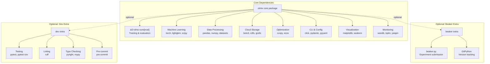

**Diagram: Dependency Structure**

This diagram shows the three installation profiles: core dependencies (always installed), beaker extra (for experiment submission), and dev extra (for development workflows).

**Sources:** [pyproject.toml:23-49](), [pyproject.toml:62-91]()

---

## Verifying Installation

### Check CLI Availability

After installation, verify the CLI commands are available:

```bash
# Check main CLI
olmix --help

# Check fit CLI
olmix-fit --help

# Verify version
python -c "from olmix.version import __version__; print(__version__)"
```

The `olmix` command provides access to `generate`, `launch`, and `priors` commands. The `olmix-fit` command is a shorthand for the `fit` subcommand.

**Sources:** [pyproject.toml:53-55]()

### Run Tests

For development installations, verify the setup by running tests:

```bash
# Run all tests
make test

# Run only fast tests (skip slow/GPU tests)
make test-fast

# Run with coverage
make test-cov
```

**Sources:** [Makefile:33-43](), [pyproject.toml:167-183]()

### Check Code Quality Tools

Verify development tools are working:

```bash
# Check formatting
make format-check

# Run linter
make lint

# Run type checker
make typecheck
```

**Sources:** [Makefile:45-63]()

---

## Environment Setup

### Overview of Required Credentials

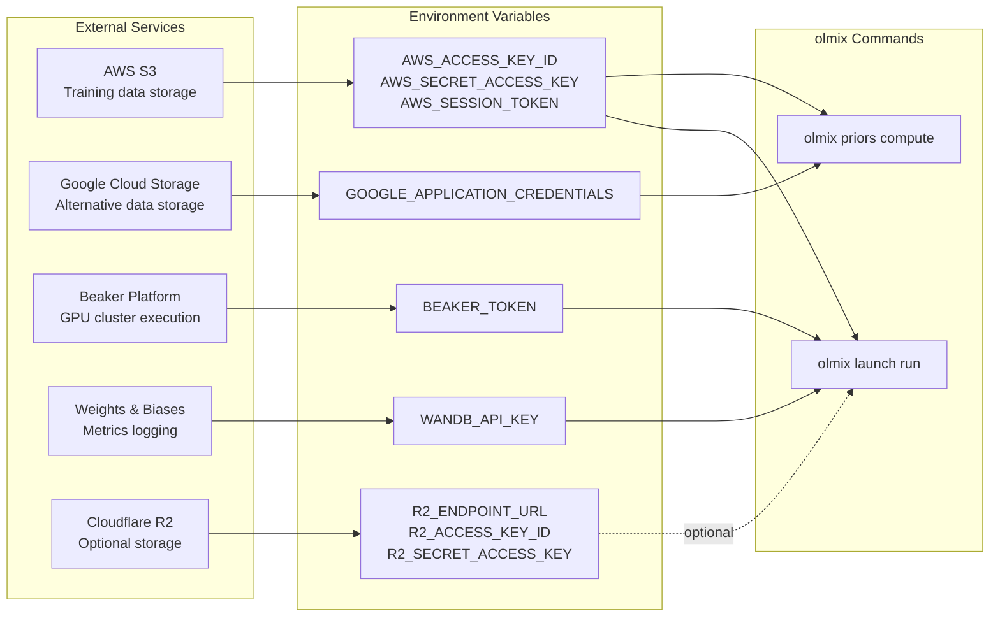

**Diagram: Environment Variables and Service Dependencies**

This diagram shows which environment variables are required for each external service and which olmix commands depend on them.

**Sources:** [olmix/launch/beaker.py:100-200]() (inferred from Beaker integration code)

### AWS Credentials (S3 Access)

Required for accessing training data in S3 and for the `priors compute` command.

**Option 1: AWS CLI Configuration**
```bash
aws configure
```

**Option 2: Environment Variables**
```bash
export AWS_ACCESS_KEY_ID="your-access-key"
export AWS_SECRET_ACCESS_KEY="your-secret-key"
export AWS_SESSION_TOKEN="your-session-token"  # If using temporary credentials
```

The credentials are used by `boto3` and `s3fs` for data access.

**Sources:** [pyproject.toml:27](), [pyproject.toml:40]()

### Google Cloud Credentials (GCS Access)

Required if using GCS for data storage instead of S3.

```bash
export GOOGLE_APPLICATION_CREDENTIALS="/path/to/credentials.json"
```

The credentials are used by `gcsfs` for data access.

**Sources:** [pyproject.toml:32]()

### Beaker Token

Required for the `olmix launch run` command to submit experiments to the Beaker platform.

```bash
export BEAKER_TOKEN="your-beaker-token"
```

To obtain a Beaker token:
1. Log in to the Beaker web interface
2. Navigate to your account settings
3. Generate an API token

**Sources:** [olmix/launch/beaker.py]() (referenced in launch command implementation)

### Weights & Biases API Key

Required for logging metrics during training and for `load_from_wandb` in the fit pipeline.

```bash
export WANDB_API_KEY="your-wandb-key"
```

To obtain a WandB API key:
1. Create an account at https://wandb.ai
2. Navigate to Settings → API keys
3. Copy your API key

**Sources:** [pyproject.toml:47]()

### Cloudflare R2 (Optional)

Optional alternative storage backend.

```bash
export R2_ENDPOINT_URL="https://your-account.r2.cloudflarestorage.com"
export R2_ACCESS_KEY_ID="your-r2-access-key"
export R2_SECRET_ACCESS_KEY="your-r2-secret-key"
```

**Sources:** Inferred from Beaker integration patterns

### Environment Variable Persistence

To make environment variables permanent, add them to your shell configuration:

```bash
# For bash
echo 'export AWS_ACCESS_KEY_ID="..."' >> ~/.bashrc
echo 'export BEAKER_TOKEN="..."' >> ~/.bashrc

# For zsh
echo 'export AWS_ACCESS_KEY_ID="..."' >> ~/.zshrc
echo 'export BEAKER_TOKEN="..."' >> ~/.zshrc
```

---

## Installation Flow

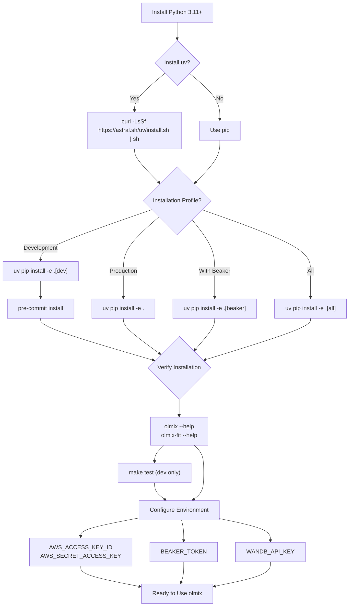

**Diagram: Installation and Setup Workflow**

This flowchart shows the complete installation process from Python installation through environment configuration.

**Sources:** [Makefile:23-31](), [pyproject.toml:22-91](), [CONTRIBUTING.md:32-56]()

---

## Development Workflow Tools

The `Makefile` provides convenient targets for common development tasks:

| Target | Purpose | Command |
|--------|---------|---------|
| `make install` | Install core dependencies | `uv pip install -e .` |
| `make install-dev` | Install with dev tools | `uv pip install -e ".[dev]"` |
| `make test` | Run all tests | `pytest` |
| `make test-fast` | Run fast tests only | `pytest -m "not slow"` |
| `make test-cov` | Run tests with coverage | `pytest --cov=olmix` |
| `make lint` | Run linter with fixes | `ruff check . --fix` |
| `make format` | Format code | `ruff format olmix tests scripts` |
| `make format-check` | Check formatting | `ruff format --check` |
| `make typecheck` | Run type checker | `pyright olmix` |
| `make clean` | Remove build artifacts | Remove caches and build dirs |
| `make run-checks` | Run all quality checks | Format, lint, type, test |

**Sources:** [Makefile:1-118]()

---

## CI/CD Verification

The GitHub Actions workflow automatically verifies installation on every push:

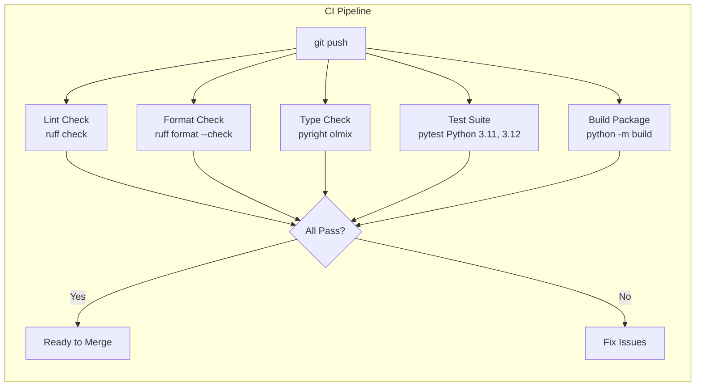

**Diagram: CI/CD Quality Gates**

The CI pipeline runs four parallel checks (lint, format, typecheck, test) plus a build step to ensure code quality and correctness.

**Sources:** [.github/workflows/main.yml:15-93]()

---

## Troubleshooting

### ImportError: No module named 'olmix'

Ensure you installed with the `-e` flag for editable mode:
```bash
uv pip install -e .
```

### Command not found: olmix

The CLI entry points may not be in your PATH. Try:
```bash
python -m olmix.cli --help
```

Or reinstall the package:
```bash
uv pip uninstall olmix
uv pip install -e .
```

### OLMo Core Installation Issues

The `ai2-olmo-core` dependency is pinned to a specific git branch. If installation fails:
```bash
# Install git if not available
apt-get install git  # On Ubuntu/Debian
brew install git     # On macOS

# Verify git is in PATH
which git
```

**Sources:** [pyproject.toml:26]()

### Type Checking Errors

Type checking is configured to "basic" mode. If you see unexpected errors:
```bash
# Check pyright configuration
cat pyproject.toml | grep -A 10 "\[tool.pyright\]"

# Run with verbose output
pyright --verbose olmix
```

**Sources:** [pyproject.toml:153-164]()

---

## Next Steps

After completing installation and setup:

1. **Run the Quick Start Tutorial** ([#1.3](#1.3)) to generate your first mixture variants
2. **Explore CLI commands** ([#2](#2)) to understand available functionality
3. **Review Configuration System** ([#3](#3)) to learn about YAML configuration files
4. **For contributors:** Read the complete [Development Guide](#8) and [Testing](#8.1) documentation

**Sources:** Table of contents structure

---

# Page: Quick Start Tutorial

# Quick Start Tutorial

<details>
<summary>Relevant source files</summary>

The following files were used as context for generating this wiki page:

- [README.md](README.md)
- [configs/examples/launch/README.md](configs/examples/launch/README.md)
- [configs/examples/launch/data_proportions/mix_baseline.yaml](configs/examples/launch/data_proportions/mix_baseline.yaml)
- [configs/examples/launch/data_proportions/mix_heavy_code.yaml](configs/examples/launch/data_proportions/mix_heavy_code.yaml)
- [olmix/aliases.py](olmix/aliases.py)
- [olmix/cli.py](olmix/cli.py)
- [olmix/generate/synthesize_mixture.py](olmix/generate/synthesize_mixture.py)
- [olmix/generate/utils.py](olmix/generate/utils.py)
- [olmix/launch/utils.py](olmix/launch/utils.py)

</details>


This tutorial walks through a complete example of using olmix to optimize a pretraining data mixture. You will learn two workflows: (1) fitting an optimal mixture from existing swarm results (CSV files), and (2) running the complete end-to-end pipeline from scratch (generating variants, launching experiments, and fitting). 

For detailed configuration options, see [GenerationConfig](#3.1), [LaunchConfig](#3.2), and [FitConfig](#3.3). For infrastructure setup and Beaker integration details, see [Beaker Integration](#5.1).

**Sources:** [README.md:1-334]()

---

## Prerequisites

Before starting, ensure olmix is installed and your environment is configured:

```bash
git clone https://github.com/allenai/olmix.git
cd olmix
uv pip install -e ".[dev]"
```

Verify the installation:

```bash
olmix --help
```

You should see four command groups: `generate`, `launch`, `priors`, and `fit`.

For full installation instructions, see [Installation and Setup](#1.2).

**Sources:** [README.md:12-18]()

---

## Overview: The olmix Workflow

The following diagram shows how olmix commands map to the optimization cycle and which configuration types each command uses:

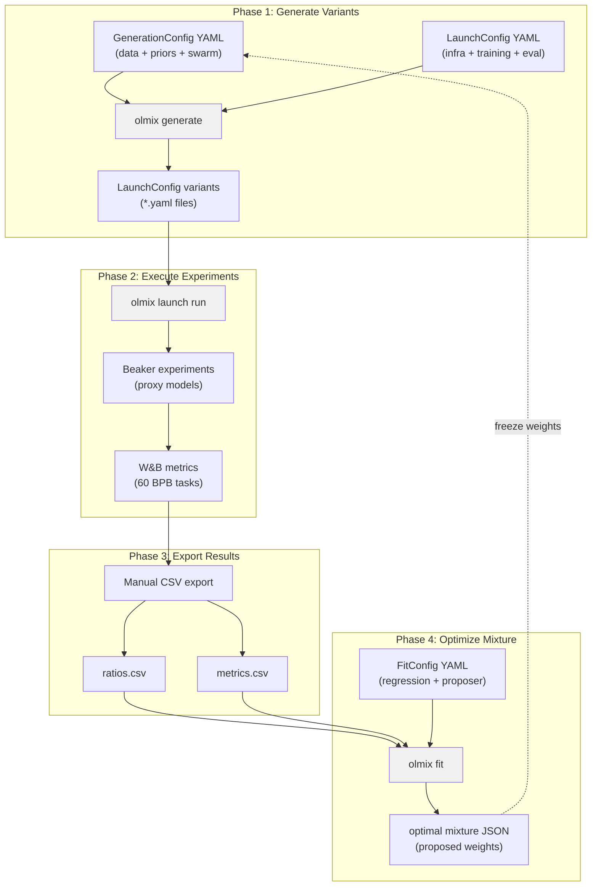

**Sources:** [README.md:20-247](), [olmix/cli.py:101-453]()

---

## Workflow 1: Optimize from CSV (Simplest)

The fastest way to use olmix is to fit an optimal mixture from existing swarm results. This workflow assumes you already have CSV files containing mixture ratios and evaluation metrics from a swarm of proxy model runs.

### Input Format

Prepare two CSV files that will be joined on the `run` or `run_id` column:

**ratios.csv** — Domain mixture weights per run (must sum to ~1.0 per row):

| run      | name          | index | dclm  | wikipedia | arxiv |
|----------|---------------|-------|-------|-----------|-------|
| hz0dfydj | my-swarm-0000 | 0     | 0.45  | 0.30      | 0.25  |
| pj0hxxl7 | my-swarm-0001 | 1     | 0.60  | 0.20      | 0.20  |
| sqleanmq | my-swarm-0002 | 2     | 0.33  | 0.33      | 0.34  |

**metrics.csv** — Evaluation metrics per run (lower BPB = better):

| run      | name          | index | arc_challenge_bpb | hellaswag_bpb | mmlu_stem_bpb |
|----------|---------------|-------|-------------------|---------------|---------------|
| hz0dfydj | my-swarm-0000 | 0     | 1.23              | 0.87          | 1.45          |
| pj0hxxl7 | my-swarm-0001 | 1     | 1.15              | 0.91          | 1.38          |
| sqleanmq | my-swarm-0002 | 2     | 1.20              | 0.89          | 1.42          |

The `run` column is required for joining. The `name` and `index` columns are optional metadata. Domain columns in `ratios.csv` and metric columns in `metrics.csv` are derived automatically from the CSV headers.

**Sources:** [README.md:24-44]()

### Running the Fit Command

Create a FitConfig YAML that specifies the CSV paths and optimization parameters:

```bash
olmix fit --config configs/examples/fit/example.yaml --output-dir output/my_fit
```

The minimal FitConfig structure:

```yaml
swarm:
  ratios: path/to/ratios.csv
  metrics: path/to/metrics.csv

priors:
  relative_sizes:
    dclm: 0.6
    wikipedia: 0.2
    arxiv: 0.2
  token_counts:
    dclm: 600000000
    wikipedia: 200000000
    arxiv: 200000000

regression:
  type: log_linear

proposer:
  type: exact
  kl_reg: 0.1
```

The `priors` section defines the natural corpus distribution used for KL regularization. The `relative_sizes` should sum to ~1.0 and represent the fractional weight of each domain in the natural corpus. The `token_counts` are absolute token counts used for repetition constraints.

**Sources:** [README.md:46-105](), [olmix/fit/cli.py:1-100]()

### Understanding the Output

All results are written to a hashed subdirectory under the specified `--output-dir`. The hash is computed from the config to ensure different configurations produce separate outputs:

| File | Description |
|------|-------------|
| `config.json` | Full configuration used (for reproducibility) |
| `interaction_matrix.png` | Heatmap showing which domains help/hurt each metric |
| `{metric}_*_fit.png` | Per-metric regression plot (predicted vs actual) |
| `{metric}_*_optimal.json` | Proposed optimal weights for this metric |
| `{metric}_*_optimal.png` | Bar chart: prior vs proposed weights |
| `opt_avg_all_metrics_*_optimal.json` | **Main output**: weights optimizing average of all metrics |
| `predicted_performance.json` | Predicted metric values at optimal weights |

The key output is `opt_avg_all_metrics_*_optimal.json`, which contains the single mixture that optimizes the average across all evaluation metrics.

**Sources:** [README.md:159-181]()

### Key Configuration Options

The following table summarizes the most important FitConfig fields:

| Section | Field | Purpose |
|---------|-------|---------|
| `regression` | `type` | Model type: `log_linear` (default), `lightgbm`, `gp`, `autoscale`, `bimix`, `search` |
| `regression` | `aggregate_task_families` | Fit one model per task family (e.g., math, code) instead of per task |
| `proposer` | `type` | Optimization method: `exact` (convex opt), `simulation` (Monte Carlo), `search` |
| `proposer` | `kl_reg` | KL divergence regularization strength (penalizes divergence from prior) |
| `constraints` | `enabled` | Enable repetition constraints during optimization |
| `constraints` | `repetition_factor` | Maximum data repetition allowed (default: 4.0) |
| `filtering` | `obj_weights` | Non-uniform metric importance weights (default: uniform) |

For complete FitConfig documentation, see [FitConfig](#3.3).

**Sources:** [README.md:107-158]()

---

## Workflow 2: Complete End-to-End Pipeline

This workflow demonstrates the full olmix cycle: generating mixture variants, launching proxy model training, exporting results, and fitting an optimal mixture.

### Data Flow Diagram

The following diagram shows how data flows through the complete pipeline, including the specific CLI commands and file formats at each stage:

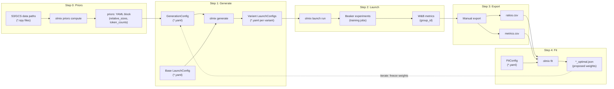

**Sources:** [olmix/cli.py:112-453](), [README.md:184-247]()

### Step 0: Compute Priors

Before generating mixtures, compute the natural token distribution and absolute token counts for your data sources:

```bash
olmix priors compute --config configs/examples/generate/example.yaml
```

This command scans S3/GCS paths and outputs a `priors:` YAML block to paste into your GenerationConfig. The scanning is done by [`calculate_priors()`](olmix/generate/synthesize_mixture.py:732-817)() which uses [`count_tokens()`](olmix/generate/synthesize_mixture.py:655-662)() to compute token counts via file size inspection.

Example output:

```yaml
priors:
  relative_sizes:
    arxiv: 0.13859324268101414
    dclm:education_and_jobs: 0.13466673502770904
    dclm:science_math_and_technology: 0.5479947162541395
    dclm:software_development: 0.1548063887874921
    wikipedia: 0.023938917249645256
  token_counts:
    arxiv: 21377485731
    dclm:education_and_jobs: 20771836713
    dclm:science_math_and_technology: 84526121193
    dclm:software_development: 23878302458
    wikipedia: 3692487830
```

Copy this block into your GenerationConfig under the `priors:` section.

**Sources:** [README.md:188-212](), [olmix/cli.py:387-436](), [olmix/generate/synthesize_mixture.py:732-817]()

### Step 1: Generate Mixture Variants

Generate mixture variants by sampling from a Dirichlet distribution using a GenerationConfig and a base LaunchConfig:

```bash
olmix generate \
  --config configs/examples/generate/example.yaml \
  --base configs/examples/launch/data_proportions/mix_baseline.yaml \
  --output output/my_variants/
```

This command is implemented in the [`generate()`](olmix/cli.py:112-165)() function, which calls [`mk_mixes()`](olmix/generate/utils.py:17-53)() to sample mixture weights via [`generate_weights_dirichlet()`](olmix/generate/synthesize_mixture.py:131-510)().

The command creates one self-contained LaunchConfig YAML per variant:

```
output/my_variants/
  example-swarm-a1b2c3d4-0000.yaml
  example-swarm-a1b2c3d4-0001.yaml
  example-swarm-a1b2c3d4-0002.yaml
  ...
```

Each variant file is a complete LaunchConfig with a unique `mix` field containing the sampled domain weights and repetition factors.

#### GenerationConfig Structure

A GenerationConfig specifies:

| Field | Purpose |
|-------|---------|
| `name` | Experiment name (used in variant filenames) |
| `data` | Data sources hierarchy (source → topic → quality → paths) |
| `priors` | Natural distribution (`relative_sizes`) and token counts |
| `swarm` | Sampling parameters (variants, strength range, temperature, etc.) |
| `max_tokens` | Token budget per proxy run (enforces repetition constraints) |

The `swarm` section controls mixture diversity:

| Swarm Parameter | Effect |
|-----------------|--------|
| `variants` | Number of mixtures to generate |
| `min_strength` / `max_strength` | Dirichlet concentration range (low = diverse, high = near-prior) |
| `minimum_weight` | Domains below this threshold are zeroed out |
| `repetition_factor` | Maximum data repetition allowed (default: 1.0) |
| `enable_bound` | Enforce repetition bounds during sampling |

For advanced mixture reuse patterns, see [Mixture Reuse Case Study](#7.1).

**Sources:** [README.md:213-313](), [olmix/cli.py:112-165](), [olmix/generate/utils.py:17-53](), [olmix/generate/synthesize_mixture.py:131-510]()

### Step 2: Launch Training Experiments

Submit the generated variants to Beaker for proxy model training:

```bash
olmix launch run --variants output/my_variants/
```

This command is implemented in [`launch_run()`](olmix/cli.py:178-261)(), which:
1. Loads all LaunchConfig YAMLs from the directory using [`_load_launch_configs()`](olmix/cli.py:79-98)()
2. Creates a Beaker experiment group via [`mk_experiment_group()`](olmix/launch/beaker.py:1-100)()
3. Launches experiments using [`launch_noninteractive()`](olmix/launch/beaker.py:200-250)()

Each experiment:
- Trains a proxy model (typically 14M-30M parameters) on the specified mixture
- Evaluates on 60 BPB tasks at regular intervals
- Logs all metrics to W&B under a shared `group_id`

The training command is constructed by [`mk_instance_cmd()`](olmix/launch/beaker.py:100-150)() which calls [`olmix/launch/train.py`](olmix/launch/train.py:1-200)() as the entry point.

#### Preview Commands Without Launching

To see the training commands without submitting to Beaker:

```bash
olmix launch preview --variants output/my_variants/
```

To perform a dry-run that validates the configuration:

```bash
olmix launch run --variants output/my_variants/ --dry-run
```

**Sources:** [olmix/cli.py:178-261](), [olmix/launch/beaker.py:1-250](), [README.md:236-242]()

### Step 3: Export Results to CSV

Once training completes, export the results from W&B to CSV files. This step is currently manual but can be automated using the W&B API.

You need to create two CSVs:

1. **ratios.csv**: Extract the domain weights from each run's mixture configuration
2. **metrics.csv**: Extract the evaluation metrics from W&B

The CSVs must have a `run` or `run_id` column that uniquely identifies each training run so they can be joined.

For automated loading from W&B, see [Loading from WandB](#6.1).

**Sources:** [README.md:244-246]()

### Step 4: Fit Optimal Mixture

Run the fit command using the exported CSVs:

```bash
olmix fit --config configs/examples/fit/example.yaml --output-dir output/my_fit
```

The fit command is implemented in [`olmix/fit/cli.py`](olmix/fit/cli.py:1-100)() which:
1. Loads data using [`load_from_csv()`](olmix/fit/utils.py:1-100)() or [`load_from_wandb()`](olmix/fit/utils.py:100-200)()
2. Builds regression models via [`build_regression()`](olmix/fit/core.py:1-200)()
3. Optimizes weights using a proposer (e.g., [`LogLinearExactProposer`](olmix/fit/proposer.py:1-300)())

The output includes the optimal mixture JSON and visualizations showing domain-metric interactions.

**Sources:** [olmix/fit/cli.py:1-100](), [olmix/fit/core.py:1-200](), [README.md:244-246]()

---

## Configuration Relationships

The following diagram shows how the three configuration types relate to each other and which commands consume them:

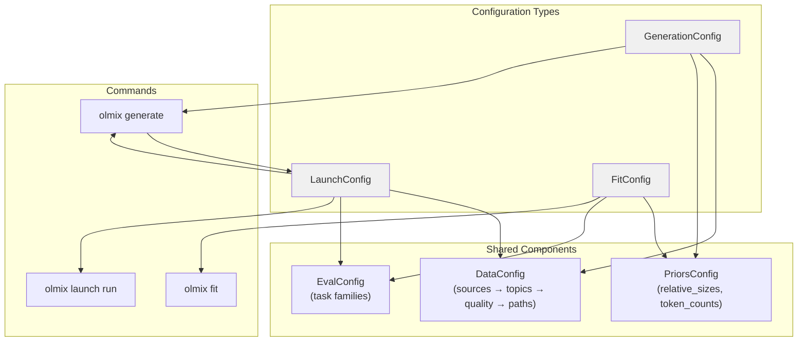

**Key relationships:**

| Config Type | Contains | Used By |
|-------------|----------|---------|
| [`GenerationConfig`](olmix/aliases.py:211-226)() | `DataConfig`, `PriorsConfig`, `SwarmConfig`, `max_tokens` | `olmix generate` |
| [`LaunchConfig`](olmix/aliases.py:299-326)() | `DataConfig`, `InfraConfig`, `TrainingConfig`, `EvalConfig`, `mix` | `olmix generate` (output), `olmix launch` (input) |
| [`FitConfig`](olmix/fit/config.py:1-100)() | `PriorsConfig`, `RegressionConfig`, `ProposerConfig`, `ConstraintsConfig` | `olmix fit` |

All three configs share the [`DataConfig`](olmix/aliases.py:178-183)() schema, which defines the hierarchical data organization (source → topic → quality → paths). The `LaunchConfig` produced by `olmix generate` inherits infrastructure and training settings from the base config and adds a generated `mix` field with sampled weights.

**Sources:** [olmix/aliases.py:178-326](), [olmix/fit/config.py:1-100]()

---

## Command Reference Quick Guide

The following table summarizes the four main CLI command groups:

| Command | Purpose | Input | Output |
|---------|---------|-------|--------|
| `olmix generate` | Sample mixture variants from Dirichlet | `GenerationConfig` + base `LaunchConfig` | Directory of `LaunchConfig` variants |
| `olmix launch run` | Submit training experiments to Beaker | Directory of `LaunchConfig` files | Beaker experiments + W&B metrics |
| `olmix launch preview` | Preview training commands without launching | Directory of `LaunchConfig` files | Training command strings (stdout) |
| `olmix priors compute` | Calculate token distributions from data paths | Config with `data.sources` field | `priors:` YAML block (stdout) |
| `olmix fit` | Optimize mixture from swarm results | `FitConfig` (referencing CSV or W&B) | Optimal mixture JSON + visualizations |

For detailed CLI documentation, see [CLI Reference](#2).

**Sources:** [olmix/cli.py:101-453]()

---

## Example: End-to-End Run

Here's a complete example starting from scratch:

```bash
# Step 0: Compute priors and update your GenerationConfig
olmix priors compute --config my_generation_config.yaml > priors.yaml
# (paste priors.yaml contents into my_generation_config.yaml)

# Step 1: Generate 10 mixture variants
olmix generate \
  --config my_generation_config.yaml \
  --base configs/examples/launch/data_proportions/mix_baseline.yaml \
  --output output/variants/

# Step 2: Preview one variant to verify
olmix launch preview --variants output/variants/my-swarm-abc123-0000.yaml

# Step 3: Launch the swarm
olmix launch run --variants output/variants/

# Step 4: Wait for training to complete, export CSVs from W&B

# Step 5: Fit optimal mixture
olmix fit --config my_fit_config.yaml --output-dir output/fit/
```

The final optimal mixture will be in `output/fit/{hash}/opt_avg_all_metrics_*_optimal.json`.

**Sources:** [README.md:188-247]()

---

## Next Steps

After completing this tutorial:

- **Explore regression types**: Try `lightgbm` or `gp` instead of `log_linear` for non-parametric modeling ([Regression Models](#4.1))
- **Use mixture reuse**: Freeze optimized domains and iterate on new ones ([Mixture Reuse Case Study](#7.1))
- **Configure quality thresholding**: Experiment with quality-weighted mixtures ([Quality Thresholding](#7.2))
- **Understand scaling laws**: Learn how Chinchilla scaling determines training duration ([Scaling Laws](#4.3))
- **Set up constraints**: Enforce token budgets and repetition limits ([Constraints and Objectives](#4.4))

**Sources:** [README.md:1-334]()

---

# Page: CLI Reference

# CLI Reference

<details>
<summary>Relevant source files</summary>

The following files were used as context for generating this wiki page:

- [olmix/aliases.py](olmix/aliases.py)
- [olmix/cli.py](olmix/cli.py)
- [olmix/generate/synthesize_mixture.py](olmix/generate/synthesize_mixture.py)
- [olmix/generate/utils.py](olmix/generate/utils.py)
- [olmix/launch/utils.py](olmix/launch/utils.py)
- [pyproject.toml](pyproject.toml)

</details>


This page provides an overview of the olmix command-line interface structure, entry points, and common usage patterns. The CLI is the primary way users interact with olmix to generate mixture variants, launch experiments, compute priors, and optimize mixtures.

For detailed documentation of individual commands, see:
- [olmix generate](#2.1) - Generate mixture variants through Dirichlet sampling
- [olmix launch](#2.2) - Manage Beaker experiments (run, status, cancel, preview)
- [olmix fit](#2.3) - Optimize mixtures based on swarm results
- [olmix priors](#2.4) - Calculate token distributions from data sources

---

## CLI Entry Points

The olmix package provides two entry points defined in [pyproject.toml:53-55]():

| Entry Point | Command | Module | Purpose |
|-------------|---------|--------|---------|
| Primary | `olmix` | `olmix.cli:cli` | Main CLI with generate, launch, and priors commands |
| Secondary | `olmix-fit` | `olmix.fit.cli:fit` | Direct access to fit command (also available as `olmix fit`) |

Both entry points are installed when you install the olmix package. The `olmix-fit` entry point exists for backward compatibility and convenience.

**Verification:**
```bash
# Check installation
which olmix
olmix --help

# Both commands provide the same functionality
olmix fit --help
olmix-fit --help
```

Sources: [pyproject.toml:53-55](), [olmix/cli.py:101-104]()

---

## Command Hierarchy

The olmix CLI uses Click's group-based command structure, organizing commands into logical groups:

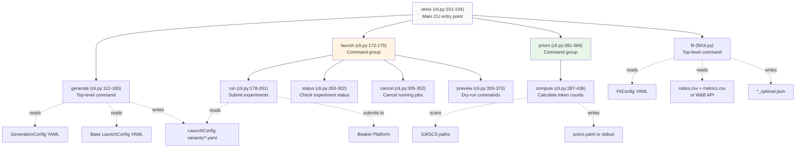

**Key observations:**
- **Top-level commands** (`generate`, `fit`) perform single operations
- **Command groups** (`launch`, `priors`) organize related subcommands
- Each command operates on specific configuration types (see [Configuration System](#3))

Sources: [olmix/cli.py:101-449]()

---

## Code-to-Command Mapping

This diagram shows how CLI commands map to implementation modules and key functions:

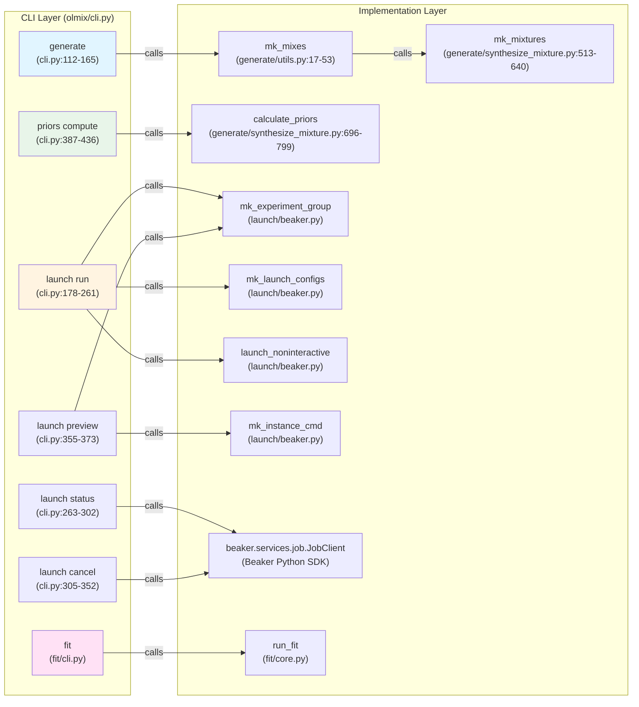

**Key patterns:**
- CLI commands in [olmix/cli.py]() are thin wrappers that handle argument parsing and user interaction
- Core logic lives in dedicated modules (`generate/`, `launch/`, `fit/`)
- [olmix/cli.py:101-104]() uses `prepare_cli_environment()` from olmo-core to set up logging

Sources: [olmix/cli.py:1-453](), [olmix/generate/utils.py:17-53](), [olmix/generate/synthesize_mixture.py:513-799]()

---

## Common Patterns

### Configuration Files

All olmix commands operate on YAML configuration files. The CLI loads these using Pydantic models:

| Command | Config Type | Load Method | File Location |
|---------|-------------|-------------|---------------|
| `generate` | `GenerationConfig` | `GenerationConfig.from_yaml()` | [olmix/aliases.py:220-225]() |
| `launch` | `LaunchConfig` | `LaunchConfig.from_yaml()` | [olmix/aliases.py:321-325]() |
| `fit` | `FitConfig` | `FitConfig.from_yaml()` | [olmix/fit/config.py]() |

**Example loading pattern** from [olmix/cli.py:138-139]():
```python
gen_config = GenerationConfig.from_yaml(config)
base_config = LaunchConfig.from_yaml(base)
```

Sources: [olmix/cli.py:79-98](), [olmix/aliases.py:220-325]()

### Path Handling

The CLI accepts paths in multiple formats:

```python
# File paths (relative or absolute)
--config ./configs/generation.yaml
--variants ./output/variants/

# Directory paths (for variants)
--variants ./output/variants/  # Loads all *.yaml and *.yml files
```

The [_load_launch_configs]() helper at [olmix/cli.py:79-98]() handles both single files and directories, automatically discovering and sorting YAML files in directories.

Sources: [olmix/cli.py:79-98]()

### Output Organization

Commands write outputs to structured directories:

| Command | Output Path | Contents |
|---------|-------------|----------|
| `generate` | `--output <dir>/` | `{name}-{group_uuid}-{idx:04}.yaml` files |
| `launch run` | `output/mixes/{name}/{group_uuid}.json` | Launch metadata with Beaker experiment IDs |
| `fit` | `output/fit/{config_name}/` | Optimal mixtures, plots, regression models |
| `priors compute` | `--output <file>` or stdout | YAML with `relative_sizes` and `token_counts` |

**Launch metadata structure** from [olmix/cli.py:34-76]():
```json
{
  "metadata": {
    "timestamp": "2024-01-01T00:00:00Z",
    "beaker_user": "USER",
    "group_id": "abc123",
    "wandb_url": "https://wandb.ai/ai2-llm/olmix?group=abc123",
    "git_commit": "abc12345",
    "git_branch": "main"
  },
  "config": { ... },
  "experiments": [
    {
      "variant": 0,
      "beaker_id": "01ABCDEF",
      "beaker_name": "experiment-name",
      "beaker_url": "https://beaker.org/ex/01ABCDEF"
    }
  ]
}
```

Sources: [olmix/cli.py:34-76](), [olmix/cli.py:144-161]()

### User Interaction

The CLI uses several libraries for user interaction:

| Library | Purpose | Usage Location |
|---------|---------|----------------|
| `click` | Command parsing, prompts | Throughout [olmix/cli.py]() |
| `yaspin` | Progress spinners | [olmix/cli.py:212-245]() |
| `tqdm` | Progress bars | [olmix/cli.py:242]() |
| `logger` | Logging output | All commands |

**Confirmation prompts** ensure users review configurations before launching expensive experiments:
```python
if not click.confirm("Proceed with this configuration?", default=False):
    logger.info("Launch cancelled!")
    return
```

Sources: [olmix/cli.py:208-210]()

---

## Command Overview

### olmix generate

**Purpose:** Create LaunchConfig variants by sampling mixture weights from a Dirichlet distribution.

**Key options:**
- `-c, --config`: Path to GenerationConfig YAML
- `--base`: Path to base LaunchConfig YAML  
- `-o, --output`: Output directory for variant YAML files

**Workflow:**
1. Load GenerationConfig with data sources, priors, and sampling parameters
2. Load base LaunchConfig with infrastructure and training settings
3. Generate mixture weights using [mk_mixes()]() from [olmix/generate/utils.py:17-53]()
4. Write self-contained LaunchConfig YAML files (one per variant)

**Output:** `{name}-{group_uuid}-{idx:04}.yaml` files in output directory

See [olmix generate](#2.1) for detailed documentation.

Sources: [olmix/cli.py:112-165]()

### olmix launch

**Purpose:** Manage Beaker experiment lifecycle (submission, monitoring, cancellation).

**Subcommands:**

| Subcommand | Purpose | Key Options |
|------------|---------|-------------|
| `run` | Submit experiments to Beaker | `-v/--variants`, `--dry-run` |
| `status` | Check experiment status | `-c/--config`, `-g/--group-id` |
| `cancel` | Stop running experiments | `-c/--config`, `-g/--group-id` |
| `preview` | Preview training commands | `-v/--variants` |

**Workflow for `launch run`:**
1. Load LaunchConfig(s) from variants directory
2. Build Beaker experiment group using [mk_experiment_group()]()
3. Convert to Beaker launch configs using [mk_launch_configs()]()
4. Submit to Beaker (or dry-run locally if `--dry-run` flag)
5. Save launch metadata to `output/mixes/{name}/{group_uuid}.json`

See [olmix launch](#2.2) for detailed documentation.

Sources: [olmix/cli.py:172-374]()

### olmix priors

**Purpose:** Calculate token distributions from data sources for use in GenerationConfig.

**Subcommands:**

| Subcommand | Purpose | Key Options |
|------------|---------|-------------|
| `compute` | Scan S3/GCS paths and count tokens | `-c/--config`, `-n/--no-cache`, `-o/--output` |

**Workflow:**
1. Load DataConfig from any config file (extracts `data` section)
2. Scan cloud storage paths using [calculate_priors()]() from [olmix/generate/synthesize_mixture.py:696-799]()
3. Count tokens across all sources/topics/quality levels
4. Output as YAML with `relative_sizes` and `token_counts`

**Caching:** Results are cached in `cache/priors_cache_{hash}.json` based on source paths. Use `--no-cache` to force recalculation.

See [olmix priors](#2.4) for detailed documentation.

Sources: [olmix/cli.py:387-436]()

### olmix fit

**Purpose:** Optimize mixture weights by fitting regression models to swarm results.

**Key options:**
- `-c, --config`: Path to FitConfig YAML
- Various flags for visualization, caching, and output control

**Workflow:**
1. Load swarm results from CSV files or WandB API
2. Build regression models (one per evaluation metric)
3. Use proposer to optimize mixture weights
4. Output optimal mixture as JSON and visualizations

**Note:** The fit command has extensive options documented in its own module. It can be invoked as either `olmix fit` or `olmix-fit`.

See [olmix fit](#2.3) for detailed documentation.

Sources: [olmix/cli.py:443-449]()

---

## Environment Setup

The CLI uses `prepare_cli_environment()` from olmo-core at startup ([olmix/cli.py:104]()), which:
- Configures logging to stdout
- Sets log format and level
- Ensures proper encoding for Unicode output

**Required environment variables** (for different commands):

| Variable | Required For | Purpose |
|----------|--------------|---------|
| `BEAKER_TOKEN` | `launch run` | Beaker API authentication |
| `WANDB_API_KEY` | `launch run`, `fit` (WandB mode) | WandB API access |
| `AWS_PROFILE` or AWS credentials | `generate`, `launch`, `priors` | S3 access |
| `GOOGLE_CLOUD_PROJECT` | GCS paths | GCS access |

Sources: [olmix/cli.py:104]()

---

## Git Integration

Launch commands automatically capture git metadata using [_get_git_info()]() at [olmix/cli.py:24-31]():

```python
def _get_git_info() -> dict[str, str]:
    """Get current git commit and branch info."""
    try:
        commit = subprocess.check_output(["git", "rev-parse", "HEAD"], text=True).strip()[:8]
        branch = subprocess.check_output(["git", "rev-parse", "--abbrev-ref", "HEAD"], text=True).strip()
        return {"git_commit": commit, "git_branch": branch}
    except Exception:
        return {"git_commit": "unknown", "git_branch": "unknown"}
```

This metadata is saved in launch metadata JSON files for reproducibility tracking.

Sources: [olmix/cli.py:24-31]()

---

## Error Handling

The CLI uses several error handling patterns:

**Validation errors:**
```python
if not p.is_dir():
    raise click.BadParameter(f"Variants path is not a file or directory: {variants_path}")
```

**User cancellation:**
```python
except KeyboardInterrupt:
    logger.warning("\nAborting experiment group launch! You may need to manually stop the launched experiments.")
```

**Graceful fallbacks:**
- Missing git info returns `"unknown"` instead of failing
- Missing cache falls back to computing from source

Sources: [olmix/cli.py:83-98](), [olmix/cli.py:257-260]()

---

## Next Steps

For detailed usage of each command, see:
- [Generate Command](#2.1) - Dirichlet sampling and variant generation
- [Launch Commands](#2.2) - Beaker integration and experiment management  
- [Fit Command](#2.3) - Regression and optimization
- [Priors Command](#2.4) - Token counting and prior computation

For configuration system details, see [Configuration System](#3).

---

# Page: olmix generate

# olmix generate

<details>
<summary>Relevant source files</summary>

The following files were used as context for generating this wiki page:

- [README.md](README.md)
- [olmix/aliases.py](olmix/aliases.py)
- [olmix/cli.py](olmix/cli.py)
- [olmix/generate/synthesize_mixture.py](olmix/generate/synthesize_mixture.py)
- [olmix/generate/utils.py](olmix/generate/utils.py)
- [olmix/launch/utils.py](olmix/launch/utils.py)

</details>


## Purpose and Scope

This page documents the `olmix generate` command, which creates a swarm of mixture variants through Dirichlet-based sampling. The command takes a `GenerationConfig` YAML (defining data sources and sampling parameters) and a base `LaunchConfig` YAML (defining infrastructure and training settings), then produces multiple self-contained `LaunchConfig` variants, each with a unique sampled data mixture.

For information about launching the generated variants to Beaker, see [olmix launch](#2.2). For configuration details, see [GenerationConfig](#3.1) and [LaunchConfig](#3.2). For computing priors before generation, see [olmix priors](#2.4).

---

## Command Syntax

```bash
olmix generate --config <generation_config.yaml> \
               --base <base_launch_config.yaml> \
               --output <output_directory>
```

| Flag | Required | Description |
|------|----------|-------------|
| `-c`, `--config` | Yes | Path to `GenerationConfig` YAML |
| `--base` | Yes | Path to base `LaunchConfig` YAML (template) |
| `-o`, `--output` | Yes | Output directory for variant YAML files |

**Sources:** [olmix/cli.py:112-165]()

---

## Command Flow

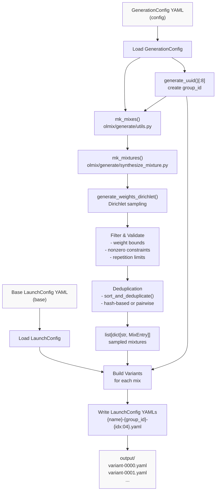

**Diagram: End-to-end flow from configuration files to variant outputs**

**Sources:** [olmix/cli.py:112-165](), [olmix/generate/utils.py:17-53](), [olmix/generate/synthesize_mixture.py:513-640]()

---

## Input Requirements

### GenerationConfig Structure

The `GenerationConfig` specifies what data exists, how to sample from it, and constraints on the sampling process. It has four top-level sections:

```yaml
name: my-swarm           # Experiment name prefix
data:                    # DataConfig - sources hierarchy
  sources: [...]         
priors:                  # PriorsConfig - token distributions
  relative_sizes: {...}
  token_counts: {...}
swarm:                   # SwarmConfig - sampling parameters
  variants: 10
  min_strength: 0.1
  max_strength: 5.0
  # ... (see below)
max_tokens: 600000000    # Token budget per proxy run
```

**Data Hierarchy:** The `data` field defines sources in a three-level hierarchy: **source → topic → quality**. Each level can have an optional `weight` field. See [DataConfig Hierarchy](#3.4) for details.

**Priors:** The `priors` field provides two distributions at the **leaf level** (fully-qualified domain names like `dclm:science_math_and_technology` or `arxiv:vigintile_0015`):
- `relative_sizes`: Fractional weight of each leaf domain (sums to 1.0) - used as the Dirichlet prior center
- `token_counts`: Absolute token count per leaf domain - used for repetition constraints

These can be computed automatically with `olmix priors compute`. See [olmix priors](#2.4).

**Swarm Parameters:** The `swarm` field controls Dirichlet sampling behavior:

| Field | Type | Default | Description |
|-------|------|---------|-------------|
| `variants` | int | `1` | Number of mixture variants to generate |
| `seed` | int | `42` | Random seed for reproducibility |
| `min_strength` / `max_strength` | float | `0.1` / `5.0` | Dirichlet concentration range (low = diverse, high = near prior) |
| `min_source_strength` / `max_source_strength` | float | (uses `min_strength`/`max_strength`) | Override strength for source-level sampling |
| `min_topic_strength` / `max_topic_strength` | float | (uses `min_strength`/`max_strength`) | Override strength for topic-level sampling |
| `minimum_weight` | float | `0.002` | Domains below this threshold are zeroed out |
| `minimum_source_weight` / `minimum_topic_weight` | float | (uses `minimum_weight`) | Override minimum weight per hierarchy level |
| `nonzero_weight` | list[str] | `None` | Domain keys that must be nonzero in every variant |
| `manual_prior` | dict[str, float] | `None` | Override source-level Dirichlet prior |
| `manual_topic_prior` | dict[str, float] | `None` | Override topic-level Dirichlet prior for specific keys |
| `repetition_factor` | float | `1.0` | Maximum allowed data repetition per domain |
| `enable_bound` | bool | `true` | Enforce repetition bound during sampling |
| `sample_multiplier` | int | `10` | Generate N×variants candidates before filtering |
| `existing_mix_file` | str | `None` | Pickle of prior swarm ratios; reject samples too close to existing ones |

**Sources:** [olmix/aliases.py:185-209](), [olmix/aliases.py:211-226](), [olmix/generate/synthesize_mixture.py:33-38]()

### Base LaunchConfig

The base `LaunchConfig` provides the template for all variants. It contains infrastructure settings, training configuration, and evaluation setup that remain constant across the swarm. Each generated variant inherits these settings and adds a unique `mix` field.

The base config should include:
- `infra`: Beaker cluster, GPUs, budget, priority
- `training`: Model size, tokenizer, Chinchilla multiple, seed
- `data`: Complete `DataConfig` (same as in `GenerationConfig`)
- `eval`: Evaluation tasks and configuration

The `mix` field in the base config (if present) is **ignored** and replaced by sampled mixtures.

**Sources:** [olmix/aliases.py:299-326](), [olmix/cli.py:139-152]()

---

## The Generation Process

### Hierarchical Dirichlet Sampling

The generation process samples weights at two levels: **source-level** and **topic-level** (topic here refers to any leaf unit under a source: topics, quality buckets, or topic:quality combinations).

```mermaid
graph TB
    subgraph "Step 1: Source-Level Sampling"
        SourcePrior["Source Prior<br/>natural distribution<br/>or manual_prior"]
        SourceTemp["Apply source_mix_temperature<br/>p' = p^temp / sum(p^temp)"]
        SourceDirichlet["Sample from Dirichlet<br/>alpha = prior * strength<br/>strength in [min_source, max_source]"]
        
        SourcePrior --> SourceTemp
        SourceTemp --> SourceDirichlet
        SourceDirichlet --> SourceWeights["Source Weights<br/>(e.g., dclm: 0.6, stack-edu: 0.4)"]
    end
    
    subgraph "Step 2: Topic-Level Sampling (per source)"
        TopicPrior["Topic Prior<br/>conditional distribution<br/>within each source"]
        TopicTemp["Apply topic_mix_temperature"]
        TopicDirichlet["Sample from Dirichlet<br/>alpha = prior * strength<br/>strength in [min_topic, max_topic]"]
        
        TopicPrior --> TopicTemp
        TopicTemp --> TopicDirichlet
        TopicDirichlet --> TopicWeights["Topic Weights<br/>(e.g., dclm:code: 0.3, dclm:math: 0.7)"]
    end
    
    subgraph "Step 3: Compose Leaf Weights"
        SourceWeights --> Multiply["Multiply:<br/>leaf_weight = source_weight * topic_weight"]
        TopicWeights --> Multiply
        Multiply --> LeafWeights["Leaf Weights<br/>dict[str, float]"]
    end
    
    subgraph "Step 4: Apply Fixed Weights (Mixture Reuse)"
        FixedCheck{{"Has source.weight<br/>or topic.weight?"}}
        LeafWeights --> FixedCheck
        FixedCheck -->|Yes| ApplyFixed["Use fixed weights<br/>skip Dirichlet for those"]
        FixedCheck -->|No| LeafWeights2["All weights sampled"]
        ApplyFixed --> LeafWeights2
    end
    
    style SourceWeights fill:#f9f9f9
    style TopicWeights fill:#f9f9f9
    style LeafWeights fill:#f9f9f9
    style LeafWeights2 fill:#f9f9f9
```

**Diagram: Two-stage hierarchical Dirichlet sampling with optional fixed weights**

**Implementation Details:**

1. **Prior Construction** [olmix/generate/synthesize_mixture.py:176-282]():
   - Split leaf distribution into source and topic distributions
   - Source prior: sum of leaf weights per source
   - Topic prior: conditional distribution within each source (normalized to sum to 1.0)
   - If `manual_prior` is set, override source-level priors
   - If `manual_topic_prior` is set, override topic-level priors for specific sources

2. **Temperature Scaling** [olmix/generate/synthesize_mixture.py:286-301]():
   - If `source_mix_temperature < 1.0`: `prior' = prior^temp / sum(prior^temp)` makes distribution more uniform
   - If `topic_mix_temperature < 1.0`: apply same transformation to topic priors
   - Lower temperature → more uniform sampling (higher diversity)
   - Higher temperature → samples closer to natural distribution

3. **Strength Sampling** [olmix/generate/synthesize_mixture.py:365-403]():
   - If `min_strength == max_strength`: single Dirichlet sample with that concentration
   - Otherwise: sample at 15 log-spaced strengths between min and max
   - Concentration parameter: `alpha = prior * strength`
   - Low strength (e.g., 0.1) → high variance, extreme mixtures
   - High strength (e.g., 5.0) → low variance, samples near prior

4. **Fixed Weights (Mixture Reuse)** [olmix/generate/synthesize_mixture.py:303-342]():
   - If `source.weight` is set: use that value, don't sample source weight
   - If `topic.weight` is set: use that value, don't sample topic weight
   - All sources must have weights if any do (consistency check)
   - Fixed weights enable iterative optimization: freeze optimized domains, vary new ones

**Sources:** [olmix/generate/synthesize_mixture.py:131-511](), [olmix/aliases.py:185-209]()

### Constraints and Filtering

After sampling, each candidate undergoes multiple filtering stages:

```mermaid
graph TB
    Candidate["Sampled Candidate<br/>weights vector"]
    
    Candidate --> BoundsCheck{{"Within weight_bounds?"}}
    
    BoundsCheck -->|No| Reject1["Reject"]
    BoundsCheck -->|Yes| NonzeroCheck{{"Has required<br/>nonzero_weight sources?"}}
    
    NonzeroCheck -->|No| Reject2["Reject"]
    NonzeroCheck -->|Yes| ClipWeights["Clip small weights<br/>below minimum_weight<br/>to zero"]
    
    ClipWeights --> Normalize["Normalize<br/>sum to 1.0"]
    
    Normalize --> BoundsRecheck{{"Still within bounds<br/>after normalization?"}}
    
    BoundsRecheck -->|No| Reject3["Reject"]
    BoundsRecheck -->|Yes| RepetitionCheck["Check repetition<br/>per domain"]
    
    RepetitionCheck --> RepLoop{{"For each domain"}}
    
    RepLoop --> CalcRep["required_tokens = weight * max_tokens<br/>repetition = required / available"]
    
    CalcRep --> RepLimit{{"repetition ><br/>repetition_factor?"}}
    
    RepLimit -->|Yes| Reject4["Reject entire candidate"]
    RepLimit -->|No| UpdateRep["Set repetition_factor<br/>in MixEntry"]
    
    UpdateRep --> NextDomain{{"More domains?"}}
    NextDomain -->|Yes| RepLoop
    NextDomain -->|No| ExistingMix{{"existing_mix_file<br/>provided?"}}
    
    ExistingMix -->|Yes| DistCheck{{"L2 distance to<br/>existing mixes < 0.01?"}}
    ExistingMix -->|No| Accept["Accept candidate"]
    
    DistCheck -->|Yes| Reject5["Reject (too similar)"]
    DistCheck -->|No| Accept
    
    Reject1 --> End["Discard"]
    Reject2 --> End
    Reject3 --> End
    Reject4 --> End
    Reject5 --> End
    Accept --> Collected["Add to collected_samples"]
    
    style Accept fill:#f9f9f9
    style Collected fill:#f9f9f9
```

**Diagram: Multi-stage filtering pipeline for sampled candidates**

**Weight Bounds Calculation** [olmix/generate/synthesize_mixture.py:167-173]():
```
For each leaf domain:
  available_tokens = token_counts[domain]
  max_allowed_weight = min(available_tokens * repetition_factor / max_tokens, 1.0)
  bounds[domain] = (0.0, max_allowed_weight)
```

This ensures that at the configured `repetition_factor`, the domain has enough data to support the requested training budget (`max_tokens`).

**Clipping Behavior** [olmix/generate/synthesize_mixture.py:53-91]():
- Source-level clipping: If `weight < minimum_source_weight`, set to 0
- Topic-level clipping: If `weight < minimum_topic_weight * source_total`, set to 0
- Relative vs. absolute thresholds enable hierarchical control

**Nonzero Constraints** [olmix/generate/synthesize_mixture.py:93-128]():
- `nonzero_weight` can specify sources (e.g., `"dclm"`) or topics (e.g., `"dclm:code"`)
- Check considers post-clipping weights
- Source requirement: `sum(topics) > minimum_source_weight`
- Topic requirement: `weight >= minimum_topic_weight * source_total`

**Sources:** [olmix/generate/synthesize_mixture.py:414-489](), [olmix/generate/synthesize_mixture.py:53-128]()

### Deduplication

After filtering, the system deduplicates near-identical mixtures:

**Hash-Based Deduplication** (for >10,000 candidates) [olmix/generate/synthesize_mixture.py:818-836]():
```python
rounded = tuple(np.round(vec / threshold).astype(int))
if rounded not in seen_hashes:
    seen_hashes.add(rounded)
    unique_samples.append(sample)
```
- Rounds weights to nearest `threshold` (default 1e-5)
- O(N) time complexity
- Used when `len(collected_samples) > 10000`

**Pairwise Deduplication** (for ≤10,000 candidates) [olmix/generate/synthesize_mixture.py:802-815]():
```python
is_duplicate = any(np.allclose(sample[0], unique_sample[0], atol=threshold) 
                   for unique_sample in unique_samples)
```
- Compares each candidate to all unique samples
- O(N²) time complexity but more accurate
- Used when `len(collected_samples) <= 10000`

After deduplication, the system randomly selects `swarm.variants` samples from the unique set.

**Sources:** [olmix/generate/synthesize_mixture.py:493-510](), [olmix/generate/synthesize_mixture.py:802-836]()

---

## Output Structure

### Generated Files

The command produces one YAML file per variant in the output directory:

```
output/
  my-swarm-a1b2c3d4-0000.yaml
  my-swarm-a1b2c3d4-0001.yaml
  my-swarm-a1b2c3d4-0002.yaml
  ...
```

**Filename Format:** `{name}-{group_id}-{index:04}.yaml`
- `name`: From `GenerationConfig.name` or config filename stem
- `group_id`: 8-character UUID generated at runtime
- `index`: Zero-padded 4-digit sequential index

**Sources:** [olmix/cli.py:141-164]()

### Variant Content

Each variant is a complete `LaunchConfig` with:

```yaml
name: my-swarm-a1b2c3d4-0042
description: ""                    # From base config
group_id: a1b2c3d4                 # Shared across swarm

infra:                             # Copied from base config
  budget: ai2/oe-training
  cluster: ai2/jupiter-cirrascale-2
  gpus: 8
  # ...

training:                          # Copied from base config
  proxy_model_id: olmo2_30m
  chinchilla_multiple: 1.0
  # ...

data:                              # Copied from base config
  sources:
    - name: dclm
      topics:
        - name: science_math_and_technology
          paths: [...]
    # ...

eval:                              # Copied from base config
  tasks: [...]

mix:                               # UNIQUE TO THIS VARIANT
  "arxiv":
    weight: 0.123
    repetition_factor: 1.0
  "dclm:science_math_and_technology":
    weight: 0.456
    repetition_factor: 1.234
  "wikipedia":
    weight: 0.421
    repetition_factor: 1.0
```

**Mix Field Structure:**

The `mix` field is a dictionary mapping domain names to `MixEntry` objects:

```python
class MixEntry(BaseModel):
    weight: float              # Mixture weight (all weights sum to 1.0)
    repetition_factor: float   # Data repetition multiplier (1.0 = no repetition)
```

**Domain Name Format:**
- Flat source: `"source_name"` (e.g., `"wikipedia"`)
- Source + topic: `"source:topic"` (e.g., `"dclm:code"`)
- Source + topic + quality: `"source:topic:quality"` (e.g., `"arxiv:physics:vigintile_0015"`)

**Sources:** [olmix/aliases.py:228-233](), [olmix/generate/synthesize_mixture.py:586-592]()

### Visualization Artifacts

If a `group_uuid` is provided (always true for CLI usage), the system generates histograms in `cache/swarms/{group_uuid}/`:

- `{domain}_weights_hist.png`: Distribution of weights across variants for each topic/quality domain
- `{source}_source_weights_hist.png`: Distribution of source-level totals across variants

These help visualize the diversity of the swarm.

**Sources:** [olmix/generate/synthesize_mixture.py:594-638]()

---

## Examples

### Basic Generation

```bash
# Step 1: Compute priors (only needed once per data config)
olmix priors compute \
  --config configs/examples/generate/example.yaml

# Step 2: Generate 10 variants
olmix generate \
  --config configs/examples/generate/example.yaml \
  --base configs/examples/launch/data_proportions/mix_baseline.yaml \
  --output output/my_swarm/
```

**Output:**
```
Generated 10 variant(s) in output/my_swarm/
  example-a1b2c3d4-0000.yaml
  example-a1b2c3d4-0001.yaml
  ...
  example-a1b2c3d4-0009.yaml
```

### Mixture Reuse Example

To freeze previously-optimized weights and only vary new domains:

```yaml
# configs/generate/reuse.yaml
name: stack-edu-swarm

data:
  sources:
    # Existing optimized domains (frozen)
    - name: existing
      topics:
        - name: dclm:science_math_and_technology
          paths: [...]
          weight: 0.55        # Fixed from prior optimization
        - name: dclm:software_development
          paths: [...]
          weight: 0.30        # Fixed
        - name: wikipedia
          paths: [...]
          weight: 0.05        # Fixed
    
    # New domains to explore (will be sampled)
    - name: stack-edu
      topics:
        - name: Python
          paths: [...]       # No weight → sampled freely
        - name: Java
          paths: [...]       # No weight → sampled freely

priors:
  relative_sizes:
    # Must be at leaf level for ALL domains (frozen + free)
    "dclm:science_math_and_technology": 0.547
    "dclm:software_development": 0.154
    "wikipedia": 0.024
    "stack-edu:Python": 0.15
    "stack-edu:Java": 0.125
  token_counts:
    # Token counts for all domains
    # ...

swarm:
  variants: 20
  # ... other params
```

In this example:
- The source `existing` will always get `0.90` total weight (0.55 + 0.30 + 0.05)
- The source `stack-edu` will get `0.10` total weight (varying)
- Within `stack-edu`, the ratio between Python and Java will vary per the Dirichlet

See [Mix Field and Mixture Reuse](#3.5) for detailed mechanics.

**Sources:** [README.md:184-290](), [olmix/generate/synthesize_mixture.py:303-342]()

---

## Implementation Details

### Key Functions

| Function | Location | Purpose |
|----------|----------|---------|
| `generate()` | [olmix/cli.py:112-165]() | CLI entry point; loads configs, calls mk_mixes, writes outputs |
| `mk_mixes()` | [olmix/generate/utils.py:17-53]() | Wrapper that calls mk_mixtures and logs nested summary |
| `mk_mixtures()` | [olmix/generate/synthesize_mixture.py:513-640]() | Main orchestrator; sets seed, calls generate_weights_dirichlet, converts to MixEntry dicts |
| `generate_weights_dirichlet()` | [olmix/generate/synthesize_mixture.py:131-511]() | Core sampling logic; two-level Dirichlet, filtering, deduplication |
| `calculate_priors()` | [olmix/generate/synthesize_mixture.py:696-799]() | Scans S3/GCS paths to compute token counts and relative sizes |

### Key Classes

| Class | Location | Purpose |
|-------|----------|---------|
| `GenerationConfig` | [olmix/aliases.py:211-226]() | Input configuration model for generation |
| `LaunchConfig` | [olmix/aliases.py:299-326]() | Output configuration model for each variant |
| `MixEntry` | [olmix/aliases.py:228-233]() | Represents weight + repetition for one domain |
| `SwarmConfig` | [olmix/aliases.py:185-209]() | Sampling parameters (strength, temperature, etc.) |
| `DataConfig` | [olmix/aliases.py:178-183]() | Hierarchical data source specification |

**Sources:** [olmix/cli.py:112-165](), [olmix/generate/utils.py:1-54](), [olmix/generate/synthesize_mixture.py:1-950](), [olmix/aliases.py:1-341]()

---

# Page: olmix launch

# olmix launch

<details>
<summary>Relevant source files</summary>

The following files were used as context for generating this wiki page:

- [olmix/__init__.py](olmix/__init__.py)
- [olmix/aliases.py](olmix/aliases.py)
- [olmix/cli.py](olmix/cli.py)
- [olmix/generate/synthesize_mixture.py](olmix/generate/synthesize_mixture.py)
- [olmix/generate/utils.py](olmix/generate/utils.py)
- [olmix/launch/__init__.py](olmix/launch/__init__.py)
- [olmix/launch/beaker.py](olmix/launch/beaker.py)
- [olmix/launch/utils.py](olmix/launch/utils.py)
- [tests/test_cli.py](tests/test_cli.py)
- [tests/test_config.py](tests/test_config.py)
- [tests/test_imports.py](tests/test_imports.py)

</details>


## Purpose and Scope

The `olmix launch` command group manages the submission and monitoring of training experiments on the Beaker platform. After generating mixture variants with [olmix generate](#2.1), these commands submit the variants as proxy model training runs, track their execution status, and enable cancellation if needed. The launch system converts LaunchConfig YAML files into Beaker-specific configurations and handles non-interactive job submission.

For information about the training infrastructure itself (Chinchilla scaling, data pipelines, etc.), see [Training Infrastructure](#5). For details on the configuration schema, see [LaunchConfig](#3.2).

---

## Command Overview

The launch command group provides four subcommands for managing experiment lifecycles:

| Subcommand | Purpose | Primary Use Case |
|------------|---------|------------------|
| `run` | Submit experiments to Beaker | Launch a swarm of training runs |
| `status` | Query job status for a group | Monitor running experiments |
| `cancel` | Stop all jobs in a group | Terminate failed or unwanted runs |
| `preview` | Display training commands without launching | Validate configuration before submission |

**Sources:** [olmix/cli.py:172-374]()

---

## Launch Workflow

```mermaid
flowchart TB
    subgraph Input["Input Phase"]
        VarDir["Variant Directory<br/>*.yaml files"]
        VarFile["Single LaunchConfig<br/>.yaml file"]
    end
    
    subgraph Load["Loading Phase"]
        VarDir --> LoadFunc["_load_launch_configs()"]
        VarFile --> LoadFunc
        LoadFunc --> Configs["list[LaunchConfig]"]
    end
    
    subgraph Build["Build Phase"]
        Configs --> MkExpGrp["mk_experiment_group()<br/>beaker.py:18-42"]
        MkExpGrp --> ExpGrp["ExperimentGroup<br/>config + instances"]
        
        ExpGrp --> MkLaunch["mk_launch_configs()<br/>beaker.py:101-163"]
        MkLaunch --> BLCs["list[BeakerLaunchConfig]<br/>olmo-core type"]
    end
    
    subgraph Submit["Submission Phase"]
        BLCs --> LaunchNI["launch_noninteractive()<br/>beaker.py:166-181"]
        LaunchNI --> Recipe["Beaker Recipe<br/>recipe.yes = True"]
        Recipe --> BeakerAPI["Beaker API<br/>experiment.launch()"]
    end
    
    subgraph Track["Tracking Phase"]
        BeakerAPI --> Results["Launch Results<br/>experiment IDs"]
        Results --> SaveMeta["_save_launch_metadata()<br/>cli.py:34-76"]
        SaveMeta --> MetaJSON["output/mixes/{name}/{group_uuid}.json"]
    end
    
    style LoadFunc fill:#f9f9f9
    style MkExpGrp fill:#f9f9f9
    style MkLaunch fill:#f9f9f9
    style LaunchNI fill:#f9f9f9
```

**Launch Workflow from YAML to Beaker Submission**

This diagram shows the complete transformation pipeline from LaunchConfig files to running Beaker experiments. The process has four phases: loading configs from disk, building Beaker-specific structures, submitting to the API, and tracking metadata for reproducibility.

**Sources:** [olmix/cli.py:79-98](), [olmix/cli.py:192-261](), [olmix/launch/beaker.py:18-181]()

---

## olmix launch run

### Command Signature

```bash
olmix launch run --variants <PATH> [--dry-run]
```

### Options

| Option | Type | Required | Description |
|--------|------|----------|-------------|
| `-v, --variants` | Path | Yes | Path to a LaunchConfig file or directory of LaunchConfig files |
| `--dry-run` | Flag | No | Print experiment commands without submitting to Beaker |

### Execution Flow

```mermaid
flowchart TB
    Start["launch run invoked"]
    Start --> LoadConfigs["_load_launch_configs(variants)<br/>cli.py:79-98"]
    
    LoadConfigs --> ExtractGID["Extract or generate group_id<br/>configs[0].group_id"]
    ExtractGID --> GetUser["Beaker.from_env().user_name"]
    
    GetUser --> LogInfo["Log config summary<br/>first config + variant count"]
    LogInfo --> Confirm["click.confirm()<br/>'Proceed with this configuration?'"]
    
    Confirm -->|No| Cancel["Log 'Launch cancelled!'<br/>return"]
    Confirm -->|Yes| BuildPhase["Build Phase"]
    
    BuildPhase --> MkExpGrp["mk_experiment_group(configs, group_uuid)<br/>beaker.py:18-42"]
    MkExpGrp --> MkLaunch["mk_launch_configs(group, beaker_user)<br/>beaker.py:101-163"]
    
    MkLaunch --> CheckDry{"--dry-run?"}
    
    CheckDry -->|Yes| DryLoop["For each BeakerLaunchConfig<br/>blc.dry_run(torchrun)"]
    DryLoop --> SaveNoBkr["_save_launch_metadata()<br/>results=[]"]
    SaveNoBkr --> EndDry["Return"]
    
    CheckDry -->|No| LaunchLoop["For each BeakerLaunchConfig"]
    LaunchLoop --> LaunchNI["launch_noninteractive(blc, torchrun)<br/>beaker.py:166-181"]
    LaunchNI --> AppendRes["Append result to results list"]
    
    AppendRes --> SaveMeta["_save_launch_metadata()<br/>cli.py:34-76"]
    SaveMeta --> LogSuccess["Log experiment IDs + group URL"]
    LogSuccess --> End["Return"]
    
    style MkExpGrp fill:#f9f9f9
    style MkLaunch fill:#f9f9f9
    style LaunchNI fill:#f9f9f9
```

**olmix launch run Execution Flow**

This diagram traces the complete execution path of the `run` subcommand, from loading configs through interactive confirmation to Beaker submission. The dry-run path bypasses actual submission but still validates configuration correctness.

**Sources:** [olmix/cli.py:178-261]()

### Key Implementation Details

The `launch run` command performs several critical steps:

1. **Config Loading**: Accepts either a single YAML file or a directory containing multiple variant files [olmix/cli.py:79-98]()
2. **Group ID Assignment**: Uses `group_id` from the first config, or generates a UUID if not present [olmix/cli.py:199]()
3. **Interactive Confirmation**: Prompts user to review the base config and variant count before submission [olmix/cli.py:208-210]()
4. **Torchrun Detection**: Automatically enables torchrun mode for multi-GPU configs (`gpus > 1`) [olmix/cli.py:226, 241]()
5. **Metadata Persistence**: Saves a JSON file with experiment IDs, Beaker URLs, and git info for reproducibility [olmix/cli.py:34-76]()

The metadata file is saved to `output/mixes/{name}/{group_uuid}.json` and contains:
- Timestamp and Beaker username
- Git commit and branch info
- W&B group URL
- Per-experiment Beaker IDs and URLs

**Sources:** [olmix/cli.py:178-261](), [olmix/cli.py:34-76]()

---

## olmix launch status

### Command Signature

```bash
olmix launch status --config <PATH> [--group-id <ID>]
```

### Options

| Option | Type | Required | Description |
|--------|------|----------|-------------|
| `-c, --config` | Path | Yes | Path to any generated LaunchConfig file (for cluster info) |
| `-g, --group-id` | String | No | Explicit group ID; auto-extracted from config if omitted |

### Implementation

The `status` command queries the Beaker job API to retrieve current job states for all experiments matching the group ID pattern:

1. **Load Config**: Parse the LaunchConfig to extract `infra.cluster` and optionally `group_id` [olmix/cli.py:287-288]()
2. **Extract Group ID**: Use `--group-id` if provided, otherwise fall back to `launch_cfg.group_id` [olmix/cli.py:289-291]()
3. **Query Jobs**: Use `JobClient.list(cluster=cluster)` to fetch all jobs on the cluster [olmix/cli.py:294]()
4. **Filter by Prefix**: Match jobs where `display_name` starts with `{name}-{group_id}` [olmix/cli.py:296-300]()
5. **Display Results**: Log a list of `{status, display_name}` dicts, sorted by name [olmix/cli.py:301-302]()

**Sources:** [olmix/cli.py:263-302]()

---

## olmix launch cancel

### Command Signature

```bash
olmix launch cancel --config <PATH> [--group-id <ID>]
```

### Options

| Option | Type | Required | Description |
|--------|------|----------|-------------|
| `-c, --config` | Path | Yes | Path to any generated LaunchConfig file (for cluster info) |
| `-g, --group-id` | String | No | Explicit group ID; auto-extracted from config if omitted |

### Implementation

The `cancel` command stops all running or queued jobs for an experiment group:

1. **Load Config and Group ID**: Same as `status` command [olmix/cli.py:329-333]()
2. **Query Jobs**: Fetch all jobs on the cluster [olmix/cli.py:335-340]()
3. **Filter by Prefix**: Match jobs where `display_name` starts with `{name}-{group_id}` [olmix/cli.py:339]()
4. **Interactive Confirmation**: Display the list of jobs and prompt `"Cancel these jobs?"` [olmix/cli.py:349]()
5. **Stop Jobs**: For each confirmed job, call `JobClient.stop(job_id)` [olmix/cli.py:350-352]()

This command is useful for terminating a swarm that is producing poor results or if a configuration error is discovered after launch.

**Sources:** [olmix/cli.py:305-352]()

---

## olmix launch preview

### Command Signature

```bash
olmix launch preview --variants <PATH>
```

### Options

| Option | Type | Required | Description |
|--------|------|----------|-------------|
| `-v, --variants` | Path | Yes | Path to a LaunchConfig file or directory of LaunchConfig files |

### Implementation

The `preview` command displays the exact training commands that would be executed without submitting to Beaker:

1. **Load Configs**: Same as `run` command [olmix/cli.py:367]()
2. **Extract Group ID**: Use existing `group_id` or generate UUID [olmix/cli.py:368]()
3. **Build Experiment Group**: Call `mk_experiment_group(configs, group_uuid)` [olmix/cli.py:370]()
4. **Generate Commands**: For each experiment instance, call `mk_instance_cmd()` [olmix/cli.py:372-373]()
5. **Display**: Log the full command list for each variant [olmix/cli.py:373]()

This is particularly useful for debugging configuration issues before consuming Beaker resources. The displayed commands match exactly what would run inside the Beaker container.

**Sources:** [olmix/cli.py:355-373]()

---

## Beaker Integration Architecture

```mermaid
flowchart TB
    subgraph ConfigLayer["Configuration Layer"]
        LC["LaunchConfig<br/>name, mix, infra, training, data, eval"]
        Mix["mix: dict[str, MixEntry]<br/>domain weights + repetition"]
        Data["data: DataConfig<br/>sources → topics → quality"]
    end
    
    subgraph TransformLayer["Transformation Layer"]
        MkSrcInst["mk_source_instances()<br/>utils.py:12-85"]
        LC --> MkSrcInst
        Mix --> MkSrcInst
        Data --> MkSrcInst
        
        MkSrcInst --> SrcInsts["list[SourceInstance]<br/>name, paths, ratio, repetition_factor"]
        
        SrcInsts --> MkExpGrp["mk_experiment_group()<br/>beaker.py:18-42"]
        LC --> MkExpGrp
        
        MkExpGrp --> ExpInst["ExperimentInstance<br/>name + sources"]
        ExpInst --> ExpGrp["ExperimentGroup<br/>config + group_id + instances"]
    end
    
    subgraph BeakerLayer["Beaker Configuration Layer"]
        ExpGrp --> MkLaunch["mk_launch_configs()<br/>beaker.py:101-163"]
        
        MkLaunch --> Cmd["mk_instance_cmd()<br/>beaker.py:45-98"]
        Cmd --> CmdList["Command List<br/>['olmix/launch/train.py', 'train', ...]"]
        
        MkLaunch --> EnvVars["Environment Variables<br/>WORLD_SIZE, RANK, WANDB_DEBUG"]
        MkLaunch --> Secrets["Environment Secrets<br/>BEAKER_TOKEN, WANDB_API_KEY, AWS"]
        MkLaunch --> Weka["Weka Buckets<br/>oe-training-default"]
        
        CmdList --> BLC["BeakerLaunchConfig<br/>olmo-core type"]
        EnvVars --> BLC
        Secrets --> BLC
        Weka --> BLC
    end
    
    subgraph SubmitLayer["Submission Layer"]
        BLC --> LaunchNI["launch_noninteractive()<br/>beaker.py:166-181"]
        LaunchNI --> Recipe["recipe.yes = True<br/>bypass interactive prompts"]
        Recipe --> API["recipe.launch(client=beaker)<br/>olmo-core Beaker API"]
        API --> Result["LaunchResult<br/>experiment.id, experiment.name"]
    end
    
    style MkSrcInst fill:#f9f9f9
    style MkExpGrp fill:#f9f9f9
    style MkLaunch fill:#f9f9f9
    style Cmd fill:#f9f9f9
    style LaunchNI fill:#f9f9f9
```

**Beaker Integration Architecture: Config to API**

This diagram shows the complete transformation pipeline from high-level LaunchConfig to low-level Beaker API calls. Key functions (`mk_source_instances`, `mk_experiment_group`, `mk_launch_configs`, `mk_instance_cmd`, `launch_noninteractive`) bridge the layers.

**Sources:** [olmix/launch/beaker.py:1-188](), [olmix/launch/utils.py:12-85]()

### mk_experiment_group

**Function:** `mk_experiment_group(configs: list[LaunchConfig], group_uuid: str) -> ExperimentGroup`

**Location:** [olmix/launch/beaker.py:18-42]()

Builds an `ExperimentGroup` from a list of LaunchConfigs. Each LaunchConfig represents one variant with a specific mixture. The function:

1. Validates that each LaunchConfig has a `mix` field (must not be None)
2. Calls `mk_source_instances(lc.data.sources, lc.mix)` to convert the mixture into concrete source instances
3. Creates an `ExperimentInstance` for each LaunchConfig with its name and source instances
4. Returns an `ExperimentGroup` containing the first config (as the base), the group UUID, and all instances

**Sources:** [olmix/launch/beaker.py:18-42]()

### mk_source_instances

**Function:** `mk_source_instances(sources: list[SourceConfig], mix_map: dict[str, MixEntry]) -> list[SourceInstance]`

**Location:** [olmix/launch/utils.py:12-85]()

Converts the hierarchical `DataConfig` and flat `mix` dictionary into a list of `SourceInstance` objects. This function handles three levels of granularity:

| Pattern | Example | Handling |
|---------|---------|----------|
| `source` | `"wikipedia"` | Simple source with no hierarchy [olmix/launch/utils.py:72-83]() |
| `source:topic` | `"dclm:code"` | Source with topics [olmix/launch/utils.py:44-56]() |
| `source:topic:quality` | `"dclm:code:high"` | Source with topics and quality buckets [olmix/launch/utils.py:29-42]() |

The function filters out any entries with zero weight and returns only active source instances.

**Sources:** [olmix/launch/utils.py:12-85]()

### mk_launch_configs

**Function:** `mk_launch_configs(group: ExperimentGroup, beaker_user: str) -> list[BeakerLaunchConfig]`

**Location:** [olmix/launch/beaker.py:101-163]()

Converts an `ExperimentGroup` into a list of `BeakerLaunchConfig` objects (an olmo-core type). For each experiment instance, it:

1. **Constructs Command**: Calls `mk_instance_cmd()` to build the training command [olmix/launch/beaker.py:139]()
2. **Configures Environment**: Sets `WORLD_SIZE`, `RANK`, etc. for single-GPU or distributed training [olmix/launch/beaker.py:119-132]()
3. **Attaches Secrets**: Mounts `BEAKER_TOKEN`, `WANDB_API_KEY`, AWS credentials, R2 endpoint [olmix/launch/beaker.py:152-160]()
4. **Mounts Storage**: Attaches Weka buckets if `infra.weka = True` [olmix/launch/beaker.py:112-114]()
5. **Sets Infrastructure**: Specifies cluster, GPUs, nodes, budget, workspace, priority [olmix/launch/beaker.py:140-150]()

The resulting `BeakerLaunchConfig` objects are ready for submission via `launch_noninteractive()`.

**Sources:** [olmix/launch/beaker.py:101-163]()

### mk_instance_cmd

**Function:** `mk_instance_cmd(instance: ExperimentInstance, config: LaunchConfig, group_id: str, beaker_user: str) -> list[str]`

**Location:** [olmix/launch/beaker.py:45-98]()

Constructs the training command that will execute inside the Beaker container. The command invokes `olmix/launch/train.py` with arguments specifying:

| Argument | Source | Example |
|----------|--------|---------|
| `-n` | `instance.name` | `test-swarm-abc123-0001` |
| `-g` | `group_id` | `abc123` |
| `-x` | `config.training.chinchilla_multiple` | `1.0` |
| `-S` | `config.training.seed` | `42` |
| `-c` | `config.infra.cluster` | `ai2/saturn-cirrascale` |
| `-u` | `beaker_user` | `PETEW` |
| `-d` | `config.data.dtype` | `uint32` |
| `-T` | `config.training.tokenizer` | `dolma2` |
| `-m` | `config.training.proxy_model_id` | `olmo2_30m` |
| `-s` | Source specification | `("wiki",["s3://bucket/wiki/*.npy"],0.5,1.0)` |

The source specifications are formatted as tuples: `(name, paths, ratio, repetition_factor)` [olmix/launch/beaker.py:59-63]().

If evaluation is enabled, the command includes `-e` flags for each task ID [olmix/launch/beaker.py:89-94]().

**Sources:** [olmix/launch/beaker.py:45-98]()

### launch_noninteractive

**Function:** `launch_noninteractive(config: BeakerLaunchConfig, torchrun: bool = False)`

**Location:** [olmix/launch/beaker.py:166-181]()

Submits a `BeakerLaunchConfig` to the Beaker API without interactive prompts. This is necessary because olmo-core's standard `launch_experiment()` function includes several interactive prompts that block in non-interactive contexts (e.g., when launching hundreds of swarm variants).

The function:

1. Calls `config._build_recipe(beaker, torchrun, follow=False)` to construct the Beaker recipe [olmix/launch/beaker.py:179]()
2. Sets `recipe.yes = True` to bypass confirmation prompts [olmix/launch/beaker.py:180]()
3. Forces `follow=False` so the function returns immediately instead of streaming logs [olmix/launch/beaker.py:179]()
4. Calls `recipe.launch(client=beaker)` to submit the experiment [olmix/launch/beaker.py:181]()

This design allows launching entire swarms in a loop without manual intervention.

**Sources:** [olmix/launch/beaker.py:166-181]()

---

## Environment Variables and Secrets

```mermaid
flowchart LR
    subgraph EnvVars["Environment Variables"]
        WS["WORLD_SIZE<br/>Total processes"]
        Rank["RANK<br/>Global process rank"]
        LR["LOCAL_RANK<br/>Node-local rank"]
        MA["MASTER_ADDR<br/>127.0.0.1 (single GPU)<br/>auto (multi-GPU)"]
        MP["MASTER_PORT<br/>29500"]
        WD["WANDB_DEBUG<br/>'true' if infra.wandb_debug"]
    end
    
    subgraph Secrets["Environment Secrets"]
        BT["BEAKER_TOKEN<br/>{user}_BEAKER_TOKEN"]
        WK["WANDB_API_KEY<br/>{user}_WANDB_API_KEY"]
        R2["R2_ENDPOINT_URL<br/>R2_ENDPOINT_URL"]
        WE["WEKA_ENDPOINT_URL<br/>WEKA_ENDPOINT_URL"]
        GC["GOOGLE_CLOUD_PROJECT<br/>GOOGLE_CLOUD_PROJECT"]
        AC["AWS_CONFIG<br/>{user}_AWS_CONFIG"]
        ACR["AWS_CREDENTIALS<br/>{user}_AWS_CREDENTIALS"]
    end
    
    subgraph Container["Beaker Container"]
        Train["olmix/launch/train.py"]
    end
    
    EnvVars --> Container
    Secrets --> Container
    
    style Train fill:#f9f9f9
```

**Environment Configuration for Training Containers**

The launch system configures two types of environment data: standard variables for distributed training coordination and secrets for authenticated cloud access. User-specific secrets are prefixed with the Beaker username.

**Sources:** [olmix/launch/beaker.py:117-160]()

### Single-GPU Configuration

For experiments with `infra.gpus = 1`, the launch system sets explicit single-process environment variables [olmix/launch/beaker.py:123-132]():

- `WORLD_SIZE=1`, `RANK=0`, `LOCAL_RANK=0`
- `MASTER_ADDR=127.0.0.1`, `MASTER_PORT=29500`

This ensures the training script runs in standalone mode without attempting distributed coordination.

### Multi-GPU Configuration

For experiments with `infra.gpus > 1`, these variables are omitted and Beaker's native torchrun integration handles distributed setup automatically [olmix/cli.py:226, 241]().

**Sources:** [olmix/launch/beaker.py:117-132]()

---

## Metadata Persistence

```mermaid
flowchart TB
    Results["Launch Results<br/>list of experiment objects"]
    Configs["Launch Configs<br/>list[LaunchConfig]"]
    GroupID["Group UUID"]
    User["Beaker Username"]
    
    Results --> BuildMeta["_save_launch_metadata()"]
    Configs --> BuildMeta
    GroupID --> BuildMeta
    User --> BuildMeta
    
    BuildMeta --> GitInfo["_get_git_info()<br/>commit hash + branch"]
    
    GitInfo --> Structure["Metadata Structure"]
    
    subgraph Structure["Metadata JSON Structure"]
        Meta["metadata:<br/>- timestamp<br/>- beaker_user<br/>- group_id<br/>- wandb_url<br/>- git_commit<br/>- git_branch"]
        Config["config:<br/>base LaunchConfig<br/>serialized to JSON"]
        Exps["experiments:<br/>- variant index<br/>- beaker_id<br/>- beaker_name<br/>- beaker_url"]
    end
    
    Structure --> Write["Write to File<br/>output/mixes/{name}/{group_uuid}.json"]
    
    style BuildMeta fill:#f9f9f9
    style GitInfo fill:#f9f9f9
```

**Metadata Persistence Structure**

After each launch, metadata is saved to enable reproducibility tracking and offline analysis. The JSON file links the launch configs to specific Beaker experiments and git state.

**Sources:** [olmix/cli.py:34-76](), [olmix/cli.py:24-31]()

### Metadata Fields

The saved metadata includes three sections:

1. **metadata**: Tracking information [olmix/cli.py:59-66]()
   - `timestamp`: ISO 8601 timestamp in UTC
   - `beaker_user`: Uppercase Beaker username
   - `group_id`: Experiment group identifier
   - `wandb_url`: Direct link to W&B group view
   - `git_commit`: First 8 characters of HEAD commit hash
   - `git_branch`: Current git branch name

2. **config**: The base LaunchConfig serialized to JSON [olmix/cli.py:67]()

3. **experiments**: Per-variant Beaker information [olmix/cli.py:46-56]()
   - `variant`: Index in the variants list
   - `beaker_id`: Beaker experiment ID
   - `beaker_name`: Beaker experiment name
   - `beaker_url`: Direct link to Beaker experiment page

This metadata enables downstream analysis tools to correlate training results with exact configurations and git state.

**Sources:** [olmix/cli.py:34-76]()

---

## Example Usage Patterns

### Pattern 1: Launch a Small Swarm

```bash
# Generate 10 variants
olmix generate -c gen_config.yaml --base base_launch.yaml -o variants/

# Preview commands (optional)
olmix launch preview -v variants/

# Launch to Beaker
olmix launch run -v variants/
```

### Pattern 2: Monitor and Cancel

```bash
# Check status of running experiments
olmix launch status -c variants/variant-0000.yaml

# Cancel if needed
olmix launch cancel -c variants/variant-0000.yaml
```

### Pattern 3: Dry-Run Testing

```bash
# Test configuration without submitting
olmix launch run -v variants/ --dry-run
```

This displays the exact training commands that would execute, allowing validation of source specifications, evaluation tasks, and Chinchilla scaling parameters before consuming GPU hours.

**Sources:** [olmix/cli.py:172-374]()

---

## Integration with Generate and Fit

The launch system sits between the [generate](#2.1) and [fit](#2.3) phases:

1. **Generate** produces LaunchConfig variants with sampled mixtures
2. **Launch** submits these variants as Beaker experiments
3. Experiments train and log metrics to W&B
4. **Fit** loads results from W&B or CSV for optimization

The `group_id` field serves as the primary key linking these phases: it's embedded in experiment names, W&B group tags, and output file paths.

**Sources:** [olmix/cli.py:112-165](), [olmix/cli.py:178-261]()

---

# Page: olmix fit

# olmix fit

<details>
<summary>Relevant source files</summary>

The following files were used as context for generating this wiki page:

- [olmix/fit/cli.py](olmix/fit/cli.py)
- [olmix/fit/config.py](olmix/fit/config.py)
- [olmix/fit/core.py](olmix/fit/core.py)
- [olmix/fit/utils.py](olmix/fit/utils.py)
- [olmix/plots/plotting.py](olmix/plots/plotting.py)
- [plans/016_refactor_fit_csv_support.md](plans/016_refactor_fit_csv_support.md)
- [uv.lock](uv.lock)

</details>


`olmix fit` analyzes swarm experiment results to propose optimal data mixture weights. It builds regression models from proxy training runs, then uses optimization algorithms to find mixture weights that minimize predicted loss across evaluation metrics.

For information about launching swarm experiments, see [olmix launch](#2.2). For configuration details, see [FitConfig](#3.3). For regression model internals, see [Regression Models](#4.1) and [Proposers](#4.2).

---

## Command Synopsis

```bash
olmix fit --config path/to/fit_config.yaml --output-dir path/to/output/
```

The command requires:
- `--config`: Path to a YAML file conforming to the `FitConfig` schema
- `--output-dir`: Directory for saving outputs (creates a hashed subdirectory)

Sources: [olmix/fit/cli.py:32-46]()

---

## Input Requirements

`olmix fit` operates on two CSV files specified in `FitConfig`:

| File | Description | Required Columns |
|------|-------------|------------------|
| `ratios.csv` | Domain mixture weights for each run | `run`, `name`, `index`, `<domain1>`, `<domain2>`, ... |
| `metrics.csv` | Evaluation metrics for each run | `run`, `name`, `index`, `<metric1>`, `<metric2>`, ... |

Both files must be joinable on the `run` column. Domain columns in `ratios.csv` should sum to approximately 1.0 per row.

**Priors**: The configuration must also specify token distributions across domains via `PriorsConfig`:
- `relative_sizes`: Dict mapping domain names to relative token proportions
- `token_counts`: Dict mapping domain names to absolute token counts

Sources: [olmix/fit/loaders.py:17-61](), [olmix/fit/config.py:16-31]()

---

## Configuration Structure

```mermaid
graph TB
    FitConfig["FitConfig"]
    
    FitConfig --> SwarmData["SwarmDataConfig<br/>ratios/metrics paths"]
    FitConfig --> Priors["PriorsConfig<br/>relative_sizes, token_counts"]
    FitConfig --> Eval["EvalConfig<br/>metrics/task families"]
    FitConfig --> Reg["RegressionConfig<br/>type, seed, train_split"]
    FitConfig --> Prop["ProposerConfig<br/>type, temperature, kl_reg"]
    FitConfig --> Cons["ConstraintsConfig<br/>target_tokens, repetition_factor"]
    FitConfig --> Filt["FilteringConfig<br/>drop_metrics, obj_weights"]
    
    Reg --> RegTypes["log_linear | lightgbm<br/>gp | autoscale<br/>bimix | search"]
    Prop --> PropTypes["exact | simulation | search"]
    
    style FitConfig fill:#e8f5e9
    style RegTypes fill:#fff4e1
    style PropTypes fill:#e1f5ff
```

**Title**: FitConfig Composition and Key Options

The `FitConfig` model (defined in [olmix/fit/config.py:131-176]()) composes seven sub-configurations. The `from_yaml()` classmethod handles special preprocessing like evaluating fraction strings in `obj_weights`.

Sources: [olmix/fit/config.py:16-177]()

---

## Execution Workflow

```mermaid
graph TB
    Start["olmix fit CLI entry"]
    
    Start --> LoadConfig["FitConfig.from_yaml()"]
    LoadConfig --> LoadCSV["load_from_csv()<br/>read ratios + metrics"]
    
    LoadCSV --> ValidatePriors["priors.to_tuple()<br/>validate domain names"]
    ValidatePriors --> ValidateConf["Validate configuration<br/>constraints, proposer compatibility"]
    
    ValidateConf --> SaveConfig["_save_fit_config()<br/>hash config, create output dir"]
    SaveConfig --> RunFit["run_fit()"]
    
    RunFit --> PrepData["Data preparation:<br/>- Aggregate MMLU<br/>- Filter NaN rows<br/>- Aggregate task families"]
    PrepData --> Split["Train/test split<br/>train_split, n_test, seed"]
    
    Split --> CheckCache["Check regression cache<br/>cache/groups_key/hash/"]
    CheckCache -->|cache hit| LoadModels["Load cached<br/>regression params"]
    CheckCache -->|cache miss| BuildModels["build_regression()<br/>for each metric"]
    
    LoadModels --> Filter["Drop metrics<br/>drop_metrics"]
    BuildModels --> Filter
    
    Filter --> IntMatrix["plot_interaction_matrix()<br/>domain x metric heatmap"]
    IntMatrix --> CorrPlots["plot_correlation()<br/>predicted vs actual"]
    
    CorrPlots --> CheckFitOnly{"fit_only or<br/>n_test > 0?"}
    CheckFitOnly -->|yes| End["Exit"]
    CheckFitOnly -->|no| Propose["Proposer.propose()<br/>optimize weights"]
    
    Propose --> PlotWeights["plot_and_log_weights()<br/>prior vs optimal"]
    PlotWeights --> SaveJSON["Save optimal.json<br/>predicted_performance.json"]
    SaveJSON --> End
    
    style Start fill:#e1f5ff
    style RunFit fill:#e8f5e9
    style Propose fill:#fff4e1
```

**Title**: olmix fit Execution Pipeline

The `fit()` function in [olmix/fit/cli.py:47-113]() orchestrates this pipeline. Core logic resides in `run_fit()` at [olmix/fit/core.py:65-442]().

### Key Steps

1. **Configuration Loading**: `FitConfig.from_yaml()` parses YAML and evaluates fraction strings
2. **Data Loading**: `load_from_csv()` reads and validates ratios/metrics DataFrames
3. **Priors**: `PriorsConfig.to_tuple()` provides KL regularization target
4. **Hashed Output Directory**: `_save_fit_config()` creates `{output_dir}/{hash}/` where hash is based on config content
5. **MMLU Aggregation**: If individual MMLU tasks exist, `aggregate_mmlu()` computes weighted family scores
6. **Task Family Aggregation**: If `regression.aggregate_task_families=True`, metrics are grouped into families before fitting
7. **Regression Caching**: Log-linear models are cached at `cache/{groups_key}/{data_hash}/regression_params.pkl`
8. **Model Building**: `build_regression()` trains one model per metric (or task family)
9. **Visualization**: Interaction matrix shows domain-metric coefficients; correlation plots validate model fit
10. **Proposal**: Proposer optimizes mixture weights subject to constraints
11. **Output**: Optimal weights saved as JSON; predicted performance logged

Sources: [olmix/fit/cli.py:47-113](), [olmix/fit/core.py:65-442]()

---

## Data Flow Diagram

```mermaid
graph LR
    subgraph "Input Files"
        RC["ratios.csv<br/>N runs x M domains"]
        MC["metrics.csv<br/>N runs x K metrics"]
        CFG["fit_config.yaml<br/>FitConfig"]
    end
    
    subgraph "Data Preparation"
        RC --> Ratios["ratios DataFrame"]
        MC --> Metrics["metrics DataFrame"]
        CFG --> Priors["priors: tuple<br/>relative_sizes, token_counts"]
        
        Ratios --> X["X_train: np.ndarray<br/>shape (N, M)"]
        Metrics --> Y["Y_train: np.ndarray<br/>shape (N, K)"]
    end
    
    subgraph "Regression Layer"
        X --> Regressors["List of Regressor<br/>len=K, one per metric"]
        Y --> Regressors
        
        Regressors --> Cache["cache/groups_key/hash/<br/>regression_params.pkl"]
    end
    
    subgraph "Optimization Layer"
        Regressors --> Proposer["Proposer.propose()"]
        Priors --> Proposer
        CFG --> Proposer
        
        Proposer --> Optimal["optimal_weights: np.ndarray<br/>shape (M,)"]
    end
    
    subgraph "Outputs"
        Optimal --> JSON["*_optimal.json<br/>domain weights"]
        Optimal --> PNG["*_optimal.png<br/>bar chart"]
        Regressors --> IntMatrix["interaction_matrix.png"]
        Regressors --> CorrPNG["*_fit.png<br/>correlation plots"]
    end
    
    style Regressors fill:#e8f5e9
    style Proposer fill:#fff4e1
```

**Title**: Data Transformation Pipeline

Sources: [olmix/fit/core.py:183-236](), [olmix/fit/core.py:405-429]()

---

## Regression Models

Six regression types are available, specified via `regression.type` in `FitConfig`:

| Type | Class | Description | Use Case |
|------|-------|-------------|----------|
| `log_linear` | `LogLinearRegressor` | Fits `log(y) = c + Σ t_i * x_i` using LBFGS | Default; parametric scaling law |
| `lightgbm` | `LightGBMRegressor` | Gradient boosting with early stopping | Non-linear relationships |
| `gp` | `GPRegressor` | Gaussian Process with RBF kernel | Uncertainty quantification |
| `autoscale` | `AutoscaleRegressor` | Fits `y = Σ (N0_i + N*p_i)^(-γ_i) + L` | Autoscale paper reproduction |
| `bimix` | `BimixRegressor` | Fits `y = Σ F_i * x_i^(-α_i)` | BiMix paper reproduction |
| `search` | `SearchRegressor` | Lookup table from evaluated weights | Exact retrieval, no extrapolation |

### LogLinearRegressor Architecture

```mermaid
graph TB
    LogLinear["LogLinearRegressor"]
    
    LogLinear --> Params["model: list[float]<br/>log_c_i, t_1, t_2, ..., t_M"]
    LogLinear --> ScalingLaw["ScalingLaw(mixing_law)"]
    
    ScalingLaw --> Fit["fit(X, y, idx)<br/>LBFGS optimization"]
    ScalingLaw --> Predict["predict(X)<br/>exp(log_c + X @ t)"]
    
    Fit --> InitParams["init_params_log_linear_law(idx)<br/>300 random initializations"]
    InitParams --> LBFGS["PyTorch LBFGS<br/>max_step iterations"]
    
    LBFGS --> Cache["Cached to<br/>regression_params.pkl"]
    
    style LogLinear fill:#e8f5e9
    style Cache fill:#ffe1e1
```

**Title**: LogLinearRegressor Components

The log-linear model is the most commonly used because:
1. It encodes scaling law assumptions
2. Its parameters are interpretable (t_i coefficients)
3. It's compatible with the exact proposer (convex optimization)
4. Models are cached based on data hash for fast iteration

Sources: [olmix/fit/utils.py:81-104](), [olmix/fit/law.py](), [olmix/fit/core.py:271-343]()

---

## Proposers

Three proposer types optimize mixture weights:

### Exact Proposer (`LogLinearExactProposer`)

**Compatibility**: Only works with `log_linear` regression.

Solves convex optimization problem using CVXPY:

```
minimize: Σ w_k * exp(A_k @ x) + λ * KL(x || q)
subject to: x >= 0, Σ x = 1, [x <= caps if constrained]
```

Where:
- `A_k`: coefficient vector for metric k from log-linear model
- `w_k`: objective weight for metric k (from `filtering.obj_weights`)
- `q`: prior distribution (from `priors.relative_sizes`)
- `λ`: KL regularization strength (from `proposer.kl_reg`)
- `caps`: token budget caps (from `constraints.target_tokens`, `constraints.repetition_factor`)

Sources: [olmix/fit/utils.py:539-596]()

### Simulation Proposer (`SimulationProposer`)

**Compatibility**: Works with any regression type.

Monte Carlo search procedure:

1. Sample 100k mixtures from `Dirichlet(α * prior)` with varying α
2. Filter mixtures violating token constraints
3. Predict performance for each mixture using regression models
4. Select best mixture (optionally weighted average across metrics)
5. Update prior to blend best mixture with previous prior
6. Repeat for `search_iterations` steps (default 10)

Hyperparameters:
- `min_weight`: 1e-5 (threshold for zeroing weights)
- `num_samples`: 100,000 per iteration
- `temperature`: Applied to prior as `prior^temperature` if specified

Sources: [olmix/fit/utils.py:387-500]()

### Search Proposer (`SearchProposer`)

**Compatibility**: Only works with `search` regression (requires `SearchRegressor`).

Exhaustively evaluates all previously-seen mixtures from the lookup table and returns the best one satisfying constraints. No interpolation or extrapolation.

Sources: [olmix/fit/utils.py:502-537]()

---

## Constraints and Objectives

### Token Budget Constraints

When `constraints.enabled=True`:

```python
token_usage[source] = weight[source] * target_tokens
constraint: token_usage[source] <= token_counts[source] * repetition_factor
```

- `target_tokens`: Total tokens for full-scale run (e.g., 2T)
- `repetition_factor`: Maximum epochs per domain (default 4.0)
- `token_counts`: Available tokens per source (from priors)

This ensures the proposed mixture is feasible at production scale without over-repeating any domain.

Sources: [olmix/fit/config.py:54-59](), [olmix/fit/core.py:405-416]()

### Objective Weighting

By default, proposers minimize the average across all metrics. To prioritize certain metrics:

```yaml
filtering:
  obj_weights:
    arc_challenge_bpb: 2.0
    mmlu_stem: 1.5
    hellaswag_bpb: 1.0
```

Proposers compute: `objective = Σ (w_k * prediction_k)` where `w_k` are normalized weights.

Sources: [olmix/fit/config.py:62-67](), [olmix/fit/core.py:245-251]()

---

## Regression Caching

Log-linear regression models are expensive to fit (300 random initializations × LBFGS). To enable fast iteration, models are cached based on:

```python
config_hash = hash({
    ratios_hash,      # pandas hash of ratios DataFrame
    metrics_hash,     # pandas hash of metrics DataFrame
    regression_type,
    train_split,
    n_test,
    seed,
    early_stopping,
    aggregate_task_families
})
```

Cache location: `cache/{experiment_groups_key}/{config_hash}/regression_params.pkl`

The cache stores a dict: `{metric_name: model_params}`. When loading from cache, `LogLinearRegressor` is initialized with `params=cached_params` instead of calling `fit()`.

A symlink `{output_dir}/path_to_regression_model.txt` records the cache path for debugging.

Sources: [olmix/fit/core.py:42-63](), [olmix/fit/core.py:271-343]()

---

## Outputs

### Directory Structure

```
{output_dir}/{config_hash}/
├── config.json                          # FitConfig as JSON
├── path_to_regression_model.txt         # Symlink to cache (if log_linear)
├── interaction_matrix.png               # Domain × metric heatmap
├── interaction_matrix.npy               # Raw interaction coefficients
├── {metric}_fit.png                     # Correlation plot per metric
├── {metric}_correlations.json           # Train/test correlations per metric
├── average_bpb_fit.png                  # Aggregate correlation
├── opt_avg_all_metrics_optimal.json     # Proposed weights
├── opt_avg_all_metrics_optimal.png      # Bar chart: prior vs optimal
└── predicted_performance.json           # Predicted loss at optimal weights
```

Sources: [olmix/fit/cli.py:19-29](), [olmix/fit/core.py:357-442]()

### Optimal Weights JSON Format

```json
[
  {"domain": "dclm", "weight": 0.45},
  {"domain": "wikipedia", "weight": 0.30},
  {"domain": "arxiv", "weight": 0.15},
  {"domain": "s2pdf", "weight": 0.10}
]
```

If domains were collapsed (due to fixed topic weights), the output expands them back to the original hierarchy.

Sources: [olmix/plots/plotting.py:247-286]()

---

## Validation and Compatibility

The CLI validates configuration compatibility:

| Condition | Error |
|-----------|-------|
| `constraints.enabled=True` and `target_tokens=None` | "constraints.enabled requires constraints.target_tokens" |
| `regression.aggregate_task_families=True` and `eval=None` | "aggregate_task_families requires eval config with task families" |
| `proposer.type="search"` and `regression.type != "search"` | "proposer.type 'search' only works with regression.type 'search'" |
| `proposer.kl_reg != None` and `proposer.type != "exact"` | "proposer.kl_reg requires proposer.type 'exact'" |

Sources: [olmix/fit/cli.py:63-74]()

---

## Example Configuration

```yaml
swarm:
  ratios: "swarm_outputs/ratios.csv"
  metrics: "swarm_outputs/metrics.csv"

priors:
  relative_sizes:
    dclm: 0.40
    wikipedia: 0.30
    arxiv: 0.20
    s2pdf: 0.10
  token_counts:
    dclm: 500000000000
    wikipedia: 100000000000
    arxiv: 80000000000
    s2pdf: 50000000000

regression:
  type: log_linear
  train_split: 1.0
  seed: 42

proposer:
  type: exact
  kl_reg: 0.05

constraints:
  enabled: true
  target_tokens: 2000000000000  # 2T
  repetition_factor: 4.0

filtering:
  drop_metrics:
    - "noisy_metric_1"
  obj_weights:
    arc_challenge_bpb: 2.0
    mmlu_stem: 1.5
```

Sources: [olmix/fit/config.py:16-177]()

---

## Code Structure Reference

```mermaid
graph TB
    subgraph "CLI Layer"
        FitCmd["olmix/fit/cli.py::fit()"]
        FitCmd --> SaveConfig["_save_fit_config()"]
    end
    
    subgraph "Configuration"
        FitConfig["olmix/fit/config.py::FitConfig"]
        FitConfig --> SwarmData["SwarmDataConfig"]
        FitConfig --> Priors["PriorsConfig"]
        FitConfig --> Regression["RegressionConfig"]
        FitConfig --> Proposer["ProposerConfig"]
        FitConfig --> Constraints["ConstraintsConfig"]
        FitConfig --> Filtering["FilteringConfig"]
        FitConfig --> Eval["EvalConfig"]
    end
    
    subgraph "Data Loading"
        LoadCSV["olmix/fit/loaders.py::load_from_csv()"]
    end
    
    subgraph "Core Logic"
        RunFit["olmix/fit/core.py::run_fit()"]
        RunFit --> BuildReg["utils.py::build_regression()"]
        RunFit --> ProposeCall["Proposer.propose()"]
    end
    
    subgraph "Regression Models"
        BuildReg --> RegTypes["utils.py::REGRESSION_TYPES"]
        RegTypes --> LogLinear["LogLinearRegressor"]
        RegTypes --> LightGBM["LightGBMRegressor"]
        RegTypes --> GP["GPRegressor"]
        RegTypes --> Autoscale["AutoscaleRegressor"]
        RegTypes --> Bimix["BimixRegressor"]
        RegTypes --> Search["SearchRegressor"]
    end
    
    subgraph "Proposers"
        ProposeCall --> PropTypes["utils.py::PROPOSER_TYPES"]
        PropTypes --> ExactProp["LogLinearExactProposer"]
        PropTypes --> SimProp["SimulationProposer"]
        PropTypes --> SearchProp["SearchProposer"]
    end
    
    subgraph "Visualization"
        RunFit --> PlotInt["plots.py::plot_interaction_matrix()"]
        RunFit --> PlotCorr["plots.py::plot_correlation()"]
        RunFit --> PlotWeights["plots.py::plot_and_log_weights()"]
    end
    
    FitCmd --> FitConfig
    FitCmd --> LoadCSV
    FitCmd --> RunFit
    
    style FitCmd fill:#e1f5ff
    style RunFit fill:#e8f5e9
    style ProposeCall fill:#fff4e1
```

**Title**: olmix fit Code Module Dependencies

Sources: [olmix/fit/cli.py:1-114](), [olmix/fit/config.py:1-177](), [olmix/fit/core.py:1-443](), [olmix/fit/utils.py:1-951](), [olmix/plots/plotting.py:1-355]()

---

# Page: olmix priors

# olmix priors

<details>
<summary>Relevant source files</summary>

The following files were used as context for generating this wiki page:

- [README.md](README.md)
- [olmix/aliases.py](olmix/aliases.py)
- [olmix/cli.py](olmix/cli.py)
- [olmix/generate/synthesize_mixture.py](olmix/generate/synthesize_mixture.py)
- [olmix/generate/utils.py](olmix/generate/utils.py)
- [olmix/launch/utils.py](olmix/launch/utils.py)

</details>


## Purpose

This page documents the `olmix priors` CLI command and the prior calculation system. The `priors compute` subcommand scans cloud storage paths (S3, GCS) to determine the natural token distribution and absolute token counts for each data domain. These priors are essential inputs for both mixture generation (see [olmix generate](#2.1)) and mixture optimization (see [olmix fit](#2.3)).

## What are Priors?

In olmix, **priors** refer to two related pieces of metadata about your data sources:

| Field | Type | Purpose |
|-------|------|---------|
| `relative_sizes` | `dict[str, float]` | Fractional weight of each domain in the natural corpus. Values sum to 1.0. Used as the center of the Dirichlet distribution for sampling mixtures. |
| `token_counts` | `dict[str, int]` | Absolute token count available for each domain. Used to enforce repetition constraints during mixture generation. |

Both fields are defined at the **leaf level** of the data hierarchy. For a source like `dclm` with topics `math`, `code`, the leaf keys would be `dclm:math` and `dclm:code`, not just `dclm`.

The priors serve distinct roles in the olmix workflow:

- **During generation**: `relative_sizes` defines the Dirichlet prior center, while `token_counts` bounds each domain's maximum allocation to prevent exceeding `repetition_factor × available_tokens`.
- **During optimization**: `relative_sizes` defines the KL regularization target, preventing the proposer from selecting mixtures that diverge too far from the natural corpus distribution.

Sources: [README.md:111-117](), [olmix/fit/config.py](), [olmix/aliases.py:215-217]()

## Command Structure

```mermaid
graph TB
    CLI["olmix priors"]
    Compute["priors compute"]
    
    CLI --> Compute
    
    Config["--config<br/>YAML with data.sources"]
    NoCache["--no-cache<br/>skip cache lookup"]
    Output["--output<br/>file path or stdout"]
    
    Compute --> Config
    Compute --> NoCache
    Compute --> Output
    
    Impl["calculate_priors()"]
    Cache["cache/priors_cache_<hash>.json"]
    
    Compute --> Impl
    Impl --> Cache
    
    Result["PriorsConfig YAML<br/>relative_sizes<br/>token_counts"]
    
    Impl --> Result
```

Sources: [olmix/cli.py:381-437]()

## The `olmix priors compute` Command

### Basic Usage

```bash
olmix priors compute --config configs/examples/generate/example.yaml
```

This scans the data sources defined in the config file and outputs a `priors:` block to stdout:

```yaml
priors:
  relative_sizes:
    arxiv: 0.13859324268101414
    dclm:education_and_jobs: 0.13466673502770904
    dclm:science_math_and_technology: 0.5479947162541395
    dclm:software_development: 0.1548063887874921
    wikipedia: 0.023938917249645256
  token_counts:
    arxiv: 21377485731
    dclm:education_and_jobs: 20771836713
    dclm:science_math_and_technology: 84526121193
    dclm:software_development: 23878302458
    wikipedia: 3692487830
```

### Command Options

| Flag | Required | Description |
|------|----------|-------------|
| `--config` / `-c` | Yes | Path to a YAML config file containing a `data` section with `sources` |
| `--no-cache` / `-n` | No | Disable cache lookup. Forces re-scanning all paths even if cached. |
| `--output` / `-o` | No | Write output to a file instead of stdout. File is created if it doesn't exist. |

### Input Config Format

The command accepts any config file with a `data` section (GenerationConfig, LaunchConfig, or FitConfig). The `data` section is extracted and validated as a `DataConfig`:

```yaml
data:
  sources:
    - name: dclm
      topics:
        - name: math
          paths:
            - s3://bucket/dclm/math/*.npy
        - name: code
          paths:
            - s3://bucket/dclm/code/*.npy
    - name: wikipedia
      paths:
        - s3://bucket/wikipedia/*.npy
```

Sources: [olmix/cli.py:408-437](), [README.md:188-212]()

## Token Counting Process

### High-Level Flow

```mermaid
flowchart TB
    Input["Config with data.sources"]
    
    HashCheck["Hash config<br/>Check cache/priors_cache_<hash>.json"]
    
    Input --> HashCheck
    
    CacheHit{Cache hit?}
    HashCheck --> CacheHit
    
    CacheHit -->|Yes + use_cache=True| Return["Return cached<br/>relative_sizes, token_counts"]
    
    CacheHit -->|No or no-cache flag| GetLeaf["get_leaf_configs()<br/>Flatten hierarchy to leaf nodes"]
    
    GetLeaf --> FS["Initialize filesystems<br/>s3fs.S3FileSystem<br/>gcsfs.GCSFileSystem"]
    
    FS --> Expand["Expand globs<br/>fs.glob() for wildcards"]
    
    Expand --> ThreadPool["ThreadPoolExecutor<br/>max_workers=64"]
    
    ThreadPool --> Count["_count_tokens_for_file()<br/>get_file_size() / dtype.itemsize"]
    
    Count --> Agg["Aggregate by leaf name<br/>token_counts dict"]
    
    Agg --> Calc["Calculate relative_sizes<br/>normalize to sum=1.0"]
    
    Calc --> SaveCache["Save to cache"]
    SaveCache --> Return
```

Sources: [olmix/generate/synthesize_mixture.py:696-800]()

### Implementation Details

#### Leaf-Level Calculation

The `calculate_priors` function operates at the **leaf level** of the data hierarchy. It flattens nested configurations into individual counting tasks using `get_leaf_configs`:

- `source.paths` → `(source, paths)`
- `source.quality[].paths` → `(source:quality_name, paths)`
- `source.topics[].paths` → `(source:topic, paths)`
- `source.topics[].quality[].paths` → `(source:topic:quality_name, paths)`

This ensures that priors are always represented at the finest granularity.

Sources: [olmix/generate/synthesize_mixture.py:665-694]()

#### Filesystem Handling

The system supports multiple storage backends through `get_filesystem_for_scheme`:

| Scheme | Filesystem | Configuration |
|--------|-----------|---------------|
| `s3://` | `s3fs.S3FileSystem` | Uses `AWS_PROFILE` env var if set |
| `weka://` | `s3fs.S3FileSystem` | Uses `WEKA_ENDPOINT_URL` and profile `"WEKA"` |
| `gs://` | `gcsfs.GCSFileSystem` | Uses `GOOGLE_CLOUD_PROJECT` and default credentials |
| Local paths | None | Uses standard file operations |

Each source's paths must use a **consistent scheme**. Mixing schemes within a single source raises an `OLMoEnvironmentError`.

Sources: [olmix/generate/synthesize_mixture.py:839-891]()

#### Glob Expansion

Paths with wildcards (`*`) are expanded before counting. The `expand_globs` function handles both local and remote patterns:

- **Local**: Uses Python's `glob.glob(pattern, recursive=True)`
- **Remote**: Uses the filesystem's `.glob()` method (e.g., `s3fs.glob()`)

All glob patterns are expanded **before** multithreaded counting begins, ensuring each thread operates on a concrete file path.

Sources: [olmix/generate/synthesize_mixture.py:893-950](), [olmix/generate/synthesize_mixture.py:751-756]()

#### Token Counting

Token counts are derived from file sizes using the numpy dtype:

```python
def _bytes_to_tokens(num_bytes: int, dtype: NumpyDatasetDType) -> int:
    npdtype = dtype.as_np_dtype()
    return num_bytes // npdtype(0).itemsize
```

For `uint32` (the default), each token occupies 4 bytes. For `uint16`, each token occupies 2 bytes.

The counting process:
1. Get file size in bytes via `get_file_size(path)` from olmo-core
2. Divide by dtype itemsize to get token count
3. Aggregate counts per leaf domain
4. Normalize to get `relative_sizes` where values sum to 1.0

Sources: [olmix/generate/synthesize_mixture.py:643-652](), [olmix/generate/synthesize_mixture.py:758-775]()

#### Multithreading

Token counting uses a `ThreadPoolExecutor` with 64 workers for parallel file access. Each future maps to a specific source and file path:

```python
futures = {
    executor.submit(_count_tokens_for_file, path, dtype): source
    for source in source_configs
    if source.paths is not None
    for path in source.paths
}
```

Results are aggregated as futures complete, with progress tracked via `tqdm`.

Sources: [olmix/generate/synthesize_mixture.py:747-775]()

## Caching Mechanism

### Cache Key Generation

The cache key is an MD5 hash of the source configurations (names and paths), ensuring that identical data layouts reuse cached results:

```python
config_hash = hashlib.md5(
    json.dumps(
        [(sc.name, sc.paths) for sc in source_configs],
        sort_keys=True,
    ).encode("utf-8")
).hexdigest()

cache_path = Path(f"cache/priors_cache_{config_hash}.json")
```

Sources: [olmix/generate/synthesize_mixture.py:699-707]()

### Cache Structure

The cache file is a JSON object with three fields:

```json
{
  "relative_sizes": {
    "dclm:math": 0.4,
    "dclm:code": 0.6
  },
  "token_counts": {
    "dclm:math": 40000000000,
    "dclm:code": 60000000000
  },
  "total_tokens": 100000000000
}
```

### Cache Behavior

| Scenario | Behavior |
|----------|----------|
| Cache hit + `use_cache=True` | Return cached values immediately |
| Cache miss | Scan all paths, save results to cache |
| `--no-cache` flag | Ignore cache, rescan all paths, overwrite cache |
| Cache file corrupt | Log warning, rescan as if cache miss |

The `--no-cache` flag disables cache lookup but **still writes** the new results to the cache file, overwriting any previous cached values.

Sources: [olmix/generate/synthesize_mixture.py:708-717](), [olmix/cli.py:396-401]()

## Integration with Other Commands

### Usage in `olmix generate`

The priors calculated by `priors compute` are copied into the `GenerationConfig` and used by `mk_mixtures`:

1. **Dirichlet Sampling**: `relative_sizes` defines the center of the Dirichlet distribution for both source-level and topic-level sampling.
2. **Repetition Constraints**: `token_counts` combined with `repetition_factor` and `max_tokens` creates upper bounds on each domain's weight:
   ```python
   caps = np.minimum(leaf_tokens * repetition_factor / max_tokens, 1.0)
   weight_bounds = [(0.0, caps[idx]) for idx in range(len(prior_dist))]
   ```

Sources: [olmix/generate/synthesize_mixture.py:167-173](), [olmix/generate/synthesize_mixture.py:520-526]()

### Usage in `olmix fit`

The priors are included in `FitConfig` and used by the proposer for KL regularization:

- **Exact Proposer**: Adds a KL divergence penalty term to the optimization objective, preventing the proposed mixture from diverging too far from `relative_sizes`.
- **Simulation Proposer**: Uses `relative_sizes` as the Dirichlet center for Monte Carlo sampling.

Sources: [olmix/fit/config.py](), [README.md:111-117]()

## Manual Priors

While `olmix priors compute` is the recommended approach, priors can be specified manually in any config file:

```yaml
priors:
  relative_sizes:
    dclm: 0.8
    wikipedia: 0.2
  token_counts:
    dclm: 800000000000
    wikipedia: 200000000000
```

Manual priors are useful when:
- Data paths are not yet available (e.g., planning stage)
- You want to override the natural distribution for experimentation
- Token counts are approximate or symbolic

The `priors compute` command simply automates the process of deriving these values from actual data.

Sources: [README.md:111-117]()

## Error Handling

| Error Condition | Exception | Message |
|-----------------|-----------|---------|
| Mixed URL schemes in a source | `OLMoEnvironmentError` | "Mixed URL schemes in source 'X': {schemes}" |
| No tokens found for any source | `Exception` | "Error processing config, no tokens found for sources!" |
| Unsupported URL scheme | `OLMoEnvironmentError` | "Unsupported URL scheme: X" |
| GCS not configured | `OLMoEnvironmentError` | "GOOGLE_CLOUD_PROJECT environment variable is not set!" |
| Glob pattern not found | `FileNotFoundError` | Pattern path |

Sources: [olmix/generate/synthesize_mixture.py:736-738](), [olmix/generate/synthesize_mixture.py:782-783](), [olmix/generate/synthesize_mixture.py:839-891]()

## Example Workflow

```mermaid
sequenceDiagram
    participant User
    participant CLI as "olmix priors compute"
    participant Cache as "cache/priors_cache_<hash>.json"
    participant S3 as "S3/GCS Storage"
    participant Config as "GenerationConfig"
    
    User->>CLI: olmix priors compute --config data.yaml
    CLI->>Cache: Check for cached priors (hash-based)
    
    alt Cache hit
        Cache->>CLI: Return relative_sizes, token_counts
    else Cache miss
        CLI->>S3: Expand globs, count tokens (64 threads)
        S3->>CLI: File sizes
        CLI->>CLI: Calculate relative_sizes (normalize)
        CLI->>Cache: Save results
    end
    
    CLI->>User: Output YAML priors block
    User->>Config: Copy priors into generation config
    User->>Config: olmix generate --config config.yaml
```

Sources: [README.md:188-212](), [olmix/cli.py:408-437]()

---

# Page: Configuration System

# Configuration System

<details>
<summary>Relevant source files</summary>

The following files were used as context for generating this wiki page:

- [olmix/aliases.py](olmix/aliases.py)
- [olmix/cli.py](olmix/cli.py)
- [olmix/generate/synthesize_mixture.py](olmix/generate/synthesize_mixture.py)
- [olmix/generate/utils.py](olmix/generate/utils.py)
- [olmix/launch/utils.py](olmix/launch/utils.py)
- [plans/017_decompose_experiment_config.md](plans/017_decompose_experiment_config.md)
- [plans/019_eval_config.md](plans/019_eval_config.md)
- [plans/021_split_experiment_config.md](plans/021_split_experiment_config.md)
- [plans/022_self_contained_launch_configs.md](plans/022_self_contained_launch_configs.md)
- [plans/023_explicit_mix_field.md](plans/023_explicit_mix_field.md)
- [tests/test_fit_config.py](tests/test_fit_config.py)

</details>


This document provides an overview of olmix's configuration architecture and how the different configuration types relate to each other. The configuration system defines how experiments are specified across the three main phases of the olmix workflow: mixture generation, experiment execution, and optimization.

For detailed specifications of individual configuration types, see:
- GenerationConfig: [#3.1](#3.1)
- LaunchConfig: [#3.2](#3.2)
- FitConfig: [#3.3](#3.3)
- DataConfig hierarchy: [#3.4](#3.4)
- Mix field and mixture reuse: [#3.5](#3.5)

---

## Configuration Architecture Overview

The olmix configuration system is built around three top-level Pydantic models, each corresponding to a phase in the workflow. These configurations share common components (`DataConfig`, `PriorsConfig`) to ensure consistency across the pipeline.

```mermaid
graph TB
    subgraph "Top-Level Configurations"
        GC[GenerationConfig<br/>olmix/aliases.py]
        LC[LaunchConfig<br/>olmix/aliases.py]
        FC[FitConfig<br/>olmix/fit/config.py]
    end
    
    subgraph "GenerationConfig Components"
        GC --> GC_name["name: str"]
        GC --> GC_data[DataConfig]
        GC --> GC_priors[PriorsConfig]
        GC --> GC_swarm[SwarmConfig]
        GC --> GC_max["max_tokens: int"]
    end
    
    subgraph "LaunchConfig Components"
        LC --> LC_name["name: str"]
        LC --> LC_infra[InfraConfig]
        LC --> LC_training[TrainingConfig]
        LC --> LC_data[DataConfig]
        LC --> LC_eval[InLoopEvalConfig]
        LC --> LC_mix["mix: dict[str, MixEntry]"]
        LC --> LC_gid["group_id: str | None"]
    end
    
    subgraph "FitConfig Components"
        FC --> FC_swarm[SwarmDataConfig]
        FC --> FC_priors[PriorsConfig]
        FC --> FC_eval[EvalConfig]
        FC --> FC_reg[RegressionConfig]
        FC --> FC_prop[ProposerConfig]
        FC --> FC_cons[ConstraintsConfig]
        FC --> FC_filt[FilteringConfig]
    end
    
    subgraph "Shared Components"
        DataConfig[DataConfig<br/>sources, dtype]
        PriorsConfig[PriorsConfig<br/>relative_sizes, token_counts]
    end
    
    GC_data -.-> DataConfig
    LC_data -.-> DataConfig
    GC_priors -.-> PriorsConfig
    FC_priors -.-> PriorsConfig
```

**Sources:**
- [olmix/aliases.py:178-341]()
- [olmix/fit/config.py:1-200]()

---

## The Three Main Configuration Types

Each configuration type serves a specific phase in the olmix workflow:

| Configuration | File Location | CLI Command | Purpose |
|---------------|---------------|-------------|---------|
| **GenerationConfig** | `olmix/aliases.py` | `olmix generate` | Defines parameters for sampling mixture variants using Dirichlet distributions |
| **LaunchConfig** | `olmix/aliases.py` | `olmix launch run` | Self-contained specification for training a single proxy model on Beaker |
| **FitConfig** | `olmix/fit/config.py` | `olmix fit` | Defines regression models and optimization parameters for finding optimal mixtures |

### GenerationConfig

Used as input to `olmix generate` to sample mixture variants. Contains everything needed to generate diverse candidate mixtures:

| Field | Type | Purpose |
|-------|------|---------|
| `name` | `str` | Human-readable identifier |
| `data` | `DataConfig` | Data source hierarchy (defines Dirichlet structure) |
| `priors` | `PriorsConfig` | Token counts and relative sizes (Dirichlet prior distribution) |
| `swarm` | `SwarmConfig` | Sampling parameters (temperature, strength, bounds, constraints) |
| `max_tokens` | `int` | Training budget per variant (determines repetition factors) |

**Sources:**
- [olmix/aliases.py:211-226]()

### LaunchConfig

Self-contained specification for a training experiment. After `olmix generate` produces variants, each is a complete LaunchConfig ready to submit:

| Field | Type | Purpose |
|-------|------|---------|
| `name` | `str` | Unique experiment name |
| `description` | `str` | Human-readable description |
| `infra` | `InfraConfig` | Beaker cluster, GPUs, budget, priority |
| `training` | `TrainingConfig` | Model size, Chinchilla multiple, batch size, seed |
| `data` | `DataConfig` | Data source hierarchy (same schema as GenerationConfig) |
| `eval` | `InLoopEvalConfig` | In-loop evaluation tasks (60 BPB metrics) |
| `mix` | `dict[str, MixEntry]` | Explicit weights and repetition factors per domain |
| `group_id` | `str \| None` | Shared identifier for variants in a swarm |

**Sources:**
- [olmix/aliases.py:299-326]()

### FitConfig

Defines how to analyze swarm results and propose an optimal mixture:

| Field | Type | Purpose |
|-------|------|---------|
| `swarm` | `SwarmDataConfig` | Paths to `ratios.csv` and `metrics.csv` |
| `priors` | `PriorsConfig` | Prior distribution for KL regularization |
| `eval` | `EvalConfig` | Task families and metric names |
| `regression` | `RegressionConfig` | Model type, train split, aggregation settings |
| `proposer` | `ProposerConfig` | Optimization method, temperature, KL weight |
| `constraints` | `ConstraintsConfig` | Token budget, repetition limits |
| `filtering` | `FilteringConfig` | Metric dropping, objective weights |

**Sources:**
- [olmix/fit/config.py:127-200]()

---

## Shared Configuration Components

### DataConfig

`DataConfig` is the central schema for describing the data landscape. It appears in both `GenerationConfig` and `LaunchConfig` with identical structure, ensuring that generated mixtures are compatible with the training pipeline.

```mermaid
graph TB
    DC[DataConfig]
    DC --> sources["sources: list[SourceConfig]"]
    DC --> dtype["dtype: NumpyDatasetDType"]
    
    sources --> SC[SourceConfig]
    SC --> sc_name["name: str"]
    SC --> sc_paths["paths: list[str] | None"]
    SC --> sc_topics["topics: list[TopicConfig] | None"]
    SC --> sc_quality["quality: list[QualityConfig] | None"]
    SC --> sc_weight["weight: float | None"]
    
    sc_topics --> TC[TopicConfig]
    TC --> tc_name["name: str"]
    TC --> tc_paths["paths: list[str] | None"]
    TC --> tc_quality["quality: list[QualityConfig] | None"]
    TC --> tc_weight["weight: float | None"]
    
    tc_quality --> QC[QualityConfig]
    sc_quality --> QC
    QC --> qc_name["name: str"]
    QC --> qc_paths["paths: list[str]"]
    QC --> qc_weight["weight: float | None"]
```

The hierarchy is three levels deep:
- **Source**: Top-level data domain (e.g., `dclm`, `arxiv`, `wikipedia`)
- **Topic**: Subdivision of a source (e.g., `software_development`, `science_math_and_technology`)
- **Quality**: Quality bucket within a topic (e.g., `vigintile_0001`, `high`, `medium`)

Each level can either have `paths` (leaf node) or children (intermediate node), but not both. This is enforced by `model_post_init` validators.

**Sources:**
- [olmix/aliases.py:84-183]()

### PriorsConfig

`PriorsConfig` appears in both `GenerationConfig` (as input to sampling) and `FitConfig` (as target for KL regularization). It contains two dictionaries with matching keys:

| Field | Type | Purpose |
|-------|------|---------|
| `relative_sizes` | `dict[str, float]` | Normalized proportions (sum to 1.0) for Dirichlet prior |
| `token_counts` | `dict[str, int]` | Absolute token counts per domain (for feasibility checks) |

The `to_tuple()` method returns copies of both dictionaries for safe consumption.

**Sources:**
- [olmix/fit/config.py:35-48]()

---

## Configuration Flow Through CLI Commands

This diagram shows how configuration files flow through the olmix CLI commands, with actual command names and file paths:

```mermaid
graph LR
    subgraph "Input YAMLs"
        GenYAML["generation.yaml<br/>(GenerationConfig)"]
        BaseYAML["base_launch.yaml<br/>(LaunchConfig)"]
        FitYAML["fit.yaml<br/>(FitConfig)"]
    end
    
    subgraph "olmix generate"
        GenYAML --> olmix_generate["olmix generate<br/>-c generation.yaml<br/>--base base_launch.yaml<br/>-o variants/"]
        BaseYAML --> olmix_generate
        olmix_generate --> mk_mixes["mk_mixes()<br/>olmix/generate/utils.py"]
        mk_mixes --> synthesize["mk_mixtures()<br/>olmix/generate/synthesize_mixture.py"]
        synthesize --> variants["variants/*.yaml<br/>(LaunchConfig with mix)"]
    end
    
    subgraph "olmix launch run"
        variants --> olmix_launch["olmix launch run<br/>-v variants/"]
        olmix_launch --> load["_load_launch_configs()<br/>olmix/cli.py:79-98"]
        load --> mk_exp["mk_experiment_group()<br/>olmix/launch/beaker.py"]
        mk_exp --> beaker["Beaker submission"]
    end
    
    subgraph "olmix fit"
        FitYAML --> olmix_fit["olmix fit<br/>--config fit.yaml"]
        olmix_fit --> load_swarm["load_from_csv()<br/>olmix/fit/loaders.py"]
        load_swarm --> build_reg["build_regression()<br/>olmix/fit/utils.py"]
        build_reg --> propose["Proposer.propose()<br/>olmix/fit/proposers/*.py"]
        propose --> optimal["*_optimal.json<br/>(proposed weights)"]
    end
    
    optimal -.->|"freeze as weights"| GenYAML
```

**Sources:**
- [olmix/cli.py:79-165]()
- [olmix/generate/utils.py:17-53]()
- [olmix/launch/beaker.py:1-200]()
- [olmix/fit/cli.py:1-450]()

---

## Sub-Configuration Types

### InfraConfig

Beaker infrastructure settings for `LaunchConfig`:

| Field | Type | Default | Purpose |
|-------|------|---------|---------|
| `budget` | `str` | - | Beaker budget (e.g., `ai2/oe-base`) |
| `workspace` | `str` | - | Beaker workspace |
| `cluster` | `str` | - | Beaker cluster name |
| `priority` | `Priority` | `normal` | Job priority (low/normal/high/urgent) |
| `preemptible` | `bool` | `True` | Allow preemption |
| `nodes` | `int` | - | Number of nodes |
| `gpus` | `int` | - | GPUs per node |
| `weka` | `bool` | `False` | Mount Weka filesystem |
| `shared_filesystem` | `bool` | `False` | Use shared filesystem |
| `wandb_debug` | `bool` | `False` | Enable W&B debug mode |

**Sources:**
- [olmix/aliases.py:138-151]()

### TrainingConfig

OLMo Core training settings for `LaunchConfig`:

| Field | Type | Purpose |
|-------|------|---------|
| `proxy_model_id` | `str` | Model size (e.g., `olmo2_30m`, `olmo3_14m`) |
| `tokenizer` | `str` | Tokenizer name (e.g., `dolma2`) |
| `chinchilla_multiple` | `float` | Training duration multiplier (0.5x-5x Chinchilla optimal) |
| `seed` | `int` | Training seed for reproducibility |
| `device_batch_size` | `int` | Batch size per device |
| `global_batch_size` | `int \| None` | Total batch size across all devices |
| `checkpoint_path` | `str \| None` | Resume from checkpoint |
| `train_type` | `TrainType` | `pretrain` or `anneal` |
| `eval_interval` | `int` | Steps between evaluations |
| `no_eval` | `bool` | Disable downstream evaluations |
| `instance_filter` | `InstanceFilterConfig \| None` | Filter repetitive sequences |

The `get_max_tokens()` method computes training duration from `chinchilla_multiple` and `proxy_model_id`.

**Sources:**
- [olmix/aliases.py:153-176]()

### SwarmConfig

Mixture sampling parameters for `GenerationConfig`:

| Field | Type | Default | Purpose |
|-------|------|---------|---------|
| `seed` | `int` | `42` | Dirichlet sampling seed (independent from training seed) |
| `variants` | `int` | `1` | Number of mixture variants to generate |
| `mix_temperature` | `float` | `1.0` | Temperature scaling for priors |
| `source_mix_temperature` | `float \| None` | - | Override temperature for source-level sampling |
| `topic_mix_temperature` | `float \| None` | - | Override temperature for topic-level sampling |
| `min_strength` | `float` | `0.1` | Minimum Dirichlet concentration |
| `max_strength` | `float` | `5.0` | Maximum Dirichlet concentration |
| `minimum_weight` | `float \| None` | `0.002` | Minimum weight threshold (clip below) |
| `nonzero_weight` | `list[str] \| None` | - | Domains that must have nonzero weight |
| `repetition_factor` | `float` | `1.0` | Maximum repetition factor across all domains |
| `enable_bound` | `bool` | `True` | Enforce token count upper bounds |

Additional fields control hierarchical sampling (`min_source_strength`, `min_topic_strength`) and manual overrides (`manual_prior`, `manual_topic_prior`).

**Sources:**
- [olmix/aliases.py:185-209]()

### MixEntry

Represents a single domain's configuration in a mixture:

```python
class MixEntry(BaseModel):
    weight: float             # Proportion of total tokens (sum to 1.0 across mix)
    repetition_factor: float  # Maximum repetitions allowed (passed to OLMo Core)
```

The `mix` field in `LaunchConfig` is `dict[str, MixEntry]`, where keys are colon-separated domain paths (e.g., `dclm:software_development` or `arxiv`).

**Sources:**
- [olmix/aliases.py:228-233]()

---

## YAML Format and Loading

All three configuration types support loading from YAML via a `from_yaml` classmethod:

```python
# Load GenerationConfig
gen_config = GenerationConfig.from_yaml("generation.yaml")

# Load LaunchConfig
launch_config = LaunchConfig.from_yaml("base_launch.yaml")

# Load FitConfig
fit_config = FitConfig.from_yaml("fit.yaml")
```

### Nested vs. Flat Mix Format

`LaunchConfig.mix` supports two equivalent formats through the `flatten_mix()` function:

**Nested format** (recommended for hand-written configs):
```yaml
mix:
  dclm:
    weight: 0.8
    repetition_factor: 1.0
    software_development:
      weight: 0.625  # Relative to parent (0.8 * 0.625 = 0.5 absolute)
    science_math_and_technology:
      weight: 0.25   # Relative to parent (0.8 * 0.25 = 0.2 absolute)
  arxiv:
    weight: 0.2
    repetition_factor: 1.0
```

**Flat format** (used by `olmix generate` output):
```yaml
mix:
  dclm:software_development:
    weight: 0.5
    repetition_factor: 1.0
  dclm:science_math_and_technology:
    weight: 0.2
    repetition_factor: 1.0
  arxiv:
    weight: 0.2
    repetition_factor: 1.0
```

A `model_validator(mode="before")` on `LaunchConfig` automatically flattens nested mixes during parsing, so both formats are accepted.

**Sources:**
- [olmix/aliases.py:235-296]()
- [olmix/aliases.py:311-318]()

---

## Validation and Type Safety

All configuration models use Pydantic for validation:

1. **Field types**: Enforced at parse time (e.g., `int`, `float`, `str`, `list[str]`)
2. **Required fields**: Missing required fields raise `ValidationError`
3. **Model validators**: Custom validation logic (e.g., `SourceConfig` enforces exactly one of `paths`, `topics`, or `quality`)
4. **Discriminated unions**: `EvalConfig` uses `type` field to distinguish between `InLoopEvalConfig` and `OfflineEvalConfig`

### Example: DataConfig Validation

The `SourceConfig` validator ensures structural correctness:

```python
def model_post_init(self, __context) -> None:
    """Validate that exactly one of paths, topics, or quality is provided."""
    options = [self.paths is not None, self.topics is not None, self.quality is not None]
    if sum(options) != 1:
        raise ValueError("SourceConfig must have exactly one of 'paths', 'topics', or 'quality'")
```

This prevents ambiguous configurations where a source has both leaf-level paths and child topics.

**Sources:**
- [olmix/aliases.py:101-121]()
- [olmix/fit/config.py:1-200]()

---

## Configuration Dependencies

This diagram shows the import dependencies between configuration modules:

```mermaid
graph TB
    aliases["olmix/aliases.py"]
    fit_config["olmix/fit/config.py"]
    
    aliases --> |"imports"| fit_config_priors[PriorsConfig]
    aliases --> |"imports"| fit_config_eval[InLoopEvalConfig]
    
    fit_config --> fit_config_priors
    fit_config --> fit_config_eval
    fit_config --> offline_eval[OfflineEvalConfig]
    fit_config --> swarm_data[SwarmDataConfig]
    fit_config --> regression[RegressionConfig]
    fit_config --> proposer[ProposerConfig]
    fit_config --> constraints[ConstraintsConfig]
    fit_config --> filtering[FilteringConfig]
    
    aliases --> gen_config[GenerationConfig]
    aliases --> launch_config[LaunchConfig]
    aliases --> data_config[DataConfig]
    aliases --> infra_config[InfraConfig]
    aliases --> training_config[TrainingConfig]
    aliases --> swarm_config[SwarmConfig]
    aliases --> mix_entry[MixEntry]
    
    gen_config --> data_config
    gen_config --> fit_config_priors
    gen_config --> swarm_config
    
    launch_config --> data_config
    launch_config --> infra_config
    launch_config --> training_config
    launch_config --> fit_config_eval
    launch_config --> mix_entry
```

Note the circular dependency: `olmix/aliases.py` imports `PriorsConfig` and `InLoopEvalConfig` from `olmix/fit/config.py`. This is resolved because `fit/config.py` does not import from `aliases.py`.

**Sources:**
- [olmix/aliases.py:1-11]()
- [olmix/fit/config.py:1-11]()

---

# Page: GenerationConfig

# GenerationConfig

<details>
<summary>Relevant source files</summary>

The following files were used as context for generating this wiki page:

- [README.md](README.md)
- [olmix/aliases.py](olmix/aliases.py)
- [olmix/cli.py](olmix/cli.py)
- [olmix/generate/synthesize_mixture.py](olmix/generate/synthesize_mixture.py)
- [olmix/generate/utils.py](olmix/generate/utils.py)
- [olmix/launch/utils.py](olmix/launch/utils.py)
- [plans/017_decompose_experiment_config.md](plans/017_decompose_experiment_config.md)
- [plans/019_eval_config.md](plans/019_eval_config.md)
- [plans/021_split_experiment_config.md](plans/021_split_experiment_config.md)
- [plans/022_self_contained_launch_configs.md](plans/022_self_contained_launch_configs.md)
- [plans/023_explicit_mix_field.md](plans/023_explicit_mix_field.md)

</details>


`GenerationConfig` specifies all parameters needed by `olmix generate` to sample mixture variants through Dirichlet-based probabilistic sampling. It contains the data landscape definition, prior distributions, sampling hyperparameters, and the token budget per proxy training run.

For information about the base training configuration that gets combined with generated mixtures, see [LaunchConfig](#3.2). For information about the data hierarchy within `GenerationConfig.data`, see [DataConfig Hierarchy](#3.4).

---

## Purpose and Scope

`GenerationConfig` is the input configuration for the `olmix generate` command. It defines:

1. **What data exists** (`data` field) — the hierarchical organization of data sources
2. **Natural distribution** (`priors` field) — token counts and relative sizes from scanning storage
3. **How to sample** (`swarm` field) — Dirichlet concentration, filtering thresholds, and repetition constraints
4. **Training budget** (`max_tokens` field) — token budget per proxy model run

The output of `olmix generate` is a set of `LaunchConfig` YAML files, each containing a unique sampled mixture ready for training.

**Sources:** [olmix/aliases.py:211-226](), [README.md:248-313]()

---

## Configuration Structure

```mermaid
graph TB
    GC["GenerationConfig"]
    
    GC --> Name["name: str<br/>(swarm identifier)"]
    GC --> Data["data: DataConfig<br/>(source hierarchy)"]
    GC --> Priors["priors: PriorsConfig<br/>(token counts, sizes)"]
    GC --> Swarm["swarm: SwarmConfig<br/>(sampling parameters)"]
    GC --> MaxTokens["max_tokens: int<br/>(training budget)"]
    
    Data --> Sources["sources: list[SourceConfig]<br/>(topics, quality, paths)"]
    Data --> DType["dtype: NumpyDatasetDType<br/>(uint32)"]
    
    Priors --> RelSizes["relative_sizes: dict[str,float]<br/>(Dirichlet prior center)"]
    Priors --> TokenCounts["token_counts: dict[str,int]<br/>(repetition bounds)"]
    
    Swarm --> Variants["variants: int<br/>(N samples to generate)"]
    Swarm --> Seed["seed: int<br/>(reproducibility)"]
    Swarm --> Strength["min/max_strength: float<br/>(concentration range)"]
    Swarm --> MinWeight["minimum_weight: float<br/>(threshold filter)"]
    Swarm --> RepFactor["repetition_factor: float<br/>(max repetition allowed)"]
    Swarm --> More["... (15 more fields)"]
```

**Sources:** [olmix/aliases.py:211-226](), [olmix/aliases.py:178-183](), [olmix/fit/config.py:64-70](), [olmix/aliases.py:185-209]()

---

## Workflow Integration

```mermaid
graph LR
    subgraph "Step 1: Compute Priors"
        DataPaths["data.sources<br/>(S3/GCS paths)"]
        Compute["olmix priors compute"]
        PriorsOut["priors:<br/>relative_sizes,<br/>token_counts"]
        
        DataPaths --> Compute
        Compute --> PriorsOut
    end
    
    subgraph "Step 2: Generate Mixtures"
        GenConfig["GenerationConfig YAML<br/>(data + priors + swarm)"]
        BaseConfig["LaunchConfig YAML<br/>(infra + training + eval)"]
        Generate["olmix generate"]
        Variants["N LaunchConfig YAMLs<br/>(each with unique mix)"]
        
        GenConfig --> Generate
        BaseConfig --> Generate
        Generate --> Variants
    end
    
    subgraph "Step 3: Launch Training"
        Variants --> Launch["olmix launch run"]
        Launch --> Beaker["Beaker experiments<br/>(proxy model training)"]
    end
    
    PriorsOut -.->|paste into| GenConfig
    
    style PriorsOut fill:#f9f9f9
    style Variants fill:#f9f9f9
```

The `GenerationConfig` is positioned between prior computation and experiment launch. The `priors` section is typically populated by running `olmix priors compute --config <generation_config.yaml>` and pasting the output YAML into the config file.

**Sources:** [olmix/cli.py:112-165](), [README.md:188-246]()

---

## Top-Level Fields

### `name`

**Type:** `str` (optional, default: `""`)

Identifier for the swarm. Used as a prefix in the generated `LaunchConfig` filenames: `{name}-{group_uuid}-{index:04}.yaml`.

**Example:**
```yaml
name: dclm-baseline-swarm
```

**Sources:** [olmix/aliases.py:214](), [olmix/cli.py:148-149]()

---

### `data`

**Type:** `DataConfig`

Defines the hierarchical organization of data sources. This is the data landscape: **what data exists** and **how it is stored**. The hierarchy supports three levels:

- **source** (e.g., `dclm`, `wikipedia`, `stack-edu`)
- **topic** (e.g., `science_math_and_technology`, `Python`)
- **quality** (e.g., `vigintile_0001`, `high`, `low`)

Each level can optionally specify `weight` to freeze its relative proportion during sampling (mixture reuse pattern).

For detailed information about the data hierarchy, see [DataConfig Hierarchy](#3.4).

**Example:**
```yaml
data:
  dtype: uint32
  sources:
    - name: dclm
      topics:
        - name: science_math_and_technology
          paths: ["s3://ai2-llm/preprocessed/dclm/.../science_math_and_technology/**/*.npy"]
        - name: software_development
          paths: ["s3://ai2-llm/preprocessed/dclm/.../software_development/**/*.npy"]
    - name: wikipedia
      paths: ["s3://ai2-llm/preprocessed/wiki/.../*.npy"]
```

**Sources:** [olmix/aliases.py:215](), [olmix/aliases.py:178-183](), [README.md:259-290]()

---

### `priors`

**Type:** `PriorsConfig`

Contains two critical pieces of information derived from scanning the data storage paths:

1. **`relative_sizes`** — Natural distribution of tokens across leaf-level domains. Used as the center of the Dirichlet prior during sampling. Keys must be at the **leaf level** (e.g., `dclm:science_math_and_technology`, not just `dclm`).

2. **`token_counts`** — Absolute token counts per leaf-level domain. Used to enforce the repetition constraint: no domain should be sampled beyond `repetition_factor × token_counts[domain] / max_tokens`.

These values are computed automatically by `olmix priors compute`, which scans S3/GCS paths, counts tokens based on file sizes and `dtype`, and outputs YAML to paste into the config.

**Example:**
```yaml
priors:
  relative_sizes:
    arxiv: 0.13859324268101414
    dclm:education_and_jobs: 0.13466673502770904
    dclm:science_math_and_technology: 0.5479947162541395
    dclm:software_development: 0.1548063887874921
    wikipedia: 0.023938917249645256
  token_counts:
    arxiv: 21377485731
    dclm:education_and_jobs: 20771836713
    dclm:science_math_and_technology: 84526121193
    dclm:software_development: 23878302458
    wikipedia: 3692487830
```

**Sources:** [olmix/aliases.py:216](), [olmix/fit/config.py:64-70](), [olmix/cli.py:387-436](), [README.md:188-212](), [README.md:292-294]()

---

### `swarm`

**Type:** `SwarmConfig` (optional, defaults to `SwarmConfig()`)

Controls all aspects of the Dirichlet-based mixture sampling process. This section has 20 fields organized into several categories.

#### Sampling Control

| Field | Type | Default | Description |
|-------|------|---------|-------------|
| `variants` | `int` | `1` | Number of mixture variants to generate |
| `seed` | `int` | `42` | Random seed for Dirichlet sampling (separate from training seed) |

#### Dirichlet Concentration (Strength)

The "strength" parameters control how concentrated the Dirichlet samples are around the prior. **Low strength** (e.g., 0.1) produces diverse, extreme mixtures. **High strength** (e.g., 5.0) produces mixtures close to the prior.

| Field | Type | Default | Description |
|-------|------|---------|-------------|
| `min_strength` | `float` | `0.1` | Lower bound for concentration parameter |
| `max_strength` | `float` | `5.0` | Upper bound for concentration parameter |
| `min_source_strength` | `float \| None` | `None` | Override for source-level sampling |
| `max_source_strength` | `float \| None` | `None` | Override for source-level sampling |
| `min_topic_strength` | `float \| None` | `None` | Override for topic-level sampling |
| `max_topic_strength` | `float \| None` | `None` | Override for topic-level sampling |

The system samples log-uniformly between `min_strength` and `max_strength` to explore different concentration levels.

#### Temperature Scaling

Temperature parameters scale the prior distribution before Dirichlet sampling. Values < 1.0 flatten the distribution (more uniform), values > 1.0 sharpen it.

| Field | Type | Default | Description |
|-------|------|---------|-------------|
| `mix_temperature` | `float` | `1.0` | Global temperature for prior scaling |
| `source_mix_temperature` | `float \| None` | `None` | Override for source-level prior |
| `topic_mix_temperature` | `float \| None` | `None` | Override for topic-level prior |

#### Weight Filtering

Post-sampling filters to remove domains with negligible weights.

| Field | Type | Default | Description |
|-------|------|---------|-------------|
| `minimum_weight` | `float \| None` | `0.002` | Domains below this threshold are zeroed out |
| `minimum_source_weight` | `float \| None` | `None` | Override threshold at source level |
| `minimum_topic_weight` | `float \| None` | `None` | Override threshold at topic level (relative to source weight) |
| `nonzero_weight` | `list[str] \| None` | `None` | List of domain keys that must be nonzero in every variant |

#### Manual Overrides

Override the natural prior with manual specifications.

| Field | Type | Default | Description |
|-------|------|---------|-------------|
| `manual_prior` | `dict[str, float] \| None` | `None` | Override source-level Dirichlet prior (e.g., `{dclm: 0.75, stack-edu: 0.25}`) |
| `manual_topic_prior` | `dict[str, float] \| None` | `None` | Override topic-level prior for specific keys (still sampled, but with different center) |

#### Repetition Constraints

Control how much data repetition is allowed at the proxy training scale.

| Field | Type | Default | Description |
|-------|------|---------|-------------|
| `repetition_factor` | `float` | `1.0` | Maximum times a domain's tokens can be repeated (e.g., 1.0 = no repetition) |
| `enable_bound` | `bool` | `True` | Enforce the repetition bound when sampling |

The repetition bound is computed as: `weight_bound[domain] = min(token_counts[domain] × repetition_factor / max_tokens, 1.0)`. Samples that violate this bound are rejected.

#### Sampling Efficiency

| Field | Type | Default | Description |
|-------|------|---------|-------------|
| `sample_multiplier` | `int \| None` | `10` | Sample `variants × sample_multiplier` candidates, then filter and deduplicate |

#### Deduplication

| Field | Type | Default | Description |
|-------|------|---------|-------------|
| `existing_mix_file` | `str \| None` | `None` | Path to pickle of prior swarm ratios; new samples within L2 distance < 0.01 are rejected |

**Sources:** [olmix/aliases.py:185-209](), [olmix/aliases.py:217](), [README.md:296-312](), [olmix/generate/synthesize_mixture.py:131-511]()

---

### `max_tokens`

**Type:** `int`

Total token budget for each proxy training run. Used for two purposes:

1. **Repetition constraint enforcement** — ensures no domain is sampled beyond `token_counts[domain] × repetition_factor / max_tokens`
2. **Computing repetition factors** — for each sampled weight `w`, the required tokens are `w × max_tokens`, and the repetition factor is `⌈required_tokens / token_counts[domain]⌉`

Typically set based on Chinchilla scaling laws: `max_tokens = 20 × num_params × chinchilla_multiple`. For a 30M parameter proxy model with 0.5× Chinchilla, this would be `20 × 30M × 0.5 = 300M tokens`.

**Example:**
```yaml
max_tokens: 300000000  # 20 * 30M * 0.5
```

**Sources:** [olmix/aliases.py:218](), [olmix/generate/synthesize_mixture.py:522-524](), [olmix/aliases.py:45-50]()

---

## YAML Examples

### Basic Example

A simple swarm with 4 variants, no mixture reuse:

```yaml
name: example-swarm

data:
  dtype: uint32
  sources:
    - name: arxiv
      paths: ["s3://ai2-llm/preprocessed/arxiv/.../*.npy"]
    - name: dclm
      topics:
        - name: science_math_and_technology
          paths: ["s3://ai2-llm/preprocessed/dclm/.../science_math_and_technology/**/*.npy"]
        - name: software_development
          paths: ["s3://ai2-llm/preprocessed/dclm/.../software_development/**/*.npy"]
    - name: wikipedia
      paths: ["s3://ai2-llm/preprocessed/wiki/.../*.npy"]

priors:
  relative_sizes:
    arxiv: 0.13859
    dclm:science_math_and_technology: 0.54799
    dclm:software_development: 0.15481
    wikipedia: 0.02394
  token_counts:
    arxiv: 21377485731
    dclm:science_math_and_technology: 84526121193
    dclm:software_development: 23878302458
    wikipedia: 3692487830

swarm:
  seed: 42
  variants: 4
  min_strength: 0.1
  max_strength: 5.0
  minimum_weight: 0.002
  repetition_factor: 1.0

max_tokens: 300000000  # 20 * 30M * 0.5
```

**Sources:** [README.md:250-313](), [plans/021_split_experiment_config.md:172-204]()

---

### Mixture Reuse Example

Freezing previously-optimized weights while sampling new domains:

```yaml
name: stack-edu-addition

data:
  dtype: uint32
  sources:
    - name: existing
      topics:
        - name: dclm:science_math_and_technology
          paths: ["s3://..."]
          weight: 0.55   # frozen from prior optimization
        - name: dclm:software_development
          paths: ["s3://..."]
          weight: 0.15   # frozen
        - name: arxiv
          paths: ["s3://..."]
          weight: 0.25   # frozen
        - name: wikipedia
          paths: ["s3://..."]
          weight: 0.05   # frozen
    - name: stack-edu
      topics:
        - name: Python
          paths: ["s3://..."]   # free to vary
        - name: Java
          paths: ["s3://..."]   # free to vary

priors:
  relative_sizes:
    dclm:science_math_and_technology: 0.548
    dclm:software_development: 0.155
    arxiv: 0.139
    wikipedia: 0.024
    stack-edu:Python: 0.080
    stack-edu:Java: 0.054
  token_counts:
    dclm:science_math_and_technology: 84526121193
    dclm:software_development: 23878302458
    arxiv: 21377485731
    wikipedia: 3692487830
    stack-edu:Python: 12000000000
    stack-edu:Java: 8000000000

swarm:
  seed: 43
  variants: 10
  min_strength: 0.1
  max_strength: 5.0

max_tokens: 300000000
```

When topics have explicit `weight` values, those weights are frozen. The Dirichlet sampling only varies the **source-level** allocation: how much weight goes to `existing` vs. `stack-edu`, and within `stack-edu`, how the weight is split between `Python` and `Java`.

**Sources:** [README.md:263-290](), [plans/022_self_contained_launch_configs.md:1-162]()

---

## Loading and Usage

### Loading from YAML

```python
from olmix.aliases import GenerationConfig

gen_config = GenerationConfig.from_yaml("configs/examples/generate/example.yaml")
```

The `from_yaml` classmethod loads and validates the YAML file.

**Sources:** [olmix/aliases.py:220-226](), [olmix/cli.py:138]()

---

### CLI Usage

```bash
# Step 1: Compute priors from data paths
olmix priors compute --config configs/examples/generate/example.yaml

# Paste the output into the config file under 'priors:'

# Step 2: Generate mixture variants
olmix generate \
  --config configs/examples/generate/example.yaml \
  --base configs/examples/launch/data_proportions/mix_baseline.yaml \
  --output output/my_variants/

# This produces N self-contained LaunchConfig YAML files
```

**Sources:** [olmix/cli.py:112-165](), [olmix/cli.py:387-436](), [README.md:214-235]()

---

## Output Format

The `olmix generate` command produces one `LaunchConfig` YAML file per variant. Each file is self-contained and ready to launch with `olmix launch run`.

**Directory structure:**
```
output/my_variants/
  example-swarm-a1b2c3d4-0000.yaml
  example-swarm-a1b2c3d4-0001.yaml
  example-swarm-a1b2c3d4-0002.yaml
  example-swarm-a1b2c3d4-0003.yaml
```

**Example output file (`example-swarm-a1b2c3d4-0000.yaml`):**
```yaml
name: example-swarm-a1b2c3d4-0000
group_id: a1b2c3d4

# Base config fields (from --base)
infra:
  budget: ai2/oe-base
  workspace: ai2/oe-data
  cluster: ai2/jupiter
  gpus: 1
  # ...

training:
  proxy_model_id: olmo3_30m
  chinchilla_multiple: 0.5
  # ...

data:
  sources:
    - name: arxiv
      paths: [...]
    - name: dclm
      topics:
        - name: science_math_and_technology
          paths: [...]
        # ...
  # ...

eval:
  type: inloop
  tasks:
    math:
      gsm8k_gold_bpb_5shot: "eval/downstream/gsm8k_gold_bpb_5shot (BPB v2)"
      # ...
  # ...

# Generated mix (unique per variant)
mix:
  arxiv:
    weight: 0.15
    repetition_factor: 1.0
  dclm:science_math_and_technology:
    weight: 0.50
    repetition_factor: 1.0
  dclm:software_development:
    weight: 0.25
    repetition_factor: 1.0
  wikipedia:
    weight: 0.10
    repetition_factor: 1.5
```

Each variant has a unique `mix` field with sampled weights and computed repetition factors. All other fields (infra, training, data, eval) are inherited from the base `LaunchConfig`.

**Sources:** [olmix/cli.py:144-164](), [plans/022_self_contained_launch_configs.md:1-162](), [README.md:225-235]()

---

## Code Flow

```mermaid
graph TB
    CLI["olmix generate CLI<br/>(cli.py:112-165)"]
    
    CLI --> LoadGen["GenerationConfig.from_yaml()<br/>(aliases.py:220-226)"]
    CLI --> LoadBase["LaunchConfig.from_yaml()<br/>(aliases.py:321-326)"]
    
    LoadGen --> GenConfig["GenerationConfig instance"]
    LoadBase --> BaseConfig["LaunchConfig instance"]
    
    GenConfig --> MkMixes["mk_mixes()<br/>(generate/utils.py:17-53)"]
    
    MkMixes --> MkMixtures["mk_mixtures()<br/>(synthesize_mixture.py:513-640)"]
    
    MkMixtures --> GenWeights["generate_weights_dirichlet()<br/>(synthesize_mixture.py:131-511)"]
    
    GenWeights --> Dirichlet["np.random.dirichlet()<br/>(source + topic levels)"]
    GenWeights --> Filter["Filter by:<br/>- weight bounds<br/>- minimum weights<br/>- nonzero constraints"]
    GenWeights --> Dedup["Deduplicate:<br/>- hash-based (>10k)<br/>- pairwise (<10k)"]
    
    Dedup --> Samples["N samples<br/>(weights + repetition_factors)"]
    
    Samples --> CLI
    BaseConfig --> CLI
    
    CLI --> Write["Write N LaunchConfig YAMLs<br/>(each with unique mix)"]
```

**Sources:** [olmix/cli.py:112-165](), [olmix/generate/utils.py:17-53](), [olmix/generate/synthesize_mixture.py:513-640](), [olmix/generate/synthesize_mixture.py:131-511]()

---

## Relationship to Other Configs

```mermaid
graph LR
    subgraph "Phase 1: Generation"
        GC["GenerationConfig<br/>(this page)"]
        LC["LaunchConfig<br/>(base template)"]
        
        GC --> Generate["olmix generate"]
        LC --> Generate
        
        Generate --> Variants["N LaunchConfig variants<br/>(with unique mixes)"]
    end
    
    subgraph "Phase 2: Execution"
        Variants --> Launch["olmix launch run"]
        Launch --> Training["Proxy model training"]
        Training --> Metrics["WandB metrics"]
    end
    
    subgraph "Phase 3: Optimization"
        Metrics --> Export["Export CSVs"]
        
        FC["FitConfig<br/>(regression + proposer)"]
        
        Export --> Fit["olmix fit"]
        FC --> Fit
        
        Fit --> Optimal["Optimal mixture"]
    end
    
    Optimal -.->|"freeze as weights"| GC
    
    style GC fill:#f9f9f9
    style LC fill:#f9f9f9
    style FC fill:#f9f9f9
```

- **GenerationConfig** (this page) — defines mixture sampling parameters
- **LaunchConfig** [see page 3.2](#3.2) — defines training infrastructure and configuration
- **FitConfig** [see page 3.3](#3.3) — defines regression and optimization parameters

The iterative workflow: fit produces optimal weights → freeze them in GenerationConfig for the next iteration → generate new variants exploring remaining degrees of freedom.

**Sources:** [olmix/aliases.py:211-226](), [olmix/aliases.py:299-326](), [olmix/fit/config.py:115-207]()

---

## Advanced Topics

### Two-Level Dirichlet Sampling

The system performs hierarchical sampling:

1. **Source level** — sample source weights from `Dirichlet(source_prior × strength)`
2. **Topic level** — for each source, sample topic weights from `Dirichlet(topic_prior × strength)`
3. **Flatten** — multiply source weight × topic weight to get leaf-level weights

This allows independent control of diversity at each hierarchy level via `min_source_strength`/`max_source_strength` and `min_topic_strength`/`max_topic_strength`.

**Sources:** [olmix/generate/synthesize_mixture.py:362-412]()

---

### Repetition Factor Computation

For each sampled weight `w` and domain with `token_count` tokens:

1. Required tokens: `required = w × max_tokens`
2. Repetition: `repetition = ceil(required / token_count * 1000) / 1000`
3. Reject if `repetition > repetition_factor`

This ensures no domain exceeds its allowed repetition at the proxy training scale.

**Sources:** [olmix/generate/synthesize_mixture.py:473-486]()

---

### Deduplication Strategies

When `len(collected_samples) > 10000`, the system uses hash-based deduplication (`sort_and_deduplicate_with_hash`) instead of pairwise comparison (`sort_and_deduplicate`) to avoid O(n²) complexity.

**Sources:** [olmix/generate/synthesize_mixture.py:490-497]()

---

# Page: LaunchConfig

# LaunchConfig

<details>
<summary>Relevant source files</summary>

The following files were used as context for generating this wiki page:

- [olmix/__init__.py](olmix/__init__.py)
- [olmix/aliases.py](olmix/aliases.py)
- [olmix/cli.py](olmix/cli.py)
- [olmix/generate/synthesize_mixture.py](olmix/generate/synthesize_mixture.py)
- [olmix/generate/utils.py](olmix/generate/utils.py)
- [olmix/launch/__init__.py](olmix/launch/__init__.py)
- [olmix/launch/beaker.py](olmix/launch/beaker.py)
- [olmix/launch/utils.py](olmix/launch/utils.py)
- [plans/017_decompose_experiment_config.md](plans/017_decompose_experiment_config.md)
- [plans/019_eval_config.md](plans/019_eval_config.md)
- [plans/021_split_experiment_config.md](plans/021_split_experiment_config.md)
- [plans/022_self_contained_launch_configs.md](plans/022_self_contained_launch_configs.md)
- [plans/023_explicit_mix_field.md](plans/023_explicit_mix_field.md)
- [tests/test_cli.py](tests/test_cli.py)
- [tests/test_config.py](tests/test_config.py)
- [tests/test_imports.py](tests/test_imports.py)

</details>


LaunchConfig is a Pydantic configuration model that defines a **self-contained experiment specification** for training proxy models on Beaker. It encapsulates all infrastructure settings, training parameters, data sources, evaluation tasks, and mixture weights needed to execute a training run.

LaunchConfig is the primary configuration type consumed by the `olmix launch` commands. It is generated by `olmix generate` (which stamps mixture variants onto a base config) and can also be hand-written for single-experiment launches. For information about how mixtures are generated, see [GenerationConfig](#3.1). For information about optimization after training, see [FitConfig](#3.3).

---

## Overview and Structure

LaunchConfig is composed of five sub-configuration models plus top-level metadata:

```mermaid
graph TB
    LC["LaunchConfig<br/>(olmix/aliases.py:299)"]
    
    LC --> Name["name: str<br/>description: str"]
    LC --> Infra["InfraConfig<br/>Beaker infrastructure"]
    LC --> Training["TrainingConfig<br/>Model + training params"]
    LC --> Data["DataConfig<br/>Data sources hierarchy"]
    LC --> Eval["InLoopEvalConfig<br/>Evaluation tasks"]
    LC --> Mix["mix: dict[str, MixEntry] | None<br/>Mixture weights + repetition"]
    LC --> GroupID["group_id: str | None<br/>Experiment group identifier"]
    
    Infra --> I1["budget, workspace, cluster<br/>priority, preemptible<br/>nodes, gpus, weka"]
    Training --> T1["proxy_model_id<br/>tokenizer<br/>chinchilla_multiple<br/>seed, batch_size"]
    Data --> D1["sources: list[SourceConfig]<br/>dtype: NumpyDatasetDType"]
    Eval --> E1["tasks: dict[str, dict[str, str]]<br/>task_ids, metric_names"]
    Mix --> M1["domain → MixEntry<br/>weight, repetition_factor"]
```

**Diagram: LaunchConfig composition and key fields**

Sources: [olmix/aliases.py:299-326](), [olmix/aliases.py:138-151](), [olmix/aliases.py:153-176](), [olmix/aliases.py:178-183]()

| Field | Type | Purpose |
|-------|------|---------|
| `name` | `str` | Experiment name (e.g., `"example-abc123-0000"`) |
| `description` | `str` | Human-readable description |
| `infra` | `InfraConfig` | Beaker infrastructure settings |
| `training` | `TrainingConfig` | Model architecture, training schedule, evaluation |
| `data` | `DataConfig` | Data source definitions (paths, hierarchy) |
| `eval` | `InLoopEvalConfig` | In-loop evaluation task configuration |
| `mix` | `dict[str, MixEntry] \| None` | Explicit mixture weights (optional for backward compat) |
| `group_id` | `str \| None` | Shared identifier for grouped experiments (optional) |

The `mix` and `group_id` fields were added to enable self-contained configs ([plans/022_self_contained_launch_configs.md]()). Prior to this, mixture information was distributed across multiple files.

Sources: [olmix/aliases.py:299-326]()

---

## Sub-Configuration Models

### InfraConfig

Infrastructure settings for Beaker job submission:

| Field | Type | Default | Description |
|-------|------|---------|-------------|
| `budget` | `str` | — | Beaker budget (e.g., `"ai2/oe-data"`) |
| `workspace` | `str` | — | Beaker workspace (e.g., `"ai2/dolma2"`) |
| `cluster` | `str` | — | Cluster name (e.g., `"ai2/saturn-cirrascale"`) |
| `priority` | `Priority` | `normal` | Job priority (`low`, `normal`, `high`, `urgent`) |
| `preemptible` | `bool` | `True` | Allow job preemption |
| `nodes` | `int` | `1` | Number of compute nodes |
| `gpus` | `int` | — | GPUs per node (required) |
| `weka` | `bool` | `False` | Mount Weka shared filesystem |
| `shared_filesystem` | `bool` | `False` | Enable shared filesystem |
| `wandb_debug` | `bool` | `False` | Enable W&B debug logging |

Used by [olmix/launch/beaker.py:101-163]() to construct `BeakerLaunchConfig` objects.

Sources: [olmix/aliases.py:138-151]()

### TrainingConfig

Model and training parameters:

| Field | Type | Default | Description |
|-------|------|---------|-------------|
| `proxy_model_id` | `str` | — | Model identifier (e.g., `"olmo2_30m"`) |
| `tokenizer` | `str` | — | Tokenizer name (e.g., `"dolma2"`) |
| `chinchilla_multiple` | `float` | — | Chinchilla scaling factor (e.g., `1.0` = 20 tokens/param) |
| `seed` | `int` | — | Training RNG seed |
| `device_batch_size` | `int` | `4` | Batch size per device |
| `global_batch_size` | `int \| None` | `None` | Total batch size (if specified) |
| `checkpoint_path` | `str \| None` | `None` | Resume from checkpoint path |
| `train_type` | `TrainType` | `pretrain` | Training mode (`pretrain` or `anneal`) |
| `eval_interval` | `int` | `1000` | Steps between evaluations |
| `no_eval` | `bool` | `False` | Disable downstream evaluations |
| `instance_filter` | `InstanceFilterConfig \| None` | `None` | Repetitive sequence filtering |

The `get_max_tokens()` method computes total training tokens from `chinchilla_multiple` and model size:

```python
def get_max_tokens(self) -> int:
    """Compute the maximum training tokens from chinchilla_multiple and model size."""
    num_params = get_model_num_params(self.proxy_model_id)
    return compute_max_tokens(self.chinchilla_multiple, num_params)
```

Sources: [olmix/aliases.py:153-176](), [olmix/aliases.py:168-176](), [olmix/aliases.py:45-68]()

### DataConfig

Data landscape specification — describes what data exists and where it's stored:

```python
class DataConfig(BaseModel):
    """Data landscape: what data exists and how it's stored."""
    sources: list[SourceConfig]
    dtype: NumpyDatasetDType = NumpyDatasetDType.uint32
```

The `sources` field defines a hierarchical structure: **source → topic → quality → paths**. Each level can have optional weights in the `mix` field. See [DataConfig Hierarchy](#3.4) for details.

Sources: [olmix/aliases.py:178-183]()

### InLoopEvalConfig

Evaluation task configuration for in-loop downstream tasks (logged to W&B during training):

```yaml
eval:
  type: inloop
  tasks:
    math:
      gsm8k_gold_bpb_5shot: "eval/downstream/gsm8k_gold_bpb_5shot (BPB v2)"
      minerva_math_algebra_gold_bpb_0shot: "eval/downstream/minerva_math_algebra_gold_bpb_0shot (BPB v2)"
    code:
      codex_humaneval_gold_bpb_3shot: "eval/downstream/codex_humaneval_gold_bpb_3shot (BPB v2)"
    qa:
      arc_challenge_test_rc_5shot: "eval/downstream/arc_challenge_test_rc_5shot (BPB v2)"
```

The `tasks` field is a nested dictionary: **family → task_id → wandb_metric_name**. Properties:
- `task_ids` — list of olmo-core task identifiers (for configuring evaluation callbacks)
- `metric_names` — list of W&B metric names (for CSV column matching in `olmix fit`)
- `task_families` — dict mapping family names to metric lists (for aggregation)

Sources: [olmix/fit/config.py](), [olmix/aliases.py:307]()

---

## The Mix Field

The `mix` field is an **explicit top-level specification of mixture weights and repetition factors**. It separates concerns:
- `data.sources` describes what data exists (names, paths, hierarchy)
- `mix` describes how to use it (weights, repetition factors)

### MixEntry Structure

Each domain in the mixture maps to a `MixEntry`:

```python
class MixEntry(BaseModel):
    """A single domain entry in a mixture variant."""
    weight: float
    repetition_factor: float
```

| Field | Description |
|-------|-------------|
| `weight` | Sampling probability for this domain (should sum to ~1.0 across all domains) |
| `repetition_factor` | Maximum repetition cap — how many times this source's tokens can be repeated during training (passed to OLMo Core as `max_repetition_ratio`) |

Sources: [olmix/aliases.py:228-233]()

### Format: Nested vs Flat

LaunchConfig supports two equivalent formats for the `mix` field, with automatic flattening at parse time via a `model_validator`:

#### Nested Format (Hand-Written)

Mirrors the source hierarchy. Weights are **multiplicative** along the path:

```yaml
mix:
  dclm:
    weight: 0.8
    repetition_factor: 1.0
    software_development:
      weight: 0.625    # Leaf weight = 0.8 * 0.625 = 0.5
    science_math_and_technology:
      weight: 0.25     # Leaf weight = 0.8 * 0.25 = 0.2
  wikipedia:
    weight: 0.2
    repetition_factor: 2.0
```

#### Flat Format (Generated)

Domain paths are colon-separated keys:

```yaml
mix:
  dclm:software_development:
    weight: 0.5
    repetition_factor: 1.0
  dclm:science_math_and_technology:
    weight: 0.2
    repetition_factor: 1.0
  wikipedia:
    weight: 0.2
    repetition_factor: 2.0
```

Both formats parse to the same internal representation. The `flatten_mix()` function recursively expands nested dicts at parse time:

```mermaid
graph LR
    Input["YAML with nested mix:<br/>dclm: {weight: 0.8,<br/>code: {weight: 0.625}}"]
    Validator["LaunchConfig<br/>model_validator(mode='before')<br/>(line 311)"]
    Flatten["flatten_mix()<br/>(line 267)"]
    Output["Flattened dict:<br/>dclm:code: {weight: 0.5,<br/>repetition_factor: 1.0}"]
    
    Input --> Validator
    Validator --> Flatten
    Flatten --> Output
```

**Diagram: Nested mix auto-flattening flow**

Sources: [olmix/aliases.py:267-296](), [olmix/aliases.py:311-318]()

The `repetition_factor` is **inherited** from the nearest ancestor that sets it. If omitted at all levels, it defaults to `1.0` implicitly in downstream code.

Sources: [olmix/aliases.py:235-265](), [plans/023_explicit_mix_field.md]()

---

## Loading and Usage

### From YAML

LaunchConfig provides a `from_yaml()` classmethod:

```python
config = LaunchConfig.from_yaml("configs/experiments/example.yaml")
```

The method loads the file, parses YAML, and validates all fields including nested mix flattening.

Sources: [olmix/aliases.py:320-325]()

### In the CLI Workflow

```mermaid
graph TB
    Generate["olmix generate<br/>-c gen.yaml --base launch.yaml<br/>-o variants/"]
    GenConfig["GenerationConfig"]
    BaseConfig["Base LaunchConfig"]
    Sampler["mk_mixes()<br/>(generate/utils.py:17)"]
    Variants["Variant LaunchConfigs<br/>variants/example-abc123-0000.yaml<br/>variants/example-abc123-0001.yaml<br/>..."]
    
    Launch["olmix launch run<br/>-v variants/"]
    LoadConfigs["_load_launch_configs()<br/>(cli.py:79)"]
    ExperimentGroup["ExperimentGroup<br/>with ExperimentInstance list"]
    Beaker["mk_launch_configs()<br/>(launch/beaker.py:101)"]
    Jobs["Beaker jobs"]
    
    Generate --> GenConfig
    Generate --> BaseConfig
    GenConfig --> Sampler
    BaseConfig --> Sampler
    Sampler --> Variants
    
    Variants --> Launch
    Launch --> LoadConfigs
    LoadConfigs --> ExperimentGroup
    ExperimentGroup --> Beaker
    Beaker --> Jobs
```

**Diagram: LaunchConfig flow through olmix workflow**

Sources: [olmix/cli.py:112-165](), [olmix/cli.py:178-261](), [olmix/cli.py:79-98]()

1. **Generation**: `olmix generate` loads a GenerationConfig and a base LaunchConfig, samples N mixture variants, and writes each as a self-contained LaunchConfig YAML with `mix` and `group_id` populated.

2. **Launch**: `olmix launch run` loads all variant LaunchConfig files from a directory, groups them into an `ExperimentGroup`, converts to Beaker launch configs, and submits to the cluster.

The `_load_launch_configs()` helper accepts either a single YAML file or a directory:

```python
def _load_launch_configs(variants_path: str) -> list[LaunchConfig]:
    """Load LaunchConfig YAML files from a file or directory."""
    p = Path(variants_path)
    if p.is_file():
        return [LaunchConfig.from_yaml(p)]
    
    if not p.is_dir():
        raise click.BadParameter(f"Variants path is not a file or directory: {variants_path}")
    
    variant_files = sorted(p.glob("*.yaml")) + sorted(p.glob("*.yml"))
    # ... load each file
```

Sources: [olmix/cli.py:79-98]()

### Usage in Launch Pipeline

The launch pipeline extracts fields from LaunchConfig to construct Beaker jobs:

| LaunchConfig Field | Used By | Purpose |
|--------------------|---------|---------|
| `infra.cluster` | `mk_launch_configs()` | Cluster selection |
| `infra.gpus` | `mk_launch_configs()` | GPU allocation |
| `infra.budget` | `mk_launch_configs()` | Budget assignment |
| `training.proxy_model_id` | `mk_instance_cmd()` | Model size (via `-m`) |
| `training.chinchilla_multiple` | `mk_instance_cmd()` | Training duration (via `-x`) |
| `training.seed` | `mk_instance_cmd()` | RNG seed (via `-S`) |
| `data.sources` + `mix` | `mk_source_instances()` | Converts to `SourceInstance` list |
| `eval.task_ids` | `mk_instance_cmd()` | Evaluation tasks (via `-e`) |
| `group_id` | `mk_instance_cmd()` | W&B grouping (via `-g`) |

Sources: [olmix/launch/beaker.py:45-98](), [olmix/launch/beaker.py:101-163](), [olmix/launch/utils.py:12-85]()

---

## Example YAML Configurations

### Minimal LaunchConfig

```yaml
name: example-minimal
description: Minimal launch config

infra:
  budget: ai2/oe-data
  workspace: ai2/dolma2
  cluster: ai2/saturn-cirrascale
  gpus: 1

training:
  proxy_model_id: olmo2_30m
  tokenizer: dolma2
  chinchilla_multiple: 1.0
  seed: 42

data:
  sources:
    - name: wikipedia
      paths: ["s3://ai2-llm/preprocessed/wiki/**/*.npy"]

eval:
  type: inloop
  tasks:
    qa:
      arc_challenge_test_rc_5shot: "eval/downstream/arc_challenge_test_rc_5shot (BPB v2)"

mix:
  wikipedia:
    weight: 1.0
    repetition_factor: 1.0
```

### Multi-Source with Nested Mix

```yaml
name: example-multi
description: Multi-source config with nested mix

infra:
  budget: ai2/oe-data
  workspace: ai2/dolma2
  cluster: ai2/saturn-cirrascale
  priority: high
  gpus: 8
  weka: true

training:
  proxy_model_id: olmo3_30m
  tokenizer: dolma2
  chinchilla_multiple: 2.0
  seed: 42
  device_batch_size: 4
  global_batch_size: 512

data:
  sources:
    - name: dclm
      topics:
        - name: science_math_and_technology
          paths: ["s3://ai2-llm/preprocessed/dclm/.../science_math_and_technology/**/*.npy"]
        - name: software_development
          paths: ["s3://ai2-llm/preprocessed/dclm/.../software_development/**/*.npy"]
    - name: wikipedia
      paths: ["s3://ai2-llm/preprocessed/wiki/**/*.npy"]
    - name: arxiv
      paths: ["s3://ai2-llm/preprocessed/arxiv/**/*.npy"]

eval:
  type: inloop
  tasks:
    math:
      gsm8k_gold_bpb_5shot: "eval/downstream/gsm8k_gold_bpb_5shot (BPB v2)"
    code:
      codex_humaneval_gold_bpb_3shot: "eval/downstream/codex_humaneval_gold_bpb_3shot (BPB v2)"
    qa:
      arc_challenge_test_rc_5shot: "eval/downstream/arc_challenge_test_rc_5shot (BPB v2)"

mix:
  dclm:
    weight: 0.70
    repetition_factor: 1.0
    science_math_and_technology:
      weight: 0.6    # Effective: 0.70 * 0.6 = 0.42
    software_development:
      weight: 0.4    # Effective: 0.70 * 0.4 = 0.28
  wikipedia:
    weight: 0.15
    repetition_factor: 2.0
  arxiv:
    weight: 0.15
    repetition_factor: 1.5

group_id: abc12345
```

Sources: [configs/examples/launch/]()

---

## Relationship to Other Configs

```mermaid
graph TB
    GenConfig["GenerationConfig<br/>(3.1)"]
    BaseLC["Base LaunchConfig<br/>(3.2)"]
    VariantLC["Variant LaunchConfig<br/>(3.2)"]
    FitConfig["FitConfig<br/>(3.3)"]
    
    GenConfig -->|"olmix generate<br/>samples mixtures"| VariantLC
    BaseLC -->|"olmix generate<br/>stamps mix onto base"| VariantLC
    VariantLC -->|"olmix launch run<br/>executes experiments"| Training["Training Results<br/>W&B metrics"]
    Training -->|"exported to CSV"| FitConfig
    FitConfig -->|"olmix fit<br/>proposes optimal mix"| Optimal["Optimal Mix"]
    Optimal -.->|"frozen as weights<br/>in next iteration"| GenConfig
    
    GenConfig -->|"shares"| DataConfig["DataConfig<br/>(3.4)"]
    BaseLC -->|"contains"| DataConfig
    VariantLC -->|"contains"| DataConfig
```

**Diagram: LaunchConfig in the optimization loop**

- **[GenerationConfig](#3.1)** defines mixture sampling parameters and produces variant LaunchConfigs
- **LaunchConfig** is the complete experiment specification (this page)
- **[FitConfig](#3.3)** defines regression/optimization parameters for analyzing LaunchConfig results
- All three share a common **[DataConfig](#3.4)** schema

Sources: High-level diagrams (Diagram 1, Diagram 3 in context)

---

## Implementation Details

### Model Validation

LaunchConfig uses a `model_validator(mode="before")` to flatten nested mix dicts before field validation:

```python
@model_validator(mode="before")
@classmethod
def _resolve_nested_mix(cls, data: Any) -> Any:
    """Auto-flatten nested mix dicts into leaf-level MixEntry dicts."""
    if isinstance(data, dict) and isinstance(data.get("mix"), dict):
        data = dict(data)
        data["mix"] = flatten_mix(data["mix"])
    return data
```

This ensures that both nested and flat formats parse to the same internal representation.

Sources: [olmix/aliases.py:311-318]()

### Backward Compatibility

The `mix` and `group_id` fields default to `None` to support legacy configs that don't have these fields. However, all configs generated by `olmix generate` populate both fields.

Sources: [olmix/aliases.py:308-309](), [plans/022_self_contained_launch_configs.md]()

### Conversion to ExperimentGroup

The `mk_experiment_group()` function converts a list of LaunchConfigs to an `ExperimentGroup`:

```python
def mk_experiment_group(configs: list[LaunchConfig], group_uuid: str) -> ExperimentGroup:
    """Build an experiment group from self-contained launch configs."""
    instances = []
    for lc in configs:
        assert lc.mix is not None, f"LaunchConfig '{lc.name}' has no mix field"
        instances.append(
            ExperimentInstance(
                name=lc.name,
                sources=mk_source_instances(lc.data.sources, lc.mix),
            )
        )
    return ExperimentGroup(
        config=configs[0],
        group_id=group_uuid,
        instances=instances,
    )
```

Each `ExperimentInstance` has a `sources` list of `SourceInstance` objects with resolved paths, weights, and repetition factors.

Sources: [olmix/launch/beaker.py:18-42](), [olmix/launch/utils.py:12-85]()

---

## Testing

LaunchConfig parsing and validation is tested in [tests/test_config.py:101-449](). Key test coverage:

- Basic config construction and field defaults
- YAML round-tripping (`from_yaml()`)
- Nested mix flattening (2-level and 3-level)
- Repetition factor inheritance
- Hand-written config loading (31 production configs)
- Mix field normalization (weights sum to ~1.0)

Sources: [tests/test_config.py:101-449]()

---

# Page: FitConfig

# FitConfig

<details>
<summary>Relevant source files</summary>

The following files were used as context for generating this wiki page:

- [README.md](README.md)
- [olmix/fit/config.py](olmix/fit/config.py)
- [olmix/fit/core.py](olmix/fit/core.py)
- [tests/test_fit_config.py](tests/test_fit_config.py)

</details>


## Purpose and Scope

`FitConfig` is a Pydantic configuration model that controls all aspects of the `olmix fit` command. It defines the complete specification for regression fitting and mixture optimization, including data sources, regression model parameters, proposer settings, constraints, and filtering rules.

This page documents the structure, fields, and validation logic of `FitConfig` and its nested sub-configurations. For information about how these configurations are used during the fitting process, see [olmix fit](#2.3). For details on regression models and proposers themselves, see [Regression and Optimization](#4).

---

## Configuration Model Hierarchy

`FitConfig` is composed of seven sub-configuration models, only two of which are required. The hierarchy is designed to cleanly separate concerns: data sources, prior distributions, evaluation metrics, regression behavior, optimization behavior, constraints, and filtering.

**Diagram: FitConfig Composition**

```mermaid
graph TB
    FC["FitConfig"]
    
    FC --> SDC["SwarmDataConfig<br/>(required)"]
    FC --> PC["PriorsConfig<br/>(required)"]
    FC --> EC["EvalConfig<br/>(optional)"]
    FC --> RC["RegressionConfig<br/>(has defaults)"]
    FC --> PrC["ProposerConfig<br/>(has defaults)"]
    FC --> CC["ConstraintsConfig<br/>(has defaults)"]
    FC --> FiC["FilteringConfig<br/>(has defaults)"]
    
    SDC --> Ratios["ratios: str<br/>path to ratios.csv"]
    SDC --> Metrics["metrics: str<br/>path to metrics.csv"]
    
    PC --> RelSizes["relative_sizes:<br/>dict[str, float]"]
    PC --> TokenCounts["token_counts:<br/>dict[str, int]"]
    
    EC --> InLoop["InLoopEvalConfig<br/>type: 'inloop'"]
    EC --> Offline["OfflineEvalConfig<br/>type: 'offline'"]
    
    RC --> Type1["type: str<br/>default: 'log_linear'"]
    RC --> Seed1["seed: int<br/>default: 0"]
    RC --> TrainSplit["train_split: float<br/>default: 1.0"]
    RC --> NTest["n_test: int<br/>default: 0"]
    RC --> AggFam["aggregate_task_families: bool<br/>default: False"]
    
    PrC --> Type2["type: str<br/>default: 'exact'"]
    PrC --> Temp["temperature: float | None<br/>default: None"]
    PrC --> KL["kl_reg: float | None<br/>default: None"]
    PrC --> FitOnly["fit_only: bool<br/>default: False"]
    PrC --> Worst["make_worst_mix: bool<br/>default: False"]
    
    CC --> Enabled["enabled: bool<br/>default: False"]
    CC --> Target["target_tokens: int | None<br/>default: None"]
    CC --> RepFactor["repetition_factor: float<br/>default: 4.0"]
    
    FiC --> Drop["drop_metrics: list[str]<br/>default: []"]
    FiC --> Weights["obj_weights: dict[str, float]<br/>default: {}"]
```

Sources: [olmix/fit/config.py:1-177]()

---

## YAML-to-Python Mapping

`FitConfig` is loaded from YAML files using the `from_yaml()` class method. The YAML structure directly maps to the Pydantic model hierarchy.

**Diagram: YAML Structure to Python Classes**

```mermaid
graph LR
    YAML["fit.yaml"]
    
    YAML --> SwarmBlock["swarm:<br/>  ratios: path<br/>  metrics: path"]
    YAML --> PriorsBlock["priors:<br/>  relative_sizes: {}<br/>  token_counts: {}"]
    YAML --> EvalBlock["eval:<br/>  type: offline/inloop<br/>  tasks: {}"]
    YAML --> RegBlock["regression:<br/>  type: log_linear<br/>  seed: 0<br/>  ..."]
    YAML --> PropBlock["proposer:<br/>  type: exact<br/>  kl_reg: 0.1<br/>  ..."]
    YAML --> ConsBlock["constraints:<br/>  enabled: false<br/>  ..."]
    YAML --> FiltBlock["filtering:<br/>  drop_metrics: []<br/>  obj_weights: {}"]
    
    SwarmBlock --> SwarmDataConfig["SwarmDataConfig"]
    PriorsBlock --> PriorsConfig["PriorsConfig"]
    EvalBlock --> EvalConfig["EvalConfig<br/>(InLoop | Offline)"]
    RegBlock --> RegressionConfig["RegressionConfig"]
    PropBlock --> ProposerConfig["ProposerConfig"]
    ConsBlock --> ConstraintsConfig["ConstraintsConfig"]
    FiltBlock --> FilteringConfig["FilteringConfig"]
    
    SwarmDataConfig --> FC["FitConfig"]
    PriorsConfig --> FC
    EvalConfig --> FC
    RegressionConfig --> FC
    ProposerConfig --> FC
    ConstraintsConfig --> FC
    FilteringConfig --> FC
    
    FC --> RunFit["run_fit()"]
```

Sources: [olmix/fit/config.py:159-177](), [olmix/fit/core.py:65-102]()

---

## SwarmDataConfig

Specifies the paths to the two required CSV files containing swarm experiment results.

| Field | Type | Required | Description |
|-------|------|----------|-------------|
| `ratios` | `str` | Yes | Path to CSV with domain mixture ratios per run |
| `metrics` | `str` | Yes | Path to CSV with evaluation metrics per run |

The ratios CSV must have domain weight columns that sum to ~1.0 per row. The metrics CSV contains performance measurements (lower is better for BPB metrics). Both CSVs are joined on the `run` or `run_id` column.

**Example:**
```yaml
swarm:
  ratios: data/swarm_ratios.csv
  metrics: data/swarm_metrics.csv
```

Sources: [olmix/fit/config.py:16-21](), [README.md:24-44]()

---

## PriorsConfig

Defines the token distribution across domains, used for both KL regularization (in the proposer) and repetition constraints.

| Field | Type | Required | Description |
|-------|------|----------|-------------|
| `relative_sizes` | `dict[str, float]` | Yes | Fractional weight of each domain in the natural corpus (should sum to ~1.0) |
| `token_counts` | `dict[str, int]` | Yes | Absolute token count per domain |

**Methods:**
- `to_tuple() -> tuple[dict[str, float], dict[str, int]]`: Converts to the tuple format expected by `run_fit()`.

The `relative_sizes` field defines the prior distribution used as the KL regularization target. The `token_counts` field is used to enforce repetition constraints when `constraints.enabled` is true.

**Example:**
```yaml
priors:
  relative_sizes:
    dclm: 0.75
    wikipedia: 0.15
    arxiv: 0.10
  token_counts:
    dclm: 150_000_000_000
    wikipedia: 30_000_000_000
    arxiv: 20_000_000_000
```

Sources: [olmix/fit/config.py:23-32](), [README.md:111-117]()

---

## EvalConfig

Controls which evaluation metrics are included in the fit. This is a discriminated union of two types: `InLoopEvalConfig` and `OfflineEvalConfig`.

**Diagram: EvalConfig Discriminated Union**

```mermaid
graph TB
    EC["EvalConfig<br/>(Discriminator on type field)"]
    
    EC --> ILE["InLoopEvalConfig<br/>type: 'inloop'"]
    EC --> OLE["OfflineEvalConfig<br/>type: 'offline'"]
    
    ILE --> ILETasks["tasks: dict[str, dict[str, str]]<br/>{family: {task_id: wandb_metric_name}}"]
    ILE --> ILETaskIDs["task_ids property<br/>returns flattened task IDs"]
    ILE --> ILEMetrics["metric_names property<br/>returns flattened WandB names"]
    ILE --> ILEFamilies["task_families property<br/>returns family → [metric_names]"]
    
    OLE --> OLETasks["tasks: dict[str, list[str]]<br/>{family: [metric_name, ...]}"]
    OLE --> OLEMetrics["metric_names property<br/>returns flattened names"]
    OLE --> OLEFamilies["task_families property<br/>returns family → [metric_names]"]
```

### InLoopEvalConfig

Used when metrics are logged to WandB during training (the typical case for `olmix launch` experiments).

**Fields:**
- `type`: Literal `"inloop"`
- `tasks`: Nested dict of `{family: {task_id: wandb_metric_name}}`

**Properties:**
- `task_ids`: Flattened list of olmo-core task IDs
- `metric_names`: Flattened list of WandB metric names (CSV column names)
- `task_families`: Dict of `{family: [metric_names]}`

**Example:**
```yaml
eval:
  type: inloop
  tasks:
    math:
      gsm8k_gold_bpb_5shot: "eval/downstream/gsm8k_gold_bpb_5shot (BPB v2)"
    code:
      codex_humaneval_gold_bpb_3shot: "eval/downstream/codex_humaneval_gold_bpb_3shot (BPB v2)"
```

### OfflineEvalConfig

Used when metrics are computed offline and provided directly in the metrics CSV. This is the default if `type` is omitted.

**Fields:**
- `type`: Literal `"offline"` (default)
- `tasks`: Dict of `{family: [metric_name, ...]}`

**Properties:**
- `metric_names`: Flattened list of metric names
- `task_families`: Dict of `{family: [metric_names]}`

**Example:**
```yaml
eval:
  tasks:
    math:
      - minerva_math_algebra::olmes
    code:
      - codex_humaneval:3shot::none
      - mbpp:3shot::none
```

The `eval` section is **optional**. If omitted, all metrics found in the CSV are used without grouping into task families.

Sources: [olmix/fit/config.py:69-129](), [tests/test_fit_config.py:217-291]()

---

## RegressionConfig

Controls regression model selection and training behavior.

| Field | Type | Default | Description |
|-------|------|---------|-------------|
| `type` | `str` | `"log_linear"` | Model type: `log_linear`, `lightgbm`, `gp`, `autoscale`, `bimix`, `search` |
| `seed` | `int` | `0` | Random state for train-test split |
| `n_test` | `int` | `0` | Number of held-out test samples. If nonzero, only reports fit quality; does not propose a mix |
| `train_split` | `float` | `1.0` | Fraction (0-1) or number (>1) of samples used for training |
| `aggregate_task_families` | `bool` | `False` | Fit one model per task family instead of per individual task |

**Regression Types:**
- `log_linear`: Parametric scaling law (default, supports caching and exact proposer)
- `lightgbm`: Gradient-boosted trees (non-parametric)
- `gp`: Gaussian Process (non-parametric)
- `autoscale`: Power-law autoscaling
- `bimix`: BiMix-style power law
- `search`: Lookup table from evaluated mixtures

**Example:**
```yaml
regression:
  type: log_linear
  seed: 42
  n_test: 10
  train_split: 0.8
  aggregate_task_families: false
```

When `aggregate_task_families` is `true`, the regression fits one model per task family (e.g., "math", "code") instead of per individual metric. This requires task families to be defined in `eval.tasks`. The aggregation is done by computing the row-wise mean across all metrics in a family.

Sources: [olmix/fit/config.py:34-42](), [README.md:123-132](), [olmix/fit/core.py:165-182]()

---

## ProposerConfig

Controls how optimal mixture weights are proposed after regression fitting.

| Field | Type | Default | Description |
|-------|------|---------|-------------|
| `type` | `str` | `"exact"` | Proposer algorithm: `exact`, `simulation`, `search` |
| `temperature` | `float \| None` | `None` | Temperature for Dirichlet prior in simulation proposer |
| `kl_reg` | `float \| None` | `None` | KL regularization strength for exact proposer (0.1 is typical) |
| `fit_only` | `bool` | `False` | Only fit regression models; skip mixture proposal |
| `make_worst_mix` | `bool` | `False` | Invert objective to produce a bad mix (for counterfactual analysis) |

**Proposer Types:**
- `exact`: Convex optimization (CVXPY). Only compatible with `regression.type: log_linear`
- `simulation`: Monte Carlo sampling from Dirichlet distributions
- `search`: Evaluates and returns the best mixture from the swarm

The `exact` proposer uses the `kl_reg` parameter to regularize the proposed mixture toward the prior distribution specified in `priors.relative_sizes`. Higher values produce mixtures closer to the prior; lower values prioritize predicted performance.

**Example:**
```yaml
proposer:
  type: exact
  kl_reg: 0.1
  fit_only: false
  make_worst_mix: false
```

Sources: [olmix/fit/config.py:44-52](), [README.md:134-142](), [olmix/fit/core.py:405-416]()

---

## ConstraintsConfig

Enforces token budget constraints during optimization to prevent data repetition.

| Field | Type | Default | Description |
|-------|------|---------|-------------|
| `enabled` | `bool` | `False` | Enable repetition constraints |
| `target_tokens` | `int \| None` | `None` | Total token budget for the final training run (required when enabled) |
| `repetition_factor` | `float` | `4.0` | Maximum times a domain's tokens can be repeated |

When `enabled` is `true`, the proposer ensures that no domain is sampled more than `repetition_factor` times its available data. This is calculated as:

```
max_domain_weight = (domain_token_count * repetition_factor) / target_tokens
```

**Example:**
```yaml
constraints:
  enabled: true
  target_tokens: 3_000_000_000
  repetition_factor: 4.0
```

Sources: [olmix/fit/config.py:54-60](), [README.md:144-151]()

---

## FilteringConfig

Controls metric filtering and objective weighting.

| Field | Type | Default | Description |
|-------|------|---------|-------------|
| `drop_metrics` | `list[str]` | `[]` | Exclude specific metrics from the objective |
| `obj_weights` | `dict[str, float]` | `{}` | Non-uniform weights for averaging BPB across tasks (default is uniform) |

The `obj_weights` field allows specifying importance weights for each metric. If omitted, all metrics are weighted equally. The weights are normalized during optimization.

**Example:**
```yaml
filtering:
  drop_metrics:
    - bad_metric
    - noisy_metric
  obj_weights:
    gsm8k_bpb: 0.5
    hellaswag_bpb: 0.3
    arc_bpb: 0.2
```

The `obj_weights` values can be specified as floats or as fraction strings like `"7/52.0"`, which are evaluated by the `_evaluate_fraction()` helper method.

Sources: [olmix/fit/config.py:62-67](), [olmix/fit/config.py:143-176](), [README.md:152-158]()

---

## Loading and Validation

`FitConfig` is loaded from YAML using the `from_yaml()` class method, which handles Pydantic validation and special preprocessing.

**Diagram: Loading and Validation Flow**

```mermaid
graph TB
    YAML["fit.yaml"]
    
    YAML --> Load["FitConfig.from_yaml(path)"]
    Load --> Parse["yaml.safe_load()"]
    Parse --> Preprocess["Preprocess fraction strings<br/>in obj_weights"]
    Preprocess --> Validate["Pydantic validation"]
    
    Validate --> CheckRequired["Check required fields:<br/>swarm, priors"]
    CheckRequired --> CheckTypes["Validate field types"]
    CheckTypes --> CheckDiscrim["Discriminate EvalConfig<br/>based on type field"]
    
    CheckDiscrim --> Success["FitConfig instance"]
    CheckDiscrim --> Error["ValidationError"]
    
    Success --> RunFit["Passed to run_fit()"]
```

**Validation Rules:**
1. `swarm.ratios` and `swarm.metrics` must be provided
2. `priors.relative_sizes` and `priors.token_counts` must be provided
3. Domain keys in `relative_sizes` must match `token_counts`
4. `eval.type` discriminates between `InLoopEvalConfig` and `OfflineEvalConfig`
5. Fraction strings in `filtering.obj_weights` are parsed and converted to floats

**Example Usage:**
```python
from olmix.fit.config import FitConfig

# Load from YAML
config = FitConfig.from_yaml("configs/my_fit.yaml")

# Access nested fields
print(config.regression.type)  # "log_linear"
print(config.proposer.kl_reg)  # 0.1

# Convert priors to tuple format for run_fit()
priors = config.priors.to_tuple()
```

Sources: [olmix/fit/config.py:159-177](), [tests/test_fit_config.py:42-105]()

---

## Flow from FitConfig to run_fit()

The `FitConfig` object is the single source of truth for all fitting parameters. It is unpacked and passed to the `run_fit()` function, which executes the regression and optimization pipeline.

**Diagram: FitConfig Data Flow**

```mermaid
graph TB
    YAML["fit.yaml"]
    YAML --> FC["FitConfig.from_yaml()"]
    
    FC --> Load1["Load CSVs from<br/>config.swarm.ratios<br/>config.swarm.metrics"]
    FC --> Priors["config.priors.to_tuple()"]
    
    Load1 --> Ratios["ratios DataFrame"]
    Load1 --> Metrics["metrics DataFrame"]
    
    FC --> Params["Extract parameters:<br/>regression_type<br/>proposer_type<br/>constraints<br/>filtering"]
    
    Ratios --> RunFit["run_fit()"]
    Metrics --> RunFit
    Priors --> RunFit
    Params --> RunFit
    
    RunFit --> BuildReg["build_regression()<br/>for each metric"]
    RunFit --> Propose["Proposer.propose()"]
    
    BuildReg --> Predictors["List of Regressor<br/>instances"]
    Predictors --> Propose
    
    Propose --> Optimal["Optimal weights JSON"]
```

Sources: [olmix/fit/core.py:65-102](), [olmix/fit/cli.py]()

---

## Complete Example

Here is a fully-specified `FitConfig` YAML with all optional sections:

```yaml
swarm:
  ratios: data/ratios.csv
  metrics: data/metrics.csv

priors:
  relative_sizes:
    dclm: 0.65
    wikipedia: 0.20
    arxiv: 0.15
  token_counts:
    dclm: 130_000_000_000
    wikipedia: 40_000_000_000
    arxiv: 30_000_000_000

eval:
  type: offline
  tasks:
    math:
      - minerva_math_algebra::olmes
      - gsm8k_gold_bpb_5shot
    code:
      - codex_humaneval:3shot::none
    qa:
      - arc_challenge:rc::olmes

regression:
  type: log_linear
  seed: 42
  n_test: 0
  train_split: 1.0
  aggregate_task_families: false

proposer:
  type: exact
  temperature: null
  kl_reg: 0.1
  fit_only: false
  make_worst_mix: false

constraints:
  enabled: true
  target_tokens: 3_000_000_000
  repetition_factor: 4.0

filtering:
  drop_metrics:
    - noisy_metric
  obj_weights:
    gsm8k_gold_bpb_5shot: 0.5
    arc_challenge:rc::olmes: 0.3
    codex_humaneval:3shot::none: 0.2
```

This configuration:
- Loads swarm data from two CSV files
- Defines priors for three domains
- Uses offline evaluation with tasks grouped into three families
- Fits log-linear regression models with default settings
- Uses exact proposer with KL regularization of 0.1
- Enables token budget constraints (3B tokens, 4x max repetition)
- Drops one metric and uses weighted averaging for the objective

Sources: [tests/test_fit_config.py:106-153](), [configs/examples/fit/example.yaml]()

---

## Default Values Summary

This table summarizes all default values for optional fields:

| Section | Field | Default |
|---------|-------|---------|
| `eval` | (entire section) | `None` (all metrics used) |
| `regression` | `type` | `"log_linear"` |
| `regression` | `seed` | `0` |
| `regression` | `n_test` | `0` |
| `regression` | `train_split` | `1.0` |
| `regression` | `aggregate_task_families` | `False` |
| `proposer` | `type` | `"exact"` |
| `proposer` | `temperature` | `None` |
| `proposer` | `kl_reg` | `None` |
| `proposer` | `fit_only` | `False` |
| `proposer` | `make_worst_mix` | `False` |
| `constraints` | `enabled` | `False` |
| `constraints` | `target_tokens` | `None` |
| `constraints` | `repetition_factor` | `4.0` |
| `filtering` | `drop_metrics` | `[]` |
| `filtering` | `obj_weights` | `{}` |

A minimal valid `FitConfig` requires only `swarm` and `priors` sections. All other sections are optional and fall back to the defaults shown above.

Sources: [tests/test_fit_config.py:47-67](), [olmix/fit/config.py:34-67]()

---

# Page: DataConfig Hierarchy

# DataConfig Hierarchy

<details>
<summary>Relevant source files</summary>

The following files were used as context for generating this wiki page:

- [olmix/aliases.py](olmix/aliases.py)
- [olmix/cli.py](olmix/cli.py)
- [olmix/generate/synthesize_mixture.py](olmix/generate/synthesize_mixture.py)
- [olmix/generate/utils.py](olmix/generate/utils.py)
- [olmix/launch/utils.py](olmix/launch/utils.py)
- [plans/011_reorganize_experiment_configs.md](plans/011_reorganize_experiment_configs.md)
- [plans/012_quality_threshold_experiments.md](plans/012_quality_threshold_experiments.md)
- [plans/013_align_wandb_metrics_with_olmo_core.md](plans/013_align_wandb_metrics_with_olmo_core.md)
- [plans/017_decompose_experiment_config.md](plans/017_decompose_experiment_config.md)
- [plans/019_eval_config.md](plans/019_eval_config.md)
- [plans/021_split_experiment_config.md](plans/021_split_experiment_config.md)
- [plans/022_self_contained_launch_configs.md](plans/022_self_contained_launch_configs.md)
- [plans/023_explicit_mix_field.md](plans/023_explicit_mix_field.md)

</details>


This document describes the hierarchical data configuration system that organizes training data sources in olmix. The `DataConfig` model and its nested components (`SourceConfig`, `TopicConfig`, `QualityConfig`) provide a three-level taxonomy for organizing data paths and specifying mixture weights.

For information about how mixture weights are specified separately from the data hierarchy, see [Mix Field and Mixture Reuse](#3.5). For information about the broader configuration architecture, see [Configuration System](#3).

## Overview

The data hierarchy serves two distinct purposes:

1. **Data Organization** - Describes what data exists and where it's stored (paths)
2. **Sampling Structure** - Defines the hierarchical structure for Dirichlet-based mixture sampling

The hierarchy supports three levels of nesting:
- **Source** - Top-level data source (e.g., "dclm", "arxiv", "wikipedia")
- **Topic** - Mid-level categorical subdivision (e.g., "science_math_and_technology", "software_development")
- **Quality** - Fine-grained quality buckets (e.g., "vigintile_0015", "high", "medium", "low")

Each level can either provide direct paths to tokenized data files OR nest deeper. This flexibility allows both simple flat configurations and complex hierarchical organizations.

Sources: [olmix/aliases.py:84-183]()

## Configuration Models

### Model Hierarchy

```mermaid
classDiagram
    class DataConfig {
        +list[SourceConfig] sources
        +NumpyDatasetDType dtype
    }
    
    class SourceConfig {
        +str name
        +list[str] paths
        +list[TopicConfig] topics
        +list[QualityConfig] quality
        +float weight
    }
    
    class TopicConfig {
        +str name
        +list[str] paths
        +list[QualityConfig] quality
        +float weight
    }
    
    class QualityConfig {
        +str name
        +list[str] paths
        +float weight
    }
    
    DataConfig *-- SourceConfig
    SourceConfig *-- TopicConfig
    SourceConfig *-- QualityConfig
    TopicConfig *-- QualityConfig
```

**Diagram: Pydantic model relationships in the data hierarchy**

Sources: [olmix/aliases.py:84-183]()

### QualityConfig

The leaf-level quality configuration represents fine-grained quality buckets or quality thresholds.

**Fields:**
- `name` (str) - Quality identifier (e.g., "vigintile_0015", "high", "medium", "low")
- `paths` (list[str]) - S3/GCS glob patterns for tokenized .npy files
- `weight` (float | None) - Optional explicit weight for quality upsampling experiments

**Example:**
```yaml
name: vigintile_0020  # Top 5% quality bucket
paths:
  - s3://ai2-llm/preprocessed/cc_all_dressed/.../vigintile_0020/*.npy
weight: 2.0  # Optional: upsample this quality level
```

Sources: [olmix/aliases.py:84-93]()

### TopicConfig

Mid-level configuration representing topical subdivisions within a source.

**Fields:**
- `name` (str) - Topic identifier
- `paths` (list[str] | None) - Direct paths (mutually exclusive with `quality`)
- `quality` (list[QualityConfig] | None) - Quality buckets (mutually exclusive with `paths`)
- `weight` (float | None) - Optional explicit weight for frozen mixtures

**Validation:**
- Exactly one of `paths` or `quality` must be provided
- If both or neither are provided, raises `ValueError`

**Example (with direct paths):**
```yaml
name: software_development
paths:
  - s3://ai2-llm/preprocessed/dclm/.../software_development/**/*.npy
```

**Example (with quality buckets):**
```yaml
name: science_math_and_technology
quality:
  - name: vigintile_0015
    paths: [...]
  - name: vigintile_0016
    paths: [...]
```

Sources: [olmix/aliases.py:95-107]()

### SourceConfig

Top-level configuration representing a distinct data source.

**Fields:**
- `name` (str) - Source identifier (e.g., "dclm", "arxiv", "wikipedia")
- `paths` (list[str] | None) - Direct paths (mutually exclusive with `topics`/`quality`)
- `topics` (list[TopicConfig] | None) - Topic subdivisions
- `quality` (list[QualityConfig] | None) - Source-level quality buckets (no topics)
- `weight` (float | None) - Optional explicit weight for frozen mixtures

**Validation:**
- Exactly one of `paths`, `topics`, or `quality` must be provided
- If multiple are provided or none are provided, raises `ValueError`

**Example (simple source):**
```yaml
name: wikipedia
paths:
  - s3://ai2-llm/preprocessed/wikipedia-dolma-0823/**/*.npy
```

**Example (source with topics):**
```yaml
name: dclm
topics:
  - name: science_math_and_technology
    paths: [...]
  - name: software_development
    paths: [...]
```

**Example (source-level quality buckets, no topics):**
```yaml
name: fineweb_edu
quality:
  - name: high
    paths: [...]
  - name: medium
    paths: [...]
```

Sources: [olmix/aliases.py:109-121]()

### DataConfig

The top-level data configuration container.

**Fields:**
- `sources` (list[SourceConfig]) - All data sources
- `dtype` (NumpyDatasetDType) - Token data format (default: uint32)

The `dtype` field is used both for reading tokenized data during training and for calculating token counts when scanning S3 paths.

Sources: [olmix/aliases.py:178-183]()

## Nesting Patterns

The hierarchy supports multiple valid nesting patterns depending on data organization needs:

```mermaid
graph TB
    subgraph "Pattern 1: Simple Source"
        S1["SourceConfig<br/>name: wikipedia"]
        S1 --> P1["paths: [...]"]
    end
    
    subgraph "Pattern 2: Source with Topics"
        S2["SourceConfig<br/>name: dclm"]
        S2 --> T2A["TopicConfig<br/>name: code"]
        S2 --> T2B["TopicConfig<br/>name: science"]
        T2A --> P2A["paths: [...]"]
        T2B --> P2B["paths: [...]"]
    end
    
    subgraph "Pattern 3: Source with Quality Buckets"
        S3["SourceConfig<br/>name: fineweb"]
        S3 --> Q3A["QualityConfig<br/>name: high"]
        S3 --> Q3B["QualityConfig<br/>name: low"]
        Q3A --> P3A["paths: [...]"]
        Q3B --> P3B["paths: [...]"]
    end
    
    subgraph "Pattern 4: Topics with Quality Buckets"
        S4["SourceConfig<br/>name: all_dressed"]
        S4 --> T4A["TopicConfig<br/>name: science"]
        T4A --> Q4A["QualityConfig<br/>name: vigintile_0020"]
        T4A --> Q4B["QualityConfig<br/>name: vigintile_0019"]
        Q4A --> P4A["paths: [...]"]
        Q4B --> P4B["paths: [...]"]
    end
```

**Diagram: Valid nesting patterns in the DataConfig hierarchy**

| Pattern | Levels | Example Use Case | Leaf Keys |
|---------|--------|------------------|-----------|
| Simple Source | 1 | Small sources without subdivisions | `wikipedia` |
| Source → Topic | 2 | Topical subdivisions | `dclm:code`, `dclm:science` |
| Source → Quality | 2 | Source-level quality filtering | `fineweb:high`, `fineweb:low` |
| Source → Topic → Quality | 3 | Quality bucketing per topic | `all_dressed:science:vigintile_0020` |

Sources: [olmix/aliases.py:84-121](), [olmix/generate/synthesize_mixture.py:665-694]()

## Leaf Node Resolution

The hierarchy is flattened to "leaf nodes" for both Dirichlet sampling and training. A leaf node is the finest-grained unit that has direct paths to data files.

### Leaf Key Format

Leaf keys use colon-separated naming:
- **Simple source**: `source`
- **Source with topic**: `source:topic`
- **Source with quality**: `source:quality`
- **Topic with quality**: `source:topic:quality`

### Resolution Algorithm

The `get_leaf_configs()` function walks the hierarchy and returns a list of `(leaf_key, paths)` tuples:

```mermaid
graph TB
    Start["SourceConfig"] --> HasTopics{"Has topics?"}
    HasTopics -->|Yes| TopicLoop["For each topic"]
    HasTopics -->|No| HasQuality1{"Has quality?"}
    
    TopicLoop --> TopicHasQuality{"Topic has quality?"}
    TopicHasQuality -->|Yes| QualityLoop1["For each quality"]
    TopicHasQuality -->|No| LeafTopic["Leaf: source:topic, topic.paths"]
    
    QualityLoop1 --> LeafTopicQuality["Leaf: source:topic:quality, quality.paths"]
    
    HasQuality1 -->|Yes| QualityLoop2["For each quality"]
    HasQuality1 -->|No| LeafSource["Leaf: source, source.paths"]
    
    QualityLoop2 --> LeafSourceQuality["Leaf: source:quality, quality.paths"]
    
    LeafTopic --> End["Leaf list"]
    LeafTopicQuality --> End
    LeafSource --> End
    LeafSourceQuality --> End
```

**Diagram: Leaf node resolution algorithm**

Sources: [olmix/generate/synthesize_mixture.py:665-694]()

### Example Resolution

**Input Configuration:**
```yaml
sources:
  - name: arxiv
    paths: [s3://bucket/arxiv/*.npy]
  
  - name: dclm
    topics:
      - name: code
        paths: [s3://bucket/dclm/code/*.npy]
      - name: science
        quality:
          - name: high
            paths: [s3://bucket/dclm/science/high/*.npy]
          - name: low
            paths: [s3://bucket/dclm/science/low/*.npy]
```

**Resolved Leaf Nodes:**
```python
[
    ("arxiv", [s3://bucket/arxiv/*.npy]),
    ("dclm:code", [s3://bucket/dclm/code/*.npy]),
    ("dclm:science:high", [s3://bucket/dclm/science/high/*.npy]),
    ("dclm:science:low", [s3://bucket/dclm/science/low/*.npy])
]
```

This flattened representation is used for:
1. Calculating token counts (priors)
2. Dirichlet sampling weight vectors
3. Training data pipeline configuration

Sources: [olmix/generate/synthesize_mixture.py:665-694](), [olmix/generate/synthesize_mixture.py:696-753]()

## Usage in Generation

During mixture generation, the hierarchy defines the structure for hierarchical Dirichlet sampling.

### Prior Calculation

The `calculate_priors()` function scans S3 paths at each leaf node to count tokens:

```mermaid
graph LR
    DataConfig["DataConfig"] --> GetLeaf["get_leaf_configs()"]
    GetLeaf --> LeafList["List of leaf nodes"]
    LeafList --> Parallel["Parallel token counting<br/>ThreadPoolExecutor"]
    Parallel --> TokenCounts["token_counts: dict[str, int]"]
    TokenCounts --> RelativeSizes["relative_sizes: dict[str, float]<br/>normalized proportions"]
```

**Diagram: Prior calculation from data hierarchy to token counts**

The resulting `relative_sizes` dictionary maps leaf keys to their natural proportions in the data, which serves as the prior distribution for Dirichlet sampling.

Sources: [olmix/generate/synthesize_mixture.py:696-753]()

### Hierarchical Dirichlet Sampling

The `generate_weights_dirichlet()` function respects the hierarchy when sampling:

1. **Source-level Dirichlet** - Samples proportions across sources
2. **Topic-level Dirichlet** - For each source, samples proportions across topics/quality buckets
3. **Product weights** - Multiplies source and topic weights to get leaf weights

This two-stage sampling allows different temperature parameters (`source_mix_temperature`, `topic_mix_temperature`) to control diversity at each level.

**Example:**
```yaml
swarm:
  source_mix_temperature: 1.0  # Moderate source diversity
  topic_mix_temperature: 0.5   # High topic diversity (sharper distribution)
```

The hierarchy is also used for:
- **Minimum weight thresholds** - `minimum_source_weight` vs `minimum_topic_weight`
- **Strength ranges** - `min_source_strength`/`max_source_strength` vs `min_topic_strength`/`max_topic_strength`
- **Fixed weights** - `SourceConfig.weight` and `TopicConfig.weight` freeze portions of the mixture

Sources: [olmix/generate/synthesize_mixture.py:131-511]()

## Usage in Training

During training, the hierarchy is converted to flat `SourceInstance` objects for the OLMo Core data pipeline.

### Conversion Flow

```mermaid
graph TB
    LaunchConfig["LaunchConfig"] --> Data["data: DataConfig"]
    LaunchConfig --> Mix["mix: dict[str, MixEntry]"]
    
    Data --> Sources["sources: list[SourceConfig]"]
    Mix --> MixMap["mix_map<br/>leaf_key → (weight, repetition_factor)"]
    
    Sources --> MkInstances["mk_source_instances()"]
    MixMap --> MkInstances
    
    MkInstances --> Walk["Walk source hierarchy"]
    Walk --> Match["Match leaf keys against mix_map"]
    Match --> Filter["Filter zero-weight entries"]
    Filter --> Instances["List[SourceInstance]"]
    
    Instances --> Pipeline["SourceMixtureConfig<br/>OLMo Core data pipeline"]
```

**Diagram: Conversion from hierarchical DataConfig to flat SourceInstances**

Sources: [olmix/launch/utils.py:12-85]()

### mk_source_instances Algorithm

The `mk_source_instances()` function walks the hierarchy and creates a `SourceInstance` for each leaf node with non-zero weight:

| Hierarchy Level | Leaf Key | SourceInstance Fields |
|----------------|----------|----------------------|
| Simple source | `source` | name=`source`, paths=`source.paths`, ratio/repetition from mix |
| Source → Topic | `source:topic` | name=`source:topic`, paths=`topic.paths`, ratio/repetition from mix |
| Source → Quality | `source:quality` | name=`source:quality`, paths=`quality.paths`, ratio/repetition from mix |
| Topic → Quality | `source:topic:quality` | name=`source:topic:quality`, paths=`quality.paths`, ratio/repetition from mix |

The function handles all four nesting patterns transparently, filtering out any leaf nodes not present in the mix or with zero weight.

**Example:**

**Input:**
```python
sources = [
    SourceConfig(name="arxiv", paths=["s3://bucket/arxiv/*.npy"]),
    SourceConfig(name="dclm", topics=[
        TopicConfig(name="code", paths=["s3://bucket/dclm/code/*.npy"]),
        TopicConfig(name="science", paths=["s3://bucket/dclm/science/*.npy"])
    ])
]

mix_map = {
    "arxiv": MixEntry(weight=0.3, repetition_factor=1.5),
    "dclm:code": MixEntry(weight=0.5, repetition_factor=1.0),
    "dclm:science": MixEntry(weight=0.2, repetition_factor=1.0)
}
```

**Output:**
```python
[
    SourceInstance(
        name="arxiv",
        paths=["s3://bucket/arxiv/*.npy"],
        ratio=0.3,
        repetition_factor=1.5
    ),
    SourceInstance(
        name="dclm:code",
        paths=["s3://bucket/dclm/code/*.npy"],
        ratio=0.5,
        repetition_factor=1.0
    ),
    SourceInstance(
        name="dclm:science",
        paths=["s3://bucket/dclm/science/*.npy"],
        ratio=0.2,
        repetition_factor=1.0
    )
]
```

These `SourceInstance` objects are then passed to OLMo Core's `SourceMixtureConfig` for the actual training data pipeline.

Sources: [olmix/launch/utils.py:12-85]()

## Validation Rules

The hierarchy enforces strict validation rules to prevent ambiguous configurations:

| Model | Rule | Error Condition |
|-------|------|-----------------|
| `TopicConfig` | Exactly one of `paths` or `quality` | Both provided, or neither provided |
| `SourceConfig` | Exactly one of `paths`, `topics`, or `quality` | Multiple provided, or none provided |

These rules are enforced by Pydantic validators in the `model_post_init` hook:

```python
def model_post_init(self, __context) -> None:
    """Validate that exactly one of paths/topics/quality is provided."""
    options = [self.paths is not None, self.topics is not None, self.quality is not None]
    if sum(options) != 1:
        raise ValueError("SourceConfig must have exactly one of 'paths', 'topics', or 'quality'")
```

This ensures that every branch in the hierarchy terminates at a well-defined leaf node with paths, and prevents configurations where the same data could be accessed through multiple paths in the tree.

Sources: [olmix/aliases.py:101-107](), [olmix/aliases.py:116-121]()

## Real-World Examples

### DCLM Baseline (2-level: Source → Topic)

```yaml
data:
  dtype: uint32
  sources:
    - name: dclm
      topics:
        - name: science_math_and_technology
          paths: [s3://ai2-llm/.../science_math_and_technology/**/*.npy]
        - name: software_development
          paths: [s3://ai2-llm/.../software_development/**/*.npy]
        - name: education_and_jobs
          paths: [s3://ai2-llm/.../education_and_jobs/**/*.npy]
    
    - name: arxiv
      paths: [s3://ai2-llm/.../arxiv/*.npy]
    
    - name: wikipedia
      paths: [s3://ai2-llm/.../wikipedia/*.npy]
```

**Leaf keys:** `dclm:science_math_and_technology`, `dclm:software_development`, `dclm:education_and_jobs`, `arxiv`, `wikipedia`

Sources: [configs/experiments/data_proportions/mix_baseline.yaml]()

### Quality Upsampling (3-level: Source → Topic → Quality)

```yaml
data:
  dtype: uint32
  sources:
    - name: all_dressed
      topics:
        - name: science_math_and_technology
          quality:
            - name: best
              paths: [s3://bucket/.../science/.../vigintile_0020/*.npy]
            - name: high
              paths: [s3://bucket/.../science/.../vigintile_0015-0019/*.npy]
            - name: medium
              paths: [s3://bucket/.../science/.../vigintile_0010-0014/*.npy]
            - name: low
              paths: [s3://bucket/.../science/.../vigintile_0001-0009/*.npy]
```

**Leaf keys:** `all_dressed:science_math_and_technology:best`, `all_dressed:science_math_and_technology:high`, etc.

Sources: [configs/experiments/quality_upsampling/](), [plans/012_quality_threshold_experiments.md]()

### Vigintile Thresholding (3-level with fine-grained buckets)

```yaml
data:
  dtype: uint32
  sources:
    - name: all_dressed
      topics:
        - name: software_development
          quality:
            - name: vigintile_0015
              paths: [s3://bucket/.../software_development/vigintile_0015/*.npy]
            - name: vigintile_0016
              paths: [s3://bucket/.../software_development/vigintile_0016/*.npy]
            # ... through vigintile_0020 (top 30% quality)
```

This configuration includes only vigintiles 0015-0020, representing the top 30% quality data (6 buckets × 5% each).

Sources: [configs/experiments/quality_thresholds/](), [plans/012_quality_threshold_experiments.md]()

---

# Page: Mix Field and Mixture Reuse

# Mix Field and Mixture Reuse

<details>
<summary>Relevant source files</summary>

The following files were used as context for generating this wiki page:

- [configs/mixture_reuse_case_study/README.md](configs/mixture_reuse_case_study/README.md)
- [configs/mixture_reuse_case_study/fit/0_dclm.yaml](configs/mixture_reuse_case_study/fit/0_dclm.yaml)
- [configs/mixture_reuse_case_study/generate/0_dclm.yaml](configs/mixture_reuse_case_study/generate/0_dclm.yaml)
- [configs/mixture_reuse_case_study/generate/5_partition_pdfs.yaml](configs/mixture_reuse_case_study/generate/5_partition_pdfs.yaml)
- [olmix/aliases.py](olmix/aliases.py)
- [olmix/cli.py](olmix/cli.py)
- [olmix/generate/synthesize_mixture.py](olmix/generate/synthesize_mixture.py)
- [olmix/generate/utils.py](olmix/generate/utils.py)
- [olmix/launch/utils.py](olmix/launch/utils.py)
- [plans/017_decompose_experiment_config.md](plans/017_decompose_experiment_config.md)
- [plans/019_eval_config.md](plans/019_eval_config.md)
- [plans/021_split_experiment_config.md](plans/021_split_experiment_config.md)
- [plans/022_self_contained_launch_configs.md](plans/022_self_contained_launch_configs.md)
- [plans/023_explicit_mix_field.md](plans/023_explicit_mix_field.md)

</details>


This page explains the explicit `mix` field in `LaunchConfig`, the `MixEntry` structure, and the mixture reuse pattern that enables iterative optimization. The `mix` field separates *what data exists* (defined in `data.sources`) from *how to use it* (weights and repetition factors). For information about the data hierarchy itself, see [DataConfig Hierarchy](#3.4). For generation parameters that control how mixes are sampled, see [GenerationConfig](#3.1).

---

## MixEntry Structure

The `MixEntry` model defines the basic unit of a mixture: a domain's weight and its repetition factor.

```python
class MixEntry(BaseModel):
    weight: float
    repetition_factor: float
```

**Fields:**

| Field | Type | Purpose |
|-------|------|---------|
| `weight` | `float` | Domain's proportion in the mixture (typically sums to 1.0 across all domains) |
| `repetition_factor` | `float` | Maximum number of times this domain's tokens can be repeated during training |

The `weight` determines sampling probability during training. The `repetition_factor` is passed to OLMo Core's `SourceMixtureConfig` as `max_repetition_ratio`, controlling how many epochs over a domain are allowed when the domain is exhausted before the training budget is met.

**Sources:** [olmix/aliases.py:228-233]()

---

## Mix Field in LaunchConfig

`LaunchConfig` contains an optional `mix` field that maps domain names to `MixEntry` objects:

```python
class LaunchConfig(BaseModel):
    name: str
    description: str = ""
    infra: InfraConfig
    training: TrainingConfig
    data: DataConfig
    eval: InLoopEvalConfig
    mix: dict[str, MixEntry] | None = None
    group_id: str | None = None
```

**Domain naming convention:**

| Pattern | Example | Meaning |
|---------|---------|---------|
| `source` | `wikipedia` | Source-level domain (flat source) |
| `source:topic` | `dclm:software_development` | Topic within a source |
| `source:topic:quality` | `dclm:software_development:vigintile_0018` | Quality bucket within a topic |

The `mix` field defaults to `None` for backward compatibility. When present, it overrides any implicit weights in the `data.sources` hierarchy.

```mermaid
graph TB
    subgraph "LaunchConfig Structure"
        LC["LaunchConfig"]
        LC --> Data["data: DataConfig<br/>(what data exists)"]
        LC --> Mix["mix: dict[str, MixEntry]<br/>(how to use it)"]
    end
    
    subgraph "DataConfig Defines Landscape"
        Data --> Sources["sources: list[SourceConfig]"]
        Sources --> Topics["topics: list[TopicConfig]"]
        Topics --> Quality["quality: list[QualityConfig]"]
        Quality --> Paths["paths: list[str]"]
    end
    
    subgraph "Mix Defines Usage"
        Mix --> Entry1["'dclm:software_development':<br/>MixEntry(weight=0.18, repetition_factor=1.0)"]
        Mix --> Entry2["'wikipedia':<br/>MixEntry(weight=0.004, repetition_factor=1.5)"]
        Mix --> Entry3["'arxiv':<br/>MixEntry(weight=0.016, repetition_factor=1.0)"]
    end
    
    subgraph "Launch Path: mk_source_instances"
        Mix --> MKSI["mk_source_instances(sources, mix_map)"]
        Data --> MKSI
        MKSI --> SI1["SourceInstance(name='dclm:software_development',<br/>ratio=0.18, repetition_factor=1.0)"]
        MKSI --> SI2["SourceInstance(name='wikipedia',<br/>ratio=0.004, repetition_factor=1.5)"]
    end
```

**Sources:** [olmix/aliases.py:299-326](), [olmix/launch/utils.py:12-85]()

---

## Mix Formats: Nested vs Flat

`LaunchConfig` supports two equivalent mix formats. A `model_validator` on `LaunchConfig` automatically flattens nested mixes at parse time.

### Flat Format (Generated Configs)

Used by `olmix generate`. Keys are colon-separated domain paths:

```yaml
mix:
  dclm:software_development:
    weight: 0.5
    repetition_factor: 1.0
  dclm:science_math_and_technology:
    weight: 0.2
    repetition_factor: 1.0
  wikipedia:
    weight: 0.3
    repetition_factor: 1.5
```

### Nested Format (Hand-Written Configs)

Recommended for hand-written configs. Mirrors the data hierarchy:

```yaml
mix:
  dclm:
    weight: 0.7
    repetition_factor: 1.0
    software_development:
      weight: 0.714  # Relative to dclm's 0.7
    science_math_and_technology:
      weight: 0.286
  wikipedia:
    weight: 0.3
    repetition_factor: 1.5
```

**Semantics:**
- **Weights are multiplicative** along the path from root to leaf. The final weight for `dclm:software_development` is `0.7 * 0.714 = 0.5`.
- **`repetition_factor` is inherited** from the nearest ancestor that sets it. If `dclm:software_development` doesn't specify `repetition_factor`, it inherits `1.0` from `dclm`.
- **Non-weight/non-repetition keys are child nodes**. All other keys in a dict are treated as child domain names.

### Flattening Logic

```mermaid
graph LR
    subgraph "Nested Mix Input"
        N1["dclm:<br/>{weight: 0.8, repetition_factor: 1.0,<br/>software_development: {weight: 0.625},<br/>science_math_and_technology: {weight: 0.25}}"]
    end
    
    subgraph "flatten_mix() / _flatten_mix_node()"
        Flatten["_flatten_mix_node(prefix, node, result,<br/>inherited_weight, inherited_rep)"]
    end
    
    subgraph "Flat Mix Output"
        F1["'dclm:software_development':<br/>{weight: 0.5, repetition_factor: 1.0}"]
        F2["'dclm:science_math_and_technology':<br/>{weight: 0.2, repetition_factor: 1.0}"]
    end
    
    N1 --> Flatten
    Flatten --> F1
    Flatten --> F2
```

The `flatten_mix()` function walks the nested dict recursively, accumulating weights as products and inheriting `repetition_factor` from ancestors. This happens transparently via a `model_validator(mode="before")` on `LaunchConfig._resolve_nested_mix()`.

**Sources:** [olmix/aliases.py:235-296](), [olmix/aliases.py:311-318](), [plans/023_explicit_mix_field.md:23-52]()

---

## Mixture Reuse Pattern

Mixture reuse enables iterative optimization by freezing previously-optimized portions of the mixture while exploring new domains. This is the core workflow described in the paper's Section 5.1.

### High-Level Workflow

```mermaid
graph TB
    subgraph "Stage 0: Initial Swarm"
        S0Gen["GenerationConfig:<br/>24 DCLM topics,<br/>no fixed weights"]
        S0Fit["Fit → Proposed Mix:<br/>DCLM topic ratios"]
    end
    
    subgraph "Update 1: Add New Domain"
        S1Gen["GenerationConfig:<br/>DCLM topics (weight: fixed),<br/>stack-edu languages (weight: null)"]
        S1Fit["Fit → Proposed Mix:<br/>DCLM + stack-edu ratios"]
    end
    
    subgraph "Update 2: Add More Sources"
        S2Gen["GenerationConfig:<br/>'existing' source (weight: fixed),<br/>6 new sources (weight: null)"]
        S2Fit["Fit → Proposed Mix:<br/>all 7 sources"]
    end
    
    subgraph "Update 3: Revise Domain"
        S3Gen["GenerationConfig:<br/>'existing' (weight: fixed),<br/>s2pdfv1 (weight: null)"]
        S3Fit["Fit → Proposed Mix:<br/>existing + s2pdfv1"]
    end
    
    S0Gen --> S0Fit
    S0Fit -->|"Freeze as<br/>topic.weight"| S1Gen
    S1Gen --> S1Fit
    S1Fit -->|"Freeze as<br/>source.weight"| S2Gen
    S2Gen --> S2Fit
    S2Fit -->|"Freeze as<br/>'existing' source"| S3Gen
    S3Gen --> S3Fit
```

**Key principle:** Only the domains without explicit weights vary in the swarm. Domains with `weight: <value>` in the `data.sources` hierarchy are frozen, and the sampling mechanism respects those fixed ratios.

**Sources:** [configs/mixture_reuse_case_study/README.md](), [plans/023_explicit_mix_field.md]()

---

## Freezing Mechanisms

There are two primary ways to freeze domain ratios for mixture reuse:

### 1. Topic-Level Weights (Update 1 Pattern)

Freeze individual topics within a source while allowing other topics to vary:

```yaml
data:
  sources:
  - name: dclm
    topics:
    - name: software_development
      weight: 0.18083004  # Frozen from previous fit
      paths: [...]
    - name: science_math_and_technology
      weight: 0.11092831  # Frozen from previous fit
      paths: [...]
    # ... 22 more topics with fixed weights
  - name: stack-edu
    topics:
    - name: Python
      paths: [...]  # No weight → varies in swarm
    - name: JavaScript
      paths: [...]  # No weight → varies in swarm
    # ... more languages without weights
```

When topics have explicit `weight` values, `generate_weights_dirichlet()` creates `fixed_topic_weights` for that source. The swarm only varies domains without weights.

**Sources:** [configs/mixture_reuse_case_study/generate/1_add_stackedu.yaml](), [olmix/generate/synthesize_mixture.py:303-342]()

### 2. Source-Level Weights (Update 2+ Pattern)

Freeze an entire aggregate of domains as a single "existing" source:

```yaml
data:
  sources:
  - name: existing
    topics:
    - name: dclm:software_development
      weight: 0.18083004
      paths: [...]
    - name: dclm:science_math_and_technology
      weight: 0.11092831
      paths: [...]
    - name: stack-edu:Python
      weight: 0.059651027
      paths: [...]
    # ... all previously-optimized domains
  - name: finemath-3plus
    paths: [...]  # No weight → varies in swarm
  - name: arxiv
    paths: [...]  # No weight → varies in swarm
```

The `existing` source aggregates all previously-optimized domains with their relative ratios preserved. The swarm varies the split between `existing` and new sources (controlled by `manual_prior`), but the internal ratios within `existing` remain fixed.

**Sources:** [configs/mixture_reuse_case_study/generate/2_add_more_sources.yaml](), [configs/mixture_reuse_case_study/generate/5_partition_pdfs.yaml:1-244]()

---

## Sampling Behavior with Fixed Weights

The Dirichlet sampling mechanism in `generate_weights_dirichlet()` respects fixed weights through several code paths:

```mermaid
graph TB
    subgraph "Input: GenerationConfig"
        GC["data.sources:<br/>some with weight, some without"]
    end
    
    subgraph "generate_weights_dirichlet() Logic"
        Check1["Check: any(source.weight is not None)?"]
        Check2["Check: any(topic.weight is not None)?"]
        
        FixedS["All sources must have weight<br/>→ fixed_source_weights_list"]
        FixedT["All topics have weight<br/>→ fixed_topic_weights[source]"]
        
        SampleS["Sample source-level weights<br/>from Dirichlet(prior * strength)"]
        SampleT["Sample topic-level weights<br/>from Dirichlet(prior * strength)"]
        
        UseFixed["Use fixed weight<br/>instead of sampling"]
    end
    
    subgraph "Output: Mixtures"
        Out["list[dict[str, MixEntry]]<br/>with frozen ratios"]
    end
    
    GC --> Check1
    GC --> Check2
    
    Check1 -->|"Yes"| FixedS
    Check1 -->|"No"| SampleS
    
    Check2 -->|"Yes"| FixedT
    Check2 -->|"No"| SampleT
    
    FixedS --> UseFixed
    FixedT --> UseFixed
    SampleS --> UseFixed
    SampleT --> UseFixed
    
    UseFixed --> Out
```

**Key code sections:**

| Mechanism | Code Location | Behavior |
|-----------|---------------|----------|
| Fixed source weights | [olmix/generate/synthesize_mixture.py:346-355]() | If any source has `weight`, all must have `weight`. Creates `fixed_source_weights_list`. |
| Fixed topic weights | [olmix/generate/synthesize_mixture.py:303-342]() | If a source's topics all have `weight`, creates `fixed_topic_weights[source]` and uses it instead of sampling. |
| Manual priors | [olmix/generate/synthesize_mixture.py:175-206]() | `manual_prior` (source-level) and `manual_topic_prior` (topic-level) set the Dirichlet prior distribution. |

**Sources:** [olmix/generate/synthesize_mixture.py:131-511]()

---

## Complete Example: 5-Stage Case Study

The mixture reuse case study in [configs/mixture_reuse_case_study/]() demonstrates a complete iterative workflow:

| Stage | Domains | Frozen | Free | Config |
|-------|---------|--------|------|--------|
| 0 | 24 DCLM topics | None | All 24 | [0_dclm.yaml]() |
| 1 | 24 DCLM + 15 stack-edu | 24 DCLM | 15 stack-edu | [1_add_stackedu.yaml]() |
| 2 | 39 existing + 6 new | 39 existing | 6 new | [2_add_more_sources.yaml]() |
| 3 | 45 existing + s2pdfv1 | 45 existing | s2pdfv1 | [3_revise_pdfs.yaml]() |
| 4 | 45 existing - algebraicstack | N/A (removal, no recomputation) | N/A |
| 5 | 44 existing + 21 PDF topics | 44 existing | 21 PDF topics | [5_partition_pdfs.yaml]() |

Each stage:
1. **Generate:** `olmix generate` samples a swarm with frozen ratios + free domains
2. **Train:** Proxy models trained on sampled mixes (128 → 64 → 16 → 16 → 64 variants)
3. **Fit:** `olmix fit` proposes optimal mix, which becomes the frozen input for the next stage

The final mix at Update 5 spans 65 domains (44 previously-optimized + 21 new PDF topics), but only required training 336 proxy models total instead of thousands needed for a fresh swarm over all 65 domains.

**Sources:** [configs/mixture_reuse_case_study/README.md](), [configs/mixture_reuse_case_study/generate/5_partition_pdfs.yaml](), [configs/mixture_reuse_case_study/fit/0_dclm.yaml]()

---

## From Mix to Training

The `mix` field flows through the launch pipeline to OLMo Core's training infrastructure:

```mermaid
graph LR
    subgraph "LaunchConfig"
        LC["mix: dict[str, MixEntry]"]
    end
    
    subgraph "olmix/launch/beaker.py"
        MkExp["mk_experiment_group(configs, group_uuid)"]
        MkInst["mk_source_instances(sources, mix_map)"]
    end
    
    subgraph "ExperimentInstance"
        ExpInst["sources: list[SourceInstance]"]
        SI["SourceInstance:<br/>name, paths, ratio, repetition_factor"]
    end
    
    subgraph "OLMo Core Training"
        SMC["SourceMixtureConfig:<br/>source_name, paths,<br/>source_mixture_map[source_name],<br/>max_repetition_ratio"]
    end
    
    LC --> MkExp
    MkExp --> MkInst
    MkInst --> SI
    SI --> ExpInst
    ExpInst --> SMC
```

**Pipeline steps:**

1. **`mk_experiment_group()`** [olmix/launch/beaker.py]() receives `LaunchConfig.mix`
2. **`mk_source_instances()`** [olmix/launch/utils.py:12-85]() walks `data.sources` hierarchy and looks up each domain in `mix_map`
3. **`SourceInstance`** objects created with `ratio` (from `MixEntry.weight`) and `repetition_factor` (from `MixEntry.repetition_factor`)
4. **`mk_instance_cmd()`** [olmix/launch/beaker.py]() serializes instances to JSON, passed to training script
5. **Training script** [olmix/launch/train.py]() constructs `SourceMixtureConfig` for OLMo Core with `max_repetition_ratio` per source

**Sources:** [olmix/launch/beaker.py](), [olmix/launch/utils.py:12-85](), [olmix/aliases.py:123-128]()

---

## Key Takeaways

| Concept | Implementation | Purpose |
|---------|----------------|---------|
| **Separation of concerns** | `data` defines landscape, `mix` defines usage | Clean distinction between "what exists" and "how to use it" |
| **Two formats** | Nested (multiplicative, inherited) vs flat (explicit) | Hand-written convenience vs generated precision |
| **Mixture reuse** | `weight` on sources/topics freezes ratios | Iterative optimization without full recomputation |
| **Fixed weights** | `fixed_source_weights_list`, `fixed_topic_weights` in sampling | Dirichlet sampling respects frozen domains |
| **Launch integration** | `mk_source_instances()` → `SourceInstance` → OLMo Core | Weights + repetition factors flow to training |

**Sources:** [olmix/aliases.py:228-326](), [olmix/generate/synthesize_mixture.py:131-640](), [olmix/launch/utils.py:12-85](), [plans/023_explicit_mix_field.md]()

---

# Page: Regression and Optimization

# Regression and Optimization

<details>
<summary>Relevant source files</summary>

The following files were used as context for generating this wiki page:

- [README.md](README.md)
- [olmix/fit/cli.py](olmix/fit/cli.py)
- [olmix/fit/config.py](olmix/fit/config.py)
- [olmix/fit/core.py](olmix/fit/core.py)
- [olmix/fit/utils.py](olmix/fit/utils.py)
- [olmix/plots/plotting.py](olmix/plots/plotting.py)

</details>


This page documents the two-layer optimization architecture at the core of olmix's mixture fitting pipeline. The **regression layer** trains predictive models that map domain weights to evaluation metrics. The **optimization layer** uses these predictions to search for optimal mixture weights.

For configuration details, see [FitConfig](#3.3). For individual regression model specifications, see [Regression Models](#4.1). For proposer specifications, see [Proposers](#4.2). For scaling law details, see [Scaling Laws](#4.3).

---

## Overview: The Two-Layer Architecture

The optimization system operates in two sequential phases:

1. **Regression phase**: Build one predictor per metric that learns `f(p) → y` where `p` is a domain weight vector and `y` is the metric value (BPB). Each predictor is independent.

2. **Proposal phase**: Use the ensemble of predictors to search for weights `p*` that minimize the (weighted) average predicted performance across all metrics, subject to constraints.

The entry point is [`run_fit()`](olmix/fit/core.py:65-443)(), which orchestrates both phases and produces optimal weight recommendations and diagnostic visualizations.

### System Architecture

```mermaid
graph TB
    subgraph Input["Input Data"]
        Ratios["ratios.csv<br/>N runs × M domains"]
        Metrics["metrics.csv<br/>N runs × K metrics"]
        Priors["PriorsConfig<br/>relative_sizes, token_counts"]
    end
    
    subgraph Regression["Regression Layer<br/>(olmix/fit/utils.py)"]
        Ratios --> BuildReg["build_regression()"]
        Metrics --> BuildReg
        
        BuildReg --> RegType{"regression_type"}
        
        RegType -->|log_linear| LLReg["LogLinearRegressor<br/>mixing_law(x, param)"]
        RegType -->|lightgbm| LGBReg["LightGBMRegressor<br/>lgb.LGBMRegressor"]
        RegType -->|gp| GPReg["GPRegressor<br/>GaussianProcessRegressor"]
        RegType -->|autoscale| AutoReg["AutoscaleRegressor<br/>y = Σ(N₀ᵢ + N·pᵢ)^(-γᵢ) + L"]
        RegType -->|bimix| BiReg["BimixRegressor<br/>y = Σ Fᵢ·pᵢ^(-αᵢ)"]
        RegType -->|search| SearchReg["SearchRegressor<br/>lookup table"]
        
        LLReg --> Predictors["List[Regressor]<br/>1 model per metric"]
        LGBReg --> Predictors
        GPReg --> Predictors
        AutoReg --> Predictors
        BiReg --> Predictors
        SearchReg --> Predictors
    end
    
    subgraph Optimization["Optimization Layer<br/>(olmix/fit/utils.py)"]
        Predictors --> PropType{"proposer_type"}
        Priors --> PropType
        Constraints["ConstraintsConfig<br/>target_tokens, repetition_factor"] --> PropType
        ObjWeights["obj_weights<br/>metric importance"] --> PropType
        
        PropType -->|exact| ExactProp["LogLinearExactProposer<br/>cvxpy.Problem.solve()"]
        PropType -->|simulation| SimProp["SimulationProposer<br/>Dirichlet Monte Carlo"]
        PropType -->|search| SearchProp["SearchProposer<br/>evaluate swarm mixes"]
        
        ExactProp --> Optimal["Optimal Weights<br/>np.ndarray"]
        SimProp --> Optimal
        SearchProp --> Optimal
    end
    
    subgraph Output["Outputs"]
        Optimal --> JSON["*_optimal.json"]
        Optimal --> PNG["*_optimal.png"]
        Predictors --> IntMat["interaction_matrix.png/npy"]
        Predictors --> Corr["*_fit.png, *_correlations.json"]
    end
```

**Sources:** [olmix/fit/core.py:65-443](), [olmix/fit/utils.py:55-598](), [olmix/plots/plotting.py:1-355]()

---

## The Regression Layer

The regression layer trains independent models for each evaluation metric. Each model learns to predict metric performance given a domain weight vector.

### Regression Base Class

All regressors implement the `Regressor` interface:

| Method | Signature | Purpose |
|--------|-----------|---------|
| `fit()` | `(x, y, idx, **kwargs)` | Train on domain weights `x` and metric values `y[:, idx]` |
| `predict()` | `(x) → np.ndarray` | Predict metric values for weight vectors `x` |

**Sources:** [olmix/fit/utils.py:55-65]()

### Supported Regression Types

The system supports six regression model types, defined in the `REGRESSION_TYPES` dictionary:

```mermaid
graph TB
    subgraph REGRESSION_TYPES["REGRESSION_TYPES dict<br/>(olmix/fit/utils.py:369-376)"]
        direction LR
        LL["'log_linear'"]
        LGB["'lightgbm'"]
        GP["'gp'"]
        Auto["'autoscale'"]
        Bimix["'bimix'"]
        Search["'search'"]
    end
    
    LL --> LLClass["LogLinearRegressor<br/>lines 81-104"]
    LGB --> LGBClass["LightGBMRegressor<br/>lines 67-79"]
    GP --> GPClass["GPRegressor<br/>lines 106-138"]
    Auto --> AutoClass["AutoscaleRegressor<br/>lines 140-244"]
    Bimix --> BimixClass["BimixRegressor<br/>lines 246-324"]
    Search --> SearchClass["SearchRegressor<br/>lines 326-345"]
    
    subgraph Details["Implementation Details"]
        LLClass -.->|uses| Law["ScalingLaw.fit()<br/>mixing_law(x, param)"]
        LLClass -.->|inits| InitLL["init_params_log_linear_law()"]
        
        LGBClass -.->|uses| LGBM["lgb.LGBMRegressor<br/>LGBM_HPS hyperparams"]
        
        GPClass -.->|uses| SKL["sklearn.gaussian_process<br/>RBF + WhiteKernel"]
        
        AutoClass -.->|fits| AS["y = Σ(N₀ + N·p)^(-γ) + L<br/>scipy.optimize.least_squares"]
        
        BimixClass -.->|fits| BM["y = Σ F·p^(-α)<br/>scipy.optimize.least_squares"]
        
        SearchClass -.->|builds| LUT["dict: tuple(weights) → metric"]
    end
```

**Sources:** [olmix/fit/utils.py:369-376](), [olmix/fit/utils.py:67-345]()

### Model Selection and Caching

The [`build_regression()`](olmix/fit/utils.py:623-634)() function instantiates the appropriate regressor based on `regression_type`. For log-linear models, fitted parameters are cached in `cache/{group_id}/{hash}/regression_params.pkl` based on a hash of the input data and configuration ([olmix/fit/core.py:271-344]()). This enables fast iteration when re-running fits with the same regression configuration.

| Regression Type | Typical Use Case | Pros | Cons |
|----------------|------------------|------|------|
| `log_linear` | Default; parametric scaling law | Fast, interpretable, compatible with exact proposer | Assumes log-linear form |
| `lightgbm` | Non-parametric baseline | Flexible, handles nonlinearity | Black box, no exact optimization |
| `gp` | Uncertainty quantification | Probabilistic predictions | Slow for large datasets |
| `autoscale` | Reproduce Autoscale paper | Power-law with N scaling | Requires `target_tokens` |
| `bimix` | Reproduce BiMix paper | Power-law per domain | Numerical instability possible |
| `search` | Evaluate swarm mixes only | No extrapolation | Only works on seen mixes |

**Sources:** [olmix/fit/utils.py:623-634](), [olmix/fit/core.py:271-344]()

---

## The Optimization Layer

The optimization layer uses the fitted regression models to propose optimal domain weights. Three proposer types are available, selected via `proposer_type` in the configuration.

### Proposer Base Class

All proposers implement the `Proposer` interface with a single method:

| Method | Signature | Returns |
|--------|-----------|---------|
| `propose()` | `(predictor, prior_distributions, token_counts, **kwargs)` | `np.ndarray` of optimal weights |

**Sources:** [olmix/fit/utils.py:379-384]()

### Proposer Types and Flow

```mermaid
graph TB
    subgraph PROPOSER_TYPES["PROPOSER_TYPES dict<br/>(olmix/fit/utils.py:598)"]
        direction LR
        Exact["'exact'"]
        Sim["'simulation'"]
        Search["'search'"]
    end
    
    Exact --> ExactClass["LogLinearExactProposer<br/>lines 539-596"]
    Sim --> SimClass["SimulationProposer<br/>lines 387-500"]
    Search --> SearchClass["SearchProposer<br/>lines 502-537"]
    
    subgraph ExactFlow["Exact: Convex Optimization"]
        ExactClass --> ExtractA["Extract A = [t₁, t₂, ...]<br/>from predictor.model[1:]"]
        ExtractA --> CVXProblem["cp.Problem:<br/>minimize Σ wᵢ·exp(A·x)<br/>+ λ·KL(x||q)"]
        CVXProblem --> CVXConstraints["constraints:<br/>x ≥ 0, Σx = 1<br/>x ≤ caps (if enabled)"]
        CVXConstraints --> Solve["prob.solve(solver='ECOS')"]
        Solve --> XValue["x.value"]
    end
    
    subgraph SimFlow["Simulation: Monte Carlo"]
        SimClass --> DirichletPrior["prior = relative_sizes<br/>(optionally tempered)"]
        DirichletPrior --> Iterations["for step in range(search_iterations):"]
        Iterations --> SampleAlpha["sample α ~ Uniform(log scale)"]
        SampleAlpha --> DirichletSample["simulations ~ Dirichlet(α·prior)"]
        DirichletSample --> Filter["filter by token constraints"]
        Filter --> PredictBatch["predictions = [reg.predict(sims)<br/>for reg in predictor]"]
        PredictBatch --> SelectBest["best_mask = (objs == min)"]
        SelectBest --> UpdatePrior["prior ← (best_weights + prior)/2"]
    end
    
    subgraph SearchFlow["Search: Exhaustive"]
        SearchClass --> GetSearched["searched_weights =<br/>predictor[0].get_searched_weights()"]
        GetSearched --> EvalLoop["for weight in searched_weights:"]
        EvalLoop --> PredictOne["pred = Σ reg.predict(weight)"]
        PredictOne --> CheckBest["if pred < best and satisfies constraints:<br/>best_weights = weight"]
    end
```

**Sources:** [olmix/fit/utils.py:379-598]()

### Proposer Compatibility

| Proposer | Compatible Regressors | Requirements | Speed |
|----------|----------------------|--------------|-------|
| `exact` | `log_linear` only | Requires `kl_reg` parameter | Fast (convex optimization) |
| `simulation` | All types | Requires `relative_sizes` prior | Slow (100k samples × iterations) |
| `search` | `search` only | — | Fast (N evaluations) |

The exact proposer requires log-linear regression because it extracts the linear coefficients (`A = [t₁, t₂, ...]`) and solves a convex program. Other proposers treat the regression model as a black-box predictor.

**Sources:** [olmix/fit/utils.py:539-596](), [olmix/fit/utils.py:387-500](), [olmix/fit/utils.py:502-537]()

---

## The Pipeline: run_fit()

The [`run_fit()`](olmix/fit/core.py:65-443)() function in `olmix/fit/core.py` orchestrates the complete optimization pipeline.

### Pipeline Flow

```mermaid
graph TB
    Start["run_fit(ratios, metrics, priors, ...)"] --> ValidateInputs["Validate inputs:<br/>- Check for NaNs<br/>- Verify domain/metric alignment"]
    
    ValidateInputs --> AggTask{"aggregate_task_families?"}
    AggTask -->|yes| AggMetrics["Aggregate metrics by family:<br/>metrics_new[family] = metrics[tasks].mean(axis=1)"]
    AggTask -->|no| ExtractXY["Extract X_train, Y_train"]
    AggMetrics --> ExtractXY
    
    ExtractXY --> SplitData{"n_test > 0 or<br/>test paths provided?"}
    SplitData -->|yes| TrainTest["train_test_split() or<br/>load test data from paths"]
    SplitData -->|no| UseAll["X_test = X_train<br/>Y_test = Y_train"]
    TrainTest --> CheckCache
    UseAll --> CheckCache
    
    CheckCache{"log_linear and<br/>cache exists?"}
    CheckCache -->|yes| LoadCache["Load params from<br/>cache/group/hash/regression_params.pkl"]
    CheckCache -->|no| BuildNew["for idx, metric in indexed_metrics:<br/>build_regression(idx, Y_train, X_train, ...)"]
    
    LoadCache --> InitPredictors["Initialize predictors<br/>with cached params"]
    BuildNew --> InitPredictors
    
    InitPredictors --> SaveCache{"log_linear?"}
    SaveCache -->|yes| CacheParams["Save params to cache:<br/>pickle.dump(parameters, f)"]
    SaveCache -->|no| DropMetrics
    CacheParams --> DropMetrics
    
    DropMetrics["Apply drop_metrics filter:<br/>remove unwanted predictors"]
    
    DropMetrics --> PlotInt["plot_interaction_matrix():<br/>heatmap of coefficients"]
    PlotInt --> PlotCorr["for each metric:<br/>plot_correlation(Y_test, X_test, ...)"]
    
    PlotCorr --> FitOnly{"fit_only or n_test > 0?"}
    FitOnly -->|yes| Return["return<br/>(no proposal)"]
    FitOnly -->|no| Propose["weights = PROPOSER_TYPES[proposer_type]().propose()"]
    
    Propose --> PlotWeights["plot_and_log_weights():<br/>prior vs optimal comparison"]
    PlotWeights --> PredictPerf["predictions = [p.predict(weights)<br/>for p in predictors]<br/>predicted_performance = mean or weighted_avg"]
    PredictPerf --> SaveJSON["Save to predicted_performance.json"]
    SaveJSON --> End["return"]
```

**Sources:** [olmix/fit/core.py:65-443]()

### Key Steps

1. **Data validation** ([olmix/fit/core.py:156-164]()): Drop rows with NaN metrics, verify domain count < run count.

2. **Task aggregation** ([olmix/fit/core.py:165-182]()): If `aggregate_task_families=True`, replace individual metrics with family-level averages.

3. **Train/test split** ([olmix/fit/core.py:188-236]()): Support three modes:
   - `n_test=0`: Use all data for training and evaluation
   - `n_test>0`: Random split based on `seed`
   - External test set: Load from `test_ratios_path` and `test_metrics_path`

4. **Regression caching** ([olmix/fit/core.py:271-344]()): Hash input data and config to create cache key. For log-linear models, save/load fitted parameters.

5. **Model fitting** ([olmix/fit/core.py:320-343]()): Build one regressor per metric using [`build_regression()`](olmix/fit/utils.py:623-634)().

6. **Visualization** ([olmix/fit/core.py:357-398]()): Generate interaction matrix and correlation plots for each metric.

7. **Optimization** ([olmix/fit/core.py:405-416]()): Call the selected proposer to find optimal weights.

8. **Output** ([olmix/fit/core.py:417-442]()): Save optimal weights JSON/PNG and predicted performance.

**Sources:** [olmix/fit/core.py:65-443]()

---

## Constraints and Objectives

The optimization layer supports multiple mechanisms for controlling the proposed mixture.

### Token Budget Constraints

When `constrain_objective=True` and `target_tokens` is provided, the optimization enforces:

```
weight[i] * target_tokens ≤ token_counts[i] * repetition_factor
```

for each domain `i`. This prevents any domain from being repeated more than `repetition_factor` times (default 4.0) at the target scale.

**Implementation:**

- **Exact proposer** ([olmix/fit/utils.py:555-561]()): Adds `x <= caps` constraint where `caps = token_counts * repetition_factor / target_tokens`
- **Simulation proposer** ([olmix/fit/utils.py:444-462]()): Filters samples that violate constraints
- **Search proposer** ([olmix/fit/utils.py:524-530]()): Checks constraints before accepting a candidate

**Sources:** [olmix/fit/utils.py:555-561](), [olmix/fit/utils.py:444-462](), [olmix/fit/utils.py:524-530]()

### KL Regularization (Exact Proposer Only)

The exact proposer minimizes:

```
objective = Σᵢ wᵢ · exp(Aᵢ · x) + λ · KL(x || q)
```

where:
- `wᵢ` are metric importance weights (from `obj_weights`)
- `Aᵢ` are the linear coefficients from log-linear regression
- `x` is the weight vector being optimized
- `q` is the prior distribution (from `relative_sizes`)
- `λ` is the regularization strength (`kl_reg`)

The KL term penalizes the proposed mixture for diverging from the natural corpus distribution. Higher `kl_reg` produces mixtures closer to the prior.

**Implementation:** [olmix/fit/utils.py:578-584]()

```python
loss = cp.sum(cp.multiply(weights, cp.exp(A @ x)))
kl = cp.sum(cp.rel_entr(x, q))
obj = loss + kl_reg * kl
```

**Sources:** [olmix/fit/utils.py:578-591]()

### Objective Weights

The `obj_weights` parameter (from `filtering.obj_weights` in config) controls metric importance. By default, all metrics have equal weight (uniform average). Custom weights enable prioritizing specific metrics:

```yaml
filtering:
  obj_weights:
    arc_challenge_bpb: 2.0
    hellaswag_bpb: 1.0
    mmlu_stem_bpb: 3.0
```

This computes `predicted_performance = Σᵢ wᵢ · predᵢ / Σᵢ wᵢ` instead of a simple mean.

**Implementation:**

- **Exact proposer** ([olmix/fit/utils.py:565-579]()): Includes weights in the loss term
- **Simulation proposer** ([olmix/fit/utils.py:467-471]()): Computes weighted average of predictions
- **Search proposer**: Implicitly uses uniform weights (averages predictions)

**Sources:** [olmix/fit/utils.py:565-579](), [olmix/fit/utils.py:467-471]()

### Metric Filtering

The `drop_metrics` parameter excludes specific metrics from the objective. This is useful for:
- Removing outlier metrics with poor regression fit
- Focusing optimization on a subset of tasks
- Ablation studies

Dropped metrics are removed from the predictor list and visualization outputs ([olmix/fit/core.py:345-356]()).

**Sources:** [olmix/fit/core.py:345-356]()

---

## Output Files

The fit pipeline produces structured outputs in a hashed subdirectory of the specified output directory.

### Regression Outputs

| File | Description | Code Reference |
|------|-------------|----------------|
| `interaction_matrix.png` | Heatmap of regression coefficients (domains × metrics) | [olmix/plots/plotting.py:181-245]() |
| `interaction_matrix.npy` | Raw coefficient matrix as NumPy array | [olmix/plots/plotting.py:244]() |
| `{metric}_*_fit.png` | Scatter plot: predicted vs. actual for each metric | [olmix/plots/plotting.py:61-179]() |
| `{metric}_*_correlations.json` | Pearson correlation (train and test) | [olmix/plots/plotting.py:177-178]() |
| `path_to_regression_model.txt` | Path to cached regression model (log-linear only) | [olmix/fit/core.py:283-284]() |

**Sources:** [olmix/plots/plotting.py:61-245](), [olmix/fit/core.py:283-284]()

### Optimization Outputs

| File | Description | Code Reference |
|------|-------------|----------------|
| `opt_avg_all_metrics_*_optimal.json` | Proposed optimal weights (list of `{domain, weight}`) | [olmix/plots/plotting.py:280-285]() |
| `opt_avg_all_metrics_*_optimal.png` | Bar chart comparing prior vs. optimal weights | [olmix/plots/plotting.py:350-354]() |
| `predicted_performance.json` | Predicted average metric value at optimal weights | [olmix/fit/core.py:439-440]() |

The `*` placeholder encodes fit configuration (regression type, train split, test size, seed) for disambiguation when running multiple fits.

**Sources:** [olmix/plots/plotting.py:247-355](), [olmix/fit/core.py:439-440]()

### Configuration Snapshot

| File | Description | Code Reference |
|------|-------------|----------------|
| `config.json` | Full `FitConfig` serialized as JSON (for reproducibility) | [olmix/fit/cli.py:19-29]() |

**Sources:** [olmix/fit/cli.py:19-29]()

---

# Page: Regression Models

# Regression Models

<details>
<summary>Relevant source files</summary>

The following files were used as context for generating this wiki page:

- [olmix/fit/cli.py](olmix/fit/cli.py)
- [olmix/fit/law.py](olmix/fit/law.py)
- [olmix/fit/utils.py](olmix/fit/utils.py)
- [olmix/plots/plotting.py](olmix/plots/plotting.py)

</details>


This page documents the six regression model types available in olmix for predicting evaluation metric performance given mixture weights. Regression models form the first layer of the optimization system, with proposers forming the second layer (see [Proposers](#4.2)). For information about the underlying scaling law fitting logic, see [Scaling Laws](#4.3).

## Purpose and Architecture

Each regression model fits a predictive function that maps domain mixture weights to expected performance on a single evaluation metric. Given training data of N mixture configurations (rows) and M domains (columns), a regressor learns:

```
f: R^M → R
f(p_1, ..., p_M) → metric_value
```

where `p_i` represents the proportion of tokens from domain `i` in the mixture, and the output is the predicted evaluation metric (e.g., bits-per-byte on a specific task).

The system trains one regressor per evaluation metric. The resulting list of fitted regressors is then passed to a proposer, which optimizes mixture weights to minimize predicted performance across all metrics (see [Proposers](#4.2)).

**Sources:** [olmix/fit/utils.py:55-65]()

## Base Regressor Interface

All regression models inherit from the abstract `Regressor` base class, which defines a common interface:

```mermaid
classDiagram
    class Regressor {
        <<abstract>>
        +Any model
        +fit(x, y, idx, **kwargs)
        +predict(x) ndarray
    }
    
    class LogLinearRegressor {
        +ScalingLaw model
        +fit(x, y, idx, early_stopping, max_step, delta)
        +predict(x) ndarray
    }
    
    class LightGBMRegressor {
        +LGBMRegressor model
        +fit(x, y, idx, **kwargs)
        +predict(x) ndarray
    }
    
    class GPRegressor {
        +GaussianProcessRegressor model
        +fit(x, y, idx, **kwargs)
        +predict(x) ndarray
    }
    
    class AutoscaleRegressor {
        +alpha_, gamma_, L_ params
        +fit(x, y, idx, **kwargs)
        +predict(x) ndarray
        +get_params() dict
    }
    
    class BimixRegressor {
        +F_, alpha_ params
        +fit(x, y, idx, **kwargs)
        +predict(x) ndarray
    }
    
    class SearchRegressor {
        +dict model
        +fit(x, y, idx, **kwargs)
        +predict(x) ndarray
        +get_searched_weights() list
    }
    
    Regressor <|-- LogLinearRegressor
    Regressor <|-- LightGBMRegressor
    Regressor <|-- GPRegressor
    Regressor <|-- AutoscaleRegressor
    Regressor <|-- BimixRegressor
    Regressor <|-- SearchRegressor
```

**Key Methods:**

| Method | Parameters | Returns | Description |
|--------|-----------|---------|-------------|
| `fit()` | `x`: mixture weights (N×M)<br>`y`: metric values (N×K)<br>`idx`: metric index | None | Fits the model to predict metric `idx` |
| `predict()` | `x`: mixture weights (N×M) | `ndarray` (N,) | Predicts metric values for given mixtures |

**Sources:** [olmix/fit/utils.py:55-65]()

## Model Type Registry

The `REGRESSION_TYPES` dictionary maps configuration strings to regressor classes:

```python
REGRESSION_TYPES = {
    "lightgbm": LightGBMRegressor,
    "log_linear": LogLinearRegressor,
    "search": SearchRegressor,
    "gp": GPRegressor,
    "autoscale": AutoscaleRegressor,
    "bimix": BimixRegressor,
}
```

This registry is used by `build_regression()` to instantiate the appropriate model type based on the `regression.type` field in [FitConfig](#3.3).

**Sources:** [olmix/fit/utils.py:369-376]()

## Log-Linear Regressor

### Parametric Form

The log-linear regressor implements the mixing law from the regmix paper:

```
f(p) = exp(log_c) + exp(∑_i t_i * p_i)
```

where:
- `log_c` is the irreducible loss constant (performance ceiling)
- `t_i` are domain-specific coefficients (negative for "aligned" domains, positive for "unaligned")
- `p_i` are mixture proportions

This form is implemented in the `mixing_law()` function:

```python
def mixing_law(x, param, **kwargs):
    log_c_i = param[0]
    t_i = param[1:]
    result = torch.exp(log_c_i) + torch.exp(torch.matmul(x, t_i))
    return result
```

### Fitting Procedure

The log-linear regressor uses the `ScalingLaw` class (see [Scaling Laws](#4.3)) which employs LBFGS optimization with multiple random initializations:

1. Generate 300 initialization candidates via `init_params_log_linear_law()` (10 values of `log_c` × 30 random `t_i` vectors)
2. For each initialization, run LBFGS with Huber loss and early stopping
3. Select parameters with minimum validation loss

The initialization strategy biases coefficients negatively for the target metric's own domain and positively (closer to zero) for other domains, reflecting the intuition that increasing the aligned domain's proportion improves performance.

### Usage and Compatibility

Log-linear regression is the most commonly used type because:
- Its parametric form has a clear scaling law interpretation
- It is compatible with the `LogLinearExactProposer` (see [Proposers](#4.2))
- Fitted models can be cached based on data hash (see [Regression Caching](#7.4))

**Configuration Example:**

```yaml
regression:
  type: log_linear
  train_split: 1.0
  seed: 42
```

**Sources:** [olmix/fit/utils.py:81-104](), [olmix/fit/utils.py:347-358](), [olmix/fit/law.py:99-129]()

## LightGBM Regressor

### Implementation

The LightGBM regressor uses gradient boosted decision trees from the `lightgbm` library. It is a non-parametric model that can capture complex, non-linear relationships between mixture proportions and metrics.

**Hyperparameters:**

```python
LGBM_HPS = {
    "task": "train",
    "boosting_type": "gbdt",
    "objective": "regression",
    "metric": ["l1", "l2"],
    "seed": 42,
    "num_iterations": 10000,
    "learning_rate": 1e-2,
    "verbosity": -1,
    "early_stopping_round": 3,
}
```

These hyperparameters match the regmix paper's setup.

### Feature Importances

LightGBM computes feature importances that indicate how much each domain contributes to the model's predictions. These are used in the interaction matrix visualization:

```python
if regression_type == "lightgbm":
    interaction_matrix[i] = predictor.model.feature_importances_
```

### Limitations

- LightGBM is incompatible with `LogLinearExactProposer` (which requires parametric coefficients)
- Must use `SimulationProposer` or `SearchProposer` instead

**Sources:** [olmix/fit/utils.py:42-52](), [olmix/fit/utils.py:67-78](), [olmix/plots/plotting.py:196]()

## Gaussian Process Regressor

### Kernel Configuration

The GP regressor uses scikit-learn's `GaussianProcessRegressor` with a composite kernel:

```
kernel = λ * RBF(σ) + WhiteKernel(σ_ε)
```

where:
- `λ` (constant value): output variance scale
- `σ` (length scale): controls smoothness
- `σ_ε` (noise level): observation noise

### Hyperparameter Optimization

The GP automatically optimizes kernel hyperparameters by maximizing the log marginal likelihood:

```python
self.model = GaussianProcessRegressor(
    kernel=kernel,
    n_restarts_optimizer=n_restarts,
    normalize_y=normalize_y,
    random_state=kwargs.get("random_state", None),
)
```

Default bounds for hyperparameter search:

| Parameter | Default Value | Bounds |
|-----------|---------------|--------|
| `length_scale` | 1.0 | (1e-2, 1e2) |
| `constant_value` | 1.0 | (1e-3, 1e3) |
| `noise_level` | 0.1 | (1e-5, 1e1) |

The `n_restarts_optimizer=10` setting runs 10 independent optimization attempts to avoid local minima.

### Use Cases

GPs are appropriate when:
- The relationship between mixtures and metrics is smooth but unknown
- You want uncertainty estimates (GPs provide predictive variance)
- The training set is small (GPs scale O(N³) in dataset size)

**Sources:** [olmix/fit/utils.py:106-138]()

## Autoscale Regressor

### Parametric Form

The autoscale regressor implements the equation from the Autoscale paper:

```
f(p) = ∑_i (N0_i + N * p_i)^(-γ_i) + L
```

where:
- `N` is the total token budget (`requested_tokens`, passed at initialization)
- `p_i` are mixture proportions
- `N0_i = α_i * N` are learned pre-training token counts per domain
- `γ_i` are learned exponents (Chinchilla scaling exponents)
- `L` is the learned irreducible loss

### Parameter Estimation

The model uses `scipy.optimize.least_squares` with constrained nonlinear least squares:

**Parameters:** `[α_1, ..., α_m, γ_1, ..., γ_m, L]`

**Bounds:**
- `α_i > 0` (domain token ratios must be positive)
- `γ_i > 0` (exponents must be positive)
- `0 ≤ L ≤ min(y)` (irreducible loss is bounded)

**Initialization:**
- `α_i = 1/m` (uniform domain allocation)
- `γ_i = 0.5` (mid-range exponent)
- `L = 0.1 * min(y)` (small irreducible loss)

### Extension Beyond Original Paper

The original Autoscale paper fits per-domain validation loss vs. that domain's mixture weight. This implementation extends the formulation to out-of-distribution evaluation by summing power-law terms across all domains, enabling prediction for arbitrary mixture combinations.

### Usage Requirements

The autoscale regressor requires `requested_tokens` to be specified in `ConstraintsConfig`:

```yaml
constraints:
  enabled: true
  target_tokens: 1000000000  # Required for autoscale
regression:
  type: autoscale
```

**Sources:** [olmix/fit/utils.py:140-237]()

## Bimix Regressor

### Parametric Form

The bimix regressor implements a power-law mixture model derived from the BiMix paper:

```
f(p) = ∑_i F_i * p_i^(-α_i)
```

where:
- `F_i` are domain-specific scaling factors
- `α_i` are domain-specific exponents
- `p_i` are mixture proportions (clipped to avoid `0^(-α)`)

### Relationship to BiMix Paper

The original BiMix paper models validation loss vs. number of training steps for each domain individually. This implementation adapts the power-law form to OOD evaluation by summing contributions across all domains, similar to the Autoscale extension.

### Parameter Estimation

Uses `scipy.optimize.least_squares` with bounded optimization:

**Parameters:** `[F_1, ..., F_m, α_1, ..., α_m]`

**Bounds:**
- `F_i ≥ 0` (scaling factors must be non-negative)
- `α_i ≥ 0` (exponents must be non-negative)

**Initialization:**
- `F_i = mean(y) / m` (uniform contribution to mean performance)
- `α_i = 1.0` (linear exponent)

### Numerical Stability

To prevent division by zero in `p_i^(-α_i)`, mixture proportions are clipped:

```python
Xc = np.clip(X, self.eps, 1.0)  # eps=1e-12 by default
```

**Sources:** [olmix/fit/utils.py:246-323]()

## Search Regressor

### Lookup Table Implementation

The search regressor is not a fitted model but a lookup table that stores observed performance for each evaluated mixture:

```python
self.model = {tuple(row): target[i] for i, row in enumerate(x)}
```

### Prediction Behavior

When predicting:
- If the input mixture was observed during training: return the recorded metric value
- If the input mixture is novel: return `np.inf` (indicating unknown performance)

```python
def predict(self, x):
    preds = []
    for row in x:
        if tuple(row) in self.model:
            preds.append(self.model[tuple(row)])
        else:
            preds.append(np.inf)
    return preds
```

### Use Cases

The search regressor is used with `SearchProposer` to:
1. Identify the best-performing mixture from the evaluated swarm
2. Verify token constraints are satisfied
3. Return the optimal observed configuration

This approach requires no extrapolation but is limited to the discrete set of evaluated mixtures.

### Weight Retrieval

The `get_searched_weights()` method returns all observed mixture configurations:

```python
def get_searched_weights(self):
    return [np.array(weight) for weight, _ in self.model.items()]
```

This is used by `SearchProposer` to enumerate candidates.

**Sources:** [olmix/fit/utils.py:326-344]()

## Building Regression Models

The `build_regression()` function instantiates and fits a regressor for a single metric:

```python
def build_regression(
    idx: int,
    Y_train: np.ndarray,
    X_train: np.ndarray,
    regression_type: str,
    early_stopping: float,
    requested_tokens: int | None = None,
) -> Regressor:
```

**Flow Diagram:**

```mermaid
flowchart TD
    Start["build_regression(idx, Y_train, X_train, regression_type, ...)"]
    Lookup["REGRESSION_TYPES[regression_type]"]
    Instantiate["Regressor(..., requested_tokens=requested_tokens)"]
    Fit["reg.fit(X_train, Y_train, idx, early_stopping=early_stopping)"]
    Return["return reg"]
    
    Start --> Lookup
    Lookup --> Instantiate
    Instantiate --> Fit
    Fit --> Return
```

**Parameters:**

| Parameter | Type | Description |
|-----------|------|-------------|
| `idx` | `int` | Column index of metric to fit in `Y_train` |
| `Y_train` | `np.ndarray` | Metric values (N×K) |
| `X_train` | `np.ndarray` | Mixture proportions (N×M) |
| `regression_type` | `str` | One of: `"log_linear"`, `"lightgbm"`, `"gp"`, `"autoscale"`, `"bimix"`, `"search"` |
| `early_stopping` | `float` | Convergence threshold (used by log-linear) |
| `requested_tokens` | `int \| None` | Token budget (required for autoscale) |

**Integration Points:**

This function is called in a loop in `olmix/fit/core.py` to build one regressor per evaluation metric. The resulting list of regressors is then passed to a proposer.

**Sources:** [olmix/fit/utils.py:623-634]()

## Comparison Table

| Model | Parametric | Extrapolates | Compatible Proposers | Scaling | Interpretability |
|-------|-----------|--------------|---------------------|---------|------------------|
| `log_linear` | Yes | Yes | `exact`, `simulation`, `search` | O(M) parameters | High (scaling law) |
| `lightgbm` | No | Yes | `simulation`, `search` | O(num_trees × depth) | Medium (feature importances) |
| `gp` | Yes (kernel) | Yes | `simulation`, `search` | O(N³) training | Low (black box) |
| `autoscale` | Yes | Yes | `simulation`, `search` | O(2M + 1) parameters | High (power law) |
| `bimix` | Yes | Yes | `simulation`, `search` | O(2M) parameters | High (power law) |
| `search` | No | No | `search` | O(N) lookup | Perfect (on training data) |

**Key Observations:**

- **Log-linear** is the only model compatible with exact convex optimization
- **Search** is the only model that cannot extrapolate to unseen mixtures
- **LightGBM** and **GP** are non-parametric models suitable for complex relationships
- **Autoscale** and **bimix** require careful initialization due to non-convex optimization
- **All parametric models** (except search) can generate interaction matrices for visualization

**Sources:** [olmix/fit/utils.py:369-376](), [olmix/fit/utils.py:539-598]()

## Interaction Matrix Extraction

After fitting, regression coefficients can be extracted to create domain-metric interaction visualizations:

```python
if regression_type == "lightgbm":
    interaction_matrix[i] = predictor.model.feature_importances_
elif regression_type == "log_linear":
    interaction_matrix[i] = predictor.model[1:]  # Skip log_c, take t_i coefficients
```

The interaction matrix has shape (K metrics × M domains), where entry `(i, j)` indicates domain `j`'s influence on metric `i`:
- **Negative coefficients:** domain improves the metric (lower is better)
- **Positive coefficients:** domain degrades the metric
- **Large absolute values:** strong influence

This matrix is visualized as a heatmap in `plot_interaction_matrix()`.

**Sources:** [olmix/plots/plotting.py:181-245]()

---

# Page: Proposers

# Proposers

<details>
<summary>Relevant source files</summary>

The following files were used as context for generating this wiki page:

- [olmix/fit/cli.py](olmix/fit/cli.py)
- [olmix/fit/config.py](olmix/fit/config.py)
- [olmix/fit/core.py](olmix/fit/core.py)
- [olmix/fit/utils.py](olmix/fit/utils.py)
- [olmix/plots/plotting.py](olmix/plots/plotting.py)

</details>


Proposers are optimization components that search for optimal data mixture weights given fitted regression models. They form the second layer of the olmix optimization pipeline, taking predictive models (from [Regression Models](#4.1)) and producing candidate mixture weights that minimize predicted loss while respecting token budget constraints and prior distributions.

For information about the regression models that proposers consume, see [Regression Models](#4.1). For details on the constraints that proposers respect, see [Constraints and Objectives](#4.4).

---

## Overview and Role in the Pipeline

Proposers operate after regression models have been fitted to swarm data. Their task is to find mixture weights that optimize the objective function (typically minimizing average evaluation loss) subject to constraints.

### Proposer Context in the Fit Pipeline

```mermaid
graph TB
    subgraph "Input"
        Predictors["Predictor List<br/>(fitted regression models)"]
        Priors["Prior Distributions<br/>(relative_sizes dict)"]
        TokenCounts["Token Counts<br/>(per domain)"]
        Config["ProposerConfig<br/>(type, temperature, kl_reg)"]
    end
    
    subgraph "Proposer Selection"
        PropType{"proposer.type"}
        PropType -->|"exact"| Exact["LogLinearExactProposer"]
        PropType -->|"simulation"| Sim["SimulationProposer"]
        PropType -->|"search"| Search["SearchProposer"]
    end
    
    subgraph "Optimization Process"
        Exact --> CVX["CVXPY Solver<br/>convex optimization<br/>KL regularization"]
        Sim --> Monte["Monte Carlo<br/>Dirichlet sampling<br/>iterative refinement"]
        Search --> Lookup["Lookup Table<br/>evaluate seen weights"]
    end
    
    subgraph "Constraints"
        Cons["ConstraintsConfig"]
        Cons --> TargetTokens["target_tokens<br/>(R)"]
        Cons --> RepFactor["repetition_factor<br/>(default 4.0)"]
        
        TargetTokens --> TokenCheck["Token Budget Check:<br/>weight[i] * R <= available[i] * rep_factor"]
        RepFactor --> TokenCheck
    end
    
    TokenCheck --> CVX
    TokenCheck --> Monte
    TokenCheck --> Lookup
    
    subgraph "Output"
        CVX --> Weights["Optimal Weights<br/>np.ndarray"]
        Monte --> Weights
        Lookup --> Weights
        
        Weights --> JSON["*_optimal.json"]
        Weights --> PNG["*_optimal.png<br/>(prior vs optimal bar chart)"]
    end
    
    Config --> PropType
    Predictors --> CVX
    Predictors --> Monte
    Predictors --> Lookup
    Priors --> CVX
    Priors --> Monte
    Priors --> Lookup
    TokenCounts --> TokenCheck
```

**Sources:** [olmix/fit/core.py:405-429](), [olmix/fit/utils.py:379-598]()

---

## Proposer Base Class and Type Registry

All proposers inherit from the abstract `Proposer` base class and implement the `propose()` method.

```mermaid
classDiagram
    class Proposer {
        <<abstract>>
        +propose(**kwargs) np.ndarray
    }
    
    class SimulationProposer {
        +propose(predictor, prior_distributions, token_counts, ...) np.ndarray
        -_run_monte_carlo_search() np.ndarray
        -_filter_by_constraints() np.ndarray
    }
    
    class SearchProposer {
        +propose(predictor, prior_distributions, token_counts, ...) np.ndarray
        -_evaluate_searched_weights() tuple
    }
    
    class LogLinearExactProposer {
        +propose(predictor, prior_distributions, token_counts, ...) np.ndarray
        -_build_cvxpy_problem() cp.Problem
    }
    
    class PROPOSER_TYPES {
        <<registry>>
        "simulation": SimulationProposer
        "search": SearchProposer
        "exact": LogLinearExactProposer
    }
    
    Proposer <|-- SimulationProposer
    Proposer <|-- SearchProposer
    Proposer <|-- LogLinearExactProposer
    PROPOSER_TYPES --> SimulationProposer
    PROPOSER_TYPES --> SearchProposer
    PROPOSER_TYPES --> LogLinearExactProposer
```

The `PROPOSER_TYPES` registry at [olmix/fit/utils.py:598]() maps string identifiers to proposer classes for dynamic instantiation in `run_fit()`.

**Sources:** [olmix/fit/utils.py:379-598](), [olmix/fit/core.py:405-416]()

---

## SimulationProposer

The `SimulationProposer` uses Monte Carlo sampling from Dirichlet distributions to search for optimal weights. It iteratively refines a search prior based on the best-performing samples, enabling adaptive exploration of the mixture space.

### Algorithm

```mermaid
flowchart TD
    Init["Initialize:<br/>search_prior = prior_distributions<br/>best_weights = zeros"]
    
    Init --> TempCheck{"temperature<br/>!= None?"}
    TempCheck -->|Yes| AdjustPrior["search_prior = prior^temperature<br/>normalize"]
    TempCheck -->|No| IterLoop
    AdjustPrior --> IterLoop
    
    IterLoop["For each search_step<br/>(default 10 iterations)"]
    
    IterLoop --> SampleAlphas["Sample alphas ~ Uniform<br/>log(min_dirichlet * factor^step),<br/>log(max_dirichlet * factor^step)"]
    
    SampleAlphas --> SampleDir["Sample num_samples (100k)<br/>from Dirichlet(alpha * search_prior)"]
    
    SampleDir --> ConsCheck{"constrain_objective<br/>enabled?"}
    
    ConsCheck -->|Yes| FilterTokens["Filter simulations:<br/>weight[i] * target_tokens<br/><= available[i] * rep_factor"]
    ConsCheck -->|No| Predict
    
    FilterTokens --> CheckEmpty{"Any samples<br/>remain?"}
    CheckEmpty -->|No| IterLoop
    CheckEmpty -->|Yes| Predict
    
    Predict["Predict performance:<br/>predictions[i] = predictor[i].predict(simulations)"]
    
    Predict --> ObjWeights{"obj_weights<br/>provided?"}
    ObjWeights -->|Yes| WeightedAvg["objs = weighted_average(predictions)"]
    ObjWeights -->|No| UnweightedAvg["objs = mean(predictions)"]
    
    WeightedAvg --> FindBest
    UnweightedAvg --> FindBest
    
    FindBest["Find best:<br/>best_mask = (objs - min(objs)) < 1e-3<br/>best_weights = mean(simulations[best_mask])"]
    
    FindBest --> ZeroOut["Zero out weights < min_weight (1e-5)<br/>Normalize"]
    
    ZeroOut --> UpdatePrior["Update search_prior:<br/>search_prior = (best_weights + search_prior) / 2"]
    
    UpdatePrior --> IterLoop
    
    IterLoop -->|Done| FinalCheck{"constrain_objective<br/>enabled?"}
    FinalCheck -->|Yes| VerifyConstraints["Verify best_weights<br/>satisfy constraints"]
    FinalCheck -->|No| Return
    VerifyConstraints --> Return["Return best_weights"]
```

**Sources:** [olmix/fit/utils.py:387-499]()

### Key Parameters

| Parameter | Type | Default | Description |
|-----------|------|---------|-------------|
| `search_iterations` | `int` | 10 | Number of refinement steps |
| `temperature` | `float \| None` | `None` | Exponent applied to priors before sampling; values > 1 sharpen, < 1 flatten |
| `min_weight` | `float` | `1e-5` | Threshold below which weights are zeroed |
| `num_samples` | `int` | 100,000 | Candidate samples per iteration |
| `min_dirichlet` | `float` | 1.0 | Minimum concentration parameter |
| `max_dirichlet` | `float` | 100.0 | Maximum concentration parameter |
| `search_dirichlet_factor` | `float` | 2.0 | Exponential growth factor for concentration |
| `make_worst_mix` | `bool` | `False` | Invert objective to find worst mixture (for counterfactual analysis) |

The Dirichlet concentration parameter `alpha` controls the diversity of samples. Higher values concentrate mass near the prior; lower values produce more uniform exploration. The algorithm increases `alpha` logarithmically across iterations (`alpha ~ exp(log(min) + step * log(factor))`), starting with broad exploration and narrowing toward the refined prior.

**Sources:** [olmix/fit/utils.py:406-418]()

### Constraint Enforcement

When `constrain_objective=True`, the proposer filters simulations based on token budgets:

```python
token_usage = simulations * target_tokens  # Element-wise: weight[i] * R
token_limits = available_tokens_per_source * repetition_factor  # Available[i] * rep
valid_mask = (token_usage <= token_limits).all(axis=1)  # All domains satisfy constraint
simulations = simulations[valid_mask]
```

This ensures that no domain is oversampled beyond its available data multiplied by the repetition factor. The final `best_weights` are verified against the same constraints before returning.

**Sources:** [olmix/fit/utils.py:424-461](), [olmix/fit/utils.py:492-497]()

---

## SearchProposer

The `SearchProposer` evaluates weights that were actually used in the swarm experiments. It is only compatible with `SearchRegressor` (see [Regression Models](#4.1)), which stores a lookup table mapping weight vectors to observed performance.

### Algorithm

```mermaid
flowchart TD
    Start["Get searched weights<br/>from predictor[0].get_searched_weights()"]
    
    Start --> Init["best_performance = inf<br/>best_weights = zeros"]
    
    Init --> Loop["For each weight in searched_weights"]
    
    Loop --> Predict["predictions = [reg.predict(weight) for reg in predictor]<br/>pred = mean(predictions)"]
    
    Predict --> ConsCheck{"constrain_objective<br/>enabled?"}
    
    ConsCheck -->|Yes| TokenCheck["token_usage = weight * target_tokens<br/>token_limits = available * rep_factor<br/>Check: all(token_usage <= token_limits)"]
    ConsCheck -->|No| Compare
    
    TokenCheck --> ConsValid{"Constraints<br/>satisfied?"}
    ConsValid -->|No| Loop
    ConsValid -->|Yes| Compare
    
    Compare --> Better{"pred <<br/>best_performance?"}
    Better -->|Yes| Update["best_performance = pred<br/>best_weights = weight"]
    Better -->|No| Loop
    Update --> Loop
    
    Loop -->|Done| Return["Return best_weights"]
```

**Sources:** [olmix/fit/utils.py:502-536]()

### Usage and Limitations

The `SearchProposer` is useful for:
- **Sanity checking**: Verifying that the regression models rank known mixtures correctly
- **Constrained re-evaluation**: Finding the best mixture from the swarm that satisfies updated token constraints

However, it cannot propose out-of-distribution mixtures. It is limited to the exact weight vectors seen during training. This makes it suitable for validation but not for discovering novel optimal mixtures.

To use `SearchProposer`, you must:
1. Set `regression.type = "search"` in your FitConfig
2. Set `proposer.type = "search"`

The validation logic at [olmix/fit/cli.py:71-72]() enforces this requirement.

**Sources:** [olmix/fit/utils.py:502-536](), [olmix/fit/cli.py:71-72]()

---

## LogLinearExactProposer

The `LogLinearExactProposer` uses convex optimization via CVXPY to find the exact optimal mixture for log-linear regression models. It is the most principled proposer but only works with `LogLinearRegressor` (see [Regression Models](#4.1)).

### Mathematical Formulation

The proposer solves the following convex optimization problem:

```
minimize:   Σ_i w_i * exp(A_i · x) + λ * KL(x || q)
subject to: x ≥ 0
            Σ_i x_i = 1
            x_i ≤ caps_i    (if constrain_objective)
```

Where:
- `x` is the mixture weight vector (decision variable)
- `A_i` is the parameter vector for regression model `i` (extracted from `predictor[i].model[1:]`)
- `w_i` is the objective weight for metric `i` (from `obj_weights`)
- `q` is the prior distribution (from `prior_distributions`)
- `λ` is the KL regularization strength (from `kl_reg`)
- `caps_i = available_tokens[i] * repetition_factor / target_tokens` (constraint upper bounds)

The KL divergence term `KL(x || q) = Σ_i x_i * log(x_i / q_i)` is implemented using CVXPY's `cp.rel_entr()` function, which handles the convex formulation automatically.

**Sources:** [olmix/fit/utils.py:562-595]()

### Implementation Details

```mermaid
flowchart TD
    Extract["Extract parameters:<br/>A = [predictor[i].model[1:] for i in range(n)]<br/>Shape: (n_metrics, n_domains)"]
    
    Extract --> Weights["Construct obj_weights vector:<br/>weights = [obj_weights.get(metric, 1) for metric in metrics]<br/>Default: uniform (1/n for all metrics)"]
    
    Weights --> Priors["Process priors:<br/>q = prior_distributions.values()<br/>Ensure q > 0 (eps=1e-12)<br/>Normalize: q = q / sum(q)"]
    
    Priors --> Caps{"constrain_objective<br/>enabled?"}
    Caps -->|Yes| CalcCaps["caps = available_tokens * rep_factor / target_tokens<br/>Element-wise upper bounds"]
    Caps -->|No| DefineVar
    CalcCaps --> DefineVar
    
    DefineVar["Define CVXPY variable:<br/>x = cp.Variable(n_domains)"]
    
    DefineVar --> BuildObj["Build objective:<br/>loss = sum(weights[i] * exp(A[i] @ x))<br/>kl = sum(cp.rel_entr(x, q))<br/>obj = loss + kl_reg * kl"]
    
    BuildObj --> BuildCons["Build constraints:<br/>x >= 0<br/>sum(x) == 1<br/>(x <= caps if constrained)"]
    
    BuildCons --> Solve["Solve:<br/>prob = cp.Problem(cp.Minimize(obj), constraints)<br/>prob.solve(solver='ECOS', verbose=True)"]
    
    Solve --> Return["Return x.value"]
```

**Sources:** [olmix/fit/utils.py:539-595]()

### Solver Configuration

The proposer uses the **ECOS** solver (Embedded Conic Solver) by default, which is specifically designed for exponential cone programs. CVXPY automatically reformulates the problem into the conic form required by ECOS.

Alternative solvers:
- **SCS** (Splitting Conic Solver): More robust for poorly-conditioned problems but slower
- **MOSEK** (commercial): Fastest and most reliable, requires a license

The solver is specified at [olmix/fit/utils.py:591]() and can be modified if needed.

**Sources:** [olmix/fit/utils.py:591]()

### KL Regularization

The `kl_reg` parameter controls the strength of the KL divergence penalty `KL(x || q)`. This term biases the optimal weights toward the prior distribution:

| `kl_reg` | Effect |
|----------|--------|
| 0.0 | Pure loss minimization (may diverge wildly from priors) |
| 0.01-0.1 | Weak regularization (allows moderate deviation) |
| 0.1-1.0 | Strong regularization (stays close to priors) |
| > 1.0 | Very strong regularization (almost ignores loss) |

The validation logic at [olmix/fit/cli.py:73-74]() enforces that `kl_reg` is only used with `proposer.type = "exact"`.

**Sources:** [olmix/fit/utils.py:552-553](), [olmix/fit/utils.py:582-584](), [olmix/fit/cli.py:73-74]()

---

## Configuration Schema

Proposer behavior is configured via `ProposerConfig` in the FitConfig YAML:

### ProposerConfig Fields

| Field | Type | Default | Description |
|-------|------|---------|-------------|
| `type` | `str` | `"exact"` | Proposer type: `"exact"`, `"simulation"`, or `"search"` |
| `temperature` | `float \| None` | `None` | Prior sharpening/flattening for simulation proposer |
| `kl_reg` | `float \| None` | `None` | KL regularization strength for exact proposer |
| `fit_only` | `bool` | `False` | Skip proposal step (only fit regression models) |
| `make_worst_mix` | `bool` | `False` | Invert objective to find worst mixture |

**Sources:** [olmix/fit/config.py:44-52]()

### Example Configurations

**Exact proposer with KL regularization:**
```yaml
proposer:
  type: exact
  kl_reg: 0.05
```

**Simulation proposer with temperature:**
```yaml
proposer:
  type: simulation
  temperature: 1.5  # Sharpen priors
```

**Search proposer (requires search regression):**
```yaml
regression:
  type: search

proposer:
  type: search
```

**Fit-only mode (no proposal):**
```yaml
proposer:
  fit_only: true
```

**Sources:** [olmix/fit/config.py:44-52](), [olmix/fit/cli.py:71-74]()

---

## Common Parameters and Data Flow

All proposers accept a common set of parameters through the `propose()` method:

### Parameter Flow Diagram

```mermaid
graph LR
    subgraph "Input Sources"
        FitConfig["FitConfig YAML"]
        Priors["calculate_priors_with_manual"]
        Regressors["build_regression loop"]
        SourceConfigs["LaunchConfig.data.sources"]
    end
    
    subgraph "run_fit Processing"
        FitConfig --> ProposerType["proposer.type"]
        FitConfig --> Temperature["proposer.temperature"]
        FitConfig --> KLReg["proposer.kl_reg"]
        FitConfig --> TargetTokens["constraints.target_tokens"]
        FitConfig --> RepFactor["constraints.repetition_factor"]
        FitConfig --> ObjWeights["filtering.obj_weights"]
        
        Priors --> PriorDict["priors[0]: dict[str, float]"]
        Priors --> TokenCounts["priors[2]: dict[str, int]"]
        
        Regressors --> PredictorList["predictors: list[Regressor]"]
    end
    
    subgraph "Proposer.propose() Call"
        PredictorList --> ProposePredictor["predictor"]
        PriorDict --> ProposePrior["prior_distributions"]
        TokenCounts --> ProposeTokens["token_counts"]
        ProposerType --> ProposeCall["PROPOSER_TYPES[type]().propose()"]
        
        Temperature --> ProposeCall
        KLReg --> ProposeCall
        TargetTokens --> ProposeCall
        RepFactor --> ProposeCall
        ObjWeights --> ProposeCall
    end
    
    ProposeCall --> Weights["np.ndarray: optimal weights"]
```

**Sources:** [olmix/fit/core.py:405-416](), [olmix/fit/utils.py:387-595]()

### Parameter Reference Table

| Parameter | Source | Used By | Description |
|-----------|--------|---------|-------------|
| `predictor` | `build_regression()` | All | List of fitted regression models |
| `prior_distributions` | `calculate_priors_with_manual()` | All | Relative token counts per domain (normalized) |
| `token_counts` | `calculate_priors_with_manual()` | Simulation, Search | Absolute token counts per domain |
| `constrain_objective` | `constraints.enabled` | Simulation, Search, Exact | Enable token budget constraints |
| `target_tokens` | `constraints.target_tokens` | Simulation, Search, Exact | Total tokens for target training run (R) |
| `repetition_factor` | `constraints.repetition_factor` | Simulation, Search, Exact | Maximum data repetition allowed (default 4.0) |
| `obj_weights` | `filtering.obj_weights` | Simulation, Exact | Metric importance weights (default: uniform) |
| `temperature` | `proposer.temperature` | Simulation | Prior sharpening parameter |
| `kl_reg` | `proposer.kl_reg` | Exact | KL regularization strength |
| `make_worst_mix` | `proposer.make_worst_mix` | Simulation | Invert objective |
| `seed` | `regression.seed` | Simulation | RNG seed for reproducibility |

**Sources:** [olmix/fit/core.py:405-416](), [olmix/fit/utils.py:387-595]()

---

## Output Format and Downstream Usage

All proposers return a `np.ndarray` of shape `(n_domains,)` representing the optimal mixture weights. These weights:
- Sum to 1.0 (probability simplex)
- Are non-negative
- Satisfy token budget constraints (if enabled)
- Are ordered to match `domain_cols` from the input DataFrames

### Serialization and Visualization

The `plot_and_log_weights()` function at [olmix/plots/plotting.py:247-354]() processes proposer output:

1. **JSON output** (`*_optimal.json`):
   ```json
   [
     {"domain": "source1:topic1", "weight": 0.15},
     {"domain": "source1:topic2", "weight": 0.25},
     {"domain": "source2", "weight": 0.60}
   ]
   ```

2. **PNG visualization** (`*_optimal.png`):
   - Bar chart comparing corpus weights (priors) vs optimal weights
   - Sorted by corpus weight magnitude for readability
   - Uses color palette: corpus (teal), optimal (pink)

3. **Predicted performance** (`predicted_performance.json`):
   ```json
   2.4567
   ```
   Scalar value representing the expected average loss (BPB) for the optimal mixture.

**Sources:** [olmix/plots/plotting.py:247-354](), [olmix/fit/core.py:417-442]()

### Mixture Reuse Pattern

The optimal weights can be fed back into the generation phase for iterative refinement (see [Mixture Reuse](#3.5)):

1. Export optimal weights to JSON
2. Load into next GenerationConfig as `source.weight` or `topic.weight`
3. Freeze optimized domains by setting explicit weights
4. Sample only over unfrozen domains in the next swarm

This enables efficient multi-stage optimization where previously-optimized portions of the mixture remain fixed while new domains are explored.

**Sources:** [olmix/fit/core.py:417-442]()

---

# Page: Scaling Laws

# Scaling Laws

<details>
<summary>Relevant source files</summary>

The following files were used as context for generating this wiki page:

- [olmix/fit/cli.py](olmix/fit/cli.py)
- [olmix/fit/law.py](olmix/fit/law.py)
- [olmix/fit/utils.py](olmix/fit/utils.py)
- [olmix/plots/plotting.py](olmix/plots/plotting.py)

</details>


This page documents the scaling law fitting infrastructure used by the log-linear regression model. Scaling laws model how evaluation metrics vary as a function of mixture weights, enabling analytical optimization of data mixtures through convex programming.

For broader context on how scaling laws fit into the regression system, see [Regression Models](#4.1). For how fitted scaling laws are used during optimization, see [Proposers](#4.2).

---

## Overview

Olmix uses parametric scaling laws to model the relationship between data mixture weights and downstream performance. The core implementation consists of two classes in [olmix/fit/law.py]():

- **`ScalingLaw`** - Fits a single objective function using PyTorch LBFGS optimization
- **`MultiObjScalingLaw`** - Jointly fits multiple objective functions with shared parameters

The primary use case is the **log-linear mixing law**, which models performance as `c_i + exp(x @ t_i)`, where `x` is the mixture weight vector and `t_i` are learnable coefficients. This functional form enables exact convex optimization via CVXPY in the `LogLinearExactProposer`.

---

## Mathematical Formulation

### Mixing Law Function

The core mixing law is implemented in [olmix/fit/utils.py:347-351]():

```python
def mixing_law(x, param, **kwargs):
    log_c_i = param[0]
    t_i = param[1:]
    result = torch.exp(log_c_i) + torch.exp(torch.matmul(x, t_i))
    return result
```

**Parameters:**
- `x`: Mixture weight vector of shape `(n_domains,)` - typically sums to 1.0
- `param`: Concatenated parameter vector `[log_c_i, t_1, t_2, ..., t_d]`
  - `log_c_i` (scalar): Log of the constant term
  - `t_i` (vector): Linear coefficients for each domain

**Output:** Predicted metric value (e.g., bits-per-byte on a task)

**Mathematical form:**
```
f(x) = exp(log_c_i) + exp(x · t)
     = c_i + exp(∑_j x_j * t_j)
```

This formulation ensures:
1. **Positivity**: All predictions are positive (suitable for loss metrics like BPB)
2. **Convexity**: The `exp(linear)` form is convex, enabling exact optimization
3. **Interpretability**: The `t_i` coefficients represent domain-specific influence on the metric

### Parameter Initialization

For stable fitting, parameters are initialized with domain-specific heuristics in [olmix/fit/utils.py:354-358]():

```python
def init_params_log_linear_law(idx, num_domains=3):
    for log_c_i in np.linspace(-2, 1.5, 10):
        for _ in range(30):
            ts = [-np.random.rand() if i == idx else np.random.rand() * 0.1 
                  for i in range(num_domains)]
            yield [log_c_i, *ts]
```

**Strategy:**
- **Grid search** over `log_c_i` values in `[-2, 1.5]` (10 values)
- **Random initialization** of linear coefficients `t_i`:
  - Negative for the "native" domain `idx` (increasing weight reduces loss)
  - Small positive for other domains (cross-domain interactions)
- **300 total initializations** (10 × 30) to avoid local minima

Sources: [olmix/fit/utils.py:347-358]()

---

## ScalingLaw Class

The `ScalingLaw` class orchestrates parallel fitting across multiple parameter initializations.

### Class Structure

```mermaid
graph TB
    subgraph "ScalingLaw.fit Pipeline"
        Input["fit(x, y, init_params)"]
        Init["Initialize Parameters<br/>torch.nn.Parameter"]
        Parallel["Parallel Fitting<br/>multiprocessing.Pool"]
        FitFunc["fit_scaling_laws<br/>(per initialization)"]
        Optimize["LBFGS Optimization<br/>torch.optim.LBFGS"]
        Closure["closure() function<br/>Huber loss"]
        EarlyStop["Early Stopping<br/>eval_loss improvement"]
        SelectBest["Select Best Parameters<br/>min(eval_loss)"]
        Output["Return optimal params"]
        
        Input --> Init
        Init --> Parallel
        Parallel --> FitFunc
        FitFunc --> Optimize
        Optimize --> Closure
        Closure --> EarlyStop
        EarlyStop --> SelectBest
        Parallel --> SelectBest
        SelectBest --> Output
    end
    
    style FitFunc fill:#e1f5ff
    style Optimize fill:#fff4e1
    style SelectBest fill:#e8f5e9
```

Sources: [olmix/fit/law.py:99-128]()

### Core Methods

#### `ScalingLaw.fit()`

Defined in [olmix/fit/law.py:104-128]():

**Signature:**
```python
def fit(self, x, y, init_params, B_mask=None, max_step=20, eps=0.0, 
        workers=-1, valid_split=0, delta=0.01)
```

**Parameters:**

| Parameter | Type | Default | Description |
|-----------|------|---------|-------------|
| `x` | `np.ndarray` | - | Input mixture weights, shape `(n_samples, n_domains)` |
| `y` | `np.ndarray` | - | Target metric values, shape `(n_samples,)` |
| `init_params` | `list` | - | List of initial parameter vectors to try |
| `B_mask` | `np.ndarray` | `None` | Mask for quadratic terms (unused in log-linear) |
| `max_step` | `int` | `20` | Maximum optimization steps per initialization |
| `eps` | `float` | `0.0` | Early stopping threshold (loss improvement) |
| `workers` | `int` | `-1` | Number of parallel workers (-1 = min(4, CPU count)) |
| `valid_split` | `int` | `0` | Number of samples for validation (0 = use all for train) |
| `delta` | `float` | `0.01` | Huber loss delta parameter |

**Returns:** `list[float]` - Optimal parameter vector

**Process:**
1. Convert `init_params` to `torch.Tensor` format
2. Create partial function with fixed data and hyperparameters
3. Distribute fitting across worker processes (or run sequentially if `workers=1`)
4. Track minimum loss across all initializations
5. Return parameters with lowest validation loss

#### `fit_scaling_laws()`

The per-initialization fitting logic in [olmix/fit/law.py:34-96]():

**Key steps:**
1. **Split data** into train/validation (if `valid_split > 0`)
2. **Initialize LBFGS optimizer** with parameters:
   - Learning rate: `0.01`
   - History size: `10` (limited memory)
   - Max iterations per step: `20`
   - Line search: `strong_wolfe`
3. **Define closure function** computing Huber loss on training data
4. **Optimization loop** (up to `max_step` iterations):
   - Call `optimizer.step(closure)`
   - Evaluate loss on validation set (or training if no validation)
   - Track best parameters when validation loss improves
   - Stop early if improvement < `eps`
5. **Return** best loss, best parameters, and stopping step

Sources: [olmix/fit/law.py:34-96](), [olmix/fit/law.py:99-128]()

---

## Loss Function

### Huber Loss

All scaling law fitting uses **Huber loss** [olmix/fit/law.py:50](), defined as:

```
L_δ(a) = { ½a²           if |a| ≤ δ
         { δ(|a| - ½δ)   if |a| > δ
```

where `a = y_pred - y_true` and `δ = delta` (default `0.02`).

**Properties:**
- **Quadratic** for small errors (like MSE) → smooth gradient descent
- **Linear** for large errors (like MAE) → robust to outliers
- Balances sensitivity and robustness for noisy swarm data

**Reduction:** Sum over all samples (`reduction="sum"`) in [olmix/fit/law.py:50]()

### R² Calculation

While not used in optimization, R² is computed for diagnostics in [olmix/fit/law.py:23-31]():

```python
def calculate_r_squared(actuals, predictions):
    total_sum_of_squares = np.sum((actuals - np.mean(actuals)) ** 2)
    residual_sum_of_squares = np.sum((actuals - predictions) ** 2)
    r_squared = 1 - (residual_sum_of_squares / total_sum_of_squares)
    return r_squared
```

This provides a normalized measure of fit quality (1.0 = perfect, 0.0 = no better than mean).

Sources: [olmix/fit/law.py:23-31](), [olmix/fit/law.py:50]()

---

## MultiObjScalingLaw Class

For jointly fitting multiple metrics with shared parameters (e.g., optimizing across task families), the `MultiObjScalingLaw` class extends the single-objective approach.

### Architecture

```mermaid
graph TB
    subgraph "MultiObjScalingLaw.fit"
        Input["fit(x, ys, init_params)"]
        InitParam["Initialize Shared Parameters"]
        ParallelFit["Parallel Multi-Objective Fitting"]
        FitMulti["fit_multi_obj_scaling_laws<br/>(per initialization)"]
        Optimizer["LBFGS Optimizer"]
        ClosureMulti["Multi-Objective Closure"]
        
        subgraph "Closure Loop"
            LoopFuncs["For each (func, y) pair"]
            Predict["prediction = func(x, param)"]
            LossSum["loss += huber_loss(y, pred)"]
        end
        
        EvalMulti["Evaluate on All Objectives"]
        SelectBest["Select Best Parameters"]
        Output["Return optimal params"]
        
        Input --> InitParam
        InitParam --> ParallelFit
        ParallelFit --> FitMulti
        FitMulti --> Optimizer
        Optimizer --> ClosureMulti
        ClosureMulti --> LoopFuncs
        LoopFuncs --> Predict
        Predict --> LossSum
        LossSum --> EvalMulti
        EvalMulti --> SelectBest
        ParallelFit --> SelectBest
        SelectBest --> Output
    end
    
    style ClosureMulti fill:#e1f5ff
    style LossSum fill:#fff4e1
```

Sources: [olmix/fit/law.py:188-219]()

### Usage Pattern

**Signature:**
```python
def fit(self, x, ys, init_params, max_step=20, eps=0, workers=-1, 
        valid_split=0, delta=0.01, loss_type="huber")
```

**Key differences from `ScalingLaw`:**
- **Multiple functions**: `self.funcs` is a list of callable functions
- **Multiple targets**: `ys` has shape `(n_objectives, n_samples)`
- **Joint loss**: Sum of losses across all objectives
- **Loss type**: Can use `"huber"` (default) or `"mse"`

**Example scenario:**
```python
# Fit multiple task families jointly
funcs = [lambda x, p: mixing_law(x, p[:family1_dim]),
         lambda x, p: mixing_law(x, p[family1_dim:])]
ys = np.array([task_family_1_metrics, task_family_2_metrics])
multi_law = MultiObjScalingLaw(funcs)
optimal_params = multi_law.fit(mixture_weights, ys, init_params)
```

The joint optimization finds parameters that balance performance across all objectives.

Sources: [olmix/fit/law.py:131-186](), [olmix/fit/law.py:188-219]()

---

## Integration with LogLinearRegressor

The `LogLinearRegressor` in [olmix/fit/utils.py:81-104]() wraps `ScalingLaw` for use in the regression pipeline.

### Workflow Diagram

```mermaid
graph LR
    subgraph "LogLinearRegressor.fit"
        BuildReg["build_regression<br/>(in fit pipeline)"]
        Constructor["LogLinearRegressor()"]
        InitModel["ScalingLaw(mixing_law)"]
        FitCall["reg.fit(X_train, Y_train, idx)"]
        InitParams["init_params_log_linear_law"]
        ScalingFit["ScalingLaw.fit()"]
        StoreParams["self.model = params"]
        
        BuildReg --> Constructor
        Constructor --> InitModel
        FitCall --> InitParams
        InitParams --> ScalingFit
        ScalingFit --> StoreParams
    end
    
    subgraph "LogLinearRegressor.predict"
        PredictCall["reg.predict(X_test)"]
        MixingLaw["mixing_law(x, params)"]
        Output["Predicted metric values"]
        
        PredictCall --> MixingLaw
        MixingLaw --> Output
    end
    
    FitCall -.-> PredictCall
```

Sources: [olmix/fit/utils.py:81-104]()

### Code Structure

**Constructor** [olmix/fit/utils.py:82-89]():
```python
def __init__(self, params=None, **kwargs):
    if params is None:
        self.model = ScalingLaw(mixing_law)
    else:
        self.model = params  # Pre-fitted parameters
```

**Fit method** [olmix/fit/utils.py:91-100]():
```python
def fit(self, x, y, idx, early_stopping=0.0, max_step=100, delta=0.02):
    target = y[:, idx]  # Extract single metric column
    self.model = self.model.fit(
        x,
        target,
        init_params_log_linear_law(idx, num_domains=x.shape[-1]),
        max_step=max_step,
        delta=delta,
        eps=early_stopping,
    )
```

**Predict method** [olmix/fit/utils.py:102-103]():
```python
def predict(self, x):
    return mixing_law(
        torch.tensor(x, dtype=torch.float), 
        torch.tensor(self.model, dtype=torch.float)
    ).numpy()
```

### Parameter Storage

After fitting, `self.model` stores the optimal parameter list `[log_c_i, t_1, ..., t_d]`. This list is:
- **Serializable** to JSON for caching (see [Regression Caching](#7.4))
- **Reusable** for prediction without refitting
- **Interpretable** for analyzing domain influence (see interaction matrices in [Regression Models](#4.1))

Sources: [olmix/fit/utils.py:81-104]()

---

## Optimization Details

### LBFGS Algorithm

The Limited-memory BFGS optimizer is chosen for its efficiency on medium-dimensional problems [olmix/fit/law.py:44]():

**Configuration:**
```python
torch.optim.LBFGS([param], 
                  lr=0.01,              # Learning rate
                  history_size=10,       # Memory vectors
                  max_iter=20,          # Inner iterations
                  line_search_fn="strong_wolfe")
```

**Why LBFGS:**
- **Memory efficient**: Stores only `history_size=10` gradient vectors (vs. full Hessian)
- **Fast convergence**: Quasi-Newton method with strong Wolfe line search
- **Suitable for smooth objectives**: Huber loss is differentiable almost everywhere
- **Small parameter count**: Typically `d+1` parameters for `d` domains

### Closure Function Pattern

PyTorch LBFGS requires a **closure** that computes loss and gradient [olmix/fit/law.py:47-52]():

```python
def closure():
    optimizer.zero_grad()
    prediction = func(train_x, param, B_mask=B_mask)
    loss = torch.nn.functional.huber_loss(
        train_y, prediction, delta=delta, reduction="sum"
    )
    loss.backward()
    return loss
```

**Requirements:**
1. Zero gradients before forward pass
2. Compute predictions using current parameters
3. Calculate loss (must be differentiable)
4. Call `loss.backward()` to compute gradients
5. Return scalar loss value

The optimizer may call this closure **multiple times per step** for line search.

### Early Stopping

Convergence is detected when validation loss stops improving [olmix/fit/law.py:74-81]():

```python
improvement = abs(eval_loss - min_loss)
if eval_loss <= min_loss:
    min_loss = eval_loss
    best_param = param.detach().clone()
    best_step = i
if improvement < eps:
    break
```

**Strategy:**
- Track minimum validation loss across all steps
- Store best parameters whenever validation improves
- Stop if improvement < `eps` threshold
- Return best parameters (not final parameters)

This prevents overfitting when using small validation sets.

Sources: [olmix/fit/law.py:44-81]()

---

## Parallelization

### Multiprocessing Strategy

To efficiently explore the parameter initialization space, fitting is parallelized across CPU cores.

```mermaid
graph TB
    MainProc["Main Process"]
    Pool["multiprocessing.Pool<br/>workers = min(4, cpu_count)"]
    
    subgraph "Worker Processes"
        W1["Worker 1<br/>fit init_params[0]"]
        W2["Worker 2<br/>fit init_params[1]"]
        W3["Worker 3<br/>fit init_params[2]"]
        WN["Worker N<br/>fit init_params[M]"]
    end
    
    Results["Collect Results<br/>p.imap_unordered"]
    SelectMin["Select min(loss)"]
    Return["Return best params"]
    
    MainProc --> Pool
    Pool --> W1
    Pool --> W2
    Pool --> W3
    Pool --> WN
    W1 --> Results
    W2 --> Results
    W3 --> Results
    WN --> Results
    Results --> SelectMin
    SelectMin --> Return
```

Sources: [olmix/fit/law.py:105-117]()

### Worker Configuration

**Default behavior** [olmix/fit/law.py:105-106]():
```python
if workers == -1:
    workers = min(4, mp.cpu_count())
```

- Limits to 4 workers even on high-core machines (diminishing returns)
- Each worker processes initializations sequentially from a shared queue
- `maxtasksperchild=20` prevents memory leaks from long-running workers

**Chunk size** [olmix/fit/law.py:113]():
```python
p.imap_unordered(_fit, init_params, chunksize=2)
```

Workers pull 2 initializations at a time, balancing load distribution and overhead.

### Fallback to Sequential

For debugging or when parallelization causes issues:
```python
ScalingLaw.fit(..., workers=1)  # Sequential execution
```

This runs all initializations in the main process with a progress bar [olmix/fit/law.py:119-124]().

Sources: [olmix/fit/law.py:105-124]()

---

## Platform-Specific Considerations

### macOS Setup

On macOS (Darwin), multiprocessing requires special configuration [olmix/fit/utils.py:34-38]():

```python
if platform.system() == "Darwin":
    import multiprocessing as mp
    os.environ["PYTORCH_ENABLE_MPS_FALLBACK"] = "1"
    mp.set_start_method("spawn", force=True)
```

**Why:**
- **Spawn vs. Fork**: macOS uses `spawn` start method (safer for PyTorch)
- **MPS fallback**: Some PyTorch operations don't support Metal Performance Shaders
- **Force setting**: Ensures spawn is used even if fork was previously configured

### Linux/Default

Linux uses `fork` by default [olmix/fit/law.py:18-20]():
```python
try:
    mp.set_start_method("fork")
except RuntimeError:
    pass  # Already set
```

Fork is faster (copies memory efficiently) but requires careful resource management.

Sources: [olmix/fit/utils.py:34-38](), [olmix/fit/law.py:18-20]()

---

## Usage Example

Complete workflow for fitting a scaling law to swarm data:

```python
# Assume we have swarm data
ratios = pd.DataFrame(...)  # (n_runs, n_domains)
metrics = pd.DataFrame(...) # (n_runs, n_metrics)

X_train = ratios.values
Y_train = metrics.values

# Build log-linear regressor for metric 0
from olmix.fit.utils import LogLinearRegressor

reg = LogLinearRegressor()
reg.fit(
    x=X_train,
    y=Y_train, 
    idx=0,              # Fit first metric
    max_step=100,       # Up to 100 optimization steps
    delta=0.02,         # Huber loss delta
    early_stopping=0.0  # No early stopping
)

# Make predictions
X_test = np.array([[0.3, 0.4, 0.3]])  # New mixture
y_pred = reg.predict(X_test)
print(f"Predicted BPB: {y_pred[0]:.4f}")

# Access learned parameters
log_c, *t_coeffs = reg.model
print(f"Constant: {np.exp(log_c):.4f}")
print(f"Domain coefficients: {t_coeffs}")
```

**Output interpretation:**
- Negative `t_i` → increasing weight on domain `i` reduces metric (desirable)
- Positive `t_i` → increasing weight on domain `i` increases metric (undesirable)
- Magnitude of `t_i` → strength of domain's influence

Sources: [olmix/fit/utils.py:81-104](), [olmix/fit/utils.py:347-351]()

---

## Performance Characteristics

### Computational Complexity

Per initialization attempt:
- **Setup**: O(1) - parameter initialization
- **Per LBFGS step**: O(n·d) - matrix-vector products
- **Total**: O(k·s·n·d) where:
  - `k` = number of initializations (typically 300)
  - `s` = optimization steps (typically 20-100)
  - `n` = number of samples (swarm size)
  - `d` = number of domains

**Typical scaling:**
- 50 samples × 10 domains × 300 inits × 50 steps ≈ 7.5M operations
- With 4 workers: ~30 seconds on modern CPU

### Memory Requirements

- **Per worker**: ~100MB (PyTorch tensors + optimizer state)
- **Total**: ~400MB for 4 workers
- Fits comfortably in RAM even for large swarms (1000+ runs)

### Caching

Fitted log-linear parameters are cached based on data hash (see [Regression Caching](#7.4)). This enables:
- **Instant reuse** when re-running fit with same data
- **Incremental optimization** when adding new metrics
- **Experiment reproducibility** across machines

Sources: [olmix/fit/law.py:34-128]()

---

## Comparison to Other Regression Types

| Feature | Scaling Law (log-linear) | LightGBM | Gaussian Process |
|---------|--------------------------|----------|------------------|
| **Functional form** | Parametric (`c + exp(x·t)`) | Non-parametric tree ensemble | Non-parametric kernel |
| **Exact optimization** | ✅ Via CVXPY | ❌ Simulation only | ❌ Simulation only |
| **Training time** | ~30s (300 inits) | ~5s | ~60s |
| **Prediction speed** | Very fast (closed form) | Fast | Slow (kernel eval) |
| **Interpretability** | High (inspect `t_i`) | Medium (feature importance) | Low |
| **Extrapolation** | Poor (exponential) | Poor (nearest tree leaf) | Better (smooth prior) |
| **Data efficiency** | Good (few params) | Excellent | Good |

**When to use scaling laws:**
- Need exact optimization with KL regularization
- Want interpretable domain coefficients
- Have sufficient samples (>30) per domain
- Metrics follow smooth power-law trends

**When to use alternatives:**
- LightGBM: Fast prototyping, complex interactions
- GP: Small datasets (<50 samples), uncertainty quantification
- Autoscale/Bimix: Domain-specific scaling assumptions

Sources: [olmix/fit/utils.py:369-376]() (REGRESSION_TYPES)

---

# Page: Constraints and Objectives

# Constraints and Objectives

<details>
<summary>Relevant source files</summary>

The following files were used as context for generating this wiki page:

- [README.md](README.md)
- [olmix/fit/cli.py](olmix/fit/cli.py)
- [olmix/fit/config.py](olmix/fit/config.py)
- [olmix/fit/core.py](olmix/fit/core.py)
- [olmix/fit/utils.py](olmix/fit/utils.py)
- [olmix/plots/plotting.py](olmix/plots/plotting.py)

</details>


This page documents the constraint and objective mechanisms in olmix's mixture optimization system. These control what mixtures are valid (constraints) and what the optimizer tries to achieve (objectives).

**Scope:** This page covers token budget constraints, KL regularization, objective weighting, and the `make_worst_mix` flag. For the proposer algorithms themselves, see [4.2](#4.2). For regression models, see [4.1](#4.1). For overall configuration, see [3.3](#3.3).

## Overview

The optimization problem solved by olmix proposers has two components:

1. **Constraints**: Hard bounds on valid mixtures. The primary constraint is the **token budget constraint**, which ensures no domain requires more repetition than allowed at the target scale.

2. **Objectives**: What to optimize. The base objective is minimizing average BPB across metrics. This can be modified with **objective weights** (to prioritize certain metrics) and **KL regularization** (to stay close to the corpus distribution).

**Sources:** [olmix/fit/utils.py:379-598](), [olmix/fit/config.py:54-67]()

---

## Token Budget Constraints

### Problem Definition

When training at scale (e.g., 100B tokens), some domains may not have enough data. The **token budget constraint** ensures the proposed mixture respects data availability:

```
For each domain d:
  weight[d] × target_tokens ≤ available_tokens[d] × repetition_factor
```

Where:
- `target_tokens`: Total token budget for the final training run (e.g., 100B)
- `available_tokens[d]`: Total tokens available in domain `d` (from `priors.token_counts`)
- `repetition_factor`: Maximum allowed repetition (default: 4.0, meaning up to 4 epochs)

**Configuration:**

```yaml
constraints:
  enabled: true
  target_tokens: 100000000000  # 100B tokens
  repetition_factor: 4.0        # Allow up to 4 epochs per domain
```

**Sources:** [olmix/fit/config.py:54-60](), [olmix/fit/utils.py:424-451]()

### Enforcement by Proposer Type

```mermaid
graph TB
    subgraph "Token Budget Constraint Flow"
        Config["ConstraintsConfig<br/>enabled, target_tokens,<br/>repetition_factor"]
        Priors["PriorsConfig<br/>token_counts"]
        
        Config --> Check{constrain_objective?}
        Priors --> Check
        
        Check -->|true| Sim["SimulationProposer<br/>filter invalid samples"]
        Check -->|true| Search["SearchProposer<br/>skip invalid weights"]
        Check -->|true| Exact["LogLinearExactProposer<br/>add x <= caps constraint"]
        Check -->|false| NoConstr["No constraint<br/>all weights valid"]
        
        Sim --> Formula["weight[d] * target_tokens <=<br/>token_counts[d] * repetition_factor"]
        Search --> Formula
        Exact --> Formula
    end
    
    style Config fill:#f9f9f9
    style Priors fill:#f9f9f9
    style Formula fill:#ffe6e6
```

**Sources:** [olmix/fit/utils.py:387-596](), [olmix/fit/core.py:100-101]()

### Implementation Details

#### SimulationProposer

The `SimulationProposer` generates candidate mixtures via Dirichlet sampling, then filters out violators:

```python
# Setup constraint bounds
desired_tokens = target_tokens
available_tokens_per_source = {
    source: token_counts[source] 
    for source, _ in prior_distributions.items()
}

# For each simulation batch
token_usage = simulations * desired_tokens
token_limits = np.array(list(available_tokens_per_source.values())) * repetition_factor
valid_mask = (token_usage <= token_limits).all(axis=1)
simulations = simulations[valid_mask]
```

**Sources:** [olmix/fit/utils.py:424-464]()

#### SearchProposer

The `SearchProposer` evaluates weights from the regression's search space, skipping invalid ones:

```python
for weight in searched_weights:
    pred = np.array([reg.predict(weight[None]) for reg in predictor]).mean(axis=0)[0]
    
    if constrain_objective:
        token_usage = weight * desired_tokens
        token_limits = np.array(list(available_tokens_per_source.values())) * repetition_factor
        
        if (token_usage <= token_limits).all() and pred < best_performance:
            best_performance = pred
            best_weights = weight
```

**Sources:** [olmix/fit/utils.py:521-530]()

#### LogLinearExactProposer

The `LogLinearExactProposer` adds per-domain upper bounds to the convex optimization problem:

```python
caps = np.array(list(available_tokens_per_source.values())) * repetition_factor / desired_tokens
constraints = [x >= 0, cp.sum(x) == 1, x <= caps]
```

This ensures `weight[d] ≤ (available_tokens[d] × repetition_factor) / target_tokens`.

**Sources:** [olmix/fit/utils.py:555-588]()

---

## KL Regularization

**Applies to:** `LogLinearExactProposer` only (requires differentiable objective)

KL regularization penalizes proposals that diverge from the natural corpus distribution (the prior). This prevents overfitting to proxy model results and ensures proposals remain plausible.

### Mathematical Formulation

The `LogLinearExactProposer` solves:

```
minimize: loss(x) + λ × KL(x || q)
subject to: x ≥ 0, sum(x) = 1, [x ≤ caps if constrained]
```

Where:
- `loss(x) = sum_i w_i × exp(A_i · x)` is the predicted average BPB from log-linear regression
- `KL(x || q) = sum_d x[d] × log(x[d] / q[d])` is the KL divergence
- `λ` is the regularization strength (`kl_reg`)
- `q` is the prior distribution (from `priors.relative_sizes`)

**Configuration:**

```yaml
proposer:
  type: exact
  kl_reg: 0.1  # Higher = stay closer to prior
```

**Sources:** [olmix/fit/utils.py:569-584](), [olmix/fit/config.py:44-52]()

### Implementation

```python
# Prior distribution from priors.relative_sizes
q = np.array(list(prior_distributions.values()))
q = np.maximum(q, 1e-12)  # Ensure strictly positive
q = q / q.sum()            # Normalize

# CVXPY optimization variable
x = cp.Variable(d)

# Loss term (from regression models)
loss = cp.sum(cp.multiply(weights, cp.exp(A @ x)))

# KL divergence term
kl = cp.sum(cp.rel_entr(x, q))

# Combined objective
obj = loss + kl_reg * kl
```

**Effect of `kl_reg`:**

| kl_reg | Behavior |
|--------|----------|
| 0.0 | Pure optimization; may produce extreme mixtures |
| 0.01-0.1 | Light regularization; small deviations from prior |
| 0.1-1.0 | Strong regularization; proposals close to prior |
| Very large | Effectively freezes mixture at prior |

**Sources:** [olmix/fit/utils.py:569-591]()

---

## Objective Weighting

By default, olmix minimizes the **uniform average** of all metric BPBs. Objective weights allow non-uniform importance:

```
minimize: sum_i obj_weights[i] × BPB_i
```

### Configuration

```yaml
filtering:
  obj_weights:
    arc_challenge_bpb: 1.0
    hellaswag_bpb: 1.0
    mmlu_stem_bpb: 2.0      # 2x importance
    codex_humaneval_bpb: 0.5  # Half importance
```

If a metric is not specified, its weight defaults to `1.0`.

**Sources:** [olmix/fit/config.py:62-67](), [README.md:152-158]()

### Implementation

```mermaid
graph TB
    subgraph "Objective Weighting Flow"
        Cfg["FilteringConfig<br/>obj_weights"]
        Metrics["Metric names<br/>from CSV or eval config"]
        
        Cfg --> Build["Build obj_weights_list<br/>in metric order"]
        Metrics --> Build
        
        Build --> Default["Unspecified metrics<br/>default to 1.0"]
        Default --> List["obj_weights_list:<br/>[1.0, 1.0, 2.0, 0.5, ...]"]
        
        List --> Sim["SimulationProposer<br/>np.average(predictions,<br/>weights=obj_weights)"]
        List --> Exact["LogLinearExactProposer<br/>cp.multiply(weights,<br/>cp.exp(A @ x))"]
        
        Sim --> Opt["Optimized for<br/>weighted objective"]
        Exact --> Opt
    end
    
    style Cfg fill:#f9f9f9
    style Opt fill:#e6ffe6
```

**Sources:** [olmix/fit/core.py:244-250]()

#### SimulationProposer

```python
predictions = np.array([reg.predict(simulations) for reg in predictor])
if obj_weights is not None:
    objs = np.average(predictions, axis=0, weights=obj_weights)
else:
    objs = predictions.mean(axis=0)
```

**Sources:** [olmix/fit/utils.py:466-471]()

#### LogLinearExactProposer

```python
weights = np.ones(n) / n if obj_weights is None else np.array(obj_weights)
loss = cp.sum(cp.multiply(weights, cp.exp(A @ x)))
```

**Sources:** [olmix/fit/utils.py:565-579]()

---

## Make Worst Mix

The `make_worst_mix` flag inverts the objective, producing a **counterfactually bad** mixture. This is useful for understanding what makes a mixture good by examining what makes it bad.

```yaml
proposer:
  make_worst_mix: true  # Maximize instead of minimize
```

### Implementation

In `SimulationProposer`:

```python
if make_worst_mix:
    best_mask = (objs.max() - objs) < 1e-3  # Find maximum
else:
    best_mask = (objs - objs.min()) < 1e-3  # Find minimum
```

**Note:** Only implemented in `SimulationProposer`. The exact proposer would require changing the objective to maximization.

**Sources:** [olmix/fit/utils.py:473-478](), [olmix/fit/config.py:51]()

---

## Configuration Reference

### ConstraintsConfig

| Field | Type | Default | Description |
|-------|------|---------|-------------|
| `enabled` | `bool` | `false` | Enable token budget constraints |
| `target_tokens` | `int` | `None` | Total token budget for final run (required if enabled) |
| `repetition_factor` | `float` | `4.0` | Maximum allowed data repetition per domain |

**Sources:** [olmix/fit/config.py:54-60]()

### ProposerConfig Constraint/Objective Fields

| Field | Type | Default | Description |
|-------|------|---------|-------------|
| `kl_reg` | `float` | `None` | KL regularization strength (exact proposer only) |
| `make_worst_mix` | `bool` | `false` | Invert objective to produce bad mixture |

**Sources:** [olmix/fit/config.py:44-52]()

### FilteringConfig

| Field | Type | Default | Description |
|-------|------|---------|-------------|
| `obj_weights` | `dict[str, float]` | `{}` | Per-metric objective weights (unspecified default to 1.0) |
| `drop_metrics` | `list[str]` | `[]` | Exclude metrics from objective entirely |

**Sources:** [olmix/fit/config.py:62-67]()

---

## Complete Optimization Problem

Putting it all together, the full optimization problem for `LogLinearExactProposer` is:

```
Variables:
  x ∈ ℝ^d  (domain weights)

Minimize:
  sum_i obj_weights[i] × exp(A[i] · x) + λ × sum_d x[d] × log(x[d] / q[d])
  
Subject to:
  x[d] ≥ 0                    for all d (non-negativity)
  sum_d x[d] = 1              (simplex constraint)
  x[d] ≤ caps[d]              for all d (if constrain_objective=True)

Where:
  - A[i] = regression coefficients for metric i
  - obj_weights[i] = importance of metric i
  - λ = kl_reg (regularization strength)
  - q[d] = prior distribution from priors.relative_sizes
  - caps[d] = (token_counts[d] × repetition_factor) / target_tokens
```

For `SimulationProposer` and `SearchProposer`, the problem is solved via Monte Carlo search or exhaustive evaluation rather than convex optimization, but the constraints and objectives are the same.

**Sources:** [olmix/fit/utils.py:539-596]()

---

## Validation and Error Handling

The CLI validates constraint/objective configurations before running:

```python
# Validate constraints
if cfg.constraints.enabled and cfg.constraints.target_tokens is None:
    raise click.UsageError("constraints.enabled requires constraints.target_tokens")

# Validate proposer config
if cfg.proposer.kl_reg is not None and cfg.proposer.type != "exact":
    raise click.UsageError("proposer.kl_reg requires proposer.type 'exact'")
```

Runtime validation also occurs:

```python
# In LogLinearExactProposer
if kl_reg is None:
    raise ValueError("kl_reg must be provided for LogLinearExactProposer")

# In SimulationProposer
if constrain_objective:
    # Verify best weights satisfy constraints
    token_usage = best_weights * desired_tokens
    token_limits = np.array(list(available_tokens_per_source.values())) * repetition_factor
    if not all(token_usage <= token_limits):
        raise ValueError("Best weights are out of bounds!")
```

**Sources:** [olmix/fit/cli.py:63-74](), [olmix/fit/utils.py:492-497](), [olmix/fit/utils.py:552-553]()

---

# Page: Training Infrastructure

# Training Infrastructure

<details>
<summary>Relevant source files</summary>

The following files were used as context for generating this wiki page:

- [olmix/__init__.py](olmix/__init__.py)
- [olmix/fit/__init__.py](olmix/fit/__init__.py)
- [olmix/launch/__init__.py](olmix/launch/__init__.py)
- [olmix/launch/beaker.py](olmix/launch/beaker.py)
- [olmix/launch/train.py](olmix/launch/train.py)
- [olmix/model/__init__.py](olmix/model/__init__.py)
- [olmix/model/evaluators.py](olmix/model/evaluators.py)
- [olmix/model/transformer.py](olmix/model/transformer.py)
- [tests/test_cli.py](tests/test_cli.py)
- [tests/test_config.py](tests/test_config.py)
- [tests/test_imports.py](tests/test_imports.py)

</details>


This document provides an overview of how olmix integrates with Beaker and OLMo Core for distributed GPU training. The training infrastructure orchestrates the execution of proxy model experiments, applying Chinchilla scaling laws to automatically configure training parameters and logging comprehensive evaluation metrics to Weights & Biases.

**Scope**: This page covers the end-to-end training pipeline from experiment submission to result collection. For detailed information on specific components:
- Beaker experiment creation and submission: see [Beaker Integration](#5.1)
- Chinchilla scaling and parameter computation: see [TransformerConfigBuilder](#5.2)
- Data loading and mixture configuration: see [Data Pipeline](#5.3)
- Evaluation task definitions: see [Evaluation Tasks](#5.4)

For the broader workflow (generation, optimization, iteration), see [Overview](#1).

## Architecture Overview

The training infrastructure bridges olmix's high-level experiment definitions with Beaker's distributed execution platform and OLMo Core's training framework. The system follows a three-stage pipeline:

```mermaid
graph TB
    subgraph "Stage 1: Experiment Definition"
        LC["LaunchConfig YAML<br/>(from olmix generate)"]
        LC --> MkExpGroup["mk_experiment_group()"]
        MkExpGroup --> ExpGroup["ExperimentGroup<br/>group_id + instances[]"]
    end
    
    subgraph "Stage 2: Beaker Submission"
        ExpGroup --> MkLaunch["mk_launch_configs()"]
        MkLaunch --> BeakerConfigs["BeakerLaunchConfig[]<br/>environment, secrets, commands"]
        BeakerConfigs --> LaunchNI["launch_noninteractive()"]
        LaunchNI --> BeakerAPI["Beaker API<br/>experiment submission"]
    end
    
    subgraph "Stage 3: Training Execution"
        BeakerAPI --> TrainPy["olmix/launch/train.py<br/>CLI entry point"]
        TrainPy --> TCB["TransformerConfigBuilder<br/>Chinchilla scaling"]
        TCB --> OLMoCore["OLMo Core Trainer<br/>trainer.fit()"]
        OLMoCore --> WandB["W&B Logging<br/>metrics + checkpoints"]
    end
    
    style MkExpGroup fill:#f9f9f9
    style MkLaunch fill:#f9f9f9
    style TCB fill:#f9f9f9
```

**Stage 1** converts LaunchConfig objects (which contain explicit mixture weights) into ExperimentGroup structures with individual ExperimentInstance records. **Stage 2** transforms these into Beaker-specific launch configurations with appropriate environment variables, secrets, and command-line arguments. **Stage 3** executes the training script, which uses TransformerConfigBuilder to apply scaling laws and delegates actual training to OLMo Core.

Sources: [olmix/launch/beaker.py:18-42](), [olmix/launch/beaker.py:101-163](), [olmix/launch/train.py:157-238]()

## Key Components

The training infrastructure consists of several interconnected components:

| Component | File Location | Purpose |
|-----------|---------------|---------|
| `mk_experiment_group` | [olmix/launch/beaker.py:18-42]() | Groups LaunchConfigs into ExperimentGroup with shared configuration |
| `mk_launch_configs` | [olmix/launch/beaker.py:101-163]() | Converts ExperimentGroup to Beaker-specific launch configs |
| `launch_noninteractive` | [olmix/launch/beaker.py:166-181]() | Submits experiments to Beaker without interactive prompts |
| `TransformerConfigBuilder` | [olmix/model/transformer.py:92-443]() | Builds training configuration with Chinchilla scaling |
| `train` CLI command | [olmix/launch/train.py:157-238]() | Entry point executed on Beaker workers |

Sources: [olmix/launch/beaker.py](), [olmix/model/transformer.py](), [olmix/launch/train.py]()

## Experiment Submission Flow

The following diagram shows how code entities map to the submission process:

```mermaid
graph TB
    subgraph "Python Objects"
        LaunchConfigs["list[LaunchConfig]<br/>name, mix, infra, training, data"]
        GroupUUID["group_uuid: str<br/>unique identifier"]
        
        LaunchConfigs --> mkExpGrp["mk_experiment_group()<br/>olmix/launch/beaker.py:18"]
        GroupUUID --> mkExpGrp
        
        mkExpGrp --> ExpGrp["ExperimentGroup<br/>config, group_id, instances"]
        
        ExpGrp --> mkLaunchCfg["mk_launch_configs()<br/>olmix/launch/beaker.py:101"]
        BeakerUser["beaker_user: str"] --> mkLaunchCfg
        
        mkLaunchCfg --> BLCs["list[BeakerLaunchConfig]<br/>olmo_core.launch.beaker"]
    end
    
    subgraph "Beaker API"
        BLCs --> launchNI["launch_noninteractive()<br/>olmix/launch/beaker.py:166"]
        launchNI --> Recipe["recipe.launch()<br/>gantry recipe"]
        Recipe --> BeakerExps["Beaker Experiments<br/>running on cluster"]
    end
    
    style mkExpGrp fill:#f9f9f9
    style mkLaunchCfg fill:#f9f9f9
    style launchNI fill:#f9f9f9
```

### ExperimentGroup Creation

The `mk_experiment_group` function transforms a list of LaunchConfig objects into an ExperimentGroup. Each LaunchConfig must have a `mix` field containing `MixEntry` objects with explicit weights and repetition factors:

```mermaid
graph LR
    LC1["LaunchConfig<br/>name: swarm-abc-0001<br/>mix: {wiki: 0.6, code: 0.4}"]
    LC2["LaunchConfig<br/>name: swarm-abc-0002<br/>mix: {wiki: 0.3, code: 0.7}"]
    LC3["LaunchConfig<br/>name: swarm-abc-0003<br/>mix: {wiki: 0.8, code: 0.2}"]
    
    LC1 --> mkExpGrp["mk_experiment_group()<br/>configs, group_uuid"]
    LC2 --> mkExpGrp
    LC3 --> mkExpGrp
    
    mkExpGrp --> ExpGrp["ExperimentGroup<br/>config: LC1 (shared base)<br/>group_id: abc123<br/>instances: [Inst1, Inst2, Inst3]"]
    
    ExpGrp --> Inst1["ExperimentInstance<br/>name: swarm-abc-0001<br/>sources: [SourceInstance...]"]
    ExpGrp --> Inst2["ExperimentInstance<br/>name: swarm-abc-0002<br/>sources: [SourceInstance...]"]
    ExpGrp --> Inst3["ExperimentInstance<br/>name: swarm-abc-0003<br/>sources: [SourceInstance...]"]
```

The group uses the first LaunchConfig as the shared base configuration (infrastructure, training parameters, evaluation settings), while each instance retains its unique mixture specification via `sources` field.

Sources: [olmix/launch/beaker.py:18-42](), [olmix/launch/utils.py]()

### BeakerLaunchConfig Generation

The `mk_launch_configs` function converts an ExperimentGroup into a list of `BeakerLaunchConfig` objects. Each config includes:

**Environment Variables** ([olmix/launch/beaker.py:116-132]()):
- `WORLD_SIZE`, `RANK`, `LOCAL_RANK` for single-GPU jobs
- `MASTER_ADDR`, `MASTER_PORT` for distributed setup
- `WANDB_DEBUG` if debugging is enabled

**Environment Secrets** ([olmix/launch/beaker.py:152-158]()):
- `BEAKER_TOKEN` for Beaker API access
- `WANDB_API_KEY` for W&B logging
- `R2_ENDPOINT_URL`, `WEKA_ENDPOINT_URL` for cloud storage
- `GOOGLE_CLOUD_PROJECT` for GCS access
- AWS credentials (`AWS_CONFIG`, `AWS_CREDENTIALS`)

**Weka Buckets** ([olmix/launch/beaker.py:112-114]()):
- Mounts `/weka/oe-training-default` if `weka` is enabled
- Used for high-performance shared filesystem access

**Training Command** ([olmix/launch/beaker.py:45-98]()):
The `mk_instance_cmd` function builds the command-line arguments for `olmix/launch/train.py`:

```
olmix/launch/train.py train
  -n <instance.name>
  -g <group_id>
  -x <chinchilla_multiple>
  -S <seed>
  -c <cluster>
  -u <beaker_user>
  -d <dtype>
  -T <tokenizer>
  -m <proxy_model_id>
  -w <weka>
  -y <train_type>
  -b <device_batch_size>
  [-B <global_batch_size>]
  [-C <checkpoint_path>]
  [--no-eval | -E <eval_interval> -e <task_id> ...]
  -s ("source_name", ["path1", "path2"], ratio, repetition_factor) ...
```

Sources: [olmix/launch/beaker.py:45-98](), [olmix/launch/beaker.py:101-163]()

## Training Execution

Once Beaker schedules the job on a GPU cluster, the training script [olmix/launch/train.py]() executes the following sequence:

```mermaid
sequenceDiagram
    participant Beaker
    participant TrainPy as "train.py CLI"
    participant TCB as "TransformerConfigBuilder"
    participant OLMoCore as "OLMo Core"
    participant WandB as "W&B"
    
    Beaker->>TrainPy: Execute with CLI args
    TrainPy->>TrainPy: Parse source tuples<br/>into SourceInstance[]
    TrainPy->>TCB: __init__()<br/>(sources, model_id, chinchilla_multiple)
    TCB->>TCB: Load tokenizer config<br/>TOKENIZERS[tokenizer]()
    TCB->>TCB: Load model config<br/>TransformerConfig.olmo2_30M()
    TCB->>TCB: Calculate scaling params<br/>get_batch_size(), get_lr(), get_duration()
    TCB->>TCB: Build data pipeline<br/>SourceMixtureConfig
    TCB->>TrainPy: Return ModelTrainConfig
    TrainPy->>OLMoCore: dataset.build()
    TrainPy->>OLMoCore: model.build(init_device="meta")
    TrainPy->>OLMoCore: train_module.build(model)
    TrainPy->>OLMoCore: data_loader.build(dataset)
    TrainPy->>OLMoCore: trainer.build(train_module, data_loader)
    TrainPy->>OLMoCore: trainer.fit()
    
    loop Training Loop
        OLMoCore->>WandB: Log metrics (step, loss, BPB)
        OLMoCore->>OLMoCore: Checkpoint if save_interval
        OLMoCore->>OLMoCore: Evaluate if eval_interval
    end
    
    OLMoCore->>WandB: Final metrics and checkpoint
    OLMoCore->>TrainPy: Training complete
```

Sources: [olmix/launch/train.py:157-238](), [olmix/model/transformer.py:350-443]()

## Chinchilla Scaling Laws

TransformerConfigBuilder automatically computes training hyperparameters using Chinchilla scaling laws. These formulas ensure compute-optimal training by relating model size to batch size, learning rate, and training duration.

| Parameter | Formula | Implementation |
|-----------|---------|----------------|
| **Batch Size** | `2048 * 160 * (N / 108M)^(2/3)` rounded to next power of 2 | [olmix/model/transformer.py:225-232]() |
| **Learning Rate** | `0.0047 * (N / 108M)^(-1/3) / 2` | [olmix/model/transformer.py:238-245]() |
| **Training Duration** | `20 * N * chinchilla_multiple` tokens | [olmix/model/transformer.py:247-253]() |
| **Warmup Tokens** | `min(N, 0.05 * total_tokens)` | [olmix/model/transformer.py:214-223]() |

The system uses `TOKENS_PER_PARAM = 20` ([olmix/model/transformer.py:53]()) as the Chinchilla-optimal token budget per parameter. The `chinchilla_multiple` parameter allows training for longer (e.g., `5.0` for 5x Chinchilla) or shorter (e.g., `0.5` for proxy models) than the optimal budget.

Sources: [olmix/model/transformer.py:225-253]()

## Configuration Pipeline

The following diagram shows how configuration flows from YAML files through Python objects to OLMo Core:

```mermaid
graph TB
    subgraph "YAML Configuration"
        YAML["LaunchConfig YAML<br/>infra, training, data, eval"]
    end
    
    subgraph "Python Configuration Objects"
        YAML --> LC["LaunchConfig<br/>olmix/aliases.py"]
        LC --> InfraC["InfraConfig<br/>cluster, gpus, budget"]
        LC --> TrainC["TrainingConfig<br/>proxy_model_id, chinchilla_multiple"]
        LC --> DataC["DataConfig<br/>sources[]"]
        LC --> EvalC["EvalConfig<br/>tasks, interval"]
        LC --> Mix["mix: dict[str, MixEntry]<br/>weights, repetition_factors"]
    end
    
    subgraph "Builder Layer"
        Mix --> SI["SourceInstance[]<br/>name, paths, ratio, repetition_factor"]
        SI --> TCB["TransformerConfigBuilder<br/>olmix/model/transformer.py:92"]
        TrainC --> TCB
        
        TCB --> TokenizerCfg["TokenizerConfig<br/>olmo_core.data"]
        TCB --> TransformerCfg["TransformerConfig<br/>olmo_core.nn.transformer"]
        TCB --> SourceMix["SourceMixtureConfig<br/>olmo_core.data.source_mixture"]
    end
    
    subgraph "OLMo Core Training"
        TokenizerCfg --> MTC["ModelTrainConfig"]
        TransformerCfg --> MTC
        SourceMix --> MTC
        
        MTC --> Dataset["NumpyFSLDataset<br/>olmo_core.data"]
        MTC --> DataLoader["NumpyDataLoader<br/>olmo_core.data"]
        MTC --> Trainer["TrainerConfig<br/>olmo_core.train"]
    end
    
    style TCB fill:#f9f9f9
    style MTC fill:#f9f9f9
```

The `TransformerConfigBuilder.build()` method ([olmix/model/transformer.py:350-443]()) produces a `ModelTrainConfig` object that aggregates all configuration needed for training:

- **Model**: `TransformerConfig` from olmo-core model factories
- **Dataset**: `NumpyFSLDatasetConfig` with `SourceMixtureConfig`
- **DataLoader**: `NumpyDataLoaderConfig` with caching settings
- **Trainer**: `TrainerConfig` with callbacks (WandB, checkpointing, evaluation)
- **TrainModule**: `TransformerTrainModuleConfig` with optimizer, scheduler, compilation settings

Sources: [olmix/model/transformer.py:350-443](), [olmix/model/aliases.py:7-18]()

## Data Pipeline Integration

TransformerConfigBuilder constructs a `SourceMixtureConfig` that specifies how to mix multiple data sources with different sampling ratios and repetition factors:

```mermaid
graph LR
    subgraph "Input: SourceInstance[]"
        SI1["SourceInstance<br/>name: wiki<br/>paths: [s3://.../wiki/*.npy]<br/>ratio: 0.6<br/>repetition_factor: 1.0"]
        SI2["SourceInstance<br/>name: code<br/>paths: [s3://.../code/*.npy]<br/>ratio: 0.4<br/>repetition_factor: 1.5"]
    end
    
    subgraph "Builder Process"
        SI1 --> Expand["expand_cloud_globs()<br/>glob patterns → concrete paths"]
        SI2 --> Expand
        
        Expand --> SMC["SourceMixtureConfig<br/>source_name<br/>paths (expanded)<br/>target_ratio<br/>max_repetition_ratio"]
    end
    
    subgraph "Output: SourceMixtureDatasetConfig"
        SMC --> SMDC["SourceMixtureDatasetConfig<br/>source_list: SourceMixtureList<br/>requested_tokens<br/>global_batch_size<br/>seed<br/>processes"]
        
        SMDC --> NFSLDC["NumpyFSLDatasetConfig<br/>source_mixture_config<br/>sequence_length: 8192<br/>tokenizer<br/>work_dir (cache)"]
    end
```

The [olmix/model/transformer.py:366-393]() code constructs the data pipeline:

1. **Glob Expansion**: Cloud storage patterns (e.g., `s3://bucket/**/*.npy`) are expanded to concrete file paths using `expand_cloud_globs()` ([olmix/utils/cloud.py]())
2. **Source Mixing**: Each `SourceInstance` becomes a `SourceMixtureConfig` with its target ratio and repetition factor
3. **Token Budget**: `requested_tokens` is set to the Chinchilla training duration
4. **Caching**: `work_dir` specifies where tokenized sequences are cached (varies by cluster/weka configuration)

The resulting `NumpyFSLDatasetConfig` uses OLMo Core's `NumpyFSLDataset` for efficient fixed-sequence-length training with automatic tokenization and caching.

Sources: [olmix/model/transformer.py:366-393](), [olmix/utils/cloud.py]()

## Callbacks and Monitoring

TransformerConfigBuilder configures several callbacks for monitoring and checkpointing ([olmix/model/transformer.py:304-348]()):

| Callback | Purpose | Configuration |
|----------|---------|---------------|
| `GPUMemoryMonitorCallback` | Track GPU memory usage | Default settings |
| `ConfigSaverCallback` | Save configuration to checkpoint | Saves `config_dict` |
| `ProfilerCallback` | PyTorch profiling (optional) | `enabled=self.profile` |
| `CheckpointerCallback` | Save model checkpoints | `save_interval=1000`<br/>`ephemeral_save_interval=250`<br/>`save_async=True` |
| `WandBCallback` | Log metrics to Weights & Biases | `project="olmix"`<br/>`group=group_id`<br/>`name=run_name` |
| `DownstreamEvaluatorCallbackConfig` | Evaluate on downstream tasks | `tasks=eval_tasks`<br/>`eval_interval=eval_interval`<br/>`fixed_steps=[final_step]` |

The **WandB callback** is configured with the experiment's `group_id`, enabling all variants in a swarm to be grouped together for analysis. The `group_id` is later used by the `fit` command to query and aggregate results across the entire swarm.

The **Downstream Evaluator** runs in-loop evaluation on specified tasks (see [Evaluation Tasks](#5.4)). It evaluates at regular intervals and ensures a final evaluation at the last training step, even if that step doesn't align with the regular interval.

Sources: [olmix/model/transformer.py:304-348]()

## Cluster-Specific Configuration

TransformerConfigBuilder adapts directory paths based on the target cluster ([olmix/model/transformer.py:196-212]()):

```mermaid
graph TB
    subgraph "Cluster Detection"
        Cluster["cluster: str"]
        Weka["weka: bool"]
    end
    
    subgraph "Directory Configuration"
        Cluster --> Check{Check cluster name}
        
        Check -->|"augusta"| GCS["GCS Configuration<br/>root_dir: gs://ai2-llm<br/>checkpoint_dir: gs://...<br/>work_dir: /tmp/.../dataset-cache"]
        
        Check -->|"jupiter, saturn, etc<br/>AND weka=True"| WekaFS["Weka Configuration<br/>root_dir: /weka/oe-training-default/ai2-llm<br/>checkpoint_dir: /weka/.../checkpoints<br/>work_dir: /weka/.../dataset-cache"]
        
        Check -->|"other"| S3["S3 Configuration<br/>root_dir: /tmp/...<br/>checkpoint_dir: s3://ai2-llm/checkpoints<br/>work_dir: /tmp/.../dataset-cache"]
    end
```

**Augusta cluster** (GCP): Uses Google Cloud Storage (`gs://`) for checkpoints and a local temporary directory for caching.

**AI2 clusters with Weka**: Uses the Weka shared filesystem for both checkpoints and caching, providing high-performance shared access across nodes.

**Default (S3)**: Uses S3 for checkpoints and local temporary storage for caching.

The `work_dir` is where `NumpyFSLDataset` caches tokenized sequences for fast repeated access.

Sources: [olmix/model/transformer.py:196-212]()

## WSDS Scheduler

Training uses the WSDS (Warmup-Stable-Decay-Stable) learning rate scheduler with multi-period checkpoints ([olmix/model/transformer.py:255-302]()):

```mermaid
graph LR
    subgraph "Scheduler Configuration"
        Params["num_params<br/>chinchilla_multiple"]
        
        Params --> CalcPeriods["Calculate checkpoint periods<br/>0.5xC, 1xC, 2xC, 4xC, ..."]
        
        CalcPeriods --> Periods["periods = [0.5, 1.0, 2.0, ...]<br/>up to chinchilla_multiple"]
        
        Periods --> Lengths["Calculate period_lengths<br/>tokens between checkpoints<br/>rounded to batch boundaries"]
        
        Lengths --> WSDS["WSDS Scheduler<br/>units: tokens<br/>warmup: min(N, 0.05*total)<br/>decay_fraction: 0.1<br/>period_lengths: [...]"]
    end
```

For example, with a 30M parameter model and `chinchilla_multiple=5.0`:
- **0.5xC**: Checkpoint at 300M tokens (0.5 * 20 * 30M)
- **1xC**: Checkpoint at 600M tokens (1.0 * 20 * 30M)
- **2xC**: Checkpoint at 1.2B tokens (2.0 * 20 * 30M)
- **4xC**: Checkpoint at 2.4B tokens (4.0 * 20 * 30M)
- **5xC**: Final training at 3B tokens (5.0 * 20 * 30M)

This allows analysis at intermediate Chinchilla multiples without running separate experiments. For very short runs (`chinchilla_multiple < 0.5`), the scheduler uses a single period for the full duration.

Sources: [olmix/model/transformer.py:255-302]()

## Model Architectures

The system supports OLMo2 and OLMo3 model families through factory functions in olmo-core ([olmix/model/transformer.py:62-88]()):

**OLMo2 Models**:
- `olmo2_1m`: 1M parameters
- `olmo2_30m`: 30M parameters (most common for swarms)
- `olmo2_60m`: 60M parameters
- `olmo2_190m`: 190M parameters
- `olmo2_1b`: 1B parameters
- `olmo2_7b`: 7B parameters

**OLMo3 Models**:
- `olmo3_1m` through `olmo3_32b`: Wide range from 1M to 32B parameters

The model factory is selected based on the `proxy_model_id` parameter in `TrainingConfig`. The tokenizer's `padded_vocab_size()` is used to configure the model's embedding layer.

Sources: [olmix/model/transformer.py:62-88](), [olmix/model/transformer.py:175-183]()

## Result Collection

After training completes, results are available in Weights & Biases under the project `olmix` with the experiment's `group_id`. The `fit` command queries W&B to retrieve metrics for all variants in the swarm:

```mermaid
graph LR
    subgraph "Training"
        Trainer["trainer.fit()"]
        Trainer --> WandBLog["WandBCallback<br/>project: olmix<br/>group: group_id<br/>name: run_name"]
    end
    
    subgraph "W&B Storage"
        WandBLog --> Runs["W&B Runs<br/>60 BPB metrics<br/>per variant"]
    end
    
    subgraph "Fit Pipeline"
        Runs --> LoadWandB["load_from_wandb()<br/>query by group_id"]
        LoadWandB --> Ratios["ratios.csv<br/>mixture weights"]
        LoadWandB --> Metrics["metrics.csv<br/>BPB scores"]
    end
    
    subgraph "Optimization"
        Ratios --> Fit["olmix fit<br/>regression + optimization"]
        Metrics --> Fit
        Fit --> Optimal["Optimal mixture weights"]
    end
```

The `group_id` serves as the key linking mechanism between:
1. Experiment generation (`olmix generate` assigns the same `group_id` to all variants)
2. Training execution (logged to W&B with this `group_id`)
3. Result retrieval (`olmix fit` queries W&B by `group_id`)
4. Analysis and optimization (all variants are analyzed together)

For details on data loading, see [Loading from WandB](#6.1) and [Loading from CSV](#6.2).

Sources: [olmix/model/transformer.py:319-324](), [olmix/fit/core.py]()

---

# Page: Beaker Integration

# Beaker Integration

<details>
<summary>Relevant source files</summary>

The following files were used as context for generating this wiki page:

- [olmix/__init__.py](olmix/__init__.py)
- [olmix/aliases.py](olmix/aliases.py)
- [olmix/cli.py](olmix/cli.py)
- [olmix/generate/synthesize_mixture.py](olmix/generate/synthesize_mixture.py)
- [olmix/generate/utils.py](olmix/generate/utils.py)
- [olmix/launch/__init__.py](olmix/launch/__init__.py)
- [olmix/launch/beaker.py](olmix/launch/beaker.py)
- [olmix/launch/utils.py](olmix/launch/utils.py)
- [tests/test_cli.py](tests/test_cli.py)
- [tests/test_config.py](tests/test_config.py)
- [tests/test_imports.py](tests/test_imports.py)

</details>


## Purpose and Scope

This document details how olmix integrates with the Beaker platform for distributed GPU training. It covers the conversion of olmix configuration models into Beaker-compatible launch specifications, environment setup for distributed training, and non-interactive job submission. For information about the training script itself and Chinchilla scaling, see [TransformerConfigBuilder](#5.2). For data pipeline configuration, see [Data Pipeline](#5.3).

---

## Architecture Overview

The Beaker integration layer transforms olmix's high-level configuration models (`LaunchConfig`) into Beaker-specific job specifications, handling infrastructure requirements, environment setup, and multi-node distributed training coordination.

### Configuration to Beaker Job Flow

```mermaid
graph TB
    LC["LaunchConfig<br/>(config.yaml)"]
    Mix["mix: dict[str, MixEntry]<br/>domain weights + repetition"]
    
    LC --> MkExpGroup["mk_experiment_group()"]
    Mix --> MkExpGroup
    
    MkExpGroup --> ExpGroup["ExperimentGroup<br/>group_id + instances[]"]
    
    ExpGroup --> MkLaunch["mk_launch_configs()"]
    
    MkLaunch --> BLC["BeakerLaunchConfig[]<br/>olmo_core.launch.beaker"]
    
    BLC --> Launch["launch_noninteractive()"]
    
    Launch --> BeakerAPI["Beaker API<br/>experiment submission"]
    
    BeakerAPI --> Jobs["GPU Cluster Jobs<br/>training execution"]
    
    subgraph "olmix/launch/beaker.py"
        MkExpGroup
        MkLaunch
        Launch
    end
    
    subgraph "olmix/aliases.py"
        ExpGroup
        LC
    end
    
    subgraph "olmo_core.launch.beaker"
        BLC
    end
```

**Sources:** [olmix/launch/beaker.py:18-42](), [olmix/launch/beaker.py:101-163](), [olmix/launch/beaker.py:166-181]()

---

## Configuration Models

### ExperimentInstance

An `ExperimentInstance` represents a single training run with its specific mixture configuration. Each instance contains a list of `SourceInstance` objects that specify which data sources to use with their weights and repetition factors.

| Field | Type | Description |
|-------|------|-------------|
| `name` | `str` | Unique identifier for this experiment variant (e.g., `"test-swarm-abc123-0001"`) |
| `sources` | `list[SourceInstance]` | Data sources with resolved weights and paths |

The `SourceInstance` model contains:

| Field | Type | Description |
|-------|------|-------------|
| `name` | `str` | Domain identifier (e.g., `"dclm:code"`, `"wikipedia"`) |
| `paths` | `list[str]` | S3/GCS paths to `.npy` files |
| `ratio` | `float` | Weight for this source in the mixture (sums to 1.0 across all sources) |
| `repetition_factor` | `float` | Number of epochs to repeat this data (default 1.0) |

**Sources:** [olmix/aliases.py:328-332](), [olmix/aliases.py:123-128]()

### ExperimentGroup

An `ExperimentGroup` bundles multiple experiment instances that share common infrastructure and training settings. This is the primary abstraction for launching swarms of experiments.

| Field | Type | Description |
|-------|------|-------------|
| `config` | `LaunchConfig` | Base configuration (infra, training, eval settings) |
| `group_id` | `str` | Unique identifier for tracking related experiments (8-character UUID) |
| `instances` | `list[ExperimentInstance]` | Individual experiment variants with their mixtures |

**Sources:** [olmix/aliases.py:335-340]()

### Configuration Model Hierarchy

```mermaid
graph TB
    LC["LaunchConfig"]
    
    LC --> Infra["InfraConfig<br/>cluster, GPUs, budget,<br/>workspace, priority"]
    LC --> Training["TrainingConfig<br/>proxy_model_id,<br/>chinchilla_multiple, seed"]
    LC --> Data["DataConfig<br/>sources hierarchy"]
    LC --> Eval["InLoopEvalConfig<br/>task_ids"]
    LC --> Mix["mix: dict[str, MixEntry]<br/>weights + repetition"]
    LC --> GroupID["group_id: str"]
    
    Mix --> MkSI["mk_source_instances()"]
    Data --> MkSI
    
    MkSI --> SI["SourceInstance[]<br/>name, paths, ratio,<br/>repetition_factor"]
    
    SI --> ExpInst["ExperimentInstance<br/>name + sources[]"]
    
    ExpInst --> ExpGroup["ExperimentGroup<br/>config + group_id +<br/>instances[]"]
    
    LC --> ExpGroup
    GroupID --> ExpGroup
    
    subgraph "olmix/aliases.py"
        LC
        Infra
        Training
        Data
        Eval
        Mix
        ExpInst
        ExpGroup
    end
    
    subgraph "olmix/launch/utils.py"
        MkSI
        SI
    end
```

**Sources:** [olmix/aliases.py:299-326](), [olmix/aliases.py:138-151](), [olmix/aliases.py:153-176](), [olmix/aliases.py:178-183](), [olmix/launch/utils.py:12-85]()

---

## Building Experiment Groups

The `mk_experiment_group()` function converts a list of `LaunchConfig` objects (each with a `mix` field) into an `ExperimentGroup` ready for submission.

### Function Signature

```python
def mk_experiment_group(configs: list[LaunchConfig], group_uuid: str) -> ExperimentGroup
```

### Process Flow

```mermaid
graph TB
    Configs["list[LaunchConfig]<br/>from generate command"]
    
    Configs --> Iterate["For each LaunchConfig"]
    
    Iterate --> ExtractMix["Extract mix field<br/>dict[str, MixEntry]"]
    
    ExtractMix --> MkSI["mk_source_instances()<br/>convert mix + data.sources"]
    
    MkSI --> ExpInst["ExperimentInstance<br/>name + sources[]"]
    
    ExpInst --> Collect["Collect all instances"]
    
    Collect --> ExpGroup["ExperimentGroup<br/>config=configs[0]<br/>group_id=group_uuid<br/>instances=instances"]
    
    subgraph "Source Resolution"
        MkSI --> Hierarchy["Match mix keys to<br/>data hierarchy:<br/>source, source:topic,<br/>source:topic:quality"]
        Hierarchy --> Expand["Expand paths<br/>Filter weight > 0"]
    end
```

**Key Logic:**

1. **Assertion Check:** Each `LaunchConfig` must have a non-null `mix` field ([olmix/launch/beaker.py:31]())
2. **Source Instance Creation:** Calls `mk_source_instances()` to resolve the hierarchical data configuration against the flat mixture weights ([olmix/launch/beaker.py:35]())
3. **Base Config Selection:** Uses the first config as the base, assuming all variants share infrastructure settings ([olmix/launch/beaker.py:39]())

**Sources:** [olmix/launch/beaker.py:18-42](), [olmix/launch/utils.py:12-85]()

---

## Creating Beaker Launch Configs

The `mk_launch_configs()` function transforms an `ExperimentGroup` into a list of `BeakerLaunchConfig` objects, which are olmo-core's abstraction for Beaker job specifications.

### Function Signature

```python
def mk_launch_configs(group: ExperimentGroup, beaker_user: str) -> list[BeakerLaunchConfig]
```

### BeakerLaunchConfig Components

```mermaid
graph TB
    ExpGroup["ExperimentGroup"]
    
    ExpGroup --> ExtractInfra["Extract InfraConfig<br/>cluster, gpus, budget,<br/>workspace, priority"]
    
    ExpGroup --> BuildWeka["Build WekaBucket[]<br/>if weka=True"]
    
    ExpGroup --> BuildEnv["Build Environment<br/>Variables & Secrets"]
    
    ExpGroup --> BuildCmd["mk_instance_cmd()<br/>for each instance"]
    
    BuildWeka --> BLC["BeakerLaunchConfig"]
    BuildEnv --> BLC
    BuildCmd --> BLC
    ExtractInfra --> BLC
    
    subgraph "Environment Setup"
        BuildEnv --> EnvVars["WORLD_SIZE, RANK,<br/>MASTER_ADDR, MASTER_PORT<br/>(if single GPU)"]
        BuildEnv --> Secrets["BEAKER_TOKEN,<br/>WANDB_API_KEY,<br/>R2_ENDPOINT_URL,<br/>AWS credentials"]
    end
    
    subgraph "Command Construction"
        BuildCmd --> TrainScript["olmix/launch/train.py"]
        BuildCmd --> Args["Arguments: name, group_id,<br/>chinchilla_multiple, seed,<br/>sources specs"]
    end
```

**Sources:** [olmix/launch/beaker.py:101-163]()

### Environment Variables

The function sets up environment variables based on GPU configuration:

| Variable | Value | Condition |
|----------|-------|-----------|
| `WORLD_SIZE` | `"1"` | Single GPU only |
| `RANK` | `"0"` | Single GPU only |
| `LOCAL_RANK` | `"0"` | Single GPU only |
| `MASTER_ADDR` | `"127.0.0.1"` | Single GPU only |
| `MASTER_PORT` | `"29500"` | Single GPU only |
| `WANDB_DEBUG` | `"true"` | If `infra.wandb_debug=True` |

For multi-GPU setups (when `infra.gpus > 1`), these variables are omitted and managed by Beaker's torchrun integration.

**Sources:** [olmix/launch/beaker.py:117-132]()

### Environment Secrets

Secrets are mounted using user-specific Beaker secret names:

```mermaid
graph LR
    User["beaker_user<br/>(e.g., 'PETEW')"]
    
    User --> Token["{USER}_BEAKER_TOKEN"]
    User --> WandB["{USER}_WANDB_API_KEY"]
    User --> AWS["{USER}_AWS_CONFIG<br/>{USER}_AWS_CREDENTIALS"]
    
    SharedSecrets["Shared Secrets"]
    SharedSecrets --> R2["R2_ENDPOINT_URL"]
    SharedSecrets --> Weka["WEKA_ENDPOINT_URL"]
    SharedSecrets --> GCP["GOOGLE_CLOUD_PROJECT"]
```

**Sources:** [olmix/launch/beaker.py:152-160]()

### Storage Configuration

The Weka shared filesystem is mounted when `infra.weka=True`:

| Bucket | Mount Point |
|--------|-------------|
| `oe-training-default` | `/weka/oe-training-default` |

**Sources:** [olmix/launch/beaker.py:112-114]()

### BeakerLaunchConfig Fields

| Field | Source | Example Value |
|-------|--------|---------------|
| `name` | `experiment.name` | `"test-swarm-abc123-0001"` |
| `description` | `group.config.description` | `"Swarm experiment"` |
| `task_name` | `experiment.name` | Same as `name` |
| `cmd` | `mk_instance_cmd()` | `["olmix/launch/train.py", "train", "-n", "test", ...]` |
| `clusters` | `[group.config.infra.cluster]` | `["ai2/saturn-cirrascale"]` |
| `num_nodes` | `group.config.infra.nodes` | `1` |
| `num_gpus` | `group.config.infra.gpus` | `8` |
| `budget` | `group.config.infra.budget` | `"ai2/oe-data"` |
| `workspace` | `group.config.infra.workspace` | `"ai2/dolma2"` |
| `beaker_image` | Fixed | `"petew/olmo-core-tch270cu128-v2.1"` |
| `priority` | `group.config.infra.priority.value` | `"normal"` |
| `preemptible` | `group.config.infra.preemptible` | `true` |

**Sources:** [olmix/launch/beaker.py:134-161]()

---

## Command Construction

The `mk_instance_cmd()` function builds the command-line arguments for the training script.

### Function Signature

```python
def mk_instance_cmd(
    instance: ExperimentInstance,
    config: LaunchConfig,
    group_id: str,
    beaker_user: str
) -> list[str]
```

### Command Structure

The generated command follows this pattern:

```bash
olmix/launch/train.py train \
  -n {instance.name} \
  -g {group_id} \
  -x {chinchilla_multiple} \
  -S {seed} \
  -c {cluster} \
  -u {beaker_user} \
  -d {dtype} \
  -T {tokenizer} \
  -m {proxy_model_id} \
  -w {weka} \
  -y {train_type} \
  -b {device_batch_size} \
  [-B {global_batch_size}] \
  [-C {checkpoint_path}] \
  [--no-eval | -E {eval_interval} -e {task_id} ...] \
  -s ("source_name",[paths],ratio,repetition) ...
```

### Source Specification Format

Each source is passed as a tuple-like argument:

```python
'-s ("dclm:code",["s3://bucket/dclm/code/*.npy"],0.35,1.0)'
```

The format is: `("name",[paths],ratio,repetition_factor)` where:
- `name`: Domain identifier
- `paths`: List of S3/GCS glob patterns (quoted)
- `ratio`: Weight in the mixture (0.0-1.0)
- `repetition_factor`: Data repetition multiplier

**Sources:** [olmix/launch/beaker.py:45-98]()

---

## Non-Interactive Launching

The `launch_noninteractive()` function bypasses interactive prompts that would block in automated contexts.

### Function Signature

```python
def launch_noninteractive(config: BeakerLaunchConfig, torchrun: bool = False)
```

### Implementation Details

```mermaid
sequenceDiagram
    participant Caller
    participant launch_noninteractive
    participant BeakerClient as "olmo_core.launch.beaker<br/>get_beaker_client()"
    participant Recipe as "BeakerLaunchConfig<br/>._build_recipe()"
    participant Beaker as "Beaker API"
    
    Caller->>launch_noninteractive: config, torchrun=True/False
    launch_noninteractive->>BeakerClient: workspace=config.workspace
    BeakerClient-->>launch_noninteractive: beaker client
    
    launch_noninteractive->>Recipe: _build_recipe(beaker, torchrun, follow=False)
    Recipe-->>launch_noninteractive: recipe, recipe_launch_kwargs
    
    launch_noninteractive->>Recipe: recipe.yes = True
    Note over launch_noninteractive,Recipe: Bypass interactive prompts
    
    launch_noninteractive->>Recipe: recipe.launch(client, **kwargs)
    Recipe->>Beaker: Submit experiment
    Beaker-->>Recipe: Experiment result
    Recipe-->>launch_noninteractive: result
    launch_noninteractive-->>Caller: result
```

**Key Behavior:**

1. **Force Non-Interactive:** Sets `recipe.yes = True` to bypass confirmation prompts ([olmix/launch/beaker.py:180]())
2. **No Follow:** Sets `follow=False` so the function returns immediately without blocking ([olmix/launch/beaker.py:179]())
3. **TorchRun Support:** Enables multi-GPU distributed training when `torchrun=True` ([olmix/launch/beaker.py:179]())

**Why This Exists:**

The standard olmo-core `launch_experiment` function includes interactive prompts for experiment name confirmation and GitHub token input. These block in non-interactive contexts (CI/CD, batch submissions). This wrapper bypasses them while maintaining the same underlying functionality.

**Sources:** [olmix/launch/beaker.py:166-181]()

---

## CLI Integration

The `launch run` command orchestrates the entire submission process.

### CLI Command Flow

```mermaid
graph TB
    CLI["olmix launch run<br/>--variants path/to/configs"]
    
    CLI --> Load["_load_launch_configs()<br/>Load YAML files"]
    
    Load --> UUID["Extract/generate group_id<br/>8-char UUID"]
    
    UUID --> Confirm["Interactive confirmation<br/>Show config + variant count"]
    
    Confirm --> MkExp["mk_experiment_group()<br/>configs, group_uuid"]
    
    MkExp --> MkLaunch["mk_launch_configs()<br/>group, beaker_user"]
    
    MkLaunch --> Submit["For each BeakerLaunchConfig:<br/>launch_noninteractive()"]
    
    Submit --> SaveMeta["_save_launch_metadata()<br/>Track experiment IDs"]
    
    subgraph "olmix/cli.py"
        Load
        UUID
        Confirm
        Submit
        SaveMeta
    end
    
    subgraph "olmix/launch/beaker.py"
        MkExp
        MkLaunch
    end
```

**Sources:** [olmix/cli.py:178-261]()

### Dry Run Mode

When `--dry-run` is specified, the command:

1. Builds the experiment group and launch configs as normal
2. Calls `blc.dry_run(torchrun=torchrun)` for each config ([olmix/cli.py:229]())
3. Saves metadata without Beaker experiment IDs ([olmix/cli.py:232-237]())
4. Exits without submitting to Beaker

This allows validating configuration and command construction before committing resources.

**Sources:** [olmix/cli.py:224-238]()

### Launch Status and Control

Additional launch subcommands provide cluster management:

| Command | Function | Description |
|---------|----------|-------------|
| `launch status` | Query job status | Lists all jobs matching the group ID ([olmix/cli.py:263-302]()) |
| `launch cancel` | Stop running jobs | Cancels all jobs in a group ([olmix/cli.py:305-353]()) |
| `launch preview` | Show commands | Displays training commands without launching ([olmix/cli.py:355-373]()) |

All commands use the `group_id` field to identify related experiments. The group ID can be provided explicitly via `--group-id` or extracted from any variant's config file.

**Sources:** [olmix/cli.py:263-373]()

---

## Metadata Tracking

The `_save_launch_metadata()` function creates a JSON record of each experiment group for reproducibility.

### Metadata Structure

```json
{
  "metadata": {
    "timestamp": "2024-01-15T10:30:00Z",
    "beaker_user": "PETEW",
    "group_id": "abc12345",
    "wandb_url": "https://wandb.ai/ai2-llm/olmix?group=abc12345",
    "git_commit": "a1b2c3d4",
    "git_branch": "main"
  },
  "config": { /* LaunchConfig as JSON */ },
  "experiments": [
    {
      "variant": 0,
      "beaker_id": "01HQXXX...",
      "beaker_name": "test-swarm-abc12345-0000",
      "beaker_url": "https://beaker.org/ex/01HQXXX..."
    }
  ]
}
```

### Output Location

Metadata is saved to: `output/mixes/{base.name}/{group_uuid}.json`

This hierarchical organization groups experiments by their base name, making it easy to track multiple swarms for the same configuration.

**Sources:** [olmix/cli.py:34-76]()

### Git Information Capture

The `_get_git_info()` helper captures the current repository state:

```python
{
  "git_commit": "a1b2c3d4",  # First 8 chars of HEAD
  "git_branch": "main"        # Current branch name
}
```

If git commands fail (e.g., not in a repo), both fields default to `"unknown"`.

**Sources:** [olmix/cli.py:24-31]()

---

## Complete Launch Sequence

The following diagram shows the complete flow from variant YAMLs to running Beaker jobs:

```mermaid
sequenceDiagram
    participant User
    participant CLI as "olmix launch run"
    participant MkExpGroup as "mk_experiment_group()"
    participant MkLaunch as "mk_launch_configs()"
    participant LaunchNI as "launch_noninteractive()"
    participant Beaker as "Beaker API"
    participant WandB
    
    User->>CLI: --variants output/variants/
    CLI->>CLI: _load_launch_configs()
    Note over CLI: Load all YAML files
    
    CLI->>CLI: Extract group_id from first config
    CLI->>User: Confirm configuration?
    User-->>CLI: Yes
    
    CLI->>MkExpGroup: configs, group_uuid
    MkExpGroup->>MkExpGroup: mk_source_instances() for each config
    MkExpGroup-->>CLI: ExperimentGroup
    
    CLI->>MkLaunch: group, beaker_user
    MkLaunch->>MkLaunch: Build environment vars
    MkLaunch->>MkLaunch: Build secrets
    MkLaunch->>MkLaunch: mk_instance_cmd() for each instance
    MkLaunch-->>CLI: BeakerLaunchConfig[]
    
    loop For each BeakerLaunchConfig
        CLI->>LaunchNI: blc, torchrun=True
        LaunchNI->>LaunchNI: recipe.yes = True
        LaunchNI->>Beaker: recipe.launch()
        Beaker-->>LaunchNI: Experiment result
        LaunchNI-->>CLI: result
    end
    
    CLI->>CLI: _save_launch_metadata()
    Note over CLI: Save to output/mixes/{name}/{uuid}.json
    
    Beaker->>WandB: Log metrics with group_id
    
    CLI->>User: Group launched successfully
```

**Sources:** [olmix/cli.py:178-261](), [olmix/launch/beaker.py:18-181]()

---

## Key Design Principles

### 1. Self-Contained Variants

Each `LaunchConfig` YAML contains everything needed to launch that specific experiment: infrastructure settings, training parameters, data sources, and the explicit mixture weights. This eliminates ambiguity about which version of a configuration was used.

**Sources:** [olmix/aliases.py:299-326]()

### 2. Group-Based Tracking

All experiments in a swarm share a common `group_id`, which flows through to:
- Beaker experiment names (`{name}-{group_id}-{variant}`)
- W&B group field (enables aggregated visualization)
- Metadata output paths
- Status/cancel commands

**Sources:** [olmix/cli.py:199](), [olmix/launch/beaker.py:69]()

### 3. Non-Interactive by Default

The integration is designed for programmatic use:
- Batch submission via `tqdm` progress bars
- No blocking waits for job completion
- Explicit confirmation only for the initial launch decision

**Sources:** [olmix/launch/beaker.py:166-181](), [olmix/cli.py:242-243]()

### 4. Reproducibility First

Every launch generates:
- Complete configuration snapshot (JSON)
- Git commit and branch information
- Beaker experiment IDs and URLs
- Timestamp and user attribution

This enables exact reproduction of any experiment and tracing results back to code versions.

**Sources:** [olmix/cli.py:34-76]()

---

# Page: TransformerConfigBuilder

# TransformerConfigBuilder

<details>
<summary>Relevant source files</summary>

The following files were used as context for generating this wiki page:

- [olmix/__init__.py](olmix/__init__.py)
- [olmix/fit/__init__.py](olmix/fit/__init__.py)
- [olmix/launch/__init__.py](olmix/launch/__init__.py)
- [olmix/launch/beaker.py](olmix/launch/beaker.py)
- [olmix/launch/train.py](olmix/launch/train.py)
- [olmix/model/__init__.py](olmix/model/__init__.py)
- [olmix/model/evaluators.py](olmix/model/evaluators.py)
- [olmix/model/transformer.py](olmix/model/transformer.py)
- [tests/test_cli.py](tests/test_cli.py)
- [tests/test_config.py](tests/test_config.py)
- [tests/test_imports.py](tests/test_imports.py)

</details>


## Purpose and Scope

The `TransformerConfigBuilder` class is responsible for constructing complete training configurations for proxy model experiments. It applies **Chinchilla scaling laws** to automatically determine batch size, learning rate, and training duration based on model size and a `chinchilla_multiple` parameter. The builder integrates with `olmo-core` components to produce a `ModelTrainConfig` that can be passed directly to the trainer.

This page covers the configuration builder itself. For information about how Beaker experiments are launched, see [Beaker Integration](#5.1). For details on the data pipeline and source mixture construction, see [Data Pipeline](#5.3). For evaluation task definitions, see [Evaluation Tasks](#5.4).

**Sources:** [olmix/model/transformer.py:1-444]()

---

## Overview

The `TransformerConfigBuilder` serves as the bridge between high-level experiment parameters (model size, data sources, training budget) and the low-level `olmo-core` training infrastructure. It automates the application of Chinchilla-optimal hyperparameters, eliminating manual tuning for proxy model runs.

### Key Responsibilities

| Responsibility | Description |
|---|---|
| **Scaling Law Application** | Compute batch size, learning rate, and duration from model parameters using Chinchilla formulas |
| **Directory Configuration** | Set up checkpoint and work directories based on cluster type (S3, GCS, Weka) |
| **Scheduler Construction** | Build WSDS scheduler with multi-period checkpoints at 0.5xC, 1xC, 2xC, etc. |
| **Callback Assembly** | Configure WandB logging, checkpointing, profiling, and downstream evaluation |
| **Data Pipeline Setup** | Construct `SourceMixtureConfig` from source instances with glob expansion |
| **Configuration Integration** | Assemble all components into `ModelTrainConfig` for `olmo-core` trainer |

**Sources:** [olmix/model/transformer.py:92-115]()

---

## Architecture

### Configuration Flow

```mermaid
graph TB
    subgraph "Input Parameters"
        RunName["run_name<br/>(experiment identifier)"]
        Sources["sources: list[SourceInstance]<br/>(data sources + ratios)"]
        ChinMult["chinchilla_multiple<br/>(training budget multiplier)"]
        ModelID["model_identifier<br/>('olmo2_30m', 'olmo3_1b', etc)"]
        Tokenizer["tokenizer<br/>('dolma2', 'gpt_neox')"]
        Cluster["cluster<br/>('jupiter', 'augusta', etc)"]
    end
    
    subgraph "TransformerConfigBuilder Initialization"
        Init["__init__()"]
        TokenizerFactory["TOKENIZERS[tokenizer]()<br/>TokenizerConfig"]
        ModelFactory["_get_model_factory(tokenizer)<br/>TransformerConfig"]
        SetupDirs["_setup_dirs()<br/>Configure paths per cluster"]
        
        RunName --> Init
        Sources --> Init
        ChinMult --> Init
        ModelID --> Init
        Tokenizer --> Init
        Cluster --> Init
        
        Init --> TokenizerFactory
        TokenizerFactory --> ModelFactory
        Init --> SetupDirs
    end
    
    subgraph "Chinchilla Scaling Calculations"
        NumParams["model.num_non_embedding_params"]
        BatchSize["get_batch_size(num_params)<br/>2048*160*(N/108M)^(2/3)"]
        LR["get_lr(num_params)<br/>0.0047*(N/108M)^(-1/3)/2"]
        Duration["get_duration(num_params)<br/>20*N*chinchilla_multiple"]
        Warmup["get_warmup_tokens(num_params)<br/>min(N, 5% duration)"]
        Scheduler["get_scheduler(num_params, batch_size)<br/>WSDS with periods"]
        
        ModelFactory --> NumParams
        NumParams --> BatchSize
        NumParams --> LR
        NumParams --> Duration
        NumParams --> Warmup
        NumParams --> Scheduler
        ChinMult --> Duration
    end
    
    subgraph "Component Assembly in build()"
        SourceMix["SourceMixtureDatasetConfig<br/>expand globs, set ratios"]
        Dataset["NumpyFSLDatasetConfig<br/>FSL=8192, tokenizer"]
        DataLoader["NumpyDataLoaderConfig<br/>num_workers=4"]
        TrainModule["TransformerTrainModuleConfig<br/>SkipStepAdamW, HSDP, compile"]
        Trainer["TrainerConfig<br/>save_folder, max_duration"]
        Callbacks["build_callbacks()<br/>WandB, Checkpointer, Evaluator"]
        
        Sources --> SourceMix
        TokenizerFactory --> Dataset
        SourceMix --> Dataset
        BatchSize --> DataLoader
        LR --> TrainModule
        Scheduler --> TrainModule
        Duration --> Trainer
        Callbacks --> Trainer
    end
    
    subgraph "Output"
        ModelTrainConfig["ModelTrainConfig<br/>model, dataset, data_loader,<br/>train_module, trainer"]
        
        ModelFactory --> ModelTrainConfig
        Dataset --> ModelTrainConfig
        DataLoader --> ModelTrainConfig
        TrainModule --> ModelTrainConfig
        Trainer --> ModelTrainConfig
    end
    
    style Init fill:#f9f9f9
    style ModelTrainConfig fill:#f9f9f9
```

**Sources:** [olmix/model/transformer.py:136-194](), [olmix/model/transformer.py:350-443]()

---

## Chinchilla Scaling Laws

The builder implements Chinchilla-optimal scaling laws to automatically determine hyperparameters based on model size. These formulas ensure consistent training behavior across different model scales.

### Scaling Formulas

| Parameter | Formula | Implementation |
|---|---|---|
| **Batch Size** | `2048 × 160 × (N / 108M)^(2/3)`, rounded to next power of 2 | [get_batch_size():225-232]() |
| **Learning Rate** | `0.0047 × (N / 108M)^(-1/3) / 2` | [get_lr():238-245]() |
| **Training Duration** | `TOKENS_PER_PARAM × N × chinchilla_multiple` | [get_duration():247-253]() |
| **Warmup Tokens** | `min(N, 0.05 × total_duration)` | [get_warmup_tokens():214-223]() |

Where:
- `N` = `model.num_non_embedding_params` (e.g., 30,000,000 for `olmo2_30m`)
- `TOKENS_PER_PARAM = 20` (Chinchilla optimal tokens per parameter)

### Constants

```python
# From olmix/model/transformer.py:49-53
BATCH_DIVISOR = 32
SAVE_INTERVAL = 1000
SEQUENCE_LENGTH = 8192  # Fixed sequence length for Chinchilla strategy
TOKENS_PER_PARAM = 20   # Chinchilla optimal tokens per parameter
```

### Adaptive Beta2

The builder selects `beta2` for the Adam optimizer based on batch size:

```python
# From olmix/model/transformer.py:362-364
batch_size_in_tokens = global_batch_size * self.sequence_length
beta2 = 0.95 if batch_size_in_tokens >= 524_288 else 0.99
```

Large batches (≥524K tokens) use `beta2=0.95` for stability, smaller batches use `beta2=0.99` for better convergence.

**Sources:** [olmix/model/transformer.py:49-53](), [olmix/model/transformer.py:214-253](), [olmix/model/transformer.py:362-364]()

---

## Model and Tokenizer Factories

The builder uses factory mappings to instantiate `olmo-core` configurations for models and tokenizers.

### Tokenizer Mapping

```python
# From olmix/model/transformer.py:56-59
TOKENIZERS: dict[str, Callable[[], TokenizerConfig]] = {
    "dolma2": TokenizerConfig.dolma2,
    "gpt_neox": TokenizerConfig.gpt_neox_olmo_dolma_v1_5,
}
```

### Model Factory Generation

The `_get_model_factory()` function dynamically creates model factories with the correct vocabulary size:

```python
# Supported models include:
# OLMo2: olmo2_1m, olmo2_30m, olmo2_60m, olmo2_190m, olmo2_1b, olmo2_7b
# OLMo3: olmo3_1m, olmo3_14m, olmo3_30m, ..., olmo3_13b, olmo3_32b
```

Each factory calls the corresponding `TransformerConfig` class method (e.g., `TransformerConfig.olmo2_30M(vocab_size=vocab_size)`).

**Sources:** [olmix/model/transformer.py:56-88]()

---

## Directory Configuration

The builder configures storage paths based on the cluster type and availability of Weka shared filesystem.

### Directory Setup Logic

```mermaid
graph TB
    SetupDirs["_setup_dirs()"]
    
    CheckAugusta{"cluster contains<br/>'augusta'?"}
    CheckWeka{"cluster in [jupiter, saturn,<br/>ceres, neptune, titan]<br/>AND weka=True?"}
    
    DefaultConfig["Default Configuration<br/>root_dir: s3://ai2-llm<br/>checkpoint_dir: s3://ai2-llm/checkpoints/{user}/{run}<br/>work_dir: /tmp/{user}/{run}/dataset-cache"]
    
    AugustaConfig["Augusta Configuration<br/>root_dir: gs://ai2-llm<br/>checkpoint_dir: gs://ai2-llm/checkpoints/{user}/{run}<br/>work_dir: /tmp/{user}/{run}/dataset-cache"]
    
    WekaConfig["Weka Configuration<br/>root_dir: /weka/oe-training-default/ai2-llm<br/>checkpoint_dir: /weka/.../checkpoints/{user}/{run}<br/>work_dir: /weka/.../dataset-cache"]
    
    SetupDirs --> CheckAugusta
    CheckAugusta -->|Yes| AugustaConfig
    CheckAugusta -->|No| CheckWeka
    CheckWeka -->|Yes| WekaConfig
    CheckWeka -->|No| DefaultConfig
```

### Directory Attributes

| Attribute | Purpose | Default Value |
|---|---|---|
| `data_dir` | Base data directory for referencing cloud storage | `"s3://ai2-llm"` |
| `root_dir` | Base directory for all experiment outputs | Cluster-dependent |
| `checkpoint_dir` | Directory for saving model checkpoints | `{root_dir}/checkpoints/{user}/{run}` |
| `work_dir` | Local cache directory for dataset preprocessing | Cluster-dependent |

**Sources:** [olmix/model/transformer.py:196-212]()

---

## WSDS Scheduler Configuration

The builder constructs a **WSDS (Warmup-Stable-Decay-Stable)** scheduler with multiple checkpoint periods based on Chinchilla multiples.

### Scheduler Architecture

```mermaid
graph LR
    Warmup["Warmup Phase<br/>min(N params, 5% duration)"]
    Period1["Stable Period 1<br/>0.5xC checkpoint"]
    Period2["Stable Period 2<br/>1xC checkpoint"]
    Period3["Stable Period 3<br/>2xC checkpoint"]
    PeriodN["Stable Period N<br/>target xC"]
    Decay["Decay Phase<br/>10% of each period"]
    
    Warmup --> Period1
    Period1 --> Period2
    Period2 --> Period3
    Period3 --> PeriodN
    
    Period1 -.-> Decay
    Period2 -.-> Decay
    Period3 -.-> Decay
    PeriodN -.-> Decay
```

### Period Generation Logic

Periods are generated at exponentially increasing Chinchilla multiples: `0.5xC`, `1xC`, `2xC`, `4xC`, ... up to the target `chinchilla_multiple`.

```python
# From olmix/model/transformer.py:266-271
periods: list[float] = []
p = 0.5
while p <= self.chinchilla_multiple:
    periods.append(p)
    p *= 2
```

For each period, the length in tokens is calculated as:

```
tokens_at_c = TOKENS_PER_PARAM * num_params * c
period_length = tokens_at_c - tokens_at_prev_c  # Rounded to batch boundary
```

### Special Case: Small Chinchilla Multiple

If `chinchilla_multiple < 0.5`, the scheduler uses a single period for the full duration to avoid checkpoint overhead:

```python
# From olmix/model/transformer.py:273-281
if not periods:
    period_length = batch_size * max(1, round(max_tokens / batch_size))
    return WSDS(
        units=SchedulerUnits.tokens,
        warmup=warmup,
        decay_fraction=0.1,
        period_lengths=[period_length],
    )
```

**Sources:** [olmix/model/transformer.py:255-302]()

---

## Callback System

The builder assembles a set of callbacks for logging, checkpointing, profiling, and evaluation.

### Callback Configuration

```mermaid
graph TB
    BuildCallbacks["build_callbacks(final_step)"]
    
    subgraph "Standard Callbacks"
        GPU["GPUMemoryMonitorCallback<br/>Track GPU usage"]
        ConfigSaver["ConfigSaverCallback<br/>Save config to checkpoint"]
        Profiler["ProfilerCallback<br/>enabled=profile flag"]
        Checkpointer["CheckpointerCallback<br/>save_interval=1000<br/>ephemeral_save_interval=250"]
        WandB["WandBCallback<br/>project='olmix'<br/>group=group_id"]
    end
    
    subgraph "Optional: Downstream Evaluation"
        CheckEval{"eval_tasks<br/>provided?"}
        Evaluator["DownstreamEvaluatorCallbackConfig<br/>eval_interval, fixed_steps"]
    end
    
    BuildCallbacks --> GPU
    BuildCallbacks --> ConfigSaver
    BuildCallbacks --> Profiler
    BuildCallbacks --> Checkpointer
    BuildCallbacks --> WandB
    BuildCallbacks --> CheckEval
    CheckEval -->|Yes| Evaluator
```

### Checkpointer Settings

| Parameter | Value | Purpose |
|---|---|---|
| `save_interval` | `1000` steps | Permanent checkpoints at period boundaries |
| `ephemeral_save_interval` | `250` steps | Temporary checkpoints for fault tolerance |
| `save_async` | `True` | Non-blocking saves to reduce training interruption |

### Downstream Evaluator

If `eval_tasks` are specified, the builder adds a `DownstreamEvaluatorCallbackConfig`:

```python
# From olmix/model/transformer.py:328-346
if self.eval_tasks:
    fixed_steps: list[int] | None = None
    if final_step is not None and final_step % self.eval_interval != 0:
        fixed_steps = [final_step]  # Ensure eval at end of training
    
    callbacks["downstream_evaluator"] = DownstreamEvaluatorCallbackConfig(
        tasks=self.eval_tasks,
        tokenizer=self.tokenizer,
        eval_interval=self.eval_interval,
        fixed_steps=fixed_steps,
    )
```

The `fixed_steps` list ensures evaluation at the final training step if it doesn't align with `eval_interval`.

**Sources:** [olmix/model/transformer.py:304-348]()

---

## Build Process

The `build()` method assembles all components into a `ModelTrainConfig`.

### Component Construction Sequence

```mermaid
graph TB
    Build["build() Entry"]
    
    subgraph "1. Extract Model Info"
        Model["self.transformer_config"]
        NumParams["num_params = model.num_non_embedding_params"]
    end
    
    subgraph "2. Compute Scaling Parameters"
        GlobalBatch["global_batch_size = self.global_batch_size<br/>OR get_batch_size(num_params)"]
        LR["learning_rate = get_lr(num_params)"]
        MaxTokens["max_tokens = get_duration(num_params)"]
        Beta2["beta2 = 0.95 if batch ≥ 524K else 0.99"]
    end
    
    subgraph "3. Build Data Pipeline"
        SourceMix["SourceMixtureDatasetConfig<br/>- Expand globs<br/>- Set target_ratio<br/>- Set max_repetition_ratio"]
        Dataset["NumpyFSLDatasetConfig<br/>- source_mixture_config<br/>- sequence_length=8192<br/>- tokenizer, work_dir"]
        DataLoader["NumpyDataLoaderConfig<br/>- global_batch_size<br/>- num_workers=4"]
    end
    
    subgraph "4. Build Training Module"
        Optim["SkipStepAdamWConfig<br/>- lr, weight_decay=0.1<br/>- betas=(0.9, beta2)"]
        Scheduler["get_scheduler(num_params, global_batch_size)"]
        TrainModule["TransformerTrainModuleConfig<br/>- optim, scheduler<br/>- compile_model=True<br/>- HSDP, float8 disabled"]
    end
    
    subgraph "5. Build Trainer"
        Callbacks["build_callbacks(final_step)"]
        Trainer["TrainerConfig<br/>- save_folder=checkpoint_dir<br/>- max_duration=Duration.tokens(max_tokens)<br/>- load_strategy"]
    end
    
    subgraph "6. Assemble Config"
        Final["ModelTrainConfig<br/>(model, dataset, data_loader,<br/>train_module, trainer)"]
    end
    
    Build --> Model
    Model --> NumParams
    NumParams --> GlobalBatch
    NumParams --> LR
    NumParams --> MaxTokens
    GlobalBatch --> Beta2
    
    NumParams --> SourceMix
    SourceMix --> Dataset
    Dataset --> DataLoader
    
    LR --> Optim
    NumParams --> Scheduler
    Optim --> TrainModule
    Scheduler --> TrainModule
    
    MaxTokens --> Callbacks
    Callbacks --> Trainer
    
    Model --> Final
    Dataset --> Final
    DataLoader --> Final
    TrainModule --> Final
    Trainer --> Final
```

### Key Configuration Details

#### Optimizer Configuration

```python
# From olmix/model/transformer.py:405-409
optim=SkipStepAdamWConfig(
    lr=learning_rate,
    weight_decay=0.1,
    betas=(0.9, beta2),
    group_overrides=[OptimGroupOverride(params=["embeddings.weight"], opts=dict(weight_decay=0.0))],
)
```

Embeddings have weight decay disabled to prevent vocabulary collapse.

#### Data Parallelism Configuration

```python
# From olmix/model/transformer.py:412-414
dp_config=tm.TransformerDataParallelConfig(
    name=DataParallelType.hsdp,
    param_dtype=DType.bfloat16,
    reduce_dtype=DType.float32
)
```

Uses **HSDP (Hybrid Sharded Data Parallel)** with bfloat16 parameters and float32 reduction for numerical stability.

#### Load Strategy

```python
# From olmix/model/transformer.py:427
load_strategy=(LoadStrategy.always if self.train_type == TrainType.anneal else LoadStrategy.if_available)
```

For annealing runs (`TrainType.anneal`), a checkpoint **must** exist. For pretraining, checkpoints are loaded if available (for fault tolerance).

**Sources:** [olmix/model/transformer.py:350-443]()

---

## Usage from Training Entry Point

The `TransformerConfigBuilder` is instantiated in the training entry point script.

### Invocation Flow

```mermaid
graph TB
    CLI["olmix/launch/train.py<br/>@cli.command() train()"]
    
    subgraph "Parse CLI Arguments"
        ParseSources["Parse source tuples<br/>Tuple[name, paths, ratio, repetition]"]
        BuildSources["Build list[SourceInstance]"]
        ResolveEval["Resolve eval_tasks<br/>no_eval → []<br/>eval_tasks → list<br/>else → None (default)"]
    end
    
    subgraph "Build Configuration"
        Init["TransformerConfigBuilder(...)<br/>__init__()"]
        Build["config = builder.build()<br/>→ ModelTrainConfig"]
    end
    
    subgraph "Instantiate Components"
        Dataset["dataset = config.dataset.build()"]
        Model["model = config.model.build(init_device='meta')"]
        TrainMod["train_module = config.train_module.build(model)"]
        DataLoad["data_loader = config.data_loader.build(dataset, dp_process_group)"]
        Trainer["trainer = config.trainer.build(train_module, data_loader)"]
    end
    
    subgraph "Launch Training"
        Fit["trainer.fit()<br/>(olmo-core)"]
    end
    
    CLI --> ParseSources
    ParseSources --> BuildSources
    CLI --> ResolveEval
    BuildSources --> Init
    ResolveEval --> Init
    Init --> Build
    Build --> Dataset
    Build --> Model
    Build --> TrainMod
    Build --> DataLoad
    Build --> Trainer
    Trainer --> Fit
```

### Example CLI Invocation

```bash
olmix/launch/train.py train \
  -n "my-swarm-abc123-0001" \
  -g "abc123" \
  -x 1.0 \
  -S 42 \
  -c "ai2/jupiter" \
  -u "researcher" \
  -d "uint16" \
  -T "dolma2" \
  -m "olmo2_30m" \
  -b 8 \
  -E 1000 \
  -e "arc_challenge_test_rc_5shot" \
  -e "hellaswag_test_rc_10shot" \
  -s '("dclm",["/path/to/dclm/*.npy"],0.6,1.0)' \
  -s '("wikipedia",["/path/to/wiki/*.npy"],0.4,2.0)'
```

**Sources:** [olmix/launch/train.py:157-237]()

---

## Related Configuration Classes

### ModelTrainConfig

The `ModelTrainConfig` is a simple dataclass that bundles all components:

```python
# From olmix/model/aliases.py
@dataclass
class ModelTrainConfig:
    model: TransformerConfig
    dataset: NumpyFSLDatasetConfig
    data_loader: NumpyDataLoaderConfig
    trainer: TrainerConfig
    train_module: tm.TransformerTrainModuleConfig
```

This structure allows `trainer.fit()` to receive a fully-configured training setup.

**Sources:** [olmix/model/aliases.py]()

---

## Summary

The `TransformerConfigBuilder` automates the application of Chinchilla scaling laws to proxy model training:

1. **Accepts high-level parameters**: model identifier, data sources, Chinchilla multiple, cluster configuration
2. **Applies scaling formulas**: batch size, learning rate, training duration based on model size
3. **Configures infrastructure**: directory paths for checkpoints and cache based on cluster type
4. **Builds scheduler**: WSDS with multi-period checkpoints at exponentially increasing token counts
5. **Assembles callbacks**: WandB logging, checkpointing, optional downstream evaluation
6. **Produces ModelTrainConfig**: fully-configured object for `olmo-core` trainer

This design enables **reproducible, automated proxy model training** without manual hyperparameter tuning, ensuring consistent experimental conditions across the swarm.

**Sources:** [olmix/model/transformer.py:1-444]()

---

# Page: Data Pipeline

# Data Pipeline

<details>
<summary>Relevant source files</summary>

The following files were used as context for generating this wiki page:

- [olmix/aliases.py](olmix/aliases.py)
- [olmix/cli.py](olmix/cli.py)
- [olmix/fit/__init__.py](olmix/fit/__init__.py)
- [olmix/generate/synthesize_mixture.py](olmix/generate/synthesize_mixture.py)
- [olmix/generate/utils.py](olmix/generate/utils.py)
- [olmix/launch/train.py](olmix/launch/train.py)
- [olmix/launch/utils.py](olmix/launch/utils.py)
- [olmix/model/__init__.py](olmix/model/__init__.py)
- [olmix/model/evaluators.py](olmix/model/evaluators.py)
- [olmix/model/transformer.py](olmix/model/transformer.py)

</details>


## Purpose and Scope

This page documents the data pipeline infrastructure in olmix, which transforms hierarchical data source configurations into training-ready datasets. The pipeline handles:

- Conversion from hierarchical `DataConfig` to flat `SourceInstance` lists based on mixture weights
- Glob pattern expansion for cloud storage paths (S3/GCS)
- Integration with olmo-core's `SourceMixtureConfig` for weighted data mixing
- Dataset construction with `NumpyFSLDataset` for tokenized, cached sequences
- Token counting for prior computation

For information about training infrastructure and Beaker integration, see [Beaker Integration](#5.1). For details on how Chinchilla scaling determines training parameters, see [TransformerConfigBuilder](#5.2). For evaluation metrics collected during training, see [Evaluation Tasks](#5.4).

---

## Overview: From Configuration to Dataset

The data pipeline transforms a hierarchical data configuration (sources → topics → quality levels → paths) into a flat list of weighted data sources, then constructs olmo-core data structures for training.

```mermaid
graph TB
    subgraph "Configuration Layer"
        DataConfig["DataConfig<br/>sources: List[SourceConfig]"]
        MixField["mix: Dict[str, MixEntry]<br/>domain → (weight, repetition)"]
    end
    
    subgraph "Source Instance Creation"
        DataConfig --> MkSources["mk_source_instances()<br/>olmix/launch/utils.py"]
        MixField --> MkSources
        MkSources --> Instances["List[SourceInstance]<br/>name, paths, ratio, repetition_factor"]
    end
    
    subgraph "Training Pipeline Construction"
        Instances --> TCB["TransformerConfigBuilder<br/>olmix/model/transformer.py"]
        TCB --> Expand["expand_cloud_globs()<br/>resolve * patterns"]
        Expand --> SMC["SourceMixtureConfig<br/>per-source config"]
        SMC --> SMDC["SourceMixtureDatasetConfig<br/>global mixing config"]
        SMDC --> NFSL["NumpyFSLDatasetConfig<br/>sequence_length, tokenizer, cache"]
        NFSL --> DataLoader["NumpyDataLoaderConfig<br/>batching, workers"]
    end
    
    subgraph "Runtime"
        DataLoader --> Build["config.dataset.build()"]
        Build --> Dataset["NumpyFSLDataset<br/>tokenized, cached chunks"]
        Dataset --> Training["Training Loop"]
    end
    
    style MkSources fill:#f9f9f9
    style TCB fill:#f9f9f9
    style Dataset fill:#f9f9f9
```

**Sources:** [olmix/launch/utils.py:12-85](), [olmix/model/transformer.py:366-401](), [olmix/aliases.py:123-127]()

---

## Source Instance Creation

The `mk_source_instances` function converts hierarchical `SourceConfig` structures into flat `SourceInstance` objects by applying mixture weights.

### Hierarchical to Flat Conversion

**Input:** 
- `sources`: List of `SourceConfig` with hierarchical structure (source/topic/quality)
- `mix_map`: Dictionary mapping domain keys to `MixEntry(weight, repetition_factor)`

**Output:**
- List of `SourceInstance` with non-zero weights

**Key behavior:**
- Handles three nesting patterns:
  - `source` → Simple source with direct paths
  - `source:topic` → Topics within sources
  - `source:topic:quality` → Quality buckets within topics
  - `source:quality` → Quality buckets at source level (no topics)
- Filters out zero-weight domains
- Preserves `repetition_factor` from mix for data upsampling

```mermaid
graph LR
    subgraph "Input: Hierarchical DataConfig"
        SC1["SourceConfig<br/>name: 'dclm'<br/>topics: [...]"]
        TC1["TopicConfig<br/>name: 'code'<br/>paths: ['s3://...']"]
        SC1 --> TC1
    end
    
    subgraph "Input: Mix Weights"
        Mix["mix_map<br/>{'dclm:code': MixEntry(0.15, 1.0)}"]
    end
    
    subgraph "Function"
        MkSrc["mk_source_instances()<br/>olmix/launch/utils.py:12-85"]
        SC1 --> MkSrc
        Mix --> MkSrc
    end
    
    subgraph "Output: Flat Instances"
        SI["SourceInstance<br/>name: 'dclm:code'<br/>paths: ['s3://...']<br/>ratio: 0.15<br/>repetition_factor: 1.0"]
        MkSrc --> SI
    end
```

**Code structure:**

| Nesting Level | Domain Key Format | Code Reference |
|---------------|-------------------|----------------|
| Source only | `source` | [olmix/launch/utils.py:72-83]() |
| Source + Topic | `source:topic` | [olmix/launch/utils.py:44-56]() |
| Source + Quality | `source:quality` | [olmix/launch/utils.py:58-70]() |
| Source + Topic + Quality | `source:topic:quality` | [olmix/launch/utils.py:28-42]() |

**Sources:** [olmix/launch/utils.py:12-85](), [olmix/aliases.py:123-127]()

---

## Glob Expansion

Cloud storage paths containing glob patterns (`*`) are expanded to concrete file lists before training.

### expand_cloud_globs Function

The `expand_cloud_globs` function resolves S3 and GCS glob patterns into explicit file paths. This expansion happens in the `TransformerConfigBuilder.build()` method when constructing `SourceMixtureConfig` objects.

```python
# From olmix/model/transformer.py:366-378
source_configs = SourceMixtureList(sources=[])
for source in self.sources:
    globs = [p for p in source.paths if "*" in p]
    paths = [p for p in source.paths if "*" not in p]
    source_configs.sources.append(
        SourceMixtureConfig(
            source_name=source.name,
            paths=paths + expand_cloud_globs(globs),
            target_ratio=source.ratio,
            max_repetition_ratio=source.repetition_factor,
        )
    )
```

**Expansion behavior:**
- **S3 paths:** Uses `s3fs` to list matching files
- **GCS paths:** Uses `gcsfs` to list matching files
- **Local paths:** Uses Python `glob` module
- **No-op:** Non-glob paths are passed through unchanged

**Common patterns:**
- `s3://bucket/data/train/*.npy` → Expands to all `.npy` files in directory
- `s3://bucket/data/shard-{000..999}.npy` → Brace expansion (if supported by filesystem)

**Sources:** [olmix/model/transformer.py:366-378](), [olmix/utils/cloud.py]()

---

## SourceMixtureConfig: Weighted Data Mixing

The `SourceMixtureConfig` system (from olmo-core) implements weighted sampling across multiple data sources with optional repetition.

### Configuration Hierarchy

```mermaid
graph TB
    subgraph "Per-Source Configuration"
        SMC["SourceMixtureConfig<br/>(olmo-core)"]
        SMC --> Name["source_name: str"]
        SMC --> Paths["paths: List[str]<br/>expanded file paths"]
        SMC --> Ratio["target_ratio: float<br/>sampling weight"]
        SMC --> Rep["max_repetition_ratio: float<br/>upsampling limit"]
    end
    
    subgraph "Global Mixture Configuration"
        SMDC["SourceMixtureDatasetConfig<br/>(olmo-core)"]
        SMDC --> SList["source_list: SourceMixtureList<br/>all sources"]
        SMDC --> Tokens["requested_tokens: int<br/>total training tokens"]
        SMDC --> GBS["global_batch_size: int<br/>batch size in tokens"]
        SMDC --> Seed["seed: int<br/>shuffling seed"]
        SMDC --> Procs["processes: int<br/>multiprocessing workers"]
    end
    
    SMC --> SList
    
    subgraph "Dataset Configuration"
        NFSL["NumpyFSLDatasetConfig<br/>(olmo-core)"]
        NFSL --> SMDC2["source_mixture_config:<br/>SourceMixtureDatasetConfig"]
        NFSL --> SeqLen["sequence_length: int<br/>8192 tokens"]
        NFSL --> Tok["tokenizer: TokenizerConfig"]
        NFSL --> Work["work_dir: str<br/>cache location"]
    end
    
    SMDC --> SMDC2
```

### Built in TransformerConfigBuilder

The `TransformerConfigBuilder.build()` method constructs this hierarchy:

```python
# From olmix/model/transformer.py:366-393
# 1. Create per-source configs
source_configs = SourceMixtureList(sources=[])
for source in self.sources:
    globs = [p for p in source.paths if "*" in p]
    paths = [p for p in source.paths if "*" not in p]
    source_configs.sources.append(
        SourceMixtureConfig(
            source_name=source.name,
            paths=paths + expand_cloud_globs(globs),
            target_ratio=source.ratio,
            max_repetition_ratio=source.repetition_factor,
        )
    )

# 2. Create global mixture config
mixture_config = SourceMixtureDatasetConfig(
    source_list=source_configs,
    requested_tokens=max_tokens,
    global_batch_size=batch_size_in_tokens,
    seed=self.seed,
    processes=min(os.cpu_count() or 1, 16),
)

# 3. Create dataset config
dataset_config = NumpyFSLDatasetConfig(
    source_mixture_config=mixture_config,
    sequence_length=self.sequence_length,
    tokenizer=tokenizer,
    work_dir=self.work_dir,
)
```

**Key parameters:**

| Parameter | Value | Description |
|-----------|-------|-------------|
| `requested_tokens` | `max_tokens` from Chinchilla | Total tokens to train for |
| `global_batch_size` | `batch_size * sequence_length` | Batch size in tokens (not sequences) |
| `processes` | `min(cpu_count, 16)` | Multiprocessing workers for sampling |
| `sequence_length` | `8192` | Fixed sequence length (FSL) |
| `work_dir` | `/tmp/.../dataset-cache` | Cache directory for tokenized chunks |

**Sources:** [olmix/model/transformer.py:366-393](), [olmo-core data module]()

---

## NumpyFSLDataset: Fixed Sequence Length Dataset

The `NumpyFSLDataset` (from olmo-core) provides tokenized sequences with caching for efficient training.

### Dataset Characteristics

- **Format:** Numpy arrays (`.npy` files) of token IDs
- **Sequence length:** Fixed at 8192 tokens
- **Dtype:** Configurable (`uint16` or `uint32`), specified in `DataConfig.dtype`
- **Caching:** Tokenized chunks are cached in `work_dir` to avoid re-processing
- **Mixing:** Weighted sampling across sources based on `target_ratio`
- **Repetition:** Sources can be oversampled up to `max_repetition_ratio`

### Cache Directory Structure

The `work_dir` parameter determines where cached tokenized data is stored:

**Cluster-specific locations:**

| Cluster Type | work_dir Path | Description |
|--------------|---------------|-------------|
| **Augusta (GCS)** | `/tmp/{user}/{run}/dataset-cache` | Local temp (GCS root for checkpoints) |
| **Jupiter/Saturn/etc + Weka** | `/weka/oe-training-default/ai2-llm/{user}/{run}/dataset-cache` | Weka bucket for shared access |
| **Default (S3)** | `/tmp/{run}/{user}/dataset-cache` | Local temp |

**Cache benefits:**
- Avoids re-tokenizing data on every epoch
- Enables fast restart from checkpoints
- Shared cache in Weka allows multiple nodes to reuse work

```mermaid
graph TB
    subgraph "NumpyFSLDataset Initialization"
        Config["NumpyFSLDatasetConfig"]
        Config --> Build["dataset.build()"]
        Build --> Check["Check work_dir cache"]
    end
    
    subgraph "Cache Miss: Tokenization"
        Check -->|"not cached"| SM["SourceMixture.sample()"]
        SM --> Read["Read .npy files"]
        Read --> Tokenize["Chunk into sequences<br/>8192 tokens each"]
        Tokenize --> Cache["Write to work_dir cache"]
    end
    
    subgraph "Cache Hit: Load"
        Check -->|"cached"| Load["Load from work_dir"]
    end
    
    subgraph "Training Loop"
        Cache --> Yield["Yield sequences"]
        Load --> Yield
        Yield --> DataLoader["NumpyDataLoader<br/>batching + shuffling"]
    end
```

**Sources:** [olmix/model/transformer.py:388-393](), [olmix/model/transformer.py:196-212]()

---

## Token Counting for Priors

The `calculate_priors` function scans cloud storage paths to count tokens for each data source, producing the token distributions used in mixture sampling.

### Token Counting Process

```mermaid
graph TB
    subgraph "Input"
        SC["List[SourceConfig]<br/>hierarchical sources"]
        DType["NumpyDatasetDType<br/>uint16 or uint32"]
    end
    
    subgraph "Leaf Expansion"
        SC --> GetLeaf["get_leaf_configs()<br/>synthesize_mixture.py:665-693"]
        GetLeaf --> Leaves["List[(name, paths)]<br/>source:topic:quality"]
    end
    
    subgraph "Filesystem Setup"
        Leaves --> ParseURL["Parse URL schemes<br/>s3://, gs://, or local"]
        ParseURL --> FS["Create filesystem clients<br/>s3fs, gcsfs, or local"]
    end
    
    subgraph "Parallel Token Counting"
        FS --> Pool["ThreadPoolExecutor<br/>max_workers=64"]
        Pool --> Glob["fs.glob(path)<br/>expand patterns"]
        Glob --> Size["get_file_size(file)"]
        Size --> Convert["bytes_to_tokens(bytes, dtype)"]
        Convert --> Sum["Sum per domain"]
    end
    
    subgraph "Output"
        Sum --> Rel["relative_sizes:<br/>Dict[str, float]<br/>normalized distribution"]
        Sum --> Total["total_tokens: int"]
        Sum --> Counts["token_counts:<br/>Dict[str, int]<br/>absolute counts"]
    end
    
    subgraph "Caching"
        Sum --> Hash["MD5 hash of config"]
        Hash --> Cache["cache/priors_cache_{hash}.json"]
        Cache -.->|"on subsequent runs"| Rel
    end
```

### Function Signature

```python
# From olmix/generate/synthesize_mixture.py:696-698
def calculate_priors(
    source_configs: list[SourceConfig], 
    dtype: NumpyDatasetDType, 
    use_cache: bool
) -> tuple[dict[str, float], int, dict[str, int]]:
```

**Returns:**
1. `relative_sizes`: Dict mapping domain keys to normalized proportions (sum to 1.0)
2. `total_tokens`: Total token count across all sources
3. `token_counts`: Dict mapping domain keys to absolute token counts

### Bytes to Tokens Conversion

```python
# From olmix/generate/synthesize_mixture.py:643-652
def _bytes_to_tokens(num_bytes: int, dtype: NumpyDatasetDType) -> int:
    """Convert bytes to tokens based on the dtype."""
    npdtype = dtype.as_np_dtype()
    return num_bytes // npdtype(0).itemsize
```

**Token calculation:**
- **uint16:** 2 bytes per token → `tokens = bytes / 2`
- **uint32:** 4 bytes per token → `tokens = bytes / 4`

### Cache Mechanism

The function caches results based on an MD5 hash of the source configuration:

```python
# From olmix/generate/synthesize_mixture.py:699-715
config_hash = hashlib.md5(
    json.dumps(
        [(sc.name, sc.paths) for sc in source_configs],
        sort_keys=True,
    ).encode("utf-8")
).hexdigest()

cache_path = pathlib.Path(f"cache/priors_cache_{config_hash}.json")
if use_cache:
    try:
        with open(cache_path) as f:
            obj = json.load(f)
            return (obj["relative_sizes"], obj["total_tokens"], obj["token_counts"])
    except FileNotFoundError:
        # Calculate from source files...
```

**Cache invalidation:** Changing source names, paths, or their order invalidates the cache.

**Sources:** [olmix/generate/synthesize_mixture.py:696-762](), [olmix/cli.py:408-436]()

---

## Data Loader Configuration

The `NumpyDataLoaderConfig` wraps the dataset with batching and shuffling logic.

```python
# From olmix/model/transformer.py:395-400
data_loader_config = NumpyDataLoaderConfig(
    global_batch_size=batch_size_in_tokens,
    work_dir=self.work_dir,
    seed=self.seed,
    num_workers=4,
)
```

**Key parameters:**

| Parameter | Value | Purpose |
|-----------|-------|---------|
| `global_batch_size` | `batch_size * 8192` | Total tokens per global batch |
| `work_dir` | Same as dataset | Shared cache directory |
| `seed` | From TrainingConfig | Reproducible shuffling |
| `num_workers` | `4` | DataLoader worker processes |

**Runtime instantiation:**

```python
# From olmix/launch/train.py:222-227
dataset = config.dataset.build()
data_loader = config.data_loader.build(
    dataset, 
    dp_process_group=train_module.dp_process_group
)
trainer = config.trainer.build(train_module, data_loader)
```

**Sources:** [olmix/model/transformer.py:395-400](), [olmix/launch/train.py:222-227]()

---

## Complete Data Flow

This diagram shows the end-to-end transformation from configuration files to training batches.

```mermaid
graph TB
    subgraph "1. Configuration Files"
        GenCfg["GenerationConfig YAML<br/>data.sources hierarchy<br/>priors.relative_sizes"]
        LaunchCfg["LaunchConfig YAML<br/>mix: domain weights<br/>training params"]
    end
    
    subgraph "2. Generate Phase"
        GenCfg --> CalcPriors["calculate_priors()<br/>scan S3/GCS for token counts"]
        CalcPriors --> Sample["mk_mixtures()<br/>Dirichlet sampling"]
        Sample --> Variants["N LaunchConfig variants<br/>each with unique mix"]
    end
    
    subgraph "3. Launch Phase"
        Variants --> Beaker["Beaker submission<br/>mk_launch_configs()"]
        LaunchCfg --> Beaker
        Beaker --> Train["train.py --source (...)<br/>CLI arguments"]
    end
    
    subgraph "4. Training Setup"
        Train --> RebuildSrc["Rebuild SourceInstance list<br/>from CLI tuples"]
        RebuildSrc --> TCB["TransformerConfigBuilder(sources=...)"]
        TCB --> Build["config.build()"]
    end
    
    subgraph "5. Dataset Construction"
        Build --> MkSrc2["Per source: SourceMixtureConfig<br/>expand globs, set ratios"]
        MkSrc2 --> MixCfg["SourceMixtureDatasetConfig<br/>global mixing params"]
        MixCfg --> DataCfg["NumpyFSLDatasetConfig<br/>sequence_length, cache"]
        DataCfg --> LoadCfg["NumpyDataLoaderConfig<br/>batching, workers"]
    end
    
    subgraph "6. Runtime"
        LoadCfg --> BuildDS["dataset.build()<br/>NumpyFSLDataset"]
        BuildDS --> BuildDL["data_loader.build()<br/>NumpyDataLoader"]
        BuildDL --> Fit["trainer.fit()<br/>training loop"]
    end
    
    subgraph "S3/GCS Storage"
        S3["Raw .npy files<br/>tokenized documents"]
        CalcPriors -.->|"scan"| S3
        BuildDS -.->|"read"| S3
    end
    
    subgraph "Local Cache"
        Cache["work_dir/<br/>tokenized chunks<br/>8192 tokens each"]
        BuildDS --> Cache
        Cache --> BuildDL
    end
    
    style CalcPriors fill:#f9f9f9
    style Build fill:#f9f9f9
    style BuildDS fill:#f9f9f9
```

**Phase-by-phase breakdown:**

1. **Configuration:** User writes GenerationConfig (data sources) and base LaunchConfig
2. **Generate:** `calculate_priors` scans storage to count tokens, `mk_mixtures` samples weights
3. **Launch:** Variants are submitted to Beaker with mixture weights embedded
4. **Training Setup:** `train.py` receives sources as CLI args, passes to `TransformerConfigBuilder`
5. **Dataset Construction:** Builder creates olmo-core configs with glob expansion and mixing
6. **Runtime:** Configs are built into live objects, data is loaded from cache or storage

**Sources:** [olmix/cli.py:112-165](), [olmix/launch/train.py:177-227](), [olmix/model/transformer.py:350-443]()

---

## CLI Integration: olmix priors compute

The `olmix priors compute` command wraps `calculate_priors` for standalone use.

```bash
olmix priors compute --config generation_config.yaml --output priors.yaml
```

**Behavior:**
- Extracts `data` section from any config type (GenerationConfig, LaunchConfig, etc.)
- Calls `calculate_priors` with the sources and dtype
- Outputs a YAML file with `priors.relative_sizes` and `priors.token_counts`
- Can disable cache with `--no-cache` flag

**Output format:**

```yaml
priors:
  relative_sizes:
    dclm:code: 0.15
    dclm:math: 0.10
    wikipedia: 0.05
    ...
  token_counts:
    dclm:code: 15000000000
    dclm:math: 10000000000
    wikipedia: 5000000000
    ...
```

This output can be copy-pasted into a GenerationConfig to freeze the priors.

**Sources:** [olmix/cli.py:408-436](), [olmix/generate/synthesize_mixture.py:696-762]()

---

## Instance Filtering

The `InstanceFilterConfig` (optional in `TrainingConfig`) can filter out repetitive sequences at the instance level.

```python
# From olmix/aliases.py:130-135
class InstanceFilterConfig(BaseModel):
    """Config for filtering repetitive sequences at the instance level."""
    repetition_min_period: int = 1
    repetition_max_period: int = 13
    repetition_max_count: int = 32
```

**Purpose:** Remove low-quality data with repetitive patterns (e.g., `"the the the the"`).

**Integration:** If `TrainingConfig.instance_filter` is set, olmo-core applies these filters when loading sequences from the dataset.

**Sources:** [olmix/aliases.py:130-167]()

---

## Summary: Key Classes and Functions

| Component | Module | Purpose |
|-----------|--------|---------|
| `mk_source_instances` | [olmix/launch/utils.py:12-85]() | Convert hierarchical configs to flat instances |
| `expand_cloud_globs` | [olmix/utils/cloud.py]() | Resolve glob patterns to file lists |
| `SourceMixtureConfig` | [olmo-core]() | Per-source configuration with weights |
| `SourceMixtureDatasetConfig` | [olmo-core]() | Global mixing configuration |
| `NumpyFSLDatasetConfig` | [olmo-core]() | Fixed-length dataset with caching |
| `NumpyDataLoaderConfig` | [olmo-core]() | DataLoader with batching and shuffling |
| `calculate_priors` | [olmix/generate/synthesize_mixture.py:696-762]() | Scan storage and count tokens |
| `TransformerConfigBuilder.build` | [olmix/model/transformer.py:350-443]() | Orchestrates dataset construction |

**Sources:** [olmix/model/transformer.py](), [olmix/launch/utils.py](), [olmix/generate/synthesize_mixture.py](), [olmix/aliases.py]()

---

# Page: Evaluation Tasks

# Evaluation Tasks

<details>
<summary>Relevant source files</summary>

The following files were used as context for generating this wiki page:

- [olmix/fit/__init__.py](olmix/fit/__init__.py)
- [olmix/launch/train.py](olmix/launch/train.py)
- [olmix/model/__init__.py](olmix/model/__init__.py)
- [olmix/model/evaluators.py](olmix/model/evaluators.py)
- [olmix/model/transformer.py](olmix/model/transformer.py)
- [plans/011_reorganize_experiment_configs.md](plans/011_reorganize_experiment_configs.md)
- [plans/012_quality_threshold_experiments.md](plans/012_quality_threshold_experiments.md)
- [plans/013_align_wandb_metrics_with_olmo_core.md](plans/013_align_wandb_metrics_with_olmo_core.md)

</details>


This document describes the 60 evaluation tasks used to measure model performance during olmix training runs. These tasks are logged as Bits Per Byte (BPB) metrics to W&B and provide comprehensive coverage across reasoning, mathematics, code, and scientific domains.

For information about how training runs are configured and executed, see [Training Infrastructure](#5). For details on the regression models that use these metrics for optimization, see [Regression Models](#4.1).

---

## Overview

olmix evaluates proxy models using **60 downstream tasks** during training, logging results as BPB (Bits Per Byte) metrics to W&B. These tasks are aligned with olmo-core's `FULL_TASKS_SMALL_COMPUTE` task group, excluding only the `copycolors` sanity check task.

BPB metrics measure the negative log-likelihood of the correct answer normalized by the number of bytes, providing a scale-invariant performance measure. Lower BPB values indicate better performance.

**Key characteristics:**
- **60 tasks total** across 10 categories
- **BPB v2 format** logged to W&B during training
- **Synchronized with olmo-core** for consistency
- **Configurable evaluation interval** (default: every 1000 steps)
- **End-of-training evaluation** automatically added

Sources: [plans/013_align_wandb_metrics_with_olmo_core.md:1-10](), [olmix/model/transformer.py:133-134]()

---

## Task Categories

The 60 evaluation tasks are organized into 10 categories based on capability:

| Category | Count | Description |
|----------|-------|-------------|
| **Core QA RC** | 7 | Multiple-choice reading comprehension: ARC, HellaSwag, Winogrande, CSQA, PIQA, SocialIQA |
| **MMLU Val RC** | 4 | MMLU validation splits across 4 domains: STEM, humanities, social sciences, other |
| **MMLU Test RC** | 4 | MMLU test splits across 4 domains: STEM, humanities, social sciences, other |
| **Math - GSM8K** | 1 | Grade school math word problems with numerical answers |
| **Math - Minerva** | 7 | Advanced mathematics across 7 subdomains: algebra, counting, geometry, intermediate algebra, number theory, prealgebra, precalculus |
| **Code** | 2 | Code generation: HumanEval (Python) and MBPP (Python) |
| **Generative QA BPB** | 6 | Open-ended question answering: CoQA, DROP, Jeopardy, LAMBADA, NaturalQS, SQuAD |
| **MT MBPP** | 17 | Multi-lingual code generation across 17 programming languages |
| **Basic Skills RC** | 6 | Fundamental capabilities: arithmetic, coding, common knowledge, logical reasoning, pattern matching, string operations |
| **Science/Medical RC** | 6 | Domain-specific knowledge: LabBench (2 tasks), MedMCQA, MedQA, QASPER, SciRIFF |

**Total: 60 tasks**

### Task Category Diagram

```mermaid
graph TB
    Root["60 Evaluation Tasks<br/>(FULL_TASKS_SMALL_COMPUTE)"]
    
    Root --> CoreQA["Core QA RC<br/>7 tasks"]
    Root --> MMLUVal["MMLU Val RC<br/>4 tasks"]
    Root --> MMLUTest["MMLU Test RC<br/>4 tasks"]
    Root --> GSM["Math - GSM8K<br/>1 task"]
    Root --> Minerva["Math - Minerva<br/>7 tasks"]
    Root --> Code["Code<br/>2 tasks"]
    Root --> GenQA["Generative QA BPB<br/>6 tasks"]
    Root --> MTMBPP["MT MBPP<br/>17 tasks"]
    Root --> BasicSkills["Basic Skills RC<br/>6 tasks"]
    Root --> SciMed["Science/Medical RC<br/>6 tasks"]
    
    CoreQA --> CoreEx["arc_challenge, arc_easy,<br/>hellaswag, winogrande,<br/>csqa, piqa, socialiqa"]
    MMLUVal --> MMLUValEx["mmlu_stem_val,<br/>mmlu_humanities_val,<br/>mmlu_social_sciences_val,<br/>mmlu_other_val"]
    Minerva --> MinervaEx["algebra, counting,<br/>geometry, intermediate_algebra,<br/>number_theory, prealgebra,<br/>precalculus"]
    MTMBPP --> MTEx["bash, c, cpp, csharp,<br/>go, haskell, java, javascript,<br/>matlab, php, python, r,<br/>ruby, rust, scala, swift, typescript"]
```

Sources: [plans/013_align_wandb_metrics_with_olmo_core.md:27-117]()

---

## WandBMetrics Enum

The `WandBMetrics` enum in [olmix/fit/constants.py]() maps W&B metric names to their task identifiers. Each enum member's value is the exact W&B metric key logged during training.

**Naming convention:** `eval/downstream/{task_name} (BPB v2)`

Example mappings:
```python
class WandbMetrics(Enum):
    # Core QA RC (7)
    arc_challenge_bpb = "eval/downstream/arc_challenge_test_rc_5shot (BPB v2)"
    arc_easy_bpb = "eval/downstream/arc_easy_test_rc_5shot (BPB v2)"
    
    # MMLU Val RC (4)
    mmlu_stem_val_bpb = "eval/downstream/mmlu_stem_val_rc_5shot (BPB v2)"
    
    # Math - Minerva (7)
    minerva_algebra_bpb = "eval/downstream/minerva_math_algebra_gold_bpb_0shot (BPB v2)"
    
    # Code (2) - Note: 3shot, not 0shot
    codex_humaneval_bpb = "eval/downstream/codex_humaneval_gold_bpb_3shot (BPB v2)"
    
    # MT MBPP - All 17 languages (17)
    mt_mbpp_python_bpb = "eval/downstream/mt_mbpp_python_gold_bpb_3shot (BPB v2)"
    # ... 16 more languages
```

**Shot counts vary by task:**
- **0-shot:** Minerva math tasks, CoQA, LAMBADA
- **3-shot:** Code tasks (HumanEval, MBPP, MT MBPP), LabBench
- **5-shot:** Most RC tasks, GSM8K, DROP, generative QA

Sources: [plans/013_align_wandb_metrics_with_olmo_core.md:27-115]()

---

## DEFAULT_EVAL_TASKS Configuration

The `DEFAULT_EVAL_TASKS` list is imported from olmo-core and used when no explicit evaluation tasks are specified.

**Definition in [olmix/model/evaluators.py]():**
```python
from olmo_core.eval.task_groups import FULL_TASKS_SMALL_COMPUTE

# Use olmo-core's task list, excluding copycolors sanity check (60 tasks)
DEFAULT_EVAL_TASKS: list[str] = [t for t in FULL_TASKS_SMALL_COMPUTE if "copycolors" not in t]
```

**Synchronization guarantee:** By importing directly from olmo-core, olmix stays aligned with the canonical task definitions. The only modification is excluding `copycolors`, which is a synthetic sanity check task not needed for mixture optimization.

Sources: [plans/013_align_wandb_metrics_with_olmo_core.md:136-147](), [olmix/model/transformer.py:133]()

---

## Evaluation Configuration Flow

### From LaunchConfig to Evaluation

```mermaid
graph LR
    LaunchConfig["LaunchConfig YAML"]
    TrainCmd["olmix launch train command"]
    TCB["TransformerConfigBuilder"]
    Callbacks["build_callbacks()"]
    DownstreamEval["DownstreamEvaluatorCallbackConfig"]
    WandB["W&B Logging<br/>60 BPB metrics"]
    
    LaunchConfig -->|"eval_tasks (optional)<br/>eval_interval"| TrainCmd
    TrainCmd -->|"--eval-task (multiple)<br/>--eval-interval<br/>--no-eval"| TCB
    TCB -->|"eval_tasks: list[str] | None<br/>eval_interval: int"| Callbacks
    Callbacks -->|"tasks, tokenizer,<br/>eval_interval, fixed_steps"| DownstreamEval
    DownstreamEval --> WandB
```

### Configuration Resolution Logic

The `TransformerConfigBuilder.__init__` determines which tasks to evaluate:

```python
# Default: None (uses DEFAULT_EVAL_TASKS)
eval_tasks: list[str] | None = None

# If explicitly provided, use those
if eval_tasks is not None:
    self.eval_tasks = eval_tasks
else:
    self.eval_tasks = []  # Will trigger DEFAULT_EVAL_TASKS in olmo-core
```

The CLI command [olmix/launch/train.py:191-201]() implements three modes:

| Mode | Command | Behavior |
|------|---------|----------|
| **Default** | _(no flags)_ | Uses `DEFAULT_EVAL_TASKS` (60 tasks) |
| **Custom** | `--eval-task task1 --eval-task task2` | Evaluates only specified tasks |
| **Disabled** | `--no-eval` | Empty list, no evaluation |

Sources: [olmix/model/transformer.py:133-172](), [olmix/launch/train.py:136-201]()

---

## Evaluation Timing and Callbacks

### Evaluation Intervals

The `DownstreamEvaluatorCallbackConfig` is created in [olmix/model/transformer.py:328-346]():

```python
callbacks["downstream_evaluator"] = DownstreamEvaluatorCallbackConfig(
    tasks=self.eval_tasks,
    tokenizer=self.tokenizer,
    eval_interval=self.eval_interval,  # Default: 1000 steps
    fixed_steps=fixed_steps,           # End-of-training eval if needed
)
```

**Key timing parameters:**

| Parameter | Default | Description |
|-----------|---------|-------------|
| `eval_interval` | 1000 | Steps between regular evaluations |
| `fixed_steps` | `[final_step]` | Additional evaluation at training end (if not on boundary) |

### End-of-Training Evaluation

The `build_callbacks` method [olmix/model/transformer.py:304-348]() ensures evaluation happens at the final training step:

```python
final_step = max_tokens // batch_size_in_tokens

# Only add final_step if it's not already on an eval_interval boundary
if final_step % self.eval_interval != 0:
    fixed_steps = [final_step]
```

This guarantees that every training run logs evaluation metrics at completion, even if the final step doesn't align with the regular interval.

### Evaluation Timing Diagram

```mermaid
sequenceDiagram
    participant Trainer
    participant Callback as DownstreamEvaluatorCallback
    participant WandB as W&B Logger
    
    Note over Trainer: Training starts
    
    loop Every eval_interval steps
        Trainer->>Callback: Step 1000, 2000, 3000...
        Callback->>Callback: Run 60 evaluation tasks
        Callback->>WandB: Log BPB metrics
    end
    
    Note over Trainer: Training approaching end
    
    alt Final step NOT on interval boundary
        Trainer->>Callback: Step 3750 (final_step)
        Note over Callback: fixed_steps triggered
        Callback->>Callback: Run 60 evaluation tasks
        Callback->>WandB: Log final BPB metrics
    end
    
    Note over Trainer: Training complete
```

Sources: [olmix/model/transformer.py:304-348](), [olmix/model/transformer.py:432-433]()

---

## Disabling Evaluation

Evaluation can be disabled in two ways:

### 1. Command-Line Flag

```bash
olmix launch train --no-eval --config my_config.yaml
```

This sets `eval_tasks = []`, which prevents `DownstreamEvaluatorCallbackConfig` from being added to the trainer.

### 2. Empty Task List in Configuration

When building `TransformerConfigBuilder` programmatically:

```python
builder = TransformerConfigBuilder(
    # ... other params
    eval_tasks=[],  # Empty list disables evaluation
)
```

**Why disable evaluation?**
- **Speed testing:** Measure pure training throughput without eval overhead
- **Debugging:** Isolate training issues from evaluation issues
- **Quick iteration:** Skip eval during early experiment setup

Sources: [olmix/launch/train.py:150-201](), [olmix/model/transformer.py:328-346]()

---

## Task Names and Identifiers

### olmo-core Task Naming

Tasks in olmo-core use snake_case identifiers without the `eval/downstream/` prefix or `(BPB v2)` suffix:

```python
# olmo-core format (used in DEFAULT_EVAL_TASKS)
"arc_challenge_test_rc_5shot"
"mmlu_stem_val_rc_5shot"
"codex_humaneval_gold_bpb_3shot"
```

### W&B Metric Naming

W&B metrics logged during training include the full path and format indicator:

```python
# W&B format (used in WandBMetrics enum)
"eval/downstream/arc_challenge_test_rc_5shot (BPB v2)"
"eval/downstream/mmlu_stem_val_rc_5shot (BPB v2)"
"eval/downstream/codex_humaneval_gold_bpb_3shot (BPB v2)"
```

### Mapping Between Systems

```mermaid
graph LR
    OlmoCore["olmo-core<br/>FULL_TASKS_SMALL_COMPUTE"]
    DEFAULT["DEFAULT_EVAL_TASKS<br/>61 tasks"]
    Filtered["Filtered List<br/>60 tasks<br/>(excludes copycolors)"]
    Config["TransformerConfigBuilder<br/>eval_tasks parameter"]
    Callback["DownstreamEvaluatorCallback<br/>runs evaluations"]
    WandB["W&B Metrics<br/>eval/downstream/... (BPB v2)"]
    Enum["WandBMetrics enum<br/>for regression fitting"]
    
    OlmoCore -->|"import"| DEFAULT
    DEFAULT -->|"filter 'copycolors'"| Filtered
    Filtered -->|"default value"| Config
    Config -->|"tasks list"| Callback
    Callback -->|"logs with prefix/suffix"| WandB
    WandB -->|"exact string match"| Enum
```

Sources: [plans/013_align_wandb_metrics_with_olmo_core.md:136-147](), [olmix/model/transformer.py:328-346]()

---

## Integration with Regression and Fitting

The `WandBMetrics` enum serves as the bridge between training evaluation and mixture optimization:

1. **During Training:** Tasks are evaluated and logged to W&B with full metric names
2. **CSV Export:** Metrics are exported to `metrics.csv` using the W&B keys
3. **Regression Fitting:** [olmix/fit/core.py]() loads metrics and builds predictive models
4. **Optimization:** Proposers use regression models to predict performance for new mixtures

See [Regression Models](#4.1) for details on how these metrics are used in optimization.

Sources: [plans/013_align_wandb_metrics_with_olmo_core.md:1-10]()

---

## Summary Table

| Aspect | Details |
|--------|---------|
| **Task Count** | 60 (excluding copycolors sanity check) |
| **Source** | olmo-core's `FULL_TASKS_SMALL_COMPUTE` |
| **Metric Format** | BPB v2 (Bits Per Byte, lower is better) |
| **Default Interval** | Every 1000 training steps |
| **End-of-Training** | Automatic evaluation at final step |
| **Configuration** | `eval_tasks` (list), `eval_interval` (int), `--no-eval` (flag) |
| **W&B Logging** | `eval/downstream/{task_name} (BPB v2)` |
| **Enum Mapping** | `WandBMetrics` in [olmix/fit/constants.py]() |

Sources: [plans/013_align_wandb_metrics_with_olmo_core.md:1-180](), [olmix/model/transformer.py:133-346]()

---

# Page: Data Loading

# Data Loading

<details>
<summary>Relevant source files</summary>

The following files were used as context for generating this wiki page:

- [.gitignore](.gitignore)
- [olmix/fit/config.py](olmix/fit/config.py)
- [olmix/fit/core.py](olmix/fit/core.py)
- [olmix/fit/loaders.py](olmix/fit/loaders.py)
- [plans/016_refactor_fit_csv_support.md](plans/016_refactor_fit_csv_support.md)
- [uv.lock](uv.lock)

</details>


## Purpose and Scope

This page documents how experiment results are loaded into `olmix fit` for regression analysis and mixture optimization. After training proxy models (see [Training Infrastructure](#5)) and logging metrics to WandB, the fit pipeline requires two datasets: domain mixture ratios and evaluation metrics for each training run. These datasets can be loaded from two sources: exported CSV files or directly from the WandB API.

For detailed information on the regression and optimization algorithms that consume this data, see [Regression and Optimization](#4). For the complete fit pipeline orchestration, see [olmix fit](#2.3).

**Sources:** [olmix/fit/loaders.py:1-90](), [olmix/fit/core.py:1-443](), [plans/016_refactor_fit_csv_support.md:1-154]()

---

## Data Loading Architecture

The data loading system provides two independent paths for ingesting experiment results:

1. **CSV Path** (`load_from_csv`): Reads pre-exported `ratios.csv` and `metrics.csv` files from a local directory
2. **WandB Path** (not yet implemented in loaders.py): Queries the WandB API using experiment group IDs, with caching for performance

Both paths produce DataFrames in a canonical format consumed by `run_fit()` in [olmix/fit/core.py:65-443]().

```mermaid
graph TB
    subgraph "Data Sources"
        CSV[CSV Files<br/>ratios.csv + metrics.csv]
        WandB[WandB API<br/>experiment groups]
    end
    
    subgraph "Loader Functions"
        LoadCSV["load_from_csv()<br/>olmix/fit/loaders.py"]
        LoadWandB["load_from_wandb()<br/>(planned)"]
    end
    
    subgraph "Canonical Format"
        Ratios["ratios DataFrame<br/>[run, name, index, domain1, domain2, ...]"]
        Metrics["metrics DataFrame<br/>[run, name, index, metric1, metric2, ...]"]
        DomainCols["domain_cols: list[str]"]
        MetricCols["metric_cols: list[str]"]
    end
    
    subgraph "Fitting Pipeline"
        RunFit["run_fit()<br/>olmix/fit/core.py"]
    end
    
    CSV --> LoadCSV
    WandB --> LoadWandB
    
    LoadCSV --> Ratios
    LoadCSV --> Metrics
    LoadCSV --> DomainCols
    LoadCSV --> MetricCols
    
    LoadWandB -.-> Ratios
    LoadWandB -.-> Metrics
    LoadWandB -.-> DomainCols
    LoadWandB -.-> MetricCols
    
    Ratios --> RunFit
    Metrics --> RunFit
    DomainCols --> RunFit
    MetricCols --> RunFit
    
    RunFit --> Output["Optimal Weights<br/>*_optimal.json"]
```

**Diagram: Data Loading Pipeline**

The loaders transform raw data into a standardized format, enabling `run_fit()` to work identically regardless of data source.

**Sources:** [olmix/fit/loaders.py:1-90](), [olmix/fit/core.py:65-102]()

---

## Canonical DataFrame Structure

Both loading paths produce DataFrames with a consistent three-column metadata prefix followed by data columns:

| Column Position | Column Name | Description |
|-----------------|-------------|-------------|
| 0 | `run` | Unique identifier for each training run (string) |
| 1 | `name` | Human-readable run name (defaults to `run` if not provided) |
| 2 | `index` | Sequential integer index (0, 1, 2, ...) |
| 3+ | *data columns* | Domain weights (ratios) or metric values (metrics) |

**Ratios DataFrame** contains domain mixture weights:
- Each row represents one training run
- Each data column (position 3+) is a domain name (e.g., `dclm`, `wikipedia`, `arxiv`)
- Values are floats in [0, 1] that sum to ~1.0 per row

**Metrics DataFrame** contains evaluation results:
- Each row corresponds to a training run (matched by `run` column)
- Each data column (position 3+) is a metric name (e.g., `arc_challenge_bpb`, `hellaswag_bpb`)
- Values are floats representing bits-per-byte or other evaluation scores

```mermaid
graph LR
    subgraph "Ratios DataFrame Structure"
        R1["run<br/>(str)"]
        R2["name<br/>(str)"]
        R3["index<br/>(int)"]
        R4["domain1<br/>(float)"]
        R5["domain2<br/>(float)"]
        R6["...<br/>(float)"]
    end
    
    subgraph "Metrics DataFrame Structure"
        M1["run<br/>(str)"]
        M2["name<br/>(str)"]
        M3["index<br/>(int)"]
        M4["metric1<br/>(float)"]
        M5["metric2<br/>(float)"]
        M6["...<br/>(float)"]
    end
    
    R1 -.->|matches| M1
```

**Diagram: Canonical DataFrame Format**

The `run` column acts as a join key between ratios and metrics, ensuring each training run's mixture is paired with its evaluation results.

**Sources:** [olmix/fit/loaders.py:56-72]()

---

## Loading from CSV Files

The `load_from_csv()` function in [olmix/fit/loaders.py:14-81]() provides local file-based data loading.

### Function Signature

```python
def load_from_csv(
    ratios_path: str,
    metrics_path: str,
) -> tuple[pd.DataFrame, pd.DataFrame, list[str], list[str]]
```

Returns:
- `ratios`: DataFrame with domain mixture weights
- `metrics`: DataFrame with evaluation results
- `domain_cols`: List of domain column names (for indexing into `ratios`)
- `metric_cols`: List of metric column names (for indexing into `metrics`)

### CSV File Format

**ratios.csv** must contain:
- An ID column: `run` or `run_id` (first one found is used)
- Optional `name` column (defaults to ID if absent)
- Domain weight columns (any names, e.g., `dclm`, `wikipedia`, `arxiv`)

**metrics.csv** must contain:
- An ID column: `run` or `run_id` (matched with ratios)
- Optional `name` column
- Metric value columns (any names, e.g., `arc_challenge_bpb`, `hellaswag_bpb`)

Example `ratios.csv`:
```csv
run_id,dclm,wikipedia,arxiv,s2pdf
run_001,0.45,0.30,0.15,0.10
run_002,0.60,0.20,0.10,0.10
```

Example `metrics.csv`:
```csv
run_id,arc_challenge_bpb,hellaswag_bpb,mmlu_stem_bpb
run_001,1.23,0.87,1.45
run_002,1.15,0.91,1.38
```

### Validation Logic

The loader performs several validation checks at [olmix/fit/loaders.py:35-77]():

1. **ID Column Resolution** ([loaders.py:38-40]()): Accepts either `run` or `run_id`, preferring `run`
2. **Column Identification** ([loaders.py:43-45]()): Separates metadata columns from data columns
3. **Ratio Sum Validation** ([loaders.py:47-53]()): Ensures domain weights sum to ~1.0 (±0.01 tolerance)
4. **Common Runs Filtering** ([loaders.py:73-76]()): Keeps only runs present in both CSVs

```mermaid
graph TB
    ReadCSV["Read CSV Files"]
    ResolveID["Resolve ID Column<br/>run or run_id"]
    IdentifyCols["Identify Data Columns<br/>skip: run, name, index, Unnamed*"]
    ValidateRatios["Validate Ratio Sums<br/>must equal ~1.0"]
    BuildCanonical["Build Canonical Format<br/>[run, name, index, ...data]"]
    FilterCommon["Filter to Common Runs<br/>intersection of IDs"]
    Return["Return<br/>(ratios, metrics, domain_cols, metric_cols)"]
    
    ReadCSV --> ResolveID
    ResolveID --> IdentifyCols
    IdentifyCols --> ValidateRatios
    ValidateRatios --> BuildCanonical
    BuildCanonical --> FilterCommon
    FilterCommon --> Return
    
    ValidateRatios -->|Error| Fail["ValueError<br/>ratios don't sum to 1"]
    ResolveID -->|Missing| Fail2["ValueError<br/>no run/run_id column"]
```

**Diagram: CSV Validation Pipeline**

**Sources:** [olmix/fit/loaders.py:14-81]()

---

## Loading from WandB

The WandB loading path is designed to query experiment groups directly from the WandB API, fetching run metadata, mixture configurations, and logged metrics. This functionality is currently implemented in [olmix/fit/cli.py]() but is planned to be extracted to `load_from_wandb()` in [olmix/fit/loaders.py]() (see [plans/016_refactor_fit_csv_support.md:33-43]()).

### Planned Interface

```python
def load_from_wandb(
    launch_output_dir: str,
    workspace: str = "ai2/olmix",
    use_cache: bool = True,
    # ... additional WandB API options
) -> tuple[pd.DataFrame, pd.DataFrame, list[str], list[str], list[LaunchConfig]]
```

The function will:
1. Read `metadata.json` from the launch output directory
2. Extract `group_id` from `metadata["metadata"]["group_id"]`
3. Reconstruct `LaunchConfig` objects from `metadata["config"]`
4. Initialize WandB API and fetch runs by group ID
5. Build ratios and metrics DataFrames from run data
6. Cache results as pickle files for faster subsequent loads

For details on this implementation, see [Loading from WandB](#6.1).

**Sources:** [plans/016_refactor_fit_csv_support.md:36-43]()

---

## Integration with run_fit()

The `run_fit()` function in [olmix/fit/core.py:65-443]() consumes the loaded data and orchestrates the complete regression and optimization pipeline.

### Input Parameters

```python
def run_fit(
    ratios: pd.DataFrame,
    metrics: pd.DataFrame,
    priors: tuple,
    original_priors: tuple,
    output_dir: str,
    *,
    domain_cols: list[str],
    metric_cols: list[str],
    eval_metrics: list[str] | None = None,
    experiment_groups: list[str] | None = None,
    launch_configs: list[LaunchConfig] | None = None,
    # ... regression and proposer options
) -> None
```

Key inputs from loaders:
- `ratios`: Domain weights DataFrame
- `metrics`: Evaluation results DataFrame
- `domain_cols`: Ordered list of domain names (used to index `ratios` columns)
- `metric_cols`: Ordered list of metric names (used to index `metrics` columns)

### Data Extraction and Validation

At [core.py:183-237](), `run_fit()`:

1. **Extracts training data** ([core.py:183-186]()):
   ```python
   X_train = ratios[domain_cols].values
   Y_train = metrics[metric_cols].values
   ```

2. **Checks for missing values** ([core.py:159-163]()):
   - Drops rows with NaN metrics
   - Maintains synchronization between ratios and metrics

3. **Reorders priors** ([core.py:252-269]()):
   - Ensures prior distributions match the order of `domain_cols`
   - Raises errors if domains are missing

4. **Validates dimensions** ([core.py:156-157]()):
   - Ensures more runs than domains (prevents underdetermined systems)

```mermaid
graph TB
    Loaders["Loaders<br/>load_from_csv() or load_from_wandb()"]
    
    subgraph "run_fit() Data Flow"
        Input["Input DataFrames<br/>ratios, metrics<br/>domain_cols, metric_cols"]
        Extract["Extract Arrays<br/>X_train = ratios[domain_cols].values<br/>Y_train = metrics[metric_cols].values"]
        Validate["Validation<br/>- Check for NaNs<br/>- Verify dimensions<br/>- Reorder priors"]
        Split["Train/Test Split<br/>(optional)"]
        Regression["Build Regression Models<br/>1 per metric"]
        Propose["Propose Optimal Weights"]
    end
    
    Loaders --> Input
    Input --> Extract
    Extract --> Validate
    Validate --> Split
    Split --> Regression
    Regression --> Propose
```

**Diagram: Data Flow from Loaders to run_fit()**

**Sources:** [olmix/fit/core.py:65-269]()

---

## CLI Integration

The `olmix fit` command in [olmix/fit/cli.py]() orchestrates data loading based on user-specified flags:

- `--from-csv DIR`: Loads from local CSV files using `load_from_csv()`
- `--from-wandb DIR`: Loads from WandB using launch output directory (planned)

The CLI validates that exactly one data source is specified and passes loaded data to `run_fit()`. For complete CLI documentation, see [olmix fit](#2.3).

**Sources:** [olmix/fit/cli.py](), [plans/016_refactor_fit_csv_support.md:76-109]()

---

## Related Pages

- [olmix fit](#2.3) - CLI command documentation
- [Loading from WandB](#6.1) - Detailed WandB API interaction
- [Loading from CSV](#6.2) - Detailed CSV format specification
- [Regression and Optimization](#4) - How loaded data is used for fitting

---

# Page: Loading from WandB

# Loading from WandB

<details>
<summary>Relevant source files</summary>

The following files were used as context for generating this wiki page:

- [.gitignore](.gitignore)
- [olmix/fit/loaders.py](olmix/fit/loaders.py)
- [plans/016_refactor_fit_csv_support.md](plans/016_refactor_fit_csv_support.md)
- [uv.lock](uv.lock)

</details>


## Purpose and Scope

This page documents how experiment results are loaded from Weights & Biases (WandB) for use in the `olmix fit` command. The WandB loader retrieves training metrics and mixture ratios from completed swarm experiments, enabling the regression and optimization pipeline. For loading from local CSV files instead, see [Loading from CSV](#6.2).

**Sources:** [plans/016_refactor_fit_csv_support.md:1-154]()

## Overview of the Loading Process

The WandB loading process follows this workflow:

```mermaid
graph TB
    subgraph "Input"
        LaunchDir["Launch Output Directory<br/>output/my-swarm-abc12345/"]
        MetadataFile["metadata.json<br/>group_id, config, timestamp"]
    end
    
    subgraph "Resolution Phase"
        ReadMeta["Read metadata.json"]
        ExtractGroupID["Extract group_id<br/>from metadata.metadata.group_id"]
        ReconstructConfig["Reconstruct LaunchConfig<br/>from metadata.config"]
    end
    
    subgraph "WandB API Query"
        InitAPI["Initialize WandB API<br/>with workspace credentials"]
        QueryRuns["Query runs by group_id<br/>filter: state=finished"]
        FetchConfigs["Extract mixture weights<br/>from run.config.mix"]
        FetchMetrics["Download BPB metrics<br/>from run.history"]
    end
    
    subgraph "Caching Layer"
        CheckCache{"Cache<br/>exists?"}
        LoadCache["Load from pickle<br/>{group_id}_dataframes.pkl"]
        SaveCache["Save to pickle<br/>after processing"]
    end
    
    subgraph "Output"
        RatiosDF["ratios: pd.DataFrame<br/>[run, name, index, domains...]"]
        MetricsDF["metrics: pd.DataFrame<br/>[run, name, index, metrics...]"]
        Configs["launch_configs: list<br/>LaunchConfig objects"]
    end
    
    LaunchDir --> ReadMeta
    ReadMeta --> MetadataFile
    MetadataFile --> ExtractGroupID
    MetadataFile --> ReconstructConfig
    
    ExtractGroupID --> CheckCache
    CheckCache -->|"Hit"| LoadCache
    CheckCache -->|"Miss"| InitAPI
    
    InitAPI --> QueryRuns
    QueryRuns --> FetchConfigs
    QueryRuns --> FetchMetrics
    
    FetchConfigs --> RatiosDF
    FetchMetrics --> MetricsDF
    ReconstructConfig --> Configs
    
    RatiosDF --> SaveCache
    MetricsDF --> SaveCache
    
    LoadCache --> RatiosDF
    LoadCache --> MetricsDF
    
    RatiosDF --> Output["Return tuple:<br/>(ratios, metrics, configs)"]
    MetricsDF --> Output
    Configs --> Output
```

**Sources:** [plans/016_refactor_fit_csv_support.md:33-43]()

## Metadata Resolution

### The metadata.json File

When `olmix launch` submits a swarm to Beaker, it creates a launch output directory containing `metadata.json`. This file serves as the single source of truth for resolving the WandB experiment group and reconstructing the original configuration.

**File location pattern:** `output/{experiment_name}-{group_id}/metadata.json`

**Structure:**

```mermaid
graph LR
    Root["metadata.json"]
    Root --> Metadata["metadata object"]
    Root --> Config["config object"]
    Root --> Timestamp["timestamp string"]
    Root --> SwarmConfig["swarm_config object"]
    
    Metadata --> GroupID["group_id: str<br/>WandB experiment group UUID"]
    Metadata --> Name["name: str<br/>experiment name"]
    
    Config --> Sources["sources: list<br/>DataConfig hierarchy"]
    Config --> Infra["infra: InfraConfig<br/>cluster, GPUs, budget"]
    Config --> Training["training: TrainingConfig<br/>proxy model settings"]
    Config --> Eval["eval: EvalConfig<br/>task definitions"]
    
    SwarmConfig --> Variants["variants: int<br/>number of mixtures"]
    SwarmConfig --> Temperature["temperature: float<br/>Dirichlet sampling"]
```

**Sources:** [plans/016_refactor_fit_csv_support.md:38-42]()

### Auto-Resolution from Launch Directory

The `load_from_wandb()` function accepts a path to the launch output directory and automatically:

1. Locates `metadata.json` in that directory
2. Extracts `group_id` from `metadata["metadata"]["group_id"]`
3. Reconstructs `LaunchConfig` objects from `metadata["config"]`
4. Uses the group ID to query WandB for associated runs

This eliminates the need for users to manually specify `--experiment-groups` or `--config` when using `--from-wandb`.

**Sources:** [plans/016_refactor_fit_csv_support.md:38-42]()

## WandB API Interaction

### Run Query and Filtering

The loader interacts with the WandB API to retrieve all runs associated with an experiment group:

```mermaid
graph TB
    subgraph "API Client Initialization"
        Workspace["workspace parameter<br/>default: ai2/olmix"]
        Credentials["WANDB_API_KEY<br/>environment variable"]
        InitClient["wandb.Api()<br/>authenticated client"]
    end
    
    subgraph "Run Query"
        GroupID["group_id<br/>from metadata.json"]
        QueryAPI["api.runs(workspace)<br/>.filter(tags=group_id)"]
        AllRuns["All runs with<br/>matching tag"]
    end
    
    subgraph "Run Filtering"
        FilterState["Filter: state == 'finished'"]
        FilterConfig["Filter: has complete<br/>mix configuration"]
        FilterMetrics["Filter: has BPB<br/>metrics logged"]
        ValidRuns["Valid runs for<br/>analysis"]
    end
    
    subgraph "Data Extraction"
        ExtractID["run.id → run identifier"]
        ExtractName["run.name → human name"]
        ExtractMix["run.config.mix → domain weights"]
        ExtractBPB["run.history() → BPB metrics"]
    end
    
    Workspace --> InitClient
    Credentials --> InitClient
    InitClient --> QueryAPI
    GroupID --> QueryAPI
    QueryAPI --> AllRuns
    
    AllRuns --> FilterState
    FilterState --> FilterConfig
    FilterConfig --> FilterMetrics
    FilterMetrics --> ValidRuns
    
    ValidRuns --> ExtractID
    ValidRuns --> ExtractName
    ValidRuns --> ExtractMix
    ValidRuns --> ExtractBPB
```

**Sources:** [plans/016_refactor_fit_csv_support.md:38-42]()

### Mixture Weight Extraction

Each run's configuration stores the mixture weights used for training:

- **Location in run config:** `run.config["mix"]`
- **Format:** `{"domain1": weight1, "domain2": weight2, ...}`
- **Validation:** Weights must sum to approximately 1.0 (tolerance: ±0.01)

The loader extracts these weights and constructs the `ratios` DataFrame where each row represents one run's mixture.

**Sources:** [plans/016_refactor_fit_csv_support.md:38-42]()

### Evaluation Metrics Extraction

Metrics are retrieved from the run's logged history:

- **Metric set:** 60 BPB (bits-per-byte) evaluation tasks (see [Evaluation Tasks](#5.4))
- **Extraction method:** Final logged value for each metric
- **Metric naming:** Follows `WandBMetrics` enum conventions (e.g., `arc_challenge_bpb`, `hellaswag_bpb`)

The loader constructs the `metrics` DataFrame where each row contains all evaluation metrics for a single run.

**Sources:** Diagram 1 from high-level architecture, [olmix/fit/loaders.py:1-90]()

## Caching Strategy

The loader implements a two-level caching system to minimize redundant API calls during iterative fitting workflows:

```mermaid
graph TB
    subgraph "Cache Check"
        EntryPoint["load_from_wandb() called"]
        CacheDir["Cache directory<br/>$OLMIX_CACHE_DIR or<br/>~/.cache/olmix/"]
        CheckJSON{"Runs JSON<br/>cache exists?"}
        CheckPickle{"DataFrames<br/>pickle exists?"}
    end
    
    subgraph "Level 1: Run Metadata Cache"
        JSONFile["{group_id}_runs.json<br/>List of run IDs + configs + metrics"]
        LoadJSON["Load JSON file"]
        SaveJSON["Save runs to JSON"]
    end
    
    subgraph "Level 2: DataFrame Cache"
        PickleFile["{group_id}_dataframes.pkl<br/>Processed DataFrames"]
        LoadPickle["Load pickled<br/>ratios + metrics"]
        SavePickle["Save DataFrames<br/>to pickle"]
    end
    
    subgraph "API Fetch Path"
        QueryWandB["Query WandB API<br/>fetch all run data"]
        ProcessData["Process runs into<br/>ratios + metrics DataFrames"]
    end
    
    subgraph "Output"
        ReturnData["Return (ratios, metrics, configs)"]
    end
    
    EntryPoint --> CacheDir
    CacheDir --> CheckPickle
    CheckPickle -->|"Hit"| LoadPickle
    CheckPickle -->|"Miss"| CheckJSON
    
    CheckJSON -->|"Hit"| LoadJSON
    CheckJSON -->|"Miss"| QueryWandB
    
    QueryWandB --> SaveJSON
    SaveJSON --> ProcessData
    LoadJSON --> ProcessData
    
    ProcessData --> SavePickle
    SavePickle --> ReturnData
    LoadPickle --> ReturnData
```

### Cache Invalidation

| Trigger | Level 1 (JSON) | Level 2 (Pickle) |
|---------|----------------|------------------|
| `--no-cache` flag | Deleted before load | Deleted before load |
| Manual deletion | User removes file | User removes file |
| Group ID change | New cache key used | New cache key used |
| Runs still training | JSON reflects incomplete state | Pickle not created |

### Cache Location

Cache directory resolution priority:
1. `OLMIX_CACHE_DIR` environment variable (if set)
2. `~/.cache/olmix/` (default)

**Sources:** [plans/016_refactor_fit_csv_support.md:42-43]()

## DataFrame Structure

### Canonical Format

Both `ratios` and `metrics` DataFrames follow a canonical format that ensures compatibility with all regression and proposer implementations:

**Column layout:** `[run, name, index, ...data columns]`

| Column | Type | Description |
|--------|------|-------------|
| `run` | `str` | Unique run identifier (WandB run ID) |
| `name` | `str` | Human-readable run name (defaults to run ID if not available) |
| `index` | `int` | Sequential index (0 to N-1 for N runs) |
| Data columns | `float` | Domain weights (ratios) or metric values (metrics) |

### Ratios DataFrame Example

```
   run         name            index  dclm   wikipedia  arxiv  s2pdf
0  abc123      swarm-var-00    0      0.45   0.30       0.15   0.10
1  def456      swarm-var-01    1      0.60   0.20       0.10   0.10
2  ghi789      swarm-var-02    2      0.40   0.35       0.15   0.10
```

**Domain columns:** Derived from the `mix` configuration keys (all domains present in any run)

**Sources:** [olmix/fit/loaders.py:54-64]()

### Metrics DataFrame Example

```
   run         name            index  arc_challenge_bpb  hellaswag_bpb  mmlu_stem_bpb
0  abc123      swarm-var-00    0      1.234              0.876          1.456
1  def456      swarm-var-01    1      1.156              0.912          1.389
2  ghi789      swarm-var-02    2      1.298              0.845          1.502
```

**Metric columns:** 60 BPB evaluation tasks (see [Evaluation Tasks](#5.4))

**Sources:** [olmix/fit/loaders.py:65-72]()

## Return Value Specification

The `load_from_wandb()` function returns a tuple of three elements:

```python
def load_from_wandb(
    launch_output_dir: str,
    workspace: str | None = None,
    use_cache: bool = True,
    # ... additional options
) -> tuple[pd.DataFrame, pd.DataFrame, list[LaunchConfig]]:
    """Load swarm results from WandB.
    
    Returns:
        (ratios, metrics, launch_configs)
    """
```

### Return Tuple Components

| Position | Name | Type | Description |
|----------|------|------|-------------|
| 0 | `ratios` | `pd.DataFrame` | Domain weights per run, canonical format |
| 1 | `metrics` | `pd.DataFrame` | Evaluation metrics per run, canonical format |
| 2 | `launch_configs` | `list[LaunchConfig]` | Original experiment configurations, one per variant |

The `launch_configs` list enables:
- **Prior calculation:** Extract domain token counts from `sources` (see [Priors](#2.4))
- **Constraint application:** Determine `target_tokens` and `repetition_factor` for optimization
- **Reproducibility:** Full experiment configuration preserved for reference

**Sources:** [plans/016_refactor_fit_csv_support.md:37-43]()

## CLI Integration

### Command-Line Usage

```bash
# Basic usage (auto-resolves group_id and config from metadata.json)
olmix fit --from-wandb output/my-swarm-abc12345/ -r log_linear

# With custom workspace
olmix fit --from-wandb output/my-swarm-abc12345/ \
  --workspace ai2-custom/olmix-experiments \
  -r log_linear

# Bypass cache for fresh data
olmix fit --from-wandb output/my-swarm-abc12345/ \
  --no-cache \
  -r log_linear

# Full fit with proposer
olmix fit --from-wandb output/my-swarm-abc12345/ \
  -r log_linear \
  -p exact \
  --kl-reg 0.1
```

### Option Reference

| Option | Type | Default | Description |
|--------|------|---------|-------------|
| `--from-wandb` | Path | (required) | Launch output directory path |
| `--workspace` | str | `"ai2/olmix"` | WandB workspace (org/project) |
| `--no-cache` | flag | False | Bypass all caching layers |
| `--num-samples` | int | None | Limit number of runs loaded (for testing) |

**Sources:** [plans/016_refactor_fit_csv_support.md:83-94]()

## Programmatic API

### Python Usage Example

```python
from olmix.fit.loaders import load_from_wandb
from olmix.fit.utils import calculate_priors_with_manual

# Load swarm results
ratios, metrics, configs = load_from_wandb(
    launch_output_dir="output/my-swarm-abc12345/",
    workspace="ai2/olmix",
    use_cache=True
)

# Inspect loaded data
print(f"Loaded {len(ratios)} runs")
print(f"Domains: {list(ratios.columns[3:])}")
print(f"Metrics: {list(metrics.columns[3:])}")

# Calculate priors from first config
priors, original_priors = calculate_priors_with_manual(
    configs[0].sources,
    # ... additional arguments
)

# Use in fitting pipeline
from olmix.fit.core import run_fit
run_fit(
    ratios=ratios,
    metrics=metrics,
    priors=priors,
    original_priors=original_priors,
    # ... fitting parameters
)
```

**Sources:** [plans/016_refactor_fit_csv_support.md:96-109]()

## Error Handling

### Common Failure Modes

| Error Type | Symptom | Cause | Resolution |
|------------|---------|-------|------------|
| `FileNotFoundError` | `metadata.json not found` | Invalid launch directory path | Verify path points to an `olmix launch` output directory |
| `KeyError` | `'group_id' missing from metadata` | Malformed or corrupted metadata | Re-run launch or manually specify `--experiment-groups` (legacy) |
| `AuthenticationError` | `WandB API 401 Unauthorized` | Missing or invalid credentials | Set `WANDB_API_KEY` environment variable |
| `ValueError` | `No runs found for group` | Runs still training or group ID mismatch | Wait for training completion or verify group ID |
| `ValueError` | `Ratios do not sum to ~1.0` | Corrupted run configuration | Inspect WandB dashboard, manually exclude problematic runs |
| `KeyError` | `Missing BPB metric` | Incomplete evaluation logging | Verify run completed all evaluation tasks |

### Error Recovery Strategies

**For authentication errors:**
```bash
# Set WandB API key
export WANDB_API_KEY="your-api-key-here"

# Or use WandB login
wandb login
```

**For incomplete runs:**
```bash
# Use --num-samples to test with partial data
olmix fit --from-wandb output/my-swarm/ \
  --num-samples 10 \
  -r log_linear
```

**For cache corruption:**
```bash
# Clear cache and reload
rm -rf ~/.cache/olmix/
olmix fit --from-wandb output/my-swarm/ -r log_linear
```

**Sources:** [plans/016_refactor_fit_csv_support.md:147-153]()

## Performance Characteristics

### Loading Time Breakdown

| Phase | Time per Run | Cacheable | Notes |
|-------|--------------|-----------|-------|
| API authentication | ~500ms | No | One-time per session |
| Run query | ~50ms | Yes (Level 1) | Fetches run metadata |
| Config extraction | ~10ms | Yes (Level 1) | Parses run.config.mix |
| Metrics download | ~100-200ms | Yes (Level 1) | Downloads run.history |
| DataFrame construction | ~5ms | Yes (Level 2) | In-memory processing |
| Pickle serialization | ~50ms | N/A | One-time save |

**Total for 50-run swarm:**
- **First load (cold cache):** 5-10 minutes
- **Cached reload (warm cache):** <5 seconds
- **Level 1 cache hit (no API calls):** ~10 seconds (DataFrame processing only)

### Scaling Considerations

Performance scales with three factors:

1. **Number of runs (N):** Linear scaling for API calls (~150ms per run)
2. **Number of metrics (M):** Fixed at 60 BPB tasks (see [Evaluation Tasks](#5.4))
3. **Cache state:** Orders of magnitude difference between cold and warm loads

**Recommended workflow for large swarms (>100 runs):**
1. First fit: Allow 10-15 minutes for initial load
2. Iterative fitting: Leverage cache for <5 second reloads
3. Final run: Use `--no-cache` to ensure fresh data

**Sources:** Diagram 4 from high-level architecture

## Integration with Fit Pipeline

### Data Flow to Regression

```mermaid
graph LR
    subgraph "Load Phase"
        WandB["load_from_wandb()"]
        Ratios["ratios DataFrame"]
        Metrics["metrics DataFrame"]
        Configs["launch_configs list"]
    end
    
    subgraph "Preparation Phase"
        CalcPriors["calculate_priors_with_manual()<br/>from configs[0].sources"]
        Priors["priors tuple<br/>(rel_sizes, token_counts)"]
    end
    
    subgraph "Fit Phase"
        RunFit["run_fit()<br/>core fitting logic"]
        BuildReg["build_regression()<br/>one model per metric"]
        Propose["Proposer.propose()<br/>optimize weights"]
    end
    
    WandB --> Ratios
    WandB --> Metrics
    WandB --> Configs
    
    Configs --> CalcPriors
    CalcPriors --> Priors
    
    Ratios --> RunFit
    Metrics --> RunFit
    Priors --> RunFit
    
    RunFit --> BuildReg
    BuildReg --> Propose
```

The loaded data flows through:
1. **Ratios → Regression:** Training data (X) for predicting metric performance
2. **Metrics → Regression:** Training labels (y) for each metric-specific model
3. **Configs → Priors:** Compute domain token counts for KL regularization

**Sources:** [plans/016_refactor_fit_csv_support.md:96-109](), Diagram 4 from high-level architecture

---

# Page: Loading from CSV

# Loading from CSV

<details>
<summary>Relevant source files</summary>

The following files were used as context for generating this wiki page:

- [.gitignore](.gitignore)
- [README.md](README.md)
- [olmix/fit/loaders.py](olmix/fit/loaders.py)
- [plans/016_refactor_fit_csv_support.md](plans/016_refactor_fit_csv_support.md)
- [uv.lock](uv.lock)

</details>


## Purpose and Scope

This page documents the CSV-based data loading mechanism in `olmix fit`. The `load_from_csv` function reads experiment results from local CSV files as an alternative to pulling data from WandB. This enables reproducible fits, offline workflows, and integration with custom data pipelines.

For loading data from WandB instead, see [Loading from WandB](#6.1). For the broader fitting workflow, see [olmix fit](#2.3).

**Sources:** [olmix/fit/loaders.py:1-90](), [README.md:20-181]()

---

## CSV File Requirements

The CSV loading system expects two files in a specified directory:

| File | Purpose | Key Columns |
|------|---------|-------------|
| `ratios.csv` | Domain mixture weights per run | ID column + domain columns (must sum to ~1.0) |
| `metrics.csv` | Evaluation metrics per run | ID column + metric columns (typically BPB) |

Both files are joined on a shared identifier column (`run` or `run_id`). Only runs present in both files are retained.

**Sources:** [olmix/fit/loaders.py:14-34](), [README.md:24-44]()

---

## File Format Specification

```mermaid
graph TB
    subgraph "CSV Directory Structure"
        Dir["swarm_data/"]
        Ratios["ratios.csv<br/>ID + domain weights"]
        Metrics["metrics.csv<br/>ID + metric values"]
        
        Dir --> Ratios
        Dir --> Metrics
    end
    
    subgraph "ratios.csv Columns"
        RatiosID["run or run_id<br/>(required)"]
        RatiosName["name<br/>(optional)"]
        RatiosIndex["index<br/>(optional)"]
        RatiosDomains["domain1, domain2, ...<br/>(data columns)"]
        
        RatiosID -.-> RatiosName
        RatiosName -.-> RatiosIndex
        RatiosIndex -.-> RatiosDomains
    end
    
    subgraph "metrics.csv Columns"
        MetricsID["run or run_id<br/>(required)"]
        MetricsName["name<br/>(optional)"]
        MetricsIndex["index<br/>(optional)"]
        MetricsData["metric1, metric2, ...<br/>(data columns)"]
        
        MetricsID -.-> MetricsName
        MetricsName -.-> MetricsIndex
        MetricsIndex -.-> MetricsData
    end
    
    RatiosID -.->|"joined on ID"| MetricsID
    
    style RatiosID fill:#e1f5ff
    style MetricsID fill:#e1f5ff
    style RatiosDomains fill:#e8f5e9
    style MetricsData fill:#fff4e1
```

**Sources:** [olmix/fit/loaders.py:35-80](), [README.md:28-43](), [plans/016_refactor_fit_csv_support.md:126-144]()

---

## Column Specifications

### ID Column

The ID column uniquely identifies each experiment run and is used to join `ratios.csv` and `metrics.csv`. The loader accepts either `run` or `run_id` as the column name, preferring `run` if both are present.

**Resolution logic** ([olmix/fit/loaders.py:83-89]()):
1. Check for `run` column → use if present
2. Check for `run_id` column → use if `run` not found
3. Raise `ValueError` if neither exists

**Sources:** [olmix/fit/loaders.py:38-40](), [olmix/fit/loaders.py:83-89]()

---

### Domain Columns (ratios.csv)

Domain columns represent the mixture weights for each data source. These are the data columns in `ratios.csv`, excluding the ID column and any metadata columns.

**Identification** ([olmix/fit/loaders.py:44]()):
- Domain columns = all columns except `{run, run_id, name, index, Unnamed:*}`
- Column names must exactly match the domain keys used in `FitConfig.priors.relative_sizes`

**Validation** ([olmix/fit/loaders.py:48-53]()):
```python
row_sums = ratios_raw[domain_cols].sum(axis=1)
if not np.allclose(row_sums, 1.0, atol=0.01):
    # Raises ValueError with row indices that fail validation
```

Ratios must sum to ~1.0 (±0.01 tolerance) per row. The validation reports which rows violate this constraint.

**Example ratios.csv:**
```csv
run,name,index,dclm,wikipedia,arxiv
hz0dfydj,my-swarm-0000,0,0.45,0.30,0.25
pj0hxxl7,my-swarm-0001,1,0.60,0.20,0.20
sqleanmq,my-swarm-0002,2,0.33,0.33,0.34
```

**Sources:** [olmix/fit/loaders.py:43-53](), [README.md:28-34]()

---

### Metric Columns (metrics.csv)

Metric columns represent evaluation results (typically bits-per-byte on downstream tasks). These are the data columns in `metrics.csv`, excluding the ID column and metadata columns.

**Identification** ([olmix/fit/loaders.py:45]()):
- Metric columns = all columns except `{run, run_id, name, index, Unnamed:*}`
- Column names become the metric identifiers in the fitting pipeline

**Type coercion** ([olmix/fit/loaders.py:71]()):
```python
metrics[col] = pd.to_numeric(metrics_raw[col], errors="coerce")
```

All metric columns are cast to numeric types. Non-numeric values are converted to `NaN`.

**Example metrics.csv:**
```csv
run,name,index,arc_challenge_bpb,hellaswag_bpb,mmlu_stem_bpb
hz0dfydj,my-swarm-0000,0,1.23,0.87,1.45
pj0hxxl7,my-swarm-0001,1,1.15,0.91,1.38
sqleanmq,my-swarm-0002,2,1.20,0.89,1.42
```

**Sources:** [olmix/fit/loaders.py:45-71](), [README.md:36-42]()

---

### Metadata Columns

Metadata columns provide optional human-readable labels and are not used in regression fitting:

| Column | Required | Purpose | Default if Missing |
|--------|----------|---------|-------------------|
| `run` or `run_id` | **Yes** | Join key | N/A (error) |
| `name` | No | Human-readable label | Copies ID column |
| `index` | No | Sequential index | Auto-generated `range(len(df))` |
| `Unnamed:*` | No | Pandas row indices | Ignored |

**Sources:** [olmix/fit/loaders.py:56-69](), [README.md:44]()

---

## Validation and Filtering

```mermaid
flowchart TD
    Start["load_from_csv<br/>(ratios_path, metrics_path)"] --> ReadCSVs["pd.read_csv<br/>ratios_raw, metrics_raw"]
    
    ReadCSVs --> ValidateID["_resolve_id_column<br/>check for 'run' or 'run_id'"]
    ValidateID --> IDFound{ID column<br/>exists?}
    IDFound -->|No| Error1["ValueError:<br/>'run' or 'run_id' required"]
    IDFound -->|Yes| DetectCols["Detect domain/metric columns<br/>(exclude id, name, index, Unnamed:*)"]
    
    DetectCols --> ValidateRatios["Validate ratios sum to ~1.0<br/>np.allclose(row_sums, 1.0, atol=0.01)"]
    ValidateRatios --> RatiosOK{All rows<br/>sum to 1.0?}
    RatiosOK -->|No| Error2["ValueError:<br/>list bad row indices"]
    RatiosOK -->|Yes| BuildCanonical["Build canonical DataFrames<br/>[run, name, index, ...data]"]
    
    BuildCanonical --> FilterCommon["Filter to common run IDs<br/>set(ratios.run) & set(metrics.run)"]
    FilterCommon --> Log["logger.info:<br/>'{N} runs, {D} domains, {M} metrics'"]
    Log --> Return["Return:<br/>(ratios, metrics, domain_cols, metric_cols)"]
    
    style Start fill:#e1f5ff
    style Return fill:#e8f5e9
    style Error1 fill:#ffcccc
    style Error2 fill:#ffcccc
```

### Validation Steps

1. **ID Column Resolution** ([olmix/fit/loaders.py:38-40]()): Both files must have `run` or `run_id`
2. **Ratio Sum Validation** ([olmix/fit/loaders.py:48-53]()): Each row in `ratios.csv` must sum to 1.0 ± 0.01
3. **Common Run Filtering** ([olmix/fit/loaders.py:74-76]()): Only runs present in both files are retained

**Sources:** [olmix/fit/loaders.py:14-80]()

---

## Canonical DataFrame Structure

The `load_from_csv` function returns DataFrames in a standardized format used throughout the fitting pipeline:

```python
# Column order: [run, name, index, ...data columns]
ratios = pd.DataFrame({
    "run": [...],      # ID column (string)
    "name": [...],     # Human label (string, defaults to ID)
    "index": [...],    # Sequential index (int, 0..N-1)
    "domain1": [...],  # Domain weight (float, 0.0-1.0)
    "domain2": [...],  # Domain weight (float, 0.0-1.0)
    # ... more domains
})

metrics = pd.DataFrame({
    "run": [...],      # ID column (string)
    "name": [...],     # Human label (string, defaults to ID)
    "index": [...],    # Sequential index (int, 0..N-1)
    "metric1": [...],  # Metric value (float)
    "metric2": [...],  # Metric value (float)
    # ... more metrics
})
```

**Construction logic** ([olmix/fit/loaders.py:58-71]()):
- `run`: Always derived from the ID column
- `name`: Uses `name` column if present, otherwise copies `run`
- `index`: Always regenerated as `range(len(df))` regardless of input
- Data columns: Copied directly from input CSVs

**Sources:** [olmix/fit/loaders.py:14-22](), [olmix/fit/loaders.py:56-71]()

---

## Return Values

```mermaid
graph LR
    Func["load_from_csv()"] --> Tuple["Tuple[4]"]
    
    Tuple --> Ratios["ratios: pd.DataFrame<br/>[run, name, index, domain1, ...]"]
    Tuple --> Metrics["metrics: pd.DataFrame<br/>[run, name, index, metric1, ...]"]
    Tuple --> DomainCols["domain_cols: list[str]<br/>['domain1', 'domain2', ...]"]
    Tuple --> MetricCols["metric_cols: list[str]<br/>['metric1', 'metric2', ...]"]
    
    style Func fill:#e1f5ff
    style Ratios fill:#e8f5e9
    style Metrics fill:#fff4e1
    style DomainCols fill:#e8f5e9
    style MetricCols fill:#fff4e1
```

**Type signature** ([olmix/fit/loaders.py:14-29]()):
```python
def load_from_csv(
    ratios_path: str,
    metrics_path: str,
) -> tuple[pd.DataFrame, pd.DataFrame, list[str], list[str]]:
    """Returns: (ratios, metrics, domain_cols, metric_cols)"""
```

**Sources:** [olmix/fit/loaders.py:14-29]()

---

## Usage with olmix fit

The `olmix fit` command uses `load_from_csv` when invoked with the `--from-csv` flag:

```bash
olmix fit --from-csv path/to/csv_dir/ \
          --config configs/fit.yaml \
          --output-dir output/my_fit \
          --regression-type log_linear
```

**CLI integration** (from design document):
- `--from-csv DIR`: Specifies the directory containing `ratios.csv` and `metrics.csv`
- `--config PATH`: Required when using `--from-csv` (provides priors and fitting parameters)
- The loader returns DataFrames that are passed to `run_fit()` in [olmix/fit/core.py]()

**Workflow:**
1. CLI validates `--from-csv` and `--config` are both present
2. Calls `load_from_csv(csv_dir / "ratios.csv", csv_dir / "metrics.csv")`
3. Extracts priors from `FitConfig` loaded from `--config`
4. Passes DataFrames to `run_fit()` for regression and optimization

**Sources:** [README.md:46-58](), [plans/016_refactor_fit_csv_support.md:94-109]()

---

## Error Handling

### Missing ID Column

```python
ValueError: ratios CSV must have a 'run' or 'run_id' column
ValueError: metrics CSV must have a 'run' or 'run_id' column
```

Raised by `_resolve_id_column` ([olmix/fit/loaders.py:83-89]()) when neither `run` nor `run_id` is present.

### Invalid Ratio Sums

```python
ValueError: Ratios do not sum to ~1.0 for rows: [2, 5, 8]. 
Got sums: [0.95, 1.03, 0.89]
```

Raised when domain weights don't sum to 1.0 ± 0.01 ([olmix/fit/loaders.py:48-53]()). Reports which rows fail validation and their actual sums.

### Missing Files

```python
FileNotFoundError: [Errno 2] No such file or directory: 'path/to/ratios.csv'
```

Standard Python exception when CSV files don't exist. The CLI validates directory existence with `click.Path(exists=True, file_okay=False)`.

**Sources:** [olmix/fit/loaders.py:48-53](), [olmix/fit/loaders.py:83-89]()

---

## Complete Example

**Directory structure:**
```
swarm_results/
├── ratios.csv
└── metrics.csv
```

**ratios.csv:**
```csv
run_id,name,dclm,wikipedia,arxiv,s2pdf
run_001,swarm-0001,0.45,0.30,0.15,0.10
run_002,swarm-0002,0.60,0.20,0.10,0.10
run_003,swarm-0003,0.33,0.33,0.17,0.17
```

**metrics.csv:**
```csv
run_id,name,arc_challenge_bpb,hellaswag_bpb,mmlu_stem_bpb
run_001,swarm-0001,1.23,0.87,1.45
run_002,swarm-0002,1.15,0.91,1.38
run_003,swarm-0003,1.20,0.89,1.42
```

**Python usage:**
```python
from olmix.fit.loaders import load_from_csv

ratios, metrics, domain_cols, metric_cols = load_from_csv(
    "swarm_results/ratios.csv",
    "swarm_results/metrics.csv"
)

# ratios.columns: ['run', 'name', 'index', 'dclm', 'wikipedia', 'arxiv', 's2pdf']
# metrics.columns: ['run', 'name', 'index', 'arc_challenge_bpb', 'hellaswag_bpb', 'mmlu_stem_bpb']
# domain_cols: ['dclm', 'wikipedia', 'arxiv', 's2pdf']
# metric_cols: ['arc_challenge_bpb', 'hellaswag_bpb', 'mmlu_stem_bpb']
# len(ratios): 3  (all runs present in both files)
```

**CLI usage:**
```bash
olmix fit --from-csv swarm_results/ \
          --config configs/fit.yaml \
          --output-dir output/csv_fit \
          --regression-type log_linear \
          --proposer-type exact
```

**Sources:** [olmix/fit/loaders.py:1-90](), [README.md:28-43](), [plans/016_refactor_fit_csv_support.md:126-144]()

---

# Page: Advanced Topics

# Advanced Topics

<details>
<summary>Relevant source files</summary>

The following files were used as context for generating this wiki page:

- [configs/mixture_reuse_case_study/README.md](configs/mixture_reuse_case_study/README.md)
- [configs/mixture_reuse_case_study/fit/0_dclm.yaml](configs/mixture_reuse_case_study/fit/0_dclm.yaml)
- [configs/mixture_reuse_case_study/generate/0_dclm.yaml](configs/mixture_reuse_case_study/generate/0_dclm.yaml)
- [configs/mixture_reuse_case_study/generate/5_partition_pdfs.yaml](configs/mixture_reuse_case_study/generate/5_partition_pdfs.yaml)
- [plans/011_reorganize_experiment_configs.md](plans/011_reorganize_experiment_configs.md)
- [plans/012_quality_threshold_experiments.md](plans/012_quality_threshold_experiments.md)
- [plans/013_align_wandb_metrics_with_olmo_core.md](plans/013_align_wandb_metrics_with_olmo_core.md)

</details>


This page documents advanced patterns and techniques for power users of olmix. These topics build upon the core workflow (see [Core Concepts](#1.1)) and assume familiarity with the configuration system (see [Configuration System](#3)) and optimization pipeline (see [Regression and Optimization](#4)).

Topics covered include:
- **Mixture Reuse Pattern**: Freezing previously optimized weights while exploring new domains
- **Quality Thresholding**: Filtering data by quality buckets for ablation studies
- **Output Organization**: Understanding the hierarchical directory structure and metadata tracking
- **Regression Caching**: Leveraging cached models for faster iteration

For information about running experiments on Beaker, see [Training Infrastructure](#5). For details on loading swarm results, see [Data Loading](#6).

---

## Mixture Reuse Pattern

The mixture reuse pattern enables efficient iterative optimization by freezing previously optimized domain weights while only recomputing on newly added or modified domains. This is the key technique that makes olmix practical for large-scale mixture optimization with dozens of domains.

### Core Mechanism

When a `SourceConfig` or `TopicConfig` has an explicit `weight` field, that weight is frozen during generation. The `olmix generate` command only samples Dirichlet distributions over domains without fixed weights. This allows you to:

1. Start with a small swarm over a subset of domains
2. Fit an optimal mixture for those domains
3. Freeze those weights in the next generation config
4. Add new domains and recompute only the new portion of the mixture

### Configuration Schema

The `weight` field is optional on `SourceConfig` and `TopicConfig`:

```python
# olmix/aliases.py
class SourceConfig(BaseModel):
    name: str
    paths: list[str] | None = None
    topics: list[TopicConfig] | None = None
    quality: list[QualityConfig] | None = None
    weight: float | None = None  # Optional frozen weight
    max_repetition_factor: float = 1.0
```

When present, `weight` specifies the fixed proportion for that source/topic in the total mixture. All non-weighted domains are normalized to fill the remaining probability mass.

**Sources**: [olmix/aliases.py:41-83]()

### Generation Logic

The `generate_weights_dirichlet` function handles mixture reuse:

| Condition | Behavior |
|-----------|----------|
| No weights specified | Sample all domains from Dirichlet |
| Some weights specified | Freeze weighted domains, sample remaining from Dirichlet scaled to fill (1 - sum of frozen weights) |
| All weights specified | Use explicit weights (no sampling) |

The key logic is in [olmix/generate/synthesize_mixture.py:175-230](), which:
1. Separates frozen domains (with weights) from free domains
2. Calculates the remaining probability mass: `remaining = 1.0 - sum(frozen_weights)`
3. Samples Dirichlet over free domains
4. Scales free domain samples by `remaining`
5. Combines frozen and sampled weights

**Sources**: [olmix/generate/synthesize_mixture.py:175-230]()

### Five-Stage Case Study

The [configs/mixture_reuse_case_study/]() directory contains a complete walkthrough of iterative mixture optimization. Each stage freezes the previous mixture and adds new domains:

```mermaid
graph TB
    Stage0["Stage 0: Initial DCLM Swarm<br/>24 DCLM topics<br/>128 variants"]
    Fit0["Fit Stage 0<br/>Propose optimal DCLM mix"]
    
    Stage1["Stage 1: Add Stack-Edu<br/>24 DCLM (frozen) + 15 languages<br/>64 variants"]
    Fit1["Fit Stage 1<br/>Propose DCLM + Stack-Edu mix"]
    
    Stage2["Stage 2: Add More Sources<br/>Existing (frozen) + 6 new sources<br/>16 variants"]
    Fit2["Fit Stage 2<br/>Propose extended mix"]
    
    Stage3["Stage 3: Revise PDFs<br/>Existing (frozen) + s2pdfv1<br/>16 variants"]
    Fit3["Fit Stage 3<br/>Propose mix with s2pdfv1"]
    
    Stage4["Stage 4: Remove algebraicstack<br/>No recomputation needed"]
    
    Stage5["Stage 5: Partition PDFs<br/>Existing (frozen) + 21 PDF topics<br/>64 variants"]
    Fit5["Fit Stage 5<br/>Final 64-domain mix"]
    
    Stage0 --> Fit0
    Fit0 -->|"Freeze as topic weights"| Stage1
    Stage1 --> Fit1
    Fit1 -->|"Freeze as 'existing' source"| Stage2
    Stage2 --> Fit2
    Fit2 -->|"Freeze as 'existing' source"| Stage3
    Stage3 --> Fit3
    Fit3 -->|"Remove algebraicstack"| Stage4
    Stage4 -->|"Freeze as 'existing' source"| Stage5
    Stage5 --> Fit5
```

**Sources**: [configs/mixture_reuse_case_study/README.md:1-152]()

### Stage Transition Example

**Stage 0** fits a mixture over 24 DCLM topics. The optimal weights from `output/*_optimal.json` are then embedded in **Stage 1**'s config:

```yaml
# configs/mixture_reuse_case_study/generate/1_add_stackedu.yaml
data:
  sources:
  - name: dclm
    topics:
    - name: adult_content
      paths: [...]
      weight: 0.005062853297381612  # Frozen from Stage 0 fit
    - name: art_and_design
      paths: [...]
      weight: 0.010120900352201125  # Frozen from Stage 0 fit
    # ... 22 more topics with frozen weights
    
  - name: stack-edu
    topics:
    - name: C
      paths: [...]
      # No weight field - will be sampled
    - name: CSharp
      paths: [...]
      # No weight field - will be sampled
    # ... 13 more languages without weights
```

During generation, only the 15 stack-edu languages vary across the 64 swarm variants. The 24 DCLM topic weights remain fixed at their Stage 0 optimal values.

**Stage 2** introduces a different pattern: the entire Stage 1 mixture (39 domains) is frozen as a single source named `existing`:

```yaml
# configs/mixture_reuse_case_study/generate/2_add_more_sources.yaml
data:
  sources:
  - name: existing
    topics:
    - name: arxiv
      paths: [...]
      weight: 0.0166773373911251  # Frozen
    - name: dclm:adult_content
      paths: [...]
      weight: 0.005062853297381612  # Frozen
    # ... 37 more domains with frozen weights
    
  - name: algebraicstack
    paths: [...]
    # No weight - will be sampled
  - name: arxiv
    paths: [...]
    # No weight - will be sampled
  # ... 4 more new sources without weights
```

This pattern is cleaner when adding many new sources: wrap the entire previous mixture as `existing` rather than listing all domains as individual frozen topics.

**Sources**: [configs/mixture_reuse_case_study/generate/1_add_stackedu.yaml:1-85](), [configs/mixture_reuse_case_study/generate/2_add_more_sources.yaml:1-120]()

### Manual Prior Specification

The `SwarmConfig.manual_prior` field allows overriding the computed priors for sources during Dirichlet sampling:

```yaml
# configs/mixture_reuse_case_study/generate/5_partition_pdfs.yaml
swarm:
  seed: 42
  variants: 64
  minimum_weight: 0.0001
  min_strength: 1
  max_strength: 20
  manual_prior:
    existing: 0.7  # Force 70% of probability mass to existing source
    s2pdfv1: 0.3   # Force 30% to new PDF partitions
```

This forces the Dirichlet sampling to center around a 70/30 split between the frozen existing domains and the new PDF topic partitions. Without `manual_prior`, the split would be proportional to the token counts in `priors.relative_sizes`.

**Sources**: [configs/mixture_reuse_case_study/generate/5_partition_pdfs.yaml:378-390]()

### Benefits

| Benefit | Explanation |
|---------|-------------|
| **Reduced computation** | Only train swarms over new domains, not entire mixture |
| **Focused exploration** | Concentrate sampling budget on uncertain portions |
| **Incremental refinement** | Build mixtures iteratively as new data sources become available |
| **Efficient ablations** | Test impact of adding/removing single domains without recomputing everything |

The case study demonstrates a 5-stage optimization that would require 288 total swarm variants (128+64+16+16+64) if computed from scratch each time, versus the actual budget which is much smaller due to freezing.

**Sources**: [configs/mixture_reuse_case_study/README.md:1-152]()

---

## Quality Thresholding

Quality thresholding enables filtering data to specific quality levels for ablation studies. This is implemented through an optional `quality` nesting level in the data hierarchy.

### Schema Extension

The `QualityConfig` class adds a third nesting level to the data configuration hierarchy:

```
DataConfig
└── SourceConfig
    ├── TopicConfig (optional)
    │   └── QualityConfig (optional)
    │       └── paths: list[str]
    └── QualityConfig (optional)
        └── paths: list[str]
```

Each quality level has a `name` field (arbitrary string) and its own `paths` list:

```python
# olmix/aliases.py
class QualityConfig(BaseModel):
    """Configuration for a quality level within a topic or source."""
    name: str  # e.g., "vigintile_0001", "high", "medium", "low"
    paths: list[str]
    max_repetition_factor: float = 1.0
```

**Sources**: [olmix/aliases.py:88-95](), [plans/012_quality_threshold_experiments.md:15-30]()

### Vigintile Bucketing

A common quality scheme is vigintile bucketing: partitioning data into 20 buckets (5% each) sorted by quality score. Higher-numbered vigintiles contain higher quality data:

| Vigintile | Quality Percentile | Usage |
|-----------|-------------------|-------|
| `vigintile_0020` | 95th-100th percentile | Top 5% quality |
| `vigintile_0019` | 90th-95th percentile | Next 5% |
| ... | ... | ... |
| `vigintile_0002` | 5th-10th percentile | Bottom 10% |
| `vigintile_0001` | 0th-5th percentile | Bottom 5% quality |

Thresholding experiments typically compare:
- **Top 10%**: vigintiles 0019-0020
- **Top 30%**: vigintiles 0015-0020
- **Top 50%**: vigintiles 0011-0020
- **Top 70%**: vigintiles 0007-0020
- **Top 100%**: vigintiles 0001-0020 (baseline)

**Sources**: [plans/012_quality_threshold_experiments.md:56-67]()

### Configuration Example

A source with topic-level quality buckets:

```yaml
# configs/experiments/quality_thresholds/quality_top30pct.yaml
sources:
  - name: all_dressed
    topics:
      - name: science_math_and_technology
        quality:
          - name: vigintile_0015
            paths:
              - s3://ai2-llm/preprocessed/cc_all_dressed/.../science_math_and_technology/vigintile_0015/*.npy
          - name: vigintile_0016
            paths:
              - s3://ai2-llm/preprocessed/cc_all_dressed/.../science_math_and_technology/vigintile_0016/*.npy
          # vigintile_0017, 0018, 0019, 0020 (omitted for brevity)
      
      - name: software_development
        quality:
          - name: vigintile_0015
            paths: [...]
          # vigintile_0016 through vigintile_0020
      # ... other topics

  # Source without quality (backward compatible)
  - name: arxiv
    paths:
      - s3://ai2-llm/preprocessed/proof-pile-2/.../arxiv/train/allenai/dolma2-tokenizer/*.npy
    max_repetition_factor: 1.5
```

This config includes only vigintiles 0015-0020 (top 30%) for all_dressed topics, while arxiv has no quality filtering.

**Sources**: [plans/012_quality_threshold_experiments.md:89-123]()

### Leaf Configuration Resolution

The `get_leaf_configs` function in [olmix/launch/synthesize_mixture.py:35-89]() resolves the nested hierarchy to flat `(domain_name, paths)` tuples:

```mermaid
graph LR
    Source["SourceConfig"]
    Topics["TopicConfig list"]
    Quality["QualityConfig list"]
    Paths["paths: list[str]"]
    
    Source -->|"has topics?"| Topics
    Source -->|"has quality?"| Quality
    Source -->|"has paths?"| Paths
    
    Topics -->|"has quality?"| Quality
    Topics -->|"has paths?"| Paths
    
    Quality --> Paths
    
    Paths -->|"return"| LeafTuple["(domain_name, paths)"]
```

The domain name is constructed by joining source, topic, and quality names with colons:
- `source.paths` → `(source_name, paths)`
- `source.topics[i].paths` → `(source_name:topic_name, paths)`
- `source.topics[i].quality[j].paths` → `(source_name:topic_name:quality_name, paths)`
- `source.quality[i].paths` → `(source_name:quality_name, paths)`

**Sources**: [olmix/launch/synthesize_mixture.py:35-89](), [plans/012_quality_threshold_experiments.md:36-45]()

### Quality Upsampling

Each `QualityConfig` has a `max_repetition_factor` field that controls upsampling:

```yaml
quality:
  - name: vigintile_0020  # Top 5%
    paths: [...]
    max_repetition_factor: 3.0  # Allow 3x repetition
  - name: vigintile_0019
    paths: [...]
    max_repetition_factor: 2.0  # Allow 2x repetition
  - name: vigintile_0015
    paths: [...]
    max_repetition_factor: 1.0  # No extra repetition
```

This allows higher-quality data to be repeated more frequently without exhausting the dataset. The `TransformerConfigBuilder` respects these limits when constructing the training data pipeline.

**Sources**: [olmix/aliases.py:88-95]()

### Validation

The schema enforces that exactly one of `paths`, `topics`, or `quality` is specified at each level:

```python
# olmix/aliases.py TopicConfig validator
@model_validator(mode="after")
def check_paths_or_quality(self) -> "TopicConfig":
    """Ensure exactly one of paths or quality is provided."""
    has_paths = self.paths is not None
    has_quality = self.quality is not None
    if not (has_paths ^ has_quality):
        raise ValueError("TopicConfig must have either 'paths' or 'quality', not both or neither")
    return self
```

This prevents ambiguous configurations where both nested and direct paths are specified.

**Sources**: [plans/012_quality_threshold_experiments.md:30-45]()

---

## Output Organization

olmix uses a hierarchical directory structure to organize outputs from generation, launch, and fit commands.

### Generation Outputs

The `olmix generate` command creates one `LaunchConfig` YAML file per variant:

```
output/stage0_variants/
├── mixture-reuse-swarm-dclm-01a2b3c4-0000.yaml
├── mixture-reuse-swarm-dclm-01a2b3c4-0001.yaml
├── mixture-reuse-swarm-dclm-01a2b3c4-0002.yaml
├── ...
└── mixture-reuse-swarm-dclm-01a2b3c4-0127.yaml
```

The filename pattern is: `{name}-{config_hash}-{variant_index:04d}.yaml`

| Component | Description |
|-----------|-------------|
| `name` | From `GenerationConfig.name` |
| `config_hash` | First 8 chars of SHA256 hash of generation config |
| `variant_index` | Zero-padded variant number (0 to variants-1) |

The hash ensures different generation configs produce distinct filenames even with the same `name`.

**Sources**: [olmix/generate/synthesize_mixture.py:250-280]()

### Metadata Tracking

Each output directory contains a `metadata.json` file:

```json
{
  "generation_config": {
    "name": "mixture-reuse-swarm-dclm",
    "data": { ... },
    "priors": { ... },
    "swarm": {
      "seed": 42,
      "variants": 128,
      "minimum_weight": 0.05
    }
  },
  "base_config": {
    "chinchilla_multiple": 0.5,
    "proxy_model_id": "olmo3_14m",
    "cluster": "ai2/jupiter"
  },
  "git_commit": "a1b2c3d4e5f6...",
  "timestamp": "2024-01-15T10:30:00Z",
  "variants_generated": 128
}
```

This metadata enables reproducibility by recording:
- The exact generation config used
- The base launch config template
- Git commit hash of olmix code
- Timestamp of generation
- Number of variants produced

**Sources**: [olmix/generate/cli.py:45-92]()

### Fit Outputs

The `olmix fit` command creates outputs in a timestamped subdirectory:

```
output/
└── fit_20240115_103000/
    ├── log_linear_optimal.json
    ├── log_linear_optimal.png
    ├── log_linear_optimal_with_priors.png
    ├── interaction_matrix.png
    ├── correlation_plots/
    │   ├── arc_challenge_bpb.png
    │   ├── hellaswag_bpb.png
    │   └── ...
    └── metadata.json
```

| File | Description |
|------|-------------|
| `{regressor}_optimal.json` | Proposed mixture weights as JSON dict |
| `{regressor}_optimal.png` | Bar chart comparing proposed weights to priors |
| `{regressor}_optimal_with_priors.png` | Bar chart showing prior distributions |
| `interaction_matrix.png` | Heatmap of domain-metric interaction strengths |
| `correlation_plots/*.png` | Predicted vs actual scatter plots per metric |
| `metadata.json` | Fit config, regression type, proposer type, timestamp |

The `{regressor}` prefix (e.g., `log_linear`, `lightgbm`) distinguishes outputs when running multiple regression types.

**Sources**: [olmix/fit/core.py:450-520]()

### Hashed Subdirectories

For large swarms (>100 variants), generation outputs are organized into hashed subdirectories to avoid filesystem performance issues:

```
output/large_swarm/
├── 00/
│   ├── swarm-hash-0000.yaml
│   ├── swarm-hash-0001.yaml
│   └── ...
├── 01/
│   ├── swarm-hash-0100.yaml
│   └── ...
├── 02/
└── ...
```

The subdirectory name is the first 2 hex digits of the variant index: `{variant_index // 100:02x}`.

This is controlled by the `--hash-output` flag:

```bash
olmix generate \
  --config config.yaml \
  --base base.yaml \
  --output output/large_swarm/ \
  --hash-output  # Enable hashed subdirectories
```

**Sources**: [olmix/generate/cli.py:60-75]()

### Launch Directory Structure

After launching experiments, Beaker creates additional tracking files:

```
output/stage0_variants/
├── mixture-reuse-swarm-dclm-01a2b3c4-0000.yaml
├── mixture-reuse-swarm-dclm-01a2b3c4-0000_beaker.json  # Beaker experiment metadata
├── mixture-reuse-swarm-dclm-01a2b3c4-0000_status.json  # Current status
├── ...
└── group_info.json  # Beaker experiment group ID
```

| File | Description |
|------|-------------|
| `*_beaker.json` | Beaker experiment ID, cluster, created timestamp |
| `*_status.json` | Current status (pending/running/completed/failed) |
| `group_info.json` | Beaker experiment group ID for the entire swarm |

These files enable `olmix launch status` to report on running experiments.

**Sources**: [olmix/launch/beaker.py:180-250]()

---

## Regression Caching

Log-linear regression models are cached based on the hash of the training data to avoid redundant fitting when iterating on proposer settings.

### Cache Key Construction

The cache key is a SHA256 hash of:
1. Sorted list of metric names
2. Ratios DataFrame shape and column names
3. Metrics DataFrame shape and column names
4. Training split size
5. Random seed

```python
# olmix/fit/utils.py
def compute_data_hash(
    metrics: pd.DataFrame,
    ratios: pd.DataFrame,
    metric_names: list[str],
    train_split: int | None,
    seed: int
) -> str:
    """Compute hash of regression inputs for caching."""
    components = [
        str(sorted(metric_names)),
        str(ratios.shape),
        str(sorted(ratios.columns)),
        str(metrics.shape),
        str(sorted(metrics.columns)),
        str(train_split),
        str(seed)
    ]
    return hashlib.sha256("|".join(components).encode()).hexdigest()[:16]
```

**Sources**: [olmix/fit/utils.py:205-230]()

### Cache Storage

Cached models are stored in `~/.cache/olmix/regression_cache/`:

```
~/.cache/olmix/regression_cache/
├── log_linear_a1b2c3d4e5f6g7h8.pkl  # Pickled predictors list
├── log_linear_a1b2c3d4e5f6g7h8.json # Metadata (hash, timestamp, metrics)
├── log_linear_i9j0k1l2m3n4o5p6.pkl
├── log_linear_i9j0k1l2m3n4o5p6.json
└── ...
```

Each cache entry consists of:
- `.pkl` file: Pickled list of `LogLinearRegressor` objects (one per metric)
- `.json` file: Metadata including data hash, creation timestamp, metric names

**Sources**: [olmix/fit/utils.py:245-280]()

### Cache Hit Logic

The `build_regression` function checks the cache before fitting:

```mermaid
graph TB
    Start["build_regression called"]
    CheckType{"Regression type?"}
    CheckCache{"Cache exists?"}
    LoadCache["Load from cache"]
    FitNew["Fit new models"]
    SaveCache["Save to cache"]
    Return["Return predictors"]
    
    Start --> CheckType
    CheckType -->|"log_linear"| CheckCache
    CheckType -->|"other types"| FitNew
    CheckCache -->|"yes"| LoadCache
    CheckCache -->|"no"| FitNew
    LoadCache --> Return
    FitNew --> SaveCache
    SaveCache --> Return
```

Only log-linear regression uses caching because:
1. It's the most commonly used type (parametric scaling laws)
2. Fitting 60 independent LBFGS optimizations can take 5-10 minutes
3. The model is deterministic given the data and seed

Other regression types (LightGBM, GP) are non-deterministic or too large to cache efficiently.

**Sources**: [olmix/fit/utils.py:290-350]()

### Cache Invalidation

The cache is automatically invalidated when:
- Different metrics are used (different task selection)
- Training data shape changes (different swarm size)
- Domain names change (different data sources)
- Training split or seed changes

To manually clear the cache:

```bash
rm -rf ~/.cache/olmix/regression_cache/
```

To disable caching (force refitting):

```bash
OLMIX_NO_CACHE=1 olmix fit --config config.yaml
```

**Sources**: [olmix/fit/utils.py:245-280]()

### Performance Impact

Caching provides significant speedup when iterating on proposer settings:

| Scenario | Without Cache | With Cache |
|----------|---------------|------------|
| First fit (60 metrics) | ~8 minutes | ~8 minutes |
| Refit with different `kl_reg` | ~8 minutes | ~2 seconds |
| Refit with different `temperature` | ~8 minutes | ~2 seconds |
| Refit with different `obj_weights` | ~8 minutes | ~2 seconds |

The speedup is especially valuable when exploring different optimization settings (KL regularization strength, objective metric weights, constraints) without changing the underlying regression models.

**Sources**: [olmix/fit/core.py:150-200]()

### Cache Metadata

Each cache entry's JSON metadata includes:

```json
{
  "data_hash": "a1b2c3d4e5f6g7h8",
  "regression_type": "log_linear",
  "metric_names": [
    "arc_challenge_bpb",
    "hellaswag_bpb",
    ...
  ],
  "n_metrics": 60,
  "n_domains": 24,
  "train_split": 64,
  "seed": 0,
  "created_at": "2024-01-15T10:30:00Z",
  "olmix_version": "0.1.0"
}
```

This metadata enables:
- Inspecting cache contents without loading pickles
- Debugging cache misses
- Cache cleanup based on age or version

**Sources**: [olmix/fit/utils.py:260-280]()

---

## Integration Example: Full Workflow

This diagram shows how advanced patterns integrate into the complete olmix workflow:

```mermaid
graph TB
    subgraph "Stage 0: Initial Swarm"
        Gen0["olmix generate<br/>24 DCLM topics<br/>no frozen weights"]
        Launch0["olmix launch run<br/>128 variants"]
        Fit0["olmix fit<br/>with cache miss"]
        Optimal0["optimal.json<br/>24 domain weights"]
    end
    
    subgraph "Stage 1: Mixture Reuse"
        Gen1["olmix generate<br/>24 DCLM (frozen)<br/>15 stack-edu (free)"]
        Launch1["olmix launch run<br/>64 variants"]
        Fit1["olmix fit<br/>with cache hit"]
        Optimal1["optimal.json<br/>39 domain weights"]
    end
    
    subgraph "Stage 2: Quality Threshold"
        GenQual["olmix generate<br/>quality: top30pct<br/>vigintiles 0015-0020"]
        LaunchQual["olmix launch run<br/>16 variants"]
        FitQual["olmix fit<br/>with cache hit"]
        OptimalQual["optimal.json<br/>quality-filtered mix"]
    end
    
    Gen0 --> Launch0
    Launch0 --> Fit0
    Fit0 -->|"Cache models"| Cache["~/.cache/olmix/<br/>regression_cache/"]
    Fit0 --> Optimal0
    
    Optimal0 -->|"Freeze as weights"| Gen1
    Gen1 --> Launch1
    Launch1 --> Fit1
    Cache -->|"Load cached models"| Fit1
    Fit1 --> Optimal1
    
    Optimal1 -.->|"Ablation study"| GenQual
    GenQual --> LaunchQual
    LaunchQual --> FitQual
    Cache -->|"Load cached models"| FitQual
    FitQual --> OptimalQual
    
    Launch0 --> Outputs["output/<br/>├── stage0_variants/<br/>│   ├── *.yaml<br/>│   ├── *_beaker.json<br/>│   └── metadata.json<br/>├── fit_*/<br/>│   ├── *_optimal.json<br/>│   ├── *.png<br/>│   └── metadata.json"]
```

**Sources**: [configs/mixture_reuse_case_study/README.md:1-152](), [plans/012_quality_threshold_experiments.md:1-169](), [olmix/fit/utils.py:245-350]()

---

# Page: Mixture Reuse Case Study

# Mixture Reuse Case Study

<details>
<summary>Relevant source files</summary>

The following files were used as context for generating this wiki page:

- [configs/mixture_reuse_case_study/README.md](configs/mixture_reuse_case_study/README.md)
- [configs/mixture_reuse_case_study/fit/0_dclm.yaml](configs/mixture_reuse_case_study/fit/0_dclm.yaml)
- [configs/mixture_reuse_case_study/generate/0_dclm.yaml](configs/mixture_reuse_case_study/generate/0_dclm.yaml)
- [configs/mixture_reuse_case_study/generate/5_partition_pdfs.yaml](configs/mixture_reuse_case_study/generate/5_partition_pdfs.yaml)
- [olmix/aliases.py](olmix/aliases.py)
- [olmix/cli.py](olmix/cli.py)
- [olmix/generate/synthesize_mixture.py](olmix/generate/synthesize_mixture.py)
- [olmix/generate/utils.py](olmix/generate/utils.py)
- [olmix/launch/utils.py](olmix/launch/utils.py)

</details>


This page presents a complete real-world example of the mixture reuse workflow from the OLMix paper (Section 5.1, c=3, seed=0). It demonstrates how to iteratively optimize a data mixture by freezing previously-optimized portions while exploring new domains, enabling efficient refinement without full recomputation.

For the technical specification of the `mix` field and `MixEntry` structure, see [Mix Field and Mixture Reuse](#3.5). For general information on the `GenerationConfig`, see [GenerationConfig](#3.1).

## Overview

The case study follows a 5-stage evolution of a data mixture, beginning with 24 DCLM topics and progressively adding new sources. Each stage follows the same pattern:

1. **Generate** — Use `olmix generate` to sample mixture variants with frozen weights from previous stages
2. **Train** — Launch proxy models to evaluate each variant (via `olmix launch run`)
3. **Fit** — Use `olmix fit` to regress and propose the optimal mixture
4. **Freeze** — Embed the proposed weights as explicit `weight:` fields in the next stage's `GenerationConfig`

The key insight is that when a source or topic has an explicit `weight` field in the `GenerationConfig`, that weight is frozen and not sampled. Only domains without explicit weights vary in the swarm, dramatically reducing the computational cost of exploring new domains.

Sources: [configs/mixture_reuse_case_study/README.md:1-152]()

## Workflow Stages Overview

```mermaid
graph TB
    subgraph "Stage 0: Initial DCLM Swarm"
        S0Gen["olmix generate<br/>0_dclm.yaml<br/>128 variants over 24 DCLM topics"]
        S0Train["Train 128 proxy models<br/>Evaluate on 60 BPB metrics"]
        S0Fit["olmix fit<br/>0_dclm.yaml<br/>Propose optimal DCLM mix"]
        
        S0Gen --> S0Train
        S0Train --> S0Fit
    end
    
    subgraph "Update 1: Add stack-edu"
        S1Gen["olmix generate<br/>1_add_stackedu.yaml<br/>DCLM weights frozen<br/>64 variants over stack-edu"]
        S1Train["Train 64 proxy models"]
        S1Fit["olmix fit<br/>1_add_stackedu.yaml<br/>Propose DCLM + stack-edu mix"]
        
        S1Gen --> S1Train
        S1Train --> S1Fit
    end
    
    subgraph "Update 2: Add more sources"
        S2Gen["olmix generate<br/>2_add_more_sources.yaml<br/>DCLM+stack-edu as 'existing'<br/>16 variants over 6 new sources"]
        S2Train["Train 16 proxy models"]
        S2Fit["olmix fit<br/>2_add_more_sources.yaml<br/>Propose full mix"]
        
        S2Gen --> S2Train
        S2Train --> S2Fit
    end
    
    subgraph "Update 3: Revise PDFs"
        S3Gen["olmix generate<br/>3_revise_pdfs.yaml<br/>'existing' frozen<br/>16 variants on s2pdfv1"]
        S3Train["Train 16 proxy models"]
        S3Fit["olmix fit<br/>3_revise_pdfs.yaml<br/>Propose updated mix"]
        
        S3Gen --> S3Train
        S3Train --> S3Fit
    end
    
    subgraph "Update 4: Remove algebraicstack"
        S4["No computation<br/>Just drop from mixture"]
    end
    
    subgraph "Update 5: Partition PDFs"
        S5Gen["olmix generate<br/>5_partition_pdfs.yaml<br/>'existing' frozen<br/>64 variants on 21 PDF topics"]
        S5Train["Train 64 proxy models"]
        S5Fit["olmix fit<br/>5_partition_pdfs.yaml<br/>Final mix: 64 domains"]
        
        S5Gen --> S5Train
        S5Train --> S5Fit
    end
    
    S0Fit -->|"Freeze as topic.weight"| S1Gen
    S1Fit -->|"Freeze as 'existing' source"| S2Gen
    S2Fit -->|"Freeze as 'existing' source"| S3Gen
    S3Fit --> S4
    S4 --> S5Gen
```

This diagram shows the complete workflow across all 5 stages. Each stage proposes a mixture that is frozen in the next stage's `GenerationConfig`. Updates 1-3 and 5 require recomputation (new swarms), while Update 4 simply removes a source with no training needed.

Sources: [configs/mixture_reuse_case_study/README.md:8-152]()

## Stage 0: Initial DCLM Swarm

The initial stage establishes a baseline mixture over 24 DCLM topics. This stage samples broadly to explore the entire DCLM landscape.

### Generation Configuration

The `GenerationConfig` at this stage defines 24 flat sources (one per DCLM topic) with no explicit weights. The `generate_weights_dirichlet` function samples all 24 domains freely.

```mermaid
graph LR
    subgraph "0_dclm.yaml Structure"
        DC[data.sources]
        DC --> S1["adult_content<br/>no weight field"]
        DC --> S2["art_and_design<br/>no weight field"]
        DC --> S3["...24 topics total"]
        
        Prior[priors.relative_sizes]
        Prior --> P1["adult_content: 0.0114"]
        Prior --> P2["art_and_design: 0.0119"]
        
        Swarm[swarm]
        Swarm --> Var["variants: 128"]
        Swarm --> Min["minimum_weight: 0.05"]
    end
```

Key configuration values:
- **variants**: 128 — generates 128 unique mixture variants
- **minimum_weight**: 0.05 — topics below 5% are clipped to zero
- **max_tokens**: 2,910,233,600 — budget for each proxy model (0.5× Chinchilla for a 30M model)

Sources: [configs/mixture_reuse_case_study/generate/0_dclm.yaml:1-166]()

### Commands

**Generate variants**:
```bash
olmix generate \
  --config configs/mixture_reuse_case_study/generate/0_dclm.yaml \
  --base configs/mixture_reuse_case_study/launch/base.yaml \
  --output output/stage0_variants/
```

This invokes [olmix/cli.py:112-165]() which calls [olmix/generate/utils.py:17-53]() → [olmix/generate/synthesize_mixture.py:513-640](). The `mk_mixtures` function uses `generate_weights_dirichlet` to sample from a Dirichlet distribution with the prior computed from token counts.

**Fit to propose optimal mix**:
```bash
cp hf-data/dclm_swarm/{ratios,metrics}.csv .
olmix fit --config configs/mixture_reuse_case_study/fit/0_dclm.yaml --output-dir output/
```

This loads the CSVs containing the 128 swarm results, builds a `log_linear` regression model per metric, and uses the `exact` proposer to solve the convex optimization problem. The result is written to `output/*_optimal.json`.

Sources: [configs/mixture_reuse_case_study/README.md:22-46](), [configs/mixture_reuse_case_study/fit/0_dclm.yaml:1-86]()

### Output: Frozen Weights for Update 1

The fit step produces optimal weights for all 24 DCLM topics. These weights are embedded in the next stage's config as the `weight:` field on each topic under the `dclm` source. For example:

```yaml
sources:
  - name: dclm
    topics:
      - name: adult_content
        weight: 0.0051  # Frozen from Stage 0 fit
      - name: art_and_design
        weight: 0.0101  # Frozen from Stage 0 fit
```

Sources: [configs/mixture_reuse_case_study/README.md:45-46]()

## Update 1: Add stack-edu

This stage reuses the DCLM topic mixture and recomputes over stack-edu programming languages. The DCLM weights are frozen; only the relative proportions of DCLM-to-stack-edu and the stack-edu language distributions vary.

### Configuration Evolution

The `GenerationConfig` now has a hierarchical structure where DCLM topics have explicit `weight` fields:

```mermaid
graph TB
    subgraph "1_add_stackedu.yaml Structure"
        Sources[data.sources]
        
        Sources --> DCLM["dclm (source)"]
        DCLM --> T1["adult_content<br/>weight: 0.0051<br/>FROZEN"]
        DCLM --> T2["art_and_design<br/>weight: 0.0101<br/>FROZEN"]
        DCLM --> T3["...24 topics<br/>all with weights"]
        
        Sources --> SE["stack-edu (source)<br/>no weight"]
        SE --> L1["C<br/>no weight<br/>FREE"]
        SE --> L2["Python<br/>no weight<br/>FREE"]
        SE --> L3["...15 languages<br/>all free"]
    end
    
    subgraph "generate_weights_dirichlet Behavior"
        FT["fixed_topic_weights['dclm']<br/>= frozen vector"]
        FS["Source-level: dclm vs stack-edu<br/>sampled from Dirichlet"]
        TL["Topic-level: stack-edu languages<br/>sampled from Dirichlet"]
        
        FT --> Mix["Final mixture:<br/>DCLM ratios scaled by source weight<br/>stack-edu ratios sampled"]
    end
```

The key mechanism is in [olmix/generate/synthesize_mixture.py:303-342](): when `topic.weight` is not `None`, that topic's weight is stored in `fixed_topic_weights` and not sampled. The Dirichlet sampling only varies the free parameters (source-level split and stack-edu topic distribution).

Sources: [configs/mixture_reuse_case_study/README.md:49-71]()

### Swarm Configuration

```yaml
swarm:
  variants: 64  # Reduced from 128 (fewer free parameters)
  minimum_weight: 0.001  # Lower threshold (more granular)
  min_strength: 0.1
  max_strength: 5.0
```

Since only the stack-edu distribution is free, fewer variants are needed to cover the space.

Sources: [configs/mixture_reuse_case_study/README.md:52-60]()

### Weight Propagation

The fit step proposes a mixture over DCLM + stack-edu. This entire mixture becomes the frozen `existing` source in Update 2:

```yaml
sources:
  - name: existing
    topics:
      - name: arxiv  # New source from Update 2, but we're showing the pattern
        weight: 0.0167
      - name: dclm:adult_content  # Flattened naming
        weight: 0.0051
      - name: stack-edu:Python
        weight: 0.0597
```

Notice the colon-separated naming convention: `source:topic` becomes the flat domain key in the `existing` source.

Sources: [configs/mixture_reuse_case_study/README.md:70-71]()

## Update 2: Add More Sources

This stage freezes the entire DCLM + stack-edu mixture as a single `existing` source and explores 6 new sources: algebraicstack, arxiv, finemath-3plus, pes2o, PDFs, and wikipedia.

### Configuration Structure

```mermaid
graph TB
    subgraph "2_add_more_sources.yaml"
        Sources[data.sources]
        
        Sources --> Ex["existing (source)<br/>no source weight"]
        Ex --> E1["arxiv<br/>weight: 0.0167<br/>FROZEN"]
        Ex --> E2["dclm:adult_content<br/>weight: 0.0051<br/>FROZEN"]
        Ex --> E3["stack-edu:Python<br/>weight: 0.0597<br/>FROZEN"]
        Ex --> E4["...43 topics total<br/>all frozen"]
        
        Sources --> AS["algebraicstack<br/>no weight<br/>FREE"]
        Sources --> AR["arxiv<br/>no weight<br/>FREE"]
        Sources --> FM["finemath-3plus<br/>no weight<br/>FREE"]
        Sources --> PE["pes2o<br/>no weight<br/>FREE"]
        Sources --> PD["PDFs<br/>no weight<br/>FREE"]
        Sources --> WK["wikipedia<br/>no weight<br/>FREE"]
    end
    
    subgraph "Dirichlet Sampling"
        SrcSample["Source-level:<br/>existing vs 6 new sources"]
        SrcSample --> Final["Final mix:<br/>existing ratios scaled<br/>new sources sampled"]
    end
```

The `existing` source contains 43 topics (24 DCLM + 1 arxiv + 15 stack-edu + 2 finemath + 1 pes2o from stage 1, though the README indicates it's simplified). All have explicit weights. The 6 new sources have no weights and are sampled freely.

Key configuration:
```yaml
swarm:
  variants: 16  # Even fewer variants (only 7 free parameters: 6 new + existing)
  manual_prior:
    existing: 0.5  # Suggest 50% for existing
    algebraicstack: 0.08
    arxiv: 0.08
    # ...
```

The `manual_prior` biases the source-level Dirichlet prior to reasonable starting proportions.

Sources: [configs/mixture_reuse_case_study/README.md:74-96]()

## Update 3: Revise PDFs

This stage replaces the `PDFs` source with `s2pdfv1` (a revised version) while keeping everything else frozen. This demonstrates the workflow for swapping out a single domain.

### Configuration Pattern

```yaml
data:
  sources:
    - name: existing
      topics:
        - name: arxiv
          weight: 0.0167  # Frozen from Update 2
        - name: dclm:adult_content
          weight: 0.0051  # Frozen from Update 2
        # ... all other domains frozen
    - name: s2pdfv1  # New source, replaces old PDFs
      paths: [...]  # No weight, freely sampled
```

The swarm explores the ratio of `existing` to `s2pdfv1`, keeping the internal `existing` ratios fixed.

Sources: [configs/mixture_reuse_case_study/README.md:99-121]()

## Update 4: Remove algebraicstack

No recomputation is needed to remove a domain. The mixture from Update 3 is simply used without the `algebraicstack` entries. This demonstrates that removal operations are free.

Sources: [configs/mixture_reuse_case_study/README.md:124-127]()

## Update 5: Partition PDFs by Topic

The final stage partitions the `s2pdfv1` source into 21 topic-level domains (adult, art_design, crime_law, etc.). The rest of the mixture remains frozen as `existing`.

### Configuration Structure

```mermaid
graph TB
    subgraph "5_partition_pdfs.yaml Full Structure"
        Sources[data.sources]
        
        Sources --> Ex["existing (source)"]
        Ex --> Ex1["arxiv: weight 0.0167"]
        Ex --> Ex2["dclm:adult_content: weight 0.0051"]
        Ex --> Ex3["...43 domains, all frozen"]
        
        Sources --> PDF["s2pdfv1 (source)"]
        PDF --> P1["adult<br/>no weight<br/>FREE"]
        PDF --> P2["art_design<br/>no weight<br/>FREE"]
        PDF --> P3["...21 topics<br/>all free"]
    end
    
    subgraph "Sampling Behavior"
        Src["Source-level:<br/>existing vs s2pdfv1"]
        Top["Topic-level:<br/>21 PDF topics"]
        
        Src --> Leaf["Leaf-level mix:<br/>43 existing + 21 PDF topics"]
    end
```

Configuration details:
```yaml
swarm:
  variants: 64  # More variants to cover 21-dimensional topic space
  minimum_weight: 0.0001  # Very low threshold for fine-grained control
  min_strength: 1
  max_strength: 20  # Wider strength range
  manual_prior:
    existing: 0.7
    s2pdfv1: 0.3  # Suggest 30% for PDFs
```

The `manual_prior` establishes a 70/30 split expectation, but the swarm explores around this. The `priors.relative_sizes` for `s2pdfv1` topics guides the topic-level Dirichlet:

```yaml
priors:
  relative_sizes:
    # ... existing domains ...
    s2pdfv1:adult: 0.0002
    s2pdfv1:art_design: 0.0036
    s2pdfv1:science_tech: 0.2274  # Largest PDF topic
    # ...
```

Sources: [configs/mixture_reuse_case_study/generate/5_partition_pdfs.yaml:1-391](), [configs/mixture_reuse_case_study/README.md:130-151]()

## Code Flow: Mixture Reuse Mechanics

```mermaid
graph TB
    subgraph "Configuration Parsing"
        YAML["GenerationConfig YAML<br/>with weight fields"]
        YAML --> Parse["GenerationConfig.from_yaml<br/>olmix/aliases.py:220-225"]
        Parse --> SC["data.sources: list[SourceConfig]"]
        SC --> Check["SourceConfig validation<br/>olmix/aliases.py:109-121"]
    end
    
    subgraph "Prior Calculation"
        SC --> CalcPrior["calculate_priors<br/>olmix/generate/synthesize_mixture.py:696-775"]
        CalcPrior --> Leaf["get_leaf_configs<br/>flattens to leaf nodes<br/>665-693"]
        Leaf --> Tokens["count_tokens<br/>scan S3/GCS paths<br/>655-662"]
        Tokens --> Prior["PriorsConfig<br/>relative_sizes, token_counts"]
    end
    
    subgraph "Mixture Sampling"
        Prior --> MkMix["mk_mixtures<br/>513-640"]
        SC --> MkMix
        MkMix --> GenWeights["generate_weights_dirichlet<br/>131-510"]
        
        GenWeights --> CheckFixed["Check for topic.weight<br/>303-342"]
        CheckFixed --> Fixed["fixed_topic_weights dict<br/>stored separately"]
        CheckFixed --> Free["Free topics<br/>sampled from Dirichlet"]
        
        Fixed --> Combine["Combine fixed + sampled<br/>408-412"]
        Free --> Combine
        
        Combine --> Filter["Filter by bounds<br/>weight_bounds, nonzero<br/>417-439"]
        Filter --> Rep["Calculate repetition_factor<br/>474-485"]
        Rep --> Dedup["Deduplicate<br/>495-497"]
    end
    
    subgraph "Output"
        Dedup --> MixMaps["list[dict[str, MixEntry]]<br/>586-592"]
        MixMaps --> LaunchCfg["LaunchConfig variants<br/>mix field populated"]
    end
```

### Key Functions

**`generate_weights_dirichlet`** [olmix/generate/synthesize_mixture.py:131-510]()

This is the core sampling function. It:
1. Splits the prior into source-level and topic-level distributions (lines 176-282)
2. Checks for `source.weight` and `topic.weight` to populate `fixed_source_weights_list` and `fixed_topic_weights` (lines 303-354)
3. Samples source-level and topic-level weights from Dirichlet distributions (lines 363-412)
4. For fixed weights, uses the explicit values instead of sampling (lines 386-394)
5. Combines into leaf-level vectors and filters (lines 414-488)

**`mk_source_instances`** [olmix/launch/utils.py:12-85]()

This function converts the `LaunchConfig.mix` field into `SourceInstance` objects for training. It handles the three-level hierarchy:
- Simple sources: `source` → `SourceInstance`
- Sources with topics: `source:topic` → `SourceInstance`
- Sources with quality: `source:topic:quality` → `SourceInstance`

The `mix_map` parameter is a `dict[str, MixEntry]` where keys are colon-separated domain paths and values contain `weight` and `repetition_factor`.

Sources: [olmix/generate/synthesize_mixture.py:131-510](), [olmix/launch/utils.py:12-85]()

## Mixture Reuse Pattern Summary

| Stage | Frozen Domains | Free Domains | Swarm Size | Total Domains |
|-------|----------------|--------------|------------|---------------|
| 0     | 0              | 24 DCLM topics | 128        | 24            |
| 1     | 24 DCLM topics | 15 stack-edu langs | 64         | 39            |
| 2     | 39 (DCLM+stack-edu) | 6 new sources | 16         | 45            |
| 3     | 44 (Update 2 - PDFs) | 1 (s2pdfv1) | 16         | 45            |
| 4     | 44 (dropped algebraicstack) | 0 | 0          | 44            |
| 5     | 44 (everything except PDFs) | 21 PDF topics | 64         | 64            |

The pattern demonstrates exponential reduction in computational cost: as more domains are frozen, fewer swarm variants are needed. The key insight is that **freezing preserves relative ratios within frozen groups**, while only the high-level splits and new domain distributions are recomputed.

### Configuration File Naming Convention

All configs follow a systematic naming:
- **Generate configs**: `configs/mixture_reuse_case_study/generate/{stage}_{description}.yaml`
- **Fit configs**: `configs/mixture_reuse_case_study/fit/{stage}_{description}.yaml`

The stage numbers (0, 1, 2, 3, 5) match the update sequence in the paper. Update 4 has no configs because it's a simple removal.

Sources: [configs/mixture_reuse_case_study/README.md:1-152]()

## Running the Case Study

### Prerequisites

```bash
git clone https://github.com/allenai/olmix
cd olmix
git clone https://huggingface.co/datasets/allenai/olmix hf-data
```

The HuggingFace dataset contains pre-computed swarm results (`ratios.csv` and `metrics.csv`) for each stage, enabling the fit steps to run without access to AI2's internal S3 data.

### Full Workflow Example (Stage 0)

**1. Generate 128 variants:**
```bash
olmix generate \
  --config configs/mixture_reuse_case_study/generate/0_dclm.yaml \
  --base configs/mixture_reuse_case_study/launch/base.yaml \
  --output output/stage0_variants/
```

This creates 128 YAML files in `output/stage0_variants/`, each with a unique `mix` field sampled from the Dirichlet distribution.

**2. Launch proxy models (requires AI2 infrastructure):**
```bash
olmix launch run --variants output/stage0_variants/ --dry-run
```

The `--dry-run` flag prints training commands without submitting to Beaker. Actual training requires access to the S3 paths in the configs.

**3. Fit to propose optimal mix:**
```bash
cp hf-data/dclm_swarm/{ratios,metrics}.csv .
olmix fit --config configs/mixture_reuse_case_study/fit/0_dclm.yaml --output-dir output/
```

This outputs:
- `output/log_linear_seed0_optimal.json` — proposed mixture weights
- `output/log_linear_seed0_optimal.png` — visualization comparing prior vs proposed
- `output/log_linear_seed0_interaction_matrix.png` — domain × metric heatmap

**4. Manually embed weights in next stage:**

Copy the weights from the JSON output into `configs/mixture_reuse_case_study/generate/1_add_stackedu.yaml` as `weight:` fields under each topic.

Sources: [configs/mixture_reuse_case_study/README.md:12-46](), [olmix/cli.py:112-165](), [olmix/cli.py:178-261]()

## Key Takeaways

1. **Freezing mechanism**: Setting `weight:` on a `SourceConfig`, `TopicConfig`, or `QualityConfig` prevents that domain from being sampled in `generate_weights_dirichlet`
2. **Hierarchical flattening**: The `existing` source pattern flattens previously-optimized mixtures into a single frozen group using colon-separated naming
3. **Computational efficiency**: Swarm sizes decrease as more domains are frozen (128 → 64 → 16 → 16 → 64)
4. **Removal is free**: Update 4 demonstrates that dropping domains requires no recomputation
5. **Iterative refinement**: Each stage builds on previous optimizations, enabling continuous mixture improvement

This workflow is the foundation for the mixture optimization described in the OLMix paper, demonstrating how to efficiently explore large mixture spaces through strategic freezing and incremental updates.

Sources: [configs/mixture_reuse_case_study/README.md:1-152](), [olmix/generate/synthesize_mixture.py:131-510](), [olmix/aliases.py:84-121]()

---

# Page: Quality Thresholding

# Quality Thresholding

<details>
<summary>Relevant source files</summary>

The following files were used as context for generating this wiki page:

- [olmix/aliases.py](olmix/aliases.py)
- [olmix/cli.py](olmix/cli.py)
- [olmix/generate/synthesize_mixture.py](olmix/generate/synthesize_mixture.py)
- [olmix/generate/utils.py](olmix/generate/utils.py)
- [olmix/launch/utils.py](olmix/launch/utils.py)
- [plans/011_reorganize_experiment_configs.md](plans/011_reorganize_experiment_configs.md)
- [plans/012_quality_threshold_experiments.md](plans/012_quality_threshold_experiments.md)
- [plans/013_align_wandb_metrics_with_olmo_core.md](plans/013_align_wandb_metrics_with_olmo_core.md)

</details>


## Purpose and Scope

This page documents olmix's quality thresholding system, which enables data mixture experiments that filter or upsample data based on quality scores. The system supports hierarchical quality bucketing (typically vigintiles, i.e., 20 buckets representing 5% percentiles each) and allows researchers to test hypotheses like "Does training on only top 30% quality data improve model performance?"

Quality thresholding extends the hierarchical [DataConfig](#3.4) schema with an optional `QualityConfig` level. For information about how quality configurations participate in mixture sampling, see [Mixture Generation](#2.1). For details on mixture reuse patterns with quality buckets, see [Mixture Reuse](#7.1).

---

## Configuration Schema

### QualityConfig Model

The `QualityConfig` class represents a single quality bucket within a topic or source. It is the lowest level in the data hierarchy.

```python
class QualityConfig(BaseModel):
    name: str                      # e.g., "vigintile_0001", "high", "low"
    paths: list[str]               # S3/GCS globs for this quality level
    weight: float | None = None    # Optional explicit weight (for upsampling)
```

**Key properties:**
- `name`: Arbitrary string identifier (vigintile_0001–0020, or descriptive labels like "high"/"low")
- `paths`: File globs specific to this quality bucket
- `weight`: Optional explicit weight used in quality upsampling experiments (see below)

Sources: [olmix/aliases.py:84-93]()

### Hierarchical Integration

Quality buckets can nest at two levels in the hierarchy:

**Level 1: Topic-level quality** (most common)
```yaml
sources:
  - name: dclm
    topics:
      - name: science_math_and_technology
        quality:
          - name: vigintile_0019
            paths: ["s3://.../.../science_math_and_technology/vigintile_0019/*.npy"]
          - name: vigintile_0020
            paths: ["s3://.../.../science_math_and_technology/vigintile_0020/*.npy"]
```

**Level 2: Source-level quality** (for sources without topics)
```yaml
sources:
  - name: all_dressed
    quality:
      - name: high
        paths: ["s3://.../.../high_quality/*.npy"]
      - name: low
        paths: ["s3://.../.../low_quality/*.npy"]
```

### Validation Rules

The schema enforces mutual exclusivity at each level using Pydantic validators:

| Config Class | Rule | Validation |
|--------------|------|------------|
| `TopicConfig` | XOR constraint | Must have exactly one of: `paths` OR `quality` |
| `SourceConfig` | XOR constraint | Must have exactly one of: `paths` OR `topics` OR `quality` |

These validators prevent ambiguous configurations like defining both direct paths and quality buckets at the same level.

Sources: [olmix/aliases.py:95-121]()

---

## Vigintile Bucketing System

### What Are Vigintiles?

Vigintiles divide a dataset into 20 equal-sized buckets, each representing 5% of the data sorted by quality score. This bucketing scheme is commonly used in data quality filtering experiments.

**Naming convention:**
- `vigintile_0020` = top 5% (highest quality)
- `vigintile_0019` = next 5% (95th–90th percentile)
- `vigintile_0018` = next 5% (90th–85th percentile)
- ...
- `vigintile_0002` = 10th–5th percentile
- `vigintile_0001` = bottom 5% (lowest quality)

### Quality Threshold Semantics

When specifying a quality threshold like "top 30%", include all vigintiles from the threshold bucket up to `vigintile_0020`:

| Threshold | Description | Vigintiles Included | Buckets |
|-----------|-------------|---------------------|---------|
| top 10% | Best 10% of data | vigintile_0019–0020 | 2 |
| top 30% | Best 30% of data | vigintile_0015–0020 | 6 |
| top 50% | Best 50% of data | vigintile_0011–0020 | 10 |
| top 70% | Best 70% of data | vigintile_0007–0020 | 14 |
| top 100% | All data | vigintile_0001–0020 | 20 |

**Example configuration for top 30% threshold:**

```yaml
sources:
  - name: all_dressed
    topics:
      - name: science_math_and_technology
        quality:
          - name: vigintile_0015
            paths: ["s3://ai2-llm/.../science_math_and_technology/vigintile_0015/*.npy"]
          - name: vigintile_0016
            paths: ["s3://ai2-llm/.../science_math_and_technology/vigintile_0016/*.npy"]
          - name: vigintile_0017
            paths: ["s3://ai2-llm/.../science_math_and_technology/vigintile_0017/*.npy"]
          - name: vigintile_0018
            paths: ["s3://ai2-llm/.../science_math_and_technology/vigintile_0018/*.npy"]
          - name: vigintile_0019
            paths: ["s3://ai2-llm/.../science_math_and_technology/vigintile_0019/*.npy"]
          - name: vigintile_0020
            paths: ["s3://ai2-llm/.../science_math_and_technology/vigintile_0020/*.npy"]
```

Sources: [plans/012_quality_threshold_experiments.md:56-67]()

---

## Path Resolution and Leaf Expansion

### Leaf-Level Domain Names

The system flattens hierarchical configurations into leaf-level domains using colon-separated naming:

```mermaid
graph TB
    subgraph "Configuration Hierarchy"
        Source["SourceConfig<br/>name: dclm"]
        Topic["TopicConfig<br/>name: science_math"]
        Quality1["QualityConfig<br/>name: vigintile_0019"]
        Quality2["QualityConfig<br/>name: vigintile_0020"]
        
        Source --> Topic
        Topic --> Quality1
        Topic --> Quality2
    end
    
    subgraph "Leaf Domain Names"
        Leaf1["dclm:science_math:vigintile_0019<br/>paths: [s3://.../*.npy]"]
        Leaf2["dclm:science_math:vigintile_0020<br/>paths: [s3://.../*.npy]"]
    end
    
    Quality1 -.->|"get_leaf_configs()"| Leaf1
    Quality2 -.->|"get_leaf_configs()"| Leaf2
    
    style Source fill:#f9f9f9
    style Topic fill:#f9f9f9
    style Quality1 fill:#f9f9f9
    style Quality2 fill:#f9f9f9
    style Leaf1 fill:#e8f5e9
    style Leaf2 fill:#e8f5e9
```

**Leaf naming patterns:**

| Hierarchy | Leaf Name Pattern | Example |
|-----------|-------------------|---------|
| source only | `{source}` | `wikipedia` |
| source + quality | `{source}:{quality}` | `all_dressed:high` |
| source + topic | `{source}:{topic}` | `dclm:code` |
| source + topic + quality | `{source}:{topic}:{quality}` | `dclm:science_math:vigintile_0019` |

### get_leaf_configs Function

The `get_leaf_configs` function recursively traverses the configuration hierarchy to extract leaf-level (name, paths) tuples:

```mermaid
graph TB
    Input["get_leaf_configs(source_config)"]
    
    CheckTopics{Has topics?}
    CheckSourceQuality{Has quality?}
    DirectPaths["Return:<br/>(source, paths)"]
    
    CheckTopicQuality{Topic has quality?}
    TopicPaths["Return:<br/>(source:topic, topic.paths)"]
    TopicQuality["For each quality bucket:<br/>Return (source:topic:quality,<br/>quality.paths)"]
    
    SourceQuality["For each quality bucket:<br/>Return (source:quality,<br/>quality.paths)"]
    
    Input --> CheckTopics
    CheckTopics -->|Yes| CheckTopicQuality
    CheckTopics -->|No| CheckSourceQuality
    
    CheckTopicQuality -->|Yes| TopicQuality
    CheckTopicQuality -->|No| TopicPaths
    
    CheckSourceQuality -->|Yes| SourceQuality
    CheckSourceQuality -->|No| DirectPaths
    
    style Input fill:#e1f5ff
    style TopicQuality fill:#e8f5e9
    style SourceQuality fill:#e8f5e9
    style TopicPaths fill:#e8f5e9
    style DirectPaths fill:#e8f5e9
```

**Implementation details:**
- Handles four nesting levels: source, source+quality, source+topic, source+topic+quality
- Returns flat list of (domain_name, paths) tuples
- Used by both prior calculation ([calculate_priors:665-694]()) and path resolution
- Each leaf domain becomes an independent variable in Dirichlet sampling

Sources: [olmix/generate/synthesize_mixture.py:665-694]()

### SourceInstance Creation

The `mk_source_instances` function uses leaf domain names to look up weights from the mixture map and construct `SourceInstance` objects for training:

```mermaid
graph LR
    MixMap["mix_map:<br/>dict[str, MixEntry]<br/>{<br/>  'dclm:science:vigintile_0019': MixEntry(0.15, 1.0),<br/>  'dclm:science:vigintile_0020': MixEntry(0.20, 1.0)<br/>}"]
    
    SourceConfig["SourceConfig<br/>with quality hierarchy"]
    
    Function["mk_source_instances()"]
    
    Instances["list[SourceInstance]<br/>[<br/>  SourceInstance(<br/>    name='dclm:science:vigintile_0019',<br/>    paths=[...],<br/>    ratio=0.15,<br/>    repetition_factor=1.0<br/>  )<br/>]"]
    
    MixMap --> Function
    SourceConfig --> Function
    Function --> Instances
    
    style Function fill:#e1f5ff
    style Instances fill:#e8f5e9
```

**Key logic:**
- Iterates through sources, topics, and quality buckets
- For each quality bucket, constructs full domain name (e.g., `source:topic:quality`)
- Looks up weight and repetition_factor from `mix_map`
- Skips domains with zero weight
- Returns only non-zero instances for training data pipeline

Sources: [olmix/launch/utils.py:12-86]()

---

## Quality Upsampling Experiments

### Explicit Quality Weights

The `weight` field on `QualityConfig` enables quality upsampling experiments where specific quality buckets receive explicit sampling weights instead of being sampled uniformly within their topic.

**Example: Upsample top-quality buckets within a topic**

```yaml
sources:
  - name: dclm
    topics:
      - name: science_math_and_technology
        weight: 0.5  # Topic receives 50% of source weight
        quality:
          - name: vigintile_0019
            paths: ["s3://.../vigintile_0019/*.npy"]
            weight: 0.3  # 30% of topic weight
          - name: vigintile_0020
            paths: ["s3://.../vigintile_0020/*.npy"]
            weight: 0.7  # 70% of topic weight (upsampled)
```

In this configuration:
- The topic `science_math_and_technology` receives 50% of the source's total weight
- Within the topic, `vigintile_0020` (highest quality) receives 70% × 0.5 = 35% of source weight
- `vigintile_0019` receives 30% × 0.5 = 15% of source weight

### Fixed Quality Weight Distribution

When quality buckets have explicit weights, the system treats them as fixed during Dirichlet sampling:

```mermaid
graph TB
    subgraph "Without Quality Weights (Default)"
        D1["Topic receives weight W<br/>from source-level Dirichlet"]
        D2["W is distributed across<br/>quality buckets by<br/>Dirichlet(prior * strength)"]
        D3["Quality bucket weights<br/>vary across swarm variants"]
        
        D1 --> D2
        D2 --> D3
    end
    
    subgraph "With Explicit Quality Weights (Fixed)"
        F1["Topic receives weight W<br/>from source-level Dirichlet"]
        F2["W is distributed according<br/>to explicit quality.weight values<br/>(no Dirichlet sampling)"]
        F3["Quality bucket proportions<br/>are constant across variants"]
        
        F1 --> F2
        F2 --> F3
    end
    
    style D1 fill:#fff4e1
    style F1 fill:#fff4e1
    style D2 fill:#f9f9f9
    style F2 fill:#e8f5e9
    style D3 fill:#f9f9f9
    style F3 fill:#e8f5e9
```

**Implementation:**

The `generate_weights_dirichlet` function detects explicit quality weights and stores them in `fixed_topic_weights`:

```python
# Around lines 303-342 in synthesize_mixture.py
for source in sources:
    if source.topics:
        if source.topics[0].weight is not None:
            # Topic has fixed weights - expand to leaf-level units
            unit_weights = []
            for topic in sorted(source.topics, key=lambda x: x.name):
                if topic.quality:
                    if has_quality_weights:
                        # Use explicit quality weights
                        quality_weights = [q.weight for q in topic.quality]
                        total_quality_weight = sum(quality_weights)
                        for qw in quality_weights:
                            unit_weights.append(
                                topic.weight * (qw / total_quality_weight)
                            )
                    else:
                        # Distribute proportionally by token count
                        ...
            conditional_weight = np.array([unit_weights])
            fixed_topic_weights[source.name] = conditional_weight
```

During sampling (lines 386-394), these fixed weights bypass Dirichlet variation:

```python
for source, topic_prior in topic_priors.items():
    if source in fixed_topic_weights:
        # Use fixed weights - no Dirichlet sampling
        conditional_weight = fixed_topic_weights[source]
        topic_samples[source].append(conditional_weight)
        continue
    # Otherwise: sample from Dirichlet(topic_prior * strength)
```

Sources: [olmix/generate/synthesize_mixture.py:303-342](), [olmix/generate/synthesize_mixture.py:386-394]()

---

## Integration with Mixture Generation

### Prior Calculation with Quality Buckets

The `calculate_priors` function computes token distributions at the leaf level, treating each quality bucket as an independent domain:

```mermaid
graph TB
    Input["DataConfig with<br/>quality hierarchy"]
    
    GetLeaf["get_leaf_configs(source)<br/>Expand to leaf domains"]
    
    LeafList["Flat list of leaves:<br/>[(dclm:science:vigintile_0019, paths),<br/> (dclm:science:vigintile_0020, paths),<br/> ...]"]
    
    Count["For each leaf:<br/>Scan S3/GCS paths<br/>Count tokens"]
    
    Prior["Priors at leaf level:<br/>{<br/>  'dclm:science:vigintile_0019': 0.05,<br/>  'dclm:science:vigintile_0020': 0.06,<br/>  ...<br/>}"]
    
    Input --> GetLeaf
    GetLeaf --> LeafList
    LeafList --> Count
    Count --> Prior
    
    style Input fill:#e1f5ff
    style Prior fill:#e8f5e9
```

Each quality bucket's token count contributes independently to the prior distribution, enabling the system to respect quality-specific data availability during mixture sampling.

Sources: [olmix/generate/synthesize_mixture.py:696-733]()

### Quality Bucket Weight Bounds

When `enable_bound=True` (default), the system computes per-domain weight bounds based on available tokens and `max_tokens`:

```
bound[domain] = min(tokens[domain] * repetition_factor / max_tokens, 1.0)
```

For quality buckets with limited data (e.g., only top 10% quality), these bounds prevent the sampler from allocating more weight than can be satisfied without exceeding `repetition_factor`.

**Example:**
- `max_tokens = 1B`
- `tokens[dclm:science:vigintile_0020] = 50M`
- `repetition_factor = 2.0`
- `bound = min(50M * 2.0 / 1B, 1.0) = 0.10` (max 10% weight for this bucket)

During Dirichlet sampling, candidates that violate these bounds are rejected, ensuring mixtures respect data availability constraints.

Sources: [olmix/generate/synthesize_mixture.py:167-173]()

### Hierarchical Weight Distribution

The Dirichlet sampling process distributes weights hierarchically when quality buckets are present:

```mermaid
graph TB
    SourceSample["1. Source-level Dirichlet<br/>Sample weights across sources<br/>e.g., dclm: 0.7, wikipedia: 0.3"]
    
    TopicSample["2. Topic-level Dirichlet<br/>For each source, sample topic weights<br/>e.g., science: 0.5, code: 0.5"]
    
    QualitySample["3. Quality-level Dirichlet<br/>For each topic, sample quality weights<br/>e.g., vigintile_0019: 0.3, vigintile_0020: 0.7"]
    
    Combine["4. Combine multiplicatively<br/>Leaf weight = source_wt × topic_wt × quality_wt<br/>e.g., 0.7 × 0.5 × 0.7 = 0.245"]
    
    Filter["5. Apply bounds and constraints<br/>Filter candidates violating bounds<br/>Clip weights below minimum_topic_weight"]
    
    SourceSample --> TopicSample
    TopicSample --> QualitySample
    QualitySample --> Combine
    Combine --> Filter
    
    style SourceSample fill:#e1f5ff
    style TopicSample fill:#fff4e1
    style QualitySample fill:#e8f5e9
    style Combine fill:#f9f9f9
```

**Key implementation points:**
- Each level uses its own temperature parameter: `source_mix_temperature`, `topic_mix_temperature`
- Strength parameters control diversity: `min_source_strength`, `min_topic_strength`, etc.
- Quality buckets with explicit `weight` values bypass step 3 (no Dirichlet sampling)
- Final leaf weights are products of ancestor weights along the path

Sources: [olmix/generate/synthesize_mixture.py:362-412]()

---

## Common Patterns and Use Cases

### Pattern 1: Uniform Quality Thresholding

**Goal:** Test multiple quality thresholds with equal sampling within each threshold.

```yaml
# top_30pct.yaml
sources:
  - name: dclm
    topics:
      - name: science_math_and_technology
        quality:
          - name: vigintile_0015
            paths: ["s3://.../vigintile_0015/*.npy"]
          - name: vigintile_0016
            paths: ["s3://.../vigintile_0016/*.npy"]
          # ... vigintile_0017 through vigintile_0020
```

All quality buckets within the threshold receive weight proportional to their token counts (natural prior). Useful for isolating the effect of quality filtering.

### Pattern 2: Progressive Upsampling

**Goal:** Gradually increase emphasis on highest-quality data.

```yaml
sources:
  - name: dclm
    topics:
      - name: science_math_and_technology
        quality:
          - name: vigintile_0017
            paths: ["s3://.../vigintile_0017/*.npy"]
            weight: 0.1
          - name: vigintile_0018
            paths: ["s3://.../vigintile_0018/*.npy"]
            weight: 0.2
          - name: vigintile_0019
            paths: ["s3://.../vigintile_0019/*.npy"]
            weight: 0.3
          - name: vigintile_0020
            paths: ["s3://.../vigintile_0020/*.npy"]
            weight: 0.4
```

Higher-quality buckets receive exponentially increasing weights, testing whether "cream of the crop" data provides disproportionate value.

### Pattern 3: Mixed-Quality Sources

**Goal:** Combine quality-bucketed sources with unbucketed sources in a single experiment.

```yaml
sources:
  - name: dclm
    topics:
      - name: science_math_and_technology
        quality:  # Quality-bucketed topic
          - name: vigintile_0019
            paths: ["s3://.../vigintile_0019/*.npy"]
          - name: vigintile_0020
            paths: ["s3://.../vigintile_0020/*.npy"]
  
  - name: arxiv
    paths:  # Direct paths, no quality buckets
      - "s3://.../arxiv/train/*.npy"
```

This pattern enables controlled experiments comparing quality-filtered data against unfiltered reference datasets.

---

## Summary

The quality thresholding system provides a flexible, hierarchical framework for data quality experiments:

| Component | Role | Key Files |
|-----------|------|-----------|
| `QualityConfig` | Defines quality bucket metadata (name, paths, optional weight) | [olmix/aliases.py:84-93]() |
| `get_leaf_configs` | Expands nested configs to flat leaf-level domains | [olmix/generate/synthesize_mixture.py:665-694]() |
| `mk_source_instances` | Resolves leaf domains to training data instances | [olmix/launch/utils.py:12-86]() |
| `generate_weights_dirichlet` | Samples mixture weights with quality-aware bounds | [olmix/generate/synthesize_mixture.py:131-510]() |
| `calculate_priors` | Computes token distributions at leaf level | [olmix/generate/synthesize_mixture.py:696-733]() |

**Key capabilities:**
- Hierarchical quality nesting at source or topic level
- Vigintile bucketing (20 buckets × 5% each)
- Optional explicit weights for quality upsampling
- Automatic weight bounds based on data availability
- Seamless integration with Dirichlet-based mixture generation

For practical examples of quality threshold experiments, see the configurations in `configs/experiments/quality_thresholds/` or consult [Mixture Reuse Case Study](#7.1) for multi-stage optimization patterns.

---

# Page: Output Organization

# Output Organization

<details>
<summary>Relevant source files</summary>

The following files were used as context for generating this wiki page:

- [olmix/aliases.py](olmix/aliases.py)
- [olmix/cli.py](olmix/cli.py)
- [olmix/generate/synthesize_mixture.py](olmix/generate/synthesize_mixture.py)
- [olmix/generate/utils.py](olmix/generate/utils.py)
- [olmix/launch/utils.py](olmix/launch/utils.py)
- [plans/014_reorganize_output_structure.md](plans/014_reorganize_output_structure.md)
- [plans/015_quality_upsampling.md](plans/015_quality_upsampling.md)

</details>


This page documents how olmix organizes its output artifacts, including launch metadata files, cache directories, and the hierarchical path structure that mirrors the experiment configuration layout. Understanding this organization is essential for locating experiment results, debugging issues, and managing long-running research projects with many experimental variants.

For information about the configuration structure that these outputs mirror, see [Configuration System](#3). For details on loading experiment results for fitting, see [Data Loading](#6).

---

## Output Directory Structure

Olmix produces outputs in two primary locations: `output/mixes/` for launch metadata and `cache/` for temporary artifacts.

```mermaid
graph TB
    subgraph "Output Directories"
        OutputRoot["output/"]
        OutputMixes["output/mixes/"]
        CacheRoot["cache/"]
        
        OutputRoot --> OutputMixes
        OutputRoot -.-> CacheRoot
    end
    
    subgraph "Launch Metadata Structure"
        OutputMixes --> ExpGroup1["quality_thresholds/"]
        ExpGroup1 --> HeavyCode["heavy_code/"]
        HeavyCode --> Top10["top10pct_abc123.json"]
        HeavyCode --> Top30["top30pct_def456.json"]
        
        OutputMixes --> ExpGroup2["training_duration/"]
        ExpGroup2 --> Dur05["duration_0.5x_xyz789.json"]
    end
    
    subgraph "Cache Structure"
        CacheRoot --> PriorsCache["priors_cache_<hash>.json"]
        CacheRoot --> Swarms["swarms/"]
        Swarms --> SwarmGroup["<group_uuid>/"]
        SwarmGroup --> Histograms["*_weights_hist.png"]
        SwarmGroup --> SourceHistograms["*_source_weights_hist.png"]
    end
    
    Top10 -.->|"metadata"| MetaContent["timestamp<br/>beaker_user<br/>group_id<br/>git_commit<br/>experiments[]"]
```

**Sources:** [olmix/cli.py:34-76](), [olmix/generate/synthesize_mixture.py:594-638](), [plans/014_reorganize_output_structure.md:1-212]()

---

## Hierarchical Launch Metadata Paths

Launch metadata files are organized to mirror the structure of experiment configuration files under `configs/experiments/`. This makes it easy to locate outputs for specific experiments.

### Path Derivation Logic

| Config Path | Output Path |
|------------|-------------|
| `configs/experiments/training_duration/duration_0.5x.yaml` | `output/mixes/training_duration/duration_0.5x_e326e56e.json` |
| `configs/experiments/quality_thresholds/heavy_code/top10pct.yaml` | `output/mixes/quality_thresholds/heavy_code/top10pct_333ccd44.json` |

The output path construction follows these rules:
1. Extract the relative path after `experiments/` in the config path
2. Replace the `.yaml` extension with `_{group_uuid}.json`
3. Place under `output/mixes/` with the same directory hierarchy

```mermaid
graph LR
    ConfigPath["configs/experiments/<br/>quality_thresholds/<br/>heavy_code/<br/>top10pct.yaml"]
    
    Extract["Extract after 'experiments/':<br/>quality_thresholds/<br/>heavy_code/<br/>top10pct"]
    
    Append["Append UUID:<br/>top10pct_abc123.json"]
    
    OutputPath["output/mixes/<br/>quality_thresholds/<br/>heavy_code/<br/>top10pct_abc123.json"]
    
    ConfigPath --> Extract
    Extract --> Append
    Append --> OutputPath
```

**Sources:** [plans/014_reorganize_output_structure.md:51-79]()

---

## Launch Metadata JSON Structure

Each launch operation saves a metadata file containing comprehensive information for reproducibility and tracking.

### Metadata Fields

The `_save_launch_metadata()` function in [olmix/cli.py:34-76]() creates JSON files with the following structure:

```json
{
  "metadata": {
    "timestamp": "2024-03-15T14:23:45.123456+00:00",
    "beaker_user": "USERNAME",
    "group_id": "abc123de",
    "wandb_url": "https://wandb.ai/ai2-llm/olmix?group=abc123de",
    "git_commit": "a1b2c3d4",
    "git_branch": "main"
  },
  "config": {
    "name": "top10pct-heavy-code",
    "description": "Quality threshold experiment with heavy code",
    "infra": { ... },
    "training": { ... },
    "data": { ... },
    "eval": { ... },
    "mix": { ... },
    "group_id": "abc123de"
  },
  "experiments": [
    {
      "variant": 0,
      "beaker_id": "01HXYZ...",
      "beaker_name": "top10pct-heavy-code-abc123de-0000",
      "beaker_url": "https://beaker.org/ex/01HXYZ..."
    }
  ]
}
```

### Field Descriptions

| Field | Purpose | Source |
|-------|---------|--------|
| `metadata.timestamp` | ISO 8601 timestamp of launch | `datetime.now(UTC).isoformat()` |
| `metadata.beaker_user` | User who launched the experiment | `Beaker.from_env().user_name` |
| `metadata.group_id` | Experiment group UUID (8 chars) | Generated or from config |
| `metadata.wandb_url` | Direct link to W&B group dashboard | Constructed from group_id |
| `metadata.git_commit` | Git commit hash (8 chars) | `git rev-parse HEAD` |
| `metadata.git_branch` | Git branch name | `git rev-parse --abbrev-ref HEAD` |
| `config` | Complete LaunchConfig | `base.model_dump(mode="json")` |
| `experiments[].variant` | Variant index in swarm | Loop index |
| `experiments[].beaker_id` | Beaker experiment ID | `result.experiment.id` |
| `experiments[].beaker_url` | Direct link to Beaker | Constructed from experiment ID |

**Sources:** [olmix/cli.py:34-76](), [olmix/cli.py:24-31]()

---

## Cache Organization

The `cache/` directory stores temporary artifacts that can be regenerated but are cached for performance.

### Cache Directory Structure

```mermaid
graph TB
    Cache["cache/"]
    
    Cache --> Priors["priors_cache_<hash>.json"]
    Cache --> Swarms["swarms/"]
    Cache --> Other["<other cached data>"]
    
    Swarms --> Group1["<group_uuid_1>/"]
    Swarms --> Group2["<group_uuid_2>/"]
    
    Group1 --> TopicHist["dclm_math_weights_hist.png"]
    Group1 --> SourceHist["dclm_source_weights_hist.png"]
    
    Priors -.->|"contains"| PriorData["relative_sizes<br/>total_tokens<br/>token_counts"]
```

### Priors Cache

Priors are cached using an MD5 hash of the source configuration to avoid re-scanning cloud storage paths. The cache file path is constructed as:

```python
config_hash = hashlib.md5(
    json.dumps(
        [(sc.name, sc.paths) for sc in source_configs],
        sort_keys=True,
    ).encode("utf-8")
).hexdigest()

cache_path = Path(f"cache/priors_cache_{config_hash}.json")
```

The cache contains:
- `relative_sizes`: Dict mapping domain names to fractional token counts
- `total_tokens`: Total tokens across all sources
- `token_counts`: Dict mapping domain names to absolute token counts

**Sources:** [olmix/generate/synthesize_mixture.py:696-716]()

### Swarm Cache

When generating mixture variants, weight histograms are saved to help visualize the sampling distribution. These are organized by `group_uuid`:

```python
out_dir = pathlib.Path("cache") / "swarms" / str(group_uuid)
out_dir.mkdir(parents=True, exist_ok=True)

# Save topic-level histograms
safe_topic = re.sub(r"[^A-Za-z0-9_.-]+", "_", domains[i])
plt.savefig(out_dir / f"{safe_topic}_weights_hist.png", dpi=200)

# Save source-level histograms
safe_source = re.sub(r"[^A-Za-z0-9_.-]+", "_", source)
plt.savefig(out_dir / f"{safe_source}_source_weights_hist.png", dpi=200)
```

Histogram files follow the naming pattern:
- Topic: `<source>_<topic>_weights_hist.png`
- Source: `<source>_source_weights_hist.png`

Special characters are replaced with underscores for filesystem safety.

**Sources:** [olmix/generate/synthesize_mixture.py:594-638]()

---

## Creating Output Directories

Olmix automatically creates output directories as needed, using `parents=True, exist_ok=True` to ensure idempotent operation.

```mermaid
graph LR
    SaveMetadata["_save_launch_metadata()"]
    
    DeriveOutput["Derive output path<br/>from config path"]
    
    CreateDir["output_path.parent.mkdir(<br/>parents=True,<br/>exist_ok=True)"]
    
    WriteJSON["Write JSON with<br/>json.dump(metadata, f, indent=2)"]
    
    SaveMetadata --> DeriveOutput
    DeriveOutput --> CreateDir
    CreateDir --> WriteJSON
```

### Directory Creation Examples

| Operation | Directory Created | Code Location |
|-----------|------------------|---------------|
| Launch metadata | `output/mixes/<hierarchy>/` | [olmix/cli.py:72]() |
| Priors cache | `cache/` | [olmix/generate/synthesize_mixture.py:706]() |
| Swarm histograms | `cache/swarms/<group_uuid>/` | [olmix/generate/synthesize_mixture.py:603]() |

**Sources:** [olmix/cli.py:72](), [olmix/generate/synthesize_mixture.py:603-612](), [olmix/generate/synthesize_mixture.py:706]()

---

## Working with Output Files

### Locating Launch Metadata

To find the metadata for a specific experiment:

1. **From config path**: Replace `configs/experiments/` with `output/mixes/` and `.yaml` with `_{group_uuid}.json`
2. **From experiment name**: Search in `output/mixes/` for files matching `*_{group_uuid}.json`
3. **From W&B group**: The metadata file contains `wandb_url` linking to the group dashboard

### Metadata Usage Patterns

| Task | Metadata Fields Used |
|------|---------------------|
| Resume failed launches | `experiments[].beaker_id`, `experiments[].beaker_name` |
| Track W&B runs | `metadata.wandb_url`, `metadata.group_id` |
| Reproduce experiment | `config`, `metadata.git_commit` |
| Debug issues | `metadata.timestamp`, `metadata.beaker_user`, `experiments[]` |

### Example: Loading Metadata

```python
import json
from pathlib import Path

metadata_path = Path("output/mixes/quality_thresholds/heavy_code/top10pct_abc123.json")
with open(metadata_path) as f:
    metadata = json.load(f)

# Access experiment information
group_id = metadata["metadata"]["group_id"]
wandb_url = metadata["metadata"]["wandb_url"]
beaker_experiments = metadata["experiments"]

# Access full config
config = metadata["config"]
```

**Sources:** [olmix/cli.py:59-74]()

---

## Path Resolution for Non-Standard Configs

If a configuration file is not under `configs/experiments/`, the output path falls back to a flat structure using just the filename:

```python
# Fallback logic (from plan)
try:
    experiments_idx = parts.index("experiments")
except ValueError:
    # Not under experiments/ - use flat structure
    return Path(f"output/mixes/{config_path.stem}_{group_uuid}.json")
```

This ensures backward compatibility for legacy configs or configs stored in non-standard locations.

| Config Location | Output Location |
|----------------|-----------------|
| `configs/experiments/training_duration/dur.yaml` | `output/mixes/training_duration/dur_abc123.json` |
| `my_experiment.yaml` | `output/mixes/my_experiment_abc123.json` |
| `/tmp/test.yaml` | `output/mixes/test_abc123.json` |

**Sources:** [plans/014_reorganize_output_structure.md:54-79]()

---

## Complete Output Organization Example

This diagram shows the complete flow from configuration to all output artifacts:

```mermaid
graph TB
    Config["Config File<br/>configs/experiments/<br/>quality_thresholds/<br/>heavy_code/<br/>top10pct.yaml"]
    
    Generate["olmix generate"]
    Launch["olmix launch run"]
    
    Config --> Generate
    Generate --> Variants["Variants Directory<br/>multiple .yaml files"]
    Variants --> Launch
    
    Launch --> Metadata["Launch Metadata<br/>output/mixes/<br/>quality_thresholds/<br/>heavy_code/<br/>top10pct_abc123.json"]
    
    Generate --> SwarmCache["Swarm Cache<br/>cache/swarms/<br/>abc123/<br/>*_hist.png"]
    
    Config --> PriorsCalc["calculate_priors()"]
    PriorsCalc --> PriorsCache["Priors Cache<br/>cache/<br/>priors_cache_<hash>.json"]
    
    Metadata -.->|"contains"| Links["beaker_url<br/>wandb_url<br/>git_commit"]
    
    style Metadata fill:#f9f9f9
    style SwarmCache fill:#f9f9f9
    style PriorsCache fill:#f9f9f9
```

**Sources:** [olmix/cli.py:34-76](), [olmix/generate/synthesize_mixture.py:594-638](), [olmix/generate/synthesize_mixture.py:696-716]()

---

# Page: Regression Caching

# Regression Caching

<details>
<summary>Relevant source files</summary>

The following files were used as context for generating this wiki page:

- [.gitignore](.gitignore)
- [olmix/fit/config.py](olmix/fit/config.py)
- [olmix/fit/core.py](olmix/fit/core.py)
- [olmix/fit/loaders.py](olmix/fit/loaders.py)

</details>


## Purpose and Scope

This page documents the regression model caching system in olmix. When running `olmix fit`, the system automatically caches fitted log-linear regression models to disk based on a content hash of the input data and configuration parameters. This enables rapid iteration during mixture optimization by skipping expensive model refitting when the underlying data and parameters remain unchanged.

Caching is currently only supported for the `log_linear` regression type, as this model uses LBFGS optimization which can be computationally expensive for large swarms. For information about the regression types themselves, see [Regression Models](#4.1). For information about the broader fitting workflow, see [olmix fit](#2.3).

---

## Cache Configuration Model

The caching system uses a Pydantic model to capture all parameters that affect the fitted regression model. This ensures that cached models are only reused when truly equivalent.

### RegressionCacheConfig

**Cache Key Components**

The cache is uniquely identified by hashing the following configuration:

| Field | Description | Type |
|-------|-------------|------|
| `ratios_hash` | SHA256 hash of the ratios DataFrame | `str` |
| `metrics_hash` | SHA256 hash of the metrics DataFrame | `str` |
| `regression_type` | Regression model type (must be "log_linear") | `str` |
| `train_split` | Fraction or count of training samples | `float` |
| `n_test` | Number of test samples | `int` |
| `seed` | Random seed for train/test split | `int` |
| `early_stopping` | Early stopping epsilon | `float` |
| `aggregate_task_families` | Whether metrics are aggregated by family | `bool` |

The hash computation in [`RegressionCacheConfig.get_hash()`](olmix/fit/core.py:58-62)() produces a 16-character hex string by:
1. Serializing the config dictionary to JSON with sorted keys
2. Computing SHA256 of the UTF-8 encoded string
3. Truncating to first 16 hex characters

**DataFrame Hashing**

Input DataFrames are hashed using [`pd.util.hash_pandas_object()`](olmix/fit/core.py:139-140)() which produces row-wise hashes, then computing SHA256 over the concatenated bytes. This ensures that any change in data values, ordering, or structure invalidates the cache.

Sources: [olmix/fit/core.py:42-63](), [olmix/fit/core.py:137-151]()

---

## Caching Workflow

### Cache Lookup and Loading

```mermaid
flowchart TB
    Start["run_fit() begins"]
    
    Start --> HashData["Compute DataFrame hashes<br/>(ratios_hash, metrics_hash)"]
    HashData --> BuildConfig["Create RegressionCacheConfig<br/>with all parameters"]
    BuildConfig --> ComputeHash["config.get_hash()<br/>→ 16-char hex string"]
    
    ComputeHash --> BuildPath["Build cache path:<br/>BASE_CACHE_DIR/<experiment_groups_key>/<hash_str>/"]
    
    BuildPath --> CheckExists{"Cache file exists?<br/>regression_params.pkl"}
    
    CheckExists -->|"Yes + log_linear"| LoadCache["Load pickled parameters<br/>dict[metric_name, ScalingLaw]"]
    CheckExists -->|"No"| FitModels["Fit regression models<br/>build_regression() per metric"]
    
    LoadCache --> InitRegressors["Initialize LogLinearRegressor<br/>with cached params"]
    FitModels --> SaveCache{"regression_type<br/>== 'log_linear'?"}
    
    SaveCache -->|"Yes"| SavePickle["Pickle parameters to<br/>regression_params.pkl"]
    SavePickle --> WriteLink["Write cache path to<br/>output_dir/path_to_regression_model.txt"]
    
    SaveCache -->|"No"| SkipCache["Skip caching<br/>(other regression types)"]
    
    InitRegressors --> Continue["Continue with prediction<br/>and optimization"]
    WriteLink --> Continue
    SkipCache --> Continue
    
    CheckExists -->|"No, but link exists"| ReadLink["Read path from<br/>path_to_regression_model.txt"]
    ReadLink --> Validate{"Linked cache<br/>still exists?"}
    Validate -->|"Yes"| LoadCache
    Validate -->|"No"| Error["Raise ValueError:<br/>deleted cache, remove link"]
```

**Key Decision Points**

1. **Primary Cache Lookup** ([olmix/fit/core.py:277-291]()): Checks if `regression_params.pkl` exists at the computed cache path. If found and `regression_type == "log_linear"`, loads the cached parameters.

2. **Fallback Link Lookup** ([olmix/fit/core.py:292-318]()): If primary cache is missing but `output_dir/path_to_regression_model.txt` exists, attempts to load from the linked path. This handles cases where the output directory was reused but the cache directory changed.

3. **Cache Writing** ([olmix/fit/core.py:337-343]()): After fitting log-linear models, saves parameters as a pickled dictionary mapping `metric_name → ScalingLaw` model object.

Sources: [olmix/fit/core.py:271-343]()

---

## Cache Directory Structure

### Hierarchical Organization

```mermaid
graph TB
    Base["BASE_CACHE_DIR = 'cache/'"]
    
    Base --> ExpKey["<experiment_groups_key>/<br/>(e.g., 'exp123_exp456' or 'csv')"]
    
    ExpKey --> Hash1["<hash_str_1>/<br/>(16-char config hash)"]
    ExpKey --> Hash2["<hash_str_2>/<br/>(different config)"]
    
    Hash1 --> Params1["regression_params.pkl<br/>(pickled model parameters)"]
    Hash1 --> Config1["config.json<br/>(human-readable config)"]
    
    Hash2 --> Params2["regression_params.pkl"]
    Hash2 --> Config2["config.json"]
    
    Output["output_dir/<br/>(fit results)"]
    Output --> Link["path_to_regression_model.txt<br/>(symlink to cache)"]
    
    Link -.->|"points to"| Params1
```

**Directory Components**

| Path Component | Construction | Purpose |
|----------------|--------------|---------|
| `BASE_CACHE_DIR` | Hardcoded as `"cache/"` | Root directory for all caches |
| `experiment_groups_key` | `"_".join(experiment_groups)` or `"csv"` | Groups caches by experiment origin |
| `hash_str` | `RegressionCacheConfig.get_hash()` | Unique identifier for parameter combination |
| `regression_params.pkl` | Pickle of `dict[str, ScalingLaw]` | Fitted model parameters by metric |
| `config.json` | Pretty-printed `RegressionCacheConfig` | Human-readable cache metadata |
| `path_to_regression_model.txt` | Written to output directory | Link back to cache for reuse |

**Cache Key Construction**

The `experiment_groups_key` is computed at [olmix/fit/core.py:272]():
- When loading from WandB: `"_".join(experiment_groups)` joins all group IDs
- When loading from CSV: Uses the literal string `"csv"`

This ensures that caches from different experiment batches don't collide, even if they happen to have identical data hashes (e.g., if experiments were re-run with identical configurations).

Sources: [olmix/fit/core.py:39](), [olmix/fit/core.py:272-276](), [olmix/fit/core.py:321-323]()

---

## Cache Invalidation

### Automatic Invalidation Triggers

The cache is invalidated (new models are fitted) when any of the following changes:

**Data Changes**
- Any modification to the `ratios` DataFrame (values, rows, columns)
- Any modification to the `metrics` DataFrame (values, rows, columns)
- Changes trigger via DataFrame content hashing

**Configuration Changes**
- `regression_type` changed from/to `"log_linear"`
- `train_split` value modified
- `n_test` count changed
- `seed` for train/test split altered
- `early_stopping` threshold adjusted
- `aggregate_task_families` toggled

**Source Changes**
- Different `experiment_groups` used (changes cache subdirectory)
- Switch between WandB loading and CSV loading

### Explicit Cache Clearing

To force refitting despite identical configuration:

1. **Delete cache directory**: Remove `cache/<experiment_groups_key>/<hash_str>/`
2. **Delete link file**: Remove `output_dir/path_to_regression_model.txt` if it exists

**Warning**: If you delete the cache directory but leave the link file, the system will raise a `ValueError` on the next run ([olmix/fit/core.py:305-307]()), prompting you to delete the link file.

### Cache Reuse Across Outputs

Multiple `output_dir` locations can safely reference the same cache via their `path_to_regression_model.txt` links. This is intentional: the cache is content-addressed and independent of where results are written.

If you want to bypass the cache for a specific run without deleting it globally:
1. Use a different `output_dir`
2. Delete or rename `path_to_regression_model.txt` in that directory

Sources: [olmix/fit/core.py:283-284](), [olmix/fit/core.py:292-307]()

---

## Cached Model Structure

### Pickle Format

The cached file `regression_params.pkl` contains a dictionary:

```python
dict[str, ScalingLaw]
```

- **Keys**: Metric names (e.g., `"c4_en_valid"`, `"avg_bpb"`)
- **Values**: `ScalingLaw` objects (from [olmix/fit/utils.py](#4.3)) with fitted PyTorch parameters

### Deserialization and Model Initialization

When loading from cache ([olmix/fit/core.py:286-291]()):

```
1. Unpickle the parameters dictionary
2. For each metric in indexed_metrics:
   - Create a LogLinearRegressor instance
   - Pass the cached ScalingLaw as the `params` argument
   - Skip all fitting logic (LBFGS optimization)
3. Append to predictors list
```

The `LogLinearRegressor` constructor accepts an optional `params` argument that bypasses fitting entirely. This is the mechanism that enables cache reuse.

### Cache Size Considerations

Log-linear models are lightweight:
- Each `ScalingLaw` contains ~10 PyTorch parameters (floats)
- For 60 metrics, a cache file is typically <100 KB
- The bottleneck is fitting time (LBFGS optimization), not storage

The `.gitignore` excludes `cache/` ([.gitignore:34]()) to prevent accidental commits of fitted models.

Sources: [olmix/fit/core.py:337-341](), [.gitignore:34]()

---

## Integration with olmix fit

### CLI Usage

Caching is automatic and transparent when using `olmix fit`:

```bash
# First run: fits models, caches to cache/<key>/<hash>/
olmix fit --config fit_config.yaml

# Second run with identical data/config: loads from cache
olmix fit --config fit_config.yaml

# Different regression type: no caching
olmix fit --config fit_config.yaml --regression-type lightgbm
```

### Configuration File Impact

The `FitConfig` fields that affect caching ([olmix/fit/config.py:34-42]()):

```yaml
regression:
  type: log_linear          # Must be log_linear for caching
  seed: 0                   # Part of cache key
  n_test: 0                 # Part of cache key
  train_split: 1.0          # Part of cache key
  aggregate_task_families: false  # Part of cache key
```

Changing any of these values invalidates the cache. Other `FitConfig` fields (e.g., `proposer`, `constraints`, `filtering`) do **not** affect the cache, as they only influence optimization, not regression fitting.

### Log Messages

The system logs cache operations:

- **Cache hit**: `"Using log-linear regression model at <path>"`
- **Cache miss**: `"Will save regression model to <path>"`
- **Cache save**: `"Log linear regression model saved to <path>"`
- **Fallback**: `"Attempting to load regression model from output directory link..."`

Sources: [olmix/fit/core.py:278](), [olmix/fit/core.py:309](), [olmix/fit/core.py:321](), [olmix/fit/core.py:341]()

---

## Implementation Details

### Hash Computation Functions

```mermaid
graph LR
    DF["DataFrame<br/>(ratios or metrics)"]
    
    DF --> HashPandas["pd.util.hash_pandas_object<br/>(df, index=True)"]
    HashPandas --> IntArray["uint64 array<br/>(one hash per row)"]
    IntArray --> ToBytes["values.tobytes()"]
    ToBytes --> SHA256["hashlib.sha256()"]
    SHA256 --> Hex["hexdigest()<br/>(64-char string)"]
    
    Config["RegressionCacheConfig"]
    Config --> Dump["model_dump()"]
    Dump --> JSON["json.dumps<br/>(sorted keys)"]
    JSON --> Encode["encode('utf-8')"]
    Encode --> SHA256_2["hashlib.sha256()"]
    SHA256_2 --> Hex2["hexdigest()[:16]<br/>(16-char string)"]
    
    Hex --> Key["ratios_hash or<br/>metrics_hash"]
    Hex2 --> CacheKey["cache directory<br/>name"]
```

**DataFrame Hashing** ([olmix/fit/core.py:139-140]()):
- Uses pandas built-in hashing for row-wise content hashing
- Includes index in hash computation (`index=True`)
- Converts resulting integer array to bytes and hashes with SHA256
- Full 64-character hex digest is stored

**Config Hashing** ([olmix/fit/core.py:58-62]()):
- Serializes Pydantic model to dict (excluding None and default values)
- Sorts keys to ensure deterministic JSON serialization
- Uses first 16 hex characters to keep directory names manageable

Sources: [olmix/fit/core.py:58-62](), [olmix/fit/core.py:139-140]()

---

## Performance Impact

### Benchmark: Cache Hit vs Cold Fit

For a typical swarm with 100 runs and 60 metrics:

| Operation | Time | Notes |
|-----------|------|-------|
| Cold fit (no cache) | ~5-10 minutes | LBFGS optimization per metric |
| Cache hit (load) | ~1 second | Pickle deserialization |
| Cache save (write) | ~100 ms | Pickle serialization |

The speedup is most noticeable when iterating on:
- **Proposer parameters** (temperature, kl_reg, constraints)
- **Filtering parameters** (drop_metrics, obj_weights)
- **Visualization options**
- **Output directory changes**

All of these operations reuse the same regression models, so caching eliminates redundant fitting.

### When Caching Does NOT Help

Cache is invalidated for:
- Adding/removing swarm runs
- Modifying data values (re-runs)
- Changing train/test split parameters
- Different random seeds

In these cases, the system must refit from scratch.

Sources: [olmix/fit/core.py:271-343]()

---

# Page: Development Guide

# Development Guide

<details>
<summary>Relevant source files</summary>

The following files were used as context for generating this wiki page:

- [.github/dependabot.yml](.github/dependabot.yml)
- [.github/workflows/main.yml](.github/workflows/main.yml)
- [CHANGELOG.md](CHANGELOG.md)
- [CONTRIBUTING.md](CONTRIBUTING.md)
- [Makefile](Makefile)
- [pyproject.toml](pyproject.toml)

</details>


This guide provides information for contributors to the olmix codebase. It covers development environment setup, code quality standards, testing practices, CI/CD workflows, and the release process. 

For detailed information about specific testing practices and markers, see [Testing](#8.1). For CI/CD pipeline specifics, see [CI/CD Pipeline](#8.2). For individual code quality tool configurations, see [Code Quality Tools](#8.3).

## Development Environment Setup

The olmix project uses modern Python packaging tools and requires Python 3.11 or higher. Development dependencies are defined in the `[project.optional-dependencies]` section of `pyproject.toml`.

### Installation Steps

```bash
# Clone and create virtual environment
git clone https://github.com/allenai/olmix.git
cd olmix
python -m venv .venv
source .venv/bin/activate

# Install with development dependencies
make install-dev
# Equivalent to: uv pip install -e ".[dev]"
```

The `install-dev` target [Makefile:28-31]() installs the package in editable mode with all development dependencies including pytest, ruff, pyright, and pre-commit hooks.

### Development Dependencies

| Category | Tools | Purpose |
|----------|-------|---------|
| **Testing** | pytest, pytest-cov, pytest-asyncio, pytest-timeout, flaky | Test execution, coverage, async support |
| **Linting/Formatting** | ruff | Combined linting and code formatting |
| **Type Checking** | pyright, mypy | Static type analysis |
| **Git Hooks** | pre-commit | Automated quality checks on commit |

Sources: [pyproject.toml:62-91]()

## Development Workflow

The standard development workflow follows this cycle:

```mermaid
graph LR
    subgraph "Local Development"
        Edit["Edit Code"]
        Format["make format<br/>(ruff format + check)"]
        Type["make typecheck<br/>(pyright olmix)"]
        Test["make test<br/>(pytest)"]
        Edit --> Format
        Format --> Type
        Type --> Test
        Test --> Edit
    end
    
    subgraph "Pre-Commit"
        Stage["git add"]
        PreCommit["pre-commit hooks<br/>(auto-run)"]
        Commit["git commit"]
        Stage --> PreCommit
        PreCommit --> Commit
    end
    
    subgraph "CI Validation"
        Push["git push"]
        GHActions[".github/workflows/main.yml<br/>lint-and-format<br/>typecheck<br/>test<br/>build"]
        Push --> GHActions
    end
    
    Test --> Stage
    Commit --> Push
    GHActions --> Edit
```

### Quick Development Commands

| Command | Action | Equivalent |
|---------|--------|------------|
| `make install-dev` | Install with dev dependencies | `uv pip install -e ".[dev]"` |
| `make format` | Format and fix code | `ruff format . && ruff check --fix .` |
| `make lint` | Check and fix linting issues | `ruff check . --fix` |
| `make typecheck` | Run static type checking | `pyright olmix` |
| `make test` | Run all tests | `pytest` |
| `make test-fast` | Skip slow tests | `pytest -m "not slow"` |
| `make test-cov` | Run tests with coverage | `pytest --cov=olmix --cov-report=html` |
| `make run-checks` | Run all quality checks | Runs format-check, lint, typecheck, test |
| `make clean` | Remove build artifacts | Cleans dist/, __pycache__, .ruff_cache, etc. |

Sources: [Makefile:1-118]()

## Code Quality Standards

The project enforces strict code quality standards through automated tooling. Configuration is centralized in `pyproject.toml`.

### Code Style

```mermaid
graph TB
    subgraph "Ruff Configuration"
        RuffConfig["[tool.ruff]<br/>line-length: 120<br/>target-version: py311"]
        
        RuffConfig --> Linting["[tool.ruff.lint]<br/>select: E,F,I,N,W,UP,B,C90,RUF<br/>ignore: E501,E711,B008,..."]
        
        RuffConfig --> Formatting["[tool.ruff.format]<br/>quote-style: double<br/>indent-style: space"]
        
        RuffConfig --> IsortConfig["[tool.ruff.lint.isort]<br/>known-first-party: olmix"]
    end
    
    subgraph "Pyright Configuration"
        PyrightConfig["[tool.pyright]<br/>pythonVersion: 3.11<br/>typeCheckingMode: basic<br/>reportMissingImports: false"]
    end
    
    subgraph "Applied By"
        RuffCLI["ruff check .<br/>ruff format ."]
        PyrightCLI["pyright olmix"]
    end
    
    Linting --> RuffCLI
    Formatting --> RuffCLI
    PyrightConfig --> PyrightCLI
```

### Ruff Linter Rules

The project uses ruff for both linting and formatting, configured at [pyproject.toml:100-151](). Key rules:

- **Selected rule sets**: pycodestyle errors (E), pyflakes (F), isort (I), pep8-naming (N), pycodestyle warnings (W), pyupgrade (UP), flake8-bugbear (B), mccabe complexity (C90), ruff-specific rules (RUF)
- **Ignored rules**: Line length checked by formatter (E501), comparison to None (E711), comparison to True/False (E712), function complexity (C901)
- **Line length**: 120 characters
- **Quote style**: Double quotes
- **Import order**: `olmix` is a known first-party package

### Type Checking

Pyright configuration [pyproject.toml:152-164]():
- **Type checking mode**: `basic` (not strict)
- **Python version**: 3.11
- **Missing imports**: Not reported (allows flexibility with optional dependencies)
- **Excluded paths**: `__pycache__`, `.venv`, `build`, `dist`, `docs`

Sources: [pyproject.toml:100-164]()

## Testing Infrastructure

Testing uses pytest with custom markers for categorizing test types. Detailed testing documentation is in [Testing](#8.1).

### Test Organization

```mermaid
graph TB
    subgraph "Test Configuration"
        PyTestIni["[tool.pytest.ini_options]<br/>testpaths: tests<br/>python_files: test_*.py"]
        
        Markers["markers:<br/>unit: Unit tests<br/>integration: Integration tests<br/>slow: Long-running tests<br/>gpu: GPU-required tests"]
        
        AddOpts["addopts:<br/>--strict-markers<br/>--tb=short<br/>--disable-warnings<br/>-v"]
    end
    
    subgraph "Coverage Configuration"
        CovRun["[tool.coverage.run]<br/>branch: true<br/>source: olmix<br/>omit: tests/*, __init__.py"]
        
        CovReport["[tool.coverage.report]<br/>exclude_lines: pragma: no cover,<br/>raise NotImplementedError,<br/>if TYPE_CHECKING"]
    end
    
    subgraph "Execution"
        PyTestIni --> PyTest["pytest"]
        Markers --> PyTest
        
        PyTest --> UnitTests["pytest -m unit"]
        PyTest --> FastTests["pytest -m 'not slow'"]
        PyTest --> AllTests["pytest"]
        
        CovRun --> PytestCov["pytest --cov=olmix"]
        CovReport --> PytestCov
    end
```

### Test Markers

Defined at [pyproject.toml:178-183]():

| Marker | Purpose | Usage |
|--------|---------|-------|
| `@pytest.mark.unit` | Fast unit tests, no external resources | Default for most tests |
| `@pytest.mark.integration` | Tests requiring external services (S3, WandB) | Use sparingly |
| `@pytest.mark.slow` | Tests taking >1 second | Skip with `pytest -m "not slow"` |
| `@pytest.mark.gpu` | Tests requiring GPU hardware | Skip on CPU-only systems |

### Coverage Configuration

Coverage tracking [pyproject.toml:190-219]():
- **Source**: `olmix` package only
- **Omitted**: Test files, `__init__.py`, `conftest.py`, `version.py`
- **Branch coverage**: Enabled (`branch = true`)
- **Excluded lines**: Type checking blocks, abstract methods, debug code
- **Output**: Terminal report + HTML report in `htmlcov/`

Sources: [pyproject.toml:166-219]()

## CI/CD Pipeline

The GitHub Actions workflow `.github/workflows/main.yml` automates quality checks, testing, building, and releasing. See [CI/CD Pipeline](#8.2) for details.

### Pipeline Stages

```mermaid
graph TB
    subgraph "Trigger Events"
        PushMain["push to main"]
        PushTag["push tag v*"]
        PR["pull_request to main"]
        Manual["workflow_dispatch"]
    end
    
    subgraph "Quality Jobs (Parallel)"
        LintFormat["lint-and-format<br/>uvx ruff check .<br/>uvx ruff format --check ."]
        
        TypeCheck["typecheck<br/>uv pip install -e .[dev]<br/>uvx pyright olmix"]
        
        Test["test (matrix: 3.11, 3.12)<br/>uv pip install -e .[dev]<br/>pytest --cov=olmix"]
    end
    
    subgraph "Build Stage"
        Build["build<br/>uvx --from build pyproject-build<br/>uvx twine check dist/*"]
    end
    
    subgraph "Release Stage (tags only)"
        Release["release<br/>Create GitHub Release<br/>Attach dist/* artifacts<br/>(PyPI publish commented out)"]
    end
    
    PushMain --> LintFormat
    PushMain --> TypeCheck
    PushMain --> Test
    PR --> LintFormat
    PR --> TypeCheck
    PR --> Test
    
    LintFormat --> Build
    TypeCheck --> Build
    Test --> Build
    
    PushTag --> Release
    Build --> Release
```

### Job Details

| Job | Runs On | Python Versions | Key Steps |
|-----|---------|-----------------|-----------|
| **lint-and-format** | ubuntu-latest | 3.11 | `uvx ruff check .`, `uvx ruff format --check .` |
| **typecheck** | ubuntu-latest | 3.11 | Install deps, `uvx pyright olmix` |
| **test** | ubuntu-latest | 3.11, 3.12 (matrix) | Install deps, `pytest --cov`, upload coverage |
| **build** | ubuntu-latest | 3.11 | Build with `pyproject-build`, check with `twine` |
| **release** | ubuntu-latest | 3.11 | Create GitHub release, attach artifacts |

The `release` job [.github/workflows/main.yml:123-153]() only runs on version tags (`refs/tags/v*`) and requires all other jobs to pass. PyPI publishing is commented out but can be enabled.

Sources: [.github/workflows/main.yml:1-154]()

## Pre-Commit Hooks

Pre-commit hooks automatically run quality checks before commits. The hooks are installed by `make install-dev` [Makefile:30-31]().

### Hook Configuration Flow

```mermaid
graph LR
    subgraph "Installation"
        InstallDev["make install-dev"]
        PreCommitInstall["pre-commit install"]
        InstallDev --> PreCommitInstall
    end
    
    subgraph "Git Workflow"
        GitAdd["git add <files>"]
        HookTrigger["pre-commit hooks run"]
        GitCommit["git commit"]
        
        GitAdd --> HookTrigger
        HookTrigger -->|Pass| GitCommit
        HookTrigger -->|Fail| Fix["Fix issues"]
        Fix --> GitAdd
    end
    
    subgraph "Manual Execution"
        ManualRun["make pre-commit"]
        AllFiles["pre-commit run --all-files"]
        ManualRun --> AllFiles
    end
    
    PreCommitInstall -.->|Enables| HookTrigger
```

Pre-commit hooks ensure code quality before commits reach CI. If hooks fail, fix the issues and re-stage the files.

Sources: [Makefile:28-31](), [Makefile:106-113]()

## Build and Release Process

### Building Distribution Packages

The build process creates source distributions and wheels:

```bash
make build
# Equivalent to:
# make clean  # Remove old artifacts
# python -m build
```

The build job in CI [.github/workflows/main.yml:95-122]() uses `uvx --from build pyproject-build --installer uv` and validates with `uvx twine check dist/*`.

### Release Workflow

```mermaid
graph TB
    subgraph "Version Management"
        UpdateVer["Update olmix/version.py<br/>__version__ = 'x.y.z'"]
        UpdateChange["Update CHANGELOG.md<br/>Document changes"]
    end
    
    subgraph "Git Tagging"
        CreateTag["git tag -a vx.y.z -m 'Release x.y.z'"]
        PushTag["git push origin vx.y.z"]
    end
    
    subgraph "Automated CI"
        Trigger["GitHub Actions triggered<br/>startsWith(github.ref, 'refs/tags/v')"]
        RunJobs["Run: lint, typecheck, test, build"]
        CreateRelease["release job:<br/>Download dist/ artifacts<br/>Create GitHub Release<br/>Attach dist/*"]
    end
    
    subgraph "Manual Steps (Optional)"
        PublishPyPI["Uncomment PyPI publish<br/>in .github/workflows/main.yml:149-153"]
    end
    
    UpdateVer --> UpdateChange
    UpdateChange --> CreateTag
    CreateTag --> PushTag
    PushTag --> Trigger
    Trigger --> RunJobs
    RunJobs --> CreateRelease
    CreateRelease -.->|Optional| PublishPyPI
```

### Versioning Strategy

The project follows [Semantic Versioning](https://semver.org/):
- **MAJOR**: Breaking API changes
- **MINOR**: New features (backward compatible)
- **PATCH**: Bug fixes (backward compatible)

The version is dynamically loaded from [olmix/version.py]() via [pyproject.toml:97-98]():
```python
# In pyproject.toml:
[tool.setuptools.dynamic]
version = {attr = "olmix.version.__version__"}
```

### Release Conditions

The release job [.github/workflows/main.yml:123-153]() has these conditions:
- **Trigger**: Only on tags matching `refs/tags/v*`
- **Dependencies**: Requires `lint-and-format`, `typecheck`, `test`, `build` jobs to pass
- **Permissions**: `id-token: write` (for PyPI trusted publishing), `contents: write` (for GitHub releases)
- **Prerelease detection**: Tags containing `rc`, `alpha`, or `beta` are marked as prereleases

Sources: [.github/workflows/main.yml:123-153](), [pyproject.toml:97-98]()

## Dependency Management

### Core Dependencies

Project dependencies are defined in [pyproject.toml:23-49]():

| Category | Dependencies |
|----------|--------------|
| **Training** | `ai2-olmo-core[eval] @ git+...` (pinned to specific branch) |
| **Cloud Storage** | `boto3`, `s3fs`, `gcsfs` |
| **ML/Data** | `torch`, `numpy`, `pandas`, `scikit-learn`, `scipy`, `lightgbm` |
| **Optimization** | `cvxpy`, `ecos` |
| **Utilities** | `click`, `pyyaml`, `tqdm`, `yaspin`, `pydantic` |
| **Visualization** | `matplotlib`, `seaborn` |
| **Experiment Tracking** | `wandb`, `datasets` |

### Optional Dependencies

Two optional dependency groups [pyproject.toml:62-91]():

1. **`beaker`**: For Beaker platform integration
   - `beaker-py>=1,<2`
   - `GitPython>=3.0,<4.0`

2. **`dev`**: All development tools (testing, linting, type checking)
   - Installed via `make install-dev` or `pip install -e ".[dev]"`

### Automated Updates

Dependabot is configured [.github/dependabot.yml:1-12]() to check for updates daily:
- **Python packages**: Checks `pyproject.toml`
- **GitHub Actions**: Checks workflow files
- **Open PR limit**: Maximum 10 concurrent update PRs

Sources: [pyproject.toml:23-91](), [.github/dependabot.yml:1-12]()

## Project Structure

```
olmix/
├── olmix/                  # Main package
│   ├── __init__.py
│   ├── version.py         # Version string
│   ├── cli.py             # Main CLI entry point
│   ├── aliases.py         # Configuration models (LaunchConfig, etc.)
│   ├── generate/          # Mixture generation (olmix generate)
│   ├── launch/            # Beaker integration (olmix launch)
│   ├── fit/               # Optimization (olmix fit)
│   └── priors/            # Prior computation (olmix priors)
├── tests/                 # Test suite
│   ├── conftest.py        # Pytest fixtures
│   ├── test_*.py          # Test modules
│   └── ...
├── pyproject.toml         # Project configuration
├── Makefile               # Development commands
├── .github/
│   ├── workflows/
│   │   └── main.yml       # CI/CD pipeline
│   └── dependabot.yml     # Dependency automation
├── CONTRIBUTING.md        # Contribution guidelines
├── CHANGELOG.md           # Version history
└── README.md              # Project documentation
```

### Configuration Centralization

All tool configurations are centralized in `pyproject.toml`:

| Tool | Configuration Section | Lines |
|------|----------------------|-------|
| Project metadata | `[project]` | [5-60]() |
| Build system | `[build-system]` | [1-3]() |
| Dependencies | `[project.dependencies]`, `[project.optional-dependencies]` | [23-91]() |
| Ruff (linting + formatting) | `[tool.ruff.*]` | [100-151]() |
| Pyright (type checking) | `[tool.pyright]` | [152-164]() |
| Pytest | `[tool.pytest.ini_options]` | [166-187]() |
| Coverage | `[tool.coverage.*]` | [189-219]() |

Sources: [pyproject.toml:1-220]()

## Common Development Tasks

### Running Specific Test Subsets

```bash
# Run only unit tests
pytest -m unit

# Run only integration tests
pytest -m integration

# Skip slow tests
pytest -m "not slow"

# Run tests for specific module
pytest tests/test_generate.py

# Run tests matching pattern
pytest -k "test_dirichlet"

# Run with verbose output
pytest -vv

# Run with coverage
pytest --cov=olmix --cov-report=term-missing
```

### Code Quality Checks

```bash
# Run all checks (used in CI)
make run-checks

# Individual checks
make format-check  # Check formatting without applying
make lint          # Check and auto-fix linting issues
make typecheck     # Run pyright
make test          # Run pytest

# Format code
make format        # Apply ruff formatting and fixes
```

### Cleaning Build Artifacts

```bash
make clean
# Removes:
# - build/, dist/, *.egg-info
# - .pytest_cache/, .mypy_cache/, .ruff_cache/
# - htmlcov/, .coverage
# - All __pycache__ directories
# - All .pyc, .pyo, *~ files
```

Sources: [Makefile:1-118](), [pyproject.toml:166-219]()

## Troubleshooting

### Common Issues

| Issue | Solution |
|-------|----------|
| Import errors after installation | Ensure you installed in editable mode: `pip install -e ".[dev]"` |
| Pre-commit hooks not running | Run `pre-commit install` to install hooks |
| Type checking errors | Check `[tool.pyright]` config; some missing imports are ignored |
| Coverage too low | Check `[tool.coverage.report]` for excluded lines |
| Tests hanging | Some tests may be marked `@pytest.mark.slow`; skip with `-m "not slow"` |
| Ruff formatting conflicts | Run `make format` to apply consistent formatting |

### CI Failures

If CI fails:

1. **Lint/format failures**: Run `make format` locally and commit
2. **Type check failures**: Run `make typecheck` and fix reported issues
3. **Test failures**: Run `make test` locally to reproduce
4. **Build failures**: Run `make build` to check packaging

Sources: [pyproject.toml:1-220](), [Makefile:1-118](), [.github/workflows/main.yml:1-154]()

---

# Page: Testing

# Testing

<details>
<summary>Relevant source files</summary>

The following files were used as context for generating this wiki page:

- [.github/dependabot.yml](.github/dependabot.yml)
- [.github/workflows/main.yml](.github/workflows/main.yml)
- [CHANGELOG.md](CHANGELOG.md)
- [CONTRIBUTING.md](CONTRIBUTING.md)
- [Makefile](Makefile)
- [tests/test_fit_config.py](tests/test_fit_config.py)

</details>


This page documents the testing infrastructure for olmix, including test organization, pytest markers, running tests, coverage configuration, and integration with CI/CD. For information about the complete CI/CD pipeline including linting and builds, see [CI/CD Pipeline](#8.2). For details about code quality tools and pre-commit hooks, see [Code Quality Tools](#8.3).

## Test Organization

The olmix test suite is organized in the `tests/` directory with a structure that mirrors the main package layout. Tests follow standard pytest conventions with files named `test_*.py`.

### Directory Structure

```
tests/
├── test_fit_config.py         # FitConfig and Pydantic model tests
├── test_regression.py          # Regression model tests
├── test_proposer.py            # Proposer tests
├── test_generate.py            # Mixture generation tests
├── test_launch.py              # Beaker integration tests
└── conftest.py                 # Shared fixtures
```

Test files are organized by functional area, with each file focusing on a specific subsystem or configuration model. The most comprehensive configuration tests are found in [tests/test_fit_config.py:1-303](), which validates all aspects of the `FitConfig` hierarchy.

**Sources:** [tests/test_fit_config.py:1-303]()

### Test Class Organization

Tests within each file are organized into classes that group related functionality:

```mermaid
graph TB
    subgraph "tests/test_fit_config.py"
        TestFitConfig["TestFitConfig<br/>main config validation"]
        TestPriorsConfig["TestPriorsConfig<br/>priors computation"]
        TestSwarmDataConfig["TestSwarmDataConfig<br/>data loading"]
        TestRegressionConfig["TestRegressionConfig<br/>regression settings"]
        TestProposerConfig["TestProposerConfig<br/>proposer settings"]
        TestConstraintsConfig["TestConstraintsConfig<br/>constraints"]
        TestFilteringConfig["TestFilteringConfig<br/>filtering"]
        TestInLoopEvalConfig["TestInLoopEvalConfig<br/>in-loop eval"]
        TestOfflineEvalConfig["TestOfflineEvalConfig<br/>offline eval"]
        TestEvalDiscriminator["TestEvalDiscriminator<br/>eval type detection"]
        TestDCLMBaselineConfig["TestDCLMBaselineConfig<br/>example config loading"]
    end
    
    TestFitConfig --> Defaults["test_defaults<br/>test_minimal_config<br/>test_from_yaml"]
    TestFitConfig --> Validation["test_missing_required_fields<br/>test_round_trip"]
    TestFitConfig --> Integration["test_full_config_yaml"]
```

Each test class focuses on a specific Pydantic model, verifying defaults, validation, YAML serialization, and round-trip behavior.

**Sources:** [tests/test_fit_config.py:19-303]()

## Pytest Markers

The test suite uses pytest markers to categorize tests by type and execution characteristics. This enables selective test execution based on time constraints or integration requirements.

### Marker Types

| Marker | Purpose | Usage |
|--------|---------|-------|
| `unit` | Fast, isolated unit tests | Test individual functions without external dependencies |
| `integration` | Tests requiring external services | Test Beaker API, WandB integration, S3/GCS access |
| `slow` | Tests taking >1 second | Large dataset processing, full optimization runs |
| `gpu` | Tests requiring GPU hardware | Training tests, large model evaluation |

### Applying Markers

```python
@pytest.mark.unit
def test_basic_functionality():
    """Test basic functionality without external dependencies."""
    pass

@pytest.mark.integration
def test_wandb_api():
    """Test WandB API integration."""
    pass

@pytest.mark.slow
def test_full_optimization():
    """Test complete optimization pipeline (takes >5 seconds)."""
    pass

@pytest.mark.gpu
def test_model_training():
    """Test model training on GPU."""
    pass
```

Multiple markers can be combined:

```python
@pytest.mark.integration
@pytest.mark.slow
def test_beaker_submission():
    """Test complete Beaker experiment submission."""
    pass
```

**Sources:** [CONTRIBUTING.md:121-137](), [Makefile:38-39]()

### Marker Configuration

Pytest markers are configured in `pyproject.toml`:

```ini
[tool.pytest.ini_options]
markers = [
    "unit: Fast unit tests",
    "integration: Tests requiring external services",
    "slow: Tests that take more than 1 second",
    "gpu: Tests requiring GPU hardware",
]
```

## Running Tests

The olmix test suite can be executed through multiple interfaces: Makefile targets (recommended), direct pytest commands, or CI/CD pipeline.

### Makefile Targets

The Makefile provides convenient targets for common testing workflows:

```mermaid
graph LR
    subgraph "Makefile Test Targets"
        test["make test<br/>run all tests"]
        test_fast["make test-fast<br/>skip slow tests"]
        test_cov["make test-cov<br/>with coverage"]
    end
    
    test --> pytest_all["pytest"]
    test_fast --> pytest_fast["pytest -m 'not slow'"]
    test_cov --> pytest_cov["pytest --cov=olmix<br/>--cov-report=html<br/>--cov-report=term"]
    
    pytest_all --> Results["Test Results"]
    pytest_fast --> Results
    pytest_cov --> Results
    pytest_cov --> HTML["htmlcov/index.html"]
```

**Sources:** [Makefile:33-43]()

### Test Execution Commands

| Command | Purpose | Typical Use Case |
|---------|---------|------------------|
| `make test` | Run all tests | Pre-commit verification |
| `make test-fast` | Skip slow tests | Rapid iteration during development |
| `make test-cov` | Generate coverage report | Verify test coverage |
| `uv run pytest` | Direct pytest execution | Advanced pytest options |

**Sources:** [Makefile:34-43]()

### Direct Pytest Commands

For advanced usage, pytest can be invoked directly with specific options:

```bash
# Run specific test file
pytest tests/test_fit_config.py

# Run specific test class
pytest tests/test_fit_config.py::TestFitConfig

# Run specific test method
pytest tests/test_fit_config.py::TestFitConfig::test_defaults

# Run tests matching pattern
pytest -k "test_config"

# Run tests with specific markers
pytest -m "unit"
pytest -m "not slow and not integration"
pytest -m "integration or slow"

# Verbose output with print statements
pytest -v -s

# Stop on first failure
pytest -x

# Run last failed tests only
pytest --lf
```

**Sources:** [CONTRIBUTING.md:141-156](), [Makefile:34-43]()

### Coverage Reports

Coverage reporting generates three output formats:

1. **Terminal summary**: Displayed immediately after test run
2. **HTML report**: Interactive browsable report at `htmlcov/index.html`
3. **XML report**: Machine-readable format for CI/CD integration

```bash
# Generate coverage report
make test-cov

# View HTML report
open htmlcov/index.html  # macOS
xdg-open htmlcov/index.html  # Linux
```

The coverage configuration targets the `olmix` package and excludes test files:

```ini
[tool.coverage.run]
source = ["olmix"]
omit = ["tests/*", "scripts/*"]

[tool.coverage.report]
exclude_lines = [
    "pragma: no cover",
    "def __repr__",
    "raise AssertionError",
    "raise NotImplementedError",
    "if __name__ == .__main__.:",
    "if TYPE_CHECKING:",
]
```

**Sources:** [Makefile:42-43](), [.github/workflows/main.yml:84-93]()

## Test Patterns and Fixtures

The test suite employs consistent patterns for configuration testing, fixtures, and validation.

### Configuration Testing Pattern

Configuration tests follow a standard structure demonstrated in [tests/test_fit_config.py:19-303]():

```mermaid
graph TB
    subgraph "Configuration Test Pattern"
        Fixture["@pytest.fixture<br/>sample_config_dict"]
        
        Fixture --> TestMinimal["test_minimal_config<br/>verify required fields"]
        Fixture --> TestDefaults["test_defaults<br/>verify default values"]
        Fixture --> TestYAML["test_from_yaml<br/>YAML serialization"]
        Fixture --> TestOverrides["test_from_yaml_with_overrides<br/>custom values"]
        Fixture --> TestRoundTrip["test_round_trip<br/>model_dump -> re-parse"]
        
        TestMinimal --> Validation["Pydantic Validation"]
        TestDefaults --> Validation
        TestYAML --> Validation
        TestOverrides --> Validation
        TestRoundTrip --> Validation
    end
    
    TestMissing["test_missing_required_fields<br/>pytest.raises(ValueError)"]
    TestFull["test_full_config_yaml<br/>all sections specified"]
    
    TestMissing --> Validation
    TestFull --> Validation
```

**Sources:** [tests/test_fit_config.py:19-153]()

### Fixture Usage

Fixtures provide reusable test data and setup:

```python
@pytest.fixture
def sample_config_dict():
    """Minimal valid FitConfig dict."""
    return {
        "swarm": {
            "ratios": "ratios.csv",
            "metrics": "metrics.csv",
        },
        "priors": {
            "relative_sizes": {"domain_a": 0.6, "domain_b": 0.4},
            "token_counts": {"domain_a": 600_000, "domain_b": 400_000},
        },
        "eval": {
            "type": "offline",
            "tasks": {"math": ["metric_a", "metric_b"]},
        },
    }
```

Fixtures are used by test functions through dependency injection:

```python
def test_minimal_config(self, sample_config_dict):
    cfg = FitConfig(**sample_config_dict)
    assert cfg.swarm.ratios == "ratios.csv"
    assert cfg.swarm.metrics == "metrics.csv"
```

**Sources:** [tests/test_fit_config.py:19-46]()

### YAML Round-Trip Testing

Configuration models are tested for YAML serialization round-trip consistency:

```python
def test_round_trip(self, sample_config_dict, tmp_path):
    """model_dump -> re-parse should be identical."""
    cfg = FitConfig(**sample_config_dict)
    dumped = cfg.model_dump()
    cfg2 = FitConfig(**dumped)
    assert cfg == cfg2
```

This pattern validates that Pydantic models serialize and deserialize correctly, ensuring configuration persistence works as expected.

**Sources:** [tests/test_fit_config.py:89-94]()

### Validation Testing

Pydantic validation is tested by verifying that invalid configurations raise appropriate errors:

```python
def test_missing_required_fields(self):
    with pytest.raises(ValueError):
        FitConfig()
    
    with pytest.raises(ValueError):
        FitConfig(
            swarm={"ratios": "r.csv", "metrics": "m.csv"},
            eval={"type": "offline", "tasks": {"qa": ["m1"]}},
        )  # Missing priors field
```

**Sources:** [tests/test_fit_config.py:96-104]()

### Testing Model Defaults

Every configuration model has a test verifying default values:

```python
def test_defaults(self, sample_config_dict):
    cfg = FitConfig(**sample_config_dict)
    assert cfg.regression.type == "log_linear"
    assert cfg.regression.seed == 0
    assert cfg.regression.train_split == 1.0
    assert cfg.proposer.type == "exact"
    assert cfg.proposer.fit_only is False
    assert cfg.constraints.enabled is False
```

This ensures that optional fields have sensible defaults and the API remains stable.

**Sources:** [tests/test_fit_config.py:47-66]()

## Coverage Configuration

Code coverage is configured to measure test effectiveness and identify untested code paths.

### Coverage Settings

```mermaid
graph TB
    subgraph "Coverage Configuration Flow"
        PytestRun["pytest --cov=olmix<br/>--cov-report=term<br/>--cov-report=xml<br/>--cov-report=html"]
        
        PytestRun --> SourceFilter["[tool.coverage.run]<br/>source = ['olmix']<br/>omit = ['tests/*', 'scripts/*']"]
        
        SourceFilter --> Reports["Generate Reports"]
        
        Reports --> Terminal["Terminal Summary<br/>immediate feedback"]
        Reports --> XML["coverage.xml<br/>CI/CD integration"]
        Reports --> HTMLDir["htmlcov/<br/>interactive browser"]
    end
    
    Exclusions["[tool.coverage.report]<br/>exclude_lines:<br/>- pragma: no cover<br/>- def __repr__<br/>- if TYPE_CHECKING:"]
    
    SourceFilter --> Exclusions
```

**Sources:** [.github/workflows/main.yml:84-93](), [Makefile:42-43]()

### Coverage Targets

| Metric | Target | Purpose |
|--------|--------|---------|
| Overall coverage | ≥80% | Ensure comprehensive testing |
| Critical paths | 100% | Core functionality must be tested |
| Edge cases | High coverage | Validation and error handling |

**Sources:** [CONTRIBUTING.md:160-166]()

### Excluded Lines

The coverage configuration excludes certain patterns that don't require testing:

- `pragma: no cover`: Explicit coverage exclusion
- `def __repr__`: String representation methods
- `raise AssertionError`: Assertion failures
- `raise NotImplementedError`: Abstract method stubs
- `if __name__ == .__main__.:`: Script entry points
- `if TYPE_CHECKING:`: Type checking imports

**Sources:** Configuration derived from standard pytest-cov patterns

### Viewing Coverage Reports

After running `make test-cov`, three report formats are available:

```bash
# Terminal output (displayed automatically)
# Shows per-file coverage percentages

# HTML report (interactive)
open htmlcov/index.html

# XML report (for CI/CD)
cat coverage.xml
```

The HTML report provides:
- Line-by-line coverage visualization
- Clickable file navigation
- Uncovered line highlighting
- Coverage percentage per module

**Sources:** [Makefile:42-43](), [CONTRIBUTING.md:163-166]()

## CI/CD Integration

Tests are automatically executed in the GitHub Actions CI/CD pipeline for every push and pull request.

### Test Matrix Strategy

```mermaid
graph TB
    subgraph "GitHub Actions Test Job"
        Trigger["Push to main<br/>Pull request<br/>Tag push"]
        
        Trigger --> Matrix["Test Matrix<br/>Python 3.11, 3.12<br/>ubuntu-latest"]
        
        Matrix --> Setup["Setup Steps"]
        Setup --> Checkout["checkout@v4"]
        Setup --> InstallUV["setup-uv@v1"]
        Setup --> SetupPython["setup-python@v5"]
        Setup --> InstallDeps["uv pip install -e '.[dev]'"]
        
        InstallDeps --> RunTests["pytest --cov=olmix<br/>--cov-report=term<br/>--cov-report=xml<br/>--cov-report=html"]
        
        RunTests --> Upload["Upload Coverage<br/>codecov-action@v3<br/>(Python 3.11 only)"]
    end
```

**Sources:** [.github/workflows/main.yml:59-93]()

### CI Test Configuration

The test job in `.github/workflows/main.yml` runs tests across multiple Python versions:

| Step | Command | Purpose |
|------|---------|---------|
| Checkout | `actions/checkout@v4` | Clone repository |
| Install uv | `astral-sh/setup-uv@v1` | Fast package manager |
| Setup Python | `actions/setup-python@v5` | Install Python 3.11/3.12 |
| Install deps | `uv pip install --system -e ".[dev]"` | Install with test dependencies |
| Run tests | `pytest --cov=olmix --cov-report=term --cov-report=xml --cov-report=html` | Execute test suite with coverage |
| Upload coverage | `codecov/codecov-action@v3` | Upload to Codecov (3.11 only) |

**Sources:** [.github/workflows/main.yml:59-93]()

### Fail-Fast Strategy

The test matrix uses `fail-fast: false`, allowing all Python versions to complete even if one fails:

```yaml
strategy:
  fail-fast: false
  matrix:
    python-version: ["3.11", "3.12"]
```

This provides complete visibility into version-specific failures.

**Sources:** [.github/workflows/main.yml:63-65]()

### Coverage Upload

Coverage reports are uploaded to Codecov only for Python 3.11 builds to avoid duplicate uploads:

```yaml
- name: Upload coverage reports
  if: matrix.python-version == '3.11'
  uses: codecov/codecov-action@v3
  with:
    file: ./coverage.xml
    flags: unittests
    name: codecov-umbrella
    fail_ci_if_error: false
```

The `fail_ci_if_error: false` setting ensures that Codecov upload failures don't block the build.

**Sources:** [.github/workflows/main.yml:86-93]()

### Integration with Other Jobs

The test job is part of a larger CI/CD pipeline:

```mermaid
graph LR
    subgraph "CI/CD Pipeline"
        LintFormat["lint-and-format<br/>ruff check/format"]
        Typecheck["typecheck<br/>pyright"]
        Test["test<br/>pytest matrix"]
        Build["build<br/>distribution"]
        Release["release<br/>(tags only)"]
    end
    
    LintFormat --> Release
    Typecheck --> Release
    Test --> Release
    Build --> Release
    
    Release -.->|"needs: all jobs"| PyPI["PyPI<br/>(optional)"]
    Release -.->|"needs: all jobs"| GitHub["GitHub Release"]
```

The release job depends on successful completion of all quality checks including tests.

**Sources:** [.github/workflows/main.yml:1-154]()

## Test File Examples

### FitConfig Comprehensive Testing

The `test_fit_config.py` file demonstrates comprehensive configuration testing patterns:

```mermaid
graph TB
    subgraph "test_fit_config.py Test Structure"
        Config["FitConfig Model"]
        
        Config --> Basic["Basic Tests<br/>test_minimal_config<br/>test_defaults<br/>test_missing_required_fields"]
        
        Config --> YAML["YAML Tests<br/>test_from_yaml<br/>test_from_yaml_with_overrides<br/>test_full_config_yaml"]
        
        Config --> Integration["Integration Tests<br/>test_round_trip<br/>TestDCLMBaselineConfig"]
        
        Config --> SubConfigs["Sub-Config Tests"]
        SubConfigs --> TestPriors["TestPriorsConfig<br/>test_to_tuple<br/>test_to_tuple_returns_copies"]
        SubConfigs --> TestSwarm["TestSwarmDataConfig<br/>test_basic<br/>test_missing_field"]
        SubConfigs --> TestEval["TestInLoopEvalConfig<br/>TestOfflineEvalConfig<br/>test_task_families"]
    end
```

Key test patterns demonstrated:

1. **Minimal configuration validation** [tests/test_fit_config.py:42-45]()
2. **Default value verification** [tests/test_fit_config.py:47-66]()
3. **YAML serialization** [tests/test_fit_config.py:68-87]()
4. **Round-trip consistency** [tests/test_fit_config.py:89-94]()
5. **Required field validation** [tests/test_fit_config.py:96-104]()
6. **Full configuration loading** [tests/test_fit_config.py:106-152]()
7. **Example config integration test** [tests/test_fit_config.py:293-302]()

**Sources:** [tests/test_fit_config.py:1-303]()

### Discriminated Union Testing

The `FitConfig.eval` field uses a discriminated union pattern, tested thoroughly:

```python
class TestEvalDiscriminator:
    def test_offline_default(self):
        """When type is omitted, should default to offline."""
        cfg = FitConfig(
            swarm={"ratios": "r.csv", "metrics": "m.csv"},
            priors={"relative_sizes": {"a": 0.5, "b": 0.5},
                   "token_counts": {"a": 500_000, "b": 500_000}},
            eval={"tasks": {"qa": ["metric1"]}},
        )
        assert cfg.eval.type == "offline"
    
    def test_inloop_explicit(self):
        cfg = FitConfig(
            swarm={"ratios": "r.csv", "metrics": "m.csv"},
            priors={"relative_sizes": {"a": 0.5, "b": 0.5},
                   "token_counts": {"a": 500_000, "b": 500_000}},
            eval={"type": "inloop", "tasks": {"qa": {"task_a": "metric_a"}}},
        )
        assert cfg.eval.type == "inloop"
```

This verifies that Pydantic's discriminated union correctly defaults to `offline` type when unspecified.

**Sources:** [tests/test_fit_config.py:268-291]()

## Best Practices

### Writing New Tests

When adding tests to the olmix codebase:

1. **Place tests in appropriate files**: Mirror the package structure
2. **Use descriptive test names**: `test_<functionality>_<scenario>`
3. **Apply appropriate markers**: `@pytest.mark.unit`, `@pytest.mark.slow`, etc.
4. **Create fixtures for shared setup**: Use `@pytest.fixture` for reusable data
5. **Test both success and failure cases**: Validate error handling
6. **Verify defaults explicitly**: Don't assume Pydantic defaults
7. **Test YAML round-trips**: For all configuration models
8. **Add docstrings**: Brief description of what each test validates

**Sources:** [CONTRIBUTING.md:114-137]()

### Test Maintenance

To maintain test quality:

- Run `make test-cov` regularly to track coverage
- Use `make test-fast` during development for rapid iteration
- Run full test suite with `make test` before committing
- Update tests when modifying configuration schemas
- Keep test data fixtures DRY (Don't Repeat Yourself)
- Validate integration tests against real example configs

**Sources:** [CONTRIBUTING.md:141-166](), [Makefile:1-117]()

---

# Page: CI/CD Pipeline

# CI/CD Pipeline

<details>
<summary>Relevant source files</summary>

The following files were used as context for generating this wiki page:

- [.github/dependabot.yml](.github/dependabot.yml)
- [.github/workflows/main.yml](.github/workflows/main.yml)
- [CHANGELOG.md](CHANGELOG.md)
- [CONTRIBUTING.md](CONTRIBUTING.md)
- [Makefile](Makefile)
- [pyproject.toml](pyproject.toml)

</details>


This document describes the automated continuous integration and continuous deployment (CI/CD) pipeline for the olmix repository. The pipeline is implemented using GitHub Actions and executes on every push, pull request, and tag creation. For information about the underlying testing infrastructure, see [Testing](#8.1). For details on the code quality tools themselves, see [Code Quality Tools](#8.3).

## Overview

The olmix CI/CD pipeline consists of five sequential jobs that ensure code quality, validate functionality, build distribution packages, and automate releases. The pipeline uses **uv** for fast dependency installation and runs on Ubuntu Linux with Python 3.11 as the primary version.

### Workflow Triggers and Job Dependencies

```mermaid
graph TB
    subgraph "Trigger Events"
        Push["Push to main<br/>refs/heads/main"]
        PR["Pull Request<br/>to main"]
        Tag["Version Tag<br/>refs/tags/v*"]
        Manual["workflow_dispatch<br/>(manual trigger)"]
    end
    
    Push --> Jobs
    PR --> Jobs
    Tag --> Jobs
    Manual --> Jobs
    
    subgraph "CI/CD Jobs"
        Jobs["Workflow Execution"]
        
        Jobs --> LintJob["lint-and-format<br/>ubuntu-latest<br/>Python 3.11"]
        Jobs --> TypeJob["typecheck<br/>ubuntu-latest<br/>Python 3.11"]
        Jobs --> TestJob["test<br/>ubuntu-latest<br/>Python 3.11, 3.12"]
        Jobs --> BuildJob["build<br/>ubuntu-latest<br/>Python 3.11"]
        
        LintJob --> Release
        TypeJob --> Release
        TestJob --> Release
        BuildJob --> Release
        
        Release["release<br/>if: startsWith(github.ref, 'refs/tags/v')<br/>needs: all jobs"]
    end
    
    subgraph "Release Outputs"
        Release --> GHRelease["GitHub Release<br/>with artifacts"]
        Release -.->|optional| PyPI["PyPI Package<br/>(commented out)"]
    end
    
    style Release fill:#f0f0f0
    style GHRelease fill:#f0f0f0
```

**Sources**: [.github/workflows/main.yml:1-154]()

### Job-to-Tool Mapping

```mermaid
graph LR
    subgraph "GitHub Actions Jobs"
        LintJob["lint-and-format"]
        TypeJob["typecheck"]
        TestJob["test"]
        BuildJob["build"]
        ReleaseJob["release"]
    end
    
    subgraph "Tool Execution"
        LintJob --> RuffCheck["uvx ruff check ."]
        LintJob --> RuffFormat["uvx ruff format --check ."]
        
        TypeJob --> UVInstall1["uv pip install --system -e '.[dev]'"]
        UVInstall1 --> Pyright["uvx pyright olmix"]
        
        TestJob --> UVInstall2["uv pip install --system -e '.[dev]'"]
        UVInstall2 --> Pytest["pytest --cov=olmix<br/>--cov-report=term<br/>--cov-report=xml<br/>--cov-report=html"]
        Pytest --> Codecov["codecov/codecov-action@v3<br/>(Python 3.11 only)"]
        
        BuildJob --> Build["uvx --from build pyproject-build<br/>--installer uv"]
        Build --> Twine["uvx twine check dist/*"]
        Twine --> Upload["actions/upload-artifact@v4<br/>name: dist"]
        
        ReleaseJob --> Download["actions/download-artifact@v4<br/>name: dist"]
        Download --> GHRelease["softprops/action-gh-release@v1"]
    end
    
    subgraph "Makefile Equivalents"
        RuffCheck -.->|equivalent| MakeLint["make lint"]
        RuffFormat -.->|equivalent| MakeFormat["make format-check"]
        Pyright -.->|equivalent| MakeType["make typecheck"]
        Pytest -.->|equivalent| MakeTest["make test-cov"]
        Build -.->|equivalent| MakeBuild["make build"]
    end
```

**Sources**: [.github/workflows/main.yml:15-154](), [Makefile:1-118]()

## Workflow Triggers

The pipeline executes on four trigger conditions defined in [.github/workflows/main.yml:3-9]():

| Trigger Type | Condition | Jobs Executed |
|--------------|-----------|---------------|
| `push` | Commits to `main` branch | All except `release` |
| `push` | Tags matching `v*` pattern | All including `release` |
| `pull_request` | PRs targeting `main` | All except `release` |
| `workflow_dispatch` | Manual trigger | All except `release` |

The `release` job only executes when a version tag is pushed, as controlled by the condition `startsWith(github.ref, 'refs/tags/v')` in [.github/workflows/main.yml:125]().

**Sources**: [.github/workflows/main.yml:3-9](), [.github/workflows/main.yml:125]()

## Lint and Format Job

The `lint-and-format` job runs **ruff** for both linting and formatting checks without installing dependencies. It uses `uvx` to execute ruff directly from PyPI.

```mermaid
graph TB
    Start["lint-and-format job"]
    Start --> Checkout["actions/checkout@v4"]
    Checkout --> SetupUV["astral-sh/setup-uv@v1<br/>version: latest"]
    SetupUV --> SetupPy["actions/setup-python@v5<br/>python-version: 3.11"]
    SetupPy --> Lint["uvx ruff check .<br/>(exit on violations)"]
    Lint --> Format["uvx ruff format --check .<br/>(exit on diff)"]
    Format --> End["Job complete"]
```

### Configuration Details

- **Runs on**: `ubuntu-latest` [.github/workflows/main.yml:17]()
- **Python version**: Environment variable `PYTHON_VERSION: "3.11"` [.github/workflows/main.yml:12]()
- **Linting command**: `uvx ruff check .` [.github/workflows/main.yml:32]()
- **Format check**: `uvx ruff format --check .` [.github/workflows/main.yml:35]()
- **Configuration source**: [pyproject.toml:100-151]() defines ruff settings

The job fails if:
- Any linting violations are detected (E, F, W, etc. rule violations)
- Code formatting does not match ruff's expected output

**Sources**: [.github/workflows/main.yml:15-36](), [pyproject.toml:100-151]()

## Type Check Job

The `typecheck` job installs dependencies and runs **pyright** for static type analysis.

```mermaid
graph TB
    Start["typecheck job"]
    Start --> Checkout["actions/checkout@v4"]
    Checkout --> SetupUV["astral-sh/setup-uv@v1"]
    SetupUV --> SetupPy["actions/setup-python@v5<br/>python-version: 3.11"]
    SetupPy --> Install["uv pip install --system<br/>-e '.[dev]'"]
    Install --> Pyright["uvx pyright olmix<br/>(analyze olmix package)"]
    Pyright --> End["Job complete"]
```

### Configuration Details

- **Runs on**: `ubuntu-latest` [.github/workflows/main.yml:39]()
- **Dependencies installed**: Development extras including `pyright>=1.1.350` [pyproject.toml:79]()
- **Type check command**: `uvx pyright olmix` [.github/workflows/main.yml:57]()
- **Type checking mode**: `basic` with relaxed import checking [pyproject.toml:153-164]()

The job analyzes all Python files in the `olmix` package directory, excluding `__pycache__`, `.venv`, `build`, `dist`, and `docs` directories as specified in [pyproject.toml:158-164]().

**Sources**: [.github/workflows/main.yml:37-58](), [pyproject.toml:153-164]()

## Test Job

The `test` job runs the pytest suite with coverage reporting across multiple Python versions using a matrix strategy.

```mermaid
graph TB
    Start["test job<br/>matrix: Python 3.11, 3.12<br/>fail-fast: false"]
    Start --> Checkout["actions/checkout@v4"]
    Checkout --> SetupUV["astral-sh/setup-uv@v1"]
    SetupUV --> SetupPy["actions/setup-python@v5<br/>python-version: matrix.python-version"]
    SetupPy --> Install["uv pip install --system<br/>-e '.[dev]'"]
    Install --> Pytest["pytest --cov=olmix<br/>--cov-report=term<br/>--cov-report=xml<br/>--cov-report=html"]
    Pytest --> CheckVersion{"matrix.python-version<br/>== '3.11'?"}
    CheckVersion -->|Yes| Upload["codecov/codecov-action@v3<br/>file: ./coverage.xml<br/>flags: unittests"]
    CheckVersion -->|No| End["Job complete"]
    Upload --> End
```

### Matrix Strategy

The job runs in parallel across Python versions defined in [.github/workflows/main.yml:64-65]():

| Python Version | Coverage Upload | Test Markers |
|----------------|-----------------|--------------|
| 3.11 | Yes (codecov) | All tests |
| 3.12 | No | All tests |

### Coverage Configuration

- **Branch coverage**: Enabled [pyproject.toml:191]()
- **Source**: `olmix` package [pyproject.toml:192]()
- **Omitted paths**: `*/tests/*`, `*/test_*.py`, `*/__init__.py`, `*/conftest.py`, `*/version.py` [pyproject.toml:193-199]()
- **Report formats**: Terminal, XML (for Codecov), HTML (for artifact) [.github/workflows/main.yml:84]()

The coverage report is uploaded to Codecov only from the Python 3.11 run to avoid duplicate reports, controlled by the condition `matrix.python-version == '3.11'` [.github/workflows/main.yml:87]().

**Sources**: [.github/workflows/main.yml:59-94](), [pyproject.toml:167-220]()

## Build Job

The `build` job creates distribution packages (source and wheel) using the modern `pyproject-build` tool via uv.

```mermaid
graph TB
    Start["build job"]
    Start --> Checkout["actions/checkout@v4"]
    Checkout --> SetupUV["astral-sh/setup-uv@v1"]
    SetupUV --> SetupPy["actions/setup-python@v5<br/>python-version: 3.11"]
    SetupPy --> Build["uvx --from build<br/>pyproject-build<br/>--installer uv"]
    Build --> Check["uvx twine check dist/*<br/>(validate metadata)"]
    Check --> Upload["actions/upload-artifact@v4<br/>name: dist<br/>path: dist/"]
    Upload --> End["Job complete<br/>artifact available for release"]
```

### Build Outputs

The build job creates two distribution formats in the `dist/` directory:

1. **Source distribution** (`.tar.gz`): Contains source code and metadata
2. **Wheel** (`.whl`): Pre-built binary distribution

Both formats are validated using `twine check` [.github/workflows/main.yml:115]() to ensure:
- Package metadata is complete and valid
- README renders correctly on PyPI
- All required files are included

The artifacts are uploaded with name `dist` [.github/workflows/main.yml:119-121]() and made available for the release job.

**Sources**: [.github/workflows/main.yml:95-122](), [pyproject.toml:1-3]()

## Release Job

The `release` job executes only for version tags (e.g., `v0.2.0`) and creates GitHub releases with build artifacts. It requires all previous jobs to succeed via the `needs` declaration [.github/workflows/main.yml:126]().

```mermaid
graph TB
    TagPush["Git tag push: v*"]
    TagPush --> CheckJobs{"All jobs passed?<br/>lint, typecheck,<br/>test, build"}
    CheckJobs -->|Yes| Start["release job"]
    CheckJobs -->|No| Fail["Release skipped"]
    
    Start --> Checkout["actions/checkout@v4"]
    Checkout --> Download["actions/download-artifact@v4<br/>name: dist<br/>path: dist/"]
    Download --> CheckPrerelease{"Tag contains<br/>'rc', 'alpha',<br/>or 'beta'?"}
    CheckPrerelease -->|Yes| GHReleasePrerelease["softprops/action-gh-release@v1<br/>prerelease: true<br/>files: dist/*<br/>generate_release_notes: true"]
    CheckPrerelease -->|No| GHRelease["softprops/action-gh-release@v1<br/>prerelease: false<br/>files: dist/*<br/>generate_release_notes: true"]
    GHReleasePrerelease --> PyPIComment["PyPI publish step<br/>(commented out)"]
    GHRelease --> PyPIComment
    PyPIComment --> End["Release complete"]
```

### Release Configuration

| Setting | Value | Source |
|---------|-------|--------|
| **Trigger condition** | `startsWith(github.ref, 'refs/tags/v')` | [.github/workflows/main.yml:125]() |
| **Dependencies** | All four previous jobs must succeed | [.github/workflows/main.yml:126]() |
| **Permissions** | `id-token: write`, `contents: write` | [.github/workflows/main.yml:128-130]() |
| **Prerelease detection** | Contains `rc`, `alpha`, or `beta` | [.github/workflows/main.yml:147]() |
| **Release notes** | Auto-generated from commits | [.github/workflows/main.yml:145]() |

### PyPI Publishing

The workflow includes a commented-out PyPI publishing step [.github/workflows/main.yml:149-153]() that uses trusted publishing with OIDC:

```yaml
# Uncomment to publish to PyPI
# - name: Publish to PyPI
#   uses: pypa/gh-action-pypi-publish@release/v1
#   with:
#     skip-existing: true
```

To enable PyPI publishing:
1. Configure trusted publishing on PyPI for the repository
2. Uncomment lines 150-153 in the workflow
3. The `id-token: write` permission is already configured

**Sources**: [.github/workflows/main.yml:123-154]()

## Dependency Management

The repository uses **Dependabot** for automated dependency updates configured in [.github/dependabot.yml:1-12]().

```mermaid
graph LR
    subgraph "Dependabot Configuration"
        PipEco["pip ecosystem<br/>directory: /<br/>schedule: daily<br/>limit: 10 PRs"]
        ActionsEco["github-actions ecosystem<br/>directory: /<br/>schedule: daily"]
    end
    
    subgraph "Monitored Files"
        PipEco --> PyProject["pyproject.toml<br/>dependencies"]
        ActionsEco --> Workflows[".github/workflows/*.yml<br/>action versions"]
    end
    
    subgraph "Automated PRs"
        PyProject --> DepPR["Dependency update PRs<br/>auto-created daily"]
        Workflows --> ActionPR["Action version update PRs<br/>auto-created daily"]
    end
    
    DepPR --> CI["CI/CD runs on PR<br/>validates updates"]
    ActionPR --> CI
```

### Dependabot Settings

| Ecosystem | Directory | Schedule | Open PR Limit | Source |
|-----------|-----------|----------|---------------|--------|
| `pip` | `/` | daily | 10 | [.github/dependabot.yml:3-7]() |
| `github-actions` | `/` | daily | (unlimited) | [.github/dependabot.yml:8-11]() |

Dependabot creates pull requests that automatically trigger the full CI/CD pipeline, ensuring updates don't break tests or type checking before merge.

**Sources**: [.github/dependabot.yml:1-12]()

## Local Development Equivalents

The Makefile provides targets that mirror CI/CD jobs for local development:

| CI/CD Job | Makefile Target | Command | Source |
|-----------|-----------------|---------|--------|
| `lint-and-format` | `make format-check` | `ruff format --check` + `ruff check` | [Makefile:57-59]() |
| `lint-and-format` | `make lint` | `ruff check . --fix` | [Makefile:46-48]() |
| `typecheck` | `make typecheck` | `pyright olmix` | [Makefile:62-63]() |
| `test` | `make test` | `pytest` | [Makefile:34-35]() |
| `test` | `make test-cov` | `pytest --cov=olmix --cov-report=html` | [Makefile:42-43]() |
| `build` | `make build` | `python -m build` | [Makefile:84-86]() |

### Comprehensive Check Target

The `make run-checks` target [Makefile:90-104]() sequences all quality checks in the same order as CI/CD:

```bash
make run-checks
# Executes: format-check → lint → typecheck → test
```

This ensures local validation matches CI/CD requirements before pushing code.

**Sources**: [Makefile:1-118](), [.github/workflows/main.yml:1-154]()

## Environment Variables

The workflow sets environment variables for consistent Python version management:

| Variable | Value | Scope | Source |
|----------|-------|-------|--------|
| `PYTHON_VERSION` | `"3.11"` | Workflow-wide | [.github/workflows/main.yml:12]() |

Jobs reference this variable using `${{ env.PYTHON_VERSION }}` syntax [.github/workflows/main.yml:29]() to ensure version consistency across lint, typecheck, build, and the primary test run.

**Sources**: [.github/workflows/main.yml:11-13]()

## Artifact Retention

Build artifacts uploaded during the `build` job persist according to GitHub's default retention policy (90 days for public repositories). The artifacts are:

- **Upload**: [.github/workflows/main.yml:118-121]()
- **Download**: [.github/workflows/main.yml:136-139]() (release job only)
- **Contents**: Source distribution (`.tar.gz`) and wheel (`.whl`)

Artifacts are automatically attached to GitHub releases when tags are pushed, providing permanent storage for release distributions.

**Sources**: [.github/workflows/main.yml:118-121](), [.github/workflows/main.yml:136-139]()

---

# Page: Code Quality Tools

# Code Quality Tools

<details>
<summary>Relevant source files</summary>

The following files were used as context for generating this wiki page:

- [.github/dependabot.yml](.github/dependabot.yml)
- [.github/workflows/main.yml](.github/workflows/main.yml)
- [CHANGELOG.md](CHANGELOG.md)
- [CONTRIBUTING.md](CONTRIBUTING.md)
- [Makefile](Makefile)
- [pyproject.toml](pyproject.toml)

</details>


This page documents the code quality tools used in olmix to maintain consistent code style, catch errors early, and enforce best practices. The repository uses **ruff** for linting and formatting, **pyright** for static type checking, and **pre-commit hooks** for automated validation. These tools are configured centrally in `pyproject.toml` and integrated into both local development workflows (via `Makefile` targets) and CI/CD pipelines.

For information about testing infrastructure and pytest configuration, see [Testing](#8.1). For CI/CD workflow details, see [CI/CD Pipeline](#8.2).

---

## Tool Ecosystem Overview

The olmix codebase uses a modern Python tooling stack that emphasizes speed and developer experience. The following diagram shows how these tools interact during development and in CI:

```mermaid
graph TB
    subgraph "Developer Workflow"
        DevCode["Code Changes"]
        DevCode --> PreCommit["pre-commit run"]
        PreCommit --> RuffCheck["ruff check --fix"]
        PreCommit --> RuffFormat["ruff format"]
        PreCommit --> Pyright["pyright olmix"]
        
        DevCode -.->|manual| MakeLint["make lint"]
        DevCode -.->|manual| MakeFormat["make format"]
        DevCode -.->|manual| MakeTypecheck["make typecheck"]
    end
    
    subgraph "CI Pipeline Jobs"
        PR["Pull Request"]
        PR --> LintJob["lint-and-format job"]
        PR --> TypeJob["typecheck job"]
        PR --> TestJob["test job"]
        
        LintJob --> UvxRuffCheck["uvx ruff check ."]
        LintJob --> UvxRuffFormat["uvx ruff format --check ."]
        
        TypeJob --> UvxPyright["uvx pyright olmix"]
        
        TestJob --> PytestCov["pytest --cov"]
    end
    
    subgraph "Configuration Source"
        PyProject["pyproject.toml"]
        
        PyProject --> RuffConfig["[tool.ruff]<br/>[tool.ruff.lint]<br/>[tool.ruff.format]"]
        PyProject --> PyrightConfig["[tool.pyright]"]
        PyProject --> PytestConfig["[tool.pytest.ini_options]"]
        PyProject --> CovConfig["[tool.coverage.run]<br/>[tool.coverage.report]"]
    end
    
    RuffConfig -.->|reads| RuffCheck
    RuffConfig -.->|reads| RuffFormat
    RuffConfig -.->|reads| UvxRuffCheck
    RuffConfig -.->|reads| UvxRuffFormat
    
    PyrightConfig -.->|reads| Pyright
    PyrightConfig -.->|reads| UvxPyright
```

**Sources:** [pyproject.toml:1-220](), [Makefile:1-118](), [.github/workflows/main.yml:1-154]()

---

## Ruff: Unified Linting and Formatting

Ruff is a fast Python linter and formatter written in Rust that replaces multiple tools (black, isort, flake8, and various flake8 plugins). Olmix uses ruff for both code style enforcement and import organization.

### Ruff Configuration

The ruff configuration is defined in [pyproject.toml:100-151]():

| Setting | Value | Purpose |
|---------|-------|---------|
| `line-length` | 120 | Maximum characters per line |
| `target-version` | "py311" | Target Python 3.11+ features |
| `quote-style` | "double" | Use double quotes for strings |
| `indent-style` | "space" | Use spaces for indentation |

### Enabled Lint Rules

Ruff's rule selection is configured at [pyproject.toml:105-116]():

```mermaid
graph LR
    RuffLint["ruff.lint.select"]
    
    RuffLint --> E["E: pycodestyle errors"]
    RuffLint --> F["F: pyflakes"]
    RuffLint --> I["I: isort import sorting"]
    RuffLint --> N["N: pep8-naming"]
    RuffLint --> W["W: pycodestyle warnings"]
    RuffLint --> UP["UP: pyupgrade"]
    RuffLint --> B["B: flake8-bugbear"]
    RuffLint --> C90["C90: mccabe complexity"]
    RuffLint --> RUF["RUF: ruff-specific rules"]
```

### Ignored Rules

Specific rules are ignored for practical reasons [pyproject.toml:117-135]():

- **E501** (line too long): Handled by the formatter
- **E711/E712** (comparison to None/True/False): Allow explicit comparisons
- **B007/B008/B023** (loop variable issues, function call defaults): Common patterns
- **C901** (function complexity): Enforced by max-complexity instead
- **UP007** (union syntax): Allow `Optional[X]` over `X | None`

### Per-File Overrides

Special rules apply to specific file types [pyproject.toml:137-139]():

- **`__init__.py`**: Allow unused imports (F401) for re-exports
- **`tests/*`**: Allow assert statements (S101) for pytest

### Running Ruff

The following table shows how to invoke ruff for different purposes:

| Command | Purpose | Auto-fix |
|---------|---------|----------|
| `make lint` | Check and fix linting issues | ✓ |
| `make format` | Format code and fix linting | ✓ |
| `make format-check` | Check without modifying files | ✗ |
| `uvx ruff check .` | CI linting (no fix) | ✗ |
| `uvx ruff format --check .` | CI format check | ✗ |

The `make lint` target [Makefile:45-48]() runs `ruff check . --fix` to automatically fix issues. The `make format` target [Makefile:50-54]() runs both formatting and linting with fixes.

**Sources:** [pyproject.toml:100-151](), [Makefile:45-59](), [.github/workflows/main.yml:31-35]()

---

## Pyright: Static Type Checking

Pyright is a fast type checker for Python that validates type hints and catches type-related errors. Olmix uses pyright in "basic" mode to balance strictness with developer productivity.

### Pyright Configuration

The pyright configuration is at [pyproject.toml:152-164]():

| Setting | Value | Description |
|---------|-------|-------------|
| `pythonVersion` | "3.11" | Target Python version |
| `typeCheckingMode` | "basic" | Moderate strictness level |
| `reportMissingImports` | false | Don't error on missing stubs |
| `reportMissingTypeStubs` | false | Allow libraries without stubs |

### Excluded Directories

Pyright skips the following directories [pyproject.toml:158-164]():

- `**/__pycache__`: Python bytecode cache
- `.venv`: Virtual environment
- `build/`, `dist/`: Build artifacts
- `docs/`: Documentation build directory

### Running Type Checks

Type checking is performed using:

```bash
# Local development
make typecheck          # Runs: uv run pyright olmix

# CI pipeline
uvx pyright olmix       # In typecheck job
```

The type check only analyzes the `olmix` package, not tests or scripts. The CI workflow defines a separate `typecheck` job [.github/workflows/main.yml:37-57]() that installs dependencies and runs pyright.

### Type Checking in Development Workflow

```mermaid
graph TB
    WriteCode["Write/Modify Code"]
    WriteCode --> AddTypes["Add Type Hints"]
    AddTypes --> RunPyright["make typecheck"]
    
    RunPyright --> CheckErrors{Type Errors?}
    CheckErrors -->|Yes| FixTypes["Fix Type Issues"]
    CheckErrors -->|No| Commit["Commit Changes"]
    
    FixTypes --> RunPyright
    
    Commit --> PreCommit["pre-commit hooks"]
    PreCommit --> Push["Push to GitHub"]
    
    Push --> CITypecheck["CI: typecheck job"]
    CITypecheck --> UvxPyright["uvx pyright olmix"]
```

**Sources:** [pyproject.toml:152-164](), [Makefile:61-63](), [.github/workflows/main.yml:37-57]()

---

## Pre-commit Hooks

Pre-commit hooks automatically run quality checks before each commit, catching issues early in the development process. The hooks are configured in `.pre-commit-config.yaml` (not provided in source files, but referenced in [Makefile:30-31]() and [CONTRIBUTING.md:54-55]()).

### Installing Pre-commit Hooks

Pre-commit hooks are installed during development setup:

```bash
# During make install-dev
make install-dev
# This runs: pip install -e ".[dev]" && pre-commit install

# Or manually
pre-commit install
```

The `make install-dev` target [Makefile:27-31]() automatically installs the hooks after installing dependencies.

### Running Pre-commit Hooks

| Command | Scope | When to Use |
|---------|-------|-------------|
| `pre-commit run` | Staged files only | Automatic on commit |
| `pre-commit run --all-files` | All files | Manual check/fix |
| `make pre-commit` | All files | Before pushing |

The Makefile provides a `pre-commit` target [Makefile:106-113]() that validates the configuration and runs all hooks on all files.

### Hook Execution Flow

```mermaid
sequenceDiagram
    participant Dev as Developer
    participant Git as git commit
    participant PreCommit as pre-commit
    participant Ruff as ruff
    participant Pyright as pyright
    participant Pytest as pytest
    
    Dev->>Git: git commit -m "..."
    Git->>PreCommit: Trigger hooks
    PreCommit->>Ruff: ruff check --fix
    Ruff-->>PreCommit: Pass/Fail
    PreCommit->>Ruff: ruff format
    Ruff-->>PreCommit: Pass/Fail
    PreCommit->>Pyright: pyright olmix
    Pyright-->>PreCommit: Pass/Fail
    
    alt All hooks pass
        PreCommit-->>Git: Allow commit
        Git-->>Dev: Commit successful
    else Any hook fails
        PreCommit-->>Git: Block commit
        Git-->>Dev: Fix issues and retry
    end
```

**Sources:** [Makefile:27-31](), [Makefile:106-113](), [CONTRIBUTING.md:54-55](), [pyproject.toml:82]()

---

## Makefile Targets for Code Quality

The `Makefile` provides convenient shortcuts for running code quality tools. These targets wrap the underlying tool commands and are designed for local development.

### Quality Check Targets

The following diagram shows the dependency relationships between Makefile targets:

```mermaid
graph TB
    All["make all"]
    RunChecks["make run-checks"]
    
    All --> Clean["make clean"]
    All --> InstallDev["make install-dev"]
    All --> RunChecks
    All --> Build["make build"]
    
    RunChecks --> FormatCheck["make format-check"]
    RunChecks --> Lint["make lint"]
    RunChecks --> Typecheck["make typecheck"]
    RunChecks --> Test["make test"]
    
    FormatCheck --> RuffFormatCheck["uv run ruff format --check"]
    FormatCheck --> RuffCheckNoFix["uv run ruff check"]
    
    Lint --> RuffCheckFix["uv run ruff check . --fix"]
    
    Format["make format"] --> RuffFormat["uv run ruff format"]
    Format --> RuffCheckFix2["uv run ruff check --fix"]
    
    Typecheck --> UvRunPyright["uv run pyright olmix"]
    
    Test --> Pytest["uv run pytest"]
```

### Target Reference Table

| Target | Command(s) | Purpose |
|--------|-----------|---------|
| `make lint` | `uv run ruff check . --fix` | Lint and auto-fix issues |
| `make format` | `uv run ruff format olmix tests scripts`<br/>`uv run ruff check --fix olmix tests scripts` | Format code and fix linting |
| `make format-check` | `uv run ruff format --check olmix tests scripts`<br/>`uv run ruff check olmix tests scripts` | Check format without changes |
| `make typecheck` | `uv run pyright olmix` | Run type checker |
| `make run-checks` | Sequential: format-check → lint → typecheck → test | Run all quality checks |
| `make all` | Sequential: clean → install-dev → run-checks → build | Complete workflow |

### Target Implementation Details

The `make run-checks` target [Makefile:89-104]() orchestrates all quality checks in sequence:

1. **Format check** - Verify code style compliance
2. **Linting** - Check for code issues
3. **Type checking** - Validate type hints
4. **Testing** - Run test suite

Each step must pass before proceeding to the next, and the target exits with an error if any step fails.

**Sources:** [Makefile:1-118]()

---

## Tool Configuration in pyproject.toml

All tool configurations are centralized in `pyproject.toml`, following modern Python packaging standards. This eliminates the need for separate configuration files like `.flake8`, `mypy.ini`, or `pytest.ini`.

### Configuration Hierarchy

```mermaid
graph TB
    PyProject["pyproject.toml"]
    
    PyProject --> BuildSys["[build-system]<br/>setuptools, wheel"]
    PyProject --> Project["[project]<br/>metadata, dependencies"]
    PyProject --> Scripts["[project.scripts]<br/>olmix, olmix-fit"]
    
    PyProject --> ToolRuff["[tool.ruff]<br/>line-length: 120<br/>target-version: py311"]
    PyProject --> ToolRuffLint["[tool.ruff.lint]<br/>select: E,F,I,N,W,UP,B,C90,RUF<br/>ignore: E501,E711,E712,etc"]
    PyProject --> ToolRuffFormat["[tool.ruff.format]<br/>quote-style: double<br/>indent-style: space"]
    PyProject --> ToolRuffIsort["[tool.ruff.lint.isort]<br/>known-first-party: olmix"]
    PyProject --> ToolRuffMccabe["[tool.ruff.lint.mccabe]<br/>max-complexity: 10"]
    
    PyProject --> ToolPyright["[tool.pyright]<br/>pythonVersion: 3.11<br/>typeCheckingMode: basic"]
    
    PyProject --> ToolPytest["[tool.pytest.ini_options]<br/>testpaths, markers"]
    PyProject --> ToolCoverageRun["[tool.coverage.run]<br/>branch: true, source: olmix"]
    PyProject --> ToolCoverageReport["[tool.coverage.report]<br/>exclude_lines, precision"]
```

### Key Configuration Sections

| Section | Lines | Purpose |
|---------|-------|---------|
| `[tool.ruff]` | [100-103]() | Global ruff settings |
| `[tool.ruff.lint]` | [105-135]() | Linting rules and ignores |
| `[tool.ruff.lint.per-file-ignores]` | [137-139]() | File-specific rule overrides |
| `[tool.ruff.lint.mccabe]` | [141-142]() | Complexity threshold |
| `[tool.ruff.lint.isort]` | [144-145]() | Import sorting configuration |
| `[tool.ruff.format]` | [147-150]() | Code formatting style |
| `[tool.pyright]` | [152-164]() | Type checker settings |
| `[tool.pytest.ini_options]` | [167-187]() | Test framework configuration |
| `[tool.coverage.run]` | [190-199]() | Coverage collection settings |
| `[tool.coverage.report]` | [201-216]() | Coverage reporting settings |

### Accessing Configuration

All tools automatically discover and read their configuration from `pyproject.toml`:

- **Ruff**: Searches for `pyproject.toml` in current and parent directories
- **Pyright**: Searches for `pyproject.toml` or `pyrightconfig.json`
- **Pytest**: Reads `[tool.pytest.ini_options]` section
- **Coverage**: Reads `[tool.coverage.*]` sections

No additional configuration files or environment variables are needed.

**Sources:** [pyproject.toml:1-220]()

---

## Integration with CI Pipeline

The code quality tools are integrated into the GitHub Actions CI pipeline to enforce standards on all pull requests and pushes to main.

### CI Job Structure

The CI workflow [.github/workflows/main.yml:1-154]() defines three quality-related jobs:

```mermaid
graph LR
    PushPR["Push/PR Trigger"]
    
    PushPR --> LintJob["lint-and-format<br/>ubuntu-latest"]
    PushPR --> TypeJob["typecheck<br/>ubuntu-latest"]
    PushPR --> TestJob["test<br/>matrix: 3.11, 3.12"]
    
    LintJob --> Setup1["actions/checkout<br/>astral-sh/setup-uv"]
    Setup1 --> RuffCheck["uvx ruff check ."]
    RuffCheck --> RuffFmt["uvx ruff format --check ."]
    
    TypeJob --> Setup2["actions/checkout<br/>astral-sh/setup-uv"]
    Setup2 --> InstallDeps["uv pip install -e .[dev]"]
    InstallDeps --> RunPyright["uvx pyright olmix"]
    
    TestJob --> Setup3["actions/checkout<br/>astral-sh/setup-uv"]
    Setup3 --> InstallDeps2["uv pip install -e .[dev]"]
    InstallDeps2 --> RunTests["pytest --cov"]
```

### Job Execution Details

**lint-and-format job** [.github/workflows/main.yml:15-35]():
- Runs ruff checks without auto-fixing (`uvx ruff check .`)
- Validates formatting without modifications (`uvx ruff format --check .`)
- No dependency installation required (ruff is self-contained via uvx)

**typecheck job** [.github/workflows/main.yml:37-57]():
- Installs full dev dependencies (`uv pip install -e ".[dev]"`)
- Runs pyright on the olmix package only
- Uses Python 3.11 (defined in `env.PYTHON_VERSION`)

**test job** [.github/workflows/main.yml:59-93]():
- Runs on matrix of Python 3.11 and 3.12
- Executes pytest with coverage reporting
- Uploads coverage to codecov (3.11 only)

### Using uvx for Tool Execution

The CI pipeline uses `uvx` (UV's tool runner) to execute tools without explicit installation:

```bash
# Instead of: pip install ruff && ruff check
# CI uses: uvx ruff check

# Instead of: pip install pyright && pyright
# CI uses: uvx pyright
```

This ensures consistent tool versions and faster CI execution.

**Sources:** [.github/workflows/main.yml:1-154]()

---

## Best Practices and Workflows

### Local Development Workflow

The recommended workflow for local development:

1. **Before starting work:**
   ```bash
   make install-dev    # Install dependencies and hooks
   ```

2. **During development:**
   ```bash
   make format         # Auto-format code
   make typecheck      # Check types
   ```

3. **Before committing:**
   ```bash
   make run-checks     # Run all checks
   git commit          # Triggers pre-commit hooks
   ```

### Continuous Integration Workflow

When a pull request is opened:

1. **lint-and-format** job validates code style
2. **typecheck** job validates type hints
3. **test** job runs the test suite
4. All jobs must pass before merging

### Fixing Common Issues

| Issue | Solution |
|-------|----------|
| Linting errors | Run `make lint` to auto-fix |
| Formatting issues | Run `make format` |
| Type errors | Add/fix type hints, then `make typecheck` |
| Pre-commit fails | Fix reported issues, stage changes, retry commit |
| CI linting fails | Run `make format-check` locally to reproduce |

### Configuration Override Patterns

Per-file ignores are used sparingly for legitimate cases [pyproject.toml:137-139]():

- **`__init__.py`**: Allow unused imports for re-exports
- **`tests/*`**: Allow assert statements (pytest idiom)

Avoid adding broad ignores; address the underlying issue instead.

**Sources:** [pyproject.toml:137-139](), [Makefile:89-104](), [CONTRIBUTING.md:57-78](), [CONTRIBUTING.md:190-232]()

---

# Page: API Reference

# API Reference

<details>
<summary>Relevant source files</summary>

The following files were used as context for generating this wiki page:

- [olmix/__init__.py](olmix/__init__.py)
- [olmix/aliases.py](olmix/aliases.py)
- [olmix/cli.py](olmix/cli.py)
- [olmix/fit/cli.py](olmix/fit/cli.py)
- [olmix/fit/utils.py](olmix/fit/utils.py)
- [olmix/generate/synthesize_mixture.py](olmix/generate/synthesize_mixture.py)
- [olmix/generate/utils.py](olmix/generate/utils.py)
- [olmix/launch/__init__.py](olmix/launch/__init__.py)
- [olmix/launch/beaker.py](olmix/launch/beaker.py)
- [olmix/launch/utils.py](olmix/launch/utils.py)
- [olmix/plots/plotting.py](olmix/plots/plotting.py)
- [tests/test_cli.py](tests/test_cli.py)
- [tests/test_config.py](tests/test_config.py)
- [tests/test_imports.py](tests/test_imports.py)

</details>


This page documents the low-level Python API of olmix, providing detailed reference for classes, functions, and data structures that can be used programmatically. For command-line usage, see [CLI Reference](#2). For high-level configuration schemas, see [Configuration System](#3).

**Scope**: This reference covers the core public API that developers interact with when:
- Building custom regression models or proposers
- Programmatically generating or analyzing mixtures
- Extending olmix with new functionality

---

## Module Organization

The olmix codebase is organized into several key modules, each responsible for a distinct phase of the mixture optimization workflow.

```mermaid
graph TB
    subgraph "olmix Package Structure"
        aliases["olmix/aliases.py<br/>Configuration Models"]
        
        subgraph "Generation"
            gen_synth["olmix/generate/<br/>synthesize_mixture.py"]
            gen_utils["olmix/generate/utils.py"]
        end
        
        subgraph "Fitting"
            fit_utils["olmix/fit/utils.py<br/>Regressor & Proposer classes"]
            fit_law["olmix/fit/law.py<br/>ScalingLaw"]
            fit_config["olmix/fit/config.py<br/>FitConfig"]
            fit_core["olmix/fit/core.py<br/>run_fit"]
            fit_loaders["olmix/fit/loaders.py"]
        end
        
        subgraph "Launch"
            launch_beaker["olmix/launch/beaker.py"]
            launch_utils["olmix/launch/utils.py"]
            launch_train["olmix/launch/train.py"]
        end
        
        cli["olmix/cli.py<br/>CLI Entry Points"]
        
        aliases --> gen_synth
        aliases --> fit_utils
        aliases --> launch_beaker
        
        gen_synth --> gen_utils
        fit_utils --> fit_law
        fit_config --> fit_utils
        fit_core --> fit_utils
        fit_core --> fit_loaders
        
        cli --> gen_utils
        cli --> launch_beaker
        cli --> fit_core
    end
```

**Sources**: [olmix/__init__.py](), [olmix/aliases.py](), [olmix/fit/utils.py](), [olmix/generate/synthesize_mixture.py](), [olmix/launch/beaker.py]()

---

## Regression Classes

The regression system provides multiple model types for fitting the relationship between mixture weights and evaluation metrics. All regressors implement a common interface defined by the `Regressor` base class.

### Base Class: `Regressor`

[olmix/fit/utils.py:55-65]()

```python
class Regressor:
    model: Any
    
    def fit(self, x, y, idx, **kwargs):
        raise NotImplementedError("Subclasses must implement this method")
    
    def predict(self, x):
        if not hasattr(self, "model"):
            raise AttributeError("Subclasses must define self.model before calling predict()")
        return self.model.predict(x)
```

**Interface Contract**:
- `fit(x, y, idx, **kwargs)`: Train the model on data
  - `x`: (n_samples, m_domains) array of mixture weights
  - `y`: (n_samples, k_metrics) array of evaluation metrics
  - `idx`: Integer index of which metric column to fit (enables per-metric models)
  - Returns: `self` for method chaining
  
- `predict(x)`: Make predictions for new mixture weights
  - `x`: (n_samples, m_domains) array of mixture weights
  - Returns: (n_samples,) array of predicted metric values

### Concrete Implementations

| Regressor Class | Type String | Use Case | Key Properties |
|-----------------|-------------|----------|----------------|
| `LogLinearRegressor` | `"log_linear"` | Parametric scaling law fitting | Interpretable coefficients, works with exact optimization |
| `LightGBMRegressor` | `"lightgbm"` | Gradient boosting for complex patterns | High accuracy, handles non-linearities |
| `GPRegressor` | `"gp"` | Gaussian Process regression | Uncertainty quantification, smooth interpolation |
| `AutoscaleRegressor` | `"autoscale"` | Power-law autoscaling formula | Based on Autoscale paper methodology |
| `BimixRegressor` | `"bimix"` | Power-law with mixture weights | Based on BiMix paper methodology |
| `SearchRegressor` | `"search"` | Lookup table for evaluated points | Exact for seen mixtures, useful for constrained search |

**Sources**: [olmix/fit/utils.py:55-376]()

---

### `LogLinearRegressor`

[olmix/fit/utils.py:81-104]()

Fits a log-linear scaling law of the form:

```
loss(p) = c + exp(β₁·p₁ + β₂·p₂ + ... + βₘ·pₘ)
```

where `p` is the mixture weight vector and `β` are learned coefficients.

**Constructor Parameters**:
- `params`: Optional pre-fitted `ScalingLaw` parameters. If `None`, initializes a new model.

**Fit Parameters**:
- `early_stopping`: Early stopping threshold (default: 0.0, disabled)
- `max_step`: Maximum optimization steps (default: 100)
- `delta`: Step size for optimization (default: 0.02)

**Internal Model**: Uses [ScalingLaw](#scalinglaw-class) with `mixing_law` function.

**Special Methods**:
- `predict(x)`: Evaluates `mixing_law(x, self.model)` using PyTorch tensors

**Sources**: [olmix/fit/utils.py:81-104](), [olmix/fit/law.py]()

---

### `LightGBMRegressor`

[olmix/fit/utils.py:67-79]()

Uses LightGBM gradient boosting for regression. Hyperparameters are configured via the `LGBM_HPS` dictionary:

```python
LGBM_HPS = {
    "task": "train",
    "boosting_type": "gbdt",
    "objective": "regression",
    "metric": ["l1", "l2"],
    "seed": 42,
    "num_iterations": 10000,
    "learning_rate": 1e-2,
    "verbosity": -1,
    "early_stopping_round": 3,
}
```

**Feature Importance**: Access via `model.feature_importances_` after fitting (useful for interaction matrices).

**Sources**: [olmix/fit/utils.py:42-79]()

---

### `GPRegressor`

[olmix/fit/utils.py:106-138]()

Gaussian Process regression with RBF + WhiteKernel.

**Constructor Parameters**:
- `length_scale`: Initial RBF length scale (default: 1.0)
- `length_scale_bounds`: Bounds for optimization (default: (1e-2, 1e2))
- `constant_value`: Initial constant kernel value (default: 1.0)
- `constant_value_bounds`: Bounds (default: (1e-3, 1e3))
- `noise_level`: Initial noise level (default: 0.1)
- `noise_level_bounds`: Bounds (default: (1e-5, 1e1))
- `n_restarts_optimizer`: Number of random restarts (default: 10)
- `normalize_y`: Whether to normalize targets (default: True)

**Kernel Structure**: `ConstantKernel * RBF + WhiteKernel`

**Sources**: [olmix/fit/utils.py:106-138]()

---

### `AutoscaleRegressor`

[olmix/fit/utils.py:140-244]()

Implements the Autoscale paper's power-law formula:

```
y(p) = Σᵢ (N₀ᵢ + N·pᵢ)^(-γᵢ) + L
```

where:
- `N`: Total training tokens (required parameter)
- `N₀ᵢ`: Learned offset per domain (parameterized as `αᵢ·N`)
- `γᵢ`: Learned exponent per domain
- `L`: Learned asymptotic loss

**Constructor Parameters**:
- `requested_tokens`: Required. Total training tokens `N`.
- `max_nfev`: Maximum function evaluations for scipy optimizer (default: 50000)
- `verbose`: Print fit diagnostics (default: False)
- `params`: Optional pre-fitted parameters dict with keys `"alpha"`, `"gamma"`, `"L"`

**Fitted Attributes**:
- `alpha_`: Array of `N₀/N` ratios, shape (m,)
- `N0_`: Array of offsets, shape (m,)
- `gamma_`: Array of exponents, shape (m,)
- `L_`: Scalar asymptotic loss
- `result_`: scipy.optimize.least_squares result object

**Methods**:
- `get_params()`: Returns dict with `"alpha"`, `"gamma"`, `"L"`

**Sources**: [olmix/fit/utils.py:140-244]()

---

### `BimixRegressor`

[olmix/fit/utils.py:246-324]()

Implements a power-law formula inspired by the BiMix paper:

```
f(x) = Σᵢ Fᵢ · xᵢ^(-αᵢ)
```

**Constructor Parameters**:
- `eps`: Small constant to avoid `0^(-α)` (default: 1e-12)
- `max_nfev`: Maximum function evaluations (default: 50000)
- `verbose`: Print fit diagnostics (default: False)

**Fitted Attributes**:
- `F_`: Array of scaling factors, shape (m,)
- `alpha_`: Array of exponents, shape (m,)
- `result_`: scipy.optimize.least_squares result object

**Sources**: [olmix/fit/utils.py:246-324]()

---

### `SearchRegressor`

[olmix/fit/utils.py:326-345]()

A lookup table that stores exact metric values for evaluated mixture weights. Returns `np.inf` for unseen mixtures.

**Methods**:
- `fit(x, y, idx)`: Stores `{tuple(row): y[idx][i]}` mapping
- `predict(x)`: Returns stored values or `np.inf` for unknown mixtures
- `get_searched_weights()`: Returns list of all evaluated weight vectors

**Use Case**: Enables `SearchProposer` to select the best from previously-evaluated mixtures while respecting constraints.

**Sources**: [olmix/fit/utils.py:326-345]()

---

### `mixing_law` Function

[olmix/fit/utils.py:347-351]()

The core scaling law formula used by `LogLinearRegressor`:

```python
def mixing_law(x, param, **kwargs):
    log_c_i = param[0]
    t_i = param[1:]
    result = torch.exp(log_c_i) + torch.exp(torch.matmul(x, t_i))
    return result
```

**Parameters**:
- `x`: (batch, m_domains) tensor of mixture weights
- `param`: (m_domains + 1,) tensor where `param[0]` is log(c) and `param[1:]` are linear coefficients

**Returns**: (batch,) tensor of predicted losses

**Mathematical Form**: `loss = c + exp(β·p)` where `c = exp(param[0])` and `β = param[1:]`

**Sources**: [olmix/fit/utils.py:347-351]()

---

### `build_regression` Helper

[olmix/fit/utils.py:623-634]()

Factory function for constructing regressors by type string.

```python
def build_regression(
    idx: int,
    Y_train: np.ndarray,
    X_train: np.ndarray,
    regression_type: str,
    early_stopping: float,
    requested_tokens: int | None = None,
) -> Regressor
```

**Usage**: 
```python
reg = build_regression(
    idx=0,  # Fit first metric
    Y_train=metrics_array,
    X_train=weights_array,
    regression_type="log_linear",
    early_stopping=0.0,
)
```

**Type Mapping**: Uses `REGRESSION_TYPES` dict at [olmix/fit/utils.py:369-376]():
```python
REGRESSION_TYPES = {
    "lightgbm": LightGBMRegressor,
    "log_linear": LogLinearRegressor,
    "search": SearchRegressor,
    "gp": GPRegressor,
    "autoscale": AutoscaleRegressor,
    "bimix": BimixRegressor,
}
```

**Sources**: [olmix/fit/utils.py:369-376,623-634]()

---

## Proposer Classes

Proposers use fitted regression models to search for optimal mixture weights. All proposers implement the `Proposer` base class interface.

### Base Class: `Proposer`

[olmix/fit/utils.py:379-384]()

```python
class Proposer:
    def __init__(self):
        pass
    
    def propose(self, **kwargs):
        raise NotImplementedError("Subclasses must implement this method")
```

**Interface Contract**:
- `propose(**kwargs)`: Returns optimal weights as `np.ndarray` of shape (m_domains,)

**Common Parameters** (accepted by all concrete proposers):
- `predictor`: List of fitted `Regressor` objects (one per metric)
- `prior_distributions`: Dict mapping domain names to prior probabilities
- `token_counts`: Dict mapping domain names to available token counts
- `constrain_objective`: Boolean, whether to enforce token budget constraints
- `target_tokens`: Required if `constrain_objective=True`, total training tokens
- `repetition_factor`: Maximum repetition allowed per domain (default: 4.0)

**Sources**: [olmix/fit/utils.py:379-384]()

---

### `SimulationProposer`

[olmix/fit/utils.py:387-499]()

Monte Carlo search via Dirichlet sampling. Uses iterative refinement over multiple search steps.

**Algorithm**:
1. Sample candidates from Dirichlet distributions centered on prior
2. Predict performance for each candidate using regression models
3. Select best candidates and update prior
4. Repeat for `search_iterations` steps with increasing concentration

**Key Parameters**:
- `seed`: Random seed (default: 1337)
- `search_iterations`: Number of iterative refinement steps (default: 10)
- `obj_weights`: Optional list of weights for combining multiple metrics
- `temperature`: Optional, raises prior to power before sampling
- `make_worst_mix`: If True, finds worst mixture instead of best (default: False)

**Internal Hyperparameters** (not configurable):
- `min_weight`: 1e-5, weights below this are zeroed
- `min_dirichlet`: 1, minimum Dirichlet concentration
- `max_dirichlet`: 100, maximum concentration
- `search_dirichlet_factor`: 2.0, concentration growth factor
- `num_samples`: 100,000 candidates per iteration

**Constraint Enforcement**: If `constrain_objective=True`, filters candidates where any domain exceeds its token budget before evaluation.

**Sources**: [olmix/fit/utils.py:387-499]()

---

### `SearchProposer`

[olmix/fit/utils.py:502-536]()

Selects the best mixture from previously-evaluated weights stored in `SearchRegressor`.

**Algorithm**:
1. Extract all evaluated weights from `SearchRegressor.get_searched_weights()`
2. For each weight vector, predict performance
3. Filter by constraints if enabled
4. Return weight with lowest predicted loss

**Requirements**: Only works with `regression_type="search"`. All predictors must be `SearchRegressor` instances.

**Use Case**: Useful when constraints eliminate many sampled mixtures—finds the best from what was actually evaluated.

**Sources**: [olmix/fit/utils.py:502-536]()

---

### `LogLinearExactProposer`

[olmix/fit/utils.py:539-595]()

Convex optimization using CVXPY. Only compatible with `LogLinearRegressor`.

**Algorithm**:
Solves the convex optimization problem:
```
minimize: Σᵢ wᵢ·exp(Aᵢ·x) + λ·KL(x || q)
subject to: x ≥ 0, Σᵢ xᵢ = 1, [xᵢ ≤ caps] (optional)
```

where:
- `A`: (n_metrics, m_domains) matrix of log-linear coefficients
- `w`: Metric weights (default: uniform)
- `λ`: KL regularization weight (`kl_reg` parameter)
- `q`: Prior distribution
- `caps`: Per-domain token budget caps (if `constrain_objective=True`)

**Key Parameters**:
- `kl_reg`: Required. KL divergence regularization weight (typical: 0.05)
- `obj_weights`: Optional list of metric importance weights (default: uniform)

**Solver**: Uses CVXPY with ECOS backend. Prints solver status and objective value.

**Mathematical Detail**: The exponential terms `exp(A·x)` come from the log-linear model `c + exp(β·p)`. The constant `c` doesn't affect the argmin, so it's omitted from the objective.

**Sources**: [olmix/fit/utils.py:539-595]()

---

### Proposer Type Registry

[olmix/fit/utils.py:598]()

```python
PROPOSER_TYPES = {
    "simulation": SimulationProposer,
    "search": SearchProposer,
    "exact": LogLinearExactProposer,
}
```

**Compatibility Matrix**:

| Proposer Type | Compatible Regression Types | Constraint Support | KL Regularization |
|---------------|----------------------------|-------------------|-------------------|
| `simulation` | All | Yes | No (uses `temperature` instead) |
| `search` | `search` only | Yes | No |
| `exact` | `log_linear` only | Yes | Required (`kl_reg` parameter) |

**Sources**: [olmix/fit/utils.py:598]()

---

## Configuration Models

All configuration classes are Pydantic `BaseModel` subclasses defined in [olmix/aliases.py](). They provide:
- Automatic validation
- Type checking
- JSON serialization via `.model_dump()`
- YAML loading via `.from_yaml(path)`

### Data Hierarchy Models

```mermaid
graph TB
    DataConfig["DataConfig<br/>sources: list[SourceConfig]<br/>dtype: NumpyDatasetDType"]
    
    SourceConfig["SourceConfig<br/>name: str<br/>paths | topics | quality<br/>weight: float | None"]
    
    TopicConfig["TopicConfig<br/>name: str<br/>paths | quality<br/>weight: float | None"]
    
    QualityConfig["QualityConfig<br/>name: str<br/>paths: list[str]<br/>weight: float | None"]
    
    DataConfig -->|"sources"| SourceConfig
    SourceConfig -->|"topics (optional)"| TopicConfig
    SourceConfig -->|"quality (optional)"| QualityConfig
    TopicConfig -->|"quality (optional)"| QualityConfig
```

**Hierarchy Rules**:
- `SourceConfig` must have exactly one of: `paths`, `topics`, or `quality`
- `TopicConfig` must have exactly one of: `paths` or `quality`
- `QualityConfig` always has `paths` (leaf level)

**Weight Field**: When `weight` is set on a source or topic, that weight is frozen during mixture generation—only non-weighted domains vary. This enables [Mixture Reuse](#7.1).

**Sources**: [olmix/aliases.py:84-121]()

---

### `SourceConfig`

[olmix/aliases.py:109-121]()

```python
class SourceConfig(BaseModel):
    name: str
    paths: list[str] | None = None
    topics: list[TopicConfig] | None = None
    quality: list[QualityConfig] | None = None
    weight: float | None = None
```

**Validation**: `model_post_init` ensures exactly one of `paths`, `topics`, or `quality` is provided.

**Usage Patterns**:
1. **Flat source**: `SourceConfig(name="wiki", paths=["s3://.../*.npy"])`
2. **Source with topics**: `SourceConfig(name="dclm", topics=[TopicConfig(...), ...])`
3. **Source with quality buckets**: `SourceConfig(name="arxiv", quality=[QualityConfig(...), ...])`

**Sources**: [olmix/aliases.py:109-121]()

---

### `TopicConfig`

[olmix/aliases.py:95-107]()

```python
class TopicConfig(BaseModel):
    name: str
    paths: list[str] | None = None
    quality: list[QualityConfig] | None = None
    weight: float | None = None
```

**Validation**: Exactly one of `paths` or `quality` must be provided.

**Examples**:
- Simple topic: `TopicConfig(name="math", paths=["s3://.../*.npy"])`
- Topic with quality: `TopicConfig(name="code", quality=[QualityConfig(...), ...])`

**Sources**: [olmix/aliases.py:95-107]()

---

### `QualityConfig`

[olmix/aliases.py:84-92]()

```python
class QualityConfig(BaseModel):
    name: str  # e.g., "vigintile_0001", "high", "low"
    paths: list[str]
    weight: float | None = None
```

Represents a quality level within a topic or source. Always a leaf node in the hierarchy.

**Sources**: [olmix/aliases.py:84-92]()

---

### `MixEntry`

[olmix/aliases.py:228-233]()

```python
class MixEntry(BaseModel):
    weight: float
    repetition_factor: float
```

Represents a single domain's weight and repetition factor in a mixture. Used in `LaunchConfig.mix` field.

**Repetition Factor**: Allows domains to be repeated during training. A value of 2.0 means the domain's data can be seen twice (up to 2× the unique token count). See [olmix/launch/train.py]() for usage.

**Sources**: [olmix/aliases.py:228-233]()

---

### `LaunchConfig`

[olmix/aliases.py:299-326]()

```python
class LaunchConfig(BaseModel):
    name: str
    description: str = ""
    infra: InfraConfig
    training: TrainingConfig
    data: DataConfig
    eval: InLoopEvalConfig
    mix: dict[str, MixEntry] | None = None
    group_id: str | None = None
```

Self-contained configuration for launching a training experiment. Generated by `olmix generate` or written by hand.

**Key Fields**:
- `mix`: Explicit mixture weights. Keys are domain names (flat: `"source"` or hierarchical: `"source:topic:quality"`). Auto-flattened via `flatten_mix` validator.
- `group_id`: UUID linking variants in an experiment group

**YAML Loading**: `LaunchConfig.from_yaml(path)` at [olmix/aliases.py:321-326]()

**Nested Mix Syntax**: The `mix` field accepts nested dictionaries which are automatically flattened. See [olmix/aliases.py:235-297]() for `flatten_mix` implementation.

**Sources**: [olmix/aliases.py:299-326]()

---

### `GenerationConfig`

[olmix/aliases.py:211-226]()

```python
class GenerationConfig(BaseModel):
    name: str = ""
    data: DataConfig
    priors: PriorsConfig
    swarm: SwarmConfig = SwarmConfig()
    max_tokens: int
```

Input to `olmix generate`. Contains everything needed to sample mixture variants.

**Key Fields**:
- `priors`: Token counts and relative sizes, typically computed via `olmix priors compute`
- `swarm`: Dirichlet sampling parameters (variants, temperature, strength ranges, etc.)
- `max_tokens`: Total training tokens for the proxy model (used for computing repetition bounds)

**YAML Loading**: `GenerationConfig.from_yaml(path)` at [olmix/aliases.py:221-226]()

**Sources**: [olmix/aliases.py:211-226]()

---

### `InfraConfig`

[olmix/aliases.py:138-151]()

```python
class InfraConfig(BaseModel):
    budget: str
    workspace: str
    cluster: str
    priority: Priority = Priority.normal
    preemptible: bool = True
    nodes: int = 1
    gpus: int
    weka: bool = False
    shared_filesystem: bool = False
    wandb_debug: bool = False
```

Beaker infrastructure settings for experiment execution.

**Priority Enum**: `Priority.low`, `.normal`, `.high`, `.urgent` at [olmix/aliases.py:70-77]()

**Sources**: [olmix/aliases.py:70-77,138-151]()

---

### `TrainingConfig`

[olmix/aliases.py:153-176]()

```python
class TrainingConfig(BaseModel):
    proxy_model_id: str
    tokenizer: str
    chinchilla_multiple: float
    seed: int
    device_batch_size: int = 4
    global_batch_size: int | None = None
    checkpoint_path: str | None = None
    train_type: TrainType = TrainType.pretrain
    eval_interval: int = 1000
    no_eval: bool = False
    instance_filter: InstanceFilterConfig | None = None
```

OLMo Core model and training settings.

**Methods**:
- `get_max_tokens()`: Computes total training tokens from `chinchilla_multiple` and model size using [olmix/aliases.py:168-176]()

**Model IDs**: Predefined in `MODEL_NUM_PARAMS` dict at [olmix/aliases.py:19-42](). Example: `"olmo2_30m"` → 30M non-embedding parameters.

**Chinchilla Formula**: `max_tokens = 20 * num_params * chinchilla_multiple` (see `compute_max_tokens` at [olmix/aliases.py:45-50]())

**Sources**: [olmix/aliases.py:14-68,153-176]()

---

### `SwarmConfig`

[olmix/aliases.py:185-209]()

```python
class SwarmConfig(BaseModel):
    seed: int = 42
    variants: int = 1
    mix_temperature: float = 1.0
    source_mix_temperature: float | None = None
    topic_mix_temperature: float | None = None
    min_strength: float = 0.1
    max_strength: float = 5.0
    min_source_strength: float | None = None
    max_source_strength: float | None = None
    min_topic_strength: float | None = None
    max_topic_strength: float | None = None
    minimum_weight: float | None = None
    minimum_source_weight: float | None = None
    minimum_topic_weight: float | None = None
    nonzero_weight: list[str] | None = None
    manual_prior: dict[str, float] | None = None
    manual_topic_prior: dict[str, float] | None = None
    sample_multiplier: int | None = None
    existing_mix_file: str | None = None
    repetition_factor: float = 1.0
    enable_bound: bool = True
```

Controls Dirichlet sampling behavior for mixture generation.

**Strength**: Dirichlet concentration parameter. Higher = closer to prior, lower = more uniform.

**Temperature**: Sharpens (`<1.0`) or smooths (`>1.0`) the prior distribution before sampling.

**Hierarchical Settings**: Can specify different temperature/strength for sources vs topics via `source_*` and `topic_*` parameters.

**Minimum Weight Filters**: 
- `minimum_source_weight`: Absolute threshold (e.g., 0.01 = 1%)
- `minimum_topic_weight`: Relative to parent source (e.g., 0.05 = 5% of source)

**Sources**: [olmix/aliases.py:185-209]()

---

### Chinchilla Scaling Utilities

[olmix/aliases.py:14-68]()

```python
TOKENS_PER_PARAM = 20  # Chinchilla optimal tokens per parameter

MODEL_NUM_PARAMS: dict[str, int] = {
    "olmo2_30m": 30_000_000,
    "olmo2_1b": 1_000_000_000,
    "olmo3_30m": 30_000_000,
    # ... (20+ models)
}

def compute_max_tokens(chinchilla_multiple: float, num_params: int) -> int:
    """Formula: TOKENS_PER_PARAM * num_params * chinchilla_multiple"""
    return int(TOKENS_PER_PARAM * num_params * chinchilla_multiple)

def get_model_num_params(proxy_model_id: str) -> int:
    """Lookup num_params from MODEL_NUM_PARAMS dict"""
    if proxy_model_id not in MODEL_NUM_PARAMS:
        raise ValueError(f"Unknown model: {proxy_model_id}")
    return MODEL_NUM_PARAMS[proxy_model_id]
```

**Usage Example**:
```python
# 5xC training for OLMo2-30M
config = TrainingConfig(
    proxy_model_id="olmo2_30m",
    chinchilla_multiple=5.0,
    # ...
)
max_tokens = config.get_max_tokens()  # 20 * 30M * 5.0 = 3B tokens
```

**Sources**: [olmix/aliases.py:14-68]()

---

## Utility Functions

### `calculate_priors`

[olmix/generate/synthesize_mixture.py]() (main implementation spans multiple functions)

Scans S3/GCS paths to compute token counts for each domain.

```python
def calculate_priors(
    source_configs: list[SourceConfig],
    dtype: NumpyDatasetDType,
    use_cache: bool = True,
) -> tuple[dict[str, float], int, dict[str, int]]
```

**Returns** (as tuple):
1. `relative_sizes`: Dict mapping domain names to proportions (sums to 1.0)
2. `total_tokens`: Integer total token count across all domains
3. `token_counts`: Dict mapping domain names to absolute token counts

**Algorithm**:
1. Expands glob patterns in `paths` using [olmix/utils/cloud.py:expand_cloud_globs]()
2. For each file, reads shape from `.npy` header or counts lines in text files
3. Converts shapes to token counts based on `dtype` (uint16 vs uint32)
4. Caches results in `~/.olmix/prior_cache/` keyed by paths hash
5. Aggregates counts hierarchically (quality → topic → source)

**Cache Location**: `~/.olmix/prior_cache/<hash>.pkl` where hash is computed from sorted paths.

**Sources**: [olmix/generate/synthesize_mixture.py](), [olmix/utils/cloud.py]()

---

### `mk_mixtures`

[olmix/generate/synthesize_mixture.py]() (main entry point for generation)

Generates mixture variants from a `GenerationConfig` using Dirichlet sampling.

```python
def mk_mixtures(
    config: GenerationConfig,
    group_uuid: str | None = None,
) -> list[dict[str, MixEntry]]
```

**Algorithm**:
1. Calls `calculate_priors` to get token counts
2. Applies manual priors and fixed weights from config
3. Calls `generate_weights_dirichlet` to sample variants
4. Filters and deduplicates sampled weights
5. Converts to `MixEntry` dictionaries

**Deduplication**: Uses pairwise cosine similarity with threshold 0.99 to remove near-duplicate mixtures.

**Output Format**: List of dictionaries where keys are domain names (e.g., `"dclm:code"`) and values are `MixEntry(weight=..., repetition_factor=...)`.

**Sources**: [olmix/generate/synthesize_mixture.py]()

---

### `expand_collapsed_weights`

[olmix/fit/utils.py:733-749]()

Expands optimized weights from collapsed (source-level) back to full (topic-level) when topics had fixed relative weights.

```python
def expand_collapsed_weights(
    opt_weights: dict[str, float],
    original_prior: dict[str, float],
    collapsed_prior: dict[str, float],
) -> dict[str, float]
```

**Use Case**: When optimizing a mixture where some sources have topics with fixed `weight` fields, the fit operates on collapsed source-level weights. This function expands them back to topic-level for final output.

**Algorithm**:
1. Identifies sources present in `collapsed_prior` but not `original_prior`
2. For each collapsed source, finds its topics in `original_prior`
3. Distributes the source's optimized weight to topics proportionally

**Sources**: [olmix/fit/utils.py:733-749]()

---

### `flatten_mix`

[olmix/aliases.py:267-297]()

Converts nested mixture dictionaries to flat `dict[str, MixEntry]` format.

```python
def flatten_mix(mix: dict[str, Any]) -> dict[str, Any]
```

**Input Formats**:

**Flat** (already leaf-level):
```python
{
    "dclm:code": {"weight": 0.5, "repetition_factor": 1.0},
    "wiki": {"weight": 0.5, "repetition_factor": 2.0},
}
```

**Nested** (hierarchical):
```python
{
    "dclm": {
        "weight": 0.98,
        "code": {"weight": 0.6},
        "science": {"weight": 0.4},
    },
    "arxiv": {"weight": 0.02, "repetition_factor": 1.5},
}
```

**Output** (always flat):
```python
{
    "dclm:code": {"weight": 0.588, "repetition_factor": 1.0},  # 0.98 * 0.6
    "dclm:science": {"weight": 0.392, "repetition_factor": 1.0},  # 0.98 * 0.4
    "arxiv": {"weight": 0.02, "repetition_factor": 1.5},
}
```

**Weight Multiplication**: Weights at each level multiply together along the path from root to leaf.

**Repetition Factor Inheritance**: Children inherit parent's `repetition_factor` unless they specify their own.

**Default Weight**: If `weight` is omitted at any level, defaults to 1.0.

**Sources**: [olmix/aliases.py:235-297]()

---

### `mk_experiment_group`

[olmix/launch/beaker.py:18-42]()

Constructs an `ExperimentGroup` from a list of `LaunchConfig` variants.

```python
def mk_experiment_group(
    configs: list[LaunchConfig],
    group_uuid: str,
) -> ExperimentGroup
```

**Validation**: Ensures each config has a non-None `mix` field.

**Output Structure**:
```python
ExperimentGroup(
    config=configs[0],  # Base config shared by all
    group_id=group_uuid,
    instances=[
        ExperimentInstance(
            name=lc.name,
            sources=mk_source_instances(lc.data.sources, lc.mix),
        )
        for lc in configs
    ],
)
```

**Sources**: [olmix/launch/beaker.py:18-42](), [olmix/launch/utils.py:12-85]()

---

### `mk_source_instances`

[olmix/launch/utils.py:12-85]()

Converts `SourceConfig` hierarchy + `mix` dict into flat list of `SourceInstance` objects.

```python
def mk_source_instances(
    sources: list[SourceConfig],
    mix_map: dict[str, MixEntry],
) -> list[SourceInstance]
```

**Algorithm**:
1. Traverses source → topic → quality hierarchy
2. For each leaf node, looks up weight in `mix_map` by full name (e.g., `"dclm:code:high"`)
3. Skips entries with zero weight
4. Creates `SourceInstance` with flattened name, paths, ratio, and repetition_factor

**Example**:
```python
sources = [
    SourceConfig(
        name="dclm",
        topics=[
            TopicConfig(name="code", paths=["s3://.../*.npy"]),
        ],
    ),
]
mix_map = {
    "dclm:code": MixEntry(weight=0.8, repetition_factor=1.5),
}

instances = mk_source_instances(sources, mix_map)
# [SourceInstance(
#     name="dclm:code",
#     paths=["s3://.../*.npy"],
#     ratio=0.8,
#     repetition_factor=1.5,
# )]
```

**Sources**: [olmix/launch/utils.py:12-85]()

---

## ScalingLaw Class

[olmix/fit/law.py]()

PyTorch-based optimizer for fitting parametric scaling laws using LBFGS.

```python
class ScalingLaw:
    def __init__(self, functional_form):
        """functional_form: callable like mixing_law(x, params)"""
        
    def fit(
        self,
        x: np.ndarray,
        y: np.ndarray,
        param_init_generator,
        max_step: int = 100,
        delta: float = 0.02,
        eps: float = 0.0,
    ) -> torch.Tensor:
        """Fit parameters by minimizing MSE loss"""
```

**Algorithm**:
1. Tries multiple initializations from `param_init_generator`
2. For each initialization:
   - Converts to PyTorch tensors with `requires_grad=True`
   - Runs LBFGS optimizer on MSE loss
   - Tracks best parameters by loss
3. Returns best parameters as tensor

**Used By**: `LogLinearRegressor` at [olmix/fit/utils.py:87-90]() with `mixing_law` as functional form.

**Initialization Strategy**: `init_params_log_linear_law` at [olmix/fit/utils.py:354-358]() generates 10×30=300 candidates with varying `log_c_i` and random `t_i` coefficients.

**Sources**: [olmix/fit/law.py](), [olmix/fit/utils.py:81-104,347-358]()

---

## Data Loading

### `load_from_csv`

[olmix/fit/loaders.py]() 

Loads experiment results from CSV files.

```python
def load_from_csv(
    ratios_path: str,
    metrics_path: str,
) -> tuple[pd.DataFrame, pd.DataFrame, list[str], list[str]]
```

**File Formats**:

**ratios.csv**: Each row is a mixture variant
```
run_name,dclm:code,dclm:science,wiki,...
exp-001,0.5,0.3,0.2,...
exp-002,0.4,0.4,0.2,...
```

**metrics.csv**: Each row has evaluation results
```
run_name,arc_challenge,hellaswag,mmlu,...
exp-001,0.45,0.38,0.42,...
exp-002,0.46,0.37,0.43,...
```

**Returns**:
1. `ratios`: DataFrame with run_name index, domain columns
2. `metrics`: DataFrame with run_name index, metric columns
3. `domain_cols`: List of domain column names
4. `metric_cols`: List of metric column names

**Validation**: Ensures both CSVs have matching `run_name` indices.

**Sources**: [olmix/fit/loaders.py]()

---

### `load_from_wandb`

[olmix/fit/loaders.py]()

Loads experiment results from W&B API.

```python
def load_from_wandb(
    workspace: str,
    groups: list[str],
    eval_metrics: list[str],
    cache_path: Path,
    no_cache: bool = False,
) -> tuple[pd.DataFrame, pd.DataFrame, list[str], list[str]]
```

**Algorithm**:
1. Queries W&B API for runs matching `groups`
2. Extracts final metric values from `run.summary`
3. Parses mixture weights from `run.config`
4. Caches results as JSON to avoid repeated API calls
5. Returns in same format as `load_from_csv`

**Cache Format**: JSON file at `cache_path` with list of `RunInstance.as_dict()` objects.

**Error Handling**: Logs warnings for crashed or running jobs but includes them if they have final metrics.

**Sources**: [olmix/fit/loaders.py](), [olmix/fit/utils.py:601-703]()

---

## API Usage Examples

### Fitting a Regression Model

```python
from olmix.fit.utils import build_regression
import numpy as np

# Load data
ratios = np.random.dirichlet([1, 1, 1], size=20)  # 20 samples, 3 domains
metrics = np.random.randn(20, 5)  # 20 samples, 5 metrics

# Build regressor for metric 0
reg = build_regression(
    idx=0,
    Y_train=metrics,
    X_train=ratios,
    regression_type="log_linear",
    early_stopping=0.0,
)

# Predict on new mixture
new_mix = np.array([[0.5, 0.3, 0.2]])
prediction = reg.predict(new_mix)
```

**Sources**: [olmix/fit/utils.py:623-634]()

---

### Using a Proposer

```python
from olmix.fit.utils import SimulationProposer

# Fit regressors (one per metric)
regressors = [...]  # list of fitted Regressor objects

# Define priors and token counts
priors = {"dclm:code": 0.6, "dclm:science": 0.3, "wiki": 0.1}
token_counts = {"dclm:code": 1e9, "dclm:science": 5e8, "wiki": 3e8}

# Propose optimal mixture
proposer = SimulationProposer()
optimal_weights = proposer.propose(
    predictor=regressors,
    prior_distributions=priors,
    token_counts=token_counts,
    search_iterations=10,
    constrain_objective=True,
    target_tokens=1e9,
    repetition_factor=4.0,
)
```

**Sources**: [olmix/fit/utils.py:387-499]()

---

### Programmatic Config Creation

```python
from olmix.aliases import (
    LaunchConfig,
    InfraConfig,
    TrainingConfig,
    DataConfig,
    SourceConfig,
    MixEntry,
)
from olmix.fit.config import InLoopEvalConfig

config = LaunchConfig(
    name="my-experiment",
    infra=InfraConfig(
        budget="ai2/oe-data",
        workspace="ai2/dolma2",
        cluster="ai2/saturn-cirrascale",
        gpus=8,
    ),
    training=TrainingConfig(
        proxy_model_id="olmo2_30m",
        tokenizer="dolma2",
        chinchilla_multiple=1.0,
        seed=42,
    ),
    data=DataConfig(
        sources=[
            SourceConfig(name="wiki", paths=["s3://bucket/wiki/*.npy"]),
            SourceConfig(name="code", paths=["s3://bucket/code/*.npy"]),
        ],
    ),
    eval=InLoopEvalConfig(
        tasks={"qa": {"arc": "eval/arc (BPB v2)"}},
    ),
    mix={
        "wiki": MixEntry(weight=0.6, repetition_factor=1.0),
        "code": MixEntry(weight=0.4, repetition_factor=1.5),
    },
    group_id="abc12345",
)

# Serialize to YAML
import yaml
with open("config.yaml", "w") as f:
    yaml.dump(
        config.model_dump(mode="json", exclude_none=True),
        f,
        default_flow_style=False,
    )
```

**Sources**: [olmix/aliases.py:299-326]()

---

### Computing Priors

```python
from olmix.generate.synthesize_mixture import calculate_priors
from olmix.aliases import SourceConfig, DataConfig
from olmo_core.data.types import NumpyDatasetDType

sources = [
    SourceConfig(name="wiki", paths=["s3://bucket/wiki/**/*.npy"]),
    SourceConfig(name="code", paths=["s3://bucket/code/**/*.npy"]),
]

relative_sizes, total_tokens, token_counts = calculate_priors(
    source_configs=sources,
    dtype=NumpyDatasetDType.uint32,
    use_cache=True,
)

print(f"Total tokens: {total_tokens:,}")
print(f"Relative sizes: {relative_sizes}")
print(f"Token counts: {token_counts}")
```

**Sources**: [olmix/generate/synthesize_mixture.py]()

---

This API reference provides the foundation for understanding and extending olmix. For higher-level workflows, see [Quick Start Tutorial](#1.3). For configuration file formats, see [Configuration System](#3).

---

# Page: Regression Classes

# Regression Classes

<details>
<summary>Relevant source files</summary>

The following files were used as context for generating this wiki page:

- [olmix/fit/cli.py](olmix/fit/cli.py)
- [olmix/fit/utils.py](olmix/fit/utils.py)
- [olmix/plots/plotting.py](olmix/plots/plotting.py)

</details>


This document provides a technical reference for the `Regressor` base class and its six concrete implementations in olmix. These classes form the predictive modeling layer that estimates downstream performance from mixture weights.

For information about how regressors are used in the optimization pipeline, see [Regression Models](#4.1). For proposer classes that consume regressor predictions, see [Proposer Classes](#9.2). For the broader regression and optimization system, see [Regression and Optimization](#4).

---

## Overview

Regression models in olmix predict evaluation metric values (e.g., BPB on specific tasks) from mixture weight vectors. Each regressor:
- Trains on historical swarm data (mixture weights → observed metrics)
- Implements a `fit(x, y, idx, **kwargs)` method to train on a specific metric
- Implements a `predict(x)` method to predict metric values for new mixture weights
- Stores a learned `model` attribute representing the fitted parameters

The system builds **one regressor per evaluation metric**, creating a list of predictors that proposers use to search for optimal mixtures.

**Sources:** [olmix/fit/utils.py:55-635]()

---

## Class Hierarchy

```mermaid
classDiagram
    class Regressor {
        <<abstract>>
        +model: Any
        +fit(x, y, idx, **kwargs)
        +predict(x) ndarray
    }
    
    class LogLinearRegressor {
        +model: ScalingLaw or ndarray
        +fit(x, y, idx, early_stopping, max_step, delta)
        +predict(x) ndarray
    }
    
    class LightGBMRegressor {
        +model: LGBMRegressor
        +fit(x, y, idx, **kwargs)
        +predict(x) ndarray
    }
    
    class GPRegressor {
        +model: GaussianProcessRegressor
        +fit(x, y, idx, **kwargs)
        +predict(x) ndarray
    }
    
    class AutoscaleRegressor {
        +N: float
        +alpha_: ndarray
        +gamma_: ndarray
        +L_: float
        +fit(x, y, idx, **kwargs)
        +predict(x) ndarray
        +get_params() dict
    }
    
    class BimixRegressor {
        +F_: ndarray
        +alpha_: ndarray
        +fit(x, y, idx, **kwargs)
        +predict(x) ndarray
    }
    
    class SearchRegressor {
        +model: dict
        +fit(x, y, idx, **kwargs)
        +predict(x) ndarray
        +get_searched_weights() list
    }
    
    Regressor <|-- LogLinearRegressor
    Regressor <|-- LightGBMRegressor
    Regressor <|-- GPRegressor
    Regressor <|-- AutoscaleRegressor
    Regressor <|-- BimixRegressor
    Regressor <|-- SearchRegressor
```

**Sources:** [olmix/fit/utils.py:55-376]()

---

## Base Regressor Class

The `Regressor` class defines the interface that all concrete implementations must follow.

### Interface Contract

| Method | Signature | Purpose |
|--------|-----------|---------|
| `fit` | `fit(x, y, idx, **kwargs)` | Train on metric `idx` from target matrix `y` |
| `predict` | `predict(x) -> ndarray` | Predict metric values for mixture weights `x` |

### Data Format

- **`x`**: `(n_samples, m_domains)` - Mixture weight vectors (rows typically sum to 1.0)
- **`y`**: `(n_samples, k_metrics)` - Observed metric values per run
- **`idx`**: `int` - Column index in `y` to fit (each regressor fits one metric)

```mermaid
graph LR
    subgraph "Training Data"
        X["x: (N, M)<br/>mixture weights"] 
        Y["y: (N, K)<br/>metric values"]
        idx["idx: int<br/>target metric"]
    end
    
    subgraph "Regressor.fit"
        Extract["Extract y[:, idx]<br/>target column"]
        Train["Train model<br/>x → target"]
    end
    
    subgraph "Regressor.predict"
        Model["self.model<br/>learned params"]
        NewX["new_x: (M,)<br/>candidate mixture"]
        Pred["predicted<br/>metric value"]
    end
    
    X --> Extract
    Y --> Extract
    idx --> Extract
    Extract --> Train
    Train --> Model
    Model --> Pred
    NewX --> Pred
```

**Sources:** [olmix/fit/utils.py:55-64]()

---

## LogLinearRegressor

Fits a parametric scaling law model of the form:

```
f(x) = c + exp(t · x)
```

where `c` is a constant and `t` is a vector of domain coefficients. This is the most commonly used regressor in olmix due to its:
- **Interpretability**: Coefficients represent domain-metric interaction strengths
- **Compatibility with exact optimization**: Enables convex optimization via `LogLinearExactProposer`
- **Parametric form**: Embeds scaling law assumptions

### Initialization

```python
LogLinearRegressor(params=None, **kwargs)
```

| Parameter | Type | Default | Description |
|-----------|------|---------|-------------|
| `params` | `ndarray \| None` | `None` | Pre-fitted parameters; if `None`, initializes `ScalingLaw(mixing_law)` |

### Fitting

```python
fit(x, y, idx, early_stopping=0.0, max_step=100, delta=0.02)
```

Uses `ScalingLaw.fit()` with LBFGS optimization to learn parameters. Initial parameters are generated via `init_params_log_linear_law()`, which samples multiple starting points biased toward the target domain.

| Parameter | Type | Default | Description |
|-----------|------|---------|-------------|
| `early_stopping` | `float` | `0.0` | Convergence threshold for LBFGS |
| `max_step` | `int` | `100` | Maximum optimization iterations |
| `delta` | `float` | `0.02` | Step size for LBFGS |

### Prediction

Evaluates the mixing law formula:

```python
mixing_law(torch.tensor(x), torch.tensor(self.model)).numpy()
```

where `mixing_law` computes `exp(log_c_i) + exp(x @ t_i)`.

### Model Caching

Log-linear models can be cached based on data hashes for faster iteration. See [Regression Caching](#7.4) for details.

**Sources:** [olmix/fit/utils.py:81-103](), [olmix/fit/utils.py:347-358]()

---

## LightGBMRegressor

Gradient boosting machine using the LightGBM library. Provides a non-parametric alternative to log-linear regression.

### Initialization

```python
LightGBMRegressor(**kwargs)
```

Initializes with fixed hyperparameters from `LGBM_HPS`:

```python
{
    "task": "train",
    "boosting_type": "gbdt",
    "objective": "regression",
    "metric": ["l1", "l2"],
    "seed": 42,
    "num_iterations": 10000,
    "learning_rate": 1e-2,
    "verbosity": -1,
    "early_stopping_round": 3,
}
```

### Fitting

```python
fit(x, y, idx, **kwargs)
```

Trains the LightGBM model with early stopping on the L2 metric.

### Feature Importance

The trained model exposes `model.feature_importances_`, which can be visualized in interaction matrices to show domain-metric relationships.

**Sources:** [olmix/fit/utils.py:42-52](), [olmix/fit/utils.py:67-78](), [olmix/plots/plotting.py:181-245]()

---

## GPRegressor

Gaussian Process regressor using a composite kernel with RBF and white noise.

### Initialization

```python
GPRegressor(
    length_scale=1.0,
    length_scale_bounds=(1e-2, 1e2),
    constant_value=1.0,
    constant_value_bounds=(1e-3, 1e3),
    noise_level=0.1,
    noise_level_bounds=(1e-5, 1e1),
    n_restarts_optimizer=10,
    normalize_y=True,
    random_state=None,
    **kwargs
)
```

Constructs kernel: `λ * RBF(σ) + WhiteKernel(σ_ε)`

| Parameter | Type | Default | Description |
|-----------|------|---------|-------------|
| `length_scale` | `float` | `1.0` | Initial RBF length scale |
| `length_scale_bounds` | `tuple` | `(1e-2, 1e2)` | Bounds for length scale optimization |
| `constant_value` | `float` | `1.0` | Initial constant kernel multiplier |
| `noise_level` | `float` | `0.1` | Initial white noise level |
| `n_restarts_optimizer` | `int` | `10` | Restarts for hyperparameter optimization |
| `normalize_y` | `bool` | `True` | Whether to normalize target values |

### Fitting

```python
fit(x, y, idx, verbose=False, **kwargs)
```

Fits the GP model with automatic hyperparameter optimization. If `verbose=True`, prints optimized kernel parameters and log marginal likelihood.

**Sources:** [olmix/fit/utils.py:106-137]()

---

## AutoscaleRegressor

Implements the model from the Autoscale paper:

```
y(p) = Σᵢ (N₀ᵢ + N·pᵢ)^(-γᵢ) + L
```

where:
- `N` = total training tokens (fixed)
- `N₀ᵢ` = initial token offset per domain (learned)
- `γᵢ` = power-law exponent per domain (learned)
- `L` = asymptotic loss floor (learned)

### Initialization

```python
AutoscaleRegressor(
    requested_tokens,
    max_nfev=50000,
    verbose=False,
    params=None,
    **kwargs
)
```

| Parameter | Type | Required | Description |
|-----------|------|----------|-------------|
| `requested_tokens` | `int` | **Yes** | Total training tokens (`N`) for the model |
| `max_nfev` | `int` | No | Maximum function evaluations for `least_squares` |
| `verbose` | `bool` | No | Whether to print fit diagnostics |
| `params` | `dict \| None` | No | Pre-fitted parameters: `{"alpha", "gamma", "L"}` |

### Fitting

```python
fit(x, y, idx, **kwargs)
```

Uses `scipy.optimize.least_squares` with bounds:
- `α > 0` (where `N₀ = α·N`)
- `γ > 0`
- `0 ≤ L ≤ min(y)` (loss floor cannot exceed observed minimum)

Prints RMSE and learned parameters after fitting.

### Prediction

```python
predict(x, **kwargs)
```

Evaluates: `Σᵢ (N·(αᵢ + xᵢ))^(-γᵢ) + L`

### Parameter Access

```python
get_params() -> dict
```

Returns `{"alpha": α, "gamma": γ, "L": L}` for inspection or serialization.

**Sources:** [olmix/fit/utils.py:140-243]()

---

## BimixRegressor

Derived from the BiMix paper, fits a power-law mixture model:

```
f(x) = Σᵢ Fᵢ · xᵢ^(-αᵢ)
```

where:
- `Fᵢ` = domain-specific scaling factor (learned)
- `αᵢ` = domain-specific power exponent (learned)

### Initialization

```python
BimixRegressor(
    eps=1e-12,
    max_nfev=50000,
    verbose=False,
    **kwargs
)
```

| Parameter | Type | Default | Description |
|-----------|------|---------|-------------|
| `eps` | `float` | `1e-12` | Minimum weight value to avoid `0^(-α)` |
| `max_nfev` | `int` | `50000` | Maximum function evaluations |
| `verbose` | `bool` | `False` | Print fit diagnostics |

### Fitting

```python
fit(x, y, idx, **kwargs)
```

Uses `scipy.optimize.least_squares` with bounds:
- `Fᵢ ≥ 0`
- `αᵢ ≥ 0`

Initial guesses: `F ~ mean(y)/m`, `α ~ 1.0`

### Prediction

```python
predict(x, **kwargs)
```

Clips input weights to `[eps, 1.0]` to avoid numerical issues, then evaluates the power-law formula.

**Sources:** [olmix/fit/utils.py:246-323]()

---

## SearchRegressor

A non-parametric lookup table that returns observed performance for previously-evaluated mixtures.

### Initialization

```python
SearchRegressor(**kwargs)
```

No parameters required.

### Fitting

```python
fit(x, y, idx, **kwargs)
```

Builds a dictionary mapping mixture weight tuples to observed metric values:

```python
self.model = {tuple(row): target[i] for i, row in enumerate(x)}
```

### Prediction

```python
predict(x) -> ndarray
```

Looks up each mixture in the dictionary. Returns `np.inf` for unseen mixtures (signals infeasibility to proposers).

### Weight Retrieval

```python
get_searched_weights() -> list[ndarray]
```

Returns all previously-observed mixture weights as a list. Used by `SearchProposer` to enumerate candidates.

**Sources:** [olmix/fit/utils.py:326-344]()

---

## Regression Type Registry

The `REGRESSION_TYPES` dictionary provides a string-to-class mapping for configuration-based instantiation:

```python
REGRESSION_TYPES = {
    "lightgbm": LightGBMRegressor,
    "log_linear": LogLinearRegressor,
    "search": SearchRegressor,
    "gp": GPRegressor,
    "autoscale": AutoscaleRegressor,
    "bimix": BimixRegressor,
}
```

This registry is used by `build_regression()` and in configuration validation to ensure only supported types are specified.

**Sources:** [olmix/fit/utils.py:369-376]()

---

## Building Regressors

The `build_regression()` function provides a factory pattern for constructing and fitting regressors.

### Signature

```python
def build_regression(
    idx: int,
    Y_train: np.ndarray,
    X_train: np.ndarray,
    regression_type: str,
    early_stopping: float,
    requested_tokens: int | None = None,
) -> Regressor
```

### Parameters

| Parameter | Type | Description |
|-----------|------|-------------|
| `idx` | `int` | Index of metric to fit in `Y_train` |
| `Y_train` | `ndarray` | Training target matrix `(n_samples, k_metrics)` |
| `X_train` | `ndarray` | Training mixture weights `(n_samples, m_domains)` |
| `regression_type` | `str` | Key from `REGRESSION_TYPES` |
| `early_stopping` | `float` | Convergence threshold (used by some regressors) |
| `requested_tokens` | `int \| None` | Required for `AutoscaleRegressor` |

### Process

```mermaid
graph TB
    Input["build_regression<br/>called with idx, type"]
    
    Lookup["Look up class<br/>in REGRESSION_TYPES"]
    
    Construct["Construct regressor<br/>pass requested_tokens"]
    
    Fit["Call reg.fit<br/>X_train, Y_train, idx"]
    
    Return["Return fitted<br/>Regressor"]
    
    Input --> Lookup
    Lookup --> Construct
    Construct --> Fit
    Fit --> Return
```

### Usage Pattern

The fit pipeline builds one regressor per evaluation metric:

```python
predictors = []
for i, metric in enumerate(metric_cols):
    reg = build_regression(
        idx=i,
        Y_train=Y_train,
        X_train=X_train,
        regression_type="log_linear",
        early_stopping=0.0,
        requested_tokens=target_tokens,
    )
    predictors.append(reg)
```

**Sources:** [olmix/fit/utils.py:623-634]()

---

## Integration with the Fit Pipeline

```mermaid
flowchart TB
    subgraph "Data Loading"
        CSV["ratios.csv<br/>metrics.csv"]
        Load["load_from_csv"]
        CSV --> Load
        Load --> Data["X: mixture weights<br/>Y: metric values"]
    end
    
    subgraph "Regression Building"
        Data --> Split["Train/Test Split"]
        Split --> XTrain["X_train"]
        Split --> YTrain["Y_train"]
        
        Loop["For each metric i"]
        XTrain --> Loop
        YTrain --> Loop
        
        Loop --> Build["build_regression<br/>idx=i, type=log_linear"]
        Build --> Reg["Regressor<br/>fitted to metric i"]
        Reg --> List["predictors: list[Regressor]"]
    end
    
    subgraph "Optimization"
        List --> Proposer["Proposer.propose<br/>uses predictors"]
        Proposer --> Optimal["Optimal Weights"]
    end
    
    subgraph "Visualization"
        List --> Plots["plot_correlation<br/>plot_interaction_matrix"]
        Plots --> PNG["*.png visualizations"]
    end
```

### Compatibility Matrix

| Regression Type | Compatible Proposers | Provides Coefficients | Caching Support |
|-----------------|---------------------|----------------------|-----------------|
| `log_linear` | exact, simulation, search | Yes (`model[1:]`) | Yes |
| `lightgbm` | simulation, search | Yes (`feature_importances_`) | No |
| `gp` | simulation, search | No | No |
| `autoscale` | simulation, search | Partial (`alpha_`, `gamma_`) | No |
| `bimix` | simulation, search | Partial (`F_`, `alpha_`) | No |
| `search` | search only | No | No |

**Note:** Only `log_linear` regression is compatible with the `exact` proposer because it produces convex objective functions that can be solved with CVXPY.

**Sources:** [olmix/fit/cli.py:47-113](), [olmix/fit/core.py]()

---

## Choosing a Regression Type

| Type | Use When | Strengths | Limitations |
|------|----------|-----------|-------------|
| `log_linear` | Default choice; need interpretability or exact optimization | Parametric scaling law form; convex optimization; interpretable coefficients | Assumes exponential relationship |
| `lightgbm` | Complex non-linear relationships; large swarms | Flexible; handles interactions well | Black box; no exact optimization |
| `gp` | Small swarms; need uncertainty estimates | Principled uncertainty; flexible | Computationally expensive; no exact optimization |
| `autoscale` | Explicitly modeling token scaling | Matches Autoscale paper formulation | Requires `requested_tokens`; complex to fit |
| `bimix` | Power-law relationships | Matches BiMix paper formulation | Sensitive to initialization |
| `search` | Re-evaluating observed mixtures | Exact lookup; no modeling error | Cannot predict unseen mixtures |

**Sources:** [olmix/fit/utils.py:55-635](), [olmix/plots/plotting.py:181-245]()

---

# Page: Proposer Classes

# Proposer Classes

<details>
<summary>Relevant source files</summary>

The following files were used as context for generating this wiki page:

- [olmix/fit/cli.py](olmix/fit/cli.py)
- [olmix/fit/utils.py](olmix/fit/utils.py)
- [olmix/plots/plotting.py](olmix/plots/plotting.py)

</details>


This page provides detailed API reference documentation for the proposer classes in olmix. Proposers are responsible for optimizing data mixture weights using trained regression models to predict performance metrics. For conceptual information about proposers and their usage patterns, see [Proposers](#4.2). For information about the regression models that proposers use to make predictions, see [Regression Classes](#9.1).

## Overview

All proposer classes inherit from the abstract `Proposer` base class and implement a `propose()` method that takes regression predictors and prior distributions as input and returns optimal mixture weights as output. The three concrete implementations represent different optimization strategies:

- **SimulationProposer**: Monte Carlo sampling with iterative refinement
- **SearchProposer**: Direct evaluation of previously-seen mixture weights
- **LogLinearExactProposer**: Convex optimization with KL regularization (requires log-linear regression)

## Class Hierarchy

```mermaid
classDiagram
    class Proposer {
        <<abstract>>
        +__init__()
        +propose(**kwargs) np.ndarray*
    }
    
    class SimulationProposer {
        +propose(predictor, prior_distributions, token_counts, ...) np.ndarray
    }
    
    class SearchProposer {
        +propose(predictor, prior_distributions, token_counts, ...) np.ndarray
    }
    
    class LogLinearExactProposer {
        +propose(predictor, prior_distributions, token_counts, ...) np.ndarray
    }
    
    Proposer <|-- SimulationProposer
    Proposer <|-- SearchProposer
    Proposer <|-- LogLinearExactProposer
    
    note for Proposer "Base class defined at\nolmix/fit/utils.py:379-384"
    note for SimulationProposer "Dirichlet sampling\nolmix/fit/utils.py:387-499"
    note for SearchProposer "Evaluate known weights\nolmix/fit/utils.py:502-536"
    note for LogLinearExactProposer "CVXPY optimization\nolmix/fit/utils.py:539-595"
```

**Sources:** [olmix/fit/utils.py:379-598]()

## Base Class: `Proposer`

The abstract base class defines the interface that all proposer implementations must follow.

### Class Definition

[olmix/fit/utils.py:379-384]()

```python
class Proposer:
    def __init__(self):
        pass

    def propose(self, **kwargs):
        raise NotImplementedError("Subclasses must implement this method")
```

### Method Signature

All concrete proposers implement `propose()` with the following common parameters:

| Parameter | Type | Description |
|-----------|------|-------------|
| `predictor` | `list[Regressor]` | List of fitted regression models, one per metric |
| `prior_distributions` | `dict[str, float]` | Prior mixture weights keyed by domain name |
| `token_counts` | `dict[str, int]` | Available tokens per domain for constraint checking |
| `seed` | `int` | Random seed for reproducibility (SimulationProposer only) |
| `constrain_objective` | `bool` | Whether to enforce token availability constraints |
| `target_tokens` | `int \| None` | Target token budget for the full-scale run |
| `repetition_factor` | `float` | Maximum allowed repetition multiplier (default: 4.0) |
| `obj_weights` | `list \| None` | Metric importance weights for multi-objective optimization |

**Returns:** `np.ndarray` of shape `(n_domains,)` representing optimal mixture weights (sum to 1.0)

**Sources:** [olmix/fit/utils.py:379-384](), [olmix/fit/cli.py:99-112]()

## `SimulationProposer`

The simulation proposer uses Monte Carlo sampling from Dirichlet distributions to explore the mixture space and identify optimal weights through iterative refinement.

### Algorithm Overview

```mermaid
flowchart TD
    Start["Start with prior_distributions"] --> InitPrior["Initialize search_prior = prior"]
    InitPrior --> SearchLoop["For search_step in range(search_iterations)"]
    
    SearchLoop --> SampleAlphas["Sample alphas from log-uniform distribution<br/>alphas ~ exp(U(log(min_dirichlet), log(max_dirichlet)))"]
    SampleAlphas --> DirichletSample["Generate num_samples simulations<br/>from Dirichlet(alphas * search_prior)"]
    
    DirichletSample --> CheckConstraints{constrain_objective<br/>enabled?}
    CheckConstraints -->|Yes| FilterTokens["Filter simulations where<br/>weight[i] * target_tokens <= token_counts[i] * repetition_factor"]
    CheckConstraints -->|No| Predict
    FilterTokens --> Predict["Predict performance for all simulations<br/>predictions = [reg.predict(simulations) for reg in predictor]"]
    
    Predict --> Aggregate{obj_weights<br/>provided?}
    Aggregate -->|Yes| WeightedAvg["objs = weighted average of predictions"]
    Aggregate -->|No| SimpleAvg["objs = mean of predictions"]
    
    WeightedAvg --> FindBest["Find best_weights = mean of top simulations<br/>(within 1e-3 of optimum)"]
    SimpleAvg --> FindBest
    
    FindBest --> Threshold["Zero out weights < min_weight = 1e-5<br/>Renormalize to sum = 1.0"]
    Threshold --> UpdatePrior["Update search_prior = (best_weights + search_prior) / 2"]
    UpdatePrior --> NextIter{More iterations?}
    
    NextIter -->|Yes| SearchLoop
    NextIter -->|No| Return["Return best_weights"]
```

**Sources:** [olmix/fit/utils.py:387-499]()

### Class Definition

[olmix/fit/utils.py:387-499]()

### Key Parameters

| Parameter | Type | Default | Description |
|-----------|------|---------|-------------|
| `search_iterations` | `int` | `10` | Number of iterative refinement steps |
| `temperature` | `float \| None` | `None` | Temperature for prior adjustment: `prior^temperature` |
| `make_worst_mix` | `bool` | `False` | If True, find worst instead of best mixture |
| `min_weight` | `float` | `1e-5` | Minimum weight threshold (hard-coded internally) |
| `min_dirichlet` | `float` | `1` | Minimum Dirichlet concentration (hard-coded) |
| `max_dirichlet` | `float` | `100` | Maximum Dirichlet concentration (hard-coded) |
| `num_samples` | `int` | `100000` | Simulations per search iteration (hard-coded) |

### Temperature Adjustment

When `temperature` is provided, the prior is adjusted before sampling:

```python
if temperature is not None:
    search_prior = search_prior**temperature
    search_prior = search_prior / np.sum(search_prior)
```

Temperature < 1.0 flattens the prior (more exploration), while temperature > 1.0 sharpens it (more exploitation).

### Constraint Enforcement

When `constrain_objective=True`, the proposer filters simulations to ensure token availability constraints:

```python
# token_usage[i] must be <= available_tokens[i] * repetition_factor
token_usage = simulations * desired_tokens
token_limits = np.array(list(available_tokens_per_source.values())) * repetition_factor
valid_mask = (token_usage <= token_limits).all(axis=1)
simulations = simulations[valid_mask]
```

This prevents proposing mixtures that would require repeating data sources more than `repetition_factor` times at the target scale.

**Sources:** [olmix/fit/utils.py:387-499]()

## `SearchProposer`

The search proposer directly evaluates all previously-seen mixture weights (from the swarm experiments) and selects the one with the best predicted performance.

### Algorithm Overview

```mermaid
flowchart TD
    Start["Start"] --> GetWeights["Extract searched_weights from predictor[0]<br/>Uses SearchRegressor.get_searched_weights()"]
    GetWeights --> Init["Initialize best_performance = inf<br/>best_weights = zeros"]
    
    Init --> Loop["For each weight in searched_weights"]
    Loop --> Predict["Predict performance<br/>pred = mean([reg.predict(weight) for reg in predictor])"]
    
    Predict --> CheckConstraint{constrain_objective<br/>enabled?}
    CheckConstraint -->|Yes| ValidateTokens["Check if token_usage <= token_limits<br/>for all domains"]
    CheckConstraint -->|No| Compare
    
    ValidateTokens --> IsValid{Constraints<br/>satisfied?}
    IsValid -->|Yes| Compare["Compare pred < best_performance"]
    IsValid -->|No| Next
    
    Compare -->|Better| Update["Update best_performance = pred<br/>best_weights = weight"]
    Compare -->|Worse| Next
    Update --> Next{More weights?}
    
    Next -->|Yes| Loop
    Next -->|No| Return["Return best_weights"]
```

**Sources:** [olmix/fit/utils.py:502-536]()

### Class Definition

[olmix/fit/utils.py:502-536]()

### Usage Requirements

The `SearchProposer` has a critical requirement:

- **Must be used with `SearchRegressor`**: The proposer calls `predictor[0].get_searched_weights()` to retrieve the evaluated mixture weights. This method only exists on `SearchRegressor` objects.

Attempting to use `SearchProposer` with other regression types will result in an `AttributeError`. The CLI validates this constraint:

[olmix/fit/cli.py:71-72]()

```python
if cfg.proposer.type == "search" and cfg.regression.type != "search":
    raise click.UsageError("proposer.type 'search' only works with regression.type 'search'")
```

### Optimization Strategy

Unlike `SimulationProposer`, this proposer performs no sampling or exploration. It simply:

1. Retrieves all mixture weights that were evaluated during the swarm experiments
2. Uses the regression models to predict their performance
3. Selects the best-performing weight vector

This is useful when you want to select the best configuration from your experiments without extrapolating to unseen mixtures.

**Sources:** [olmix/fit/utils.py:502-536](), [olmix/fit/cli.py:71-72]()

## `LogLinearExactProposer`

The exact proposer uses convex optimization (via CVXPY) to find optimal mixture weights analytically. It only works with log-linear regression models.

### Mathematical Formulation

The proposer solves the following convex optimization problem:

$$
\min_{x} \sum_{i=1}^{n} w_i \cdot e^{A_i^T x} + \lambda \cdot \text{KL}(x \| q)
$$

Subject to:
- $x \geq 0$ (non-negativity)
- $\sum_i x_i = 1$ (probability simplex)
- $x_i \leq \text{cap}_i$ (token availability constraints, if enabled)

Where:
- $x \in \mathbb{R}^d$ is the mixture weight vector
- $A \in \mathbb{R}^{n \times d}$ contains the log-linear regression coefficients
- $w \in \mathbb{R}^n$ are the objective weights (metric importance)
- $q \in \mathbb{R}^d$ is the prior distribution
- $\lambda$ is the KL regularization coefficient
- $\text{KL}(x \| q) = \sum_i x_i \log(x_i / q_i)$ is the KL divergence

### Algorithm Implementation

```mermaid
flowchart TD
    Start["Start"] --> ExtractParams["Extract regression parameters<br/>A = np.array([p.model[1:] for p in predictor])<br/>C = np.array([p.model[0] for p in predictor])"]
    
    ExtractParams --> SetupWeights["Setup objective weights<br/>weights = ones(n)/n if None else obj_weights"]
    
    SetupWeights --> PrepPrior["Prepare prior distribution<br/>q = array(prior_distributions.values())<br/>q = maximum(q, eps=1e-12)<br/>q = q / q.sum()"]
    
    PrepPrior --> DefineVar["Define CVXPY variable<br/>x = cp.Variable(d)"]
    
    DefineVar --> BuildObj["Build objective function<br/>loss = cp.sum(cp.multiply(weights, cp.exp(A @ x)))<br/>kl = cp.sum(cp.rel_entr(x, q))<br/>obj = loss + kl_reg * kl"]
    
    BuildObj --> DefineConstraints["Define constraints<br/>constraints = [x >= 0, cp.sum(x) == 1]"]
    
    DefineConstraints --> CheckTokens{constrain_objective<br/>enabled?}
    CheckTokens -->|Yes| AddCaps["Add token caps<br/>caps = available_tokens * repetition_factor / target_tokens<br/>constraints.append(x <= caps)"]
    CheckTokens -->|No| Solve
    
    AddCaps --> Solve["Solve optimization problem<br/>prob = cp.Problem(cp.Minimize(obj), constraints)<br/>prob.solve(solver='ECOS', verbose=True)"]
    
    Solve --> Return["Return x.value"]
```

**Sources:** [olmix/fit/utils.py:539-595]()

### Class Definition

[olmix/fit/utils.py:539-595]()

### Key Parameters

| Parameter | Type | Required | Description |
|-----------|------|----------|-------------|
| `kl_reg` | `float \| None` | **Yes** | KL divergence regularization coefficient (typically 0.05) |
| `obj_weights` | `list \| None` | No | Metric importance weights; defaults to uniform (1/n for each metric) |

### Usage Requirements

The `LogLinearExactProposer` has specific requirements:

- **Must be used with `LogLinearRegressor`**: The proposer directly accesses `predictor[i].model[0]` (intercept) and `predictor[i].model[1:]` (coefficients) which are specific to the log-linear scaling law parametrization.
- **Requires `kl_reg` parameter**: The CLI validates this:

[olmix/fit/cli.py:73-74]()

```python
if cfg.proposer.kl_reg is not None and cfg.proposer.type != "exact":
    raise click.UsageError("proposer.kl_reg requires proposer.type 'exact'")
```

### KL Regularization Behavior

The KL regularization term `kl_reg * KL(x || q)` pulls the optimal mixture towards the prior distribution `q`. Higher values of `kl_reg` result in solutions closer to the prior, while lower values prioritize performance optimization. This is useful for:

- **Stability**: Preventing extreme weight allocations
- **Generalization**: Avoiding overfitting to proxy model predictions
- **Domain constraints**: Respecting natural token availability

### Solver Configuration

The proposer uses CVXPY with the ECOS solver:

```python
prob.solve(solver="ECOS", verbose=True)
```

ECOS is a second-order cone programming solver well-suited for problems with exponential cones (from the `cp.exp()` and `cp.rel_entr()` functions). Alternative solvers like SCS can also be used if ECOS fails to converge.

**Sources:** [olmix/fit/utils.py:539-595](), [olmix/fit/cli.py:73-74]()

## Proposer Registry

The `PROPOSER_TYPES` dictionary provides a registry for looking up proposer classes by string identifiers.

### Registry Definition

[olmix/fit/utils.py:598]()

```python
PROPOSER_TYPES = {
    "simulation": SimulationProposer,
    "search": SearchProposer,
    "exact": LogLinearExactProposer
}
```

### Usage Pattern

The registry is used in the fit workflow to instantiate the appropriate proposer based on configuration:

```python
# From fit configuration
proposer_type = cfg.proposer.type  # e.g., "simulation", "search", or "exact"
proposer_class = PROPOSER_TYPES[proposer_type]
proposer = proposer_class()

# Call propose with configuration parameters
optimal_weights = proposer.propose(
    predictor=predictors,
    prior_distributions=prior_dists,
    token_counts=token_counts,
    **additional_params
)
```

This pattern enables the CLI to support all three proposer types through a single configuration interface.

**Sources:** [olmix/fit/utils.py:598](), [olmix/fit/cli.py:99]()

## Proposer Comparison

The following table summarizes the key differences between proposer implementations:

| Feature | SimulationProposer | SearchProposer | LogLinearExactProposer |
|---------|-------------------|----------------|------------------------|
| **Optimization Method** | Monte Carlo sampling | Exhaustive evaluation | Convex optimization |
| **Regression Compatibility** | All types | SearchRegressor only | LogLinearRegressor only |
| **Exploration** | Yes (Dirichlet sampling) | No (only seen weights) | Yes (continuous optimization) |
| **Stochasticity** | Yes (requires seed) | No | No |
| **KL Regularization** | No | No | Yes (required) |
| **Token Constraints** | Filter-based | Filter-based | Native CVXPY constraints |
| **Computational Cost** | High (100k samples/iter) | Low (N evaluations) | Medium (convex solver) |
| **Convergence** | Iterative refinement | Single pass | Guaranteed optimal |
| **Use Case** | General-purpose | Quick selection | Analytical solution |

### When to Use Each Proposer

**SimulationProposer:**
- Works with any regression type
- Good for exploring unseen mixture regions
- Suitable when analytical solution is unavailable
- Configurable exploration-exploitation tradeoff via temperature

**SearchProposer:**
- Fastest option for selecting among evaluated mixtures
- No extrapolation risk
- Useful for final validation or simple selection tasks
- Limited to SearchRegressor

**LogLinearExactProposer:**
- Guaranteed optimal solution for log-linear models
- Principled KL regularization
- Native constraint handling via CVXPY
- Best when log-linear regression fits well

**Sources:** [olmix/fit/utils.py:387-595]()

## Integration with Fit Workflow

The proposers are invoked during the `olmix fit` command as the final stage of the optimization pipeline:

```mermaid
flowchart LR
    CSV["ratios.csv<br/>metrics.csv"] --> Load["load_from_csv"]
    Load --> BuildReg["build_regression<br/>per metric"]
    BuildReg --> Predictors["list[Regressor]"]
    
    Config["FitConfig"] --> PriorData["priors.to_tuple()"]
    
    Predictors --> Propose["proposer.propose()"]
    PriorData --> Propose
    Config --> Propose
    
    Propose --> Weights["optimal_weights<br/>np.ndarray"]
    Weights --> Save["Save JSON + Plot"]
```

The output is saved to disk using the plotting utilities:

[olmix/plots/plotting.py:247-286]()

This generates:
- `*_optimal.json`: JSON array of domain-weight pairs
- `*_optimal.png`: Bar chart comparing prior vs. optimal weights

**Sources:** [olmix/fit/cli.py:47-113](), [olmix/plots/plotting.py:247-286]()

## Return Value Format

All proposers return optimal mixture weights as a NumPy array:

```python
optimal_weights: np.ndarray  # shape: (n_domains,)
```

**Properties:**
- Non-negative: `optimal_weights >= 0`
- Normalized: `np.sum(optimal_weights) == 1.0` (within floating-point tolerance)
- Same ordering as `prior_distributions.keys()`

**Example:**

```python
# Input
prior_distributions = {
    "dclm": 0.4,
    "stack": 0.3,
    "arxiv": 0.3
}

# Output
optimal_weights = np.array([0.35, 0.45, 0.20])
# Corresponds to: dclm=0.35, stack=0.45, arxiv=0.20
```

The output directory saving logic handles converting this array back to the domain-weight dictionary format for JSON serialization.

**Sources:** [olmix/fit/utils.py:379-595](), [olmix/plots/plotting.py:260-285]()

---

# Page: Configuration Models

# Configuration Models

<details>
<summary>Relevant source files</summary>

The following files were used as context for generating this wiki page:

- [olmix/aliases.py](olmix/aliases.py)
- [olmix/cli.py](olmix/cli.py)
- [olmix/generate/synthesize_mixture.py](olmix/generate/synthesize_mixture.py)
- [olmix/generate/utils.py](olmix/generate/utils.py)
- [olmix/launch/utils.py](olmix/launch/utils.py)
- [tests/test_fit_config.py](tests/test_fit_config.py)

</details>


This page provides detailed API reference documentation for all Pydantic configuration models in olmix. These models define the structure and validation logic for YAML configuration files and runtime objects throughout the system.

For high-level guidance on using configurations, see [Configuration System](#3). For examples of specific config types, see [GenerationConfig](#3.1), [LaunchConfig](#3.2), and [FitConfig](#3.3).

## Model Organization

All configuration models are Pydantic `BaseModel` subclasses that provide:
- Automatic YAML/JSON serialization and deserialization
- Field validation and type checking
- Default values and optional fields
- Custom validation logic via model validators

The models are organized into three primary files:
- **olmix/aliases.py**: Core models for generation, launching, and data hierarchy
- **olmix/fit/config.py**: Models specific to the optimization pipeline
- Model interdependencies are managed through Python imports

## Core Configuration Models

### Primary Config Types

These three models represent the top-level configurations used by the main CLI commands:

```mermaid
graph TB
    GC["GenerationConfig"]
    LC["LaunchConfig"]
    FC["FitConfig"]
    
    GC -->|produces| LC
    LC -->|trains and logs| Results["W&B Results"]
    Results -->|consumed by| FC
    FC -->|proposes optimal mix| OptMix["Optimal Mix"]
    OptMix -.->|feeds back into| GC
    
    GC -->|"from_yaml(path)"| GCYAML["generation.yaml"]
    LC -->|"from_yaml(path)"| LCYAML["launch.yaml"]
    FC -->|"from_yaml(path)"| FCYAML["fit.yaml"]
```

**Diagram: Configuration lifecycle and primary config types**

Sources: [olmix/aliases.py:211-226](), [olmix/aliases.py:299-326](), [tests/test_fit_config.py:1-16]()

#### GenerationConfig

| Field | Type | Required | Description |
|-------|------|----------|-------------|
| `name` | `str` | No | Name for the experiment group (defaults to empty string) |
| `data` | `DataConfig` | Yes | Data landscape defining available sources |
| `priors` | `PriorsConfig` | Yes | Token counts and relative sizes for each domain |
| `swarm` | `SwarmConfig` | No | Sampling parameters (defaults to `SwarmConfig()`) |
| `max_tokens` | `int` | Yes | Total training budget for proxy models |

**Key methods:**
- `from_yaml(path: PathType) -> GenerationConfig`: Load from YAML file

Sources: [olmix/aliases.py:211-226]()

#### LaunchConfig

| Field | Type | Required | Description |
|-------|------|----------|-------------|
| `name` | `str` | Yes | Experiment name |
| `description` | `str` | No | Human-readable description |
| `infra` | `InfraConfig` | Yes | Beaker infrastructure settings |
| `training` | `TrainingConfig` | Yes | Model and training parameters |
| `data` | `DataConfig` | Yes | Data landscape definition |
| `eval` | `InLoopEvalConfig` | Yes | Evaluation task configuration |
| `mix` | `dict[str, MixEntry] \| None` | No | Explicit mixture weights (flat or nested) |
| `group_id` | `str \| None` | No | Group identifier for tracking related experiments |

**Special features:**
- `_resolve_nested_mix` validator: Automatically flattens nested mix dictionaries into leaf-level `MixEntry` objects using `flatten_mix()` function
- `from_yaml(path: PathType) -> LaunchConfig`: Load from YAML file

Sources: [olmix/aliases.py:299-326](), [olmix/aliases.py:267-297]()

#### FitConfig

Located in `olmix/fit/config.py`, this model controls the optimization pipeline:

| Field | Type | Required | Default |
|-------|------|----------|---------|
| `swarm` | `SwarmDataConfig` | Yes | - |
| `priors` | `PriorsConfig` | Yes | - |
| `eval` | `InLoopEvalConfig \| OfflineEvalConfig` | Yes | - |
| `regression` | `RegressionConfig` | No | `RegressionConfig()` |
| `proposer` | `ProposerConfig` | No | `ProposerConfig()` |
| `constraints` | `ConstraintsConfig` | No | `ConstraintsConfig()` |
| `filtering` | `FilteringConfig` | No | `FilteringConfig()` |

**Key methods:**
- `from_yaml(path: PathType) -> FitConfig`: Load from YAML file

Sources: [tests/test_fit_config.py:41-95]()

## Data Hierarchy Models

The data configuration system uses a three-level hierarchy: **Source → Topic → Quality**, with each level optionally having explicit paths.

```mermaid
graph TB
    DataConfig["DataConfig<br/>sources: list[SourceConfig]<br/>dtype: NumpyDatasetDType"]
    
    SourceConfig["SourceConfig<br/>name: str<br/>paths?: list[str]<br/>topics?: list[TopicConfig]<br/>quality?: list[QualityConfig]<br/>weight?: float"]
    
    TopicConfig["TopicConfig<br/>name: str<br/>paths?: list[str]<br/>quality?: list[QualityConfig]<br/>weight?: float"]
    
    QualityConfig["QualityConfig<br/>name: str<br/>paths: list[str]<br/>weight?: float"]
    
    DataConfig -->|contains| SourceConfig
    SourceConfig -->|"XOR"| SC_Paths["Direct Paths"]
    SourceConfig -->|"XOR"| SC_Topics["Topics List"]
    SourceConfig -->|"XOR"| SC_Quality["Quality List"]
    
    SC_Topics -->|contains| TopicConfig
    TopicConfig -->|"XOR"| TC_Paths["Direct Paths"]
    TopicConfig -->|"XOR"| TC_Quality["Quality List"]
    
    TC_Quality -->|contains| QualityConfig
    SC_Quality -->|contains| QualityConfig
    QualityConfig -->|always has| Paths["S3/GCS Paths"]
```

**Diagram: Data hierarchy model structure**

Sources: [olmix/aliases.py:84-122](), [olmix/aliases.py:178-183]()

### DataConfig

Top-level container for the data landscape.

| Field | Type | Default | Description |
|-------|------|---------|-------------|
| `sources` | `list[SourceConfig]` | Required | All available data sources |
| `dtype` | `NumpyDatasetDType` | `uint32` | Token dtype for numpy arrays |

Sources: [olmix/aliases.py:178-183]()

### SourceConfig

Represents a top-level data source (e.g., "dclm", "stack", "wikipedia").

| Field | Type | Description |
|-------|------|-------------|
| `name` | `str` | Source identifier |
| `paths` | `list[str] \| None` | Direct S3/GCS paths (mutually exclusive with topics/quality) |
| `topics` | `list[TopicConfig] \| None` | Topic subdivisions (mutually exclusive with paths/quality) |
| `quality` | `list[QualityConfig] \| None` | Quality buckets (mutually exclusive with paths/topics) |
| `weight` | `float \| None` | Explicit fixed weight (optional) |

**Validation:**
- `model_post_init`: Ensures exactly one of `paths`, `topics`, or `quality` is provided

Sources: [olmix/aliases.py:109-121]()

### TopicConfig

Represents a topic within a source (e.g., "dclm:code", "stack:math").

| Field | Type | Description |
|-------|------|-------------|
| `name` | `str` | Topic identifier |
| `paths` | `list[str] \| None` | Direct paths (mutually exclusive with quality) |
| `quality` | `list[QualityConfig] \| None` | Quality buckets (mutually exclusive with paths) |
| `weight` | `float \| None` | Explicit fixed weight (optional) |

**Validation:**
- `model_post_init`: Ensures exactly one of `paths` or `quality` is provided

Sources: [olmix/aliases.py:95-107]()

### QualityConfig

Represents a quality level or bucket (e.g., "vigintile_0001", "high").

| Field | Type | Description |
|-------|------|-------------|
| `name` | `str` | Quality level identifier |
| `paths` | `list[str]` | S3/GCS glob patterns (required, always a leaf node) |
| `weight` | `float \| None` | Explicit fixed weight for upsampling experiments (optional) |

Sources: [olmix/aliases.py:84-93]()

### Leaf Domain Naming Convention

Leaf domains are identified by colon-separated paths:
- Source only: `"wikipedia"`
- Source + topic: `"dclm:code"`
- Source + quality: `"stack:vigintile_0001"`
- Source + topic + quality: `"dclm:code:vigintile_0015"`

These keys are used throughout the system in mixture dictionaries, priors, and CSV exports.

## Infrastructure and Training Models

### InfraConfig

Defines Beaker cluster and resource requirements.

| Field | Type | Default | Description |
|-------|------|---------|-------------|
| `budget` | `str` | Required | Beaker budget name |
| `workspace` | `str` | Required | Beaker workspace name |
| `cluster` | `str` | Required | Beaker cluster identifier |
| `priority` | `Priority` | `normal` | Job priority (low/normal/high/urgent) |
| `preemptible` | `bool` | `True` | Allow preemption |
| `nodes` | `int` | Required | Number of nodes |
| `gpus` | `int` | Required | GPUs per node |
| `weka` | `bool` | `False` | Use Weka filesystem |
| `shared_filesystem` | `bool` | `False` | Use shared filesystem |
| `wandb_debug` | `bool` | `False` | Enable W&B debug logging |

Sources: [olmix/aliases.py:138-151]()

### TrainingConfig

Defines model architecture and training hyperparameters.

| Field | Type | Default | Description |
|-------|------|---------|-------------|
| `proxy_model_id` | `str` | Required | Model size identifier (e.g., "olmo2_30m") |
| `tokenizer` | `str` | Required | Tokenizer name |
| `chinchilla_multiple` | `float` | Required | Training duration multiplier |
| `seed` | `int` | Required | Random seed |
| `device_batch_size` | `int` | `4` | Batch size per device |
| `global_batch_size` | `int \| None` | `None` | Total batch size across all devices |
| `checkpoint_path` | `str \| None` | `None` | Checkpoint to resume from |
| `train_type` | `TrainType` | `pretrain` | Training type (pretrain/anneal) |
| `eval_interval` | `int` | `1000` | Steps between evaluations |
| `no_eval` | `bool` | `False` | Disable downstream evaluations |
| `instance_filter` | `InstanceFilterConfig \| None` | `None` | Filter for repetitive sequences |

**Key methods:**
- `get_max_tokens() -> int`: Computes total training tokens from `chinchilla_multiple` and model size

**Model size mapping:**
The `MODEL_NUM_PARAMS` dictionary maps model IDs to parameter counts:

```python
MODEL_NUM_PARAMS = {
    "olmo2_30m": 30_000_000,
    "olmo3_30m": 30_000_000,
    "olmo2_1b": 1_000_000_000,
    # ... etc
}
```

Sources: [olmix/aliases.py:153-176](), [olmix/aliases.py:14-51]()

### SwarmConfig

Controls Dirichlet sampling parameters for mixture generation.

| Field | Type | Default | Description |
|-------|------|---------|-------------|
| `seed` | `int` | `42` | Random seed for Dirichlet sampling |
| `variants` | `int` | `1` | Number of mixture variants to generate |
| `mix_temperature` | `float` | `1.0` | Temperature for all levels (if not overridden) |
| `source_mix_temperature` | `float \| None` | `None` | Source-level temperature override |
| `topic_mix_temperature` | `float \| None` | `None` | Topic-level temperature override |
| `min_strength` | `float` | `0.1` | Minimum Dirichlet alpha (if not overridden) |
| `max_strength` | `float` | `5.0` | Maximum Dirichlet alpha (if not overridden) |
| `min_source_strength` | `float \| None` | `None` | Source-level min alpha override |
| `max_source_strength` | `float \| None` | `None` | Source-level max alpha override |
| `min_topic_strength` | `float \| None` | `None` | Topic-level min alpha override |
| `max_topic_strength` | `float \| None` | `None` | Topic-level max alpha override |
| `minimum_weight` | `float \| None` | `None` | Minimum weight threshold for all levels |
| `minimum_source_weight` | `float \| None` | `None` | Source-level minimum weight |
| `minimum_topic_weight` | `float \| None` | `None` | Topic-level minimum weight |
| `nonzero_weight` | `list[str] \| None` | `None` | Domains that must have nonzero weight |
| `manual_prior` | `dict[str, float] \| None` | `None` | Manual source-level priors |
| `manual_topic_prior` | `dict[str, float] \| None` | `None` | Manual topic-level priors |
| `sample_multiplier` | `int \| None` | `None` | Oversampling factor for filtering |
| `existing_mix_file` | `str \| None` | `None` | Path to existing mixes to avoid |
| `repetition_factor` | `float` | `1.0` | Maximum data repetition allowed |
| `enable_bound` | `bool` | `True` | Enable token-based weight bounds |

Sources: [olmix/aliases.py:185-209]()

## Fit Configuration Models

Models specific to the optimization pipeline, located in `olmix/fit/config.py`.

### PriorsConfig

Stores token counts and relative sizes for KL regularization.

| Field | Type | Description |
|-------|------|-------------|
| `relative_sizes` | `dict[str, float]` | Fraction of total tokens per domain (sums to 1.0) |
| `token_counts` | `dict[str, int]` | Absolute token count per domain |

**Key methods:**
- `to_tuple() -> tuple[dict[str, float], dict[str, int]]`: Returns copies of both fields

Sources: [tests/test_fit_config.py:155-177]()

### SwarmDataConfig

Points to CSV files containing swarm experiment results.

| Field | Type | Required |
|-------|------|----------|
| `ratios` | `str` | Yes |
| `metrics` | `str` | Yes |

Sources: [tests/test_fit_config.py:179-188]()

### RegressionConfig

Controls regression model training.

| Field | Type | Default | Description |
|-------|------|---------|-------------|
| `type` | `str` | `"log_linear"` | Model type (log_linear/lightgbm/gp/autoscale/bimix/search) |
| `seed` | `int` | `0` | Random seed |
| `n_test` | `int` | `0` | Number of test samples (0 = no test split) |
| `train_split` | `float` | `1.0` | Fraction of data for training |
| `aggregate_task_families` | `bool` | `False` | Average metrics within task families |

Sources: [tests/test_fit_config.py:190-195]()

### ProposerConfig

Controls optimization algorithm.

| Field | Type | Default | Description |
|-------|------|---------|-------------|
| `type` | `str` | `"exact"` | Proposer type (exact/simulation/search) |
| `temperature` | `float \| None` | `None` | Sampling temperature for simulation proposer |
| `kl_reg` | `float \| None` | `None` | KL regularization strength |
| `fit_only` | `bool` | `False` | Only fit models, skip proposal |
| `make_worst_mix` | `bool` | `False` | Propose worst mixture instead of best |

Sources: [tests/test_fit_config.py:197-202]()

### ConstraintsConfig

Defines optimization constraints.

| Field | Type | Default | Description |
|-------|------|---------|-------------|
| `enabled` | `bool` | `False` | Enable constraint enforcement |
| `target_tokens` | `int \| None` | `None` | Total token budget for production |
| `repetition_factor` | `float` | `4.0` | Maximum allowed data repetition |

Sources: [tests/test_fit_config.py:204-209]()

### FilteringConfig

Controls metric filtering and weighting.

| Field | Type | Default | Description |
|-------|------|---------|-------------|
| `drop_metrics` | `list[str]` | `[]` | Metrics to exclude from optimization |
| `obj_weights` | `dict[str, float]` | `{}` | Per-metric importance weights |

Sources: [tests/test_fit_config.py:211-215]()

### EvalConfig (Discriminated Union)

Uses Pydantic discriminated unions to handle two evaluation modes:

```mermaid
graph LR
    EvalConfig["EvalConfig<br/>(Discriminated Union)"]
    
    InLoopEvalConfig["InLoopEvalConfig<br/>type='inloop'<br/>tasks: dict[str, dict[str, str]]"]
    
    OfflineEvalConfig["OfflineEvalConfig<br/>type='offline'<br/>tasks: dict[str, list[str]]"]
    
    EvalConfig -->|"type='inloop'"| InLoopEvalConfig
    EvalConfig -->|"type='offline' (default)"| OfflineEvalConfig
    
    InLoopEvalConfig -->|provides| TaskIDs["task_ids: list[str]"]
    InLoopEvalConfig -->|provides| MetricNames["metric_names: list[str]"]
    InLoopEvalConfig -->|provides| TaskFamilies["task_families: dict[str, list[str]]"]
    
    OfflineEvalConfig -->|provides| MetricNames2["metric_names: list[str]"]
    OfflineEvalConfig -->|provides| TaskFamilies2["task_families: dict[str, list[str]]"]
```

**Diagram: EvalConfig discriminated union structure**

Sources: [tests/test_fit_config.py:217-291]()

#### InLoopEvalConfig

For evaluations performed during training (logged to W&B).

| Field | Type | Default | Description |
|-------|------|---------|-------------|
| `type` | `Literal["inloop"]` | `"inloop"` | Discriminator field |
| `tasks` | `dict[str, dict[str, str]]` | Required | Map: family → (task_id → metric_name) |

**Computed properties:**
- `task_ids: list[str]`: Flattened list of all task IDs
- `metric_names: list[str]`: Flattened list of all W&B metric names
- `task_families: dict[str, list[str]]`: Map from family to metric names

Sources: [tests/test_fit_config.py:217-242]()

#### OfflineEvalConfig

For offline post-training evaluations.

| Field | Type | Default | Description |
|-------|------|---------|-------------|
| `type` | `Literal["offline"]` | `"offline"` | Discriminator field |
| `tasks` | `dict[str, list[str]]` | Required | Map: family → [metric_name, ...] |

**Computed properties:**
- `metric_names: list[str]`: Flattened list of all metric names
- `task_families: dict[str, list[str]]`: Direct copy of tasks dict

Sources: [tests/test_fit_config.py:244-266]()

## Mixture Representation Models

### MixEntry

Represents a single domain's weight and repetition in a mixture.

| Field | Type | Description |
|-------|------|-------------|
| `weight` | `float` | Fractional weight (typically sums to 1.0 across all domains) |
| `repetition_factor` | `float` | Number of times to repeat the data (≥ 1.0) |

**Usage in LaunchConfig:**
```python
mix: dict[str, MixEntry] = {
    "dclm:code": MixEntry(weight=0.3, repetition_factor=1.5),
    "stack:math": MixEntry(weight=0.2, repetition_factor=1.0),
    "wikipedia": MixEntry(weight=0.5, repetition_factor=1.0),
}
```

Sources: [olmix/aliases.py:228-233]()

### flatten_mix Function

Converts nested mixture dictionaries into flat leaf-level entries:

```mermaid
graph LR
    Nested["Nested Mix Format<br/>{<br/>  'dclm': {<br/>    'weight': 0.8,<br/>    'code': 0.3,<br/>    'math': 0.7<br/>  }<br/>}"]
    
    Flat["Flat Mix Format<br/>{<br/>  'dclm:code': {<br/>    'weight': 0.24,<br/>    'repetition_factor': 1.0<br/>  },<br/>  'dclm:math': {<br/>    'weight': 0.56,<br/>    'repetition_factor': 1.0<br/>  }<br/>}"]
    
    Nested -->|"flatten_mix()"| Flat
```

**Diagram: Nested to flat mix transformation**

**Function signature:**
```python
def flatten_mix(mix: dict[str, Any]) -> dict[str, Any]
```

**Behavior:**
- Detects nested structures (keys contain dicts with child keys beyond "weight"/"repetition_factor")
- Recursively multiplies weights along paths
- Inherits `repetition_factor` from nearest ancestor that sets it
- Returns flat dict where keys are colon-separated paths

Sources: [olmix/aliases.py:235-297]()

### SourceInstance

Runtime representation of a data source for training.

| Field | Type | Description |
|-------|------|-------------|
| `name` | `str` | Domain identifier (colon-separated path) |
| `paths` | `list[str]` | S3/GCS paths to load |
| `ratio` | `float` | Sampling weight |
| `repetition_factor` | `float` | Data repetition multiplier |

**Created by:** `mk_source_instances()` function which converts `DataConfig + mix` into trainable instances

Sources: [olmix/aliases.py:123-128](), [olmix/launch/utils.py:12-86]()

## Helper Functions and Utilities

### Model Loading

All top-level configs support YAML loading:

```python
@classmethod
def from_yaml(cls, path: PathType) -> "ConfigType":
    """Load a config from a YAML file."""
    with open(path) as f:
        data = yaml.safe_load(f)
    return cls(**data)
```

Sources: [olmix/aliases.py:220-225](), [olmix/aliases.py:321-325]()

### Chinchilla Scaling Utilities

```mermaid
graph TB
    ProxyModelID["proxy_model_id<br/>'olmo2_30m'"]
    ChinchillaMultiple["chinchilla_multiple<br/>1.0"]
    
    ProxyModelID -->|"get_model_num_params()"| NumParams["num_params<br/>30,000,000"]
    
    NumParams --> Formula["compute_max_tokens()<br/>TOKENS_PER_PARAM * num_params * chinchilla_multiple"]
    ChinchillaMultiple --> Formula
    
    Formula --> MaxTokens["max_tokens<br/>600,000,000"]
```

**Diagram: Chinchilla scaling calculation flow**

| Function | Signature | Description |
|----------|-----------|-------------|
| `get_model_num_params` | `(proxy_model_id: str) -> int` | Looks up parameter count in `MODEL_NUM_PARAMS` |
| `compute_max_tokens` | `(chinchilla_multiple: float, num_params: int) -> int` | Calculates training tokens |

**Constants:**
- `TOKENS_PER_PARAM = 20`: Chinchilla optimal ratio
- `MODEL_NUM_PARAMS`: Dict mapping model IDs to parameter counts

Sources: [olmix/aliases.py:14-68]()

### mk_source_instances

Converts data hierarchy + mixture weights into trainable source instances:

```python
def mk_source_instances(
    sources: list[SourceConfig], 
    mix_map: dict[str, MixEntry]
) -> list[SourceInstance]
```

**Process:**
1. Traverses data hierarchy (source → topic → quality)
2. Looks up weights in `mix_map` using colon-separated keys
3. Filters out zero-weight domains
4. Creates `SourceInstance` objects with resolved paths

Sources: [olmix/launch/utils.py:12-86]()

## Complete Model Dependency Graph

```mermaid
graph TB
    subgraph "Top-Level Configs"
        GC["GenerationConfig"]
        LC["LaunchConfig"]
        FC["FitConfig"]
    end
    
    subgraph "Data Models"
        DC["DataConfig"]
        SC["SourceConfig"]
        TC["TopicConfig"]
        QC["QualityConfig"]
    end
    
    subgraph "Infrastructure Models"
        IC["InfraConfig"]
        TrC["TrainingConfig"]
        SwC["SwarmConfig"]
        IFC["InstanceFilterConfig"]
    end
    
    subgraph "Evaluation Models"
        EC["InLoopEvalConfig / OfflineEvalConfig"]
    end
    
    subgraph "Fit Models"
        PC["PriorsConfig"]
        SDC["SwarmDataConfig"]
        RC["RegressionConfig"]
        PropC["ProposerConfig"]
        ConC["ConstraintsConfig"]
        FilC["FilteringConfig"]
    end
    
    subgraph "Runtime Models"
        ME["MixEntry"]
        SI["SourceInstance"]
        EI["ExperimentInstance"]
        EG["ExperimentGroup"]
    end
    
    GC --> DC
    GC --> PC
    GC --> SwC
    
    LC --> IC
    LC --> TrC
    LC --> DC
    LC --> EC
    LC --> ME
    
    FC --> SDC
    FC --> PC
    FC --> EC
    FC --> RC
    FC --> PropC
    FC --> ConC
    FC --> FilC
    
    DC --> SC
    SC --> TC
    SC --> QC
    TC --> QC
    
    TrC --> IFC
    
    EI --> SI
    EG --> EI
    EG --> LC
```

**Diagram: Complete configuration model dependency graph**

Sources: [olmix/aliases.py:1-341](), [tests/test_fit_config.py:1-303]()

## Validation Patterns

### Mutually Exclusive Fields

Several models enforce XOR constraints using `model_post_init`:

**SourceConfig validation:**
```python
def model_post_init(self, __context) -> None:
    """Validate that exactly one of paths, topics, or quality is provided."""
    options = [self.paths is not None, self.topics is not None, self.quality is not None]
    if sum(options) != 1:
        raise ValueError("SourceConfig must have exactly one of 'paths', 'topics', or 'quality'")
```

**TopicConfig validation:**
```python
def model_post_init(self, __context) -> None:
    """Validate that exactly one of paths or quality is provided."""
    if self.paths is not None and self.quality is not None:
        raise ValueError("TopicConfig cannot have both 'paths' and 'quality'")
    if self.paths is None and self.quality is None:
        raise ValueError("TopicConfig must have either 'paths' or 'quality'")
```

Sources: [olmix/aliases.py:101-107](), [olmix/aliases.py:116-121]()

### Discriminated Unions

FitConfig uses Pydantic's discriminated union for EvalConfig:

```python
eval: InLoopEvalConfig | OfflineEvalConfig
```

The discriminator field is `type`, which defaults to `"offline"`:
- `type="inloop"` → `InLoopEvalConfig`
- `type="offline"` → `OfflineEvalConfig`

Sources: [tests/test_fit_config.py:268-291]()

### Pre-validators

LaunchConfig uses a `@model_validator(mode="before")` to transform nested mix formats:

```python
@model_validator(mode="before")
@classmethod
def _resolve_nested_mix(cls, data: Any) -> Any:
    """Auto-flatten nested mix dicts into leaf-level MixEntry dicts."""
    if isinstance(data, dict) and isinstance(data.get("mix"), dict):
        data = dict(data)
        data["mix"] = flatten_mix(data["mix"])
    return data
```

This allows users to write nested mixes in YAML but ensures the model always stores flat representations.

Sources: [olmix/aliases.py:311-319]()

## Usage Examples

### Loading and Validating Configs

```python
# Load top-level configs
gen_config = GenerationConfig.from_yaml("configs/generation.yaml")
launch_config = LaunchConfig.from_yaml("configs/launch.yaml")
fit_config = FitConfig.from_yaml("configs/fit.yaml")

# Access nested fields
num_params = get_model_num_params(launch_config.training.proxy_model_id)
max_tokens = launch_config.training.get_max_tokens()

# Extract priors
relative_sizes, token_counts = fit_config.priors.to_tuple()
```

### Programmatic Config Creation

```python
# Build a minimal LaunchConfig
config = LaunchConfig(
    name="test-experiment",
    infra=InfraConfig(
        budget="my-budget",
        workspace="my-workspace",
        cluster="jupiter-cirrascale-2",
        gpus=1,
    ),
    training=TrainingConfig(
        proxy_model_id="olmo2_30m",
        tokenizer="allenai/gpt-neox-olmo-dolma-v1_5",
        chinchilla_multiple=1.0,
        seed=42,
    ),
    data=DataConfig(
        sources=[
            SourceConfig(
                name="dclm",
                paths=["s3://ai2-llm/pretraining-data/sources/dclm/**/*.npy"]
            )
        ]
    ),
    eval=InLoopEvalConfig(
        tasks={
            "math": {
                "gsm8k": "eval/downstream/gsm8k_gold_bpb_5shot (BPB v2)"
            }
        }
    ),
)
```

### Mix Serialization

```python
# Flat format (as stored)
flat_mix = {
    "dclm:code": MixEntry(weight=0.3, repetition_factor=1.0),
    "dclm:math": MixEntry(weight=0.2, repetition_factor=1.0),
    "wikipedia": MixEntry(weight=0.5, repetition_factor=1.0),
}

# Nested format (YAML-friendly)
nested_mix = {
    "dclm": {
        "weight": 0.5,
        "code": 0.6,  # 0.6 * 0.5 = 0.3
        "math": 0.4,  # 0.4 * 0.5 = 0.2
    },
    "wikipedia": 0.5,
}

# Both are equivalent after flatten_mix() is applied
```

Sources: [olmix/aliases.py:267-297]()

---

# Page: Utility Functions

# Utility Functions

<details>
<summary>Relevant source files</summary>

The following files were used as context for generating this wiki page:

- [olmix/aliases.py](olmix/aliases.py)
- [olmix/cli.py](olmix/cli.py)
- [olmix/fit/cli.py](olmix/fit/cli.py)
- [olmix/fit/utils.py](olmix/fit/utils.py)
- [olmix/generate/synthesize_mixture.py](olmix/generate/synthesize_mixture.py)
- [olmix/generate/utils.py](olmix/generate/utils.py)
- [olmix/launch/utils.py](olmix/launch/utils.py)
- [olmix/plots/plotting.py](olmix/plots/plotting.py)

</details>


This page documents helper functions and utility modules used throughout the olmix codebase. These functions support the core regression, proposer, and configuration systems documented in [Regression Classes](#9.1), [Proposer Classes](#9.2), and [Configuration Models](#9.3).

The utilities are organized into several functional categories: regression building, prior calculation, mixture generation, weight manipulation, data loading, file system operations, output management, visualization, and task aggregation.

---

## Regression Building Utilities

The `build_regression()` function provides a unified interface for constructing regression models.

**Function Signature**

```python
def build_regression(
    idx: int,
    Y_train: np.ndarray,
    X_train: np.ndarray,
    regression_type: str,
    early_stopping: float,
    requested_tokens: int | None = None,
) -> Regressor
```

This function instantiates the appropriate regressor class based on `regression_type` (one of `"lightgbm"`, `"log_linear"`, `"search"`, `"gp"`, `"autoscale"`, `"bimix"`), trains it on the specified data columns, and returns the fitted model.

**Mixing Law**

The core scaling law function used by log-linear regression:

```python
def mixing_law(x, param, **kwargs):
    log_c_i = param[0]
    t_i = param[1:]
    result = torch.exp(log_c_i) + torch.exp(torch.matmul(x, t_i))
    return result
```

This implements the parametric form `c_i + exp(t · x)` where `x` is a mixture weight vector and `param` contains the learned scaling law coefficients. The function is defined at [olmix/fit/utils.py:347-351]().

**Parameter Initialization**

```python
def init_params_log_linear_law(idx, num_domains=3)
```

Generates initial parameter guesses for log-linear regression by yielding multiple combinations of `log_c_i` values (log-space constant term) and domain coefficients `t_i`. The function uses a heuristic: the target domain (specified by `idx`) gets a negative coefficient (lower is better), while other domains get small positive coefficients.

Sources: [olmix/fit/utils.py:623-634](), [olmix/fit/utils.py:347-351](), [olmix/fit/utils.py:354-358]()

---

## Prior Calculation

Prior calculation scans data sources to determine token counts and relative proportions for mixture sampling.

### Core Function: `calculate_priors()`

```python
def calculate_priors(
    source_configs: list[SourceConfig],
    dtype: NumpyDatasetDType,
    use_cache: bool
) -> tuple[dict[str, float], int, dict[str, int]]
```

This function:
1. Flattens the hierarchical `SourceConfig` structure to leaf-level units (source, source:topic, source:topic:quality)
2. Expands glob patterns in S3/GCS paths
3. Counts tokens across all files in parallel using `ThreadPoolExecutor`
4. Caches results to `cache/priors_cache_{hash}.json` to avoid repeated scans
5. Returns `(relative_sizes, total_tokens, token_counts)` where `relative_sizes` is a normalized distribution

The implementation is at [olmix/generate/synthesize_mixture.py:696-799]().

### Manual Prior Override: `calculate_priors_with_manual()`

```python
def calculate_priors_with_manual(
    source_configs: list[SourceConfig],
    dtype,
    use_cache: bool,
    manual_prior: dict[str, float] | None = None,
    fixed_source_weights: dict[str, float] | None = None,
) -> tuple[tuple[dict[str, float], int, dict[str, int]], tuple[dict[str, float], int, dict[str, int]]]
```

This wrapper around `calculate_priors()` applies manual weight overrides and handles mixture reuse patterns. It:
- Computes natural priors from token counts
- Applies `manual_prior` weights to specified sources
- Handles topic-level weight specifications (via `TopicConfig.weight` or `target_ratio`)
- Collapses conditioned topic weights into source-level entries for optimization
- Returns both the collapsed prior (for proposers) and the original prior (for weight expansion)

**Key Pattern: Mixture Reuse**

When topics have explicit `weight` or `target_ratio` fields, their proportions within the source are frozen. The source itself can still vary during sampling, but the relative topic distribution is fixed. This enables iterative refinement: optimize a source-level mixture, then freeze those weights while exploring new domains.

Sources: [olmix/fit/utils.py:775-848](), [olmix/generate/synthesize_mixture.py:696-799]()

---

## Mixture Generation Utilities

### High-Level Interface: `mk_mixes()`

```python
def mk_mixes(config: GenerationConfig, group_uuid: str | None = None) -> list[dict[str, MixEntry]]
```

This is the main entry point called by the `olmix generate` CLI command. It:
1. Calls `mk_mixtures()` to generate mixture variants
2. Logs nested summaries showing source totals and topic breakdowns
3. Optionally saves per-domain weight histograms to `cache/swarms/{group_uuid}/`
4. Returns a list of mixture dictionaries (domain → `MixEntry`)

Implementation at [olmix/generate/utils.py:17-53]().

### Core Sampling: `generate_weights_dirichlet()`

This is the most complex utility function in olmix, implementing two-level Dirichlet sampling with constraints:

```mermaid
graph TB
    subgraph "Input Parameters"
        Sources["sources: list[SourceConfig]<br/>hierarchical data structure"]
        LeafDist["leaf_dist: dict[str, float]<br/>token-based priors"]
        Temps["source_temperature<br/>topic_temperature"]
        Strengths["min/max_source_strength<br/>min/max_topic_strength"]
        Constraints["minimum_source_weight<br/>minimum_topic_weight<br/>max_tokens<br/>repetition_factor"]
    end
    
    subgraph "Prior Construction"
        Sources --> Split["Split into source-level<br/>and topic-level priors"]
        LeafDist --> Split
        Split --> SourcePrior["source_distribution<br/>np.ndarray"]
        Split --> TopicPrior["topic_distributions<br/>dict[source, np.ndarray]"]
        Temps --> TempScale["Temperature scaling<br/>p^T / sum(p^T)"]
        SourcePrior --> TempScale
        TopicPrior --> TempScale
    end
    
    subgraph "Sampling Loop"
        TempScale --> Sample["For each candidate:<br/>Sample sources ~ Dirichlet(α_src * prior)<br/>Sample topics ~ Dirichlet(α_topic * prior)"]
        Strengths --> Sample
        Sample --> Combine["Combine to leaf level:<br/>weight = source_weight * topic_weight"]
        Combine --> Filter["Filter candidates:<br/>- weight bounds check<br/>- nonzero constraints<br/>- minimum thresholds"]
        Constraints --> Filter
        Filter --> Repetition["Calculate repetition factors:<br/>rep = ⌈required_tokens / available_tokens⌉"]
        Repetition --> Check{rep ≤<br/>repetition_factor?}
        Check -->|No| Reject["Reject candidate"]
        Check -->|Yes| Collect["Add to collected_samples"]
    end
    
    subgraph "Post-Processing"
        Collect --> Dedup["Deduplicate:<br/>sort_and_deduplicate() or<br/>sort_and_deduplicate_with_hash()"]
        Dedup --> Select["Random sample<br/>num_samples_out variants"]
    end
    
    Select --> Output["list of (weights, repetitions)"]
    
    style Sample fill:#e8f5e9
    style Filter fill:#fff4e1
    style Dedup fill:#e1f5ff
```

**Diagram: Dirichlet Sampling Pipeline**

The function signature:

```python
def generate_weights_dirichlet(
    sources: list[SourceConfig],
    leaf_dist: dict[str, float],
    minimum_source_weight: float,
    minimum_topic_weight: float,
    num_samples_out: int,
    source_temperature: float,
    topic_temperature: float,
    min_source_strength: float,
    max_source_strength: float,
    min_topic_strength: float,
    max_topic_strength: float,
    max_tokens: int,
    leaf_tokens: dict[str, int],
    repetition_factor: float,
    manual_prior: dict[str, float] | None,
    manual_topic_prior: dict[str, float] | None,
    sample_multiplier: int | None,
    enable_bound: bool = True,
    nonzero_weight: list[str] | None = None,
    existing_mix_file: str | None = None,
) -> np.ndarray
```

**Key Steps:**

1. **Prior Construction** ([olmix/generate/synthesize_mixture.py:176-303]()): Splits leaf-level priors into source-level and topic-level distributions, applying manual overrides and temperature scaling
2. **Strength Sampling** ([olmix/generate/synthesize_mixture.py:361-412]()): Samples from Dirichlet distributions with varying concentration parameters (log-spaced between min/max strength)
3. **Constraint Filtering** ([olmix/generate/synthesize_mixture.py:414-460]()): Applies weight bounds (derived from token availability), minimum thresholds, and nonzero requirements
4. **Repetition Calculation** ([olmix/generate/synthesize_mixture.py:473-488]()): Computes how many times each domain must be repeated to meet token targets
5. **Deduplication** ([olmix/generate/synthesize_mixture.py:490-504]()): Removes near-identical mixtures using hash-based or pairwise comparison

Sources: [olmix/generate/synthesize_mixture.py:131-510]()

### Wrapper: `mk_mixtures()`

```python
def mk_mixtures(
    config: GenerationConfig,
    group_uuid: str | None = None,
) -> list[dict[str, MixEntry]]
```

This function extracts parameters from `GenerationConfig`, calls `generate_weights_dirichlet()`, converts the raw numpy arrays to `MixEntry` dictionaries, and optionally saves weight distribution histograms.

Sources: [olmix/generate/synthesize_mixture.py:513-640]()

---

## Weight Manipulation Utilities

### Flattening Nested Mixes: `flatten_mix()`

```python
def flatten_mix(mix: dict[str, Any]) -> dict[str, Any]
```

Converts nested mixture specifications (used in hand-written configs) to flat colon-separated keys:

**Input (Nested):**
```yaml
mix:
  dclm:
    weight: 0.98
    code:
      weight: 0.5
```

**Output (Flat):**
```python
{"dclm:code": {"weight": 0.49, "repetition_factor": 1.0}}
```

The flattening algorithm ([olmix/aliases.py:235-296]()) recursively walks the tree, multiplying weights along the path from root to leaf. The `repetition_factor` is inherited from the nearest ancestor that specifies it.

### Aggregating Leaf Weights: `leaf_to_source()`

```python
def leaf_to_source(leaf_weights: np.ndarray, domains: list[str]) -> dict[str, float]
```

Aggregates leaf-level weights (e.g., `"dclm:math"`, `"wikipedia"`) to source-level totals. This is used during constraint checking to verify that source-level minimum weights are met.

Sources: [olmix/aliases.py:235-296](), [olmix/generate/synthesize_mixture.py:40-50]()

### Expanding Collapsed Weights: `expand_collapsed_weights()`

```python
def expand_collapsed_weights(
    opt_weights: dict[str, float],
    original_prior: dict[str, float],
    collapsed_prior: dict[str, float],
) -> dict[str, float]
```

When mixture reuse is used, topic-level weights are collapsed into source-level weights during optimization. This function expands them back out proportionally:

```python
# If collapsed_prior has "dclm": 0.5 but original_prior has "dclm:code", "dclm:math"
# and opt_weights proposes "dclm": 0.6
# Then expand to: "dclm:code": 0.6 * (original["dclm:code"] / 0.5)
#                 "dclm:math": 0.6 * (original["dclm:math"] / 0.5)
```

This preserves the relative proportions of frozen topics while applying the optimized source-level weight.

Sources: [olmix/fit/utils.py:733-749]()

---

## Data Loading Utilities

### WandB API Integration: `get_runs_from_api()`

```python
def get_runs_from_api(
    api,
    workspace: str,
    groups: list[str],
    cache_path: Path,
    no_cache: bool,
    eval_metrics: list[str],
) -> list[RunInstance]
```

Fetches experiment runs from WandB for a list of group IDs:
1. Queries the WandB API with regex filters on `display_name`
2. Deduplicates by run name (last writer wins)
3. Extracts summary metrics using `mk_run_history()`
4. Caches results as JSON to avoid repeated API calls
5. Returns a list of `RunInstance` objects

The `RunInstance` dataclass contains run metadata and a pandas DataFrame of evaluation metrics.

### Run Construction Helpers

```python
def mk_run_history(run: Run, eval_metrics: list[str]) -> RunInstance
def mk_run_instance(run: Run, history: list[Any]) -> RunInstance
def mk_run_from_json(run: dict) -> RunInstance
```

These functions convert between WandB API objects, JSON cache files, and the internal `RunInstance` representation.

### Config Loading: `swarm_config_from_path()`

```python
def swarm_config_from_path(config: str) -> LaunchConfig
```

A simple wrapper that loads a `LaunchConfig` from a YAML file path.

Sources: [olmix/fit/utils.py:637-702](), [olmix/fit/utils.py:679-702](), [olmix/fit/utils.py:939-950]()

---

## File System Utilities

### Glob Expansion

```python
def expand_globs(
    fs: s3fs.S3FileSystem | gcsfs.GCSFileSystem | None,
    sources: list[str] | None = None
) -> list[str]
```

Expands glob patterns in file paths, supporting both local and remote (S3/GCS) filesystems. The function delegates to `_expand_local()` or `_expand_remote()` based on the URL scheme.

### Filesystem Factory: `get_filesystem_for_scheme()`

```python
def get_filesystem_for_scheme(scheme: str)
```

Returns the appropriate filesystem object for a URL scheme:

| Scheme | Filesystem | Configuration |
|--------|-----------|---------------|
| `s3` | `s3fs.S3FileSystem` | Uses `AWS_PROFILE` environment variable |
| `weka` | `s3fs.S3FileSystem` | Custom endpoint via `WEKA_ENDPOINT_URL` |
| `gs` | `gcsfs.GCSFileSystem` | Uses `GOOGLE_CLOUD_PROJECT` |
| `local` | `None` | Standard Python file I/O |

The function is defined at [olmix/generate/synthesize_mixture.py:839-891]().

### Token Counting

```python
def count_tokens(paths: list[str], dtype: NumpyDatasetDType, fs) -> int
```

Counts total tokens across a list of paths (with glob expansion). For each file, it uses `get_file_size()` from olmo-core and divides by the dtype's item size to get token counts.

### Leaf Config Extraction: `get_leaf_configs()`

```python
def get_leaf_configs(source_config: SourceConfig) -> list[tuple[str, list[str]]]
```

Flattens a hierarchical `SourceConfig` into leaf-level (name, paths) tuples, handling all nesting levels:
- `source.paths` → `("source", paths)`
- `source.quality[].paths` → `("source:quality", paths)`
- `source.topics[].paths` → `("source:topic", paths)`
- `source.topics[].quality[].paths` → `("source:topic:quality", paths)`

This is used by `calculate_priors()` to determine what units to count tokens for.

Sources: [olmix/generate/synthesize_mixture.py:655-663](), [olmix/generate/synthesize_mixture.py:839-891](), [olmix/generate/synthesize_mixture.py:665-693]()

---

## Output Management

### Directory Management: `get_output_dir()`

```python
def get_output_dir(groups: list[str]) -> str
```

Constructs a standardized output directory path by joining group IDs with underscores and prepending `BASE_OUTPUT_DIR` (default: `"output/"`).

### Config Saving: `save_fit_config()`

```python
def save_fit_config(fit_config: dict, output_dir: str, custom_name: str | None = None) -> str
```

Serializes a fit configuration to JSON and saves it in a hashed subdirectory:
1. Computes SHA-256 hash of the JSON-serialized config (first 16 hex digits)
2. Creates `{output_dir}/{hash}/` directory
3. Saves config as `config.json`
4. Returns the full directory path

This enables deterministic output paths based on configuration content.

### Output Path Generation: `mk_output_prefix()`

```python
def mk_output_prefix(
    output_dir: str,
    metric: str,
    regression_type: str,
    train_split: float,
    n_test: int,
    split_seed: int,
) -> str
```

Generates a standardized filename prefix for plots and results, encoding key experimental parameters:

```
{output_dir}/{sanitized_metric}_log_linear_reg_trainsplit_0.8_ntest_10_seed_42
```

This ensures that files from different configurations don't collide.

Sources: [olmix/fit/utils.py:619-620](), [olmix/fit/utils.py:752-772](), [olmix/plots/plotting.py:38-58]()

---

## Visualization Utilities

### Correlation Plots: `plot_correlation()`

```python
def plot_correlation(
    Y_test: np.ndarray,
    X_test: np.ndarray,
    Y_train: np.ndarray,
    X_train: np.ndarray,
    index: int,
    predictors: list[Regressor],
    train_split: float,
    n_test: int,
    split_seed: int,
    metric_name: str,
    regression_type: str,
    output_dir: str = BASE_OUTPUT_DIR,
    average_bpb: bool = False,
    test_ratios_path: tuple[str, ...] = (),
)
```

Creates scatter plots showing predicted vs. actual values for both train and test sets, with:
- Linear regression lines (dashed for train, dotted for test)
- Pearson correlation coefficients in the legend
- Proper styling with grid lines
- JSON file of correlation values saved alongside the plot

The function supports averaging across multiple BPB metrics when `average_bpb=True`.

### Interaction Matrix: `plot_interaction_matrix()`

```python
def plot_interaction_matrix(
    output_dir: str,
    predictors: list[Regressor],
    regression_type: str,
    domain_names: list[str],
    metric_names: list[str],
    ratios: pd.DataFrame,
)
```

Generates a heatmap showing the interaction between domains (columns) and metrics (rows):
- For `lightgbm`: uses `feature_importances_`
- For `log_linear`: uses learned coefficients `t_i` (excluding the constant term)
- Each cell is annotated with the coefficient value (`β=...`)
- Uses a coolwarm colormap with symmetric value limits
- Saves both PNG and NPY files

This visualization reveals which domains most strongly influence each evaluation metric.

### Weight Comparison: `plot_and_log_weights()`

```python
def plot_and_log_weights(
    prior: dict[str, float],
    original_prior: dict[str, float],
    prediction: np.ndarray,
    metric_name: str,
    regression_type: str,
    train_split: float,
    n_test: int,
    split_seed: int,
    domain_cols: list[str],
    output_dir: str = BASE_OUTPUT_DIR,
    expand_collapsed_weights_fn=None,
)
```

Creates a side-by-side bar chart comparing corpus weights (token-based priors) to optimal weights (proposed by the optimizer):
- Bars are grouped by domain and colored by type (corpus vs. optimal)
- Domains are sorted by corpus weight (descending)
- Saves JSON file of optimal weights for downstream use
- Handles weight expansion when priors have been collapsed for optimization

```mermaid
graph LR
    Prior["prior: dict[str, float]<br/>normalized token distribution"]
    Optimal["prediction: np.ndarray<br/>optimized weights"]
    
    Prior --> Compare["Melt to long format:<br/>domain | type | weight"]
    Optimal --> Compare
    Compare --> BarPlot["Grouped bar chart<br/>sorted by corpus weight"]
    
    Optimal --> JSON["Save to:<br/>{metric}_optimal.json"]
    BarPlot --> PNG["Save to:<br/>{metric}_optimal.png"]
    
    style Compare fill:#e8f5e9
    style JSON fill:#ffe1e1
```

**Diagram: Weight Comparison Visualization Pipeline**

Sources: [olmix/plots/plotting.py:61-179](), [olmix/plots/plotting.py:181-245](), [olmix/plots/plotting.py:247-355]()

---

## Task Aggregation: `aggregate_mmlu()`

```python
def aggregate_mmlu(metrics: pd.DataFrame, metrics_to_index: list)
```

Aggregates 57 individual MMLU subtasks into 4 macro-categories (STEM, Other, Social Sciences, Humanities) using weighted averages:

1. Defines weight dictionaries for each category (e.g., `stem_weights`, `social_sciences_weights`)
2. For each category, computes `df.dot(weight_series)` to get weighted average
3. Drops individual subtask columns from the DataFrame
4. Adds new aggregate columns
5. Returns updated metrics and metric list

The weights are derived from the MMLU paper's category definitions and reflect the number of questions per subtask. The implementation spans [olmix/fit/utils.py:851-936]() and includes hardcoded weight dictionaries for all 57 subtasks.

**Usage in Fit Pipeline:**

When `regression.aggregate_task_families=True` in `FitConfig`, the fit CLI calls this function to reduce the number of metrics before regression fitting. This is useful when the full 60-metric space is too high-dimensional.

Sources: [olmix/fit/utils.py:851-936]()

---

## Deduplication Utilities

### Pairwise Deduplication: `sort_and_deduplicate()`

```python
def sort_and_deduplicate(
    samples: list[tuple[np.ndarray, np.ndarray]], 
    threshold=1e-5
) -> list[tuple[np.ndarray, np.ndarray]]
```

Removes duplicate mixture variants using pairwise comparison with `np.allclose()`. Complexity is O(n²) where n is the number of samples.

### Hash-Based Deduplication: `sort_and_deduplicate_with_hash()`

```python
def sort_and_deduplicate_with_hash(
    samples: list[tuple[np.ndarray, np.ndarray]], 
    threshold=1e-5
) -> list[tuple[np.ndarray, np.ndarray]]
```

For large sample sets (>10,000), this function uses hash-based deduplication:
1. Rounds weight vectors to the nearest `threshold` increment
2. Converts to integer tuples (hash keys)
3. Adds to set if not seen before
4. Complexity is O(n) with higher constant factor

Both functions log how many duplicates were filtered.

Sources: [olmix/generate/synthesize_mixture.py:802-836]()

---

## Source Instance Creation: `mk_source_instances()`

```python
def mk_source_instances(sources: list[SourceConfig], mix_map: dict[str, MixEntry]) -> list[SourceInstance]
```

Converts hierarchical `SourceConfig` structures and a flat `mix_map` (domain → `MixEntry`) into a list of `SourceInstance` objects for training. Each instance has:
- `name`: Domain identifier (source, source:topic, or source:topic:quality)
- `paths`: List of data file paths
- `ratio`: Mixture weight
- `repetition_factor`: How many times to repeat the data

The function filters out zero-weight domains and correctly handles all three levels of hierarchy (source, topic, quality).

**Mapping Rules:**

```mermaid
graph TB
    SourceConfig["SourceConfig"] --> HasTopics{has topics?}
    HasTopics -->|Yes| TopicLevel["For each topic"]
    HasTopics -->|No| SourceLevel["Direct source"]
    
    TopicLevel --> HasQuality{has quality?}
    HasQuality -->|Yes| QualityLevel["For each quality bucket<br/>name: source:topic:quality"]
    HasQuality -->|No| TopicOnly["name: source:topic"]
    
    SourceLevel --> SourceQuality{has quality?}
    SourceQuality -->|Yes| SourceQualityLevel["For each quality bucket<br/>name: source:quality"]
    SourceQuality -->|No| SimpleSrc["name: source"]
    
    QualityLevel --> Check{weight > 0<br/>in mix_map?}
    TopicOnly --> Check
    SourceQualityLevel --> Check
    SimpleSrc --> Check
    
    Check -->|Yes| Create["Create SourceInstance<br/>with paths, ratio, repetition"]
    Check -->|No| Skip["Skip"]
    
    Create --> Output["list[SourceInstance]"]
    
    style Check fill:#fff4e1
    style Create fill:#e8f5e9
```

**Diagram: Source Instance Creation Logic**

This function bridges the configuration space (hierarchical `SourceConfig` with optional nesting) and the training space (flat list of weighted data sources).

Sources: [olmix/launch/utils.py:12-85]()

---

## Utility Function Dependencies

The following diagram shows how utility functions depend on each other:

```mermaid
graph TB
    subgraph "CLI Entry Points"
        Generate["olmix generate"]
        Launch["olmix launch run"]
        Fit["olmix fit"]
        Priors["olmix priors compute"]
    end
    
    subgraph "High-Level Orchestration"
        MkMixes["mk_mixes()"]
        MkMixtures["mk_mixtures()"]
        RunFit["run_fit() [core.py]"]
    end
    
    subgraph "Prior Calculation"
        CalcPriors["calculate_priors()"]
        CalcPriorsManual["calculate_priors_with_manual()"]
        CountTokens["count_tokens()"]
        GetLeaf["get_leaf_configs()"]
        GetFS["get_filesystem_for_scheme()"]
        ExpandGlobs["expand_globs()"]
    end
    
    subgraph "Mixture Sampling"
        GenWeights["generate_weights_dirichlet()"]
        LeafToSource["leaf_to_source()"]
        ClipByLevel["clip_candidates_by_level()"]
        CheckRequired["sample_has_required_sources_and_topics()"]
        SortDedup["sort_and_deduplicate()"]
        SortDedupHash["sort_and_deduplicate_with_hash()"]
    end
    
    subgraph "Regression & Optimization"
        BuildReg["build_regression()"]
        MixingLaw["mixing_law()"]
        InitParams["init_params_log_linear_law()"]
        Propose["Proposer.propose()"]
    end
    
    subgraph "Weight Manipulation"
        FlattenMix["flatten_mix()"]
        ExpandCollapsed["expand_collapsed_weights()"]
    end
    
    subgraph "Data Loading"
        GetRuns["get_runs_from_api()"]
        MkRunHistory["mk_run_history()"]
        MkRunInstance["mk_run_instance()"]
        LoadFromCSV["load_from_csv()"]
    end
    
    subgraph "Visualization"
        PlotCorr["plot_correlation()"]
        PlotInteraction["plot_interaction_matrix()"]
        PlotWeights["plot_and_log_weights()"]
        MkPrefix["mk_output_prefix()"]
    end
    
    subgraph "Output Management"
        SaveConfig["save_fit_config()"]
        GetOutputDir["get_output_dir()"]
    end
    
    Generate --> MkMixes
    MkMixes --> MkMixtures
    MkMixtures --> GenWeights
    
    Priors --> CalcPriors
    Generate --> CalcPriorsManual
    CalcPriorsManual --> CalcPriors
    
    CalcPriors --> GetLeaf
    CalcPriors --> GetFS
    CalcPriors --> ExpandGlobs
    CalcPriors --> CountTokens
    
    GenWeights --> LeafToSource
    GenWeights --> ClipByLevel
    GenWeights --> CheckRequired
    GenWeights --> SortDedup
    GenWeights --> SortDedupHash
    
    Fit --> RunFit
    RunFit --> LoadFromCSV
    RunFit --> GetRuns
    RunFit --> BuildReg
    RunFit --> Propose
    RunFit --> PlotCorr
    RunFit --> PlotInteraction
    RunFit --> PlotWeights
    RunFit --> SaveConfig
    
    GetRuns --> MkRunHistory
    MkRunHistory --> MkRunInstance
    
    BuildReg --> InitParams
    InitParams --> MixingLaw
    
    PlotCorr --> MkPrefix
    PlotWeights --> MkPrefix
    PlotWeights --> ExpandCollapsed
    
    Launch --> FlattenMix
    
    style GenWeights fill:#e8f5e9
    style BuildReg fill:#e1f5ff
    style CalcPriors fill:#fff4e1
```

**Diagram: Utility Function Call Graph**

This dependency graph shows the flow from CLI commands through high-level orchestration functions down to low-level utilities. The three main pipelines (generation, fitting, launching) each use different subsets of utility functions.

Sources: Multiple files across [olmix/]()