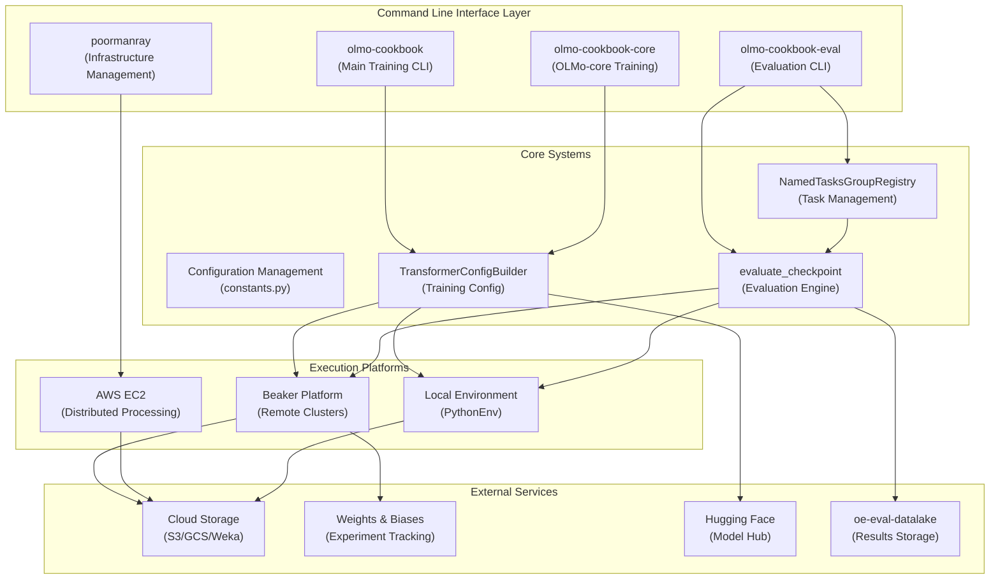
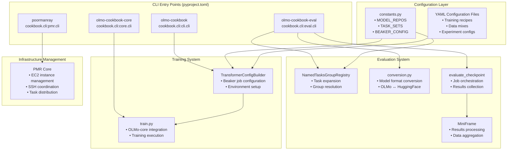

<!-- source: DeepWiki mcp.deepwiki.com · repo allenai/olmo-cookbook · page 1 Overview · fetched 2026-10-26 -->

# Overview

Relevant source files

The following files were used as context for generating this wiki page:

- [README.md](README.md)
- [pyproject.toml](pyproject.toml)

## Purpose and Scope

The `olmo-cookbook` repository is a comprehensive toolkit for managing the complete lifecycle of OLMo (Open Language Model) experiments, from training through evaluation and deployment. It serves as an orchestration layer that abstracts complex interactions with cloud platforms, compute resources, and machine learning infrastructure while providing a unified command-line interface for researchers and engineers.

This document provides an architectural overview of the entire system. For detailed information about specific subsystems, see [Configuration and Constants System](#2) for the central configuration management, [Evaluation System](#4) for comprehensive model evaluation workflows, [Training System](#5) for model training orchestration, and [Infrastructure Management](#6) for compute resource management.

## System Architecture

The olmo-cookbook system is built around four primary CLI interfaces that coordinate different aspects of the model development workflow:

**Sources:** [pyproject.toml:57-61](), [README.md:1-318]()

## Core Components and Code Structure

The system's architecture maps directly to specific code entities and modules:

**Sources:** [pyproject.toml:57-61](), [README.md:46-56](), [README.md:140-171](), [README.md:173-227](), [README.md:228-318]()

## Key Workflows

The olmo-cookbook supports three primary workflows, each accessible through dedicated CLI interfaces:

### Training Workflow
The training workflow uses configuration-driven job submission to cloud platforms:

1. **Configuration Building**: The `TransformerConfigBuilder` processes YAML recipe files ([README.md:48]()) and system constants to generate Beaker job specifications
2. **Job Launch**: The `olmo-cookbook launch` command ([README.md:54]()) submits configured training jobs to Beaker clusters
3. **Monitoring**: Integration with Weights & Biases provides real-time training metrics ([README.md:56]())

### Evaluation Workflow  
The evaluation system provides comprehensive model assessment capabilities:

1. **Model Conversion**: The `olmo-cookbook-eval convert` command ([README.md:64-89]()) transforms checkpoints between OLMo and HuggingFace formats
2. **Task Execution**: The `olmo-cookbook-eval evaluate` command ([README.md:101-123]()) runs evaluation tasks using the `NamedTasksGroupRegistry` system
3. **Results Retrieval**: The `olmo-cookbook-eval results` command ([README.md:127-137]()) queries the datalake for formatted results

### Infrastructure Workflow
The infrastructure management system enables distributed processing on EC2:

1. **Cluster Creation**: The `poormanray create` command ([README.md:242-258]()) provisions EC2 instance clusters
2. **Task Distribution**: The `poormanray map` command ([README.md:280-286]()) distributes processing tasks across instances  
3. **Resource Cleanup**: The `poormanray terminate` command ([README.md:289-294]()) manages resource lifecycle

**Sources:** [README.md:5-57](), [README.md:58-137](), [README.md:173-318]()

## Dependencies and Integration Points

The system integrates with multiple external platforms and frameworks through well-defined interfaces:

| Integration | Purpose | Configuration Source |
|-------------|---------|---------------------|
| **OLMo-core** | Training framework | [pyproject.toml:51]() |
| **Beaker Platform** | Remote job orchestration | [pyproject.toml:39-42]() |
| **Weights & Biases** | Experiment tracking | [pyproject.toml:43-45]() |
| **AWS/GCP** | Cloud storage and compute | [pyproject.toml:46-49]() |
| **HuggingFace** | Model distribution | Core dependencies |

The system requires Python 3.10-3.13 ([pyproject.toml:13]()) and supports optional dependency groups for different use cases, including development tools ([pyproject.toml:34-38]()), Beaker integration ([pyproject.toml:39-42]()), and checkpoint management ([pyproject.toml:46-49]()).

**Sources:** [pyproject.toml:15-55](), [README.md:17-29](), [README.md:32-44]()

---

