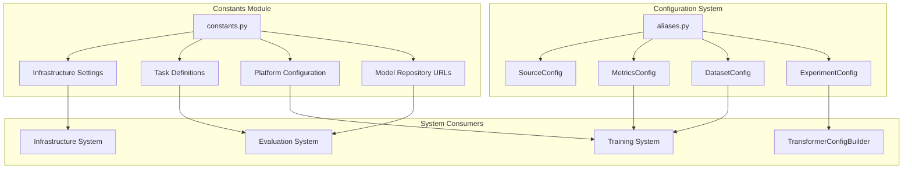
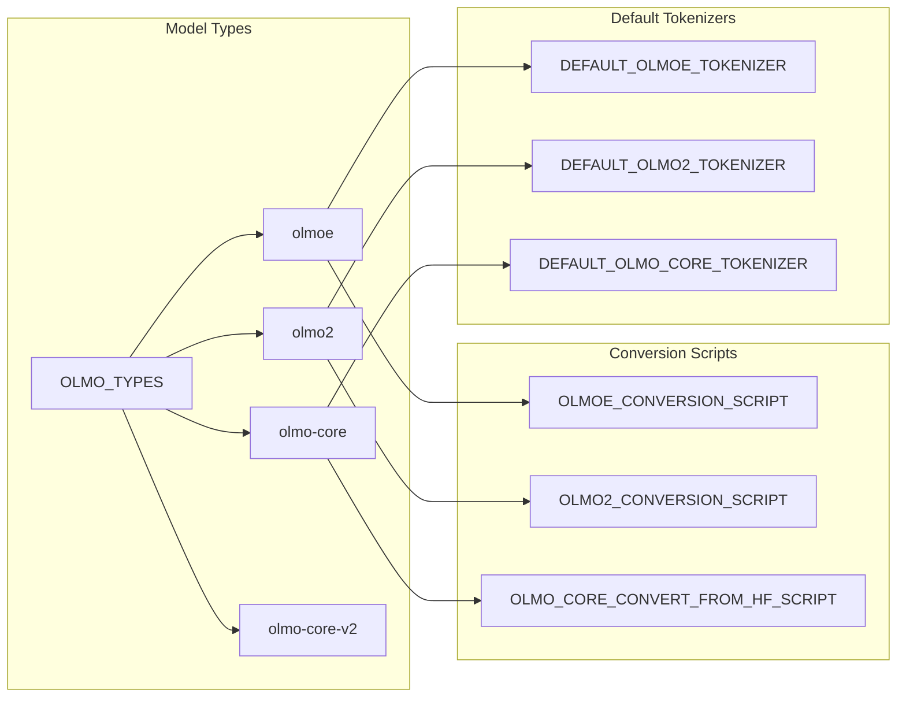
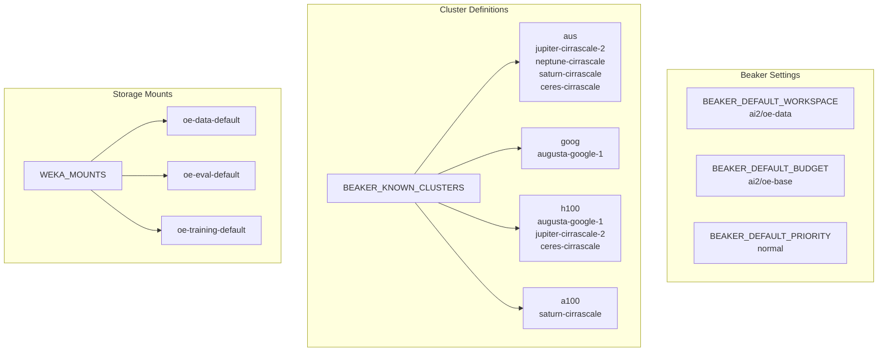
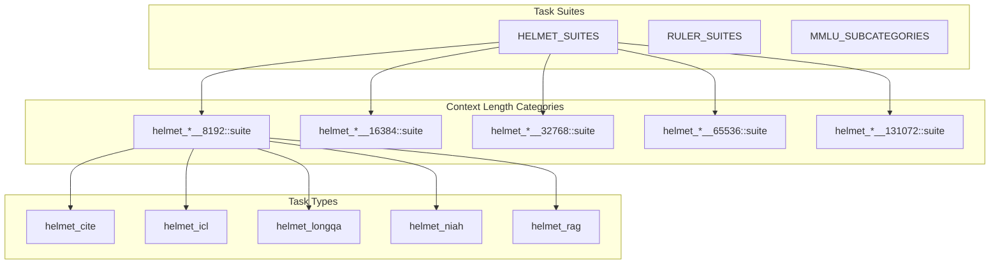
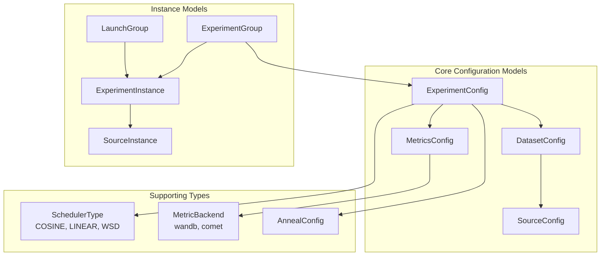
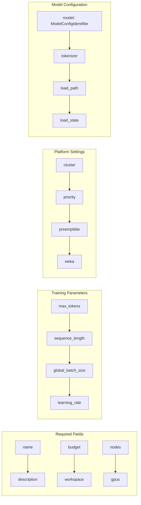
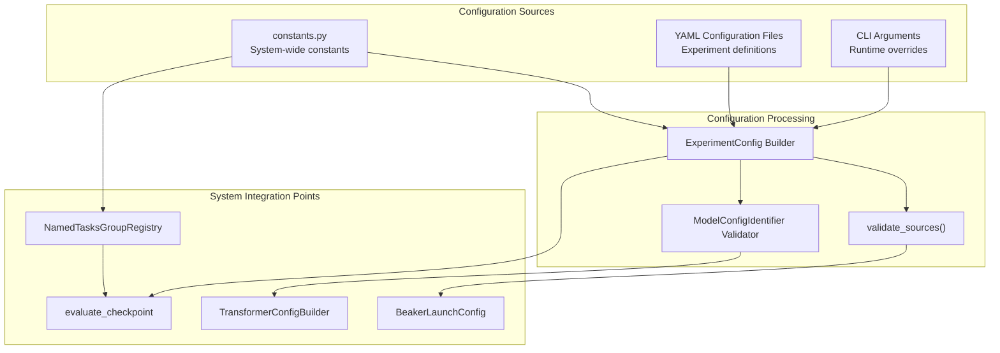

<!-- source: DeepWiki mcp.deepwiki.com · repo allenai/olmo-cookbook · page 2 Configuration and Constants System · fetched 2026-10-26 -->

# Configuration and Constants System

Relevant source files

The following files were used as context for generating this wiki page:

- [src/cookbook/aliases.py](src/cookbook/aliases.py)
- [src/cookbook/constants.py](src/cookbook/constants.py)

The Configuration and Constants System serves as the central configuration hub for all OLMo Cookbook operations, providing a unified source of truth for model repositories, evaluation benchmarks, platform settings, and experiment configurations. This system ensures consistency across training, evaluation, and infrastructure management workflows.

For information about how these configurations are used in specific workflows, see Training Configuration ([#5.1](#5.1)) and Evaluation Task Management ([#4.1](#4.1)).

## Core Constants Architecture

The system is built around two primary components: a constants module that defines static system-wide values, and a configuration system that handles dynamic experiment and runtime settings.

**System Constants Flow**

Sources: [src/cookbook/constants.py:1-1173](), [src/cookbook/aliases.py:1-154]()

## Model and Repository Configuration

The system maintains version-controlled references to all external dependencies, ensuring reproducible builds and conversions across different model formats.

| Constant | Purpose | Example Value |
|----------|---------|---------------|
| `TRANSFORMERS_GIT_URL` | HuggingFace Transformers repository | `https://github.com/huggingface/transformers.git` |
| `TRANSFORMERS_COMMIT_HASH` | Pinned commit for reproducibility | `241c04d36867259cdf11dbb4e9d9a60f9cb65ebc` |
| `AI2_OLMO_GIT_URL` | OLMo main repository | `https://github.com/allenai/OLMo.git` |
| `AI2_OLMO_CORE_GIT_URL` | OLMo Core repository | `https://github.com/allenai/OLMo-core.git` |

**Model Configuration Mapping**

Sources: [src/cookbook/constants.py:3-26](), [src/cookbook/constants.py:35-35]()

## Platform and Infrastructure Settings

The system defines comprehensive platform configurations for Beaker clusters, AWS infrastructure, and storage systems.

### Beaker Platform Configuration

**Infrastructure Configuration Hierarchy**

Sources: [src/cookbook/constants.py:28-83](), [src/cookbook/constants.py:37-51](), [src/cookbook/constants.py:53-83]()

## Evaluation Task Definitions

The system provides comprehensive task definitions organized into logical groupings for different evaluation scenarios.

### Core Task Categories

| Task Group | Description | Example Tasks |
|------------|-------------|---------------|
| `ALL_CORE_TASKS` | Fundamental reasoning benchmarks | `arc_easy`, `boolq`, `hellaswag` |
| `MMLU_CATEGORIES` | Massive Multitask Language Understanding | `mmlu_abstract_algebra`, `mmlu_anatomy` |
| `BBH_TASKS` | Big-Bench Hard reasoning tasks | `boolean_expressions`, `logical_deduction` |
| `ALL_CODEX_TASKS` | Code generation benchmarks | `codex_humaneval`, `mbpp`, `bigcodebench` |

### Evaluation Suite Structure

**Evaluation Task Hierarchy**

Sources: [src/cookbook/constants.py:85-537](), [src/cookbook/constants.py:230-408](), [src/cookbook/constants.py:410-537]()

## Experiment Configuration System

The configuration system uses Pydantic models to ensure type safety and validation for experiment definitions.

### Configuration Model Hierarchy

**Configuration Class Relationships**

Sources: [src/cookbook/aliases.py:77-130](), [src/cookbook/aliases.py:23-43](), [src/cookbook/aliases.py:50-55]()

### ExperimentConfig Structure

The `ExperimentConfig` class serves as the primary container for experiment settings:

**ExperimentConfig Field Organization**

Sources: [src/cookbook/aliases.py:77-113]()

## Configuration Flow and Usage

The configuration system integrates with all major components of the OLMo Cookbook, providing a consistent interface for accessing system settings.

**Configuration Integration Flow**

Sources: [src/cookbook/aliases.py:147-154](), [src/cookbook/aliases.py:115-121](), [src/cookbook/constants.py:919-923]()

The validation system ensures configuration consistency through several mechanisms:
- Source ratio validation ensures all sources in a dataset have consistent `target_ratio` settings
- Model configuration validation converts string identifiers to proper `ModelConfigIdentifier` objects  
- Annealing validation ensures that annealing configurations are only used with appropriate load paths

This centralized configuration approach enables the OLMo Cookbook to maintain consistency across complex multi-system workflows while providing flexibility for different use cases and deployment scenarios.

---

