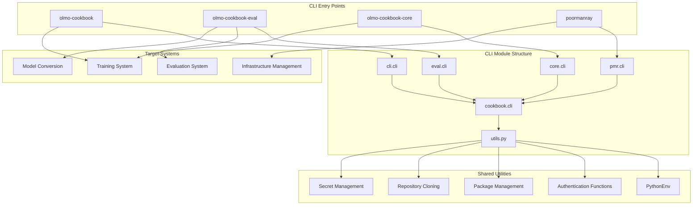
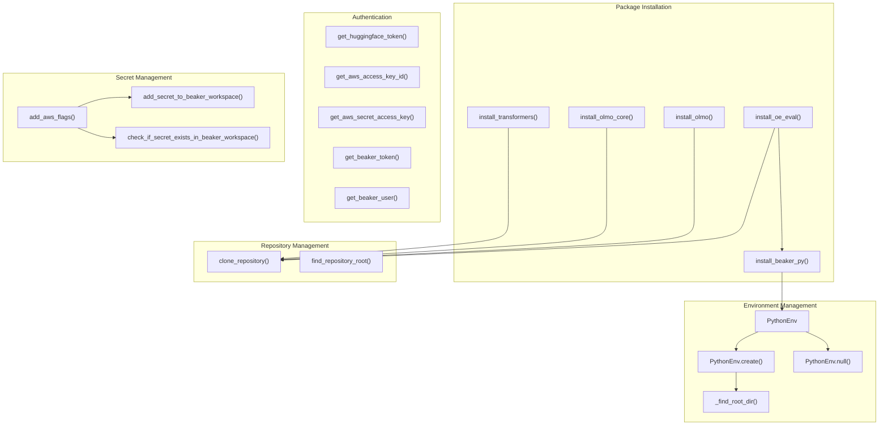
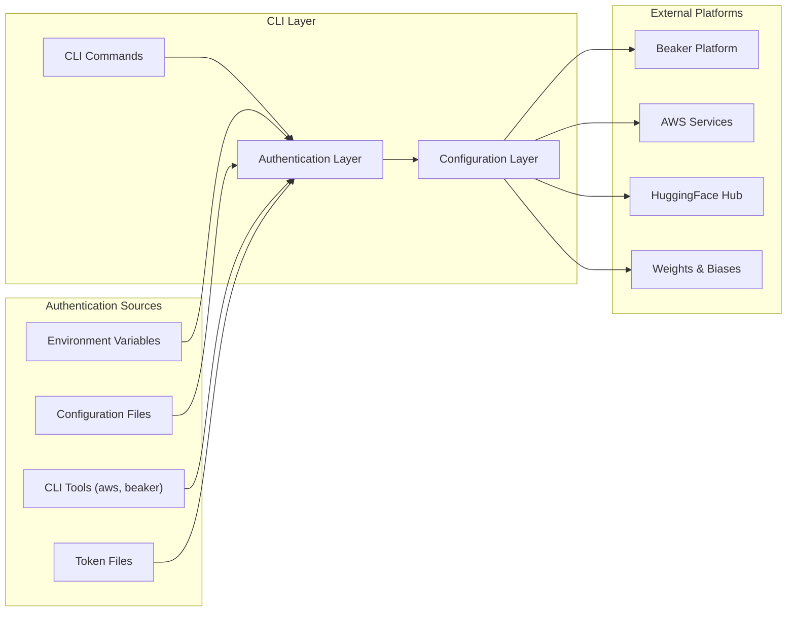

<!-- source: DeepWiki mcp.deepwiki.com · repo allenai/olmo-cookbook · page 3 Command Line Interface · fetched 2026-10-26 -->

# Command Line Interface

<details>
<summary>Relevant source files</summary>

The following files were used as context for generating this wiki page:

- [pyproject.toml](pyproject.toml)
- [src/cookbook/cli/utils.py](src/cookbook/cli/utils.py)

</details>


This document provides an overview of the command line interface structure in the olmo-cookbook repository. It covers the four main CLI entry points, their organization, shared utilities, and common patterns used across all command-line tools. For detailed documentation of specific CLI commands, see [Evaluation CLI](#3.1), [Training CLI](#3.2), and [Infrastructure CLI](#3.3).

## CLI Architecture Overview

The olmo-cookbook provides four distinct command-line interfaces, each targeting different workflows in the machine learning pipeline. These CLIs share common utilities and patterns while providing specialized functionality for their respective domains.

**CLI Architecture and Entry Points**


Sources: [pyproject.toml:57-61](), [src/cookbook/cli/utils.py:1-654]()

## Entry Points and Organization

The CLI system is organized around four main entry points, each defined in the project configuration and implemented as separate command modules.

| CLI Command | Entry Point | Module Path | Primary Purpose |
|-------------|-------------|-------------|-----------------|
| `olmo-cookbook` | `cookbook.cli:cli.cli` | `cookbook/cli/cli.py` | Model training orchestration |
| `olmo-cookbook-eval` | `cookbook.cli:eval.cli` | `cookbook/cli/eval.py` | Model evaluation and conversion |
| `olmo-cookbook-core` | `cookbook.cli:core.cli` | `cookbook/cli/core.py` | Core training functionality |
| `poormanray` | `cookbook.cli:pmr.cli` | `cookbook/cli/pmr.py` | Infrastructure management |

Sources: [pyproject.toml:57-61]()

## Common Utilities and Patterns

All CLI modules share a common set of utilities implemented in the `utils.py` module. These utilities handle cross-cutting concerns like environment management, authentication, and package installation.

**Utility Functions and Their Roles**


Sources: [src/cookbook/cli/utils.py:28-87](), [src/cookbook/cli/utils.py:150-243](), [src/cookbook/cli/utils.py:89-148](), [src/cookbook/cli/utils.py:417-459](), [src/cookbook/cli/utils.py:290-355]()

## Environment Management

The CLI system uses a sophisticated virtual environment management system through the `PythonEnv` class. This allows for isolated package installations and consistent dependency management across different execution contexts.

### PythonEnv Class Structure

The `PythonEnv` class provides three main modes of operation:

- **Isolated Environment**: Created with `PythonEnv.create()` for dependency isolation
- **System Environment**: Created with `PythonEnv.null()` for direct system usage
- **Named Environment**: Custom environments with specific naming and location

```python
# Key methods and properties from PythonEnv
@dataclass(frozen=True)
class PythonEnv:
    name: Optional[str]
    python: str
    pip: str
    
    def path(self) -> dict  # Environment variables with PATH setup
    @classmethod
    def create(cls, name, force=False, root=None) -> "PythonEnv"
    @classmethod  
    def null(cls) -> "PythonEnv"  # Uses system python/pip
```

Sources: [src/cookbook/cli/utils.py:28-87]()

## Package Installation and Dependency Management

The CLI utilities provide functions for installing various ML packages with proper dependency resolution and version management.

### Installation Functions

| Function | Purpose | Key Dependencies |
|----------|---------|------------------|
| `install_beaker_py()` | Beaker client and gantry | `beaker-py`, `beaker-gantry` |
| `install_oe_eval()` | OE-Eval evaluation toolkit | OE-Eval repository, beaker dependencies |
| `install_olmo()` | OLMo training framework | OLMo repository with `[train]` extras |
| `install_olmo_core()` | OLMo-core training system | OLMo-core repository |
| `install_transformers()` | HuggingFace Transformers | Transformers repository, accelerate, torchao |

The installation functions handle complex scenarios like:
- Commit-specific installations from git repositories
- Editable installations for development
- Dependency conflict resolution
- Version compatibility checks

Sources: [src/cookbook/cli/utils.py:150-173](), [src/cookbook/cli/utils.py:174-243](), [src/cookbook/cli/utils.py:462-489](), [src/cookbook/cli/utils.py:552-575]()

## External System Integration

The CLI system integrates with multiple external platforms and services, providing unified authentication and configuration management.

**External System Integration Flow**


Sources: [src/cookbook/cli/utils.py:89-102](), [src/cookbook/cli/utils.py:104-147](), [src/cookbook/cli/utils.py:316-336]()

## Authentication and Credentials

The CLI system provides comprehensive authentication support for various external services, with multiple fallback mechanisms for credential discovery.

### Authentication Functions

- **HuggingFace**: `get_huggingface_token()` - checks environment variables and token files
- **AWS**: `get_aws_access_key_id()` and `get_aws_secret_access_key()` - supports CLI, environment, and credential files
- **Beaker**: `get_beaker_token()` and `get_beaker_user()` - uses Beaker client configuration

### Secret Management

The system includes functions for managing secrets in Beaker workspaces:
- `add_secret_to_beaker_workspace()` - adds or updates workspace secrets
- `check_if_secret_exists_in_beaker_workspace()` - verifies secret existence
- `add_aws_flags()` - automatically configures AWS secrets for Beaker jobs

Sources: [src/cookbook/cli/utils.py:89-102](), [src/cookbook/cli/utils.py:104-147](), [src/cookbook/cli/utils.py:290-355](), [src/cookbook/cli/utils.py:357-392]()

---

