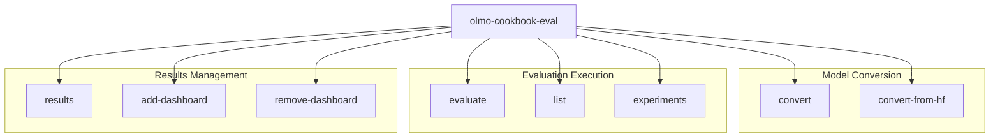
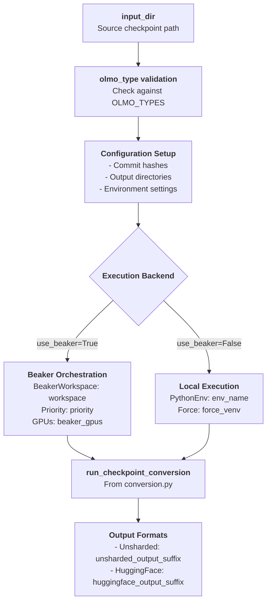
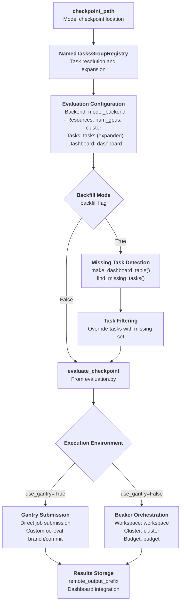
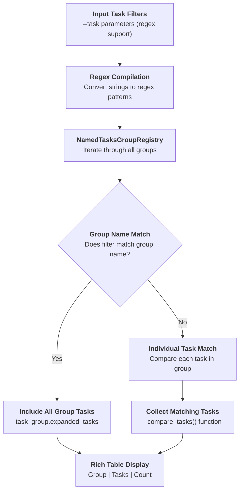
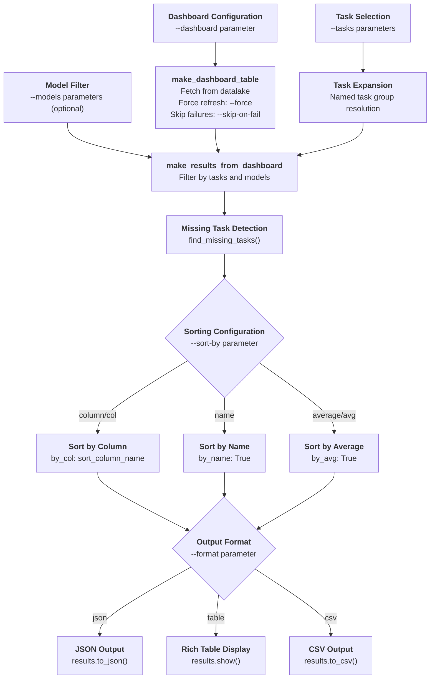

<!-- source: DeepWiki mcp.deepwiki.com · repo allenai/olmo-cookbook · page 3.1 Evaluation CLI (olmo-cookbook-eval) · fetched 2026-10-26 -->

# Evaluation CLI (olmo-cookbook-eval)

<details>
<summary>Relevant source files</summary>

The following files were used as context for generating this wiki page:

- [src/cookbook/cli/eval.py](src/cookbook/cli/eval.py)
- [src/cookbook/model/evaluators.py](src/cookbook/model/evaluators.py)
- [src/cookbook/recipes/olmo3-evals/README.md](src/cookbook/recipes/olmo3-evals/README.md)

</details>


The `olmo-cookbook-eval` CLI is the primary command-line interface for model evaluation workflows within the olmo-cookbook system. It provides comprehensive tools for model format conversion, evaluation execution across various compute environments, and results management through an integrated dashboard system.

This page covers the CLI commands, their options, and integration patterns. For detailed information about the underlying evaluation orchestration system, see [Evaluation Orchestration](#4.2). For task management and registry details, see [Task Management and Registry](#4.1). For model conversion specifics, see [Model Conversion](#4.3).

## CLI Command Structure

The `olmo-cookbook-eval` CLI implements eight primary commands organized into three functional groups:



**CLI Command Registration**

The CLI uses Click for command registration and is structured as a command group in [src/cookbook/cli/eval.py:871-884](). Each command function is decorated with Click options and registered with the main CLI group.

Sources: [src/cookbook/cli/eval.py:871-884]()

## Model Conversion Commands

### convert Command

The `convert` command handles conversion between different OLMo model formats, supporting OLMo, OLMo2, OLMoE, and OLMo-core variants.

**Key Parameters:**
- `--olmo-type`: Specifies the source OLMo model type (required)
- `--huggingface-tokenizer`: Tokenizer path for HuggingFace conversion
- `--unsharded-output-dir`/`--huggingface-output-dir`: Output destinations
- `--use-beaker`: Enable Beaker job orchestration

**Implementation Flow:**


The conversion process delegates to `run_checkpoint_conversion` from [src/cookbook/eval/conversion.py](), which handles the actual model transformation logic.

Sources: [src/cookbook/cli/eval.py:183-301]()

### convert-from-hf Command

The `convert-from-hf` command converts models from Hugging Face format to OLMo-core format, specifically targeting OLMo Core v2 architecture.

**Specialized Parameters:**
- `--huggingface-transformers-model-id`: HF Hub model identifier
- `--huggingface-transformers-revision`: Model revision/branch
- `--olmo-core-v2-model-arch`: Target OLMo architecture
- `--olmo-core-v2-tokenizer`: Compatible tokenizer
- `--skip-validation`/`--debug-validation`: Conversion validation controls

The implementation follows a similar execution pattern but uses `run_checkpoint_conversion_from_hf` from [src/cookbook/eval/conversion_from_hf.py]().

Sources: [src/cookbook/cli/eval.py:42-180]()

## Evaluation Execution

### evaluate Command

The `evaluate` command is the primary interface for launching model evaluations using the oe-eval toolkit. It supports both local and distributed execution with comprehensive configuration options.

**Core Architecture:**


**Parameter Processing:**
The command performs extensive parameter validation and transformation:
- `extra_args`: Regex processing to handle escaped hyphens [src/cookbook/cli/eval.py:540-541]()
- `task_args`: JSON parsing for task-specific configurations [src/cookbook/cli/eval.py:543-548]()
- `model_args`: Comma-separated key-value parsing [src/cookbook/cli/eval.py:550-555]()

**Backfill Functionality:**
When `--backfill` is enabled, the system automatically determines missing evaluations by:
1. Generating the model's run name using `make_eval_run_name`
2. Retrieving existing dashboard results via `make_dashboard_table`
3. Computing missing tasks using `find_missing_tasks`
4. Overriding the task list with only missing evaluations

Sources: [src/cookbook/cli/eval.py:492-625]()

### list Command

The `list` command provides an interface for browsing available evaluation tasks organized by the `NamedTasksGroupRegistry`.

**Task Filtering Logic:**


The comparison logic in `_compare_tasks` handles both string and regex pattern matching between task targets and sources [src/cookbook/cli/eval.py:776-785]().

Sources: [src/cookbook/cli/eval.py:771-836]()

### experiments Command

The `experiments` command queries the datalake to list available experiments for a specific model, with optional task filtering.

The command uses `FindExperiments.run(model_name=model)` to retrieve experiment metadata from the datalake, then applies regex-based task filtering if specified [src/cookbook/cli/eval.py:841-868]().

Sources: [src/cookbook/cli/eval.py:841-868]()

## Results Management

### results Command

The `results` command retrieves and displays evaluation results from the datalake with flexible formatting and sorting options.

**Results Processing Pipeline:**


The sorting functionality leverages the `MiniFrame.sort()` method with multiple sorting criteria and direction control via `--ascending`/`--descending` flags.

Sources: [src/cookbook/cli/eval.py:678-729]()

### Dashboard Management Commands

#### add-dashboard Command

Adds models to a specified dashboard using the `AddToDashboard.prun()` datalake operation. Supports optional source dashboard copying via `--source-dashboard` parameter.

#### remove-dashboard Command

Removes models from a dashboard using `RemoveFromDashboard.prun()` datalake operation.

Both commands use parallel execution patterns (`prun`) to handle multiple model operations efficiently.

Sources: [src/cookbook/cli/eval.py:748-767]()

## Integration with Core Systems

### Task Registry Integration

The CLI extensively integrates with `NamedTasksGroupRegistry` for task management:
- Task expansion in the `evaluate` command
- Task listing and filtering in the `list` command  
- Task validation across multiple commands

```python
# Example task group reference in help text
f"Tasks groups are: {', '.join(NamedTasksGroupRegistry.names())}"
```

Sources: [src/cookbook/cli/eval.py:322-324]()

### Configuration System Integration

The CLI imports and uses constants from the centralized configuration system:

| Constant | Purpose |
|----------|---------|
| `OLMO_TYPES` | Valid OLMo model type choices |
| `FIM_TOKENS` | Fill-in-middle token configurations |
| `*_COMMIT_HASH` | Default commit hashes for various repositories |
| `TRANSFORMERS_GIT_URL` | Default Transformers repository URL |

Sources: [src/cookbook/cli/eval.py:16-26]()

### Execution Environment Integration

The CLI supports multiple execution backends through consistent parameter patterns:
- **Local execution**: Virtual environment management with `force_venv`, `env_name`, `use_system_python`
- **Beaker orchestration**: Workspace, cluster, budget, and GPU resource configuration
- **Gantry submission**: Direct job submission with custom oe-eval versions

This flexibility enables the same CLI interface to work across development, testing, and production environments.

Sources: [src/cookbook/cli/eval.py]() (throughout various command definitions)

---

