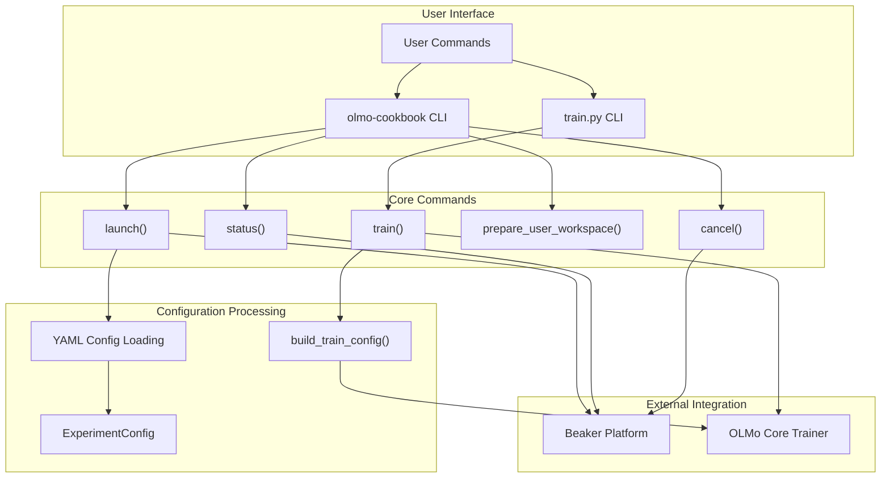
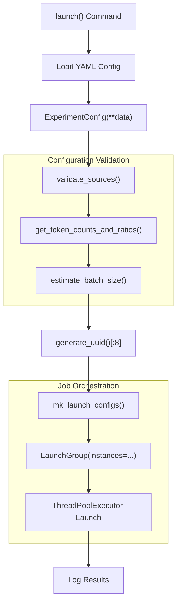
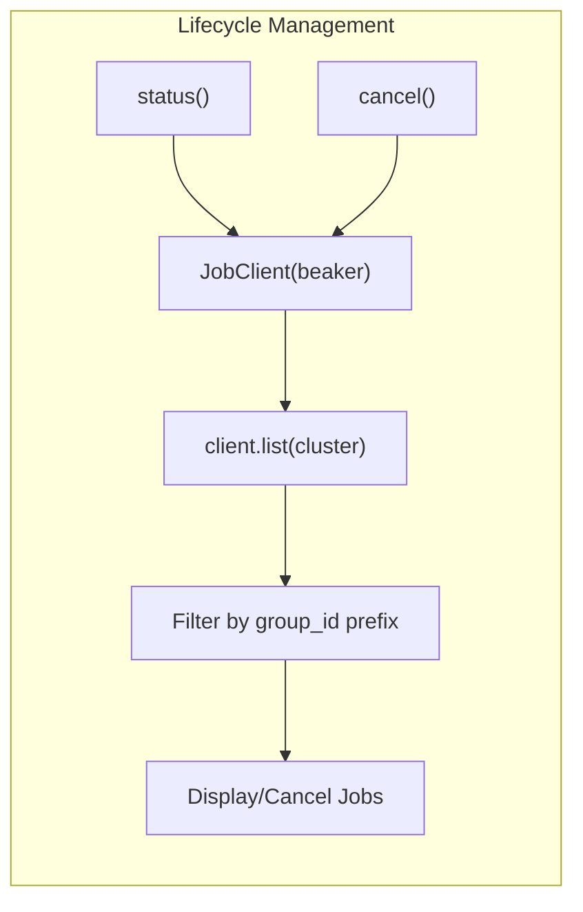
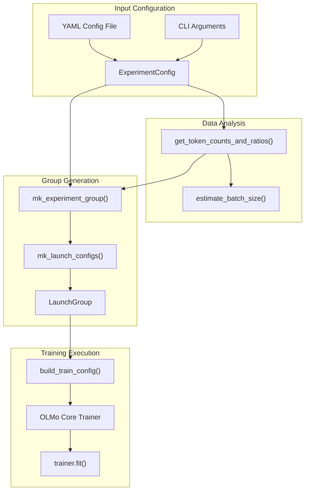
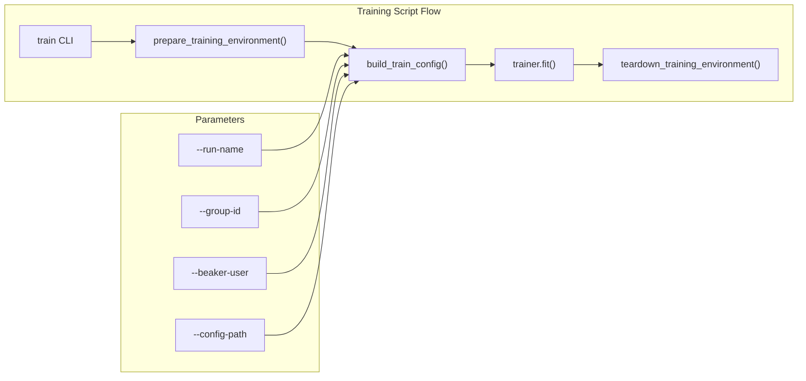
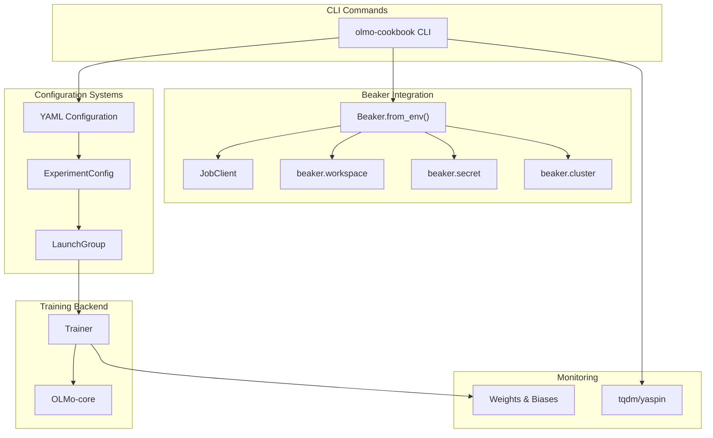

<!-- source: DeepWiki mcp.deepwiki.com · repo allenai/olmo-cookbook · page 3.2 Training CLI (olmo-cookbook) · fetched 2026-10-26 -->

# Training CLI (olmo-cookbook)

Relevant source files

The following files were used as context for generating this wiki page:

- [src/cookbook/cli/cli.py](src/cookbook/cli/cli.py)
- [src/cookbook/train.py](src/cookbook/train.py)

The Training CLI serves as the primary interface for launching and managing OLMo model training experiments. It provides commands for experiment orchestration, job lifecycle management, and workspace configuration on the Beaker platform.

For evaluation-specific operations, see [Evaluation CLI (olmo-cookbook-eval)](#3.1). For infrastructure management of EC2 instances, see [Infrastructure CLI (poormanray)](#3.3).

## CLI Structure and Entry Points

The training CLI operates through two main entry points that serve different phases of the training workflow:

**Sources:** [src/cookbook/cli/cli.py:30-33](), [src/cookbook/train.py:13-16]()

## Core Commands

### Launch Command

The `launch` command is the primary interface for starting training experiments. It processes experiment configurations and orchestrates job submission to the Beaker platform:

| Parameter | Type | Description |
|-----------|------|-------------|
| `--config` | Path | Path to experiment configuration YAML file |
| `--dry-run` | Flag | Print configurations without launching |
| `--no-cache` | Flag | Ignore cached source details |
| `--group-id` | String | Override generated group ID for restarts |

The launch workflow follows this sequence:

**Sources:** [src/cookbook/cli/cli.py:62-151]()

### Status and Cancel Commands

The CLI provides experiment lifecycle management through dedicated commands:

Both commands require the experiment configuration file and group ID to identify the target jobs within the Beaker cluster.

**Sources:** [src/cookbook/cli/cli.py:153-192](), [src/cookbook/cli/cli.py:194-231]()

### Workspace Preparation Commands

The CLI includes utilities for managing Beaker workspace secrets required for training:

| Command | Purpose |
|---------|---------|
| `prepare_user_workspace_from` | Copy secrets between workspaces |
| `prepare_user_workspace` | Set up workspace with provided credentials |

Required secrets include user-specific tokens and configuration files:
- `{USER}_BEAKER_TOKEN`
- `{USER}_WANDB_API_KEY` 
- `{USER}_AWS_CONFIG`
- `{USER}_AWS_CREDENTIALS`
- `R2_ENDPOINT_URL`
- `WEKA_ENDPOINT_URL`

**Sources:** [src/cookbook/cli/cli.py:234-378]()

## Configuration Processing Pipeline

The training system processes experiment configurations through a structured pipeline that transforms YAML specifications into executable training jobs:

The `ExperimentConfig` class validates the configuration structure, while `build_train_config()` creates the final training configuration that interfaces with OLMo-core.

**Sources:** [src/cookbook/cli/cli.py:65-117](), [src/cookbook/train.py:52-58]()

## Training Script Integration

The separate training script at [src/cookbook/train.py]() provides the execution layer that runs within Beaker jobs:

The training script uses the `@record` decorator for distributed training error handling and integrates with OLMo-core's training environment management.

**Sources:** [src/cookbook/train.py:45-66]()

## External System Integration

The training CLI coordinates with multiple external systems to execute training workflows:

The system abstracts platform-specific details while providing comprehensive experiment management capabilities including authentication, job orchestration, and monitoring integration.

**Sources:** [src/cookbook/cli/cli.py:1-26](), [src/cookbook/train.py:1-11]()

---

