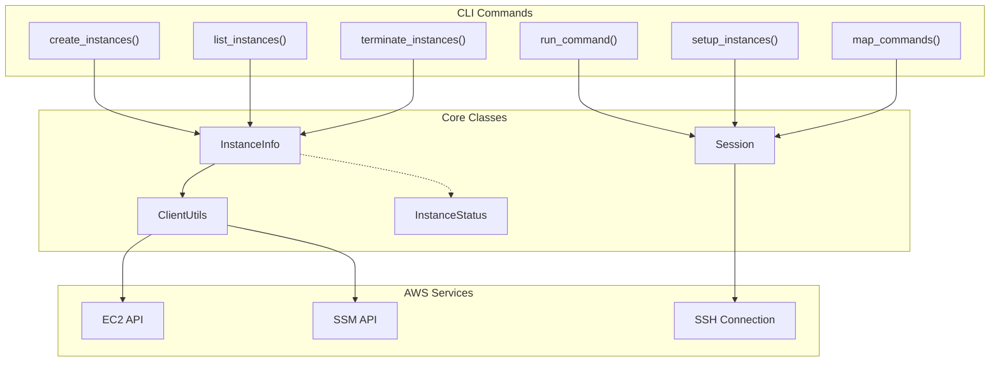
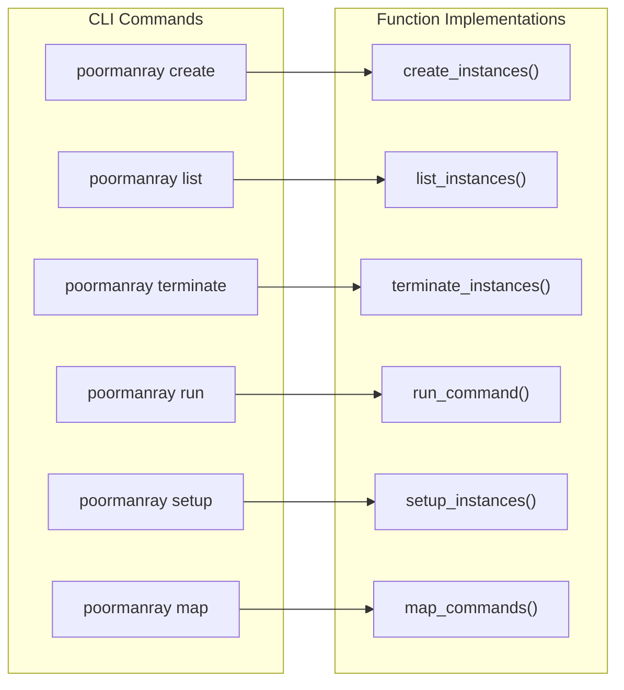
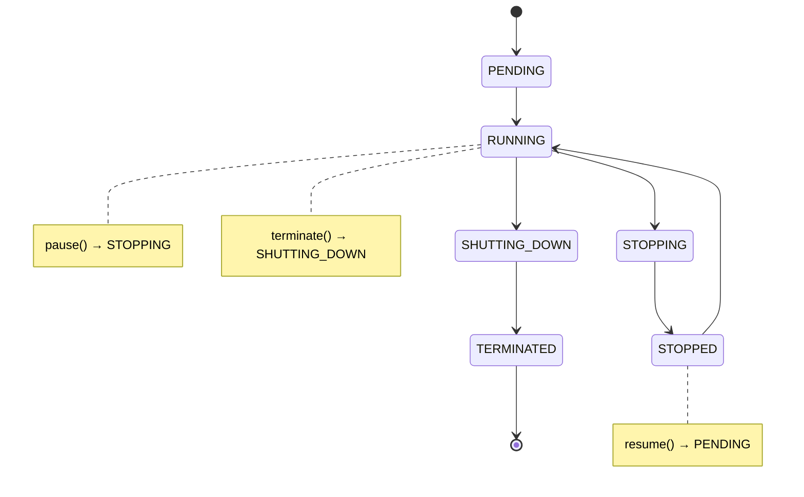

<!-- source: DeepWiki mcp.deepwiki.com · repo allenai/olmo-cookbook · page 3.3 Infrastructure CLI (poormanray) · fetched 2026-10-26 -->

# Infrastructure CLI (poormanray)

<details>
<summary>Relevant source files</summary>

The following files were used as context for generating this wiki page:

- [src/cookbook/cli/pmr.py](src/cookbook/cli/pmr.py)

</details>


## Purpose and Scope

The Infrastructure CLI (poormanray) provides command-line tools for managing EC2 instances and distributed processing workflows. It serves as a lightweight alternative to Ray for orchestrating compute clusters, with specialized support for data processing pipelines like Dolma and DECON. This system handles instance lifecycle management, SSH-based command execution, and automated toolkit installation across clusters.

For information about training workflows, see [Training CLI (olmo-cookbook)](#3.2). For evaluation infrastructure, see [Evaluation System](#4).

## Architecture Overview

The poormanray system is built around three core abstractions: instance management, SSH session handling, and command execution. The CLI provides a unified interface for managing EC2 clusters with automatic AWS credential handling and toolkit installation.

### Core System Architecture



Sources: [src/cookbook/cli/pmr.py:1-2070]()

### Command to Function Mapping



Sources: [src/cookbook/cli/pmr.py:2055-2065]()

## Core Components

### InstanceInfo Class

The `InstanceInfo` class serves as the primary abstraction for EC2 instances, providing both data representation and lifecycle management capabilities.

**Key Methods:**
- `create_instance()`: Creates new EC2 instances with specified configurations
- `describe_instances()`: Retrieves instance information with filtering
- `terminate()`: Terminates instances with optional wait
- `pause()`/`resume()`: Instance state management

**Key Attributes:**
- `instance_id`, `instance_type`, `image_id`: AWS identifiers
- `public_ip_address`, `public_dns_name`: Network endpoints  
- `state`: Current instance status from `InstanceStatus` enum
- `tags`: Instance metadata including `Project` and `Contact` tags

Sources: [src/cookbook/cli/pmr.py:415-877]()

### Session Class

The `Session` class handles SSH connections and command execution on remote instances.

**Key Methods:**
- `connect()`: Establishes SSH connection using paramiko
- `run_single()`: Executes commands directly
- `run_in_screen()`: Executes commands in detached screen sessions
- `run()`: Main command execution interface

**Connection Management:**
- Supports RSA key authentication via `private_key_path`
- Default user is `ec2-user` for Amazon Linux instances
- Handles terminal sizing for interactive sessions

Sources: [src/cookbook/cli/pmr.py:879-1019]()

### ClientUtils Class

The `ClientUtils` class provides factory methods for AWS service clients with session management.

**Methods:**
- `get_ec2_client()`: Creates EC2 client with region and profile support
- `get_ssm_client()`: Creates SSM client for parameter store access

**Configuration:**
- Respects `AWS_PROFILE` environment variable
- Default region is `us-east-1`
- Used for AMI ID resolution and instance operations

Sources: [src/cookbook/cli/pmr.py:333-355]()

## Command Structure

### Common CLI Options

All commands share a common set of options implemented via the `common_cli_options` decorator:

| Option | Default | Description |
|--------|---------|-------------|
| `--name` | Required | Cluster name for tagging and filtering |
| `--region` | us-east-1 | AWS region |
| `--instance-type` | i4i.xlarge | EC2 instance type |
| `--owner` | $USER | Owner tag for cost tracking |
| `--ssh-key-path` | ~/.ssh/id_* | SSH private key path |
| `--instance-id` | None | Specific instance IDs to target |

Sources: [src/cookbook/cli/pmr.py:1146-1251]()

### Instance Lifecycle Commands

#### Create Command
Creates new EC2 instances with automatic key pair import and tagging:

```bash
poormanray create --name myproject --number 5 --instance-type i4i.2xlarge
```

**Implementation Details:**
- Imports SSH public key to EC2 using `import_ssh_key_to_ec2()`
- Generates instance names with numeric suffixes (e.g., `myproject-0001`)
- Supports custom storage configuration via `--storage-type`, `--storage-size`
- Uses latest Amazon Linux 2023 AMI with architecture detection

Sources: [src/cookbook/cli/pmr.py:1273-1369]()

#### Terminate Command
Terminates instances matching project and owner tags:

```bash
poormanray terminate --name myproject --region us-east-1
```

**Features:**
- Filters by `Project` and `Contact` tags
- Optional instance ID targeting
- Waits for termination completion unless `--detach` specified

Sources: [src/cookbook/cli/pmr.py:1419-1466]()

### Command Execution

#### Run Command
Executes commands or scripts on running instances:

```bash
poormanray run --name myproject --command "echo 'Hello World'" --ssh-key-path ~/.ssh/id_rsa
```

**Script Execution:**
- Converts scripts to base64-encoded commands via `script_to_command()`
- Supports detached execution in screen sessions
- Optional instance self-termination with `--spindown`

Sources: [src/cookbook/cli/pmr.py:1561-1641]()

#### Map Command
Distributes multiple scripts across instances for parallel execution:

```bash
poormanray map --name myproject --script scripts/* --ssh-key-path ~/.ssh/id_rsa
```

**Distribution Algorithm:**
- Shuffles scripts for even distribution using `random.seed(42)`
- Creates per-instance job directories with UUID naming
- Generates `run_all.sh` scripts for batch execution
- Supports optional instance spindown after completion

Sources: [src/cookbook/cli/pmr.py:1923-2053]()

## Toolkit Installation

The system provides automated setup for various data processing toolkits:

### Setup Commands

| Command | Purpose | Key Components |
|---------|---------|----------------|
| `setup` | AWS credentials | `.aws/config`, `.aws/credentials`, screen |
| `setup-d2tk` | Dolma2 toolkit | RAID setup, rust toolchain, datamap-rs |
| `setup-dolma-python` | Dolma Python | Python 3.12, uv, dolma package |
| `setup-decon` | DECON toolkit | PMR environment, rust, decon repository |

### DECON Setup with PMR Environment

The `setup_decon` command automatically configures PMR environment variables for distributed processing:

```bash
poormanray setup-decon --name myproject --github-token <token>
```

**PMR Environment:**
- Sets `PMR_HOST_INDEX` (0-based instance index)
- Sets `PMR_HOST_COUNT` (total instance count)
- Enables host-aware distributed processing

Sources: [src/cookbook/cli/pmr.py:1839-1921]()

### Installation Script Generation

Setup scripts are generated dynamically using base64 encoding:

1. **Package Manager Detection**: Uses `PACKAGE_MANAGER_DETECTOR` script to identify system package manager
2. **Drive Configuration**: Automatically configures RAID arrays for instance store drives  
3. **Toolkit Installation**: Installs language runtimes, tools, and repositories
4. **Environment Setup**: Configures paths and environment variables

Sources: [src/cookbook/cli/pmr.py:97-330]()

## Instance State Management

### Instance Status Tracking



**InstanceStatus Enum:**
- `active()`: Returns non-terminated states for listing
- `unterminated()`: Returns states excluding terminated/shutting-down
- Used for filtering in `describe_instances()`

Sources: [src/cookbook/cli/pmr.py:357-376]()

### Pause and Resume Operations

The system supports pausing (stopping) and resuming (starting) instances:

```bash
poormanray pause --name myproject
poormanray resume --name myproject  
```

**Implementation:**
- Uses EC2 `stop_instances()` and `start_instances()` APIs
- Waits for state transitions via boto3 waiters
- Maintains instance configuration and attached storage
- Preserves instance store data during pause/resume cycle

Sources: [src/cookbook/cli/pmr.py:1468-1558]()

## Error Handling and Reliability

### SSH Connection Management
- Automatic host key acceptance via `paramiko.AutoAddPolicy()`
- Connection timeout handling in command execution
- Screen session management for long-running tasks

### AWS Integration
- Handles `InvalidInstanceID.NotFound` errors gracefully
- Automatic AMI ID resolution for different architectures (x86_64/ARM64)
- VPC discovery for instance placement

### Command Execution Patterns
- Base64 encoding for safe script transfer
- Completion markers for detached command tracking
- Timeout support with configurable limits

Sources: [src/cookbook/cli/pmr.py:737-746](), [src/cookbook/cli/pmr.py:983-994]()

---

