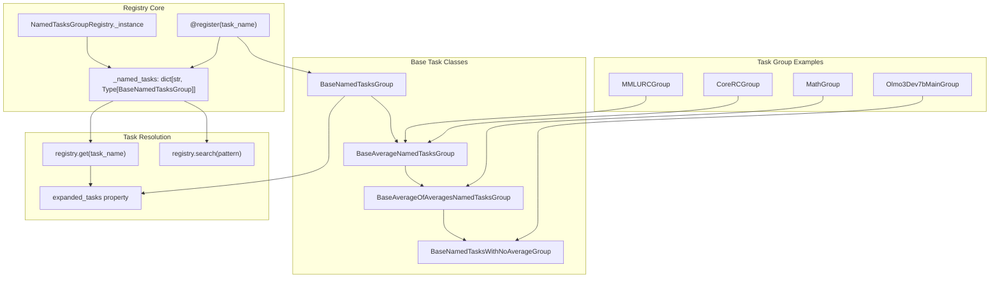
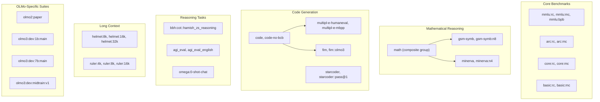
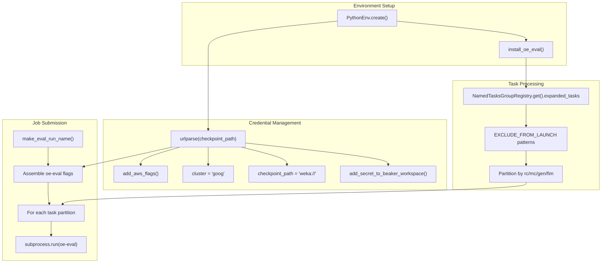
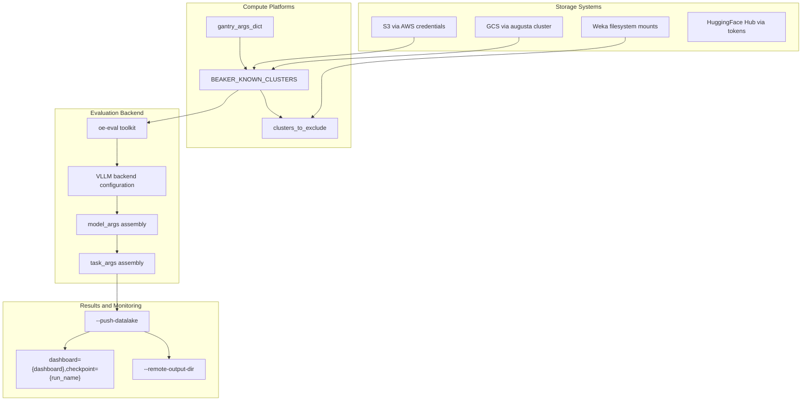

<!-- source: DeepWiki mcp.deepwiki.com · repo allenai/olmo-cookbook · page 4 Evaluation System · fetched 2026-10-26 -->

# Evaluation System

Relevant source files

The following files were used as context for generating this wiki page:

- [src/cookbook/eval/evaluation.py](src/cookbook/eval/evaluation.py)
- [src/cookbook/eval/named_tasks.py](src/cookbook/eval/named_tasks.py)

The Evaluation System provides comprehensive model evaluation capabilities for OLMo models across diverse benchmarks and tasks. This system handles task organization, execution orchestration, model format conversion, and results aggregation. The evaluation system integrates with external platforms including Beaker for distributed compute, oe-eval for task execution, and various storage backends.

For training-specific configurations, see [Training System](#5). For infrastructure management, see [Infrastructure Management](#6). For CLI usage patterns, see [Evaluation CLI](#3.1).

## System Architecture

The Evaluation System consists of four main subsystems that work together to provide end-to-end evaluation capabilities:

**Evaluation System Architecture**

```mermaid
graph TB
    subgraph "Task Management Layer"
        Registry["NamedTasksGroupRegistry"]
        BaseGroup["BaseNamedTasksGroup"]
        AvgGroup["BaseAverageNamedTasksGroup"]
        AvgOfAvgGroup["BaseAverageOfAveragesNamedTasksGroup"]
        
        Registry --> BaseGroup
        BaseGroup --> AvgGroup
        BaseGroup --> AvgOfAvgGroup
    end
    
    subgraph "Orchestration Layer"
        EvalFunc["evaluate_checkpoint"]
        PythonEnv["PythonEnv"]
        InstallOE["install_oe_eval"]
        MakeRunName["make_eval_run_name"]
        
        EvalFunc --> PythonEnv
        EvalFunc --> InstallOE
        EvalFunc --> MakeRunName
    end
    
    subgraph "External Integration"
        OEEval["oe-eval toolkit"]
        BeakerJobs["Beaker job submissions"]
        AWSFlags["AWS credential management"]
        HFSecrets["HuggingFace token handling"]
        
        EvalFunc --> OEEval
        EvalFunc --> BeakerJobs
        EvalFunc --> AWSFlags
        EvalFunc --> HFSecrets
    end
    
    subgraph "Task Processing"
        TaskPartition["Task partitioning by type"]
        TaskExpansion["expanded_tasks property"]
        TaskFiltering["EXCLUDE_FROM_LAUNCH patterns"]
        
        Registry --> TaskExpansion
        EvalFunc --> TaskPartition
        EvalFunc --> TaskFiltering
    end
    
    Registry --> EvalFunc
    TaskExpansion --> TaskPartition
```

Sources: [src/cookbook/eval/named_tasks.py:12-68](), [src/cookbook/eval/evaluation.py:27-65]()

## Task Management and Registry

The task management system provides a hierarchical organization of evaluation tasks through the `NamedTasksGroupRegistry` singleton and base classes that define task grouping patterns.

**Task Registry System**

The registry operates as a singleton pattern where task groups are registered using decorators. Each task group inherits from base classes that define different aggregation behaviors:

| Class | Purpose | Aggregation Behavior |
|-------|---------|---------------------|
| `BaseNamedTasksGroup` | Basic task grouping | No aggregation (returns `None` from `combine`) |
| `BaseAverageNamedTasksGroup` | Simple averaging | Computes mean of task scores |
| `BaseAverageOfAveragesNamedTasksGroup` | Hierarchical averaging | Averages results from child task groups |
| `BaseNamedTasksWithNoAverageGroup` | Display-only groups | Computes child averages but excludes group average |

Sources: [src/cookbook/eval/named_tasks.py:12-106](), [src/cookbook/eval/named_tasks.py:108-200]()

## Task Group Categories and Structure

The evaluation system organizes tasks into several major categories, each containing domain-specific task groups:

**Major Task Categories**

The system includes dynamically generated task groups for different context lengths using factory functions:

- `make_helmet_group()` generates groups for context lengths from 8K to 128K tokens
- `make_ruler_group()` generates groups for context lengths from 4K to 128K tokens

Sources: [src/cookbook/eval/named_tasks.py:207-584](), [src/cookbook/eval/named_tasks.py:555-584]()

## Evaluation Orchestration

The `evaluate_checkpoint` function serves as the main orchestration point, handling environment setup, credential management, task partitioning, and job submission to external systems.

**Evaluation Orchestration Flow**

The orchestration system handles several key responsibilities:

1. **Storage Backend Detection**: Automatically configures credentials and cluster selection based on checkpoint path scheme (S3, GCS, Weka, HuggingFace Hub)

2. **Task Partitioning**: Groups tasks by evaluation type to optimize resource usage:
   - `rc` tasks (reading comprehension)
   - `mc` tasks (multiple choice) 
   - `gen` tasks (generation)
   - `fim` tasks (fill-in-the-middle)

3. **Dynamic Configuration**: Assembles runtime flags including model arguments, task arguments, and Gantry configuration

Sources: [src/cookbook/eval/evaluation.py:27-358](), [src/cookbook/eval/evaluation.py:89-124](), [src/cookbook/eval/evaluation.py:223-240]()

## Integration with External Systems

The evaluation system integrates with multiple external platforms through standardized interfaces and configuration management.

**External System Integration**

Key integration patterns include:

- **Credential Management**: Automatic detection and configuration of storage credentials based on checkpoint path schemes
- **Cluster Selection**: Dynamic cluster assignment based on storage backend requirements and resource availability  
- **Resource Optimization**: Task partitioning and batch sizing to optimize compute utilization
- **Results Aggregation**: Standardized output formats and metadata tagging for downstream processing

The system uses several configuration constants and exclusion patterns:

- `EXCLUDE_FROM_LAUNCH`: Regex patterns for tasks that don't require separate job submission
- `FIM_TOKENS`: Configuration dictionaries for fill-in-the-middle task tokenization
- `BEAKER_KNOWN_CLUSTERS`: Mapping of cluster nicknames to actual cluster names

Sources: [src/cookbook/eval/evaluation.py:154-168](), [src/cookbook/eval/evaluation.py:206-211](), [src/cookbook/eval/evaluation.py:321-346]()

---

