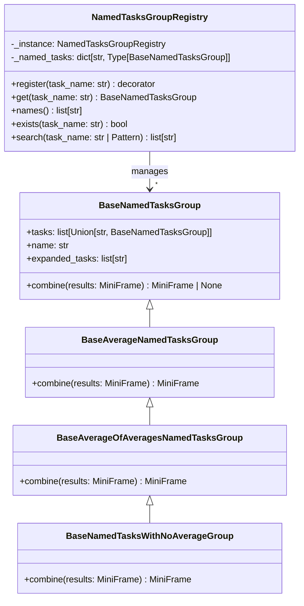
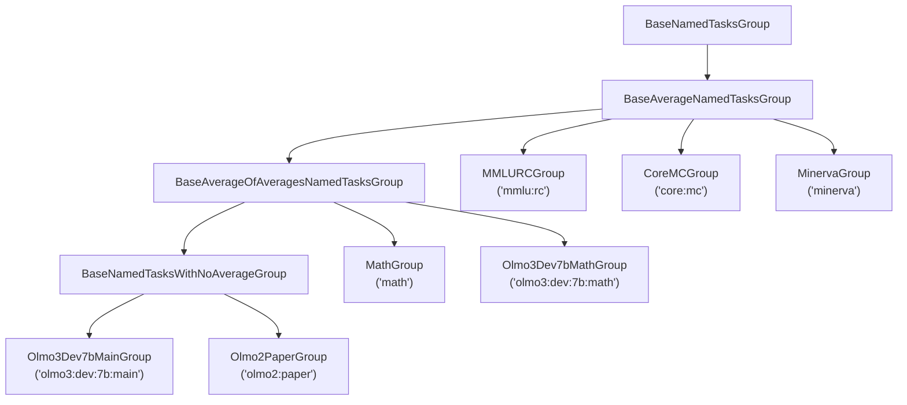
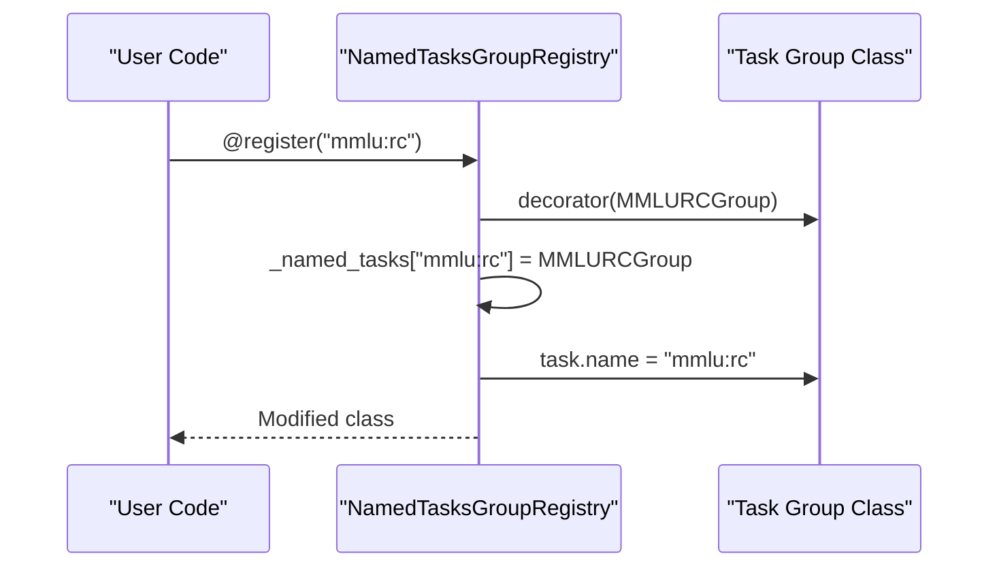
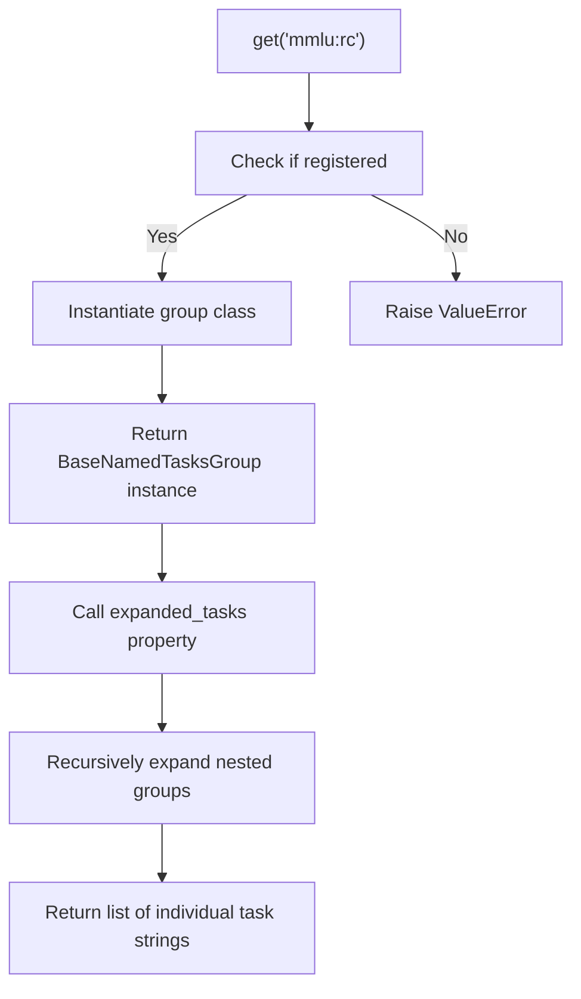
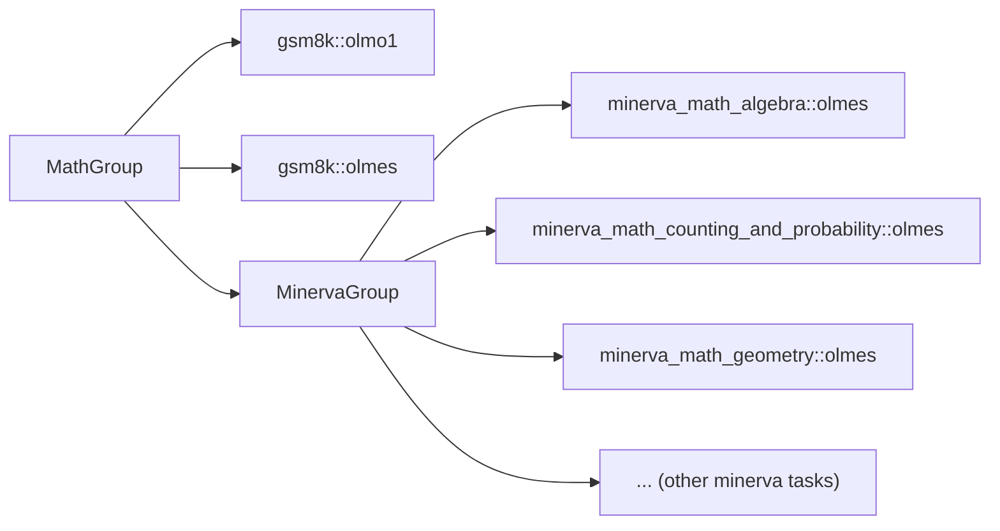

<!-- source: DeepWiki mcp.deepwiki.com · repo allenai/olmo-cookbook · page 4.1 Task Management and Registry · fetched 2026-10-26 -->

# Task Management and Registry

<details>
<summary>Relevant source files</summary>

The following files were used as context for generating this wiki page:

- [src/cookbook/eval/named_tasks.py](src/cookbook/eval/named_tasks.py)
- [src/cookbook/model/evaluators.py](src/cookbook/model/evaluators.py)
- [src/cookbook/recipes/olmo3-evals/README.md](src/cookbook/recipes/olmo3-evals/README.md)

</details>


This document covers the task management and registry system that organizes evaluation tasks into hierarchical groups and provides mechanisms for task resolution and averaging. The system enables flexible organization of evaluation benchmarks and supports different aggregation strategies for computing composite scores.

For information about how tasks are executed, see [Evaluation Orchestration](#4.2). For details about results processing after task execution, see [Results Processing and Visualization](#4.4).

## Core Registry Architecture

The task management system is built around a singleton registry pattern that manages named task groups. The `NamedTasksGroupRegistry` serves as the central repository for all task group definitions and provides methods for registration, lookup, and resolution.



The registry implements a singleton pattern through the `__new__` method [src/cookbook/eval/named_tasks.py:20-24]() to ensure a single global instance manages all task groups throughout the application lifecycle.

**Sources:** [src/cookbook/eval/named_tasks.py:12-68]()

## Task Group Hierarchy and Types

The system supports four main types of task groups, each with different behaviors for combining results:

| Task Group Type | Purpose | Averaging Behavior |
|----------------|---------|-------------------|
| `BaseNamedTasksGroup` | Basic grouping with no aggregation | Returns `None` from `combine()` |
| `BaseAverageNamedTasksGroup` | Simple averaging of task scores | Computes mean of all task scores |
| `BaseAverageOfAveragesNamedTasksGroup` | Averaging groups and individual tasks | Computes mean of child averages and individual scores |
| `BaseNamedTasksWithNoAverageGroup` | View-only groups | Shows child averages but no group average |



**Sources:** [src/cookbook/eval/named_tasks.py:70-200]()

## Task Registration and Resolution

Task groups are registered using a decorator pattern that associates string identifiers with task group classes. The registration process modifies the class name to match the registered identifier.

### Task Registration Process



### Task Resolution Process

When a task name is requested, the registry resolves it through the following process:



The `expanded_tasks` property [src/cookbook/eval/named_tasks.py:84-95]() recursively resolves nested task groups to produce a flat list of individual task identifiers.

**Sources:** [src/cookbook/eval/named_tasks.py:26-67](), [src/cookbook/eval/named_tasks.py:84-95]()

## Task Name Resolution and Expansion

Individual tasks are identified by composite strings that encode the benchmark, evaluation method, and configuration. The system supports both individual task strings and nested task group references.

### Task Name Format

Task names follow structured patterns:
- Individual tasks: `"arc_challenge:rc::olmes"`, `"gsm8k::olmo1"`
- Parameterized tasks: `"gsm8k::olmo3:n8:v2"`, `"minerva_math_algebra:bpb::olmes"`
- Group references: `MinervaGroup()`, `CoreRCGroup()`

### Task Expansion Example



The expansion process handles circular references and maintains the hierarchical structure for averaging purposes [src/cookbook/eval/named_tasks.py:88-94]().

**Sources:** [src/cookbook/eval/named_tasks.py:360-365](), [src/cookbook/eval/named_tasks.py:340-341]()

## Registry Search and Discovery

The registry provides search capabilities for discovering available tasks and groups:

| Method | Purpose | Example |
|--------|---------|---------|
| `names()` | List all registered task group names | `["mmlu:rc", "core:mc", "math", ...]` |
| `exists(name)` | Check if a task group is registered | `exists("mmlu:rc")` → `True` |
| `search(pattern)` | Find tasks matching pattern/regex | `search("mmlu")` → `["mmlu:rc", "mmlu:mc", ...]` |

**Sources:** [src/cookbook/eval/named_tasks.py:44-59]()

## Concrete Task Group Examples

The system includes numerous pre-defined task groups organized by domain and evaluation method:

### MMLU Task Groups
- `mmlu:rc` - MMLU reading comprehension tasks [src/cookbook/eval/named_tasks.py:207-209]()
- `mmlu:mc` - MMLU multiple choice tasks [src/cookbook/eval/named_tasks.py:217-219]() 
- `mmlu_stem:mc` - MMLU STEM subject subset [src/cookbook/eval/named_tasks.py:222-224]()

### Composite Task Groups
- `math` - Combines GSM8K and Minerva tasks [src/cookbook/eval/named_tasks.py:359-365]()
- `olmo3:dev:7b:main` - Complete 7B model evaluation suite [src/cookbook/eval/named_tasks.py:908-930]()

### Dynamic Task Groups
The system also generates task groups dynamically for length-specific evaluations:

```python
for helmet_length in (int(2**i) for i in range(13, 18)):
    NamedTasksGroupRegistry.register(f"helmet:{helmet_length // 2 ** 10}k")(make_helmet_group(helmet_length))
```

**Sources:** [src/cookbook/eval/named_tasks.py:555-568](), [src/cookbook/eval/named_tasks.py:571-584]()

## Integration with Constants

The task registry integrates with the constants system to dynamically generate task lists based on predefined categories:

```python
tasks = [f"{category}:rc::olmes" for category in constants.MMLU_CATEGORIES]
```

This pattern allows task groups to automatically include new tasks as categories are added to the constants definitions.

**Sources:** [src/cookbook/eval/named_tasks.py:209](), [src/cookbook/eval/named_tasks.py:254]()

---

