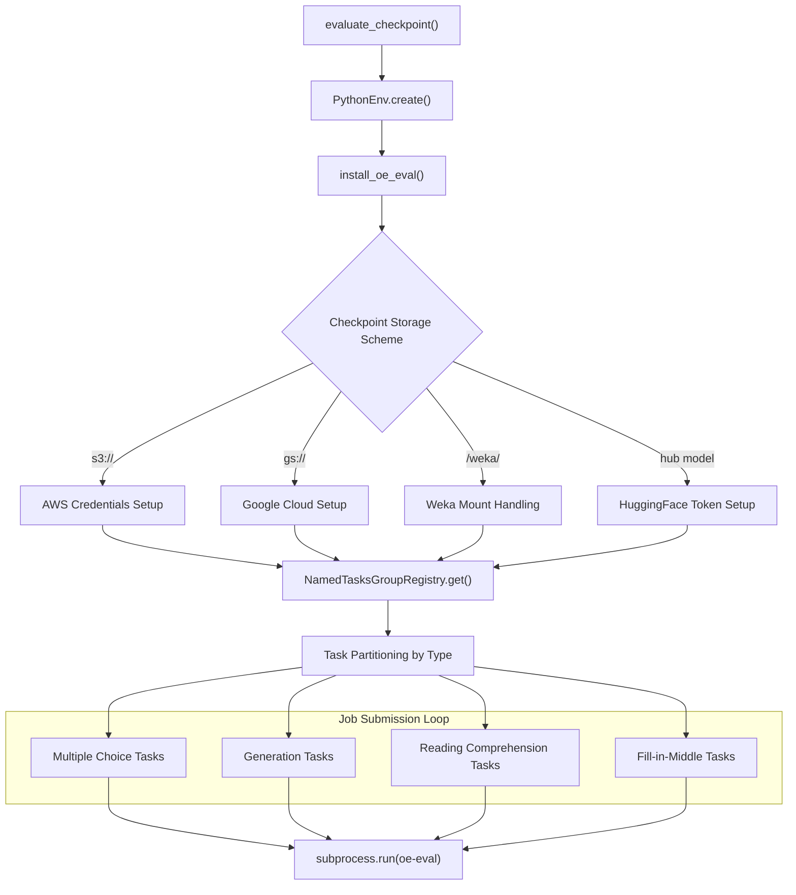
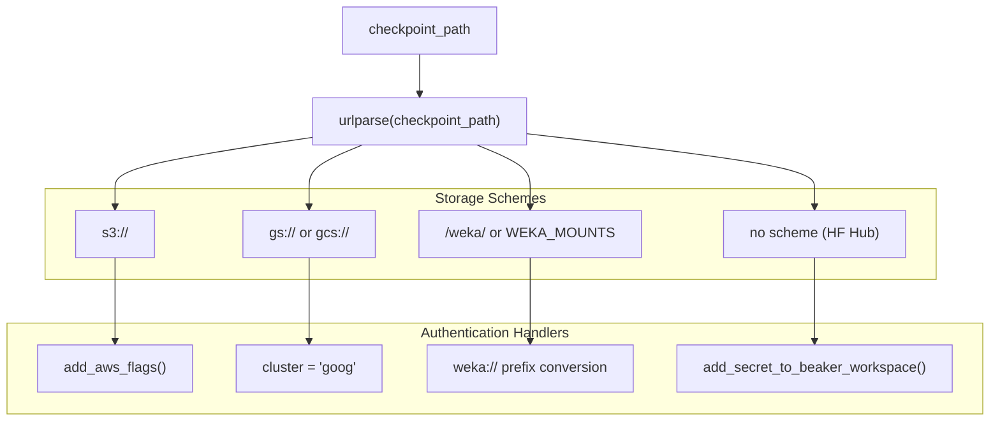
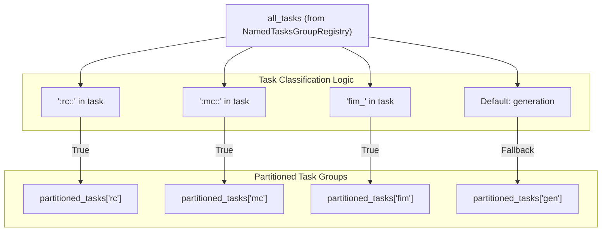
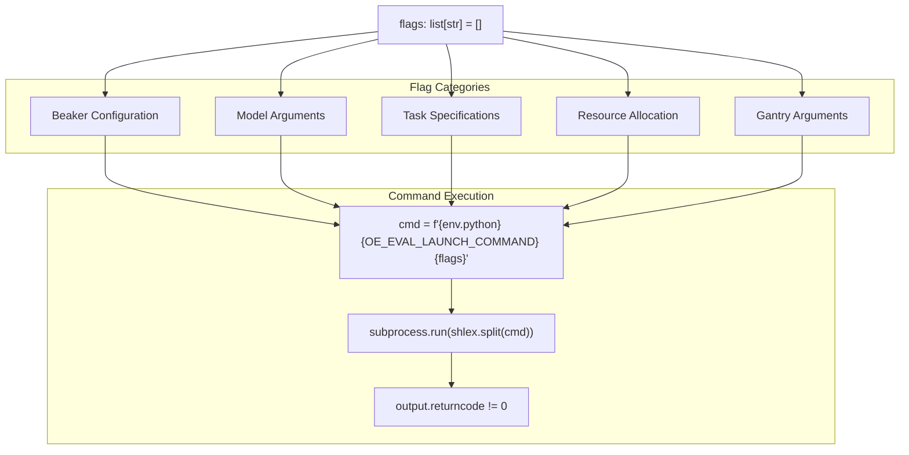

<!-- source: DeepWiki mcp.deepwiki.com · repo allenai/olmo-cookbook · page 4.2 Evaluation Orchestration · fetched 2026-10-26 -->

# Evaluation Orchestration

Relevant source files

The following files were used as context for generating this wiki page:

- [src/cookbook/eval/evaluation.py](src/cookbook/eval/evaluation.py)

This document covers how evaluations are orchestrated and executed across different compute environments within the olmo-cookbook system. The orchestration layer coordinates the setup of evaluation environments, manages dependencies, handles different storage schemes for model checkpoints, and submits evaluation jobs to distributed compute platforms.

For information about task definition and organization, see [Task Management and Registry](#4.1). For details on result processing after evaluation completion, see [Results Processing and Visualization](#4.4).

## Core Orchestration Function

The central orchestration logic is implemented in the `evaluate_checkpoint` function in [src/cookbook/eval/evaluation.py:27-65](). This function serves as the main entry point for coordinating all aspects of evaluation execution.

## Orchestration Workflow

The evaluation orchestration follows a structured workflow that handles environment setup, authentication, task partitioning, and distributed job submission:

Sources: [src/cookbook/eval/evaluation.py:27-358]()

## Environment and Dependency Management

### Python Environment Creation

The orchestration system creates isolated Python environments to ensure consistent evaluation execution:

| Component | Function | Purpose |
|-----------|----------|---------|
| `PythonEnv` | Environment isolation | Creates dedicated venv for evaluation |
| `install_oe_eval()` | Dependency management | Installs specific oe-eval toolkit commit |
| Environment variables | Configuration | Sets up execution context |

The environment setup occurs at [src/cookbook/eval/evaluation.py:66-76](), where a virtual environment is created and the oe-eval toolkit is installed with the specified commit hash and branch.

Sources: [src/cookbook/eval/evaluation.py:66-76]()

### Storage Scheme Handling

The orchestration system supports multiple storage schemes for model checkpoints, each requiring different authentication and configuration:

Sources: [src/cookbook/eval/evaluation.py:89-138]()

## Task Partitioning and Execution

### Task Type Classification

The orchestration system partitions evaluation tasks based on their execution requirements:

The partitioning logic is implemented at [src/cookbook/eval/evaluation.py:223-237](), where tasks are classified based on their naming patterns and execution requirements.

Sources: [src/cookbook/eval/evaluation.py:223-237]()

### Job Submission Process

For each task partition, the system creates separate job submissions with appropriate configurations:

| Parameter | Configuration Location | Purpose |
|-----------|----------------------|---------|
| Beaker flags | [src/cookbook/eval/evaluation.py:157-161]() | Workspace, budget, priority, clusters |
| Model arguments | [src/cookbook/eval/evaluation.py:175-187]() | Model path, BOS token, memory settings |
| Task arguments | [src/cookbook/eval/evaluation.py:244-346]() | Task-specific parameters and FIM tokens |
| Resource allocation | [src/cookbook/eval/evaluation.py:163-165]() | GPU count and compute requirements |

## Beaker Integration

### Command Construction

The orchestration system builds complex command lines for the oe-eval toolkit execution:

The command construction and execution occurs at [src/cookbook/eval/evaluation.py:349-355](), where the final oe-eval command is assembled and executed via subprocess.

Sources: [src/cookbook/eval/evaluation.py:349-355]()

### Job Naming and Organization

The system generates structured naming conventions for evaluation runs:

- **Run Names**: Created by `make_eval_run_name()` with checkpoint path, BOS token settings, and optional suffixes
- **Task Names**: Sanitized and truncated with MD5 hash fallback at [src/cookbook/eval/evaluation.py:261-275]()
- **Remote Directories**: Organized as `{remote_output_prefix}/{dashboard}/{run_name}/{friendly_task_name}` at [src/cookbook/eval/evaluation.py:278-279]()

## Error Handling and Validation

The orchestration system includes comprehensive error handling for common failure scenarios:

| Error Type | Validation Location | Handling |
|------------|-------------------|----------|
| Missing AWS credentials | [src/cookbook/eval/evaluation.py:100-101]() | ValueError with descriptive message |
| Unsupported storage schemes | [src/cookbook/eval/evaluation.py:114]() | ValueError for unknown URL schemes |
| Command execution failures | [src/cookbook/eval/evaluation.py:353-354]() | RuntimeError with command details |
| Conflicting name parameters | [src/cookbook/eval/evaluation.py:140-141]() | ValueError preventing conflicts |

Sources: [src/cookbook/eval/evaluation.py:100-101](), [src/cookbook/eval/evaluation.py:114](), [src/cookbook/eval/evaluation.py:353-354](), [src/cookbook/eval/evaluation.py:140-141]()

## Job Status and Monitoring

The orchestration function provides status reporting throughout the evaluation process:

- **Task Expansion**: Pretty-printed list of all tasks to be executed at [src/cookbook/eval/evaluation.py:214-221]()
- **Job Submission**: Count of submitted jobs per partition
- **Final Summary**: Total jobs launched with cluster and run name information at [src/cookbook/eval/evaluation.py:357]()

Sources: [src/cookbook/eval/evaluation.py:214-221](), [src/cookbook/eval/evaluation.py:357]()

---

