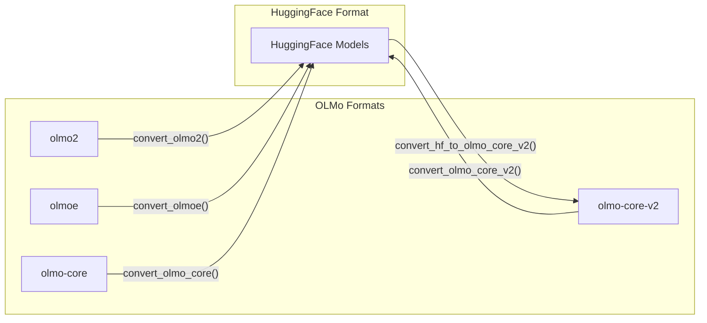
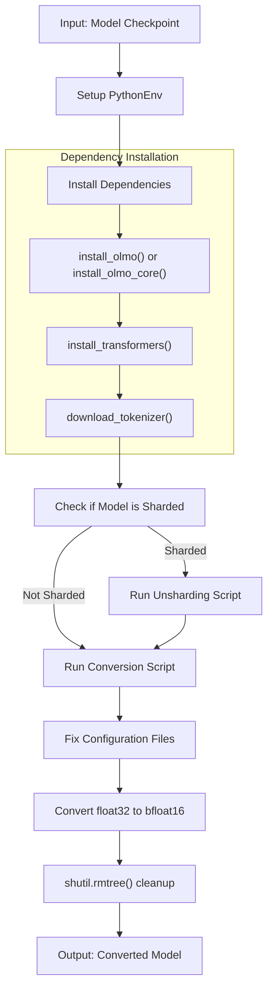
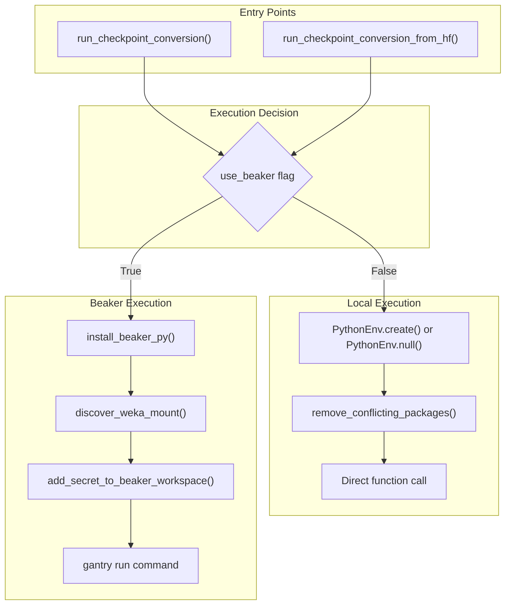

<!-- source: DeepWiki mcp.deepwiki.com · repo allenai/olmo-cookbook · page 4.3 Model Conversion · fetched 2026-10-26 -->

# Model Conversion

<details>
<summary>Relevant source files</summary>

The following files were used as context for generating this wiki page:

- [src/cookbook/eval/conversion.py](src/cookbook/eval/conversion.py)
- [src/cookbook/eval/conversion_from_hf.py](src/cookbook/eval/conversion_from_hf.py)

</details>


This document covers the model conversion system within the evaluation framework. Model conversion transforms OLMo model checkpoints into HuggingFace format for compatibility with evaluation tools, and vice versa. The system supports conversion between multiple OLMo model variants and HuggingFace formats, with execution options for both local and distributed environments.

For information about the broader evaluation orchestration that uses these converted models, see [Evaluation Orchestration](#4.2). For details on task management that defines which models to convert, see [Task Management and Registry](#4.1).

## Supported Model Conversions

The conversion system supports bidirectional format transformation between OLMo and HuggingFace model formats:



**Conversion Functions by Model Type:**

| Source Format | Target Format | Function | Script Path |
|---------------|---------------|----------|-------------|
| OLMo 2 | HuggingFace | `convert_olmo2()` | `OLMO2_CONVERSION_SCRIPT` |
| OLMoE | HuggingFace | `convert_olmoe()` | `OLMOE_CONVERSION_SCRIPT` |
| OLMo Core | HuggingFace | `convert_olmo_core()` | `OLMO_CORE_UNSHARD_CONVERT_SCRIPT` |
| OLMo Core V2 | HuggingFace | `convert_olmo_core_v2()` | `OLMO_CORE_UNSHARD_CONVERT_SCRIPT` |
| HuggingFace | OLMo Core V2 | `convert_hf_to_olmo_core_v2()` | `OLMO_CORE_CONVERT_FROM_HF_SCRIPT` |

Sources: [src/cookbook/eval/conversion.py:39-578](), [src/cookbook/eval/conversion_from_hf.py:25-234]()

## Conversion Workflow

The model conversion process follows a standardized workflow involving dependency installation, model processing, and cleanup:



**Key Processing Steps:**

1. **Environment Setup:** Creates isolated `PythonEnv` for dependency management
2. **Repository Installation:** Clones and installs specific commit hashes of OLMo and Transformers
3. **Tokenizer Handling:** Downloads tokenizer files and copies them to output directory
4. **Sharding Detection:** Checks for presence of `model/` subdirectory to determine if unsharding is needed
5. **Script Execution:** Runs appropriate conversion script via `subprocess.run()`
6. **Post-Processing:** Handles configuration file format conversion (JSON ↔ YAML) and dtype optimization
7. **Cleanup:** Removes temporary directories containing cloned repositories

Sources: [src/cookbook/eval/conversion.py:77-162](), [src/cookbook/eval/conversion.py:185-234]()

## Model-Specific Conversion Details

### OLMo Core V2 Conversion

The `convert_olmo_core_v2()` function handles the most recent OLMo Core format with enhanced configuration management:

**Configuration Resolution:**
- Automatically extracts `max_sequence_length` from `config.json` if not provided
- Handles JSON-to-YAML configuration conversion
- Supports dtype optimization (float32 → bfloat16)

**Key Parameters:**
- `max_sequence_length`: Required for conversion, auto-detected from config
- `skip_validation`: Bypasses model validation during conversion
- `dtype`: Target data type for model weights

Sources: [src/cookbook/eval/conversion.py:39-162]()

### Legacy OLMo Conversions

**OLMo 2 and OLMoE:** Both follow similar patterns with two-phase processing:

1. **Unsharding Phase:** Uses `OLMO2_UNSHARD_SCRIPT` or `OLMOE_UNSHARD_SCRIPT`
2. **Conversion Phase:** Applies format-specific conversion scripts

**OLMo Core (V1):** Single-phase conversion using `OLMO_CORE_UNSHARD_CONVERT_SCRIPT`

**Sharding Detection Logic:**
```python
model_dir = os.path.join(input_dir, "model")
is_model_in_directory = os.path.exists(model_dir) and os.path.isdir(model_dir)
```

Sources: [src/cookbook/eval/conversion.py:237-397](), [src/cookbook/eval/conversion.py:165-234]()

### HuggingFace to OLMo Conversion

The reverse conversion from HuggingFace to OLMo Core V2 format supports:

**Advanced Configuration Options:**
- `olmo_core_v2_experiment_json_path`: Custom experiment configuration
- `olmo_core_v2_model_arch`: Architecture specification override
- `transformers_model_id`: Specific model identifier for HuggingFace Hub
- `debug_validation`: Enhanced debugging output

Sources: [src/cookbook/eval/conversion_from_hf.py:25-93]()

## Execution Environments

The conversion system supports both local execution and distributed processing via Beaker:



### Local Execution Environment

**Python Environment Management:**
- `PythonEnv.create()`: Creates isolated virtual environment
- `PythonEnv.null()`: Uses system Python when `use_system_python=True`
- `remove_conflicting_packages()`: Cleans up package conflicts

**Direct Function Invocation:**
Local execution calls conversion functions directly with proper environment configuration.

Sources: [src/cookbook/eval/conversion.py:431-577]()

### Beaker Distributed Execution

**Infrastructure Requirements:**
- Fully qualified paths (must start with `/`)
- Weka mount discovery for shared storage
- Secret management for HuggingFace tokens

**Gantry Command Construction:**
```python
gantry_command = [
    "gantry run",
    f"--description 'Converting OLMo checkpoint at {input_dir}'",
    f"--workspace {beaker_workspace}",
    f"--gpus {beaker_gpus}",
    " ".join(gantry_flags),
    f"-- /bin/bash -c '{remote_command_str}'"
]
```

**Remote Execution Pattern:**
Beaker jobs install the cookbook package and execute the CLI command remotely:
```bash
pip install uv && uv pip install . --system && olmo-cookbook-eval convert {args}
```

Sources: [src/cookbook/eval/conversion.py:437-516](), [src/cookbook/eval/conversion_from_hf.py:130-214]()

## Dependencies and Commit Management

The conversion system maintains version control over all dependencies through commit hash pinning:

**Repository Management:**
| Repository | Install Function | Default Commit Hash |
|------------|------------------|---------------------|
| OLMo | `install_olmo()` | `OLMO2_COMMIT_HASH` |
| OLMo Core | `install_olmo_core()` | `OLMO_CORE_COMMIT_HASH` |
| Transformers | `install_transformers()` | `TRANSFORMERS_COMMIT_HASH` |

**Tokenizer Handling:**
- `download_tokenizer()`: Fetches tokenizer files from HuggingFace
- Default tokenizers defined per model type:
  - `DEFAULT_OLMO_CORE_TOKENIZER`
  - `DEFAULT_OLMO2_TOKENIZER`  
  - `DEFAULT_OLMOE_TOKENIZER`

**Cleanup Strategy:**
All temporary directories are tracked in `directories_to_clean_up` list and removed via `shutil.rmtree()` in finally blocks to ensure resource cleanup regardless of success/failure.

Sources: [src/cookbook/eval/conversion.py:80-87](), [src/cookbook/eval/conversion.py:159-162]()

---

