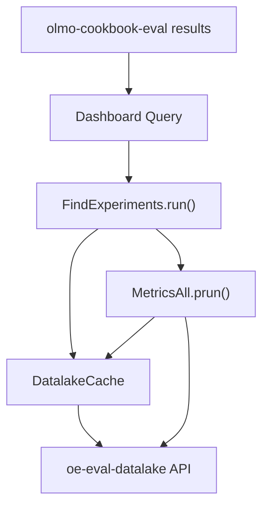
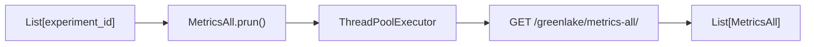
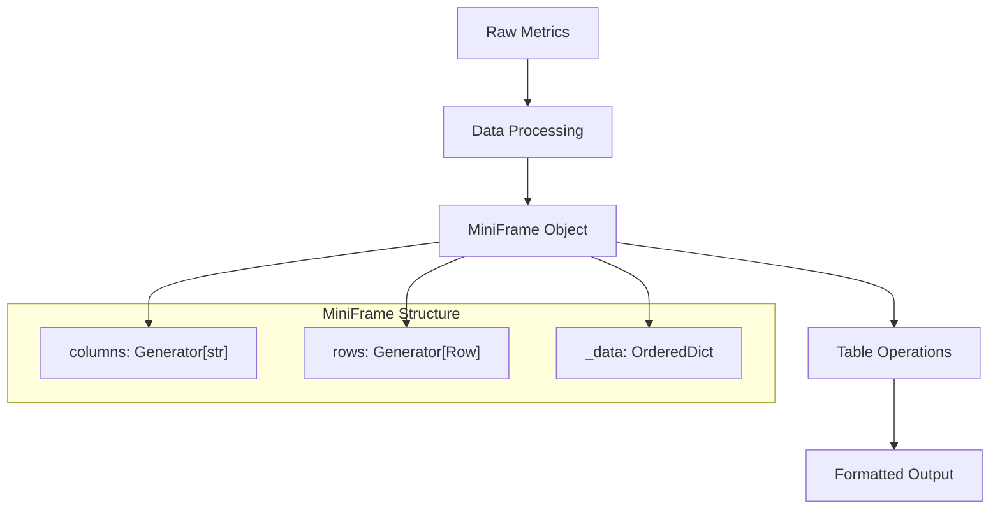
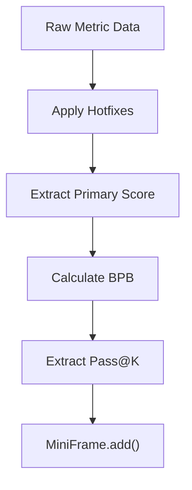
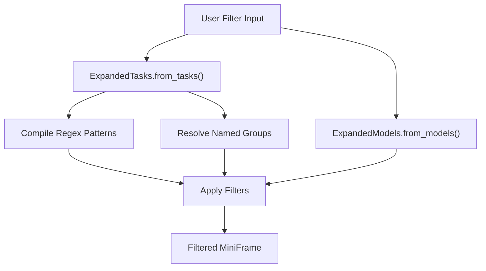
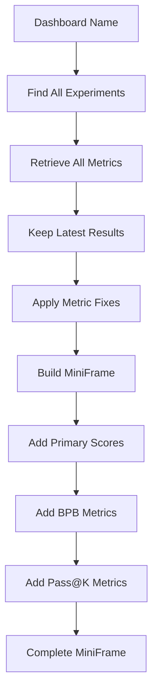
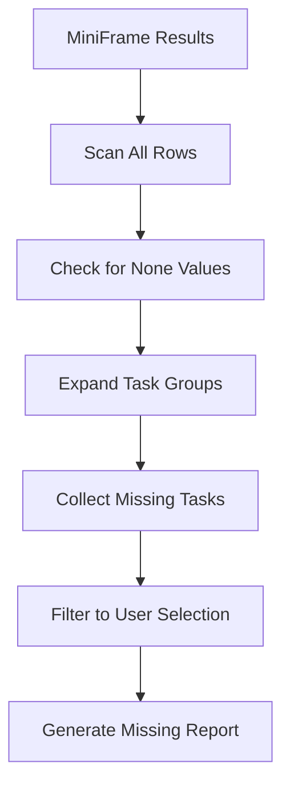
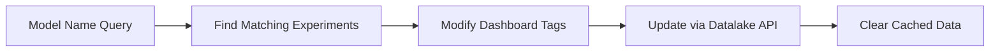

<!-- source: DeepWiki mcp.deepwiki.com · repo allenai/olmo-cookbook · page 4.4 Results Processing and Visualization · fetched 2026-10-26 -->

# Results Processing and Visualization

Relevant source files

The following files were used as context for generating this wiki page:

- [src/cookbook/eval/cache.py](src/cookbook/eval/cache.py)
- [src/cookbook/eval/datalake.py](src/cookbook/eval/datalake.py)
- [src/cookbook/eval/miniframe.py](src/cookbook/eval/miniframe.py)
- [src/cookbook/eval/results.py](src/cookbook/eval/results.py)
- [tests/cookbook/eval/test_miniframe.py](tests/cookbook/eval/test_miniframe.py)

This document covers the system for processing, filtering, and visualizing evaluation results after experiments have been completed. It explains how raw metrics from the oe-eval datalake are transformed into structured tables, filtered based on user criteria, and presented in various formats.

For information about running evaluations, see [Evaluation Orchestration](#4.2). For details about task definitions and organization, see [Task Management and Registry](#4.1).

## Overview

The results processing system provides a complete pipeline from raw evaluation data retrieval to formatted output. The core workflow involves:

1. **Data Retrieval**: Fetching experiment metadata and metrics from the oe-eval datalake
2. **Data Processing**: Organizing results into tabular format with metric standardization
3. **Filtering and Selection**: Applying user-specified filters for tasks and models
4. **Visualization**: Presenting results in console tables, CSV, or JSON formats
5. **Quality Assurance**: Identifying missing evaluations and data gaps

## Data Retrieval Architecture

### Datalake Integration

The system retrieves evaluation results from the oe-eval datalake through a structured API layer:

Sources: [src/cookbook/eval/results.py:46-63](), [src/cookbook/eval/datalake.py:147-183](), [src/cookbook/eval/datalake.py:226-294]()

### Experiment Discovery

The `FindExperiments` class locates relevant evaluations based on dashboard tags or model names:

| Parameter | Type | Purpose |
|-----------|------|---------|
| `dashboard` | `str` | Filter by dashboard tag |
| `model_name` | `str` | Filter by exact model name |
| `limit` | `int` | Maximum results to return |

The class returns structured experiment metadata including experiment IDs, model names, task names, creation timestamps, and associated tags.

Sources: [src/cookbook/eval/datalake.py:147-183]()

### Metrics Retrieval

The `MetricsAll` class fetches detailed evaluation metrics for each experiment:

The system supports parallel retrieval with configurable worker threads and automatic retry logic for failed requests.

Sources: [src/cookbook/eval/results.py:59-63](), [src/cookbook/eval/datalake.py:94-117]()

## Data Processing Pipeline

### MiniFrame Data Structure

The `MiniFrame` class serves as the core data structure for results processing, providing a lightweight pandas-like interface:

The `MiniFrame` supports:
- Dynamic column and row addition via `add()` and `add_many()`
- Flexible filtering with `keep_cols()`, `drop_cols()`, `keep_rows()`, `drop_rows()`
- Sorting by column values, averages, or names
- Export to CSV, JSON, and console display formats

Sources: [src/cookbook/eval/miniframe.py:21-259]()

### Metric Standardization

The system applies several standardization steps during processing:

1. **Primary Score Extraction**: Each task's main metric becomes the primary score
2. **BPB Calculation**: Bits-per-byte metrics are computed when available
3. **Pass@K Metrics**: Code generation pass rates are extracted from extra metrics
4. **Hotfixes**: Task-specific corrections for known metric issues

Sources: [src/cookbook/eval/results.py:83-124]()

## Filtering and Selection System

### Task and Model Expansion

The system supports flexible filtering through regex patterns and named groups:

The `ExpandedTasks` class handles both individual task patterns and named task groups from the registry. The `ExpandedModels` class applies similar logic for model name filtering.

Sources: [src/cookbook/eval/results.py:128-168]()

### Named Group Integration

Named task groups from the registry are automatically expanded and can be combined into aggregate scores when possible:

| Group Type | Behavior | Result |
|------------|----------|---------|
| Combinable Groups | Aggregated into single score | Single column with group name |
| Non-combinable Groups | Individual tasks displayed | Multiple columns with task names |
| Mixed Groups | Partial aggregation | Combination of both approaches |

Sources: [src/cookbook/eval/results.py:184-203]()

## Visualization and Output

### Console Display

The `MiniFrame.show()` method provides rich console output using the Rich library:

- Centered column headers with task names
- Formatted percentage values (multiplied by 100)
- Missing values displayed as "-"
- Configurable table title and styling

Sources: [src/cookbook/eval/miniframe.py:185-198]()

### Export Formats

#### CSV Export
The `to_csv()` method generates comma-separated output with:
- Header row with model names and task columns
- Percentage formatting for numeric values
- Missing value handling with "-" placeholder

#### JSON Export
The `to_json()` method creates structured JSON with:
- Sorted keys for consistent output
- Nested structure preserving column-row relationships
- Direct serialization of the internal data structure

Sources: [src/cookbook/eval/miniframe.py:200-216]()

### Dashboard Table Generation

The `make_dashboard_table()` function creates comprehensive result tables from dashboard data:

The function handles duplicate results by keeping only the most recent evaluation for each model-task pair.

Sources: [src/cookbook/eval/results.py:41-125]()

## Quality Assurance and Diagnostics

### Missing Task Detection

The system automatically identifies incomplete evaluations:

The `find_missing_tasks()` function returns a mapping of model names to lists of missing task names, while `print_missing_tasks()` provides user-friendly console output with color formatting.

Sources: [src/cookbook/eval/results.py:211-272]()

### Cache Management

The `DatalakeCache` provides performance optimization and offline operation:

| Feature | Implementation | Benefit |
|---------|----------------|---------|
| Automatic Caching | SHA256 key generation | Fast repeated queries |
| Cache Invalidation | Environment variable control | Fresh data when needed |
| Offline Mode | Local cache fallback | Operation without network |
| Selective Deletion | Experiment-specific removal | Cache consistency |

Sources: [src/cookbook/eval/cache.py:26-101]()

## Dashboard Management

### Adding and Removing Experiments

The system provides programmatic dashboard management through dedicated classes:

The `AddToDashboard` and `RemoveFromDashboard` classes handle bulk operations with fuzzy matching and parallel processing capabilities.

Sources: [src/cookbook/eval/datalake.py:333-421]()

---

