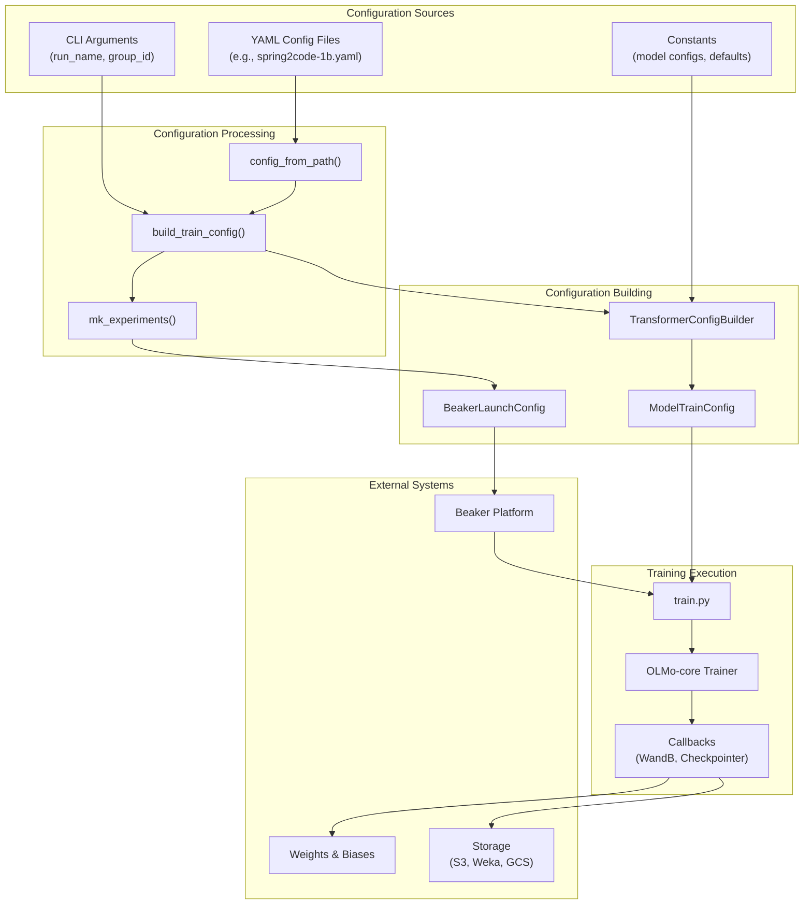
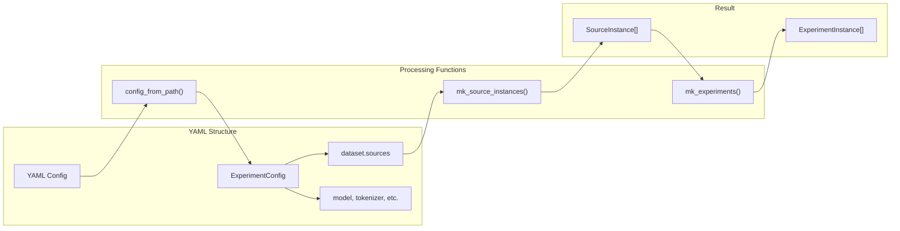
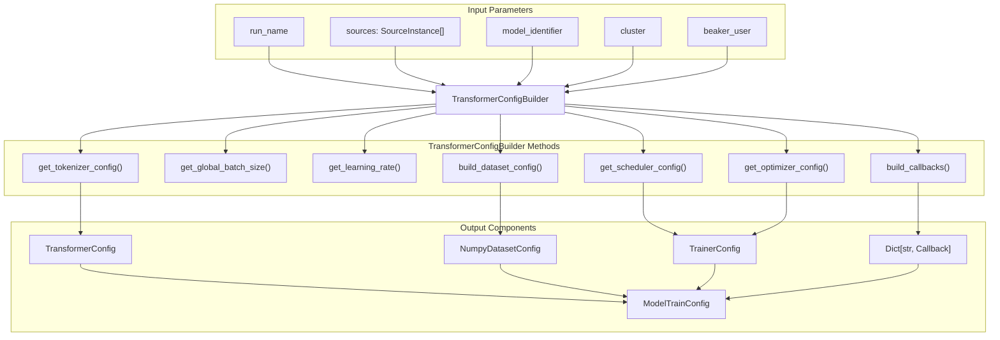
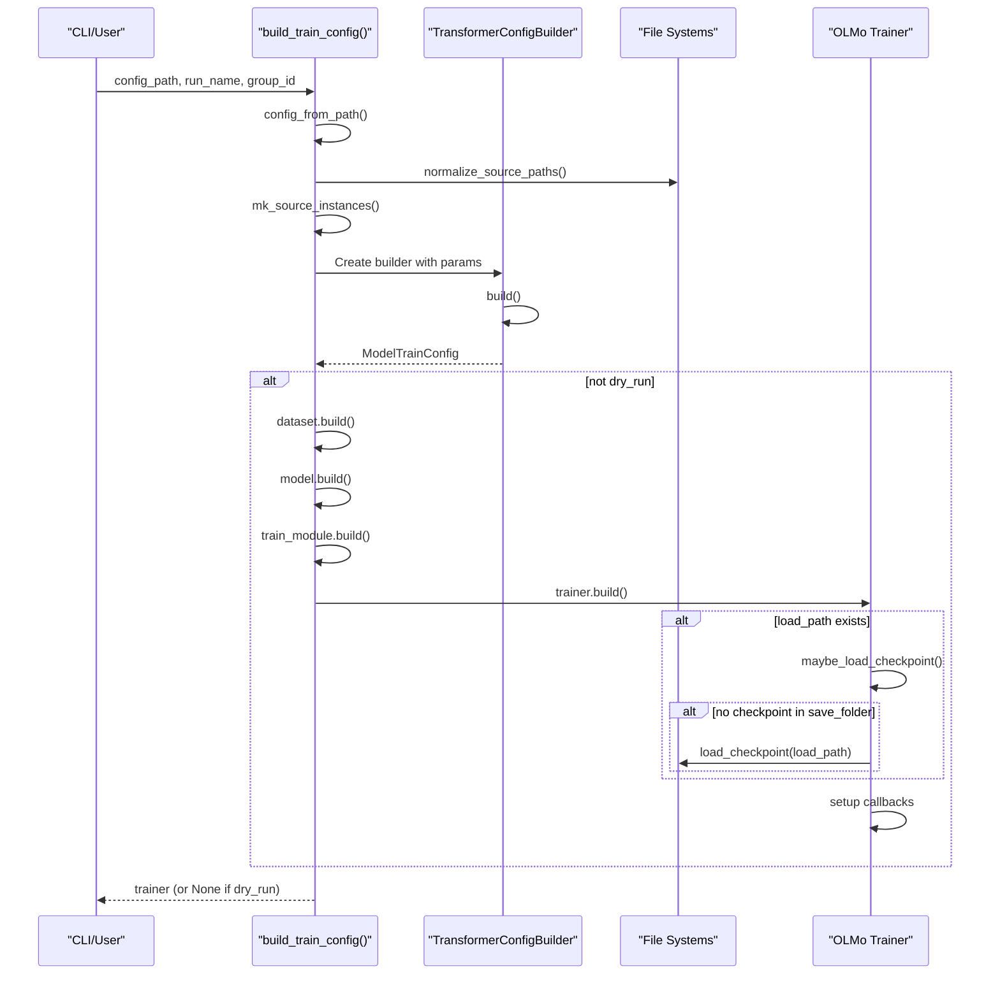
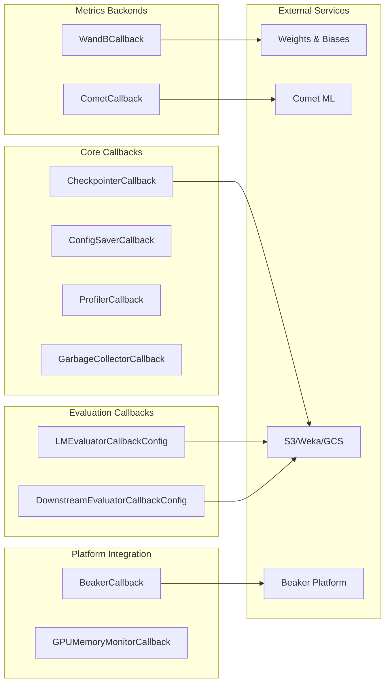
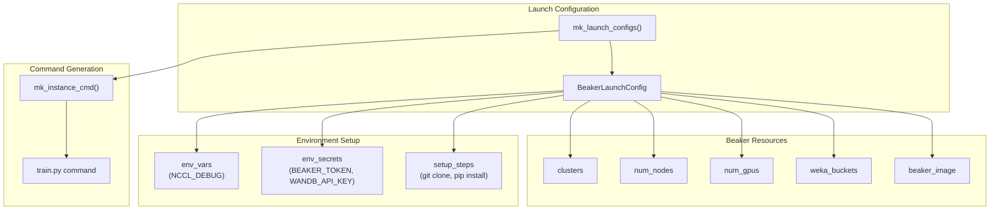

<!-- source: DeepWiki mcp.deepwiki.com · repo allenai/olmo-cookbook · page 5 Training System · fetched 2026-10-26 -->

# Training System

Relevant source files

The following files were used as context for generating this wiki page:

- [src/cookbook/model/builder.py](src/cookbook/model/builder.py)
- [src/cookbook/recipes/spring2code/scaling/spring2code-1b-5xC-weka-top15-bpb-hlr-superbpe.yaml](src/cookbook/recipes/spring2code/scaling/spring2code-1b-5xC-weka-top15-bpb-hlr-superbpe.yaml)
- [src/cookbook/utils/config.py](src/cookbook/utils/config.py)

The Training System is responsible for configuring, launching, and managing OLMo model training runs. It provides a comprehensive framework for building training configurations from YAML files, setting up distributed training environments, and integrating with external compute platforms like Beaker. For information about evaluation workflows, see [Evaluation System](#4). For infrastructure management details, see [Infrastructure Management](#6).

## System Overview

The Training System consists of several key components that work together to transform high-level training specifications into executable training configurations:

Sources: [src/cookbook/utils/config.py:34-38](), [src/cookbook/utils/config.py:124-217](), [src/cookbook/model/builder.py:85-162]()

## Configuration Loading and Processing

The system begins by loading training configurations from YAML files using a structured approach:

| Function | Purpose | Key Parameters |
|----------|---------|----------------|
| `config_from_path()` | Load YAML config into `ExperimentConfig` | `config: Path` |
| `mk_source_instances()` | Convert source configs to instances | `sources`, `priors` |
| `mk_experiments()` | Generate experiment instances | `config`, `group_id`, `priors` |

Sources: [src/cookbook/utils/config.py:34-38](), [src/cookbook/utils/config.py:41-73]()

## TransformerConfigBuilder

The `TransformerConfigBuilder` is the central component responsible for constructing comprehensive training configurations. It takes high-level parameters and builds detailed configurations for all training components:

### Key Configuration Methods

| Method | Return Type | Purpose |
|--------|-------------|---------|
| `get_tokenizer_config()` | `TokenizerConfig` | Maps tokenizer string to config |
| `get_global_batch_size()` | `int` | Calculates optimal batch size |
| `get_learning_rate()` | `float` | Uses model-specific defaults or user override |
| `build_callbacks()` | `Dict[str, Callback]` | Sets up training callbacks |
| `build_dataset_config()` | `NumpyDatasetConfig` | Configures dataset loading |
| `get_scheduler_config()` | `Scheduler` | Creates learning rate scheduler |

Sources: [src/cookbook/model/builder.py:85-162](), [src/cookbook/model/builder.py:281-332](), [src/cookbook/model/builder.py:337-413]()

## Training Configuration Build Process

The `build_train_config()` function orchestrates the entire configuration building process:

Sources: [src/cookbook/utils/config.py:124-217]()

## Callback System Integration

The Training System integrates with various external services through a callback system:

Sources: [src/cookbook/model/builder.py:337-413]()

## Beaker Integration

The Training System generates Beaker launch configurations for distributed training:

Sources: [src/cookbook/utils/config.py:219-268](), [src/cookbook/utils/config.py:88-104]()

## Storage and Path Handling

The system handles multiple storage backends with intelligent path normalization:

| Storage Type | Local Path | Remote Path | Use Case |
|-------------|------------|-------------|----------|
| S3 | `s3://ai2-llm/...` | `s3://ai2-llm/...` | General cloud storage |
| Weka | `/weka/oe-training-default/...` | `weka://oe-training-default/...` | High-performance training |
| GCS | `gs://ai2-llm/...` | `gs://ai2-llm/...` | Google Cloud clusters |

The `remote_fs_cache()` function maintains filesystem instances for different storage backends, while path normalization occurs in `build_train_config()` based on execution context (local vs. Beaker).

Sources: [src/cookbook/utils/config.py:107-122](), [src/cookbook/utils/config.py:140-149]()

---

