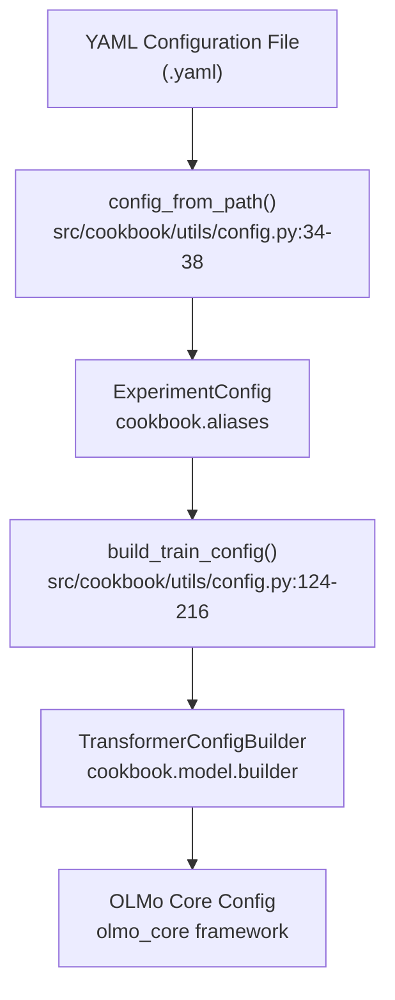
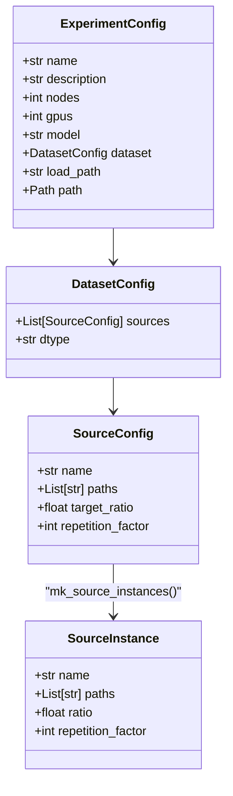
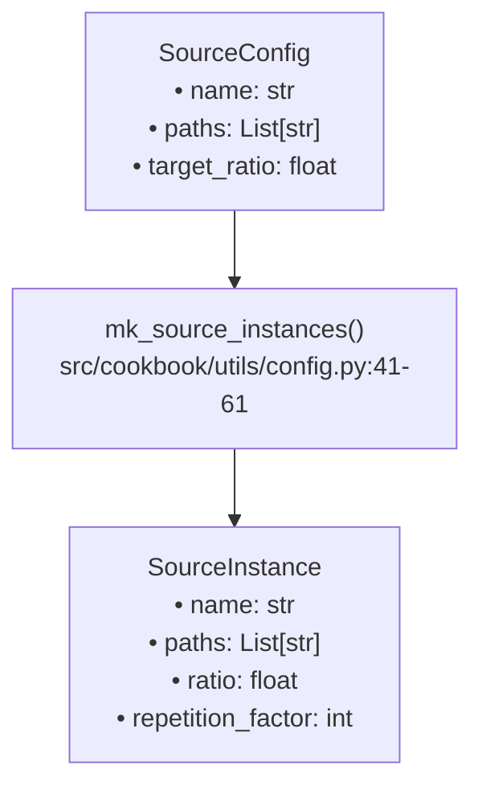
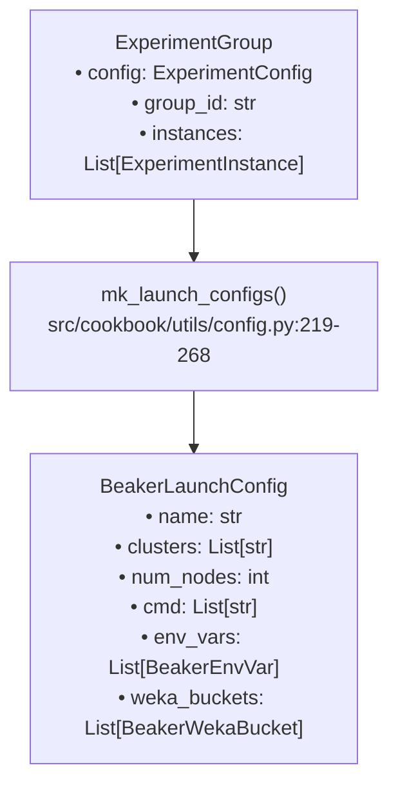

<!-- source: DeepWiki mcp.deepwiki.com · repo allenai/olmo-cookbook · page 5.1 Training Configuration · fetched 2026-10-26 -->

# Training Configuration

<details>
<summary>Relevant source files</summary>

The following files were used as context for generating this wiki page:

- [src/cookbook/recipes/olmo3-midtraining/example-olmo2_7b-web-code-reasoning-microanneal.yaml](src/cookbook/recipes/olmo3-midtraining/example-olmo2_7b-web-code-reasoning-microanneal.yaml)
- [src/cookbook/recipes/spring2code/scaling/spring2code-1b-5xC-weka-top15-bpb-hlr-superbpe.yaml](src/cookbook/recipes/spring2code/scaling/spring2code-1b-5xC-weka-top15-bpb-hlr-superbpe.yaml)
- [src/cookbook/utils/config.py](src/cookbook/utils/config.py)

</details>


This document covers how training experiments are configured in the olmo-cookbook system. Training configurations use YAML files to define experiment parameters, which are then processed by the configuration system to create executable training runs. For information about the programmatic configuration builder system, see [Model Configuration Builder](#5.2). For details about training execution, see [Training Execution](#5.3).

## Configuration File Structure

Training configurations are defined in YAML files that specify all parameters needed for a training run, including model settings, datasets, compute resources, and training hyperparameters.

### Basic Configuration Elements

The configuration system centers around the `ExperimentConfig` class, which is populated from YAML files using the `config_from_path` function:

#### Configuration Loading Flow



Sources: [src/cookbook/utils/config.py:34-38](), [src/cookbook/utils/config.py:124-216]()

### Configuration Schema

Training configurations contain the following major sections:

| Section | Purpose | Example Fields |
|---------|---------|----------------|
| **Experiment Metadata** | Basic experiment information | `name`, `description`, `workspace` |
| **Compute Resources** | Hardware and platform settings | `nodes`, `gpus`, `cluster`, `preemptible` |
| **Model Configuration** | Model architecture and tokenizer | `model`, `tokenizer`, `sequence_length` |
| **Training Parameters** | Learning and optimization settings | `max_tokens`, `global_batch_size`, `learning_rate` |
| **Dataset Configuration** | Data sources and mixing ratios | `dataset.sources`, `target_ratio`, `paths` |
| **Evaluation Settings** | Evaluation intervals and downstream tasks | `eval_interval`, `downstream_evaluators` |
| **Checkpoint Management** | Loading and saving configurations | `load_path`, `save_interval`, `load_state` |

#### Configuration Object Relationships



Sources: [src/cookbook/utils/config.py:41-61](), [src/cookbook/aliases.py]()

## Configuration Examples

### Standard Training Configuration

The following example shows a typical training configuration for fine-tuning OLMo2-7B:

```yaml
name: "olmo2-7b_10b-microanneal_web-code-reasoning"
description: "OLMo2 7b microanneal to 10B Tokens on web + code + reasoning data"
budget: "ai2/oe-base"
workspace: "ai2/olmo-3-microanneals"
nodes: 4
gpus: 8
preemptible: true
max_tokens: 10_000_000_000
global_batch_size: 2097152
sequence_length: 4096
seed: 1337
model: "olmo2_7B"
tokenizer: "dolma2"
priority: urgent
eval_interval: 250
cluster: ai2/augusta-google-1
rank_microbatch_size: 8192
scheduler_type: linear
warmup_steps: 0
annealing:
  enabled: true
  initial_lr: 6.135e-5
load_path: gs://ai2-llm/checkpoints/shanea/OLMo-2-1124-7B/step928646/model_and_optim/
load_state: false
dataset:
  sources:
  - name: web 
    target_ratio: 0.5
    paths:
    - s3://ai2-llm/preprocessed/cc_all_dressed/all_dressed_v3_subsamples/midtrain_pools/6B/allenai/dolma2-tokenizer/*.npy
  - name: code 
    target_ratio: 0.4
    paths:
    - gs://ai2-llm/preprocessed/stack-edu/allenai/dolma2-tokenizer/**/*.npy
  - name: reasoning 
    target_ratio: 0.1
    paths:
    - gs://ai2-llm/preprocessed/big-reasoning-traces/allenai/dolma2-tokenizer/*.npy
```

Sources: [src/cookbook/recipes/olmo3-midtraining/example-olmo2_7b-web-code-reasoning-microanneal.yaml:1-38]()

### Weka-Enabled Configuration

For high-performance training with Weka storage:

```yaml
name: "spring2code-1b-5xC-top15-hlr-superbpe"
description: "learn2code 1b@5xC top15 langauges from the-stack-v2 + dclm prose v2"
weka: true
cluster: ai2/jupiter-cirrascale-2
load_path: /weka/oe-training-default/ai2-llm/checkpoints/ai2-tylerm/spring2code-1b-5xC-top15-hlr-superbpe-2e15a7da/step13900/
downstream_evaluators:
  - codex_humaneval_gold_bpb_0shot
  - codex_mbpp_gold_bpb_0shot
dataset:
  sources:
  - name: the-stack-v2-top15-ai2v0-minhash-10pct-superbpe
    target_ratio: 0.85
    paths:
    - weka://oe-training-default/ai2-llm/preprocessed/learn2code/love2code-top15-minhash-plpartition-10pct/allenai/superbpe-olmo3-experimental/**/*.npy
```

Sources: [src/cookbook/recipes/spring2code/scaling/spring2code-1b-5xC-weka-top15-bpb-hlr-superbpe.yaml:1-32]()

## Configuration Processing Pipeline

The configuration system processes YAML files through several stages to create executable training configurations:

### Processing Stages

```mermaid
flowchart LR
    subgraph "Configuration Loading"
        yaml_safe_load["yaml.safe_load()"]
        ExperimentConfig_init["ExperimentConfig(**data, path=config)"]
    end
    
    subgraph "Path Normalization"
        normalize_source_paths["normalize_source_paths()"]
        mk_source_instances["mk_source_instances()"]
        path_processing["Path Processing<br/>weka:// → /weka/<br/>gs:// → normalized"]
    end
    
    subgraph "Config Building"
        TransformerConfigBuilder_init["TransformerConfigBuilder()"]
        config_build["config.build()"]
        olmo_core_config["OLMo Core Config"]
    end
    
    yaml_safe_load --> ExperimentConfig_init
    ExperimentConfig_init --> normalize_source_paths
    normalize_source_paths --> mk_source_instances
    mk_source_instances --> path_processing
    path_processing --> TransformerConfigBuilder_init
    TransformerConfigBuilder_init --> config_build
    config_build --> olmo_core_config
```



Sources: [src/cookbook/utils/config.py:124-185](), [src/cookbook/utils/config.py:144-149]()

### Path Normalization

The system handles different storage backends by normalizing paths based on execution environment:

- **Local/Dry Run**: Weka paths (`weka://`) are converted to S3-style paths (`s3://`) for validation
- **Beaker Execution**: Weka paths are converted to mounted filesystem paths (`/weka/`)
- **Cloud Storage**: S3 and GCS paths are normalized using `olmo_core.io.normalize_path`

```python
# Dry run path normalization
base_config.load_path = normalize_path(base_config.load_path.replace("weka://", "s3://"))

# Beaker execution path normalization  
base_config.load_path = normalize_path(base_config.load_path.replace("weka://", "/weka/"))
```

Sources: [src/cookbook/utils/config.py:140-149]()

## Dataset Configuration

Dataset configuration defines the data sources and mixing ratios for training:

### Source Configuration Structure

Each dataset source specifies:
- **name**: Identifier for the data source
- **paths**: List of file paths (supports glob patterns)
- **target_ratio**: Proportion of total training tokens from this source
- **repetition_factor**: Optional multiplier for source usage

### Source Instance Creation

The `mk_source_instances` function converts `SourceConfig` objects to `SourceInstance` objects that can be used by the training system:



Sources: [src/cookbook/utils/config.py:41-61]()

## Beaker Integration

For Beaker-based training, configurations are converted to `BeakerLaunchConfig` objects:

### Launch Configuration Generation



### Beaker Environment Setup

The system automatically configures Beaker jobs with:
- **Docker Image**: `petew/olmo-core-tch270cu128`
- **Environment Variables**: NCCL debug settings, cloud credentials
- **Secrets**: Beaker tokens, WandB API keys, AWS/GCP credentials
- **Weka Mounts**: High-performance storage integration when `weka: true`
- **Setup Commands**: Repository cloning, dependency installation, credential configuration

Sources: [src/cookbook/utils/config.py:219-268]()

## Configuration Validation

The `build_train_config` function supports dry-run validation to verify configurations without actually starting training:

### Dry Run Features

- **Path Validation**: Checks that all data paths are accessible
- **Resource Estimation**: Calculates estimated training steps
- **Configuration Verification**: Validates model and tokenizer compatibility
- **Remote Path Handling**: Tests cloud storage connectivity

```python
if dry_run:
    logger.info(
        f"Estimated training steps: {math.ceil(base_config.max_tokens / config.data_loader.global_batch_size):,}"
    )
```

Sources: [src/cookbook/utils/config.py:210-213]()

---

