<!-- source: DeepWiki mcp.deepwiki.com · repo allenai/olmo-cookbook · page 5.2 Model Configuration Builder · fetched 2026-10-26 -->

# Model Configuration Builder

Relevant source files

The following files were used as context for generating this wiki page:

- [src/cookbook/model/builder.py](src/cookbook/model/builder.py)

This document covers the `TransformerConfigBuilder` system, which programmatically constructs training configurations for OLMo models. The builder centralizes configuration logic and provides a fluent interface for assembling complex training setups from high-level parameters.

For information about YAML-based training configuration, see [Training Configuration](#5.1). For training execution details, see [Training Execution](#5.3).

## Overview

The `TransformerConfigBuilder` serves as a factory for creating `ModelTrainConfig` objects that define complete training runs. It abstracts away the complexity of configuring optimizers, schedulers, datasets, callbacks, and infrastructure settings into a single builder interface.

The builder pattern allows users to specify high-level training parameters and automatically derives sensible defaults for lower-level configuration details based on model size, sequence length, and target infrastructure.

**Core Builder Flow**
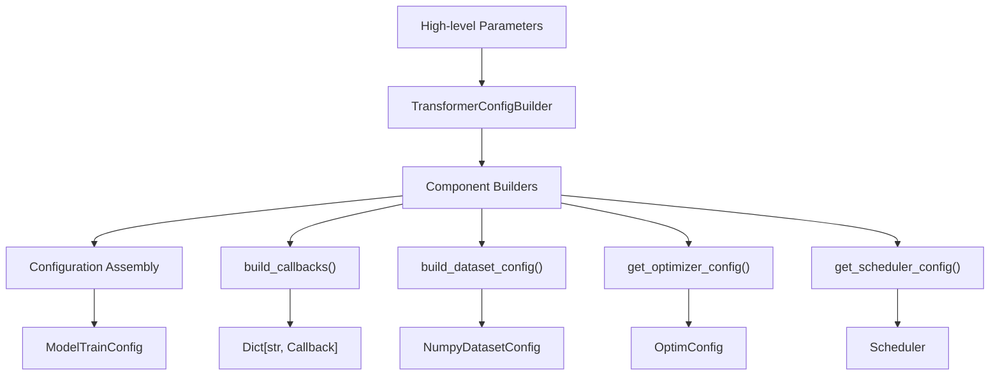

Sources: [src/cookbook/model/builder.py:85-162](), [src/cookbook/model/builder.py:577-638]()

## Builder Initialization and Configuration

The `TransformerConfigBuilder` is initialized with essential training parameters and automatically configures infrastructure-specific settings based on the target cluster and storage backend.

### Core Parameters

The builder accepts parameters that define the training run's identity, data sources, model specifications, and resource constraints:

| Parameter | Type | Purpose |
|-----------|------|---------|
| `run_name` | str | Unique identifier for the training run |
| `sources` | List[SourceInstance] | Training data sources with optional ratios |
| `sequence_length` | int | Maximum sequence length for model input |
| `max_tokens` | int | Total tokens to train on |
| `model_identifier` | ModelConfigIdentifier | Predefined model architecture |
| `cluster` | str | Target compute cluster (jupiter, saturn, etc.) |
| `beaker_user` | str | User identity for job submission |

**Infrastructure Configuration Flow**
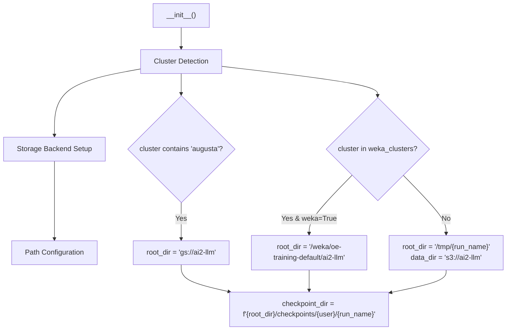

Sources: [src/cookbook/model/builder.py:199-279](), [src/cookbook/model/builder.py:270-278]()

### Default Value Resolution

The builder implements intelligent defaults for critical training parameters that can be overridden when needed:

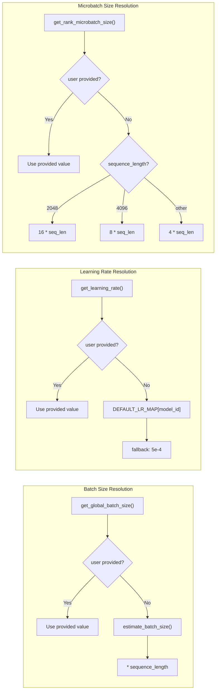

Sources: [src/cookbook/model/builder.py:295-306](), [src/cookbook/model/builder.py:308-324](), [src/cookbook/model/builder.py:326-332]()

## Component Builders

The builder delegates specific configuration aspects to specialized methods that construct individual components of the training setup.

### Callback Configuration

The `build_callbacks()` method assembles training callbacks based on enabled features and platform integrations:

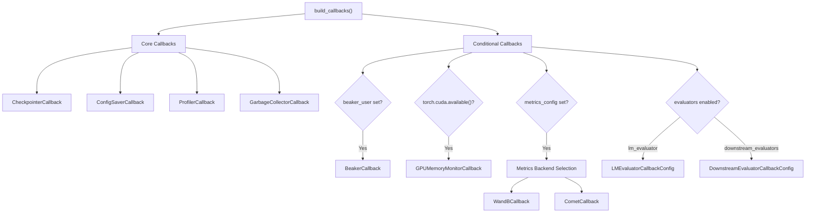

Sources: [src/cookbook/model/builder.py:337-413]()

### Dataset Configuration

Dataset configuration handles both simple and complex data mixing scenarios through the `build_dataset_config()` method:

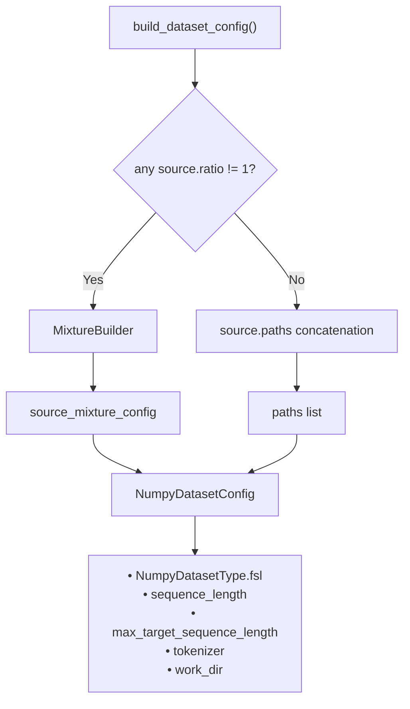

Sources: [src/cookbook/model/builder.py:415-450]()

### Optimizer and Scheduler Configuration

The builder provides scheduler selection through `get_scheduler_config()` and constructs optimizers with `get_optimizer_config()`:

**Scheduler Selection**
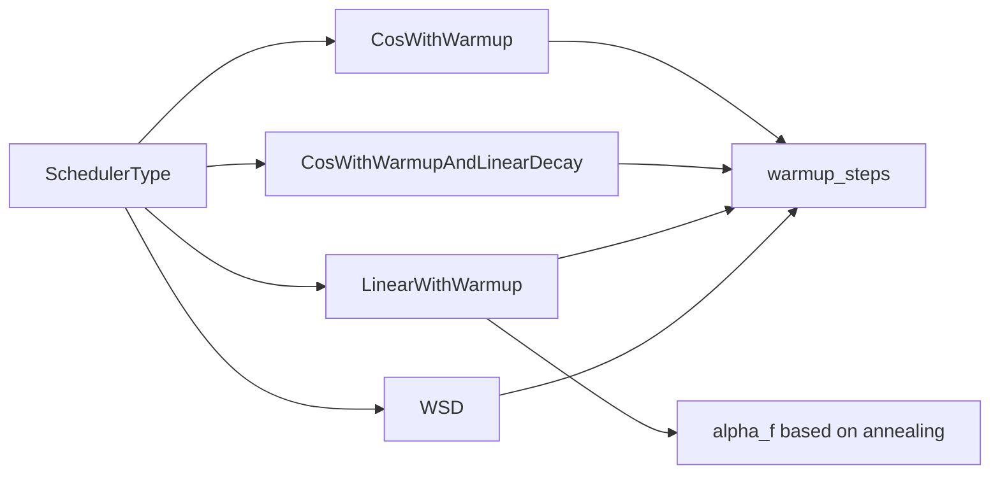

**Optimizer Configuration**
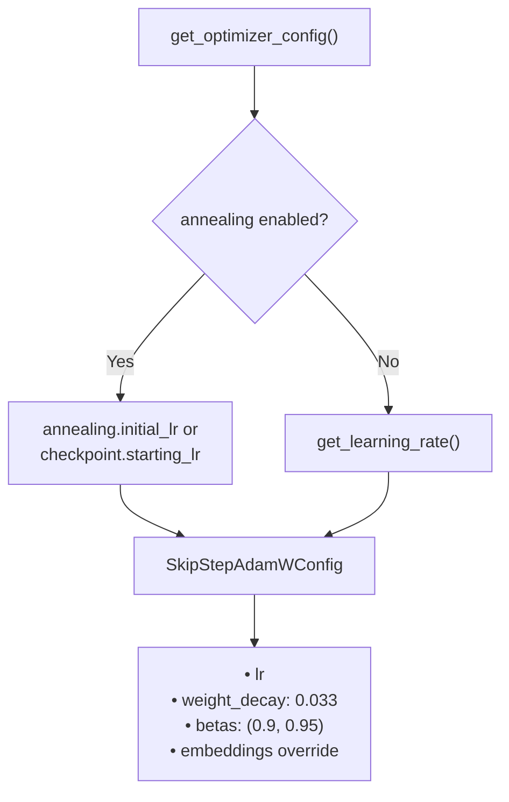

Sources: [src/cookbook/model/builder.py:452-466](), [src/cookbook/model/builder.py:468-479]()

## Checkpoint Loading and State Management

The builder supports loading from existing checkpoints for continued training or annealing scenarios through sophisticated state extraction logic.

### State Loading Flow

When `load_path` is specified, the builder can extract scheduler state and configuration from existing checkpoints:

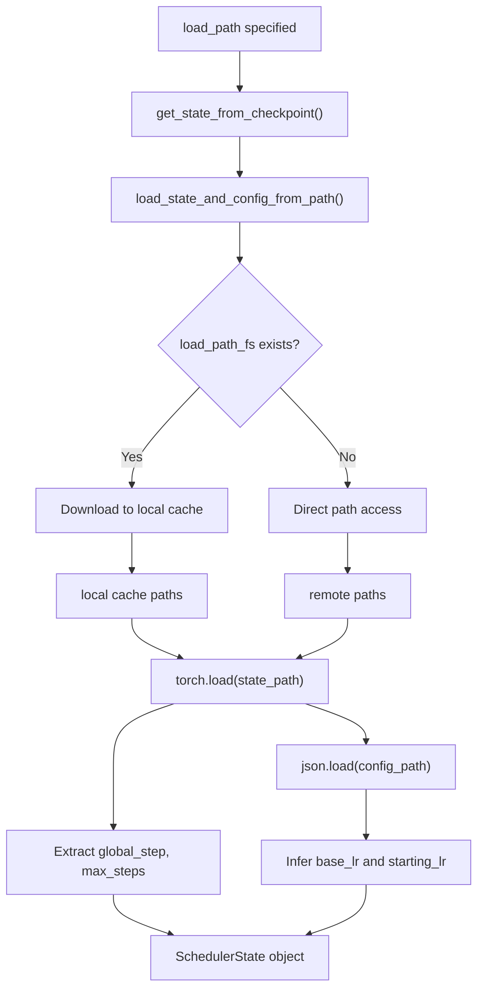

**Configuration Format Compatibility**
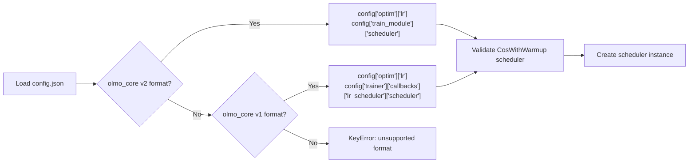

Sources: [src/cookbook/model/builder.py:488-575](), [src/cookbook/model/builder.py:514-575]()

## Final Configuration Assembly

The `build()` method orchestrates all component builders to produce a complete `ModelTrainConfig`:

**Build Process Flow**
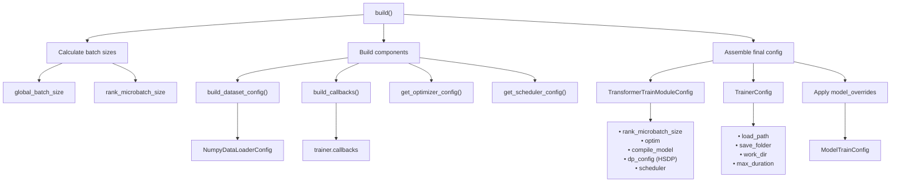

**Final Configuration Structure**
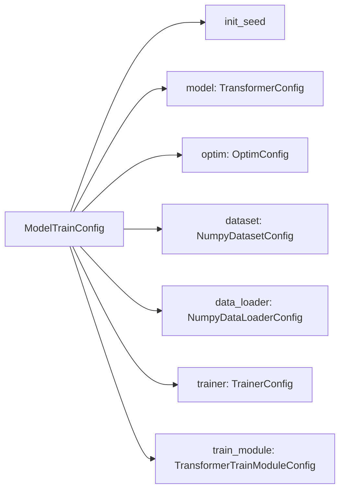

Sources: [src/cookbook/model/builder.py:577-638]()

## Integration with Training System

The `TransformerConfigBuilder` integrates with the broader training system by producing configurations compatible with OLMo-core's training framework:

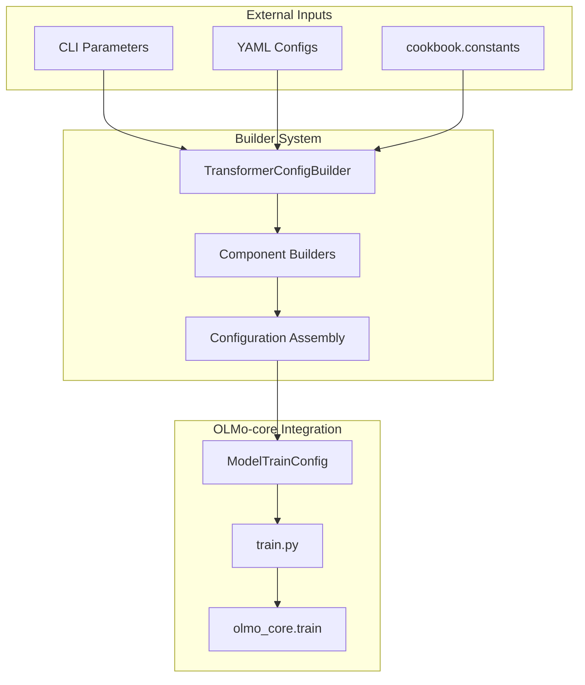

Sources: [src/cookbook/model/builder.py:1-70](), [src/cookbook/model/config.py:1-50]()

---

