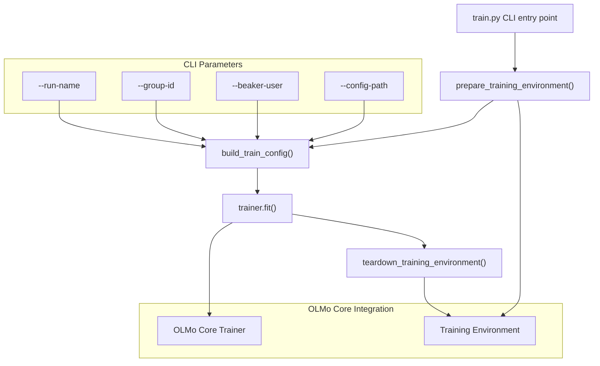
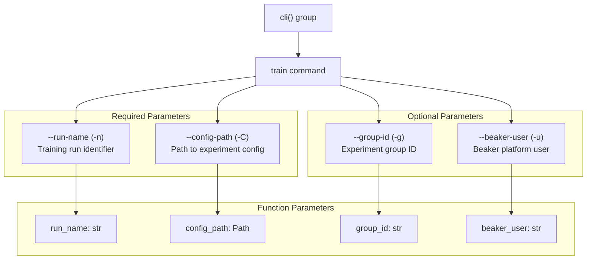
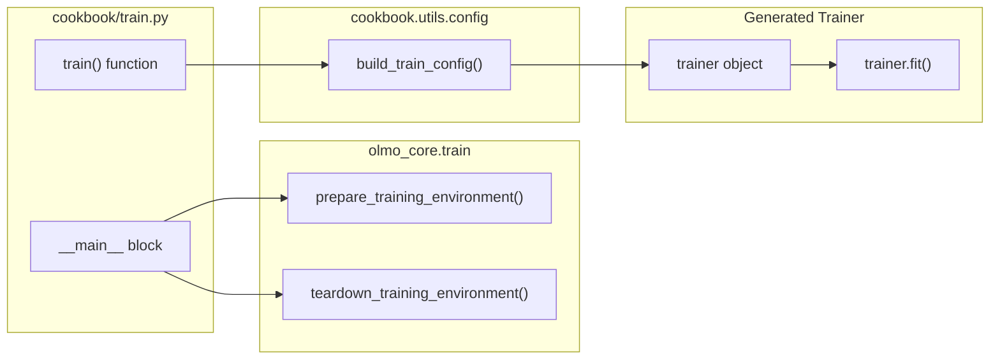
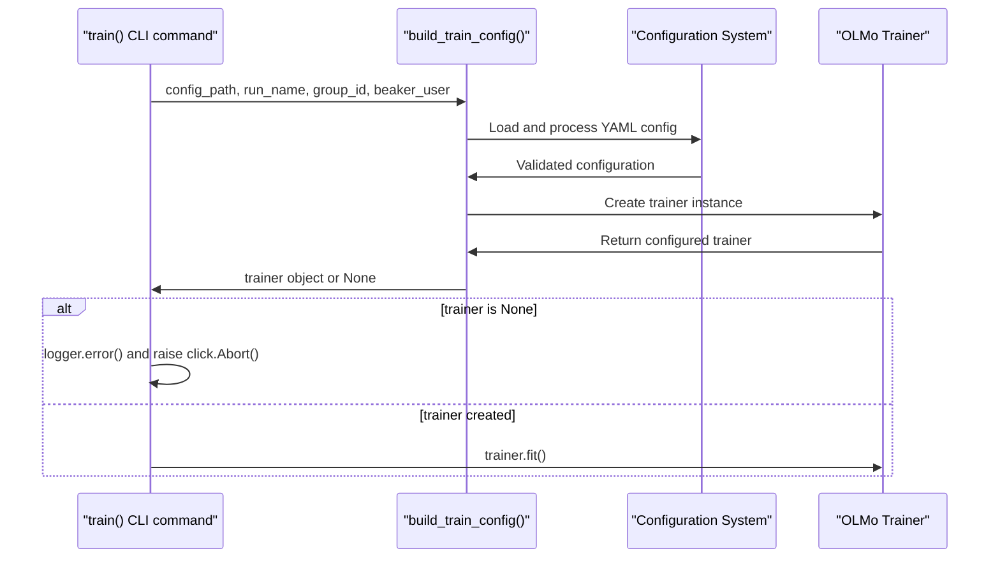
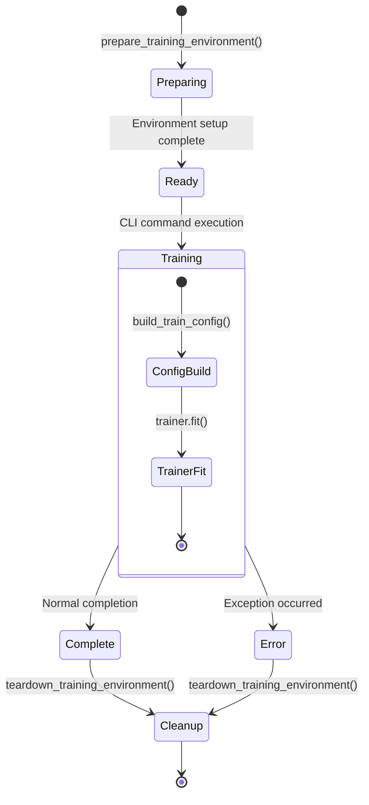

<!-- source: DeepWiki mcp.deepwiki.com · repo allenai/olmo-cookbook · page 5.3 Training Execution · fetched 2026-10-26 -->

# Training Execution

Relevant source files

The following files were used as context for generating this wiki page:

- [src/cookbook/train.py](src/cookbook/train.py)

This document covers the training execution system in olmo-cookbook, focusing on how training jobs are launched and managed through the `train.py` script and its integration with OLMo-core. This page covers the actual execution mechanics - for configuration setup, see [Training Configuration](#5.1) and [Model Configuration Builder](#5.2).

## Training Execution Flow

The training execution system provides a command-line interface that orchestrates the complete training lifecycle, from environment preparation through model training completion.

**Training Execution Architecture**

Sources: [src/cookbook/train.py:1-67]()

The execution flow follows a structured lifecycle:

1. **Environment Preparation**: Calls `prepare_training_environment()` from OLMo-core to set up the training environment
2. **Configuration Building**: Uses `build_train_config()` to construct the trainer configuration from the provided parameters
3. **Training Execution**: Invokes `trainer.fit()` to begin the actual training process
4. **Environment Cleanup**: Ensures `teardown_training_environment()` is called regardless of training outcome

## CLI Interface

The training CLI provides a simple but comprehensive interface for launching training jobs with the necessary parameters for distributed training and experiment tracking.

**CLI Command Structure**

Sources: [src/cookbook/train.py:13-58]()

| Parameter | Type | Required | Purpose |
|-----------|------|----------|---------|
| `--run-name` (`-n`) | `str` | Yes | Unique identifier for the training run |
| `--config-path` (`-C`) | `Path` | Yes | Path to the experiment configuration YAML file |
| `--group-id` (`-g`) | `str` | No | Groups related experiments together |
| `--beaker-user` (`-u`) | `str` | No | Specifies Beaker platform user for job submission |

## Integration with OLMo-Core

The training execution system integrates tightly with OLMo-core, leveraging its training environment management and trainer infrastructure.

**OLMo-Core Integration Points**

Sources: [src/cookbook/train.py:5-6](), [src/cookbook/train.py:52-58](), [src/cookbook/train.py:62-66]()

The integration provides several key benefits:

- **Environment Management**: OLMo-core handles distributed training setup, GPU detection, and process coordination
- **Trainer Abstraction**: The `trainer.fit()` method encapsulates the complete training loop
- **Error Handling**: The `@record` decorator provides robust error tracking for distributed training

## Configuration Building Integration

The training execution relies on the configuration building system to translate YAML experiment configurations into OLMo-core trainer objects.

**Configuration to Trainer Flow**

Sources: [src/cookbook/train.py:52-58]()

The configuration building process handles:
- YAML configuration file parsing
- Parameter validation and defaults
- Trainer instantiation with proper settings
- Error handling for invalid configurations

## Environment Management

The training execution system ensures proper setup and cleanup of the training environment through OLMo-core's environment management functions.

**Environment Lifecycle**

Sources: [src/cookbook/train.py:62-66]()

The environment management ensures:
- **Initialization**: Proper setup of distributed training components
- **Cleanup Guarantee**: `finally` block ensures teardown occurs even on exceptions
- **Resource Management**: Proper cleanup of GPU resources and process coordination

## Error Handling and Logging

The training execution incorporates comprehensive error handling to manage the complexities of distributed training.

| Component | Error Handling Mechanism |
|-----------|--------------------------|
| `@record` decorator | Captures and reports distributed training errors |
| Configuration validation | Returns `None` from `build_train_config()` on failure |
| Environment management | `finally` block ensures cleanup on any exit |
| CLI error reporting | `click.Abort()` provides clean exit on configuration errors |

Sources: [src/cookbook/train.py:45](), [src/cookbook/train.py:54-56](), [src/cookbook/train.py:62-66]()

The logging system uses Python's standard logging framework with a module-level logger for consistent error reporting and debugging information.

---

