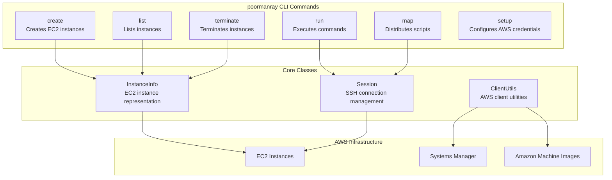
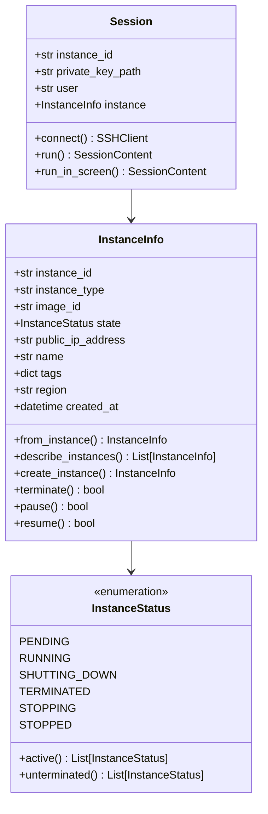
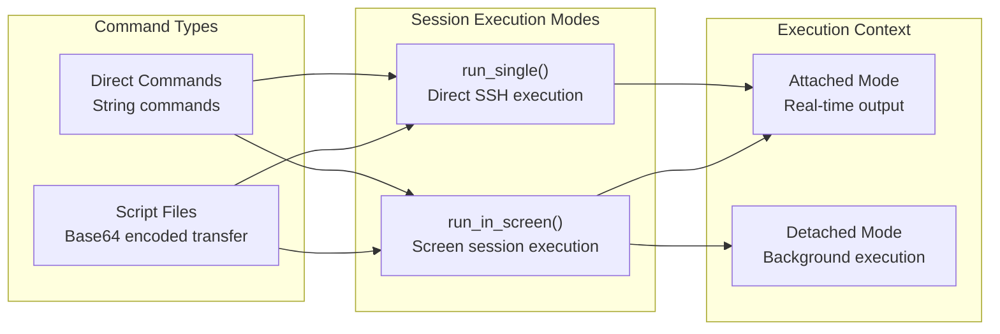
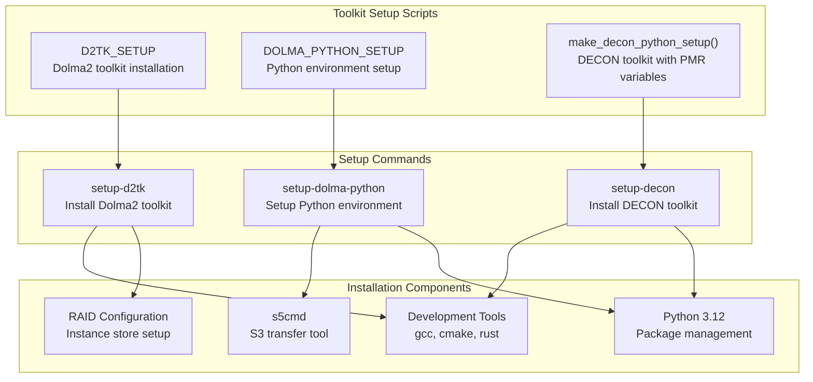
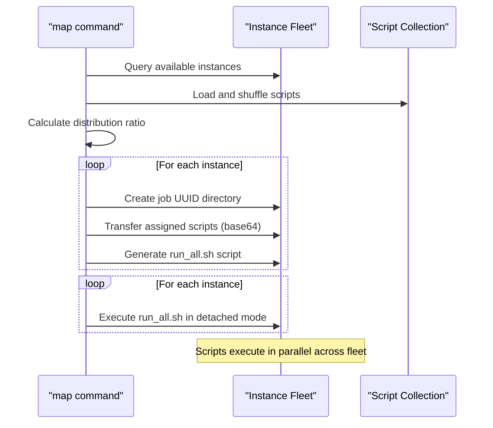
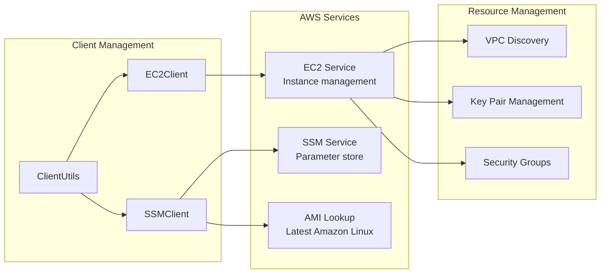
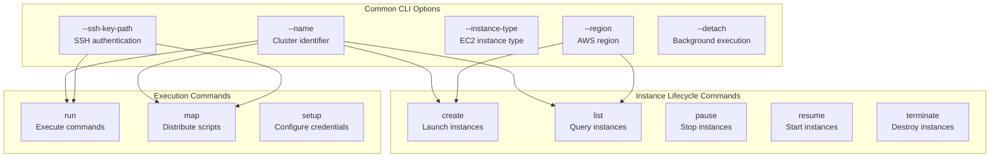

<!-- source: DeepWiki mcp.deepwiki.com · repo allenai/olmo-cookbook · page 6 Infrastructure Management · fetched 2026-10-26 -->

# Infrastructure Management

<details>
<summary>Relevant source files</summary>

The following files were used as context for generating this wiki page:

- [src/cookbook/cli/pmr.py](src/cookbook/cli/pmr.py)

</details>


This document covers the infrastructure management system provided by the `poormanray` CLI, which enables distributed computing by managing fleets of EC2 instances. The system provides a simplified alternative to Ray for distributed data processing, with built-in support for various data processing toolkits.

For information about training configuration and orchestration, see [Training System](#5). For evaluation execution environments, see [Evaluation System](#4).

## Overview

The infrastructure management system, implemented primarily in [src/cookbook/cli/pmr.py:1-2070](), provides comprehensive EC2 instance lifecycle management through the `poormanray` CLI. This system enables users to create, configure, and manage clusters of EC2 instances for distributed processing tasks, with special support for AI/ML workloads.



**Sources:** [src/cookbook/cli/pmr.py:1-81](), [src/cookbook/cli/pmr.py:2055-2066]()

## Core Data Structures

### InstanceInfo Class

The `InstanceInfo` class serves as the primary representation of EC2 instances throughout the system:



**Sources:** [src/cookbook/cli/pmr.py:415-876](), [src/cookbook/cli/pmr.py:357-376](), [src/cookbook/cli/pmr.py:879-1019]()

### Instance Management Operations

The system provides comprehensive instance lifecycle management through a set of class methods and CLI commands:

| Operation | Method | CLI Command | Purpose |
|-----------|--------|-------------|---------|
| Creation | `InstanceInfo.create_instance()` | `create` | Launch new instances with specified configurations |
| Discovery | `InstanceInfo.describe_instances()` | `list` | Query and filter existing instances |
| Termination | `instance.terminate()` | `terminate` | Permanently destroy instances |
| Pause | `instance.pause()` | `pause` | Stop instances (preserving state) |
| Resume | `instance.resume()` | `resume` | Restart stopped instances |

**Sources:** [src/cookbook/cli/pmr.py:769-876](), [src/cookbook/cli/pmr.py:536-746]()

## SSH Session Management

The `Session` class provides SSH-based command execution capabilities with support for both interactive and detached execution modes:



**Sources:** [src/cookbook/cli/pmr.py:920-1018](), [src/cookbook/cli/pmr.py:1108-1136]()

## Toolkit Installation Systems

The infrastructure management system includes built-in support for several specialized toolkits:

### Setup Scripts and Installation



**Sources:** [src/cookbook/cli/pmr.py:168-330](), [src/cookbook/cli/pmr.py:1719-1921]()

### DECON Environment Setup

The DECON setup includes special handling for distributed processing environments:

```python
# PMR environment variables are automatically set for distributed processing
PMR_HOST_INDEX={host_index}
PMR_HOST_COUNT={host_count}
```

**Sources:** [src/cookbook/cli/pmr.py:239-258](), [src/cookbook/cli/pmr.py:1839-1921]()

## Distributed Script Execution

The `map` command provides sophisticated script distribution capabilities across instance fleets:



**Sources:** [src/cookbook/cli/pmr.py:1923-2053]()

### Script Distribution Algorithm

The system uses a proportional distribution algorithm to evenly spread scripts across instances:

```python
ratio = len(script) / len(instances)
start_idx = round(ratio * i)
end_idx = round(ratio * (i + 1))
instance_scripts = script[start_idx:end_idx]
```

**Sources:** [src/cookbook/cli/pmr.py:1980-1985]()

## AWS Integration

The infrastructure management system integrates deeply with AWS services through boto3 clients:



**Sources:** [src/cookbook/cli/pmr.py:333-354](), [src/cookbook/cli/pmr.py:748-767](), [src/cookbook/cli/pmr.py:1021-1106]()

## CLI Command Structure

The poormanray CLI follows a consistent pattern with common options across all commands:



**Sources:** [src/cookbook/cli/pmr.py:1143-1251](), [src/cookbook/cli/pmr.py:2055-2066]()

The system uses a decorator pattern to apply common options across commands, ensuring consistency and reducing code duplication through the `common_cli_options` function.

**Sources:** [src/cookbook/cli/pmr.py:1146-1251]()

---

