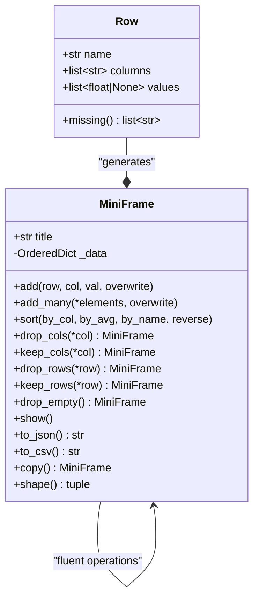
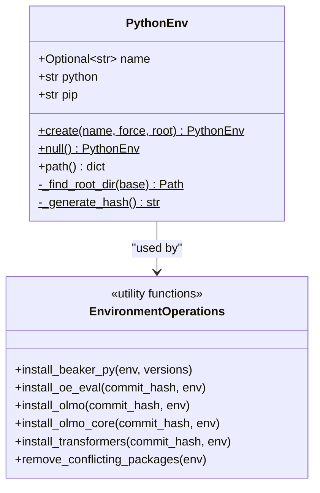
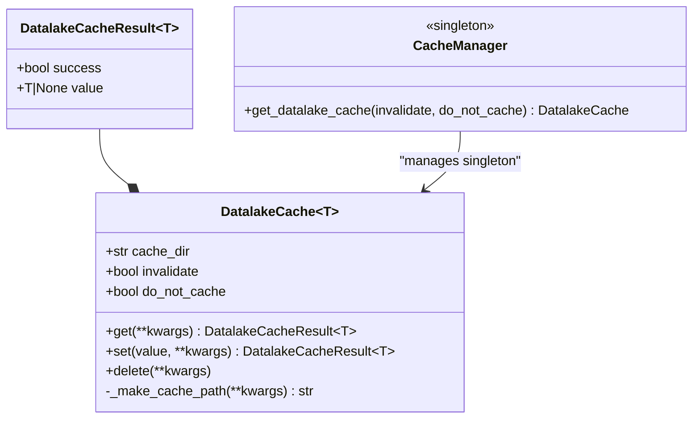
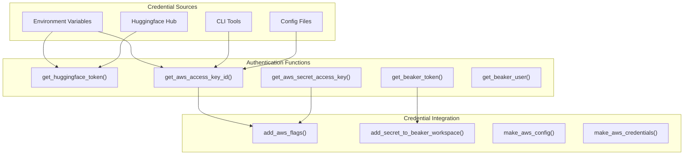
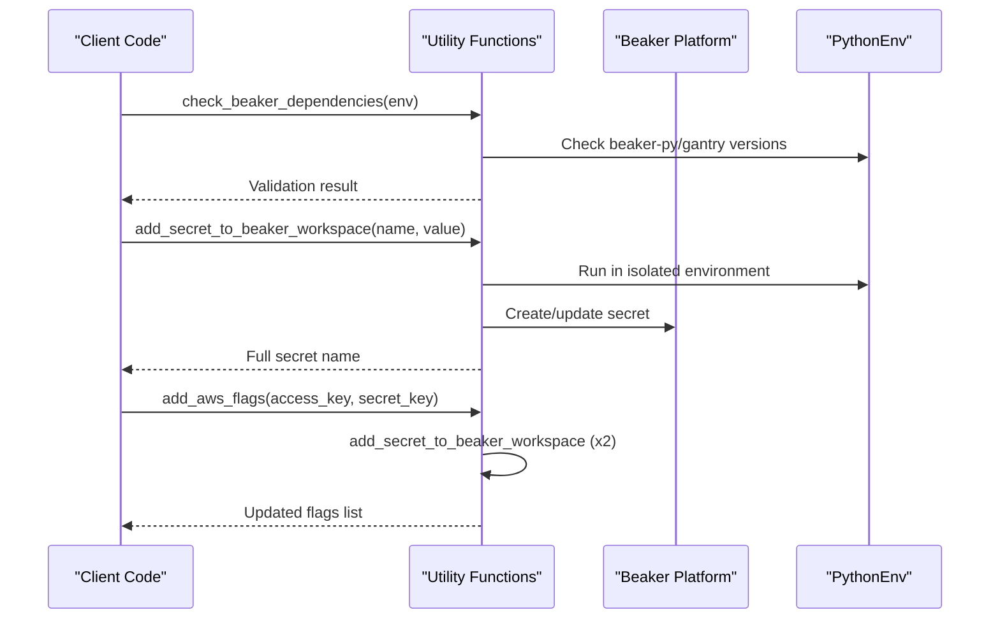
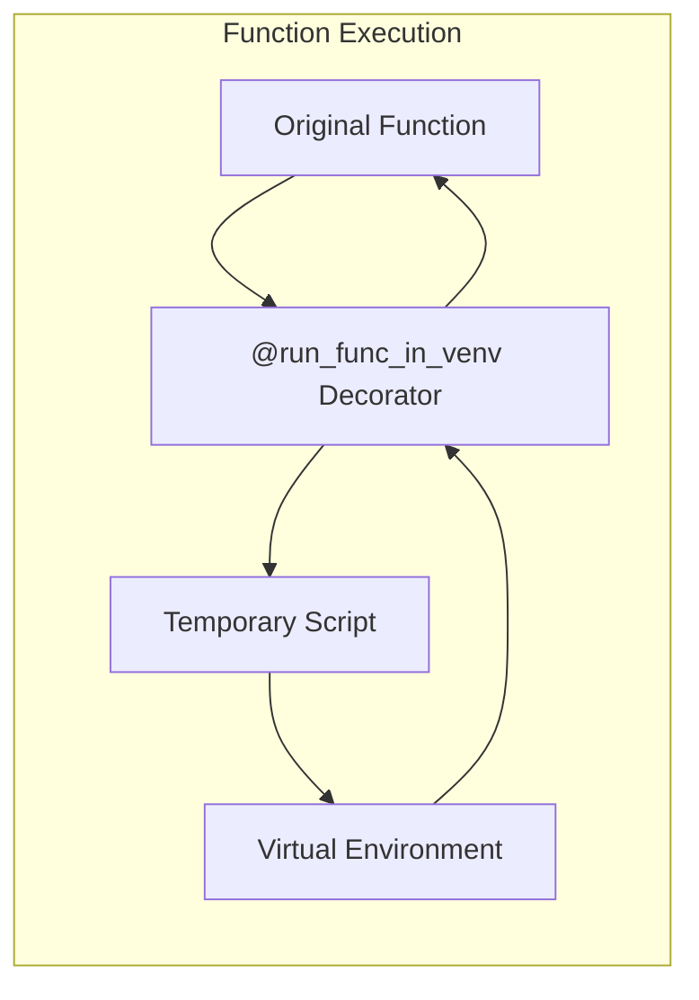
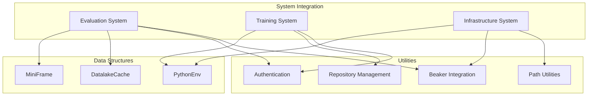

<!-- source: DeepWiki mcp.deepwiki.com · repo allenai/olmo-cookbook · page 7 Data Structures and Utilities · fetched 2026-10-26 -->

# Data Structures and Utilities

Relevant source files

The following files were used as context for generating this wiki page:

- [src/cookbook/cli/utils.py](src/cookbook/cli/utils.py)
- [src/cookbook/eval/cache.py](src/cookbook/eval/cache.py)
- [src/cookbook/eval/miniframe.py](src/cookbook/eval/miniframe.py)
- [tests/cookbook/eval/test_miniframe.py](tests/cookbook/eval/test_miniframe.py)

This document covers the core data structures and utility functions that support the olmo-cookbook system across evaluation, training, and infrastructure management workflows. These components provide essential functionality for data manipulation, environment management, caching, and system integration.

For information about the evaluation orchestration that uses these utilities, see [Evaluation Orchestration](#4.2). For training configuration that leverages these tools, see [Training Configuration](#5.1).

## Core Data Structures

### MiniFrame

The `MiniFrame` class serves as a lightweight pandas-like table structure specifically designed for handling evaluation results and metrics across different models and tasks.

**Key Features:**
- **Flexible Data Storage**: Uses `OrderedDict[str, OrderedDict[str, float | None]]` to store column-based data with support for missing values
- **Fluent Interface**: Methods return new `MiniFrame` instances, enabling method chaining
- **Pattern Matching**: Supports both string and regex patterns for filtering operations
- **Multiple Export Formats**: JSON, CSV, and rich console table output

Sources: [src/cookbook/eval/miniframe.py:1-259]()

### Environment Management

The `PythonEnv` dataclass provides isolated Python environment management for different operations within the cookbook system.

**Environment Lifecycle:**
1. **Discovery**: Locates git repository root or uses system temp directory
2. **Creation**: Sets up virtual environment in `.venv` subdirectory
3. **Management**: Provides isolated Python and pip executables
4. **Integration**: Works with dependency installation functions

Sources: [src/cookbook/cli/utils.py:28-87]()

### Caching System

The `DatalakeCache` provides persistent caching for expensive operations, particularly datalake queries and evaluation results.

**Cache Behavior:**
- **Key Generation**: Uses SHA-256 hash of JSON-serialized kwargs
- **Storage Format**: Compressed JSON files in user cache directory
- **Environment Controls**: `DATALAKE_CACHE_INVALIDATE` and `DATALAKE_DO_NOT_CACHE` environment variables
- **Singleton Pattern**: Single global cache instance

Sources: [src/cookbook/eval/cache.py:1-102]()

## Utility Function Categories

### Authentication and Credentials

The system provides comprehensive credential management for various external services:

Sources: [src/cookbook/cli/utils.py:89-147](), [src/cookbook/cli/utils.py:357-392](), [src/cookbook/cli/utils.py:492-519]()

### Repository and Package Management

Functions for managing code dependencies and repository operations:

| Function | Purpose | Key Parameters |
|----------|---------|----------------|
| `clone_repository()` | Clone git repositories with specific commits/branches | `git_url`, `commit_hash`, `commit_branch` |
| `install_oe_eval()` | Install OE-Eval evaluation toolkit | `commit_hash`, `env`, `no_dependencies` |
| `install_olmo()` | Install OLMo training framework | `commit_hash`, `env` |
| `install_olmo_core()` | Install OLMo-core library | `commit_hash`, `env` |
| `install_transformers()` | Install specific Transformers version | `commit_hash`, `env`, `git_url` |

Sources: [src/cookbook/cli/utils.py:417-575]()

### Beaker Integration Utilities

Specialized functions for Beaker platform integration:

Sources: [src/cookbook/cli/utils.py:150-173](), [src/cookbook/cli/utils.py:290-392](), [src/cookbook/cli/utils.py:600-629]()

## Cross-Platform Utility Functions

### Virtual Environment Execution

The `run_func_in_venv()` decorator enables running arbitrary functions in isolated Python environments:

**Process:**
1. **Introspection**: Extracts function source code and module information
2. **Script Generation**: Creates temporary Python script with function call
3. **Execution**: Runs script in specified virtual environment
4. **Result Capture**: Parses stdout to retrieve return value

Sources: [src/cookbook/cli/utils.py:246-287]()

### Path and Storage Utilities

| Function | Purpose | Return Type |
|----------|---------|-------------|
| `find_repository_root()` | Locate git repository root directory | `Path` |
| `discover_weka_mount()` | Identify Weka filesystem mounts | `Optional[str]` |
| `make_destination_dir()` | Create output directories with suffixes | `str` |
| `download_tokenizer()` | Download tokenizers from Hugging Face Hub | `str` |

Sources: [src/cookbook/cli/utils.py:521-554](), [src/cookbook/cli/utils.py:631-654]()

## Integration with Broader System

These data structures and utilities integrate throughout the olmo-cookbook system:

**Key Integration Points:**
- **Evaluation Results**: `MiniFrame` aggregates metrics from multiple evaluation runs
- **Environment Isolation**: `PythonEnv` provides clean environments for dependency installation
- **Performance Optimization**: `DatalakeCache` reduces redundant datalake queries
- **Cross-Platform Support**: Utility functions abstract platform-specific operations

Sources: [src/cookbook/eval/miniframe.py:1-259](), [src/cookbook/eval/cache.py:1-102](), [src/cookbook/cli/utils.py:1-654]()

---

