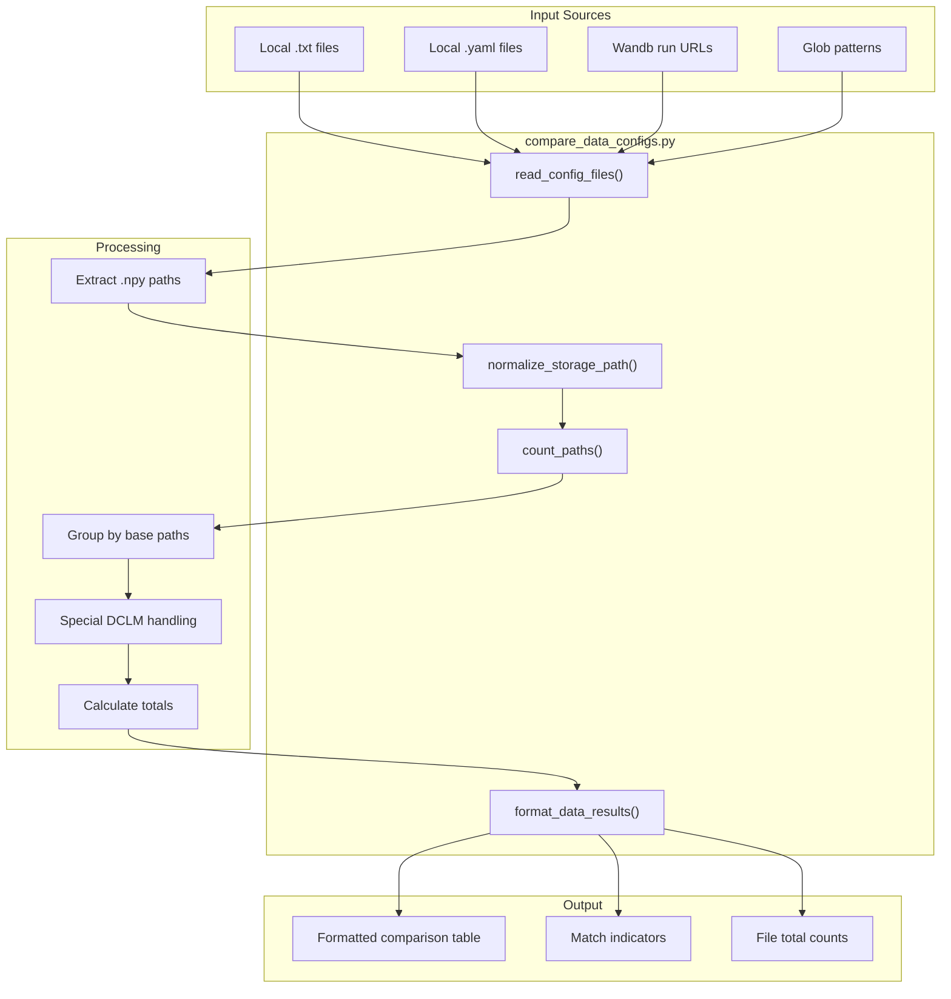
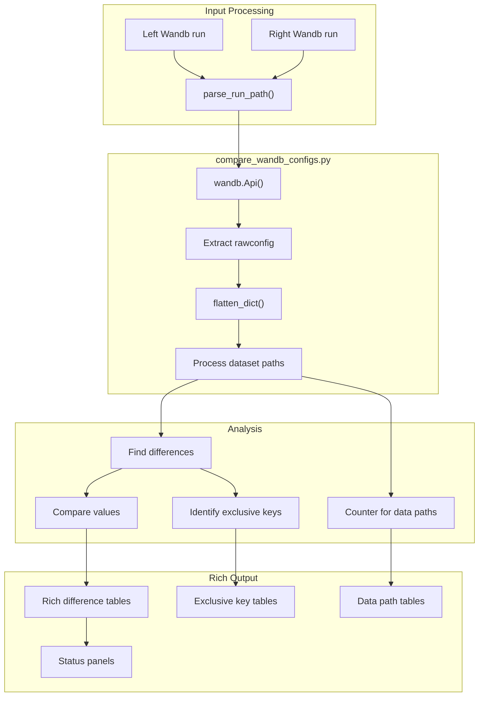
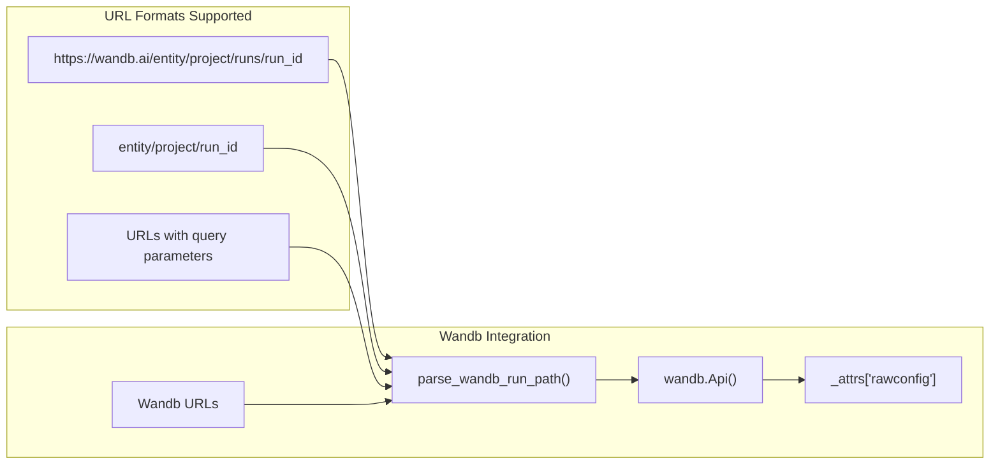

<!-- source: DeepWiki mcp.deepwiki.com · repo allenai/olmo-cookbook · page 8 Development Tools and Scripts · fetched 2026-10-26 -->

# Development Tools and Scripts

<details>
<summary>Relevant source files</summary>

The following files were used as context for generating this wiki page:

- [scripts/compare_data_configs.py](scripts/compare_data_configs.py)
- [scripts/compare_wandb_configs.py](scripts/compare_wandb_configs.py)

</details>


This page documents the development tools and utility scripts provided in the olmo-cookbook repository for debugging, analyzing, and comparing model configurations. These tools are primarily intended for developers and researchers who need to investigate differences between training runs, validate data configurations, and troubleshoot configuration issues.

For information about the main command-line interfaces used for training and evaluation, see [Command Line Interface](#3). For details about the central configuration system that these tools analyze, see [Configuration and Constants System](#2).

## Configuration Comparison Tools

The repository provides two main utilities for comparing and analyzing model configurations across different sources and formats.

### Data Configuration Comparison Script

The `compare_data_configs.py` script serves as a comprehensive tool for analyzing data path configurations across multiple file formats and sources. It can handle local configuration files, YAML configs, and remote Wandb run configurations.



The script supports both data-only comparisons (default) and full configuration comparisons. Key functions include:

- `parse_wandb_run_path()` - Handles both Wandb URLs and run path strings
- `normalize_storage_path()` - Normalizes file paths by removing URL schemes and standardizing separators
- `count_paths()` - Groups and counts files under normalized base paths
- `flatten_dict()` - Flattens nested configuration dictionaries for comparison

Sources: [scripts/compare_data_configs.py:1-377]()

### Wandb Configuration Comparison Script

The `compare_wandb_configs.py` script provides specialized functionality for comparing configurations between two Wandb runs, with rich console output formatting.



Key features include:
- Rich console formatting with colored tables and panels
- Support for both URL and path-based Wandb run references
- Optional dataset path comparison with `--diff-datasets` flag
- Separate handling of exclusive keys vs value differences

Sources: [scripts/compare_wandb_configs.py:1-204]()

## Data Path Analysis Features

Both comparison tools provide sophisticated data path analysis capabilities designed to handle the complexity of modern ML training data configurations.

### Path Normalization and Grouping

The tools implement intelligent path normalization to handle various storage systems and URL schemes:

| Feature | Implementation | Purpose |
|---------|---------------|---------|
| URL Scheme Removal | `urlparse()` and path extraction | Handle s3://, gs://, https:// prefixes uniformly |
| Path Separator Normalization | Replace backslashes with forward slashes | Cross-platform compatibility |
| Base Path Grouping | Extract parent directories | Group related files for counting |
| DCLM Special Handling | Regex matching for `/dclm/` paths | Handle DCLM dataset structure correctly |

### File Counting and Matching

The comparison tools provide detailed statistics about data configurations:

- **Base Path Counts**: Number of `.npy` files under each normalized base path
- **Match Indicators**: Visual indicators (✓) when all configurations have matching counts
- **File Totals**: Overall count of data files per configuration
- **Sorted Output**: Results sorted by largest file counts for easy analysis

Sources: [scripts/compare_data_configs.py:169-229]()

## Wandb Integration

Both tools integrate with Weights & Biases for accessing remote run configurations, enabling comparison of live experiments with local configurations.

### Authentication and API Access

The tools use the `wandb.Api()` client to access run configurations:



### Configuration Extraction

The tools extract different types of configuration data depending on the comparison mode:

- **Data-only mode**: Extracts `data.paths` arrays containing training data file paths
- **Full config mode**: Retrieves complete raw configuration dictionaries
- **Flattened access**: Converts nested configs to flat key-value pairs for easier comparison

Sources: [scripts/compare_data_configs.py:100-121](), [scripts/compare_wandb_configs.py:125-150]()

## Usage Patterns and Workflows

The development tools support several common debugging and analysis workflows:

### Mid-Training Configuration Analysis

Compare annealing configurations during training phases:
```bash
python compare_data_configs.py /path/to/dolmino50.txt /path/to/dolmino100.txt --data-only
```

### Cross-Framework Configuration Validation

Compare old OLMo YAML configs with new text-based configs:
```bash
python compare_data_configs.py /path/to/new/config.txt /path/to/old/config.yaml --data-only
```

### Live Experiment Comparison

Compare running Wandb experiments with local configurations:
```bash
python compare_wandb_configs.py https://wandb.ai/ai2-llm/project/runs/run1 https://wandb.ai/ai2-llm/project/runs/run2 --diff-datasets
```

### Batch Configuration Analysis

Analyze multiple configurations simultaneously using glob patterns:
```bash
python compare_data_configs.py /path/to/configs/dolmino*.txt --full-config
```

Sources: [scripts/compare_data_configs.py:6-34](), [scripts/compare_wandb_configs.py:3-10]()