# Page: Overview

# Overview

<details>
<summary>Relevant source files</summary>

The following files were used as context for generating this wiki page:

- [README.md](README.md)
- [pyproject.toml](pyproject.toml)

</details>


## Purpose and Scope

The `olmo-cookbook` repository is a comprehensive toolkit for managing the complete lifecycle of OLMo (Open Language Model) experiments, from training through evaluation and deployment. It serves as an orchestration layer that abstracts complex interactions with cloud platforms, compute resources, and machine learning infrastructure while providing a unified command-line interface for researchers and engineers.

This document provides an architectural overview of the entire system. For detailed information about specific subsystems, see [Configuration and Constants System](#2) for the central configuration management, [Evaluation System](#4) for comprehensive model evaluation workflows, [Training System](#5) for model training orchestration, and [Infrastructure Management](#6) for compute resource management.

## System Architecture

The olmo-cookbook system is built around four primary CLI interfaces that coordinate different aspects of the model development workflow:

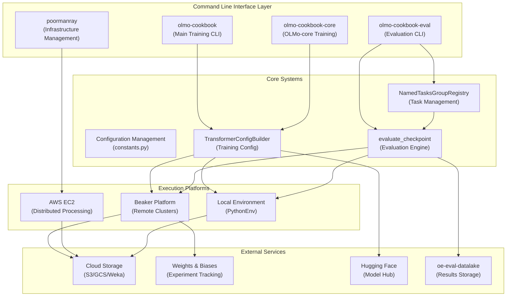

**Sources:** [pyproject.toml:57-61](), [README.md:1-318]()

## Core Components and Code Structure

The system's architecture maps directly to specific code entities and modules:

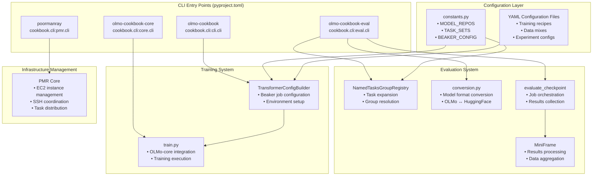

**Sources:** [pyproject.toml:57-61](), [README.md:46-56](), [README.md:140-171](), [README.md:173-227](), [README.md:228-318]()

## Key Workflows

The olmo-cookbook supports three primary workflows, each accessible through dedicated CLI interfaces:

### Training Workflow
The training workflow uses configuration-driven job submission to cloud platforms:

1. **Configuration Building**: The `TransformerConfigBuilder` processes YAML recipe files ([README.md:48]()) and system constants to generate Beaker job specifications
2. **Job Launch**: The `olmo-cookbook launch` command ([README.md:54]()) submits configured training jobs to Beaker clusters
3. **Monitoring**: Integration with Weights & Biases provides real-time training metrics ([README.md:56]())

### Evaluation Workflow  
The evaluation system provides comprehensive model assessment capabilities:

1. **Model Conversion**: The `olmo-cookbook-eval convert` command ([README.md:64-89]()) transforms checkpoints between OLMo and HuggingFace formats
2. **Task Execution**: The `olmo-cookbook-eval evaluate` command ([README.md:101-123]()) runs evaluation tasks using the `NamedTasksGroupRegistry` system
3. **Results Retrieval**: The `olmo-cookbook-eval results` command ([README.md:127-137]()) queries the datalake for formatted results

### Infrastructure Workflow
The infrastructure management system enables distributed processing on EC2:

1. **Cluster Creation**: The `poormanray create` command ([README.md:242-258]()) provisions EC2 instance clusters
2. **Task Distribution**: The `poormanray map` command ([README.md:280-286]()) distributes processing tasks across instances  
3. **Resource Cleanup**: The `poormanray terminate` command ([README.md:289-294]()) manages resource lifecycle

**Sources:** [README.md:5-57](), [README.md:58-137](), [README.md:173-318]()

## Dependencies and Integration Points

The system integrates with multiple external platforms and frameworks through well-defined interfaces:

| Integration | Purpose | Configuration Source |
|-------------|---------|---------------------|
| **OLMo-core** | Training framework | [pyproject.toml:51]() |
| **Beaker Platform** | Remote job orchestration | [pyproject.toml:39-42]() |
| **Weights & Biases** | Experiment tracking | [pyproject.toml:43-45]() |
| **AWS/GCP** | Cloud storage and compute | [pyproject.toml:46-49]() |
| **HuggingFace** | Model distribution | Core dependencies |

The system requires Python 3.10-3.13 ([pyproject.toml:13]()) and supports optional dependency groups for different use cases, including development tools ([pyproject.toml:34-38]()), Beaker integration ([pyproject.toml:39-42]()), and checkpoint management ([pyproject.toml:46-49]()).

**Sources:** [pyproject.toml:15-55](), [README.md:17-29](), [README.md:32-44]()

---

# Page: Configuration and Constants System

# Configuration and Constants System

<details>
<summary>Relevant source files</summary>

The following files were used as context for generating this wiki page:

- [src/cookbook/aliases.py](src/cookbook/aliases.py)
- [src/cookbook/constants.py](src/cookbook/constants.py)

</details>


The Configuration and Constants System serves as the central configuration hub for all OLMo Cookbook operations, providing a unified source of truth for model repositories, evaluation benchmarks, platform settings, and experiment configurations. This system ensures consistency across training, evaluation, and infrastructure management workflows.

For information about how these configurations are used in specific workflows, see Training Configuration ([#5.1](#5.1)) and Evaluation Task Management ([#4.1](#4.1)).

## Core Constants Architecture

The system is built around two primary components: a constants module that defines static system-wide values, and a configuration system that handles dynamic experiment and runtime settings.

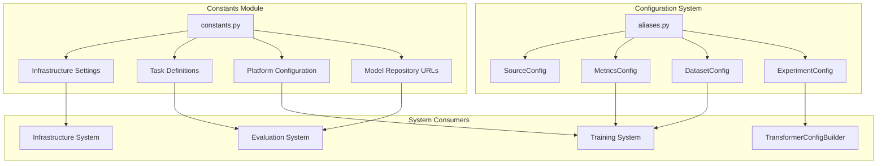

**System Constants Flow**

Sources: [src/cookbook/constants.py:1-1173](), [src/cookbook/aliases.py:1-154]()

## Model and Repository Configuration

The system maintains version-controlled references to all external dependencies, ensuring reproducible builds and conversions across different model formats.

| Constant | Purpose | Example Value |
|----------|---------|---------------|
| `TRANSFORMERS_GIT_URL` | HuggingFace Transformers repository | `https://github.com/huggingface/transformers.git` |
| `TRANSFORMERS_COMMIT_HASH` | Pinned commit for reproducibility | `241c04d36867259cdf11dbb4e9d9a60f9cb65ebc` |
| `AI2_OLMO_GIT_URL` | OLMo main repository | `https://github.com/allenai/OLMo.git` |
| `AI2_OLMO_CORE_GIT_URL` | OLMo Core repository | `https://github.com/allenai/OLMo-core.git` |

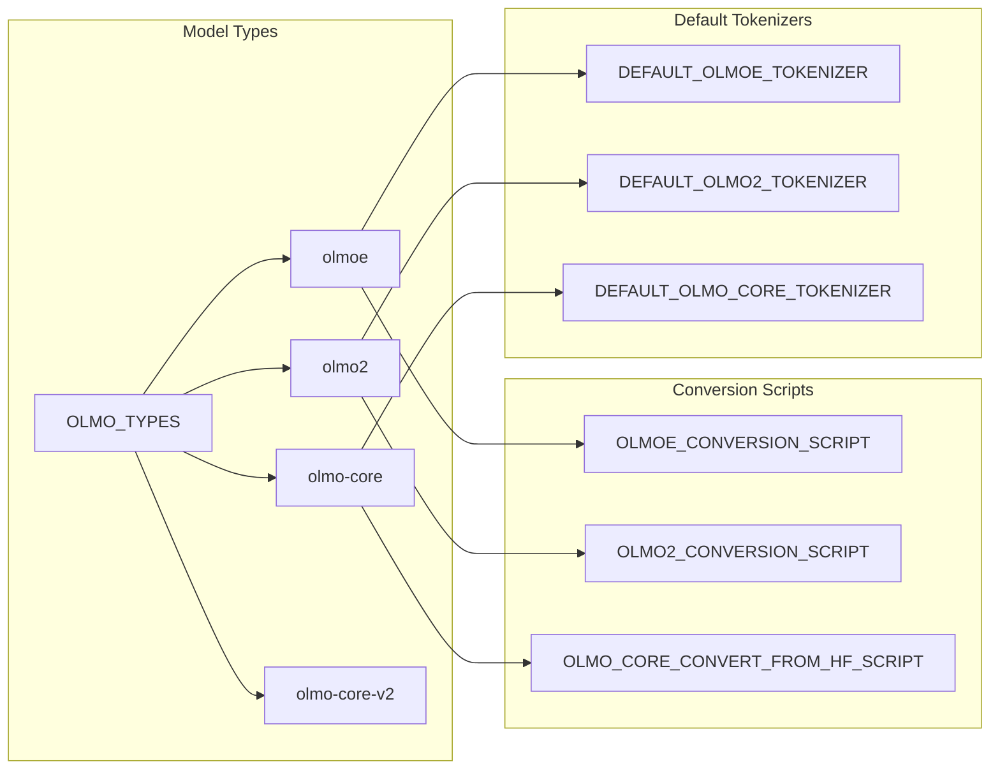

**Model Configuration Mapping**

Sources: [src/cookbook/constants.py:3-26](), [src/cookbook/constants.py:35-35]()

## Platform and Infrastructure Settings

The system defines comprehensive platform configurations for Beaker clusters, AWS infrastructure, and storage systems.

### Beaker Platform Configuration

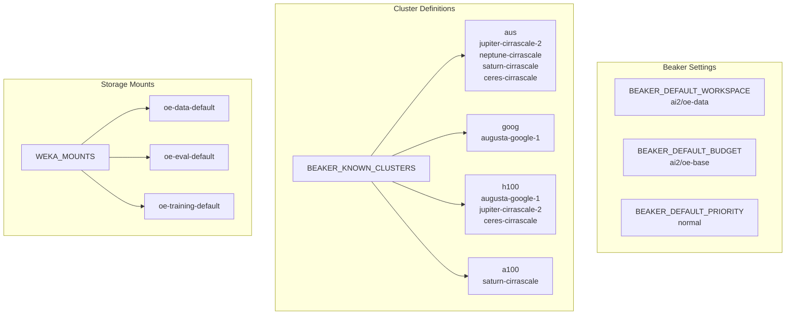

**Infrastructure Configuration Hierarchy**

Sources: [src/cookbook/constants.py:28-83](), [src/cookbook/constants.py:37-51](), [src/cookbook/constants.py:53-83]()

## Evaluation Task Definitions

The system provides comprehensive task definitions organized into logical groupings for different evaluation scenarios.

### Core Task Categories

| Task Group | Description | Example Tasks |
|------------|-------------|---------------|
| `ALL_CORE_TASKS` | Fundamental reasoning benchmarks | `arc_easy`, `boolq`, `hellaswag` |
| `MMLU_CATEGORIES` | Massive Multitask Language Understanding | `mmlu_abstract_algebra`, `mmlu_anatomy` |
| `BBH_TASKS` | Big-Bench Hard reasoning tasks | `boolean_expressions`, `logical_deduction` |
| `ALL_CODEX_TASKS` | Code generation benchmarks | `codex_humaneval`, `mbpp`, `bigcodebench` |

### Evaluation Suite Structure

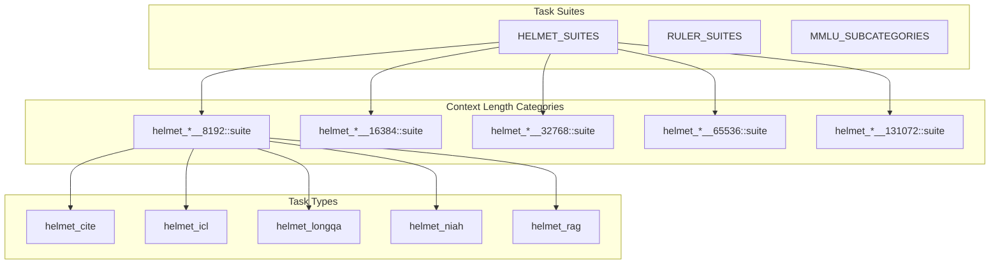

**Evaluation Task Hierarchy**

Sources: [src/cookbook/constants.py:85-537](), [src/cookbook/constants.py:230-408](), [src/cookbook/constants.py:410-537]()

## Experiment Configuration System

The configuration system uses Pydantic models to ensure type safety and validation for experiment definitions.

### Configuration Model Hierarchy

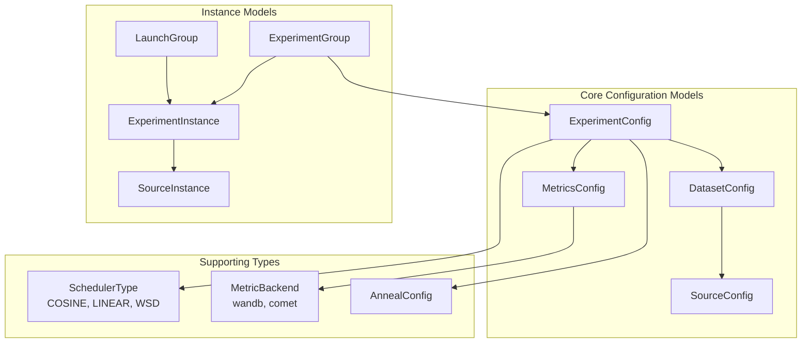

**Configuration Class Relationships**

Sources: [src/cookbook/aliases.py:77-130](), [src/cookbook/aliases.py:23-43](), [src/cookbook/aliases.py:50-55]()

### ExperimentConfig Structure

The `ExperimentConfig` class serves as the primary container for experiment settings:

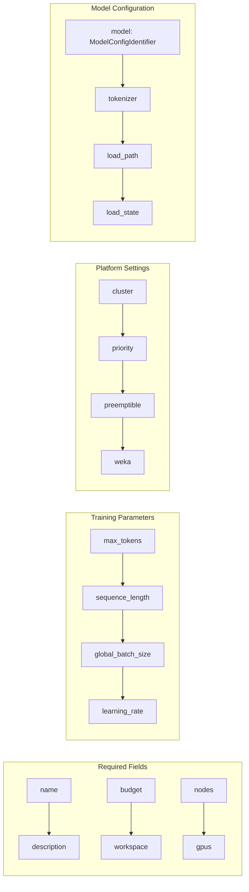

**ExperimentConfig Field Organization**

Sources: [src/cookbook/aliases.py:77-113]()

## Configuration Flow and Usage

The configuration system integrates with all major components of the OLMo Cookbook, providing a consistent interface for accessing system settings.

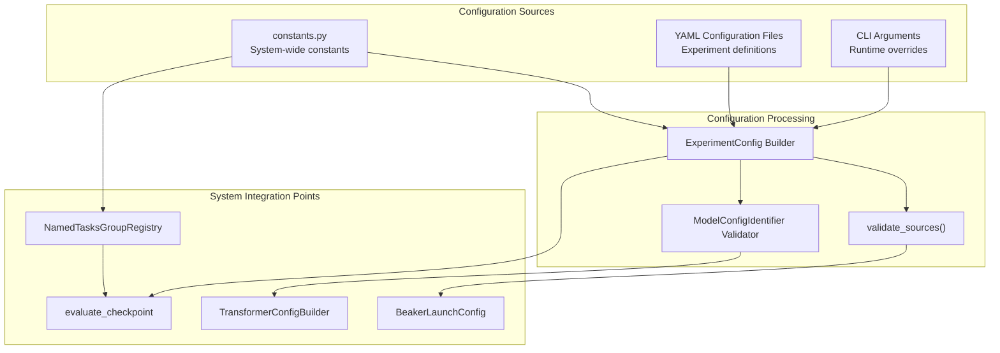

**Configuration Integration Flow**

Sources: [src/cookbook/aliases.py:147-154](), [src/cookbook/aliases.py:115-121](), [src/cookbook/constants.py:919-923]()

The validation system ensures configuration consistency through several mechanisms:
- Source ratio validation ensures all sources in a dataset have consistent `target_ratio` settings
- Model configuration validation converts string identifiers to proper `ModelConfigIdentifier` objects  
- Annealing validation ensures that annealing configurations are only used with appropriate load paths

This centralized configuration approach enables the OLMo Cookbook to maintain consistency across complex multi-system workflows while providing flexibility for different use cases and deployment scenarios.

---

# Page: Command Line Interface

# Command Line Interface

<details>
<summary>Relevant source files</summary>

The following files were used as context for generating this wiki page:

- [pyproject.toml](pyproject.toml)
- [src/cookbook/cli/utils.py](src/cookbook/cli/utils.py)

</details>


This document provides an overview of the command line interface structure in the olmo-cookbook repository. It covers the four main CLI entry points, their organization, shared utilities, and common patterns used across all command-line tools. For detailed documentation of specific CLI commands, see [Evaluation CLI](#3.1), [Training CLI](#3.2), and [Infrastructure CLI](#3.3).

## CLI Architecture Overview

The olmo-cookbook provides four distinct command-line interfaces, each targeting different workflows in the machine learning pipeline. These CLIs share common utilities and patterns while providing specialized functionality for their respective domains.

**CLI Architecture and Entry Points**
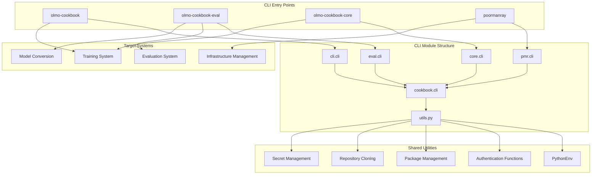

Sources: [pyproject.toml:57-61](), [src/cookbook/cli/utils.py:1-654]()

## Entry Points and Organization

The CLI system is organized around four main entry points, each defined in the project configuration and implemented as separate command modules.

| CLI Command | Entry Point | Module Path | Primary Purpose |
|-------------|-------------|-------------|-----------------|
| `olmo-cookbook` | `cookbook.cli:cli.cli` | `cookbook/cli/cli.py` | Model training orchestration |
| `olmo-cookbook-eval` | `cookbook.cli:eval.cli` | `cookbook/cli/eval.py` | Model evaluation and conversion |
| `olmo-cookbook-core` | `cookbook.cli:core.cli` | `cookbook/cli/core.py` | Core training functionality |
| `poormanray` | `cookbook.cli:pmr.cli` | `cookbook/cli/pmr.py` | Infrastructure management |

Sources: [pyproject.toml:57-61]()

## Common Utilities and Patterns

All CLI modules share a common set of utilities implemented in the `utils.py` module. These utilities handle cross-cutting concerns like environment management, authentication, and package installation.

**Utility Functions and Their Roles**
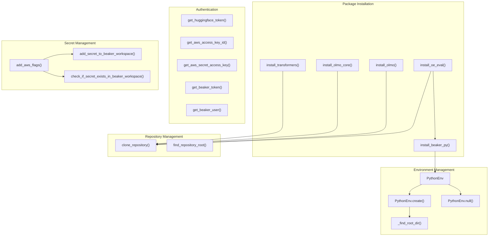

Sources: [src/cookbook/cli/utils.py:28-87](), [src/cookbook/cli/utils.py:150-243](), [src/cookbook/cli/utils.py:89-148](), [src/cookbook/cli/utils.py:417-459](), [src/cookbook/cli/utils.py:290-355]()

## Environment Management

The CLI system uses a sophisticated virtual environment management system through the `PythonEnv` class. This allows for isolated package installations and consistent dependency management across different execution contexts.

### PythonEnv Class Structure

The `PythonEnv` class provides three main modes of operation:

- **Isolated Environment**: Created with `PythonEnv.create()` for dependency isolation
- **System Environment**: Created with `PythonEnv.null()` for direct system usage
- **Named Environment**: Custom environments with specific naming and location

```python
# Key methods and properties from PythonEnv
@dataclass(frozen=True)
class PythonEnv:
    name: Optional[str]
    python: str
    pip: str
    
    def path(self) -> dict  # Environment variables with PATH setup
    @classmethod
    def create(cls, name, force=False, root=None) -> "PythonEnv"
    @classmethod  
    def null(cls) -> "PythonEnv"  # Uses system python/pip
```

Sources: [src/cookbook/cli/utils.py:28-87]()

## Package Installation and Dependency Management

The CLI utilities provide functions for installing various ML packages with proper dependency resolution and version management.

### Installation Functions

| Function | Purpose | Key Dependencies |
|----------|---------|------------------|
| `install_beaker_py()` | Beaker client and gantry | `beaker-py`, `beaker-gantry` |
| `install_oe_eval()` | OE-Eval evaluation toolkit | OE-Eval repository, beaker dependencies |
| `install_olmo()` | OLMo training framework | OLMo repository with `[train]` extras |
| `install_olmo_core()` | OLMo-core training system | OLMo-core repository |
| `install_transformers()` | HuggingFace Transformers | Transformers repository, accelerate, torchao |

The installation functions handle complex scenarios like:
- Commit-specific installations from git repositories
- Editable installations for development
- Dependency conflict resolution
- Version compatibility checks

Sources: [src/cookbook/cli/utils.py:150-173](), [src/cookbook/cli/utils.py:174-243](), [src/cookbook/cli/utils.py:462-489](), [src/cookbook/cli/utils.py:552-575]()

## External System Integration

The CLI system integrates with multiple external platforms and services, providing unified authentication and configuration management.

**External System Integration Flow**
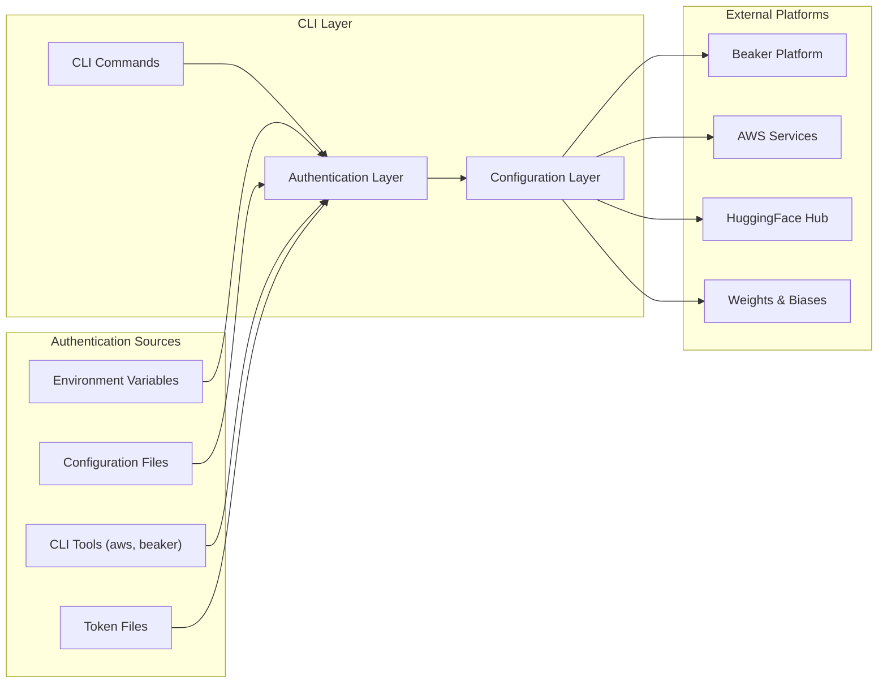

Sources: [src/cookbook/cli/utils.py:89-102](), [src/cookbook/cli/utils.py:104-147](), [src/cookbook/cli/utils.py:316-336]()

## Authentication and Credentials

The CLI system provides comprehensive authentication support for various external services, with multiple fallback mechanisms for credential discovery.

### Authentication Functions

- **HuggingFace**: `get_huggingface_token()` - checks environment variables and token files
- **AWS**: `get_aws_access_key_id()` and `get_aws_secret_access_key()` - supports CLI, environment, and credential files
- **Beaker**: `get_beaker_token()` and `get_beaker_user()` - uses Beaker client configuration

### Secret Management

The system includes functions for managing secrets in Beaker workspaces:
- `add_secret_to_beaker_workspace()` - adds or updates workspace secrets
- `check_if_secret_exists_in_beaker_workspace()` - verifies secret existence
- `add_aws_flags()` - automatically configures AWS secrets for Beaker jobs

Sources: [src/cookbook/cli/utils.py:89-102](), [src/cookbook/cli/utils.py:104-147](), [src/cookbook/cli/utils.py:290-355](), [src/cookbook/cli/utils.py:357-392]()

---

# Page: Evaluation CLI (olmo-cookbook-eval)

# Evaluation CLI (olmo-cookbook-eval)

<details>
<summary>Relevant source files</summary>

The following files were used as context for generating this wiki page:

- [src/cookbook/cli/eval.py](src/cookbook/cli/eval.py)
- [src/cookbook/model/evaluators.py](src/cookbook/model/evaluators.py)
- [src/cookbook/recipes/olmo3-evals/README.md](src/cookbook/recipes/olmo3-evals/README.md)

</details>


The `olmo-cookbook-eval` CLI is the primary command-line interface for model evaluation workflows within the olmo-cookbook system. It provides comprehensive tools for model format conversion, evaluation execution across various compute environments, and results management through an integrated dashboard system.

This page covers the CLI commands, their options, and integration patterns. For detailed information about the underlying evaluation orchestration system, see [Evaluation Orchestration](#4.2). For task management and registry details, see [Task Management and Registry](#4.1). For model conversion specifics, see [Model Conversion](#4.3).

## CLI Command Structure

The `olmo-cookbook-eval` CLI implements eight primary commands organized into three functional groups:

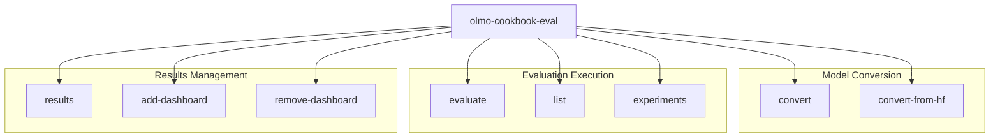

**CLI Command Registration**

The CLI uses Click for command registration and is structured as a command group in [src/cookbook/cli/eval.py:871-884](). Each command function is decorated with Click options and registered with the main CLI group.

Sources: [src/cookbook/cli/eval.py:871-884]()

## Model Conversion Commands

### convert Command

The `convert` command handles conversion between different OLMo model formats, supporting OLMo, OLMo2, OLMoE, and OLMo-core variants.

**Key Parameters:**
- `--olmo-type`: Specifies the source OLMo model type (required)
- `--huggingface-tokenizer`: Tokenizer path for HuggingFace conversion
- `--unsharded-output-dir`/`--huggingface-output-dir`: Output destinations
- `--use-beaker`: Enable Beaker job orchestration

**Implementation Flow:**
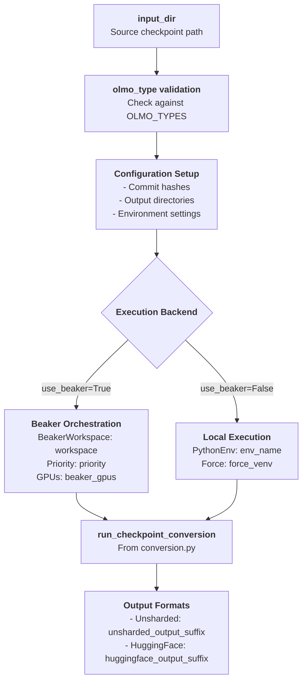

The conversion process delegates to `run_checkpoint_conversion` from [src/cookbook/eval/conversion.py](), which handles the actual model transformation logic.

Sources: [src/cookbook/cli/eval.py:183-301]()

### convert-from-hf Command

The `convert-from-hf` command converts models from Hugging Face format to OLMo-core format, specifically targeting OLMo Core v2 architecture.

**Specialized Parameters:**
- `--huggingface-transformers-model-id`: HF Hub model identifier
- `--huggingface-transformers-revision`: Model revision/branch
- `--olmo-core-v2-model-arch`: Target OLMo architecture
- `--olmo-core-v2-tokenizer`: Compatible tokenizer
- `--skip-validation`/`--debug-validation`: Conversion validation controls

The implementation follows a similar execution pattern but uses `run_checkpoint_conversion_from_hf` from [src/cookbook/eval/conversion_from_hf.py]().

Sources: [src/cookbook/cli/eval.py:42-180]()

## Evaluation Execution

### evaluate Command

The `evaluate` command is the primary interface for launching model evaluations using the oe-eval toolkit. It supports both local and distributed execution with comprehensive configuration options.

**Core Architecture:**
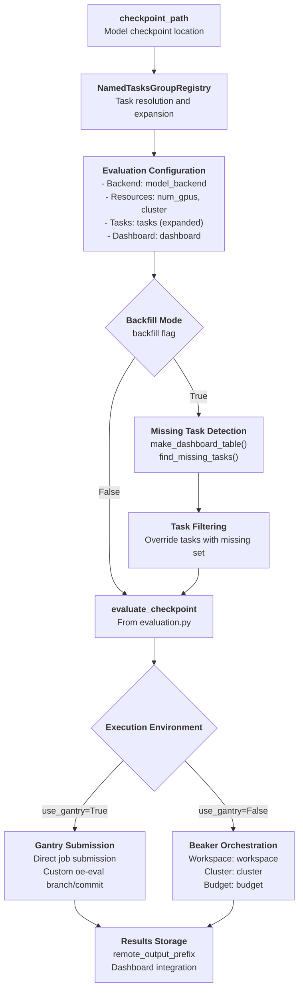

**Parameter Processing:**
The command performs extensive parameter validation and transformation:
- `extra_args`: Regex processing to handle escaped hyphens [src/cookbook/cli/eval.py:540-541]()
- `task_args`: JSON parsing for task-specific configurations [src/cookbook/cli/eval.py:543-548]()
- `model_args`: Comma-separated key-value parsing [src/cookbook/cli/eval.py:550-555]()

**Backfill Functionality:**
When `--backfill` is enabled, the system automatically determines missing evaluations by:
1. Generating the model's run name using `make_eval_run_name`
2. Retrieving existing dashboard results via `make_dashboard_table`
3. Computing missing tasks using `find_missing_tasks`
4. Overriding the task list with only missing evaluations

Sources: [src/cookbook/cli/eval.py:492-625]()

### list Command

The `list` command provides an interface for browsing available evaluation tasks organized by the `NamedTasksGroupRegistry`.

**Task Filtering Logic:**
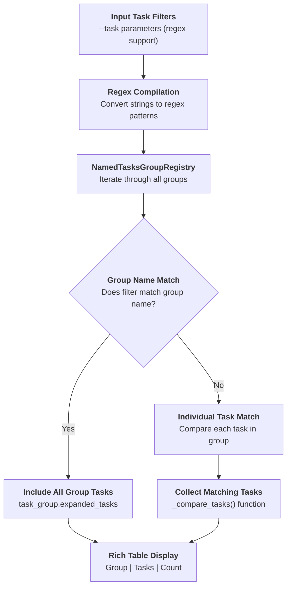

The comparison logic in `_compare_tasks` handles both string and regex pattern matching between task targets and sources [src/cookbook/cli/eval.py:776-785]().

Sources: [src/cookbook/cli/eval.py:771-836]()

### experiments Command

The `experiments` command queries the datalake to list available experiments for a specific model, with optional task filtering.

The command uses `FindExperiments.run(model_name=model)` to retrieve experiment metadata from the datalake, then applies regex-based task filtering if specified [src/cookbook/cli/eval.py:841-868]().

Sources: [src/cookbook/cli/eval.py:841-868]()

## Results Management

### results Command

The `results` command retrieves and displays evaluation results from the datalake with flexible formatting and sorting options.

**Results Processing Pipeline:**
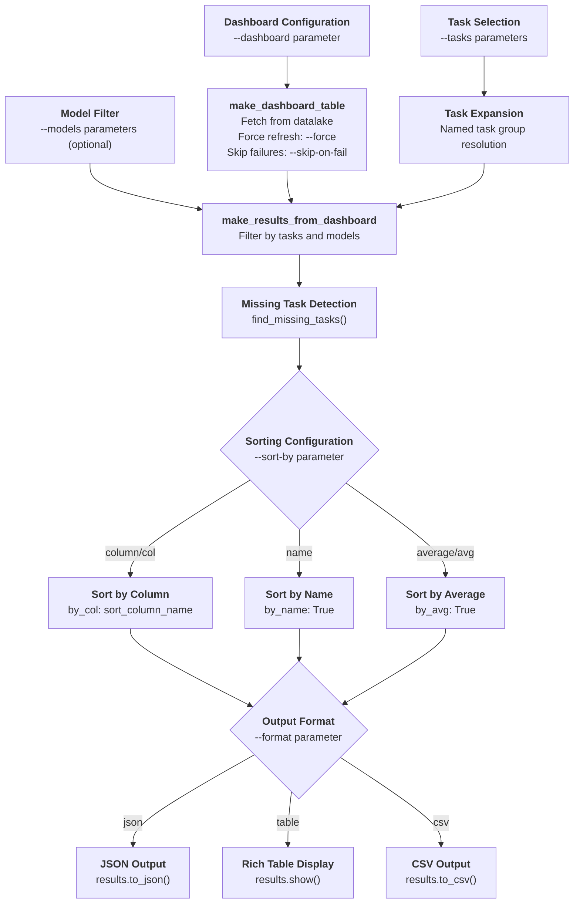

The sorting functionality leverages the `MiniFrame.sort()` method with multiple sorting criteria and direction control via `--ascending`/`--descending` flags.

Sources: [src/cookbook/cli/eval.py:678-729]()

### Dashboard Management Commands

#### add-dashboard Command

Adds models to a specified dashboard using the `AddToDashboard.prun()` datalake operation. Supports optional source dashboard copying via `--source-dashboard` parameter.

#### remove-dashboard Command

Removes models from a dashboard using `RemoveFromDashboard.prun()` datalake operation.

Both commands use parallel execution patterns (`prun`) to handle multiple model operations efficiently.

Sources: [src/cookbook/cli/eval.py:748-767]()

## Integration with Core Systems

### Task Registry Integration

The CLI extensively integrates with `NamedTasksGroupRegistry` for task management:
- Task expansion in the `evaluate` command
- Task listing and filtering in the `list` command  
- Task validation across multiple commands

```python
# Example task group reference in help text
f"Tasks groups are: {', '.join(NamedTasksGroupRegistry.names())}"
```

Sources: [src/cookbook/cli/eval.py:322-324]()

### Configuration System Integration

The CLI imports and uses constants from the centralized configuration system:

| Constant | Purpose |
|----------|---------|
| `OLMO_TYPES` | Valid OLMo model type choices |
| `FIM_TOKENS` | Fill-in-middle token configurations |
| `*_COMMIT_HASH` | Default commit hashes for various repositories |
| `TRANSFORMERS_GIT_URL` | Default Transformers repository URL |

Sources: [src/cookbook/cli/eval.py:16-26]()

### Execution Environment Integration

The CLI supports multiple execution backends through consistent parameter patterns:
- **Local execution**: Virtual environment management with `force_venv`, `env_name`, `use_system_python`
- **Beaker orchestration**: Workspace, cluster, budget, and GPU resource configuration
- **Gantry submission**: Direct job submission with custom oe-eval versions

This flexibility enables the same CLI interface to work across development, testing, and production environments.

Sources: [src/cookbook/cli/eval.py]() (throughout various command definitions)

---

# Page: Training CLI (olmo-cookbook)

# Training CLI (olmo-cookbook)

<details>
<summary>Relevant source files</summary>

The following files were used as context for generating this wiki page:

- [src/cookbook/cli/cli.py](src/cookbook/cli/cli.py)
- [src/cookbook/train.py](src/cookbook/train.py)

</details>


The Training CLI serves as the primary interface for launching and managing OLMo model training experiments. It provides commands for experiment orchestration, job lifecycle management, and workspace configuration on the Beaker platform.

For evaluation-specific operations, see [Evaluation CLI (olmo-cookbook-eval)](#3.1). For infrastructure management of EC2 instances, see [Infrastructure CLI (poormanray)](#3.3).

## CLI Structure and Entry Points

The training CLI operates through two main entry points that serve different phases of the training workflow:

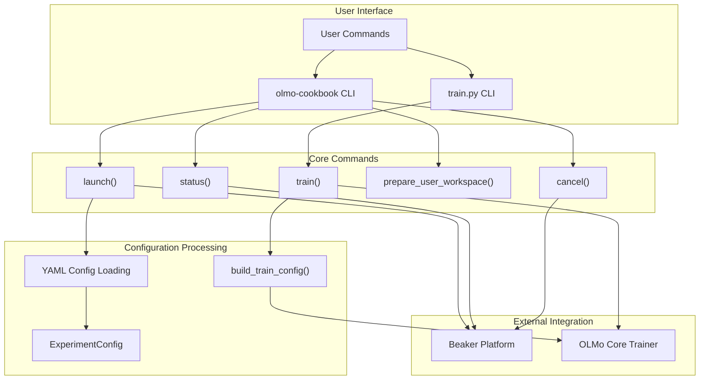

**Sources:** [src/cookbook/cli/cli.py:30-33](), [src/cookbook/train.py:13-16]()

## Core Commands

### Launch Command

The `launch` command is the primary interface for starting training experiments. It processes experiment configurations and orchestrates job submission to the Beaker platform:

| Parameter | Type | Description |
|-----------|------|-------------|
| `--config` | Path | Path to experiment configuration YAML file |
| `--dry-run` | Flag | Print configurations without launching |
| `--no-cache` | Flag | Ignore cached source details |
| `--group-id` | String | Override generated group ID for restarts |

The launch workflow follows this sequence:

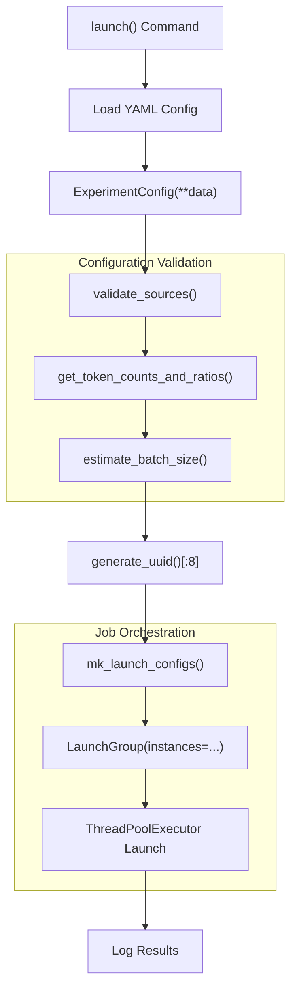

**Sources:** [src/cookbook/cli/cli.py:62-151]()

### Status and Cancel Commands

The CLI provides experiment lifecycle management through dedicated commands:

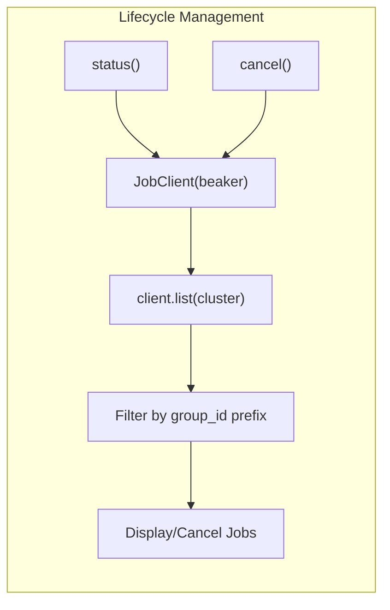

Both commands require the experiment configuration file and group ID to identify the target jobs within the Beaker cluster.

**Sources:** [src/cookbook/cli/cli.py:153-192](), [src/cookbook/cli/cli.py:194-231]()

### Workspace Preparation Commands

The CLI includes utilities for managing Beaker workspace secrets required for training:

| Command | Purpose |
|---------|---------|
| `prepare_user_workspace_from` | Copy secrets between workspaces |
| `prepare_user_workspace` | Set up workspace with provided credentials |

Required secrets include user-specific tokens and configuration files:
- `{USER}_BEAKER_TOKEN`
- `{USER}_WANDB_API_KEY` 
- `{USER}_AWS_CONFIG`
- `{USER}_AWS_CREDENTIALS`
- `R2_ENDPOINT_URL`
- `WEKA_ENDPOINT_URL`

**Sources:** [src/cookbook/cli/cli.py:234-378]()

## Configuration Processing Pipeline

The training system processes experiment configurations through a structured pipeline that transforms YAML specifications into executable training jobs:

```mermaid
graph TD
    subgraph "Input Configuration"
        YAML["YAML Config File"] --> EXPERIMENT_CONFIG["ExperimentConfig"]
        CLI_ARGS["CLI Arguments"] --> EXPERIMENT_CONFIG
    end
    
    subgraph "Data Analysis"
        EXPERIMENT_CONFIG --> TOKEN_COUNTS["get_token_counts_and_ratios()"]
        TOKEN_COUNTS --> BATCH_SIZE["estimate_batch_size()"]
    end
    
    subgraph "Group Generation"
        EXPERIMENT_CONFIG --> MK_GROUP["mk_experiment_group()"]
        TOKEN_COUNTS --> MK_GROUP
        MK_GROUP --> LAUNCH_CONFIGS["mk_launch_configs()"]
        LAUNCH_CONFIGS --> LAUNCH_GROUP["LaunchGroup"]
    end
    
    subgraph "Training Execution"
        LAUNCH_GROUP --> BUILD_TRAIN["build_train_config()"]
        BUILD_TRAIN --> TRAINER["OLMo Core Trainer"]
        TRAINER --> FIT["trainer.fit()"]
    end
```

The `ExperimentConfig` class validates the configuration structure, while `build_train_config()` creates the final training configuration that interfaces with OLMo-core.

**Sources:** [src/cookbook/cli/cli.py:65-117](), [src/cookbook/train.py:52-58]()

## Training Script Integration

The separate training script at [src/cookbook/train.py]() provides the execution layer that runs within Beaker jobs:

```mermaid
graph LR
    subgraph "Training Script Flow"
        TRAIN_CLI["train CLI"] --> PREPARE_ENV["prepare_training_environment()"]
        PREPARE_ENV --> BUILD_CONFIG["build_train_config()"]
        BUILD_CONFIG --> TRAINER_FIT["trainer.fit()"]
        TRAINER_FIT --> TEARDOWN["teardown_training_environment()"]
    end
    
    subgraph "Parameters"
        RUN_NAME["--run-name"]
        GROUP_ID["--group-id"]
        BEAKER_USER["--beaker-user"]
        CONFIG_PATH["--config-path"]
    end
    
    RUN_NAME --> BUILD_CONFIG
    GROUP_ID --> BUILD_CONFIG
    BEAKER_USER --> BUILD_CONFIG
    CONFIG_PATH --> BUILD_CONFIG
```

The training script uses the `@record` decorator for distributed training error handling and integrates with OLMo-core's training environment management.

**Sources:** [src/cookbook/train.py:45-66]()

## External System Integration

The training CLI coordinates with multiple external systems to execute training workflows:

```mermaid
graph TB
    subgraph "CLI Commands"
        CLI_MAIN["olmo-cookbook CLI"]
    end
    
    subgraph "Beaker Integration"
        BEAKER_API["Beaker.from_env()"]
        JOB_CLIENT["JobClient"]
        WORKSPACE["beaker.workspace"]
        SECRET["beaker.secret"]
        CLUSTER["beaker.cluster"]
    end
    
    subgraph "Configuration Systems"
        YAML_CONFIG["YAML Configuration"]
        EXPERIMENT_CONFIG["ExperimentConfig"]
        LAUNCH_GROUP["LaunchGroup"]
    end
    
    subgraph "Training Backend"
        OLMO_CORE["OLMo-core"]
        TRAINER["Trainer"]
    end
    
    subgraph "Monitoring"
        WANDB["Weights & Biases"]
        PROGRESS["tqdm/yaspin"]
    end
    
    CLI_MAIN --> BEAKER_API
    CLI_MAIN --> YAML_CONFIG
    CLI_MAIN --> PROGRESS
    
    BEAKER_API --> JOB_CLIENT
    BEAKER_API --> WORKSPACE
    BEAKER_API --> SECRET
    BEAKER_API --> CLUSTER
    
    YAML_CONFIG --> EXPERIMENT_CONFIG
    EXPERIMENT_CONFIG --> LAUNCH_GROUP
    LAUNCH_GROUP --> TRAINER
    TRAINER --> OLMO_CORE
    TRAINER --> WANDB
```

The system abstracts platform-specific details while providing comprehensive experiment management capabilities including authentication, job orchestration, and monitoring integration.

**Sources:** [src/cookbook/cli/cli.py:1-26](), [src/cookbook/train.py:1-11]()

---

# Page: Infrastructure CLI (poormanray)

# Infrastructure CLI (poormanray)

<details>
<summary>Relevant source files</summary>

The following files were used as context for generating this wiki page:

- [src/cookbook/cli/pmr.py](src/cookbook/cli/pmr.py)

</details>


## Purpose and Scope

The Infrastructure CLI (poormanray) provides command-line tools for managing EC2 instances and distributed processing workflows. It serves as a lightweight alternative to Ray for orchestrating compute clusters, with specialized support for data processing pipelines like Dolma and DECON. This system handles instance lifecycle management, SSH-based command execution, and automated toolkit installation across clusters.

For information about training workflows, see [Training CLI (olmo-cookbook)](#3.2). For evaluation infrastructure, see [Evaluation System](#4).

## Architecture Overview

The poormanray system is built around three core abstractions: instance management, SSH session handling, and command execution. The CLI provides a unified interface for managing EC2 clusters with automatic AWS credential handling and toolkit installation.

### Core System Architecture

```mermaid
graph TB
    subgraph "CLI Commands"
        CREATE["create_instances()"]
        LIST["list_instances()"]
        TERMINATE["terminate_instances()"] 
        RUN["run_command()"]
        SETUP["setup_instances()"]
        MAP["map_commands()"]
    end
    
    subgraph "Core Classes"
        INSTANCE["InstanceInfo"]
        SESSION["Session"] 
        CLIENT["ClientUtils"]
        STATUS["InstanceStatus"]
    end
    
    subgraph "AWS Services"
        EC2["EC2 API"]
        SSM["SSM API"]
        SSH["SSH Connection"]
    end
    
    CREATE --> INSTANCE
    LIST --> INSTANCE
    TERMINATE --> INSTANCE
    RUN --> SESSION
    SETUP --> SESSION
    MAP --> SESSION
    
    INSTANCE --> CLIENT
    SESSION --> SSH
    CLIENT --> EC2
    CLIENT --> SSM
    
    INSTANCE -.-> STATUS
```

Sources: [src/cookbook/cli/pmr.py:1-2070]()

### Command to Function Mapping

```mermaid
graph LR
    subgraph "CLI Commands"
        CLI_CREATE["poormanray create"]
        CLI_LIST["poormanray list"] 
        CLI_TERMINATE["poormanray terminate"]
        CLI_RUN["poormanray run"]
        CLI_SETUP["poormanray setup"]
        CLI_MAP["poormanray map"]
    end
    
    subgraph "Function Implementations"
        FUNC_CREATE["create_instances()"]
        FUNC_LIST["list_instances()"]
        FUNC_TERMINATE["terminate_instances()"]
        FUNC_RUN["run_command()"]
        FUNC_SETUP["setup_instances()"]
        FUNC_MAP["map_commands()"]
    end
    
    CLI_CREATE --> FUNC_CREATE
    CLI_LIST --> FUNC_LIST
    CLI_TERMINATE --> FUNC_TERMINATE
    CLI_RUN --> FUNC_RUN
    CLI_SETUP --> FUNC_SETUP
    CLI_MAP --> FUNC_MAP
```

Sources: [src/cookbook/cli/pmr.py:2055-2065]()

## Core Components

### InstanceInfo Class

The `InstanceInfo` class serves as the primary abstraction for EC2 instances, providing both data representation and lifecycle management capabilities.

**Key Methods:**
- `create_instance()`: Creates new EC2 instances with specified configurations
- `describe_instances()`: Retrieves instance information with filtering
- `terminate()`: Terminates instances with optional wait
- `pause()`/`resume()`: Instance state management

**Key Attributes:**
- `instance_id`, `instance_type`, `image_id`: AWS identifiers
- `public_ip_address`, `public_dns_name`: Network endpoints  
- `state`: Current instance status from `InstanceStatus` enum
- `tags`: Instance metadata including `Project` and `Contact` tags

Sources: [src/cookbook/cli/pmr.py:415-877]()

### Session Class

The `Session` class handles SSH connections and command execution on remote instances.

**Key Methods:**
- `connect()`: Establishes SSH connection using paramiko
- `run_single()`: Executes commands directly
- `run_in_screen()`: Executes commands in detached screen sessions
- `run()`: Main command execution interface

**Connection Management:**
- Supports RSA key authentication via `private_key_path`
- Default user is `ec2-user` for Amazon Linux instances
- Handles terminal sizing for interactive sessions

Sources: [src/cookbook/cli/pmr.py:879-1019]()

### ClientUtils Class

The `ClientUtils` class provides factory methods for AWS service clients with session management.

**Methods:**
- `get_ec2_client()`: Creates EC2 client with region and profile support
- `get_ssm_client()`: Creates SSM client for parameter store access

**Configuration:**
- Respects `AWS_PROFILE` environment variable
- Default region is `us-east-1`
- Used for AMI ID resolution and instance operations

Sources: [src/cookbook/cli/pmr.py:333-355]()

## Command Structure

### Common CLI Options

All commands share a common set of options implemented via the `common_cli_options` decorator:

| Option | Default | Description |
|--------|---------|-------------|
| `--name` | Required | Cluster name for tagging and filtering |
| `--region` | us-east-1 | AWS region |
| `--instance-type` | i4i.xlarge | EC2 instance type |
| `--owner` | $USER | Owner tag for cost tracking |
| `--ssh-key-path` | ~/.ssh/id_* | SSH private key path |
| `--instance-id` | None | Specific instance IDs to target |

Sources: [src/cookbook/cli/pmr.py:1146-1251]()

### Instance Lifecycle Commands

#### Create Command
Creates new EC2 instances with automatic key pair import and tagging:

```bash
poormanray create --name myproject --number 5 --instance-type i4i.2xlarge
```

**Implementation Details:**
- Imports SSH public key to EC2 using `import_ssh_key_to_ec2()`
- Generates instance names with numeric suffixes (e.g., `myproject-0001`)
- Supports custom storage configuration via `--storage-type`, `--storage-size`
- Uses latest Amazon Linux 2023 AMI with architecture detection

Sources: [src/cookbook/cli/pmr.py:1273-1369]()

#### Terminate Command
Terminates instances matching project and owner tags:

```bash
poormanray terminate --name myproject --region us-east-1
```

**Features:**
- Filters by `Project` and `Contact` tags
- Optional instance ID targeting
- Waits for termination completion unless `--detach` specified

Sources: [src/cookbook/cli/pmr.py:1419-1466]()

### Command Execution

#### Run Command
Executes commands or scripts on running instances:

```bash
poormanray run --name myproject --command "echo 'Hello World'" --ssh-key-path ~/.ssh/id_rsa
```

**Script Execution:**
- Converts scripts to base64-encoded commands via `script_to_command()`
- Supports detached execution in screen sessions
- Optional instance self-termination with `--spindown`

Sources: [src/cookbook/cli/pmr.py:1561-1641]()

#### Map Command
Distributes multiple scripts across instances for parallel execution:

```bash
poormanray map --name myproject --script scripts/* --ssh-key-path ~/.ssh/id_rsa
```

**Distribution Algorithm:**
- Shuffles scripts for even distribution using `random.seed(42)`
- Creates per-instance job directories with UUID naming
- Generates `run_all.sh` scripts for batch execution
- Supports optional instance spindown after completion

Sources: [src/cookbook/cli/pmr.py:1923-2053]()

## Toolkit Installation

The system provides automated setup for various data processing toolkits:

### Setup Commands

| Command | Purpose | Key Components |
|---------|---------|----------------|
| `setup` | AWS credentials | `.aws/config`, `.aws/credentials`, screen |
| `setup-d2tk` | Dolma2 toolkit | RAID setup, rust toolchain, datamap-rs |
| `setup-dolma-python` | Dolma Python | Python 3.12, uv, dolma package |
| `setup-decon` | DECON toolkit | PMR environment, rust, decon repository |

### DECON Setup with PMR Environment

The `setup_decon` command automatically configures PMR environment variables for distributed processing:

```bash
poormanray setup-decon --name myproject --github-token <token>
```

**PMR Environment:**
- Sets `PMR_HOST_INDEX` (0-based instance index)
- Sets `PMR_HOST_COUNT` (total instance count)
- Enables host-aware distributed processing

Sources: [src/cookbook/cli/pmr.py:1839-1921]()

### Installation Script Generation

Setup scripts are generated dynamically using base64 encoding:

1. **Package Manager Detection**: Uses `PACKAGE_MANAGER_DETECTOR` script to identify system package manager
2. **Drive Configuration**: Automatically configures RAID arrays for instance store drives  
3. **Toolkit Installation**: Installs language runtimes, tools, and repositories
4. **Environment Setup**: Configures paths and environment variables

Sources: [src/cookbook/cli/pmr.py:97-330]()

## Instance State Management

### Instance Status Tracking

```mermaid
stateDiagram-v2
    [*] --> PENDING
    PENDING --> RUNNING
    RUNNING --> STOPPING
    STOPPING --> STOPPED
    STOPPED --> RUNNING
    RUNNING --> SHUTTING_DOWN
    SHUTTING_DOWN --> TERMINATED
    TERMINATED --> [*]
    
    note right of RUNNING : pause() → STOPPING
    note right of STOPPED : resume() → PENDING  
    note right of RUNNING : terminate() → SHUTTING_DOWN
```

**InstanceStatus Enum:**
- `active()`: Returns non-terminated states for listing
- `unterminated()`: Returns states excluding terminated/shutting-down
- Used for filtering in `describe_instances()`

Sources: [src/cookbook/cli/pmr.py:357-376]()

### Pause and Resume Operations

The system supports pausing (stopping) and resuming (starting) instances:

```bash
poormanray pause --name myproject
poormanray resume --name myproject  
```

**Implementation:**
- Uses EC2 `stop_instances()` and `start_instances()` APIs
- Waits for state transitions via boto3 waiters
- Maintains instance configuration and attached storage
- Preserves instance store data during pause/resume cycle

Sources: [src/cookbook/cli/pmr.py:1468-1558]()

## Error Handling and Reliability

### SSH Connection Management
- Automatic host key acceptance via `paramiko.AutoAddPolicy()`
- Connection timeout handling in command execution
- Screen session management for long-running tasks

### AWS Integration
- Handles `InvalidInstanceID.NotFound` errors gracefully
- Automatic AMI ID resolution for different architectures (x86_64/ARM64)
- VPC discovery for instance placement

### Command Execution Patterns
- Base64 encoding for safe script transfer
- Completion markers for detached command tracking
- Timeout support with configurable limits

Sources: [src/cookbook/cli/pmr.py:737-746](), [src/cookbook/cli/pmr.py:983-994]()

---

# Page: Evaluation System

# Evaluation System

<details>
<summary>Relevant source files</summary>

The following files were used as context for generating this wiki page:

- [src/cookbook/eval/evaluation.py](src/cookbook/eval/evaluation.py)
- [src/cookbook/eval/named_tasks.py](src/cookbook/eval/named_tasks.py)

</details>


The Evaluation System provides comprehensive model evaluation capabilities for OLMo models across diverse benchmarks and tasks. This system handles task organization, execution orchestration, model format conversion, and results aggregation. The evaluation system integrates with external platforms including Beaker for distributed compute, oe-eval for task execution, and various storage backends.

For training-specific configurations, see [Training System](#5). For infrastructure management, see [Infrastructure Management](#6). For CLI usage patterns, see [Evaluation CLI](#3.1).

## System Architecture

The Evaluation System consists of four main subsystems that work together to provide end-to-end evaluation capabilities:

**Evaluation System Architecture**

```mermaid
graph TB
    subgraph "Task Management Layer"
        Registry["NamedTasksGroupRegistry"]
        BaseGroup["BaseNamedTasksGroup"]
        AvgGroup["BaseAverageNamedTasksGroup"]
        AvgOfAvgGroup["BaseAverageOfAveragesNamedTasksGroup"]
        
        Registry --> BaseGroup
        BaseGroup --> AvgGroup
        BaseGroup --> AvgOfAvgGroup
    end
    
    subgraph "Orchestration Layer"
        EvalFunc["evaluate_checkpoint"]
        PythonEnv["PythonEnv"]
        InstallOE["install_oe_eval"]
        MakeRunName["make_eval_run_name"]
        
        EvalFunc --> PythonEnv
        EvalFunc --> InstallOE
        EvalFunc --> MakeRunName
    end
    
    subgraph "External Integration"
        OEEval["oe-eval toolkit"]
        BeakerJobs["Beaker job submissions"]
        AWSFlags["AWS credential management"]
        HFSecrets["HuggingFace token handling"]
        
        EvalFunc --> OEEval
        EvalFunc --> BeakerJobs
        EvalFunc --> AWSFlags
        EvalFunc --> HFSecrets
    end
    
    subgraph "Task Processing"
        TaskPartition["Task partitioning by type"]
        TaskExpansion["expanded_tasks property"]
        TaskFiltering["EXCLUDE_FROM_LAUNCH patterns"]
        
        Registry --> TaskExpansion
        EvalFunc --> TaskPartition
        EvalFunc --> TaskFiltering
    end
    
    Registry --> EvalFunc
    TaskExpansion --> TaskPartition
```

Sources: [src/cookbook/eval/named_tasks.py:12-68](), [src/cookbook/eval/evaluation.py:27-65]()

## Task Management and Registry

The task management system provides a hierarchical organization of evaluation tasks through the `NamedTasksGroupRegistry` singleton and base classes that define task grouping patterns.

**Task Registry System**

```mermaid
graph TB
    subgraph "Registry Core"
        Singleton["NamedTasksGroupRegistry._instance"]
        NamedTasks["_named_tasks: dict[str, Type[BaseNamedTasksGroup]]"]
        RegisterDecorator["@register(task_name)"]
        
        Singleton --> NamedTasks
        RegisterDecorator --> NamedTasks
    end
    
    subgraph "Base Task Classes"
        BaseNamed["BaseNamedTasksGroup"]
        BaseAverage["BaseAverageNamedTasksGroup"]
        BaseAvgOfAvg["BaseAverageOfAveragesNamedTasksGroup"]
        BaseNoAverage["BaseNamedTasksWithNoAverageGroup"]
        
        BaseNamed --> BaseAverage
        BaseAverage --> BaseAvgOfAvg
        BaseAvgOfAvg --> BaseNoAverage
    end
    
    subgraph "Task Group Examples"
        MMLUGroup["MMLURCGroup"]
        CoreGroup["CoreRCGroup"]
        MathGroup["MathGroup"]
        Olmo3Dev["Olmo3Dev7bMainGroup"]
        
        MMLUGroup --> BaseAverage
        CoreGroup --> BaseAverage
        MathGroup --> BaseAvgOfAvg
        Olmo3Dev --> BaseNoAverage
    end
    
    subgraph "Task Resolution"
        ExpandedTasks["expanded_tasks property"]
        GetMethod["registry.get(task_name)"]
        SearchMethod["registry.search(pattern)"]
        
        BaseNamed --> ExpandedTasks
        NamedTasks --> GetMethod
        NamedTasks --> SearchMethod
    end
    
    RegisterDecorator --> BaseNamed
    GetMethod --> ExpandedTasks
```

The registry operates as a singleton pattern where task groups are registered using decorators. Each task group inherits from base classes that define different aggregation behaviors:

| Class | Purpose | Aggregation Behavior |
|-------|---------|---------------------|
| `BaseNamedTasksGroup` | Basic task grouping | No aggregation (returns `None` from `combine`) |
| `BaseAverageNamedTasksGroup` | Simple averaging | Computes mean of task scores |
| `BaseAverageOfAveragesNamedTasksGroup` | Hierarchical averaging | Averages results from child task groups |
| `BaseNamedTasksWithNoAverageGroup` | Display-only groups | Computes child averages but excludes group average |

Sources: [src/cookbook/eval/named_tasks.py:12-106](), [src/cookbook/eval/named_tasks.py:108-200]()

## Task Group Categories and Structure

The evaluation system organizes tasks into several major categories, each containing domain-specific task groups:

**Major Task Categories**

```mermaid
graph TB
    subgraph "Core Benchmarks"
        MMLU["mmlu:rc, mmlu:mc, mmlu:bpb"]
        ARC["arc:rc, arc:mc"]
        Core["core:rc, core:mc"]
        Basic["basic:rc, basic:mc"]
    end
    
    subgraph "Mathematical Reasoning"
        GSMGroups["gsm-symb, gsm-symb:n8"]
        Minerva["minerva, minerva:n4"]
        Math["math (composite group)"]
        
        Math --> GSMGroups
        Math --> Minerva
    end
    
    subgraph "Code Generation"
        CodeGen["code, code-no-bcb"]
        MultiPLE["multipl-e-humaneval, multipl-e-mbpp"]
        Starcoder["starcoder, starcoder::pass@1"]
        FIM["fim, fim::olmo3"]
        
        CodeGen --> MultiPLE
        CodeGen --> FIM
    end
    
    subgraph "Reasoning Tasks"
        BBH["bbh:cot::hamish_zs_reasoning"]
        AgiEval["agi_eval, agi_eval_english"]
        Omega["omega:0-shot-chat"]
    end
    
    subgraph "Long Context"
        Helmet["helmet:8k, helmet:16k, helmet:32k"]
        Ruler["ruler:4k, ruler:8k, ruler:16k"]
    end
    
    subgraph "OLMo-Specific Suites"
        Olmo2Paper["olmo2:paper"]
        Olmo3Dev1b["olmo3:dev:1b:main"]
        Olmo3Dev7b["olmo3:dev:7b:main"]
        Olmo3Midtrain["olmo3:dev:midtrain:v1"]
    end
```

The system includes dynamically generated task groups for different context lengths using factory functions:

- `make_helmet_group()` generates groups for context lengths from 8K to 128K tokens
- `make_ruler_group()` generates groups for context lengths from 4K to 128K tokens

Sources: [src/cookbook/eval/named_tasks.py:207-584](), [src/cookbook/eval/named_tasks.py:555-584]()

## Evaluation Orchestration

The `evaluate_checkpoint` function serves as the main orchestration point, handling environment setup, credential management, task partitioning, and job submission to external systems.

**Evaluation Orchestration Flow**

```mermaid
flowchart TD
    subgraph "Environment Setup"
        CreateEnv["PythonEnv.create()"]
        InstallOE["install_oe_eval()"]
        
        CreateEnv --> InstallOE
    end
    
    subgraph "Credential Management"
        ParseURL["urlparse(checkpoint_path)"]
        S3Creds["add_aws_flags()"]
        GCSOverride["cluster = 'goog'"]
        WekaMount["checkpoint_path = 'weka://'"]
        HFSecret["add_secret_to_beaker_workspace()"]
        
        ParseURL --> S3Creds
        ParseURL --> GCSOverride
        ParseURL --> WekaMount
        ParseURL --> HFSecret
    end
    
    subgraph "Task Processing"
        TaskExpansion["NamedTasksGroupRegistry.get().expanded_tasks"]
        TaskFiltering["EXCLUDE_FROM_LAUNCH patterns"]
        TaskPartitioning["Partition by rc/mc/gen/fim"]
        
        TaskExpansion --> TaskFiltering
        TaskFiltering --> TaskPartitioning
    end
    
    subgraph "Job Submission"
        FlagsAssembly["Assemble oe-eval flags"]
        PartitionLoop["For each task partition"]
        RunNameGen["make_eval_run_name()"]
        SubprocessRun["subprocess.run(oe-eval)"]
        
        FlagsAssembly --> PartitionLoop
        RunNameGen --> FlagsAssembly
        PartitionLoop --> SubprocessRun
    end
    
    CreateEnv --> ParseURL
    InstallOE --> TaskExpansion
    ParseURL --> FlagsAssembly
    TaskPartitioning --> PartitionLoop
```

The orchestration system handles several key responsibilities:

1. **Storage Backend Detection**: Automatically configures credentials and cluster selection based on checkpoint path scheme (S3, GCS, Weka, HuggingFace Hub)

2. **Task Partitioning**: Groups tasks by evaluation type to optimize resource usage:
   - `rc` tasks (reading comprehension)
   - `mc` tasks (multiple choice) 
   - `gen` tasks (generation)
   - `fim` tasks (fill-in-the-middle)

3. **Dynamic Configuration**: Assembles runtime flags including model arguments, task arguments, and Gantry configuration

Sources: [src/cookbook/eval/evaluation.py:27-358](), [src/cookbook/eval/evaluation.py:89-124](), [src/cookbook/eval/evaluation.py:223-240]()

## Integration with External Systems

The evaluation system integrates with multiple external platforms through standardized interfaces and configuration management.

**External System Integration**

```mermaid
graph TB
    subgraph "Compute Platforms"
        BeakerClusters["BEAKER_KNOWN_CLUSTERS"]
        GantryArgs["gantry_args_dict"]
        ClusterExclusion["clusters_to_exclude"]
        
        BeakerClusters --> ClusterExclusion
        GantryArgs --> BeakerClusters
    end
    
    subgraph "Storage Systems"
        S3Integration["S3 via AWS credentials"]
        GCSIntegration["GCS via augusta cluster"]
        WekaIntegration["Weka filesystem mounts"]
        HFIntegration["HuggingFace Hub via tokens"]
        
        S3Integration --> BeakerClusters
        GCSIntegration --> BeakerClusters
        WekaIntegration --> ClusterExclusion
    end
    
    subgraph "Evaluation Backend"
        OEEvalToolkit["oe-eval toolkit"]
        VLLMBackend["VLLM backend configuration"]
        ModelArgs["model_args assembly"]
        TaskArgs["task_args assembly"]
        
        OEEvalToolkit --> VLLMBackend
        VLLMBackend --> ModelArgs
        ModelArgs --> TaskArgs
    end
    
    subgraph "Results and Monitoring"
        Datalake["--push-datalake"]
        DatalakeTags["dashboard={dashboard},checkpoint={run_name}"]
        RemoteOutput["--remote-output-dir"]
        
        Datalake --> DatalakeTags
        Datalake --> RemoteOutput
    end
    
    BeakerClusters --> OEEvalToolkit
    TaskArgs --> Datalake
```

Key integration patterns include:

- **Credential Management**: Automatic detection and configuration of storage credentials based on checkpoint path schemes
- **Cluster Selection**: Dynamic cluster assignment based on storage backend requirements and resource availability  
- **Resource Optimization**: Task partitioning and batch sizing to optimize compute utilization
- **Results Aggregation**: Standardized output formats and metadata tagging for downstream processing

The system uses several configuration constants and exclusion patterns:

- `EXCLUDE_FROM_LAUNCH`: Regex patterns for tasks that don't require separate job submission
- `FIM_TOKENS`: Configuration dictionaries for fill-in-the-middle task tokenization
- `BEAKER_KNOWN_CLUSTERS`: Mapping of cluster nicknames to actual cluster names

Sources: [src/cookbook/eval/evaluation.py:154-168](), [src/cookbook/eval/evaluation.py:206-211](), [src/cookbook/eval/evaluation.py:321-346]()

---

# Page: Task Management and Registry

# Task Management and Registry

<details>
<summary>Relevant source files</summary>

The following files were used as context for generating this wiki page:

- [src/cookbook/eval/named_tasks.py](src/cookbook/eval/named_tasks.py)
- [src/cookbook/model/evaluators.py](src/cookbook/model/evaluators.py)
- [src/cookbook/recipes/olmo3-evals/README.md](src/cookbook/recipes/olmo3-evals/README.md)

</details>


This document covers the task management and registry system that organizes evaluation tasks into hierarchical groups and provides mechanisms for task resolution and averaging. The system enables flexible organization of evaluation benchmarks and supports different aggregation strategies for computing composite scores.

For information about how tasks are executed, see [Evaluation Orchestration](#4.2). For details about results processing after task execution, see [Results Processing and Visualization](#4.4).

## Core Registry Architecture

The task management system is built around a singleton registry pattern that manages named task groups. The `NamedTasksGroupRegistry` serves as the central repository for all task group definitions and provides methods for registration, lookup, and resolution.

```mermaid
classDiagram
    class NamedTasksGroupRegistry {
        -_instance: NamedTasksGroupRegistry
        -_named_tasks: dict[str, Type[BaseNamedTasksGroup]]
        +register(task_name: str) decorator
        +get(task_name: str) BaseNamedTasksGroup
        +names() list[str]
        +exists(task_name: str) bool
        +search(task_name: str | Pattern) list[str]
    }
    
    class BaseNamedTasksGroup {
        +tasks: list[Union[str, BaseNamedTasksGroup]]
        +name: str
        +expanded_tasks: list[str]
        +combine(results: MiniFrame) MiniFrame | None
    }
    
    class BaseAverageNamedTasksGroup {
        +combine(results: MiniFrame) MiniFrame
    }
    
    class BaseAverageOfAveragesNamedTasksGroup {
        +combine(results: MiniFrame) MiniFrame
    }
    
    class BaseNamedTasksWithNoAverageGroup {
        +combine(results: MiniFrame) MiniFrame
    }
    
    NamedTasksGroupRegistry --> "*" BaseNamedTasksGroup : manages
    BaseNamedTasksGroup <|-- BaseAverageNamedTasksGroup
    BaseAverageNamedTasksGroup <|-- BaseAverageOfAveragesNamedTasksGroup
    BaseAverageOfAveragesNamedTasksGroup <|-- BaseNamedTasksWithNoAverageGroup
```

The registry implements a singleton pattern through the `__new__` method [src/cookbook/eval/named_tasks.py:20-24]() to ensure a single global instance manages all task groups throughout the application lifecycle.

**Sources:** [src/cookbook/eval/named_tasks.py:12-68]()

## Task Group Hierarchy and Types

The system supports four main types of task groups, each with different behaviors for combining results:

| Task Group Type | Purpose | Averaging Behavior |
|----------------|---------|-------------------|
| `BaseNamedTasksGroup` | Basic grouping with no aggregation | Returns `None` from `combine()` |
| `BaseAverageNamedTasksGroup` | Simple averaging of task scores | Computes mean of all task scores |
| `BaseAverageOfAveragesNamedTasksGroup` | Averaging groups and individual tasks | Computes mean of child averages and individual scores |
| `BaseNamedTasksWithNoAverageGroup` | View-only groups | Shows child averages but no group average |

```mermaid
graph TD
    A["BaseNamedTasksGroup"] --> B["BaseAverageNamedTasksGroup"]
    B --> C["BaseAverageOfAveragesNamedTasksGroup"] 
    C --> D["BaseNamedTasksWithNoAverageGroup"]
    
    B --> E["MMLURCGroup<br/>('mmlu:rc')"]
    B --> F["CoreMCGroup<br/>('core:mc')"]
    B --> G["MinervaGroup<br/>('minerva')"]
    
    C --> H["MathGroup<br/>('math')"]
    C --> I["Olmo3Dev7bMathGroup<br/>('olmo3:dev:7b:math')"]
    
    D --> J["Olmo3Dev7bMainGroup<br/>('olmo3:dev:7b:main')"]
    D --> K["Olmo2PaperGroup<br/>('olmo2:paper')"]
```

**Sources:** [src/cookbook/eval/named_tasks.py:70-200]()

## Task Registration and Resolution

Task groups are registered using a decorator pattern that associates string identifiers with task group classes. The registration process modifies the class name to match the registered identifier.

### Task Registration Process

```mermaid
sequenceDiagram
    participant U as "User Code"
    participant R as "NamedTasksGroupRegistry"
    participant C as "Task Group Class"
    
    U->>R: @register("mmlu:rc")
    R->>C: decorator(MMLURCGroup)
    R->>R: _named_tasks["mmlu:rc"] = MMLURCGroup
    R->>C: task.name = "mmlu:rc"
    R-->>U: Modified class
```

### Task Resolution Process

When a task name is requested, the registry resolves it through the following process:

```mermaid
flowchart TD
    A["get('mmlu:rc')"] --> B["Check if registered"]
    B -->|Yes| C["Instantiate group class"]
    B -->|No| D["Raise ValueError"]
    C --> E["Return BaseNamedTasksGroup instance"]
    E --> F["Call expanded_tasks property"]
    F --> G["Recursively expand nested groups"]
    G --> H["Return list of individual task strings"]
```

The `expanded_tasks` property [src/cookbook/eval/named_tasks.py:84-95]() recursively resolves nested task groups to produce a flat list of individual task identifiers.

**Sources:** [src/cookbook/eval/named_tasks.py:26-67](), [src/cookbook/eval/named_tasks.py:84-95]()

## Task Name Resolution and Expansion

Individual tasks are identified by composite strings that encode the benchmark, evaluation method, and configuration. The system supports both individual task strings and nested task group references.

### Task Name Format

Task names follow structured patterns:
- Individual tasks: `"arc_challenge:rc::olmes"`, `"gsm8k::olmo1"`
- Parameterized tasks: `"gsm8k::olmo3:n8:v2"`, `"minerva_math_algebra:bpb::olmes"`
- Group references: `MinervaGroup()`, `CoreRCGroup()`

### Task Expansion Example

```mermaid
graph LR
    A["MathGroup"] --> B["gsm8k::olmo1"]
    A --> C["gsm8k::olmes"] 
    A --> D["MinervaGroup"]
    D --> E["minerva_math_algebra::olmes"]
    D --> F["minerva_math_counting_and_probability::olmes"]
    D --> G["minerva_math_geometry::olmes"]
    D --> H["... (other minerva tasks)"]
```

The expansion process handles circular references and maintains the hierarchical structure for averaging purposes [src/cookbook/eval/named_tasks.py:88-94]().

**Sources:** [src/cookbook/eval/named_tasks.py:360-365](), [src/cookbook/eval/named_tasks.py:340-341]()

## Registry Search and Discovery

The registry provides search capabilities for discovering available tasks and groups:

| Method | Purpose | Example |
|--------|---------|---------|
| `names()` | List all registered task group names | `["mmlu:rc", "core:mc", "math", ...]` |
| `exists(name)` | Check if a task group is registered | `exists("mmlu:rc")` → `True` |
| `search(pattern)` | Find tasks matching pattern/regex | `search("mmlu")` → `["mmlu:rc", "mmlu:mc", ...]` |

**Sources:** [src/cookbook/eval/named_tasks.py:44-59]()

## Concrete Task Group Examples

The system includes numerous pre-defined task groups organized by domain and evaluation method:

### MMLU Task Groups
- `mmlu:rc` - MMLU reading comprehension tasks [src/cookbook/eval/named_tasks.py:207-209]()
- `mmlu:mc` - MMLU multiple choice tasks [src/cookbook/eval/named_tasks.py:217-219]() 
- `mmlu_stem:mc` - MMLU STEM subject subset [src/cookbook/eval/named_tasks.py:222-224]()

### Composite Task Groups
- `math` - Combines GSM8K and Minerva tasks [src/cookbook/eval/named_tasks.py:359-365]()
- `olmo3:dev:7b:main` - Complete 7B model evaluation suite [src/cookbook/eval/named_tasks.py:908-930]()

### Dynamic Task Groups
The system also generates task groups dynamically for length-specific evaluations:

```python
for helmet_length in (int(2**i) for i in range(13, 18)):
    NamedTasksGroupRegistry.register(f"helmet:{helmet_length // 2 ** 10}k")(make_helmet_group(helmet_length))
```

**Sources:** [src/cookbook/eval/named_tasks.py:555-568](), [src/cookbook/eval/named_tasks.py:571-584]()

## Integration with Constants

The task registry integrates with the constants system to dynamically generate task lists based on predefined categories:

```python
tasks = [f"{category}:rc::olmes" for category in constants.MMLU_CATEGORIES]
```

This pattern allows task groups to automatically include new tasks as categories are added to the constants definitions.

**Sources:** [src/cookbook/eval/named_tasks.py:209](), [src/cookbook/eval/named_tasks.py:254]()

---

# Page: Evaluation Orchestration

# Evaluation Orchestration

<details>
<summary>Relevant source files</summary>

The following files were used as context for generating this wiki page:

- [src/cookbook/eval/evaluation.py](src/cookbook/eval/evaluation.py)

</details>


This document covers how evaluations are orchestrated and executed across different compute environments within the olmo-cookbook system. The orchestration layer coordinates the setup of evaluation environments, manages dependencies, handles different storage schemes for model checkpoints, and submits evaluation jobs to distributed compute platforms.

For information about task definition and organization, see [Task Management and Registry](#4.1). For details on result processing after evaluation completion, see [Results Processing and Visualization](#4.4).

## Core Orchestration Function

The central orchestration logic is implemented in the `evaluate_checkpoint` function in [src/cookbook/eval/evaluation.py:27-65](). This function serves as the main entry point for coordinating all aspects of evaluation execution.

## Orchestration Workflow

The evaluation orchestration follows a structured workflow that handles environment setup, authentication, task partitioning, and distributed job submission:

```mermaid
flowchart TD
    START["evaluate_checkpoint()"]
    ENV["PythonEnv.create()"]
    INSTALL["install_oe_eval()"]
    
    SCHEME_CHECK{"Checkpoint Storage Scheme"}
    S3_HANDLE["AWS Credentials Setup"]
    GCS_HANDLE["Google Cloud Setup"]
    WEKA_HANDLE["Weka Mount Handling"]
    HF_HANDLE["HuggingFace Token Setup"]
    
    TASK_EXPAND["NamedTasksGroupRegistry.get()"]
    PARTITION["Task Partitioning by Type"]
    
    subgraph "Job Submission Loop"
        MC_JOBS["Multiple Choice Tasks"]
        GEN_JOBS["Generation Tasks"]
        RC_JOBS["Reading Comprehension Tasks"]
        FIM_JOBS["Fill-in-Middle Tasks"]
    end
    
    SUBPROCESS["subprocess.run(oe-eval)"]
    
    START --> ENV
    ENV --> INSTALL
    INSTALL --> SCHEME_CHECK
    
    SCHEME_CHECK -->|"s3://"| S3_HANDLE
    SCHEME_CHECK -->|"gs://"| GCS_HANDLE
    SCHEME_CHECK -->|"/weka/"| WEKA_HANDLE
    SCHEME_CHECK -->|"hub model"| HF_HANDLE
    
    S3_HANDLE --> TASK_EXPAND
    GCS_HANDLE --> TASK_EXPAND
    WEKA_HANDLE --> TASK_EXPAND
    HF_HANDLE --> TASK_EXPAND
    
    TASK_EXPAND --> PARTITION
    PARTITION --> MC_JOBS
    PARTITION --> GEN_JOBS
    PARTITION --> RC_JOBS
    PARTITION --> FIM_JOBS
    
    MC_JOBS --> SUBPROCESS
    GEN_JOBS --> SUBPROCESS
    RC_JOBS --> SUBPROCESS
    FIM_JOBS --> SUBPROCESS
```

Sources: [src/cookbook/eval/evaluation.py:27-358]()

## Environment and Dependency Management

### Python Environment Creation

The orchestration system creates isolated Python environments to ensure consistent evaluation execution:

| Component | Function | Purpose |
|-----------|----------|---------|
| `PythonEnv` | Environment isolation | Creates dedicated venv for evaluation |
| `install_oe_eval()` | Dependency management | Installs specific oe-eval toolkit commit |
| Environment variables | Configuration | Sets up execution context |

The environment setup occurs at [src/cookbook/eval/evaluation.py:66-76](), where a virtual environment is created and the oe-eval toolkit is installed with the specified commit hash and branch.

Sources: [src/cookbook/eval/evaluation.py:66-76]()

### Storage Scheme Handling

The orchestration system supports multiple storage schemes for model checkpoints, each requiring different authentication and configuration:

```mermaid
flowchart TD
    CHECKPOINT_PATH["checkpoint_path"]
    URL_PARSE["urlparse(checkpoint_path)"]
    
    subgraph "Storage Schemes"
        S3_SCHEME["s3://"]
        GCS_SCHEME["gs:// or gcs://"]
        WEKA_SCHEME["/weka/ or WEKA_MOUNTS"]
        HF_SCHEME["no scheme (HF Hub)"]
    end
    
    subgraph "Authentication Handlers"
        AWS_FLAGS["add_aws_flags()"]
        GCS_CLUSTER["cluster = 'goog'"]
        WEKA_MOUNT["weka:// prefix conversion"]
        HF_SECRET["add_secret_to_beaker_workspace()"]
    end
    
    CHECKPOINT_PATH --> URL_PARSE
    URL_PARSE --> S3_SCHEME
    URL_PARSE --> GCS_SCHEME
    URL_PARSE --> WEKA_SCHEME
    URL_PARSE --> HF_SCHEME
    
    S3_SCHEME --> AWS_FLAGS
    GCS_SCHEME --> GCS_CLUSTER
    WEKA_SCHEME --> WEKA_MOUNT
    HF_SCHEME --> HF_SECRET
```

Sources: [src/cookbook/eval/evaluation.py:89-138]()

## Task Partitioning and Execution

### Task Type Classification

The orchestration system partitions evaluation tasks based on their execution requirements:

```mermaid
flowchart TD
    ALL_TASKS["all_tasks (from NamedTasksGroupRegistry)"]
    
    subgraph "Task Classification Logic"
        RC_CHECK["':rc::' in task"]
        MC_CHECK["':mc::' in task"]
        FIM_CHECK["'fim_' in task"]
        DEFAULT["Default: generation"]
    end
    
    subgraph "Partitioned Task Groups"
        RC_TASKS["partitioned_tasks['rc']"]
        MC_TASKS["partitioned_tasks['mc']"]
        FIM_TASKS["partitioned_tasks['fim']"]
        GEN_TASKS["partitioned_tasks['gen']"]
    end
    
    ALL_TASKS --> RC_CHECK
    ALL_TASKS --> MC_CHECK
    ALL_TASKS --> FIM_CHECK
    ALL_TASKS --> DEFAULT
    
    RC_CHECK -->|"True"| RC_TASKS
    MC_CHECK -->|"True"| MC_TASKS
    FIM_CHECK -->|"True"| FIM_TASKS
    DEFAULT -->|"Fallback"| GEN_TASKS
```

The partitioning logic is implemented at [src/cookbook/eval/evaluation.py:223-237](), where tasks are classified based on their naming patterns and execution requirements.

Sources: [src/cookbook/eval/evaluation.py:223-237]()

### Job Submission Process

For each task partition, the system creates separate job submissions with appropriate configurations:

| Parameter | Configuration Location | Purpose |
|-----------|----------------------|---------|
| Beaker flags | [src/cookbook/eval/evaluation.py:157-161]() | Workspace, budget, priority, clusters |
| Model arguments | [src/cookbook/eval/evaluation.py:175-187]() | Model path, BOS token, memory settings |
| Task arguments | [src/cookbook/eval/evaluation.py:244-346]() | Task-specific parameters and FIM tokens |
| Resource allocation | [src/cookbook/eval/evaluation.py:163-165]() | GPU count and compute requirements |

## Beaker Integration

### Command Construction

The orchestration system builds complex command lines for the oe-eval toolkit execution:

```mermaid
flowchart TD
    FLAGS_INIT["flags: list[str] = []"]
    
    subgraph "Flag Categories"
        BEAKER_FLAGS["Beaker Configuration"]
        MODEL_FLAGS["Model Arguments"]  
        TASK_FLAGS["Task Specifications"]
        RESOURCE_FLAGS["Resource Allocation"]
        GANTRY_FLAGS["Gantry Arguments"]
    end
    
    subgraph "Command Execution"
        CMD_BUILD["cmd = f'{env.python} {OE_EVAL_LAUNCH_COMMAND} {flags}'"]
        SUBPROCESS_RUN["subprocess.run(shlex.split(cmd))"]
        ERROR_CHECK["output.returncode != 0"]
    end
    
    FLAGS_INIT --> BEAKER_FLAGS
    FLAGS_INIT --> MODEL_FLAGS
    FLAGS_INIT --> TASK_FLAGS
    FLAGS_INIT --> RESOURCE_FLAGS
    FLAGS_INIT --> GANTRY_FLAGS
    
    BEAKER_FLAGS --> CMD_BUILD
    MODEL_FLAGS --> CMD_BUILD
    TASK_FLAGS --> CMD_BUILD
    RESOURCE_FLAGS --> CMD_BUILD
    GANTRY_FLAGS --> CMD_BUILD
    
    CMD_BUILD --> SUBPROCESS_RUN
    SUBPROCESS_RUN --> ERROR_CHECK
```

The command construction and execution occurs at [src/cookbook/eval/evaluation.py:349-355](), where the final oe-eval command is assembled and executed via subprocess.

Sources: [src/cookbook/eval/evaluation.py:349-355]()

### Job Naming and Organization

The system generates structured naming conventions for evaluation runs:

- **Run Names**: Created by `make_eval_run_name()` with checkpoint path, BOS token settings, and optional suffixes
- **Task Names**: Sanitized and truncated with MD5 hash fallback at [src/cookbook/eval/evaluation.py:261-275]()
- **Remote Directories**: Organized as `{remote_output_prefix}/{dashboard}/{run_name}/{friendly_task_name}` at [src/cookbook/eval/evaluation.py:278-279]()

## Error Handling and Validation

The orchestration system includes comprehensive error handling for common failure scenarios:

| Error Type | Validation Location | Handling |
|------------|-------------------|----------|
| Missing AWS credentials | [src/cookbook/eval/evaluation.py:100-101]() | ValueError with descriptive message |
| Unsupported storage schemes | [src/cookbook/eval/evaluation.py:114]() | ValueError for unknown URL schemes |
| Command execution failures | [src/cookbook/eval/evaluation.py:353-354]() | RuntimeError with command details |
| Conflicting name parameters | [src/cookbook/eval/evaluation.py:140-141]() | ValueError preventing conflicts |

Sources: [src/cookbook/eval/evaluation.py:100-101](), [src/cookbook/eval/evaluation.py:114](), [src/cookbook/eval/evaluation.py:353-354](), [src/cookbook/eval/evaluation.py:140-141]()

## Job Status and Monitoring

The orchestration function provides status reporting throughout the evaluation process:

- **Task Expansion**: Pretty-printed list of all tasks to be executed at [src/cookbook/eval/evaluation.py:214-221]()
- **Job Submission**: Count of submitted jobs per partition
- **Final Summary**: Total jobs launched with cluster and run name information at [src/cookbook/eval/evaluation.py:357]()

Sources: [src/cookbook/eval/evaluation.py:214-221](), [src/cookbook/eval/evaluation.py:357]()

---

# Page: Model Conversion

# Model Conversion

<details>
<summary>Relevant source files</summary>

The following files were used as context for generating this wiki page:

- [src/cookbook/eval/conversion.py](src/cookbook/eval/conversion.py)
- [src/cookbook/eval/conversion_from_hf.py](src/cookbook/eval/conversion_from_hf.py)

</details>


This document covers the model conversion system within the evaluation framework. Model conversion transforms OLMo model checkpoints into HuggingFace format for compatibility with evaluation tools, and vice versa. The system supports conversion between multiple OLMo model variants and HuggingFace formats, with execution options for both local and distributed environments.

For information about the broader evaluation orchestration that uses these converted models, see [Evaluation Orchestration](#4.2). For details on task management that defines which models to convert, see [Task Management and Registry](#4.1).

## Supported Model Conversions

The conversion system supports bidirectional format transformation between OLMo and HuggingFace model formats:

```mermaid
graph LR
    subgraph "OLMo Formats"
        OLMO2["olmo2"]
        OLMOE["olmoe"] 
        OLMO_CORE["olmo-core"]
        OLMO_CORE_V2["olmo-core-v2"]
    end
    
    subgraph "HuggingFace Format"
        HF["HuggingFace Models"]
    end
    
    OLMO2 -->|"convert_olmo2()"| HF
    OLMOE -->|"convert_olmoe()"| HF
    OLMO_CORE -->|"convert_olmo_core()"| HF
    OLMO_CORE_V2 -->|"convert_olmo_core_v2()"| HF
    
    HF -->|"convert_hf_to_olmo_core_v2()"| OLMO_CORE_V2
```

**Conversion Functions by Model Type:**

| Source Format | Target Format | Function | Script Path |
|---------------|---------------|----------|-------------|
| OLMo 2 | HuggingFace | `convert_olmo2()` | `OLMO2_CONVERSION_SCRIPT` |
| OLMoE | HuggingFace | `convert_olmoe()` | `OLMOE_CONVERSION_SCRIPT` |
| OLMo Core | HuggingFace | `convert_olmo_core()` | `OLMO_CORE_UNSHARD_CONVERT_SCRIPT` |
| OLMo Core V2 | HuggingFace | `convert_olmo_core_v2()` | `OLMO_CORE_UNSHARD_CONVERT_SCRIPT` |
| HuggingFace | OLMo Core V2 | `convert_hf_to_olmo_core_v2()` | `OLMO_CORE_CONVERT_FROM_HF_SCRIPT` |

Sources: [src/cookbook/eval/conversion.py:39-578](), [src/cookbook/eval/conversion_from_hf.py:25-234]()

## Conversion Workflow

The model conversion process follows a standardized workflow involving dependency installation, model processing, and cleanup:

```mermaid
flowchart TD
    START["Input: Model Checkpoint"] --> ENV["Setup PythonEnv"]
    ENV --> DEPS["Install Dependencies"]
    
    subgraph "Dependency Installation"
        DEPS --> INSTALL_OLMO["install_olmo() or install_olmo_core()"]
        INSTALL_OLMO --> INSTALL_TRANSFORMERS["install_transformers()"]
        INSTALL_TRANSFORMERS --> DOWNLOAD_TOK["download_tokenizer()"]
    end
    
    DOWNLOAD_TOK --> CHECK_SHARD["Check if Model is Sharded"]
    CHECK_SHARD -->|"Sharded"| UNSHARD["Run Unsharding Script"]
    CHECK_SHARD -->|"Not Sharded"| CONVERT["Run Conversion Script"]
    UNSHARD --> CONVERT
    
    CONVERT --> CONFIG_FIX["Fix Configuration Files"]
    CONFIG_FIX --> DTYPE_FIX["Convert float32 to bfloat16"]
    DTYPE_FIX --> CLEANUP["shutil.rmtree() cleanup"]
    CLEANUP --> OUTPUT["Output: Converted Model"]
```

**Key Processing Steps:**

1. **Environment Setup:** Creates isolated `PythonEnv` for dependency management
2. **Repository Installation:** Clones and installs specific commit hashes of OLMo and Transformers
3. **Tokenizer Handling:** Downloads tokenizer files and copies them to output directory
4. **Sharding Detection:** Checks for presence of `model/` subdirectory to determine if unsharding is needed
5. **Script Execution:** Runs appropriate conversion script via `subprocess.run()`
6. **Post-Processing:** Handles configuration file format conversion (JSON ↔ YAML) and dtype optimization
7. **Cleanup:** Removes temporary directories containing cloned repositories

Sources: [src/cookbook/eval/conversion.py:77-162](), [src/cookbook/eval/conversion.py:185-234]()

## Model-Specific Conversion Details

### OLMo Core V2 Conversion

The `convert_olmo_core_v2()` function handles the most recent OLMo Core format with enhanced configuration management:

**Configuration Resolution:**
- Automatically extracts `max_sequence_length` from `config.json` if not provided
- Handles JSON-to-YAML configuration conversion
- Supports dtype optimization (float32 → bfloat16)

**Key Parameters:**
- `max_sequence_length`: Required for conversion, auto-detected from config
- `skip_validation`: Bypasses model validation during conversion
- `dtype`: Target data type for model weights

Sources: [src/cookbook/eval/conversion.py:39-162]()

### Legacy OLMo Conversions

**OLMo 2 and OLMoE:** Both follow similar patterns with two-phase processing:

1. **Unsharding Phase:** Uses `OLMO2_UNSHARD_SCRIPT` or `OLMOE_UNSHARD_SCRIPT`
2. **Conversion Phase:** Applies format-specific conversion scripts

**OLMo Core (V1):** Single-phase conversion using `OLMO_CORE_UNSHARD_CONVERT_SCRIPT`

**Sharding Detection Logic:**
```python
model_dir = os.path.join(input_dir, "model")
is_model_in_directory = os.path.exists(model_dir) and os.path.isdir(model_dir)
```

Sources: [src/cookbook/eval/conversion.py:237-397](), [src/cookbook/eval/conversion.py:165-234]()

### HuggingFace to OLMo Conversion

The reverse conversion from HuggingFace to OLMo Core V2 format supports:

**Advanced Configuration Options:**
- `olmo_core_v2_experiment_json_path`: Custom experiment configuration
- `olmo_core_v2_model_arch`: Architecture specification override
- `transformers_model_id`: Specific model identifier for HuggingFace Hub
- `debug_validation`: Enhanced debugging output

Sources: [src/cookbook/eval/conversion_from_hf.py:25-93]()

## Execution Environments

The conversion system supports both local execution and distributed processing via Beaker:

```mermaid
graph TB
    subgraph "Entry Points"
        RUN_CONV["run_checkpoint_conversion()"]
        RUN_CONV_HF["run_checkpoint_conversion_from_hf()"]
    end
    
    subgraph "Execution Decision"
        USE_BEAKER{"use_beaker flag"}
    end
    
    subgraph "Local Execution"
        PYTHON_ENV["PythonEnv.create() or PythonEnv.null()"]
        REMOVE_CONFLICTS["remove_conflicting_packages()"]
        DIRECT_CALL["Direct function call"]
    end
    
    subgraph "Beaker Execution"
        INSTALL_BEAKER["install_beaker_py()"]
        DISCOVER_WEKA["discover_weka_mount()"]
        ADD_SECRETS["add_secret_to_beaker_workspace()"]
        GANTRY_CMD["gantry run command"]
    end
    
    RUN_CONV --> USE_BEAKER
    RUN_CONV_HF --> USE_BEAKER
    
    USE_BEAKER -->|"False"| PYTHON_ENV
    USE_BEAKER -->|"True"| INSTALL_BEAKER
    
    PYTHON_ENV --> REMOVE_CONFLICTS
    REMOVE_CONFLICTS --> DIRECT_CALL
    
    INSTALL_BEAKER --> DISCOVER_WEKA
    DISCOVER_WEKA --> ADD_SECRETS
    ADD_SECRETS --> GANTRY_CMD
```

### Local Execution Environment

**Python Environment Management:**
- `PythonEnv.create()`: Creates isolated virtual environment
- `PythonEnv.null()`: Uses system Python when `use_system_python=True`
- `remove_conflicting_packages()`: Cleans up package conflicts

**Direct Function Invocation:**
Local execution calls conversion functions directly with proper environment configuration.

Sources: [src/cookbook/eval/conversion.py:431-577]()

### Beaker Distributed Execution

**Infrastructure Requirements:**
- Fully qualified paths (must start with `/`)
- Weka mount discovery for shared storage
- Secret management for HuggingFace tokens

**Gantry Command Construction:**
```python
gantry_command = [
    "gantry run",
    f"--description 'Converting OLMo checkpoint at {input_dir}'",
    f"--workspace {beaker_workspace}",
    f"--gpus {beaker_gpus}",
    " ".join(gantry_flags),
    f"-- /bin/bash -c '{remote_command_str}'"
]
```

**Remote Execution Pattern:**
Beaker jobs install the cookbook package and execute the CLI command remotely:
```bash
pip install uv && uv pip install . --system && olmo-cookbook-eval convert {args}
```

Sources: [src/cookbook/eval/conversion.py:437-516](), [src/cookbook/eval/conversion_from_hf.py:130-214]()

## Dependencies and Commit Management

The conversion system maintains version control over all dependencies through commit hash pinning:

**Repository Management:**
| Repository | Install Function | Default Commit Hash |
|------------|------------------|---------------------|
| OLMo | `install_olmo()` | `OLMO2_COMMIT_HASH` |
| OLMo Core | `install_olmo_core()` | `OLMO_CORE_COMMIT_HASH` |
| Transformers | `install_transformers()` | `TRANSFORMERS_COMMIT_HASH` |

**Tokenizer Handling:**
- `download_tokenizer()`: Fetches tokenizer files from HuggingFace
- Default tokenizers defined per model type:
  - `DEFAULT_OLMO_CORE_TOKENIZER`
  - `DEFAULT_OLMO2_TOKENIZER`  
  - `DEFAULT_OLMOE_TOKENIZER`

**Cleanup Strategy:**
All temporary directories are tracked in `directories_to_clean_up` list and removed via `shutil.rmtree()` in finally blocks to ensure resource cleanup regardless of success/failure.

Sources: [src/cookbook/eval/conversion.py:80-87](), [src/cookbook/eval/conversion.py:159-162]()

---

# Page: Results Processing and Visualization

# Results Processing and Visualization

<details>
<summary>Relevant source files</summary>

The following files were used as context for generating this wiki page:

- [src/cookbook/eval/cache.py](src/cookbook/eval/cache.py)
- [src/cookbook/eval/datalake.py](src/cookbook/eval/datalake.py)
- [src/cookbook/eval/miniframe.py](src/cookbook/eval/miniframe.py)
- [src/cookbook/eval/results.py](src/cookbook/eval/results.py)
- [tests/cookbook/eval/test_miniframe.py](tests/cookbook/eval/test_miniframe.py)

</details>


This document covers the system for processing, filtering, and visualizing evaluation results after experiments have been completed. It explains how raw metrics from the oe-eval datalake are transformed into structured tables, filtered based on user criteria, and presented in various formats.

For information about running evaluations, see [Evaluation Orchestration](#4.2). For details about task definitions and organization, see [Task Management and Registry](#4.1).

## Overview

The results processing system provides a complete pipeline from raw evaluation data retrieval to formatted output. The core workflow involves:

1. **Data Retrieval**: Fetching experiment metadata and metrics from the oe-eval datalake
2. **Data Processing**: Organizing results into tabular format with metric standardization
3. **Filtering and Selection**: Applying user-specified filters for tasks and models
4. **Visualization**: Presenting results in console tables, CSV, or JSON formats
5. **Quality Assurance**: Identifying missing evaluations and data gaps

## Data Retrieval Architecture

### Datalake Integration

The system retrieves evaluation results from the oe-eval datalake through a structured API layer:

```mermaid
graph TB
    CLI["olmo-cookbook-eval results"]
    Dashboard["Dashboard Query"]
    FindExperiments["FindExperiments.run()"]
    MetricsAll["MetricsAll.prun()"]
    Cache["DatalakeCache"]
    Datalake["oe-eval-datalake API"]
    
    CLI --> Dashboard
    Dashboard --> FindExperiments
    FindExperiments --> Cache
    Cache --> Datalake
    FindExperiments --> MetricsAll
    MetricsAll --> Cache
    MetricsAll --> Datalake
```

Sources: [src/cookbook/eval/results.py:46-63](), [src/cookbook/eval/datalake.py:147-183](), [src/cookbook/eval/datalake.py:226-294]()

### Experiment Discovery

The `FindExperiments` class locates relevant evaluations based on dashboard tags or model names:

| Parameter | Type | Purpose |
|-----------|------|---------|
| `dashboard` | `str` | Filter by dashboard tag |
| `model_name` | `str` | Filter by exact model name |
| `limit` | `int` | Maximum results to return |

The class returns structured experiment metadata including experiment IDs, model names, task names, creation timestamps, and associated tags.

Sources: [src/cookbook/eval/datalake.py:147-183]()

### Metrics Retrieval

The `MetricsAll` class fetches detailed evaluation metrics for each experiment:

```mermaid
graph LR
    ExperimentList["List[experiment_id]"]
    ParallelQuery["MetricsAll.prun()"]
    ThreadPool["ThreadPoolExecutor"]
    APICall["GET /greenlake/metrics-all/"]
    MetricsData["List[MetricsAll]"]
    
    ExperimentList --> ParallelQuery
    ParallelQuery --> ThreadPool
    ThreadPool --> APICall
    APICall --> MetricsData
```

The system supports parallel retrieval with configurable worker threads and automatic retry logic for failed requests.

Sources: [src/cookbook/eval/results.py:59-63](), [src/cookbook/eval/datalake.py:94-117]()

## Data Processing Pipeline

### MiniFrame Data Structure

The `MiniFrame` class serves as the core data structure for results processing, providing a lightweight pandas-like interface:

```mermaid
graph TB
    RawMetrics["Raw Metrics"]
    Processing["Data Processing"]
    MiniFrame["MiniFrame Object"]
    Operations["Table Operations"]
    Output["Formatted Output"]
    
    subgraph "MiniFrame Structure"
        Columns["columns: Generator[str]"]
        Rows["rows: Generator[Row]"]
        Data["_data: OrderedDict"]
    end
    
    RawMetrics --> Processing
    Processing --> MiniFrame
    MiniFrame --> Columns
    MiniFrame --> Rows
    MiniFrame --> Data
    MiniFrame --> Operations
    Operations --> Output
```

The `MiniFrame` supports:
- Dynamic column and row addition via `add()` and `add_many()`
- Flexible filtering with `keep_cols()`, `drop_cols()`, `keep_rows()`, `drop_rows()`
- Sorting by column values, averages, or names
- Export to CSV, JSON, and console display formats

Sources: [src/cookbook/eval/miniframe.py:21-259]()

### Metric Standardization

The system applies several standardization steps during processing:

1. **Primary Score Extraction**: Each task's main metric becomes the primary score
2. **BPB Calculation**: Bits-per-byte metrics are computed when available
3. **Pass@K Metrics**: Code generation pass rates are extracted from extra metrics
4. **Hotfixes**: Task-specific corrections for known metric issues

```mermaid
graph TD
    RawMetric["Raw Metric Data"]
    HotfixCheck["Apply Hotfixes"]
    PrimaryScore["Extract Primary Score"]
    BPBScore["Calculate BPB"]
    PassAtK["Extract Pass@K"]
    MiniFrameAdd["MiniFrame.add()"]
    
    RawMetric --> HotfixCheck
    HotfixCheck --> PrimaryScore
    PrimaryScore --> BPBScore
    BPBScore --> PassAtK
    PassAtK --> MiniFrameAdd
```

Sources: [src/cookbook/eval/results.py:83-124]()

## Filtering and Selection System

### Task and Model Expansion

The system supports flexible filtering through regex patterns and named groups:

```mermaid
graph TB
    UserInput["User Filter Input"]
    ExpandedTasks["ExpandedTasks.from_tasks()"]
    ExpandedModels["ExpandedModels.from_models()"]
    RegexCompile["Compile Regex Patterns"]
    NamedGroups["Resolve Named Groups"]
    FilterApplication["Apply Filters"]
    FilteredResults["Filtered MiniFrame"]
    
    UserInput --> ExpandedTasks
    UserInput --> ExpandedModels
    ExpandedTasks --> RegexCompile
    ExpandedTasks --> NamedGroups
    RegexCompile --> FilterApplication
    NamedGroups --> FilterApplication
    ExpandedModels --> FilterApplication
    FilterApplication --> FilteredResults
```

The `ExpandedTasks` class handles both individual task patterns and named task groups from the registry. The `ExpandedModels` class applies similar logic for model name filtering.

Sources: [src/cookbook/eval/results.py:128-168]()

### Named Group Integration

Named task groups from the registry are automatically expanded and can be combined into aggregate scores when possible:

| Group Type | Behavior | Result |
|------------|----------|---------|
| Combinable Groups | Aggregated into single score | Single column with group name |
| Non-combinable Groups | Individual tasks displayed | Multiple columns with task names |
| Mixed Groups | Partial aggregation | Combination of both approaches |

Sources: [src/cookbook/eval/results.py:184-203]()

## Visualization and Output

### Console Display

The `MiniFrame.show()` method provides rich console output using the Rich library:

- Centered column headers with task names
- Formatted percentage values (multiplied by 100)
- Missing values displayed as "-"
- Configurable table title and styling

Sources: [src/cookbook/eval/miniframe.py:185-198]()

### Export Formats

#### CSV Export
The `to_csv()` method generates comma-separated output with:
- Header row with model names and task columns
- Percentage formatting for numeric values
- Missing value handling with "-" placeholder

#### JSON Export
The `to_json()` method creates structured JSON with:
- Sorted keys for consistent output
- Nested structure preserving column-row relationships
- Direct serialization of the internal data structure

Sources: [src/cookbook/eval/miniframe.py:200-216]()

### Dashboard Table Generation

The `make_dashboard_table()` function creates comprehensive result tables from dashboard data:

```mermaid
graph TB
    Dashboard["Dashboard Name"]
    FindExperiments["Find All Experiments"]
    GetMetrics["Retrieve All Metrics"]
    FilterLatest["Keep Latest Results"]
    ApplyHotfixes["Apply Metric Fixes"]
    BuildTable["Build MiniFrame"]
    AddPrimaryScores["Add Primary Scores"]
    AddBPB["Add BPB Metrics"]
    AddPassAtK["Add Pass@K Metrics"]
    FinalTable["Complete MiniFrame"]
    
    Dashboard --> FindExperiments
    FindExperiments --> GetMetrics
    GetMetrics --> FilterLatest
    FilterLatest --> ApplyHotfixes
    ApplyHotfixes --> BuildTable
    BuildTable --> AddPrimaryScores
    AddPrimaryScores --> AddBPB
    AddBPB --> AddPassAtK
    AddPassAtK --> FinalTable
```

The function handles duplicate results by keeping only the most recent evaluation for each model-task pair.

Sources: [src/cookbook/eval/results.py:41-125]()

## Quality Assurance and Diagnostics

### Missing Task Detection

The system automatically identifies incomplete evaluations:

```mermaid
graph TB
    ResultsTable["MiniFrame Results"]
    ScanRows["Scan All Rows"]
    CheckValues["Check for None Values"]
    ExpandGroups["Expand Task Groups"]
    CollectMissing["Collect Missing Tasks"]
    FilterUserTasks["Filter to User Selection"]
    ReportMissing["Generate Missing Report"]
    
    ResultsTable --> ScanRows
    ScanRows --> CheckValues
    CheckValues --> ExpandGroups
    ExpandGroups --> CollectMissing
    CollectMissing --> FilterUserTasks
    FilterUserTasks --> ReportMissing
```

The `find_missing_tasks()` function returns a mapping of model names to lists of missing task names, while `print_missing_tasks()` provides user-friendly console output with color formatting.

Sources: [src/cookbook/eval/results.py:211-272]()

### Cache Management

The `DatalakeCache` provides performance optimization and offline operation:

| Feature | Implementation | Benefit |
|---------|----------------|---------|
| Automatic Caching | SHA256 key generation | Fast repeated queries |
| Cache Invalidation | Environment variable control | Fresh data when needed |
| Offline Mode | Local cache fallback | Operation without network |
| Selective Deletion | Experiment-specific removal | Cache consistency |

Sources: [src/cookbook/eval/cache.py:26-101]()

## Dashboard Management

### Adding and Removing Experiments

The system provides programmatic dashboard management through dedicated classes:

```mermaid
graph LR
    ModelName["Model Name Query"]
    FindExperiments["Find Matching Experiments"]
    TagManagement["Modify Dashboard Tags"]
    APIUpdate["Update via Datalake API"]
    CacheInvalidation["Clear Cached Data"]
    
    ModelName --> FindExperiments
    FindExperiments --> TagManagement
    TagManagement --> APIUpdate
    APIUpdate --> CacheInvalidation
```

The `AddToDashboard` and `RemoveFromDashboard` classes handle bulk operations with fuzzy matching and parallel processing capabilities.

Sources: [src/cookbook/eval/datalake.py:333-421]()

---

# Page: Training System

# Training System

<details>
<summary>Relevant source files</summary>

The following files were used as context for generating this wiki page:

- [src/cookbook/model/builder.py](src/cookbook/model/builder.py)
- [src/cookbook/recipes/spring2code/scaling/spring2code-1b-5xC-weka-top15-bpb-hlr-superbpe.yaml](src/cookbook/recipes/spring2code/scaling/spring2code-1b-5xC-weka-top15-bpb-hlr-superbpe.yaml)
- [src/cookbook/utils/config.py](src/cookbook/utils/config.py)

</details>


The Training System is responsible for configuring, launching, and managing OLMo model training runs. It provides a comprehensive framework for building training configurations from YAML files, setting up distributed training environments, and integrating with external compute platforms like Beaker. For information about evaluation workflows, see [Evaluation System](#4). For infrastructure management details, see [Infrastructure Management](#6).

## System Overview

The Training System consists of several key components that work together to transform high-level training specifications into executable training configurations:

```mermaid
graph TB
    subgraph "Configuration Sources"
        YAML["YAML Config Files<br/>(e.g., spring2code-1b.yaml)"]
        CLI_ARGS["CLI Arguments<br/>(run_name, group_id)"]
        CONSTANTS["Constants<br/>(model configs, defaults)"]
    end
    
    subgraph "Configuration Processing"
        config_from_path["config_from_path()"]
        mk_experiments["mk_experiments()"]
        build_train_config["build_train_config()"]
    end
    
    subgraph "Configuration Building"
        TransformerConfigBuilder["TransformerConfigBuilder"]
        MODEL_CONFIG["ModelTrainConfig"]
        BEAKER_CONFIG["BeakerLaunchConfig"]
    end
    
    subgraph "Training Execution"
        TRAIN_SCRIPT["train.py"]
        OLMO_CORE["OLMo-core Trainer"]
        CALLBACKS["Callbacks<br/>(WandB, Checkpointer)"]
    end
    
    subgraph "External Systems"
        BEAKER["Beaker Platform"]
        WANDB["Weights & Biases"]
        STORAGE["Storage<br/>(S3, Weka, GCS)"]
    end
    
    YAML --> config_from_path
    CLI_ARGS --> build_train_config
    CONSTANTS --> TransformerConfigBuilder
    
    config_from_path --> build_train_config
    build_train_config --> mk_experiments
    build_train_config --> TransformerConfigBuilder
    
    TransformerConfigBuilder --> MODEL_CONFIG
    MODEL_CONFIG --> TRAIN_SCRIPT
    
    mk_experiments --> BEAKER_CONFIG
    BEAKER_CONFIG --> BEAKER
    
    TRAIN_SCRIPT --> OLMO_CORE
    OLMO_CORE --> CALLBACKS
    CALLBACKS --> WANDB
    CALLBACKS --> STORAGE
    
    BEAKER --> TRAIN_SCRIPT
```

Sources: [src/cookbook/utils/config.py:34-38](), [src/cookbook/utils/config.py:124-217](), [src/cookbook/model/builder.py:85-162]()

## Configuration Loading and Processing

The system begins by loading training configurations from YAML files using a structured approach:

```mermaid
flowchart LR
    subgraph "YAML Structure"
        YAML_FILE["YAML Config"]
        EXPERIMENT_CONFIG["ExperimentConfig"]
        DATASET_CONFIG["dataset.sources"]
        MODEL_PARAMS["model, tokenizer, etc."]
    end
    
    subgraph "Processing Functions"
        config_from_path["config_from_path()"]
        mk_source_instances["mk_source_instances()"]
        mk_experiments["mk_experiments()"]
    end
    
    subgraph "Result"
        SOURCE_INSTANCES["SourceInstance[]"]
        EXPERIMENT_INSTANCES["ExperimentInstance[]"]
    end
    
    YAML_FILE --> config_from_path
    config_from_path --> EXPERIMENT_CONFIG
    EXPERIMENT_CONFIG --> DATASET_CONFIG
    EXPERIMENT_CONFIG --> MODEL_PARAMS
    
    DATASET_CONFIG --> mk_source_instances
    mk_source_instances --> SOURCE_INSTANCES
    
    SOURCE_INSTANCES --> mk_experiments
    mk_experiments --> EXPERIMENT_INSTANCES
```

| Function | Purpose | Key Parameters |
|----------|---------|----------------|
| `config_from_path()` | Load YAML config into `ExperimentConfig` | `config: Path` |
| `mk_source_instances()` | Convert source configs to instances | `sources`, `priors` |
| `mk_experiments()` | Generate experiment instances | `config`, `group_id`, `priors` |

Sources: [src/cookbook/utils/config.py:34-38](), [src/cookbook/utils/config.py:41-73]()

## TransformerConfigBuilder

The `TransformerConfigBuilder` is the central component responsible for constructing comprehensive training configurations. It takes high-level parameters and builds detailed configurations for all training components:

```mermaid
graph TB
    subgraph "Input Parameters"
        RUN_NAME["run_name"]
        SOURCES["sources: SourceInstance[]"]
        MODEL_ID["model_identifier"]
        CLUSTER["cluster"]
        USER["beaker_user"]
    end
    
    subgraph "TransformerConfigBuilder Methods"
        GET_TOKENIZER["get_tokenizer_config()"]
        GET_BATCH_SIZE["get_global_batch_size()"]
        GET_LR["get_learning_rate()"]
        BUILD_CALLBACKS["build_callbacks()"]
        BUILD_DATASET["build_dataset_config()"]
        GET_SCHEDULER["get_scheduler_config()"]
        GET_OPTIMIZER["get_optimizer_config()"]
    end
    
    subgraph "Output Components"
        TRANSFORMER_CONFIG["TransformerConfig"]
        DATASET_CONFIG["NumpyDatasetConfig"]
        TRAINER_CONFIG["TrainerConfig"]
        CALLBACKS_DICT["Dict[str, Callback]"]
        MODEL_TRAIN_CONFIG["ModelTrainConfig"]
    end
    
    RUN_NAME --> TransformerConfigBuilder
    SOURCES --> TransformerConfigBuilder
    MODEL_ID --> TransformerConfigBuilder
    CLUSTER --> TransformerConfigBuilder
    USER --> TransformerConfigBuilder
    
    TransformerConfigBuilder --> GET_TOKENIZER
    TransformerConfigBuilder --> GET_BATCH_SIZE
    TransformerConfigBuilder --> GET_LR
    TransformerConfigBuilder --> BUILD_CALLBACKS
    TransformerConfigBuilder --> BUILD_DATASET
    TransformerConfigBuilder --> GET_SCHEDULER
    TransformerConfigBuilder --> GET_OPTIMIZER
    
    GET_TOKENIZER --> TRANSFORMER_CONFIG
    BUILD_DATASET --> DATASET_CONFIG
    BUILD_CALLBACKS --> CALLBACKS_DICT
    GET_SCHEDULER --> TRAINER_CONFIG
    GET_OPTIMIZER --> TRAINER_CONFIG
    
    TRANSFORMER_CONFIG --> MODEL_TRAIN_CONFIG
    DATASET_CONFIG --> MODEL_TRAIN_CONFIG
    TRAINER_CONFIG --> MODEL_TRAIN_CONFIG
    CALLBACKS_DICT --> MODEL_TRAIN_CONFIG
```

### Key Configuration Methods

| Method | Return Type | Purpose |
|--------|-------------|---------|
| `get_tokenizer_config()` | `TokenizerConfig` | Maps tokenizer string to config |
| `get_global_batch_size()` | `int` | Calculates optimal batch size |
| `get_learning_rate()` | `float` | Uses model-specific defaults or user override |
| `build_callbacks()` | `Dict[str, Callback]` | Sets up training callbacks |
| `build_dataset_config()` | `NumpyDatasetConfig` | Configures dataset loading |
| `get_scheduler_config()` | `Scheduler` | Creates learning rate scheduler |

Sources: [src/cookbook/model/builder.py:85-162](), [src/cookbook/model/builder.py:281-332](), [src/cookbook/model/builder.py:337-413]()

## Training Configuration Build Process

The `build_train_config()` function orchestrates the entire configuration building process:

```mermaid
sequenceDiagram
    participant CLI as "CLI/User"
    participant BTC as "build_train_config()"
    participant TCB as "TransformerConfigBuilder"
    participant FS as "File Systems"
    participant TRAINER as "OLMo Trainer"
    
    CLI->>BTC: config_path, run_name, group_id
    BTC->>BTC: config_from_path()
    BTC->>FS: normalize_source_paths()
    BTC->>BTC: mk_source_instances()
    BTC->>TCB: Create builder with params
    TCB->>TCB: build()
    TCB-->>BTC: ModelTrainConfig
    
    alt not dry_run
        BTC->>BTC: dataset.build()
        BTC->>BTC: model.build()
        BTC->>BTC: train_module.build()
        BTC->>TRAINER: trainer.build()
        
        alt load_path exists
            TRAINER->>TRAINER: maybe_load_checkpoint()
            alt no checkpoint in save_folder
                TRAINER->>FS: load_checkpoint(load_path)
            end
        end
        
        TRAINER->>TRAINER: setup callbacks
    end
    
    BTC-->>CLI: trainer (or None if dry_run)
```

Sources: [src/cookbook/utils/config.py:124-217]()

## Callback System Integration

The Training System integrates with various external services through a callback system:

```mermaid
graph LR
    subgraph "Core Callbacks"
        CHECKPOINTER["CheckpointerCallback"]
        CONFIG_SAVER["ConfigSaverCallback"]
        PROFILER["ProfilerCallback"]
        GC["GarbageCollectorCallback"]
    end
    
    subgraph "Platform Integration"
        BEAKER_CB["BeakerCallback"]
        GPU_MONITOR["GPUMemoryMonitorCallback"]
    end
    
    subgraph "Metrics Backends"
        WANDB_CB["WandBCallback"]
        COMET_CB["CometCallback"]
    end
    
    subgraph "Evaluation Callbacks"
        LM_EVAL["LMEvaluatorCallbackConfig"]
        DOWNSTREAM["DownstreamEvaluatorCallbackConfig"]
    end
    
    subgraph "External Services"
        WANDB_SERVICE["Weights & Biases"]
        COMET_SERVICE["Comet ML"]
        STORAGE_SERVICE["S3/Weka/GCS"]
        BEAKER_SERVICE["Beaker Platform"]
    end
    
    CHECKPOINTER --> STORAGE_SERVICE
    BEAKER_CB --> BEAKER_SERVICE
    WANDB_CB --> WANDB_SERVICE
    COMET_CB --> COMET_SERVICE
    
    LM_EVAL --> STORAGE_SERVICE
    DOWNSTREAM --> STORAGE_SERVICE
```

Sources: [src/cookbook/model/builder.py:337-413]()

## Beaker Integration

The Training System generates Beaker launch configurations for distributed training:

```mermaid
graph TB
    subgraph "Launch Configuration"
        MK_LAUNCH["mk_launch_configs()"]
        BEAKER_CONFIG["BeakerLaunchConfig"]
    end
    
    subgraph "Beaker Resources"
        CLUSTERS["clusters"]
        NODES["num_nodes"]
        GPUS["num_gpus"]
        WEKA_BUCKETS["weka_buckets"]
        IMAGE["beaker_image"]
    end
    
    subgraph "Environment Setup"
        ENV_VARS["env_vars<br/>(NCCL_DEBUG)"]
        SECRETS["env_secrets<br/>(BEAKER_TOKEN, WANDB_API_KEY)"]
        SETUP_STEPS["setup_steps<br/>(git clone, pip install)"]
    end
    
    subgraph "Command Generation"
        MK_INSTANCE_CMD["mk_instance_cmd()"]
        TRAIN_CMD["train.py command"]
    end
    
    MK_LAUNCH --> BEAKER_CONFIG
    BEAKER_CONFIG --> CLUSTERS
    BEAKER_CONFIG --> NODES
    BEAKER_CONFIG --> GPUS
    BEAKER_CONFIG --> WEKA_BUCKETS
    BEAKER_CONFIG --> IMAGE
    
    BEAKER_CONFIG --> ENV_VARS
    BEAKER_CONFIG --> SECRETS
    BEAKER_CONFIG --> SETUP_STEPS
    
    MK_LAUNCH --> MK_INSTANCE_CMD
    MK_INSTANCE_CMD --> TRAIN_CMD
```

Sources: [src/cookbook/utils/config.py:219-268](), [src/cookbook/utils/config.py:88-104]()

## Storage and Path Handling

The system handles multiple storage backends with intelligent path normalization:

| Storage Type | Local Path | Remote Path | Use Case |
|-------------|------------|-------------|----------|
| S3 | `s3://ai2-llm/...` | `s3://ai2-llm/...` | General cloud storage |
| Weka | `/weka/oe-training-default/...` | `weka://oe-training-default/...` | High-performance training |
| GCS | `gs://ai2-llm/...` | `gs://ai2-llm/...` | Google Cloud clusters |

The `remote_fs_cache()` function maintains filesystem instances for different storage backends, while path normalization occurs in `build_train_config()` based on execution context (local vs. Beaker).

Sources: [src/cookbook/utils/config.py:107-122](), [src/cookbook/utils/config.py:140-149]()

---

# Page: Training Configuration

# Training Configuration

<details>
<summary>Relevant source files</summary>

The following files were used as context for generating this wiki page:

- [src/cookbook/recipes/olmo3-midtraining/example-olmo2_7b-web-code-reasoning-microanneal.yaml](src/cookbook/recipes/olmo3-midtraining/example-olmo2_7b-web-code-reasoning-microanneal.yaml)
- [src/cookbook/recipes/spring2code/scaling/spring2code-1b-5xC-weka-top15-bpb-hlr-superbpe.yaml](src/cookbook/recipes/spring2code/scaling/spring2code-1b-5xC-weka-top15-bpb-hlr-superbpe.yaml)
- [src/cookbook/utils/config.py](src/cookbook/utils/config.py)

</details>


This document covers how training experiments are configured in the olmo-cookbook system. Training configurations use YAML files to define experiment parameters, which are then processed by the configuration system to create executable training runs. For information about the programmatic configuration builder system, see [Model Configuration Builder](#5.2). For details about training execution, see [Training Execution](#5.3).

## Configuration File Structure

Training configurations are defined in YAML files that specify all parameters needed for a training run, including model settings, datasets, compute resources, and training hyperparameters.

### Basic Configuration Elements

The configuration system centers around the `ExperimentConfig` class, which is populated from YAML files using the `config_from_path` function:

#### Configuration Loading Flow

```mermaid
flowchart TD
    YAML["YAML Configuration File<br/>(.yaml)"]
    config_from_path["config_from_path()<br/>src/cookbook/utils/config.py:34-38"]
    ExperimentConfig["ExperimentConfig<br/>cookbook.aliases"]
    build_train_config["build_train_config()<br/>src/cookbook/utils/config.py:124-216"]
    TransformerConfigBuilder["TransformerConfigBuilder<br/>cookbook.model.builder"]
    OlmoConfig["OLMo Core Config<br/>olmo_core framework"]
    
    YAML --> config_from_path
    config_from_path --> ExperimentConfig
    ExperimentConfig --> build_train_config
    build_train_config --> TransformerConfigBuilder
    TransformerConfigBuilder --> OlmoConfig
```

Sources: [src/cookbook/utils/config.py:34-38](), [src/cookbook/utils/config.py:124-216]()

### Configuration Schema

Training configurations contain the following major sections:

| Section | Purpose | Example Fields |
|---------|---------|----------------|
| **Experiment Metadata** | Basic experiment information | `name`, `description`, `workspace` |
| **Compute Resources** | Hardware and platform settings | `nodes`, `gpus`, `cluster`, `preemptible` |
| **Model Configuration** | Model architecture and tokenizer | `model`, `tokenizer`, `sequence_length` |
| **Training Parameters** | Learning and optimization settings | `max_tokens`, `global_batch_size`, `learning_rate` |
| **Dataset Configuration** | Data sources and mixing ratios | `dataset.sources`, `target_ratio`, `paths` |
| **Evaluation Settings** | Evaluation intervals and downstream tasks | `eval_interval`, `downstream_evaluators` |
| **Checkpoint Management** | Loading and saving configurations | `load_path`, `save_interval`, `load_state` |

#### Configuration Object Relationships

```mermaid
classDiagram
    class ExperimentConfig {
        +str name
        +str description
        +int nodes
        +int gpus
        +str model
        +DatasetConfig dataset
        +str load_path
        +Path path
    }
    
    class DatasetConfig {
        +List[SourceConfig] sources
        +str dtype
    }
    
    class SourceConfig {
        +str name
        +List[str] paths
        +float target_ratio
        +int repetition_factor
    }
    
    class SourceInstance {
        +str name
        +List[str] paths
        +float ratio
        +int repetition_factor
    }
    
    ExperimentConfig --> DatasetConfig
    DatasetConfig --> SourceConfig
    SourceConfig --> SourceInstance : "mk_source_instances()"
```

Sources: [src/cookbook/utils/config.py:41-61](), [src/cookbook/aliases.py]()

## Configuration Examples

### Standard Training Configuration

The following example shows a typical training configuration for fine-tuning OLMo2-7B:

```yaml
name: "olmo2-7b_10b-microanneal_web-code-reasoning"
description: "OLMo2 7b microanneal to 10B Tokens on web + code + reasoning data"
budget: "ai2/oe-base"
workspace: "ai2/olmo-3-microanneals"
nodes: 4
gpus: 8
preemptible: true
max_tokens: 10_000_000_000
global_batch_size: 2097152
sequence_length: 4096
seed: 1337
model: "olmo2_7B"
tokenizer: "dolma2"
priority: urgent
eval_interval: 250
cluster: ai2/augusta-google-1
rank_microbatch_size: 8192
scheduler_type: linear
warmup_steps: 0
annealing:
  enabled: true
  initial_lr: 6.135e-5
load_path: gs://ai2-llm/checkpoints/shanea/OLMo-2-1124-7B/step928646/model_and_optim/
load_state: false
dataset:
  sources:
  - name: web 
    target_ratio: 0.5
    paths:
    - s3://ai2-llm/preprocessed/cc_all_dressed/all_dressed_v3_subsamples/midtrain_pools/6B/allenai/dolma2-tokenizer/*.npy
  - name: code 
    target_ratio: 0.4
    paths:
    - gs://ai2-llm/preprocessed/stack-edu/allenai/dolma2-tokenizer/**/*.npy
  - name: reasoning 
    target_ratio: 0.1
    paths:
    - gs://ai2-llm/preprocessed/big-reasoning-traces/allenai/dolma2-tokenizer/*.npy
```

Sources: [src/cookbook/recipes/olmo3-midtraining/example-olmo2_7b-web-code-reasoning-microanneal.yaml:1-38]()

### Weka-Enabled Configuration

For high-performance training with Weka storage:

```yaml
name: "spring2code-1b-5xC-top15-hlr-superbpe"
description: "learn2code 1b@5xC top15 langauges from the-stack-v2 + dclm prose v2"
weka: true
cluster: ai2/jupiter-cirrascale-2
load_path: /weka/oe-training-default/ai2-llm/checkpoints/ai2-tylerm/spring2code-1b-5xC-top15-hlr-superbpe-2e15a7da/step13900/
downstream_evaluators:
  - codex_humaneval_gold_bpb_0shot
  - codex_mbpp_gold_bpb_0shot
dataset:
  sources:
  - name: the-stack-v2-top15-ai2v0-minhash-10pct-superbpe
    target_ratio: 0.85
    paths:
    - weka://oe-training-default/ai2-llm/preprocessed/learn2code/love2code-top15-minhash-plpartition-10pct/allenai/superbpe-olmo3-experimental/**/*.npy
```

Sources: [src/cookbook/recipes/spring2code/scaling/spring2code-1b-5xC-weka-top15-bpb-hlr-superbpe.yaml:1-32]()

## Configuration Processing Pipeline

The configuration system processes YAML files through several stages to create executable training configurations:

### Processing Stages

```mermaid
flowchart LR
    subgraph "Configuration Loading"
        yaml_safe_load["yaml.safe_load()"]
        ExperimentConfig_init["ExperimentConfig(**data, path=config)"]
    end
    
    subgraph "Path Normalization"
        normalize_source_paths["normalize_source_paths()"]
        mk_source_instances["mk_source_instances()"]
        path_processing["Path Processing<br/>weka:// → /weka/<br/>gs:// → normalized"]
    end
    
    subgraph "Config Building"
        TransformerConfigBuilder_init["TransformerConfigBuilder()"]
        config_build["config.build()"]
        olmo_core_config["OLMo Core Config"]
    end
    
    yaml_safe_load --> ExperimentConfig_init
    ExperimentConfig_init --> normalize_source_paths
    normalize_source_paths --> mk_source_instances
    mk_source_instances --> path_processing
    path_processing --> TransformerConfigBuilder_init
    TransformerConfigBuilder_init --> config_build
    config_build --> olmo_core_config
```

Sources: [src/cookbook/utils/config.py:124-185](), [src/cookbook/utils/config.py:144-149]()

### Path Normalization

The system handles different storage backends by normalizing paths based on execution environment:

- **Local/Dry Run**: Weka paths (`weka://`) are converted to S3-style paths (`s3://`) for validation
- **Beaker Execution**: Weka paths are converted to mounted filesystem paths (`/weka/`)
- **Cloud Storage**: S3 and GCS paths are normalized using `olmo_core.io.normalize_path`

```python
# Dry run path normalization
base_config.load_path = normalize_path(base_config.load_path.replace("weka://", "s3://"))

# Beaker execution path normalization  
base_config.load_path = normalize_path(base_config.load_path.replace("weka://", "/weka/"))
```

Sources: [src/cookbook/utils/config.py:140-149]()

## Dataset Configuration

Dataset configuration defines the data sources and mixing ratios for training:

### Source Configuration Structure

Each dataset source specifies:
- **name**: Identifier for the data source
- **paths**: List of file paths (supports glob patterns)
- **target_ratio**: Proportion of total training tokens from this source
- **repetition_factor**: Optional multiplier for source usage

### Source Instance Creation

The `mk_source_instances` function converts `SourceConfig` objects to `SourceInstance` objects that can be used by the training system:

```mermaid
flowchart TD
    SourceConfig["SourceConfig<br/>• name: str<br/>• paths: List[str]<br/>• target_ratio: float"]
    mk_source_instances["mk_source_instances()<br/>src/cookbook/utils/config.py:41-61"]
    SourceInstance["SourceInstance<br/>• name: str<br/>• paths: List[str]<br/>• ratio: float<br/>• repetition_factor: int"]
    
    SourceConfig --> mk_source_instances
    mk_source_instances --> SourceInstance
```

Sources: [src/cookbook/utils/config.py:41-61]()

## Beaker Integration

For Beaker-based training, configurations are converted to `BeakerLaunchConfig` objects:

### Launch Configuration Generation

```mermaid
flowchart TD
    ExperimentGroup["ExperimentGroup<br/>• config: ExperimentConfig<br/>• group_id: str<br/>• instances: List[ExperimentInstance]"]
    mk_launch_configs["mk_launch_configs()<br/>src/cookbook/utils/config.py:219-268"]
    BeakerLaunchConfig["BeakerLaunchConfig<br/>• name: str<br/>• clusters: List[str]<br/>• num_nodes: int<br/>• cmd: List[str]<br/>• env_vars: List[BeakerEnvVar]<br/>• weka_buckets: List[BeakerWekaBucket]"]
    
    ExperimentGroup --> mk_launch_configs
    mk_launch_configs --> BeakerLaunchConfig
```

### Beaker Environment Setup

The system automatically configures Beaker jobs with:
- **Docker Image**: `petew/olmo-core-tch270cu128`
- **Environment Variables**: NCCL debug settings, cloud credentials
- **Secrets**: Beaker tokens, WandB API keys, AWS/GCP credentials
- **Weka Mounts**: High-performance storage integration when `weka: true`
- **Setup Commands**: Repository cloning, dependency installation, credential configuration

Sources: [src/cookbook/utils/config.py:219-268]()

## Configuration Validation

The `build_train_config` function supports dry-run validation to verify configurations without actually starting training:

### Dry Run Features

- **Path Validation**: Checks that all data paths are accessible
- **Resource Estimation**: Calculates estimated training steps
- **Configuration Verification**: Validates model and tokenizer compatibility
- **Remote Path Handling**: Tests cloud storage connectivity

```python
if dry_run:
    logger.info(
        f"Estimated training steps: {math.ceil(base_config.max_tokens / config.data_loader.global_batch_size):,}"
    )
```

Sources: [src/cookbook/utils/config.py:210-213]()

---

# Page: Model Configuration Builder

# Model Configuration Builder

<details>
<summary>Relevant source files</summary>

The following files were used as context for generating this wiki page:

- [src/cookbook/model/builder.py](src/cookbook/model/builder.py)

</details>


This document covers the `TransformerConfigBuilder` system, which programmatically constructs training configurations for OLMo models. The builder centralizes configuration logic and provides a fluent interface for assembling complex training setups from high-level parameters.

For information about YAML-based training configuration, see [Training Configuration](#5.1). For training execution details, see [Training Execution](#5.3).

## Overview

The `TransformerConfigBuilder` serves as a factory for creating `ModelTrainConfig` objects that define complete training runs. It abstracts away the complexity of configuring optimizers, schedulers, datasets, callbacks, and infrastructure settings into a single builder interface.

The builder pattern allows users to specify high-level training parameters and automatically derives sensible defaults for lower-level configuration details based on model size, sequence length, and target infrastructure.

**Core Builder Flow**
```mermaid
graph TD
    Input["High-level Parameters"] --> Builder["TransformerConfigBuilder"]
    Builder --> Components["Component Builders"]
    Components --> Assembly["Configuration Assembly"]
    Assembly --> Output["ModelTrainConfig"]
    
    Components --> Callbacks["build_callbacks()"]
    Components --> Dataset["build_dataset_config()"]
    Components --> Optimizer["get_optimizer_config()"]
    Components --> Scheduler["get_scheduler_config()"]
    
    Callbacks --> CallbackDict["Dict[str, Callback]"]
    Dataset --> DatasetConfig["NumpyDatasetConfig"]
    Optimizer --> OptimConfig["OptimConfig"]
    Scheduler --> SchedulerConfig["Scheduler"]
```

Sources: [src/cookbook/model/builder.py:85-162](), [src/cookbook/model/builder.py:577-638]()

## Builder Initialization and Configuration

The `TransformerConfigBuilder` is initialized with essential training parameters and automatically configures infrastructure-specific settings based on the target cluster and storage backend.

### Core Parameters

The builder accepts parameters that define the training run's identity, data sources, model specifications, and resource constraints:

| Parameter | Type | Purpose |
|-----------|------|---------|
| `run_name` | str | Unique identifier for the training run |
| `sources` | List[SourceInstance] | Training data sources with optional ratios |
| `sequence_length` | int | Maximum sequence length for model input |
| `max_tokens` | int | Total tokens to train on |
| `model_identifier` | ModelConfigIdentifier | Predefined model architecture |
| `cluster` | str | Target compute cluster (jupiter, saturn, etc.) |
| `beaker_user` | str | User identity for job submission |

**Infrastructure Configuration Flow**
```mermaid
graph TD
    Init["__init__()"] --> ClusterDetection["Cluster Detection"]
    ClusterDetection --> StorageSetup["Storage Backend Setup"]
    StorageSetup --> PathConfiguration["Path Configuration"]
    
    ClusterDetection --> Augusta{"cluster contains 'augusta'?"}
    ClusterDetection --> WekaCheck{"cluster in weka_clusters?"}
    
    Augusta -->|Yes| GCS["root_dir = 'gs://ai2-llm'"]
    WekaCheck -->|Yes & weka=True| WekaStorage["root_dir = '/weka/oe-training-default/ai2-llm'"]
    WekaCheck -->|No| S3Storage["root_dir = '/tmp/{run_name}'<br/>data_dir = 's3://ai2-llm'"]
    
    GCS --> CheckpointDir["checkpoint_dir = f'{root_dir}/checkpoints/{user}/{run_name}'"]
    WekaStorage --> CheckpointDir
    S3Storage --> CheckpointDir
```

Sources: [src/cookbook/model/builder.py:199-279](), [src/cookbook/model/builder.py:270-278]()

### Default Value Resolution

The builder implements intelligent defaults for critical training parameters that can be overridden when needed:

```mermaid
graph LR
    subgraph "Batch Size Resolution"
        GlobalBatch["get_global_batch_size()"] --> UserDefined{"user provided?"}
        UserDefined -->|Yes| UseProvided["Use provided value"]
        UserDefined -->|No| Estimate["estimate_batch_size()"]
        Estimate --> Multiply["* sequence_length"]
    end
    
    subgraph "Learning Rate Resolution"
        LearningRate["get_learning_rate()"] --> LRDefined{"user provided?"}
        LRDefined -->|Yes| UseLR["Use provided value"]
        LRDefined -->|No| DefaultMap["DEFAULT_LR_MAP[model_id]"]
        DefaultMap --> Fallback["fallback: 5e-4"]
    end
    
    subgraph "Microbatch Size Resolution"
        MicroBatch["get_rank_microbatch_size()"] --> MicroDefined{"user provided?"}
        MicroDefined -->|Yes| UseMicro["Use provided value"]
        MicroDefined -->|No| SeqLength{"sequence_length?"}
        SeqLength -->|2048| Micro16["16 * seq_len"]
        SeqLength -->|4096| Micro8["8 * seq_len"]
        SeqLength -->|other| Micro4["4 * seq_len"]
    end
```

Sources: [src/cookbook/model/builder.py:295-306](), [src/cookbook/model/builder.py:308-324](), [src/cookbook/model/builder.py:326-332]()

## Component Builders

The builder delegates specific configuration aspects to specialized methods that construct individual components of the training setup.

### Callback Configuration

The `build_callbacks()` method assembles training callbacks based on enabled features and platform integrations:

```mermaid
graph TD
    BuildCallbacks["build_callbacks()"] --> CoreCallbacks["Core Callbacks"]
    BuildCallbacks --> ConditionalCallbacks["Conditional Callbacks"]
    
    CoreCallbacks --> Checkpointer["CheckpointerCallback"]
    CoreCallbacks --> ConfigSaver["ConfigSaverCallback"]
    CoreCallbacks --> Profiler["ProfilerCallback"]
    CoreCallbacks --> GC["GarbageCollectorCallback"]
    
    ConditionalCallbacks --> BeakerCheck{"beaker_user set?"}
    ConditionalCallbacks --> CUDACheck{"torch.cuda.available()?"}
    ConditionalCallbacks --> MetricsCheck{"metrics_config set?"}
    ConditionalCallbacks --> EvalCheck{"evaluators enabled?"}
    
    BeakerCheck -->|Yes| BeakerCallback["BeakerCallback"]
    CUDACheck -->|Yes| GPUMonitor["GPUMemoryMonitorCallback"]
    
    MetricsCheck -->|Yes| MetricsFlow["Metrics Backend Selection"]
    MetricsFlow --> WandB["WandBCallback"]
    MetricsFlow --> Comet["CometCallback"]
    
    EvalCheck -->|lm_evaluator| LMEval["LMEvaluatorCallbackConfig"]
    EvalCheck -->|downstream_evaluators| DownstreamEval["DownstreamEvaluatorCallbackConfig"]
```

Sources: [src/cookbook/model/builder.py:337-413]()

### Dataset Configuration

Dataset configuration handles both simple and complex data mixing scenarios through the `build_dataset_config()` method:

```mermaid
graph TD
    DatasetConfig["build_dataset_config()"] --> FractionalCheck{"any source.ratio != 1?"}
    
    FractionalCheck -->|Yes| MixtureBuilder["MixtureBuilder"]
    FractionalCheck -->|No| SimplePaths["source.paths concatenation"]
    
    MixtureBuilder --> MixtureConfig["source_mixture_config"]
    SimplePaths --> PathList["paths list"]
    
    MixtureConfig --> FinalConfig["NumpyDatasetConfig"]
    PathList --> FinalConfig
    
    FinalConfig --> ConfigParams["• NumpyDatasetType.fsl<br/>• sequence_length<br/>• max_target_sequence_length<br/>• tokenizer<br/>• work_dir"]
```

Sources: [src/cookbook/model/builder.py:415-450]()

### Optimizer and Scheduler Configuration

The builder provides scheduler selection through `get_scheduler_config()` and constructs optimizers with `get_optimizer_config()`:

**Scheduler Selection**
```mermaid
graph LR
    SchedulerType --> COSINE["CosWithWarmup"]
    SchedulerType --> COS_LINEAR["CosWithWarmupAndLinearDecay"]
    SchedulerType --> LINEAR["LinearWithWarmup"]
    SchedulerType --> WSD["WSD"]
    
    COSINE --> WarmupSteps["warmup_steps"]
    COS_LINEAR --> WarmupSteps
    LINEAR --> WarmupSteps
    LINEAR --> AlphaF["alpha_f based on annealing"]
    WSD --> WarmupSteps
```

**Optimizer Configuration**
```mermaid
graph TD
    OptimizerConfig["get_optimizer_config()"] --> LRCheck{"annealing enabled?"}
    
    LRCheck -->|Yes| AnnealLR["annealing.initial_lr or<br/>checkpoint.starting_lr"]
    LRCheck -->|No| StandardLR["get_learning_rate()"]
    
    AnnealLR --> SkipStepAdamW["SkipStepAdamWConfig"]
    StandardLR --> SkipStepAdamW
    
    SkipStepAdamW --> OptimParams["• lr<br/>• weight_decay: 0.033<br/>• betas: (0.9, 0.95)<br/>• embeddings override"]
```

Sources: [src/cookbook/model/builder.py:452-466](), [src/cookbook/model/builder.py:468-479]()

## Checkpoint Loading and State Management

The builder supports loading from existing checkpoints for continued training or annealing scenarios through sophisticated state extraction logic.

### State Loading Flow

When `load_path` is specified, the builder can extract scheduler state and configuration from existing checkpoints:

```mermaid
graph TD
    LoadPath["load_path specified"] --> StateExtraction["get_state_from_checkpoint()"]
    StateExtraction --> PathResolution["load_state_and_config_from_path()"]
    
    PathResolution --> FSCheck{"load_path_fs exists?"}
    FSCheck -->|Yes| Download["Download to local cache"]
    FSCheck -->|No| Direct["Direct path access"]
    
    Download --> LocalPaths["local cache paths"]
    Direct --> RemotePaths["remote paths"]
    
    LocalPaths --> LoadState["torch.load(state_path)"]
    RemotePaths --> LoadState
    
    LoadState --> ExtractMetadata["Extract global_step, max_steps"]
    LoadState --> LoadConfig["json.load(config_path)"]
    
    ExtractMetadata --> SchedulerState["SchedulerState object"]
    LoadConfig --> InferLR["Infer base_lr and starting_lr"]
    InferLR --> SchedulerState
```

**Configuration Format Compatibility**
```mermaid
graph LR
    ConfigLoad["Load config.json"] --> V2Format{"olmo_core v2 format?"}
    
    V2Format -->|Yes| V2Extract["config['optim']['lr']<br/>config['train_module']['scheduler']"]
    V2Format -->|No| V1Format{"olmo_core v1 format?"}
    
    V1Format -->|Yes| V1Extract["config['optim']['lr']<br/>config['trainer']['callbacks']['lr_scheduler']['scheduler']"]
    V1Format -->|No| Error["KeyError: unsupported format"]
    
    V2Extract --> Validation["Validate CosWithWarmup scheduler"]
    V1Extract --> Validation
    Validation --> SchedulerCreation["Create scheduler instance"]
```

Sources: [src/cookbook/model/builder.py:488-575](), [src/cookbook/model/builder.py:514-575]()

## Final Configuration Assembly

The `build()` method orchestrates all component builders to produce a complete `ModelTrainConfig`:

**Build Process Flow**
```mermaid
graph TD
    Build["build()"] --> BatchCalculation["Calculate batch sizes"]
    Build --> ComponentBuilding["Build components"]
    Build --> Assembly["Assemble final config"]
    
    BatchCalculation --> GlobalBatch["global_batch_size"]
    BatchCalculation --> RankBatch["rank_microbatch_size"]
    
    ComponentBuilding --> DatasetBuild["build_dataset_config()"]
    ComponentBuilding --> CallbackBuild["build_callbacks()"]
    ComponentBuilding --> OptimBuild["get_optimizer_config()"]
    ComponentBuilding --> SchedulerBuild["get_scheduler_config()"]
    
    DatasetBuild --> DataLoaderConfig["NumpyDataLoaderConfig"]
    CallbackBuild --> TrainerCallbacks["trainer.callbacks"]
    
    Assembly --> TrainModuleConfig["TransformerTrainModuleConfig"]
    Assembly --> TrainerConfig["TrainerConfig"]
    Assembly --> ModelOverrides["Apply model_overrides"]
    
    ModelOverrides --> FinalConfig["ModelTrainConfig"]
    
    TrainModuleConfig --> TMCParams["• rank_microbatch_size<br/>• optim<br/>• compile_model<br/>• dp_config (HSDP)<br/>• scheduler"]
    TrainerConfig --> TCParams["• load_path<br/>• save_folder<br/>• work_dir<br/>• max_duration"]
```

**Final Configuration Structure**
```mermaid
graph LR
    ModelTrainConfig --> InitSeed["init_seed"]
    ModelTrainConfig --> Model["model: TransformerConfig"]
    ModelTrainConfig --> Optim["optim: OptimConfig"]
    ModelTrainConfig --> Dataset["dataset: NumpyDatasetConfig"]
    ModelTrainConfig --> DataLoader["data_loader: NumpyDataLoaderConfig"]
    ModelTrainConfig --> Trainer["trainer: TrainerConfig"]
    ModelTrainConfig --> TrainModule["train_module: TransformerTrainModuleConfig"]
```

Sources: [src/cookbook/model/builder.py:577-638]()

## Integration with Training System

The `TransformerConfigBuilder` integrates with the broader training system by producing configurations compatible with OLMo-core's training framework:

```mermaid
graph TB
    subgraph "External Inputs"
        CLI["CLI Parameters"]
        YAML["YAML Configs"]
        Constants["cookbook.constants"]
    end
    
    subgraph "Builder System"
        Builder["TransformerConfigBuilder"]
        Components["Component Builders"]
        Assembly["Configuration Assembly"]
    end
    
    subgraph "OLMo-core Integration"
        ModelTrainConfig["ModelTrainConfig"]
        TrainScript["train.py"]
        OLMoCore["olmo_core.train"]
    end
    
    CLI --> Builder
    YAML --> Builder
    Constants --> Builder
    
    Builder --> Components
    Components --> Assembly
    Assembly --> ModelTrainConfig
    
    ModelTrainConfig --> TrainScript
    TrainScript --> OLMoCore
```

Sources: [src/cookbook/model/builder.py:1-70](), [src/cookbook/model/config.py:1-50]()

---

# Page: Training Execution

# Training Execution

<details>
<summary>Relevant source files</summary>

The following files were used as context for generating this wiki page:

- [src/cookbook/train.py](src/cookbook/train.py)

</details>


This document covers the training execution system in olmo-cookbook, focusing on how training jobs are launched and managed through the `train.py` script and its integration with OLMo-core. This page covers the actual execution mechanics - for configuration setup, see [Training Configuration](#5.1) and [Model Configuration Builder](#5.2).

## Training Execution Flow

The training execution system provides a command-line interface that orchestrates the complete training lifecycle, from environment preparation through model training completion.

**Training Execution Architecture**
```mermaid
flowchart TD
    CLI_ENTRY["train.py CLI entry point"]
    ENV_PREP["prepare_training_environment()"]
    CONFIG_BUILD["build_train_config()"]
    TRAINER_FIT["trainer.fit()"]
    ENV_TEARDOWN["teardown_training_environment()"]
    
    subgraph "CLI Parameters"
        RUN_NAME["--run-name"]
        GROUP_ID["--group-id"]
        BEAKER_USER["--beaker-user"]
        CONFIG_PATH["--config-path"]
    end
    
    subgraph "OLMo Core Integration"
        OLMO_TRAINER["OLMo Core Trainer"]
        TRAINING_ENV["Training Environment"]
    end
    
    CLI_ENTRY --> ENV_PREP
    ENV_PREP --> CONFIG_BUILD
    
    RUN_NAME --> CONFIG_BUILD
    GROUP_ID --> CONFIG_BUILD
    BEAKER_USER --> CONFIG_BUILD
    CONFIG_PATH --> CONFIG_BUILD
    
    CONFIG_BUILD --> TRAINER_FIT
    TRAINER_FIT --> OLMO_TRAINER
    TRAINER_FIT --> ENV_TEARDOWN
    
    ENV_PREP --> TRAINING_ENV
    ENV_TEARDOWN --> TRAINING_ENV
```

Sources: [src/cookbook/train.py:1-67]()

The execution flow follows a structured lifecycle:

1. **Environment Preparation**: Calls `prepare_training_environment()` from OLMo-core to set up the training environment
2. **Configuration Building**: Uses `build_train_config()` to construct the trainer configuration from the provided parameters
3. **Training Execution**: Invokes `trainer.fit()` to begin the actual training process
4. **Environment Cleanup**: Ensures `teardown_training_environment()` is called regardless of training outcome

## CLI Interface

The training CLI provides a simple but comprehensive interface for launching training jobs with the necessary parameters for distributed training and experiment tracking.

**CLI Command Structure**
```mermaid
graph TB
    CLI_GROUP["cli() group"]
    TRAIN_CMD["train command"]
    
    subgraph "Required Parameters"
        RUN_NAME_OPT["--run-name (-n)<br/>Training run identifier"]
        CONFIG_PATH_OPT["--config-path (-C)<br/>Path to experiment config"]
    end
    
    subgraph "Optional Parameters"
        GROUP_ID_OPT["--group-id (-g)<br/>Experiment group ID"]
        BEAKER_USER_OPT["--beaker-user (-u)<br/>Beaker platform user"]
    end
    
    subgraph "Function Parameters"
        RUN_NAME_PARAM["run_name: str"]
        GROUP_ID_PARAM["group_id: str"]
        BEAKER_USER_PARAM["beaker_user: str"]
        CONFIG_PATH_PARAM["config_path: Path"]
    end
    
    CLI_GROUP --> TRAIN_CMD
    TRAIN_CMD --> RUN_NAME_OPT
    TRAIN_CMD --> CONFIG_PATH_OPT
    TRAIN_CMD --> GROUP_ID_OPT
    TRAIN_CMD --> BEAKER_USER_OPT
    
    RUN_NAME_OPT --> RUN_NAME_PARAM
    CONFIG_PATH_OPT --> CONFIG_PATH_PARAM
    GROUP_ID_OPT --> GROUP_ID_PARAM
    BEAKER_USER_OPT --> BEAKER_USER_PARAM
```

Sources: [src/cookbook/train.py:13-58]()

| Parameter | Type | Required | Purpose |
|-----------|------|----------|---------|
| `--run-name` (`-n`) | `str` | Yes | Unique identifier for the training run |
| `--config-path` (`-C`) | `Path` | Yes | Path to the experiment configuration YAML file |
| `--group-id` (`-g`) | `str` | No | Groups related experiments together |
| `--beaker-user` (`-u`) | `str` | No | Specifies Beaker platform user for job submission |

## Integration with OLMo-Core

The training execution system integrates tightly with OLMo-core, leveraging its training environment management and trainer infrastructure.

**OLMo-Core Integration Points**
```mermaid
flowchart LR
    subgraph "cookbook/train.py"
        TRAIN_FUNC["train() function"]
        MAIN_BLOCK["__main__ block"]
    end
    
    subgraph "olmo_core.train"
        PREP_ENV["prepare_training_environment()"]
        TEARDOWN_ENV["teardown_training_environment()"]
    end
    
    subgraph "cookbook.utils.config"
        BUILD_CONFIG["build_train_config()"]
    end
    
    subgraph "Generated Trainer"
        TRAINER_OBJ["trainer object"]
        FIT_METHOD["trainer.fit()"]
    end
    
    MAIN_BLOCK --> PREP_ENV
    TRAIN_FUNC --> BUILD_CONFIG
    BUILD_CONFIG --> TRAINER_OBJ
    TRAINER_OBJ --> FIT_METHOD
    MAIN_BLOCK --> TEARDOWN_ENV
```

Sources: [src/cookbook/train.py:5-6](), [src/cookbook/train.py:52-58](), [src/cookbook/train.py:62-66]()

The integration provides several key benefits:

- **Environment Management**: OLMo-core handles distributed training setup, GPU detection, and process coordination
- **Trainer Abstraction**: The `trainer.fit()` method encapsulates the complete training loop
- **Error Handling**: The `@record` decorator provides robust error tracking for distributed training

## Configuration Building Integration

The training execution relies on the configuration building system to translate YAML experiment configurations into OLMo-core trainer objects.

**Configuration to Trainer Flow**
```mermaid
sequenceDiagram
    participant CLI as "train() CLI command"
    participant Builder as "build_train_config()"
    participant Config as "Configuration System"
    participant Trainer as "OLMo Trainer"
    
    CLI->>Builder: config_path, run_name, group_id, beaker_user
    Builder->>Config: Load and process YAML config
    Config->>Builder: Validated configuration
    Builder->>Trainer: Create trainer instance
    Trainer->>Builder: Return configured trainer
    Builder->>CLI: trainer object or None
    
    alt trainer is None
        CLI->>CLI: logger.error() and raise click.Abort()
    else trainer created
        CLI->>Trainer: trainer.fit()
    end
```

Sources: [src/cookbook/train.py:52-58]()

The configuration building process handles:
- YAML configuration file parsing
- Parameter validation and defaults
- Trainer instantiation with proper settings
- Error handling for invalid configurations

## Environment Management

The training execution system ensures proper setup and cleanup of the training environment through OLMo-core's environment management functions.

**Environment Lifecycle**
```mermaid
stateDiagram-v2
    [*] --> Preparing: prepare_training_environment()
    Preparing --> Ready: Environment setup complete
    Ready --> Training: CLI command execution
    Training --> Complete: Normal completion
    Training --> Error: Exception occurred
    Complete --> Cleanup: teardown_training_environment()
    Error --> Cleanup: teardown_training_environment()
    Cleanup --> [*]
    
    state Training {
        [*] --> ConfigBuild: build_train_config()
        ConfigBuild --> TrainerFit: trainer.fit()
        TrainerFit --> [*]
    }
```

Sources: [src/cookbook/train.py:62-66]()

The environment management ensures:
- **Initialization**: Proper setup of distributed training components
- **Cleanup Guarantee**: `finally` block ensures teardown occurs even on exceptions
- **Resource Management**: Proper cleanup of GPU resources and process coordination

## Error Handling and Logging

The training execution incorporates comprehensive error handling to manage the complexities of distributed training.

| Component | Error Handling Mechanism |
|-----------|--------------------------|
| `@record` decorator | Captures and reports distributed training errors |
| Configuration validation | Returns `None` from `build_train_config()` on failure |
| Environment management | `finally` block ensures cleanup on any exit |
| CLI error reporting | `click.Abort()` provides clean exit on configuration errors |

Sources: [src/cookbook/train.py:45](), [src/cookbook/train.py:54-56](), [src/cookbook/train.py:62-66]()

The logging system uses Python's standard logging framework with a module-level logger for consistent error reporting and debugging information.

---

# Page: Infrastructure Management

# Infrastructure Management

<details>
<summary>Relevant source files</summary>

The following files were used as context for generating this wiki page:

- [src/cookbook/cli/pmr.py](src/cookbook/cli/pmr.py)

</details>


This document covers the infrastructure management system provided by the `poormanray` CLI, which enables distributed computing by managing fleets of EC2 instances. The system provides a simplified alternative to Ray for distributed data processing, with built-in support for various data processing toolkits.

For information about training configuration and orchestration, see [Training System](#5). For evaluation execution environments, see [Evaluation System](#4).

## Overview

The infrastructure management system, implemented primarily in [src/cookbook/cli/pmr.py:1-2070](), provides comprehensive EC2 instance lifecycle management through the `poormanray` CLI. This system enables users to create, configure, and manage clusters of EC2 instances for distributed processing tasks, with special support for AI/ML workloads.

```mermaid
graph TB
    subgraph "poormanray CLI Commands"
        CREATE["create<br/>Creates EC2 instances"]
        LIST["list<br/>Lists instances"]
        TERMINATE["terminate<br/>Terminates instances"]
        RUN["run<br/>Executes commands"]
        MAP["map<br/>Distributes scripts"]
        SETUP["setup<br/>Configures AWS credentials"]
    end
    
    subgraph "Core Classes"
        INSTANCEINFO["InstanceInfo<br/>EC2 instance representation"]
        SESSION["Session<br/>SSH connection management"]
        CLIENTUTILS["ClientUtils<br/>AWS client utilities"]
    end
    
    subgraph "AWS Infrastructure"
        EC2["EC2 Instances"]
        SSM["Systems Manager"]
        AMI["Amazon Machine Images"]
    end
    
    CREATE --> INSTANCEINFO
    LIST --> INSTANCEINFO
    TERMINATE --> INSTANCEINFO
    RUN --> SESSION
    MAP --> SESSION
    
    INSTANCEINFO --> EC2
    SESSION --> EC2
    CLIENTUTILS --> SSM
    CLIENTUTILS --> AMI
```

**Sources:** [src/cookbook/cli/pmr.py:1-81](), [src/cookbook/cli/pmr.py:2055-2066]()

## Core Data Structures

### InstanceInfo Class

The `InstanceInfo` class serves as the primary representation of EC2 instances throughout the system:

```mermaid
classDiagram
    class InstanceInfo {
        +str instance_id
        +str instance_type
        +str image_id
        +InstanceStatus state
        +str public_ip_address
        +str name
        +dict tags
        +str region
        +datetime created_at
        +from_instance() InstanceInfo
        +describe_instances() List[InstanceInfo]
        +create_instance() InstanceInfo
        +terminate() bool
        +pause() bool
        +resume() bool
    }
    
    class InstanceStatus {
        <<enumeration>>
        PENDING
        RUNNING
        SHUTTING_DOWN
        TERMINATED
        STOPPING
        STOPPED
        +active() List[InstanceStatus]
        +unterminated() List[InstanceStatus]
    }
    
    class Session {
        +str instance_id
        +str private_key_path
        +str user
        +InstanceInfo instance
        +connect() SSHClient
        +run() SessionContent
        +run_in_screen() SessionContent
    }
    
    InstanceInfo --> InstanceStatus
    Session --> InstanceInfo
```

**Sources:** [src/cookbook/cli/pmr.py:415-876](), [src/cookbook/cli/pmr.py:357-376](), [src/cookbook/cli/pmr.py:879-1019]()

### Instance Management Operations

The system provides comprehensive instance lifecycle management through a set of class methods and CLI commands:

| Operation | Method | CLI Command | Purpose |
|-----------|--------|-------------|---------|
| Creation | `InstanceInfo.create_instance()` | `create` | Launch new instances with specified configurations |
| Discovery | `InstanceInfo.describe_instances()` | `list` | Query and filter existing instances |
| Termination | `instance.terminate()` | `terminate` | Permanently destroy instances |
| Pause | `instance.pause()` | `pause` | Stop instances (preserving state) |
| Resume | `instance.resume()` | `resume` | Restart stopped instances |

**Sources:** [src/cookbook/cli/pmr.py:769-876](), [src/cookbook/cli/pmr.py:536-746]()

## SSH Session Management

The `Session` class provides SSH-based command execution capabilities with support for both interactive and detached execution modes:

```mermaid
graph LR
    subgraph "Session Execution Modes"
        SINGLE["run_single()<br/>Direct SSH execution"]
        SCREEN["run_in_screen()<br/>Screen session execution"]
    end
    
    subgraph "Command Types"
        COMMAND["Direct Commands<br/>String commands"]
        SCRIPT["Script Files<br/>Base64 encoded transfer"]
    end
    
    subgraph "Execution Context"
        ATTACHED["Attached Mode<br/>Real-time output"]
        DETACHED["Detached Mode<br/>Background execution"]
    end
    
    COMMAND --> SINGLE
    COMMAND --> SCREEN
    SCRIPT --> SINGLE
    SCRIPT --> SCREEN
    
    SINGLE --> ATTACHED
    SCREEN --> ATTACHED
    SCREEN --> DETACHED
```

**Sources:** [src/cookbook/cli/pmr.py:920-1018](), [src/cookbook/cli/pmr.py:1108-1136]()

## Toolkit Installation Systems

The infrastructure management system includes built-in support for several specialized toolkits:

### Setup Scripts and Installation

```mermaid
graph TB
    subgraph "Toolkit Setup Scripts"
        D2TK["D2TK_SETUP<br/>Dolma2 toolkit installation"]
        DOLMA_PYTHON["DOLMA_PYTHON_SETUP<br/>Python environment setup"]
        DECON["make_decon_python_setup()<br/>DECON toolkit with PMR variables"]
    end
    
    subgraph "Setup Commands"
        SETUP_D2TK["setup-d2tk<br/>Install Dolma2 toolkit"]
        SETUP_DOLMA["setup-dolma-python<br/>Setup Python environment"]
        SETUP_DECON["setup-decon<br/>Install DECON toolkit"]
    end
    
    subgraph "Installation Components"
        RAID["RAID Configuration<br/>Instance store setup"]
        PYTHON["Python 3.12<br/>Package management"]
        TOOLS["Development Tools<br/>gcc, cmake, rust"]
        S5CMD["s5cmd<br/>S3 transfer tool"]
    end
    
    D2TK --> SETUP_D2TK
    DOLMA_PYTHON --> SETUP_DOLMA
    DECON --> SETUP_DECON
    
    SETUP_D2TK --> RAID
    SETUP_D2TK --> TOOLS
    SETUP_DOLMA --> PYTHON
    SETUP_DOLMA --> S5CMD
    SETUP_DECON --> PYTHON
    SETUP_DECON --> TOOLS
```

**Sources:** [src/cookbook/cli/pmr.py:168-330](), [src/cookbook/cli/pmr.py:1719-1921]()

### DECON Environment Setup

The DECON setup includes special handling for distributed processing environments:

```python
# PMR environment variables are automatically set for distributed processing
PMR_HOST_INDEX={host_index}
PMR_HOST_COUNT={host_count}
```

**Sources:** [src/cookbook/cli/pmr.py:239-258](), [src/cookbook/cli/pmr.py:1839-1921]()

## Distributed Script Execution

The `map` command provides sophisticated script distribution capabilities across instance fleets:

```mermaid
sequenceDiagram
    participant CLI as "map command"
    participant INSTANCES as "Instance Fleet"
    participant SCRIPTS as "Script Collection"
    
    CLI->>INSTANCES: Query available instances
    CLI->>SCRIPTS: Load and shuffle scripts
    CLI->>CLI: Calculate distribution ratio
    
    loop For each instance
        CLI->>INSTANCES: Create job UUID directory
        CLI->>INSTANCES: Transfer assigned scripts (base64)
        CLI->>INSTANCES: Generate run_all.sh script
    end
    
    loop For each instance
        CLI->>INSTANCES: Execute run_all.sh in detached mode
    end
    
    Note over INSTANCES: Scripts execute in parallel across fleet
```

**Sources:** [src/cookbook/cli/pmr.py:1923-2053]()

### Script Distribution Algorithm

The system uses a proportional distribution algorithm to evenly spread scripts across instances:

```python
ratio = len(script) / len(instances)
start_idx = round(ratio * i)
end_idx = round(ratio * (i + 1))
instance_scripts = script[start_idx:end_idx]
```

**Sources:** [src/cookbook/cli/pmr.py:1980-1985]()

## AWS Integration

The infrastructure management system integrates deeply with AWS services through boto3 clients:

```mermaid
graph LR
    subgraph "Client Management"
        CLIENTUTILS["ClientUtils"]
        EC2CLIENT["EC2Client"]
        SSMCLIENT["SSMClient"]
    end
    
    subgraph "AWS Services"
        EC2SERVICE["EC2 Service<br/>Instance management"]
        SSMSERVICE["SSM Service<br/>Parameter store"]
        AMI_LOOKUP["AMI Lookup<br/>Latest Amazon Linux"]
    end
    
    subgraph "Resource Management"
        VPC["VPC Discovery"]
        KEYPAIRS["Key Pair Management"]
        SECURITY["Security Groups"]
    end
    
    CLIENTUTILS --> EC2CLIENT
    CLIENTUTILS --> SSMCLIENT
    EC2CLIENT --> EC2SERVICE
    SSMCLIENT --> SSMSERVICE
    SSMCLIENT --> AMI_LOOKUP
    
    EC2SERVICE --> VPC
    EC2SERVICE --> KEYPAIRS
    EC2SERVICE --> SECURITY
```

**Sources:** [src/cookbook/cli/pmr.py:333-354](), [src/cookbook/cli/pmr.py:748-767](), [src/cookbook/cli/pmr.py:1021-1106]()

## CLI Command Structure

The poormanray CLI follows a consistent pattern with common options across all commands:

```mermaid
graph TB
    subgraph "Common CLI Options"
        NAME["--name<br/>Cluster identifier"]
        REGION["--region<br/>AWS region"]
        INSTANCE_TYPE["--instance-type<br/>EC2 instance type"]
        SSH_KEY["--ssh-key-path<br/>SSH authentication"]
        DETACH["--detach<br/>Background execution"]
    end
    
    subgraph "Instance Lifecycle Commands"
        CREATE_CMD["create<br/>Launch instances"]
        LIST_CMD["list<br/>Query instances"]
        PAUSE_CMD["pause<br/>Stop instances"]
        RESUME_CMD["resume<br/>Start instances"]
        TERMINATE_CMD["terminate<br/>Destroy instances"]
    end
    
    subgraph "Execution Commands"
        RUN_CMD["run<br/>Execute commands"]
        MAP_CMD["map<br/>Distribute scripts"]
        SETUP_CMD["setup<br/>Configure credentials"]
    end
    
    NAME --> CREATE_CMD
    NAME --> LIST_CMD
    NAME --> RUN_CMD
    NAME --> MAP_CMD
    REGION --> CREATE_CMD
    REGION --> LIST_CMD
    SSH_KEY --> RUN_CMD
    SSH_KEY --> MAP_CMD
```

**Sources:** [src/cookbook/cli/pmr.py:1143-1251](), [src/cookbook/cli/pmr.py:2055-2066]()

The system uses a decorator pattern to apply common options across commands, ensuring consistency and reducing code duplication through the `common_cli_options` function.

**Sources:** [src/cookbook/cli/pmr.py:1146-1251]()

---

# Page: Data Structures and Utilities

# Data Structures and Utilities

<details>
<summary>Relevant source files</summary>

The following files were used as context for generating this wiki page:

- [src/cookbook/cli/utils.py](src/cookbook/cli/utils.py)
- [src/cookbook/eval/cache.py](src/cookbook/eval/cache.py)
- [src/cookbook/eval/miniframe.py](src/cookbook/eval/miniframe.py)
- [tests/cookbook/eval/test_miniframe.py](tests/cookbook/eval/test_miniframe.py)

</details>


This document covers the core data structures and utility functions that support the olmo-cookbook system across evaluation, training, and infrastructure management workflows. These components provide essential functionality for data manipulation, environment management, caching, and system integration.

For information about the evaluation orchestration that uses these utilities, see [Evaluation Orchestration](#4.2). For training configuration that leverages these tools, see [Training Configuration](#5.1).

## Core Data Structures

### MiniFrame

The `MiniFrame` class serves as a lightweight pandas-like table structure specifically designed for handling evaluation results and metrics across different models and tasks.

```mermaid
classDiagram
    class Row {
        +str name
        +list~str~ columns
        +list~float|None~ values
        +missing() list~str~
    }
    
    class MiniFrame {
        +str title
        -OrderedDict _data
        +add(row, col, val, overwrite)
        +add_many(*elements, overwrite)
        +sort(by_col, by_avg, by_name, reverse)
        +drop_cols(*col) MiniFrame
        +keep_cols(*col) MiniFrame  
        +drop_rows(*row) MiniFrame
        +keep_rows(*row) MiniFrame
        +drop_empty() MiniFrame
        +show()
        +to_json() str
        +to_csv() str
        +copy() MiniFrame
        +shape() tuple
    }
    
    Row --* MiniFrame : "generates"
    MiniFrame --> MiniFrame : "fluent operations"
```

**Key Features:**
- **Flexible Data Storage**: Uses `OrderedDict[str, OrderedDict[str, float | None]]` to store column-based data with support for missing values
- **Fluent Interface**: Methods return new `MiniFrame` instances, enabling method chaining
- **Pattern Matching**: Supports both string and regex patterns for filtering operations
- **Multiple Export Formats**: JSON, CSV, and rich console table output

Sources: [src/cookbook/eval/miniframe.py:1-259]()

### Environment Management

The `PythonEnv` dataclass provides isolated Python environment management for different operations within the cookbook system.

```mermaid
classDiagram
    class PythonEnv {
        +Optional~str~ name
        +str python
        +str pip
        +create(name, force, root) PythonEnv$
        +null() PythonEnv$
        +path() dict
        -_find_root_dir(base) Path$
        -_generate_hash() str$
    }
    
    class EnvironmentOperations {
        <<utility functions>>
        +install_beaker_py(env, versions)
        +install_oe_eval(commit_hash, env)
        +install_olmo(commit_hash, env)
        +install_olmo_core(commit_hash, env)
        +install_transformers(commit_hash, env)
        +remove_conflicting_packages(env)
    }
    
    PythonEnv --> EnvironmentOperations : "used by"
```

**Environment Lifecycle:**
1. **Discovery**: Locates git repository root or uses system temp directory
2. **Creation**: Sets up virtual environment in `.venv` subdirectory
3. **Management**: Provides isolated Python and pip executables
4. **Integration**: Works with dependency installation functions

Sources: [src/cookbook/cli/utils.py:28-87]()

### Caching System

The `DatalakeCache` provides persistent caching for expensive operations, particularly datalake queries and evaluation results.

```mermaid
classDiagram
    class DatalakeCacheResult~T~ {
        +bool success
        +T|None value
    }
    
    class DatalakeCache~T~ {
        +str cache_dir
        +bool invalidate
        +bool do_not_cache
        +get(**kwargs) DatalakeCacheResult~T~
        +set(value, **kwargs) DatalakeCacheResult~T~
        +delete(**kwargs)
        -_make_cache_path(**kwargs) str
    }
    
    class CacheManager {
        <<singleton>>
        +get_datalake_cache(invalidate, do_not_cache) DatalakeCache
    }
    
    DatalakeCacheResult --* DatalakeCache
    CacheManager --> DatalakeCache : "manages singleton"
```

**Cache Behavior:**
- **Key Generation**: Uses SHA-256 hash of JSON-serialized kwargs
- **Storage Format**: Compressed JSON files in user cache directory
- **Environment Controls**: `DATALAKE_CACHE_INVALIDATE` and `DATALAKE_DO_NOT_CACHE` environment variables
- **Singleton Pattern**: Single global cache instance

Sources: [src/cookbook/eval/cache.py:1-102]()

## Utility Function Categories

### Authentication and Credentials

The system provides comprehensive credential management for various external services:

```mermaid
flowchart TD
    subgraph "Credential Sources"
        ENV["Environment Variables"]
        CLI["CLI Tools"]
        FILES["Config Files"]
        HF["Huggingface Hub"]
    end
    
    subgraph "Authentication Functions"
        get_huggingface_token["get_huggingface_token()"]
        get_aws_access_key_id["get_aws_access_key_id()"]
        get_aws_secret_access_key["get_aws_secret_access_key()"]
        get_beaker_token["get_beaker_token()"]
        get_beaker_user["get_beaker_user()"]
    end
    
    subgraph "Credential Integration"
        add_aws_flags["add_aws_flags()"]
        add_secret_to_beaker_workspace["add_secret_to_beaker_workspace()"]
        make_aws_config["make_aws_config()"]
        make_aws_credentials["make_aws_credentials()"]
    end
    
    ENV --> get_aws_access_key_id
    CLI --> get_aws_access_key_id
    FILES --> get_aws_access_key_id
    
    ENV --> get_huggingface_token
    HF --> get_huggingface_token
    
    get_aws_access_key_id --> add_aws_flags
    get_aws_secret_access_key --> add_aws_flags
    get_beaker_token --> add_secret_to_beaker_workspace
```

Sources: [src/cookbook/cli/utils.py:89-147](), [src/cookbook/cli/utils.py:357-392](), [src/cookbook/cli/utils.py:492-519]()

### Repository and Package Management

Functions for managing code dependencies and repository operations:

| Function | Purpose | Key Parameters |
|----------|---------|----------------|
| `clone_repository()` | Clone git repositories with specific commits/branches | `git_url`, `commit_hash`, `commit_branch` |
| `install_oe_eval()` | Install OE-Eval evaluation toolkit | `commit_hash`, `env`, `no_dependencies` |
| `install_olmo()` | Install OLMo training framework | `commit_hash`, `env` |
| `install_olmo_core()` | Install OLMo-core library | `commit_hash`, `env` |
| `install_transformers()` | Install specific Transformers version | `commit_hash`, `env`, `git_url` |

Sources: [src/cookbook/cli/utils.py:417-575]()

### Beaker Integration Utilities

Specialized functions for Beaker platform integration:

```mermaid
sequenceDiagram
    participant Client as "Client Code"
    participant Utils as "Utility Functions"
    participant Beaker as "Beaker Platform"
    participant Env as "PythonEnv"
    
    Client->>Utils: check_beaker_dependencies(env)
    Utils->>Env: Check beaker-py/gantry versions
    Utils-->>Client: Validation result
    
    Client->>Utils: add_secret_to_beaker_workspace(name, value)
    Utils->>Env: Run in isolated environment
    Utils->>Beaker: Create/update secret
    Utils-->>Client: Full secret name
    
    Client->>Utils: add_aws_flags(access_key, secret_key)
    Utils->>Utils: add_secret_to_beaker_workspace (x2)
    Utils-->>Client: Updated flags list
```

Sources: [src/cookbook/cli/utils.py:150-173](), [src/cookbook/cli/utils.py:290-392](), [src/cookbook/cli/utils.py:600-629]()

## Cross-Platform Utility Functions

### Virtual Environment Execution

The `run_func_in_venv()` decorator enables running arbitrary functions in isolated Python environments:

```mermaid
flowchart LR
    subgraph "Function Execution"
        ORIG["Original Function"]
        WRAPPER["@run_func_in_venv Decorator"]
        TEMP["Temporary Script"]
        VENV["Virtual Environment"]
    end
    
    ORIG --> WRAPPER
    WRAPPER --> TEMP
    TEMP --> VENV
    VENV --> WRAPPER
    WRAPPER --> ORIG
```

**Process:**
1. **Introspection**: Extracts function source code and module information
2. **Script Generation**: Creates temporary Python script with function call
3. **Execution**: Runs script in specified virtual environment
4. **Result Capture**: Parses stdout to retrieve return value

Sources: [src/cookbook/cli/utils.py:246-287]()

### Path and Storage Utilities

| Function | Purpose | Return Type |
|----------|---------|-------------|
| `find_repository_root()` | Locate git repository root directory | `Path` |
| `discover_weka_mount()` | Identify Weka filesystem mounts | `Optional[str]` |
| `make_destination_dir()` | Create output directories with suffixes | `str` |
| `download_tokenizer()` | Download tokenizers from Hugging Face Hub | `str` |

Sources: [src/cookbook/cli/utils.py:521-554](), [src/cookbook/cli/utils.py:631-654]()

## Integration with Broader System

These data structures and utilities integrate throughout the olmo-cookbook system:

```mermaid
flowchart TB
    subgraph "System Integration"
        EVAL["Evaluation System"]
        TRAIN["Training System"] 
        INFRA["Infrastructure System"]
    end
    
    subgraph "Data Structures"
        MINIFRAME["MiniFrame"]
        CACHE["DatalakeCache"]
        PYTHONENV["PythonEnv"]
    end
    
    subgraph "Utilities"
        AUTH["Authentication"]
        REPO["Repository Management"]
        BEAKER["Beaker Integration"]
        PATHS["Path Utilities"]
    end
    
    EVAL --> MINIFRAME
    EVAL --> CACHE
    EVAL --> AUTH
    EVAL --> BEAKER
    
    TRAIN --> PYTHONENV
    TRAIN --> REPO
    TRAIN --> AUTH
    
    INFRA --> PYTHONENV
    INFRA --> BEAKER
    INFRA --> PATHS
```

**Key Integration Points:**
- **Evaluation Results**: `MiniFrame` aggregates metrics from multiple evaluation runs
- **Environment Isolation**: `PythonEnv` provides clean environments for dependency installation
- **Performance Optimization**: `DatalakeCache` reduces redundant datalake queries
- **Cross-Platform Support**: Utility functions abstract platform-specific operations

Sources: [src/cookbook/eval/miniframe.py:1-259](), [src/cookbook/eval/cache.py:1-102](), [src/cookbook/cli/utils.py:1-654]()

---

# Page: Development Tools and Scripts

# Development Tools and Scripts

<details>
<summary>Relevant source files</summary>

The following files were used as context for generating this wiki page:

- [scripts/compare_data_configs.py](scripts/compare_data_configs.py)
- [scripts/compare_wandb_configs.py](scripts/compare_wandb_configs.py)

</details>


This page documents the development tools and utility scripts provided in the olmo-cookbook repository for debugging, analyzing, and comparing model configurations. These tools are primarily intended for developers and researchers who need to investigate differences between training runs, validate data configurations, and troubleshoot configuration issues.

For information about the main command-line interfaces used for training and evaluation, see [Command Line Interface](#3). For details about the central configuration system that these tools analyze, see [Configuration and Constants System](#2).

## Configuration Comparison Tools

The repository provides two main utilities for comparing and analyzing model configurations across different sources and formats.

### Data Configuration Comparison Script

The `compare_data_configs.py` script serves as a comprehensive tool for analyzing data path configurations across multiple file formats and sources. It can handle local configuration files, YAML configs, and remote Wandb run configurations.

```mermaid
flowchart TD
    subgraph "Input Sources"
        LOCAL_TXT["Local .txt files"]
        LOCAL_YAML["Local .yaml files"] 
        WANDB_URL["Wandb run URLs"]
        GLOB_PATTERNS["Glob patterns"]
    end
    
    subgraph "compare_data_configs.py"
        READ_CONFIGS["read_config_files()"]
        NORMALIZE["normalize_storage_path()"]
        COUNT_PATHS["count_paths()"]
        FORMAT_RESULTS["format_data_results()"]
    end
    
    subgraph "Processing"
        PATH_EXTRACTION["Extract .npy paths"]
        BASE_PATH_GROUPING["Group by base paths"]
        DCLM_HANDLING["Special DCLM handling"]
        TOTALS_CALC["Calculate totals"]
    end
    
    subgraph "Output"
        TABULATE_TABLE["Formatted comparison table"]
        MATCH_STATUS["Match indicators"]
        FILE_TOTALS["File total counts"]
    end
    
    LOCAL_TXT --> READ_CONFIGS
    LOCAL_YAML --> READ_CONFIGS
    WANDB_URL --> READ_CONFIGS
    GLOB_PATTERNS --> READ_CONFIGS
    
    READ_CONFIGS --> PATH_EXTRACTION
    PATH_EXTRACTION --> NORMALIZE
    NORMALIZE --> COUNT_PATHS
    COUNT_PATHS --> BASE_PATH_GROUPING
    BASE_PATH_GROUPING --> DCLM_HANDLING
    DCLM_HANDLING --> TOTALS_CALC
    TOTALS_CALC --> FORMAT_RESULTS
    FORMAT_RESULTS --> TABULATE_TABLE
    FORMAT_RESULTS --> MATCH_STATUS
    FORMAT_RESULTS --> FILE_TOTALS
```

The script supports both data-only comparisons (default) and full configuration comparisons. Key functions include:

- `parse_wandb_run_path()` - Handles both Wandb URLs and run path strings
- `normalize_storage_path()` - Normalizes file paths by removing URL schemes and standardizing separators
- `count_paths()` - Groups and counts files under normalized base paths
- `flatten_dict()` - Flattens nested configuration dictionaries for comparison

Sources: [scripts/compare_data_configs.py:1-377]()

### Wandb Configuration Comparison Script

The `compare_wandb_configs.py` script provides specialized functionality for comparing configurations between two Wandb runs, with rich console output formatting.

```mermaid
flowchart TD
    subgraph "Input Processing"
        LEFT_RUN["Left Wandb run"]
        RIGHT_RUN["Right Wandb run"]
        PARSE_PATHS["parse_run_path()"]
    end
    
    subgraph "compare_wandb_configs.py"
        WANDB_API["wandb.Api()"]
        GET_CONFIGS["Extract rawconfig"]
        FLATTEN["flatten_dict()"]
        PROCESS_DATA["Process dataset paths"]
    end
    
    subgraph "Analysis"
        FIND_DIFFS["Find differences"]
        EXCLUSIVE_KEYS["Identify exclusive keys"]
        VALUE_DIFFS["Compare values"]
        DATA_COUNTER["Counter for data paths"]
    end
    
    subgraph "Rich Output"
        DIFF_TABLES["Rich difference tables"]
        EXCLUSIVE_TABLES["Exclusive key tables"]
        DATA_TABLES["Data path tables"]
        PANELS["Status panels"]
    end
    
    LEFT_RUN --> PARSE_PATHS
    RIGHT_RUN --> PARSE_PATHS
    PARSE_PATHS --> WANDB_API
    WANDB_API --> GET_CONFIGS
    GET_CONFIGS --> FLATTEN
    FLATTEN --> PROCESS_DATA
    PROCESS_DATA --> FIND_DIFFS
    FIND_DIFFS --> EXCLUSIVE_KEYS
    FIND_DIFFS --> VALUE_DIFFS
    PROCESS_DATA --> DATA_COUNTER
    EXCLUSIVE_KEYS --> EXCLUSIVE_TABLES
    VALUE_DIFFS --> DIFF_TABLES
    DATA_COUNTER --> DATA_TABLES
    DIFF_TABLES --> PANELS
```

Key features include:
- Rich console formatting with colored tables and panels
- Support for both URL and path-based Wandb run references
- Optional dataset path comparison with `--diff-datasets` flag
- Separate handling of exclusive keys vs value differences

Sources: [scripts/compare_wandb_configs.py:1-204]()

## Data Path Analysis Features

Both comparison tools provide sophisticated data path analysis capabilities designed to handle the complexity of modern ML training data configurations.

### Path Normalization and Grouping

The tools implement intelligent path normalization to handle various storage systems and URL schemes:

| Feature | Implementation | Purpose |
|---------|---------------|---------|
| URL Scheme Removal | `urlparse()` and path extraction | Handle s3://, gs://, https:// prefixes uniformly |
| Path Separator Normalization | Replace backslashes with forward slashes | Cross-platform compatibility |
| Base Path Grouping | Extract parent directories | Group related files for counting |
| DCLM Special Handling | Regex matching for `/dclm/` paths | Handle DCLM dataset structure correctly |

### File Counting and Matching

The comparison tools provide detailed statistics about data configurations:

- **Base Path Counts**: Number of `.npy` files under each normalized base path
- **Match Indicators**: Visual indicators (✓) when all configurations have matching counts
- **File Totals**: Overall count of data files per configuration
- **Sorted Output**: Results sorted by largest file counts for easy analysis

Sources: [scripts/compare_data_configs.py:169-229]()

## Wandb Integration

Both tools integrate with Weights & Biases for accessing remote run configurations, enabling comparison of live experiments with local configurations.

### Authentication and API Access

The tools use the `wandb.Api()` client to access run configurations:

```mermaid
graph LR
    subgraph "Wandb Integration"
        URL_INPUT["Wandb URLs"]
        PATH_PARSER["parse_wandb_run_path()"]
        API_CLIENT["wandb.Api()"]
        RAW_CONFIG["_attrs['rawconfig']"]
    end
    
    subgraph "URL Formats Supported"
        FULL_URL["https://wandb.ai/entity/project/runs/run_id"]
        PATH_FORMAT["entity/project/run_id"]
        URL_WITH_PARAMS["URLs with query parameters"]
    end
    
    FULL_URL --> PATH_PARSER
    PATH_FORMAT --> PATH_PARSER
    URL_WITH_PARAMS --> PATH_PARSER
    PATH_PARSER --> API_CLIENT
    API_CLIENT --> RAW_CONFIG
    URL_INPUT --> PATH_PARSER
```

### Configuration Extraction

The tools extract different types of configuration data depending on the comparison mode:

- **Data-only mode**: Extracts `data.paths` arrays containing training data file paths
- **Full config mode**: Retrieves complete raw configuration dictionaries
- **Flattened access**: Converts nested configs to flat key-value pairs for easier comparison

Sources: [scripts/compare_data_configs.py:100-121](), [scripts/compare_wandb_configs.py:125-150]()

## Usage Patterns and Workflows

The development tools support several common debugging and analysis workflows:

### Mid-Training Configuration Analysis

Compare annealing configurations during training phases:
```bash
python compare_data_configs.py /path/to/dolmino50.txt /path/to/dolmino100.txt --data-only
```

### Cross-Framework Configuration Validation

Compare old OLMo YAML configs with new text-based configs:
```bash
python compare_data_configs.py /path/to/new/config.txt /path/to/old/config.yaml --data-only
```

### Live Experiment Comparison

Compare running Wandb experiments with local configurations:
```bash
python compare_wandb_configs.py https://wandb.ai/ai2-llm/project/runs/run1 https://wandb.ai/ai2-llm/project/runs/run2 --diff-datasets
```

### Batch Configuration Analysis

Analyze multiple configurations simultaneously using glob patterns:
```bash
python compare_data_configs.py /path/to/configs/dolmino*.txt --full-config
```

Sources: [scripts/compare_data_configs.py:6-34](), [scripts/compare_wandb_configs.py:3-10]()