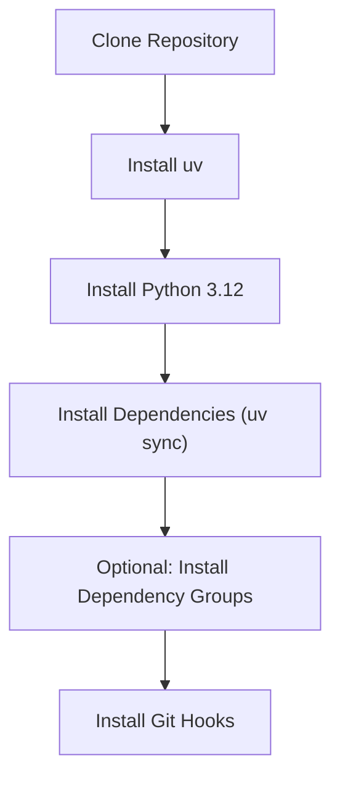
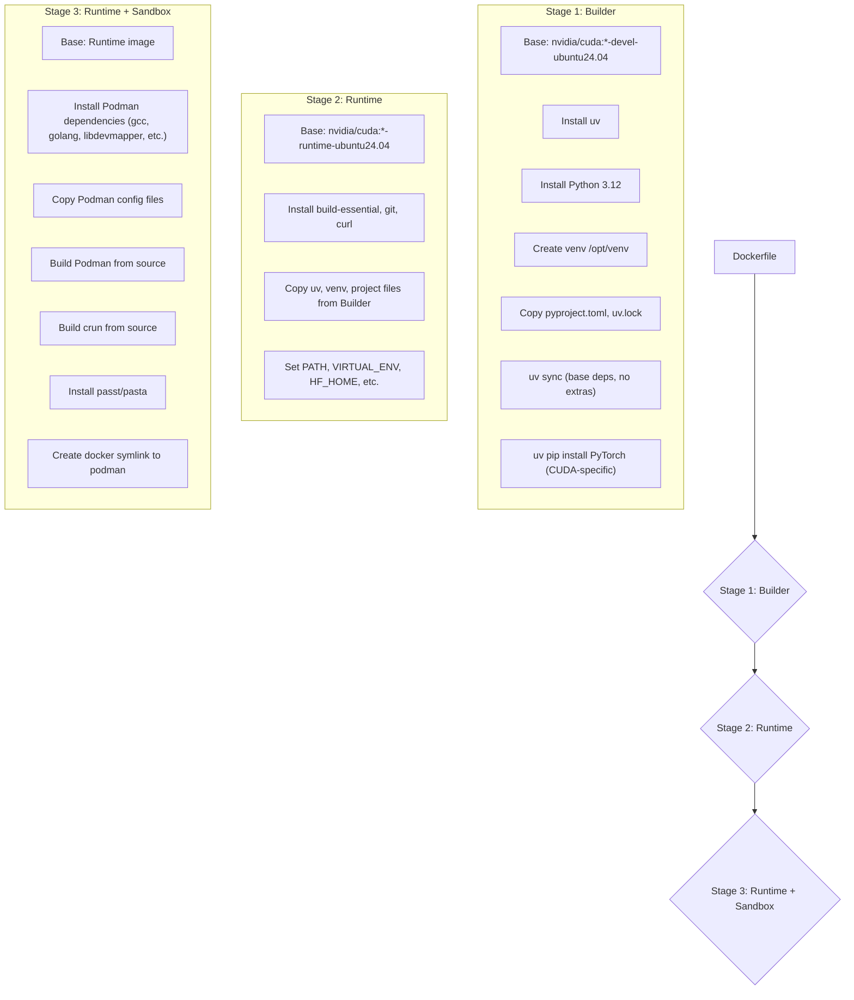
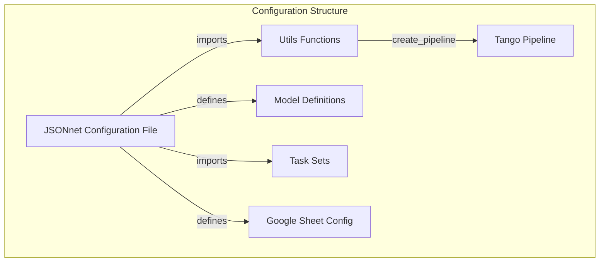
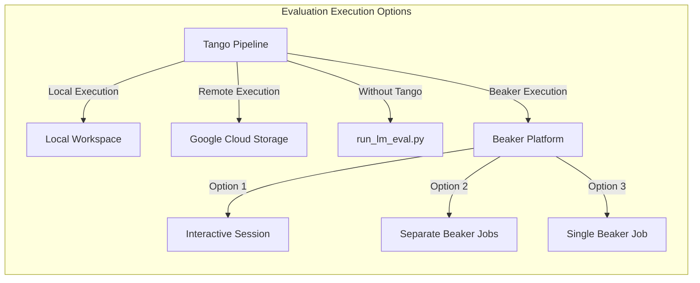
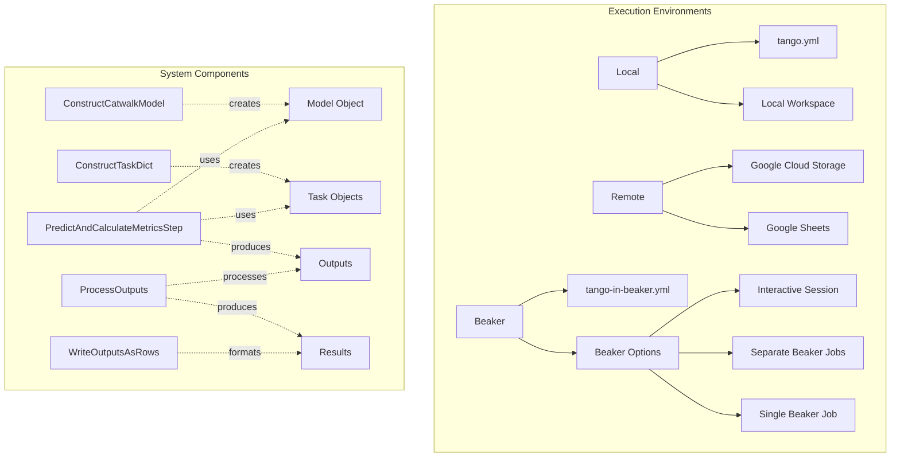

<!-- source: DeepWiki mcp.deepwiki.com · repo allenai/olmo-eval · page 1.1 Installation and Setup · fetched 2026-10-26 -->

# Installation and Setup

<details>
<summary>Relevant source files</summary>

The following files were used as context for generating this wiki page:

- [.github/workflows/ci.yml](.github/workflows/ci.yml)
- [.gitignore](.gitignore)
- [DEVELOPMENT.md](DEVELOPMENT.md)
- [Dockerfile](Dockerfile)
- [Makefile](Makefile)
- [pyproject.toml](pyproject.toml)
- [scripts/beaker/push_beaker_image.sh](scripts/beaker/push_beaker_image.sh)
- [scripts/build_image.sh](scripts/build_image.sh)
- [scripts/verify.sh](scripts/verify.sh)
- [src/olmo_eval/__init__.py](src/olmo_eval/__init__.py)
- [src/olmo_eval/cli/beaker/group.py](src/olmo_eval/cli/beaker/group.py)
- [src/olmo_eval/cli/beaker/watch.py](src/olmo_eval/cli/beaker/watch.py)
- [src/olmo_eval/storage/__init__.py](src/olmo_eval/storage/__init__.py)
- [uv.lock](uv.lock)

</details>


This page provides comprehensive instructions for installing and setting up the OLMo-Eval framework, which is used for evaluating language models across a variety of NLP tasks. For information about key concepts and terminology used in OLMo-Eval, see [Key Concepts](#1.2).

## Overview of OLMo-Eval

OLMo-Eval is built on top of [ai2-tango](https://github.com/allenai/tango) and [ai2-catwalk](https://github.com/allenai/catwalk), providing a structured pipeline for evaluating language models. The framework allows you to evaluate multiple models on multiple task sets, with optional integration for reporting results to Google Sheets.

**Note of Deprecation**: OLMo-Eval has been superseded by the OLMES repository (Open Language Model Evaluation System).

Sources: [README.md:1-25]()

## Prerequisites

Before installing OLMo-Eval, ensure you have:

- Git installed
- Python 3.12 or higher [pyproject.toml:6]()
- `uv` package installer [DEVELOPMENT.md:11]()
- Access to a system with GPU support (recommended for larger models)

## Installation Process



### Step 1: Clone the Repository

Clone the OLMo-Eval repository to your local machine.

```bash
git clone https://github.com/allenai/olmo-eval.git
cd olmo-eval
```
Sources: [DEVELOPMENT.md:6-8]()

### Step 2: Install `uv`

`uv` is a fast Python package installer and resolver. If you don't have it, install it using the provided script:

```bash
curl -LsSf https://astral.sh/uv/install.sh | sh
```
Sources: [DEVELOPMENT.md:10-11]()

### Step 3: Install Python 3.12

OLMo-Eval requires Python 3.12. If your system doesn't have it, `uv` can install it:

```bash
uv python install 3.12
```
Sources: [DEVELOPMENT.md:13-14]()

### Step 4: Install Dependencies and the Package

Install the project dependencies and the package itself in editable mode using `uv sync`. This uses the checked-in `uv.lock` file for reproducible builds.

```bash
uv sync --frozen
```
This command installs all core dependencies listed in `pyproject.toml` [pyproject.toml:23-38]() and the default dependency groups specified in `[tool.uv]` [pyproject.toml:107](), which currently include `dev` and `vllm` [pyproject.toml:107]().

Sources: [DEVELOPMENT.md:16-18]()

### Step 5: Optional Dependency Groups

OLMo-Eval supports several optional dependency groups for specific functionalities. You can install them using `uv sync --group <group_name>`.

| Group Name | Purpose | Installation Command | Dependencies |
| :--------- | :------ | :------------------- | :----------- |
| `hf` | HuggingFace Transformers integration | `uv sync --group hf` | `transformers` [pyproject.toml:47-48]() |
| `vllm` | vLLM inference engine (Linux/CUDA only) | `uv sync --group vllm` | `vllm[runai]`, `opencv-python-headless`, `torch-c-dlpack-ext` [pyproject.toml:49-55]() |
| `litellm` | LiteLLM for commercial APIs | `uv sync --group litellm` | `litellm` [pyproject.toml:56-58]() |
| `agents` | OpenAI Agents integration | `uv sync --group agents` | `openai-agents`, `httpx` [pyproject.toml:59-62]() |
| `analysis` | Data analysis and plotting tools | `uv sync --group analysis` | `matplotlib`, `seaborn`, `scipy` [pyproject.toml:63-66]() |
| `openhands` | OpenHands AI integration | `uv sync --group openhands` | `openhands-ai` [pyproject.toml:67-69]() |
| `sandbox` | Sandboxed execution with SWE-ReX | `uv sync --group sandbox` | `swe-rex[modal]` [pyproject.toml:70-72]() |
| `beaker` | Beaker platform integration | `uv sync --group beaker` | `beaker-py`, `beaker-gantry` [pyproject.toml:73-76]() |
| `s3` | S3 artifact storage | `uv sync --group s3` | `boto3`, `smart_open[s3]` [pyproject.toml:77-80]() |
| `postgres` | PostgreSQL database backend | `uv sync --group postgres` | `psycopg[binary]`, `sqlalchemy`, `alembic` [pyproject.toml:81-85]() |
| `gpu` | NVIDIA GPU monitoring | `uv sync --group gpu` | `nvidia-ml-py` [pyproject.toml:86-89]() |
| `clients` | OpenAI API client | `uv sync --group clients` | `openai` [pyproject.toml:90-92]() |
| `storage` | S3 and PostgreSQL storage | `uv sync --group storage` | `olmo-eval[s3,postgres]` [pyproject.toml:93-95]() |
| `dev` | Development tools and dependencies | `uv sync --group dev` | `pytest`, `pytest-cov`, `ruff`, `ty`, `pre-commit`, `olmo-eval[storage,beaker,hf,analysis]`, `jinja2`, `google-api-core`, `parameterized` [pyproject.toml:128-139]() |

Note that some groups have conflicting dependencies and cannot be installed together [pyproject.toml:109-122](). For example, `agents`, `openhands`, and `clients` are mutually exclusive with each other, and `vllm` is also mutually exclusive with `openhands`.

If you need to install a specific group and exclude a default one (like `vllm` on macOS), use `--no-group`:
```bash
uv sync --no-group vllm --group hf
```

Sources: [pyproject.toml:45-144](), [src/olmo_eval/storage/__init__.py:38-42]()

### Step 6: Install Git Hooks

Install pre-commit hooks to ensure code quality and formatting standards are met before committing.

```bash
uv run pre-commit install
```
Sources: [DEVELOPMENT.md:20-21]()

## First Run Commands

After installation, you can verify your setup and explore the framework using the `olmo-eval` CLI.

### Inspecting Suites and Tasks

Use `suite inspect` and `task inspect` to view available evaluation suites and their constituent tasks.

```bash
uv run olmo-eval suite inspect mmlu
uv run olmo-eval suite inspect gpqa
uv run olmo-eval suite inspect olmobase:code
```
Sources: [DEVELOPMENT.md:23-26]()

### Previewing a Run

You can perform a dry run of an evaluation without loading a model or performing actual inference. This is useful for checking configuration and task setup.

```bash
uv run olmo-eval run -m mock -t gsm8k --dry-run
```
The `-m mock` argument uses a mock inference provider, and `--dry-run` prevents actual computation.
Sources: [DEVELOPMENT.md:28-30]()

## Docker Image

OLMo-Eval provides Docker images for reproducible and isolated execution, especially useful for GPU-accelerated environments.

### Docker Image Build Process

The Docker image build process involves multiple stages:


The `Dockerfile` [Dockerfile:1-150]() defines three stages:
1.  **Builder**: Sets up a Python virtual environment (`/opt/venv`) with `uv`, installs Python 3.12, core project dependencies from `uv.lock`, and CUDA-specific PyTorch. This stage uses a `nvidia/cuda:*-devel-ubuntu24.04` base image [Dockerfile:24]().
2.  **Runtime**: Creates a minimal image based on `nvidia/cuda:*-runtime-ubuntu24.04` [Dockerfile:58](). It copies the `uv` executable, the virtual environment, and project files from the `builder` stage. This image is suitable for running evaluations.
3.  **Runtime + Sandbox**: Extends the `runtime` image by adding Podman and its dependencies for sandboxed execution environments [Dockerfile:98](). This is used for benchmarks requiring isolated code execution.

### Building the Docker Image

Use the `scripts/build_image.sh` script to build the Docker image.

```bash
./scripts/build_image.sh [OPTIONS]
```

**Common Options:**

-   `--tag TAG`: Specify a custom image tag (default is auto-generated).
-   `--cuda-version VER`: Set the CUDA version (e.g., `12.8.0`).
-   `--torch-version VER`: Set the PyTorch version (e.g., `2.9.0`).
-   `--python-version VER`: Set the Python version (default: `3.12`).
-   `--platform PLATFORM`: Target platform (e.g., `linux/amd64`, `linux/arm64`).
-   `--sandbox`: Build the `runtime-sandbox` target with Podman support.
-   `--no-cache`: Force a rebuild without using Docker cache.

**Example:**

```bash
# Build with default settings (CUDA 12.8.1, Torch 2.9.0, Python 3.12, amd64)
./scripts/build_image.sh

# Build with CUDA 12.8.0 and sandbox support
./scripts/build_image.sh --cuda-version 12.8.0 --sandbox

# Build for ARM64 platform
./scripts/build_image.sh --platform linux/arm64
```
The script will output the generated tag and instructions for testing the image.
Sources: [scripts/build_image.sh:1-176]()

### Pushing to Beaker

The `scripts/beaker/push_beaker_image.sh` script facilitates pushing the built Docker image to Beaker, including versioning and archiving previous images for safe rollbacks.

```bash
./scripts/beaker/push_beaker_image.sh [OPTIONS]
```

**Common Options:**

-   `--source IMAGE`: Local Docker image to push (default: `olmo-eval:latest`).
-   `--beaker-image NAME`: Name for the image on Beaker (default: auto-generated from source tag).
-   `--workspace WS`: Beaker workspace (default: `ai2/oe-data`).
-   `--dry-run`: Preview the actions without executing.
-   `--force`: Force upload even if a temporary image exists.

**Example:**

```bash
# Push the most recently built image to Beaker
./scripts/beaker/push_beaker_image.sh

# Push a specific image with a custom Beaker name
./scripts/beaker/push_beaker_image.sh --source olmo-eval:cu128-trc290-amd64 --beaker-image my-olmo-eval-prod
```
The script ensures that the `beaker` CLI and `jq` are installed. It uploads the image as a temporary one, renames the existing image (if any) with a timestamp, and then promotes the temporary image to the final name.
Sources: [scripts/beaker/push_beaker_image.sh:1-191]()

## Configuration



OLMo-Eval uses JSONnet configuration files to define evaluation pipelines. These configurations specify:

1. **Models to evaluate** - model paths, revisions, and GPU requirements
2. **Task sets** - collections of NLP tasks for evaluation
3. **Output options** - including Google Sheets integration

Sources: [configs/example_config.jsonnet:1-38](), [configs/evaluation_template.jsonnet:1-46]()

### Basic Configuration

The basic structure of a configuration file includes:

- Import statements for utility functions and task sets
- Model definitions with paths, revisions, and prediction parameters
- Task set definitions
- Optional Google Sheet integration

Example minimal configuration:

```jsonnet
local utils = import 'utils.libsonnet';
local gen_tasks = import 'task_sets/gen_tasks.libsonnet';

local gsheet = null;  // Set to Google Sheet name if needed

local models = [
    {
        model_path: "EleutherAI/pythia-1b",
        revision: "step140000",
        gpus_needed: 1,
        prediction_kwargs: {
            model_max_length: 2048,
            max_batch_tokens: 20480,
        }
    }
];

local task_sets = [
    gen_tasks.task_set,
];

{
    steps: utils.create_pipeline(models, task_sets, gsheet)
}
```

Sources: [configs/example_config.jsonnet:1-38]()

## Running Evaluations



### Local Execution

To run an evaluation pipeline locally:

```bash
tango --settings tango.yml run configs/example_config.jsonnet --workspace my-eval-workspace
```

This executes all the steps defined in the configuration and saves the results in a local tango workspace called `my-eval-workspace`. If you rerun with additional tasks or models, it will only compute the new outputs.

You can load the results programmatically:

```python
from tango import Workspace
workspace = Workspace.from_url("local://my-eval-workspace")
result = workspace.step_result("combine-all-outputs")
```

Sources: [README.md:39-70]()

### Google Sheets Integration

To save output to a Google Sheet:

1. Enable Google Drive API in your GCE console
2. Set up a service account with appropriate permissions
3. Share the Google Sheet with the service account email
4. Download the API JSON key for the service account
5. Set the `gsheet` variable in your configuration
6. Set the `GDRIVE_SERVICE_ACCOUNT_JSON` environment variable

```bash
export GDRIVE_SERVICE_ACCOUNT_JSON=$(cat downloaded_credentials_file.json)
tango --settings tango.yml run configs/evaluation_template.jsonnet --workspace my-eval-workspace
```

Sources: [ADVANCED.md:1-17]()

### Remote Workspace

To use a Google Cloud Storage workspace:

1. Enable Google Datastore in your GCE console
2. Log in with Google Cloud CLI:

```bash
gcloud auth login
gcloud auth application-default login
gcloud config set project <your-project>
```

3. Run with a Google Storage workspace:

```bash
tango --settings tango.yml run configs/example_config.jsonnet --workspace gs://my-gs-workspace
```

Sources: [ADVANCED.md:19-41]()

### Running Without Tango

For debugging or simpler execution, you can use the `run_lm_eval.py` script directly:

```bash
python -m olmo_eval.run_lm_eval --config_file configs/run_lm_eval_example.jsonnet
```

Or with direct arguments:

```bash
python -m olmo_eval.run_lm_eval --model lm::pretrained=EleutherAI/pythia-160m,revision=step140000 \
    --task arc_challenge arc_easy --split validation \
    --full_output_file predictions.jsonl --metrics_file metrics.json --model_max_length 2048 \
    --max_batch_tokens 4096 --num_recorded_inputs 3 --num_shots 0
```

Sources: [ADVANCED.md:52-67](), [configs/run_lm_eval_example.jsonnet:1-16]()

## Execution Environments



### Beaker Execution

OLMo-Eval supports running on [Beaker](https://beaker.org/), a platform for machine learning experiments. There are three options:

#### Option 1: Interactive Session

1. Start an interactive Beaker session with required GPUs
2. Run as you would locally:

```bash
tango --settings tango.yml run configs/example_config.jsonnet --workspace gs://my-gs-workspace
```

#### Option 2: Separate Beaker Jobs

Run each pipeline step as a different Beaker experiment, provisioning resources for each step separately:

```bash
tango --settings tango-in-beaker.yml run configs/example_config.jsonnet --workspace gs://my-gs-workspace
```

#### Option 3: Single Beaker Job

Use `beaker-gantry` to run the full pipeline in a single job:

```bash
gantry run --gpus 1 --venv base --workspace ai2/lm-eval --cluster ai2/aristo-cirrascale \
   --beaker-image oyvindt/OLMoEvalLatest \
   --env 'HF_DATASETS_CACHE=/net/nfs.cirrascale/aristo/oyvindt/hf_datasets_cache' -- \
   python olmo_eval/run_lm_eval.py \
   --model lm::pretrained=EleutherAI/pythia-160m,revision=step140000 \
   --task arc_challenge arc_easy boolq --split validation \
   --full_output_file /results/predictions.jsonl --metrics_file /results/metrics.json \
   --model_max_length 2048 --max_batch_tokens 4096 --num_recorded_inputs 3 \
   --num_shots 0
```

Additionally, the `olmo-eval beaker` CLI commands provide utilities for managing Beaker groups and watching experiment logs.

-   `olmo-eval beaker group info <group_name>`: Get detailed information about a Beaker group [src/olmo_eval/cli/beaker/group.py:50-70]().
-   `olmo-eval beaker group cancel <group_name>`: Cancel all experiments in a Beaker group [src/olmo_eval/cli/beaker/group.py:240-241]().
-   `olmo-eval beaker watch --experiment <experiment_id>`: Watch an experiment's logs in real-time [src/olmo_eval/cli/beaker/watch.py:8-21]().

Sources: [BEAKER.md:1-60](), [src/olmo_eval/cli/beaker/group.py:45-241](), [src/olmo_eval/cli/beaker/watch.py:1-41]()

## Key Configuration Files

| File | Purpose |
|------|---------|
| `tango.yml` | Configuration for local Tango execution |
| `tango-in-beaker.yml` | Configuration for Beaker execution |
| `configs/example_config.jsonnet` | Minimal example configuration |
| `configs/evaluation_template.jsonnet` | Template with multiple task sets |
| `configs/run_lm_eval_example.jsonnet` | Example for direct script execution |

Sources: [README.md:41-47](), [BEAKER.md:34-38](), [ADVANCED.md:66-67]()

## Troubleshooting

If your Google workspace enters a bad state, clear it with:

```bash
python scripts/empty_workspace.py my-gs-workspace
```

Sources: [ADVANCED.md:43-49]()

---

