<!-- source: DeepWiki mcp.deepwiki.com · repo allenai/olmo-eval · page 1.2 Key Concepts · fetched 2026-10-26 -->

# Key Concepts

<details>
<summary>Relevant source files</summary>

The following files were used as context for generating this wiki page:

- [README.md](README.md)
- [src/olmo_eval/common/metrics/__init__.py](src/olmo_eval/common/metrics/__init__.py)
- [src/olmo_eval/common/scorers/__init__.py](src/olmo_eval/common/scorers/__init__.py)
- [src/olmo_eval/common/scorers/base.py](src/olmo_eval/common/scorers/base.py)
- [src/olmo_eval/evals/tasks/common/base.py](src/olmo_eval/evals/tasks/common/base.py)
- [src/olmo_eval/harness/config.py](src/olmo_eval/harness/config.py)
- [src/olmo_eval/harness/harness.py](src/olmo_eval/harness/harness.py)
- [src/olmo_eval/harness/presets.py](src/olmo_eval/harness/presets.py)
- [src/olmo_eval/harness/sandbox/config.py](src/olmo_eval/harness/sandbox/config.py)
- [src/olmo_eval/launch/config.py](src/olmo_eval/launch/config.py)
- [src/olmo_eval/runners/asynq/processing.py](src/olmo_eval/runners/asynq/processing.py)

</details>


This page explains the fundamental concepts and terminology used throughout the OLMo-Eval framework, providing the necessary foundation for understanding how to evaluate language models using this repository. For installation instructions, see [Installation and Setup](#1.1), and for details on running evaluations, see [Evaluation Pipeline](#2).

## Core Evaluation Flow

OLMo-Eval provides a unified workbench for evaluating language models. The evaluation process is structured around several core abstractions that define how tasks are specified, how models interact with them, and how results are scored and aggregated. The overall flow involves defining tasks, grouping them into suites, executing them via a `Harness` and `InferenceProvider`, and then scoring and collecting metrics.

```mermaid
graph TD
    subgraph "Evaluation Flow"
        A[Task Definition] --> B[Instance Generation]
        B --> C[LMRequest Formatting]
        C --> D[InferenceProvider]
        D --> E[LMOutput Generation]
        E --> F[Scoring]
        F --> G[Metric Aggregation]
        G --> H[Results Storage]
    end

    subgraph "Code Entities"
        A -- "Task.get_instances()" --> B
        B -- "Task.format_instance()" --> C
        C -- "Harness.generate()/run()" --> D["InferenceProvider.agenerate()/alogprobs()"]
        D --> E
        E -- "Task.score_output()" --> F
        F -- "Task.compute_metrics()" --> G
        G -- "StorageBackend" --> H
    end
```


Sources: [README.md:66-77](), [src/olmo_eval/evals/tasks/common/base.py:20-28](), [src/olmo_eval/harness/harness.py:97-150](), [src/olmo_eval/runners/asynq/processing.py:158-196]()

## Key Abstractions

The OLMo-Eval framework is built around the following core abstractions:

| Abstraction | Description |
|-------------|-------------|
| **Task** | Defines how to load data, format prompts, and score outputs for a specific benchmark. |
| **Suite** | Groups multiple tasks and/or nested suites, defining how their results are aggregated. |
| **Harness** | The runtime layer that orchestrates inference, tool use, system prompts, and scaffolds. It wraps an `InferenceProvider`. |
| **InferenceProvider** | An interface for interacting with language models (e.g., vLLM, LiteLLM, HuggingFace). |
| **Instance** | A single example from a dataset, containing input data and the gold answer. |
| **LMRequest** | A formatted request sent to the language model, including prompt, sampling parameters, and metadata. |
| **LMOutput** | The response from the language model, including generated text, log probabilities, and extracted answers. |
| **Scorer** | Computes a numerical score for a single `LMOutput` against an `Instance`'s gold answer. |
| **Metric** | Aggregates scores from multiple `Scorer` outputs to produce a dataset-level performance measure. |

Sources: [README.md:66-77]()

### Task

A `Task` is the fundamental unit of evaluation. It encapsulates everything needed to run a benchmark:
- **Data Source**: Specifies where to load the dataset (e.g., Hugging Face dataset, local file).
- **Formatting**: Defines how an `Instance` is converted into an `LMRequest` (e.g., using `CompletionFormatter`, `ChatFormatter`).
- **Scoring Logic**: Contains one or more `Scorer` instances to evaluate `LMOutput`s.
- **Metrics**: Specifies `Metric` instances to aggregate scores.
- **Few-shot settings**: Configures the number and source of few-shot examples.
- **Runtime Dependencies**: Can specify Python packages or Dockerfile commands needed for execution, especially for sandboxed scoring.

Tasks are registered using the `@register` decorator [src/olmo_eval/evals/tasks/common/base.py:220](). Variants can be registered with `@register_variant` [src/olmo_eval/evals/tasks/common/base.py:230]() to define named evaluation presets (e.g., `humaneval:3shot:bpb`).

```python
from olmo_eval.evals.tasks.common import Task, register
from olmo_eval.data import DataSource

@register("my_task")
class MyTask(Task):
    # DataSource specifies path, subset (optional), and split
    data_source = DataSource(path="cais/mmlu", subset="abstract_algebra", split="test")
    # ... other task configurations like formatter, scorers, metrics
```
Sources: [README.md:79-86](), [src/olmo_eval/evals/tasks/common/base.py:112-186]()

### Suite

A `Suite` is a collection of `Task`s or other `Suite`s, allowing for hierarchical organization of evaluations. Suites define how results from their constituent tasks are aggregated.

```python
from olmo_eval.evals.suites import Suite, AggregationStrategy, register

# Nested suite with 3 tasks
multilingual_code = Suite(
    name="multilingual_code",
    tasks=("mbpp_python", "mbpp_java", "mbpp_rust"),
    aggregation=AggregationStrategy.AVERAGE,
)

# Parent suite using average of averages
register(Suite(
    name="code_eval",
    tasks=(
        "humaneval",        # Single task (score: 0.80)
        multilingual_code,  # Nested suite with 3 tasks (scores: 0.40, 0.50, 0.60)
    ),
    aggregation=AggregationStrategy.AVERAGE_OF_AVERAGES,
))
```
Sources: [README.md:113-164]()

**Aggregation Strategies**:
- `AVERAGE`: Simple average of all task scores (default).
- `AVERAGE_OF_AVERAGES`: Averages over child suite averages, giving equal weight to each child suite regardless of its number of tasks.
- `DISPLAY_ONLY`: Displays child results without computing a suite average.
- `NONE`: No aggregation; only individual task results are collected.
Sources: [README.md:129-135]()

### Harness

The `Harness` [src/olmo_eval/harness/harness.py:22-32]() is the runtime orchestration layer. It wraps an `InferenceProvider` and applies runtime behaviors such as:
- **System Prompts**: Prepends a system prompt to requests.
- **Tools**: Integrates external tools (e.g., search, code execution) that the model can call.
- **Scaffolds**: Enables multi-turn agentic behavior (e.g., `openai_agents`, `openhands`).
- **Sandboxes**: Provides isolated environments for executing tools (e.g., code execution).
- **Metrics Collection**: Gathers telemetry during inference.

The `Harness` allows the same task to be run in plain, tool-using, or scaffolded modes without modifying the task definition. It can perform single-turn generation (`generate`/`agenerate`) or multi-turn execution (`run`) if a scaffold is configured.

```mermaid
graph TD
    HarnessConfig[HarnessConfig] --> Harness[Harness]
    Harness --> InferenceProvider[InferenceProvider]
    Harness --> Tools[Tools]
    Harness --> Scaffolds[Scaffolds]
    Harness --> Sandboxes[Sandboxes]
    Harness --> Metrics[MetricsConfig]

    subgraph "Harness.run()"
        direction LR
        LMRequest[LMRequest] --> Scaffold[Scaffold.run()]
        Scaffold --> InferenceProvider
        Scaffold --> Tools
        Tools --> Sandboxes
        Scaffold --> HarnessResult[HarnessResult]
    end
```
Sources: [src/olmo_eval/harness/harness.py:22-32](), [src/olmo_eval/harness/config.py:23-54](), [src/olmo_eval/harness/presets.py:65-77]()

### InferenceProvider

An `InferenceProvider` [src/olmo_eval/inference/base.py:18-20]() is an interface for interacting with language models. It abstracts away the specifics of different model backends. OLMo-Eval supports:
- **VLLMProvider**: For local or server-based vLLM inference.
- **LiteLLMProvider**: For commercial APIs (e.g., OpenAI, Anthropic) via LiteLLM.
- **HuggingFaceProvider**: For local Hugging Face Transformers models.
- **MockProvider**: For dry runs and testing without actual model inference.

Providers implement methods for `generate` (text generation) and `logprobs` (log probability calculation), both synchronously and asynchronously.

```mermaid
graph TD
    InferenceProviderBase[InferenceProvider (Abstract)]
    InferenceProviderBase <|-- VLLMProvider[VLLMProvider]
    InferenceProviderBase <|-- LiteLLMProvider[LiteLLMProvider]
    InferenceProviderBase <|-- HuggingFaceProvider[HuggingFaceProvider]
    InferenceProviderBase <|-- MockProvider[MockProvider]

    subgraph "Methods"
        VLLMProvider -- "generate(requests, sampling_params)" --> LMOutputList[list[LMOutput]]
        VLLMProvider -- "logprobs(requests, sampling_params)" --> LMOutputList
        VLLMProvider -- "agenerate(requests, sampling_params)" --> LMOutputList
        VLLMProvider -- "alogprobs(requests, sampling_params)" --> LMOutputList
    end
```
Sources: [src/olmo_eval/inference/base.py:18-20](), [src/olmo_eval/inference/providers/vllm.py:24-26](), [src/olmo_eval/inference/providers/litellm.py:20-22](), [src/olmo_eval/inference/providers/huggingface.py:20-22]()

### Instance

An `Instance` [src/olmo_eval/common/types.py:100-106]() represents a single example from a dataset. It typically contains:
- `input`: The raw input data for the model.
- `gold_answer`: The correct answer for scoring.
- `metadata`: Additional information about the instance (e.g., ID, context).

Tasks are responsible for loading and processing raw data into `Instance` objects.

### LMRequest

An `LMRequest` [src/olmo_eval/common/types.py:110-120]() is a structured request sent to an `InferenceProvider`. It includes:
- `request_type`: Whether it's a `COMPLETION`, `LOGLIKELIHOOD`, or `CHAT` request.
- `prompt`: The text prompt for the model.
- `continuation`: (For `LOGLIKELIHOOD`) The text to score.
- `messages`: (For `CHAT`) A list of chat messages.
- `sampling_params`: Parameters controlling generation (e.g., temperature, top_p, max_tokens).
- `metadata`: Any additional request-specific metadata.

`Formatter`s are used by `Task`s to convert `Instance`s into `LMRequest`s.

### LMOutput

An `LMOutput` [src/olmo_eval/common/types.py:124-134]() is the structured response received from an `InferenceProvider`. It contains:
- `text`: The generated text.
- `log_prob`: The log probability of the generated text (if requested).
- `log_probs_per_token`: Log probabilities for each token.
- `extracted_answer`: The answer extracted from the generated text by the task's answer extraction logic.
- `metadata`: Any additional output-specific metadata (e.g., tool calls, scoring errors).

### Scorer

A `Scorer` [src/olmo_eval/common/scorers/base.py:14-19]() computes a numerical score (typically between 0.0 and 1.0) for a single `LMOutput` against an `Instance`'s `gold_answer`. Examples include:
- `ExactMatchScorer`: Checks for exact string equality [src/olmo_eval/common/scorers/base.py:67-84]().
- `MultipleChoiceScorer`: Compares selected options [src/olmo_eval/common/scorers/base.py:87-98]().
- `F1Scorer`: Computes token-level F1 score [src/olmo_eval/common/scorers/base.py:136-146]().
- `ProcessScorer`: Base class for CPU-heavy scorers that run in a subprocess [src/olmo_eval/common/scorers/base.py:48-63]().
- `CodeExecutionScorer`: Executes generated code in a sandbox to verify correctness [src/olmo_eval/common/scorers/code_execution.py:14-16]().
- `LLMJudgeScorer`: Uses another LLM to judge the quality of the output [src/olmo_eval/common/scorers/llm_judge.py:24-26]().

```mermaid
graph TD
    ScorerBase[Scorer (Abstract)]
    ScorerBase <|-- ExactMatchScorer[ExactMatchScorer]
    ScorerBase <|-- MultipleChoiceScorer[MultipleChoiceScorer]
    ScorerBase <|-- F1Scorer[F1Scorer]
    ScorerBase <|-- ProcessScorer[ProcessScorer]
    ProcessScorer <|-- CodeExecutionScorer[CodeExecutionScorer]
    ProcessScorer <|-- LLMJudgeScorer[LLMJudgeScorer]

    subgraph "Scorer.score()"
        Instance[Instance] --> ScorerBase
        LMOutput[LMOutput] --> ScorerBase
        ScorerBase --> Score[float]
    end
```
Sources: [src/olmo_eval/common/scorers/base.py:14-19](), [src/olmo_eval/common/scorers/base.py:67-84](), [src/olmo_eval/common/scorers/base.py:87-98](), [src/olmo_eval/common/scorers/base.py:136-146](), [src/olmo_eval/common/scorers/base.py:48-63](), [src/olmo_eval/common/scorers/code_execution.py:14-16](), [src/olmo_eval/common/scorers/llm_judge.py:24-26]()

### Metric

A `Metric` [src/olmo_eval/common/metrics/base.py:20-22]() aggregates the individual scores produced by `Scorer`s across all instances of a task to produce a single, dataset-level performance measure. Examples include:
- `AccuracyMetric`: Calculates the proportion of correctly scored instances [src/olmo_eval/common/metrics/base.py:30-32]().
- `F1Metric`: Aggregates F1 scores [src/olmo_eval/common/metrics/base.py:100-102]().
- `PassAtKMetric`: For coding tasks, measures the percentage of problems solved by at least one of `k` attempts [src/olmo_eval/common/metrics/base.py:160-162]().
- `BitsPerByteScorer`: Computes bits per byte from logprobs [src/olmo_eval/common/scorers/base.py:209-216]().

```mermaid
graph TD
    MetricBase[Metric (Abstract)]
    MetricBase <|-- AccuracyMetric[AccuracyMetric]
    MetricBase <|-- F1Metric[F1Metric]
    MetricBase <|-- PassAtKMetric[PassAtKMetric]
    MetricBase <|-- BPBMetricByteAvg[BPBMetricByteAvg]

    subgraph "Metric.compute()"
        Scores[list[float]] --> MetricBase
        MetricBase --> AggregatedScore[float]
    end
```
Sources: [src/olmo_eval/common/metrics/base.py:20-22](), [src/olmo_eval/common/metrics/base.py:30-32](), [src/olmo_eval/common/metrics/base.py:100-102](), [src/olmo_eval/common/metrics/base.py:160-162](), [src/olmo_eval/common/metrics/base.py:209-216]()

---

