<!-- source: DeepWiki mcp.deepwiki.com · repo allenai/olmo-eval · page 2 Evaluation Pipeline · fetched 2026-10-26 -->

# Evaluation Pipeline

Relevant source files

The following files were used as context for generating this wiki page:

- [README.md](README.md)
- [src/olmo_eval/cli/run/__init__.py](src/olmo_eval/cli/run/__init__.py)
- [src/olmo_eval/cli/run/config.py](src/olmo_eval/cli/run/config.py)
- [src/olmo_eval/common/progress.py](src/olmo_eval/common/progress.py)
- [src/olmo_eval/inference/__init__.py](src/olmo_eval/inference/__init__.py)
- [src/olmo_eval/launch/config.py](src/olmo_eval/launch/config.py)
- [src/olmo_eval/runners/asynq/monitoring.py](src/olmo_eval/runners/asynq/monitoring.py)
- [src/olmo_eval/runners/asynq/results.py](src/olmo_eval/runners/asynq/results.py)
- [src/olmo_eval/runners/asynq/runner.py](src/olmo_eval/runners/asynq/runner.py)
- [src/olmo_eval/runners/asynq/types.py](src/olmo_eval/runners/asynq/types.py)
- [src/olmo_eval/runners/asynq/workers.py](src/olmo_eval/runners/asynq/workers.py)
- [tests/core/test_configs.py](tests/core/test_configs.py)

The OLMo-Eval Evaluation Pipeline orchestrates end-to-end evaluations of language models, from command-line invocation to result storage. This page provides a high-level overview of the pipeline's stages, linking to child pages for detailed explanations of each component.

## Pipeline Overview

The evaluation pipeline begins with a CLI command, which parses configuration and sets up storage. An asynchronous runner then prepares tasks and manages inference workers. These workers perform inference using a configured harness, which wraps an inference provider and handles task-specific logic. Finally, results are scored, aggregated, and stored in a database and/or S3.

Here's a high-level diagram of the evaluation pipeline:

```mermaid
graph TD
    A[CLI Invocation] --> B{Run Configuration};
    B --> C[Storage Setup];
    C --> D[AsyncEvalRunner];
    D --> E[Task Preparation];
    E --> F[GPU Planning];
    F --> G[Inference Workers];
    G --> H[Harness];
    H --> I[Inference Provider];
    I --> J[LM Requests];
    J --> K[LM Outputs];
    K --> L[Scoring & Aggregation];
    L --> M[Result Storage];

    subgraph "Main Process"
        A -- "olmo-eval run" --> B;
        B -- "RunConfig" --> C;
        C -- "StorageBackend" --> D;
        D -- "prepare_task_items()" --> E;
        E -- "_plan_gpus()" --> F;
        F -- "multiprocessing.Process" --> G;
        G -- "QueueItem" --> H;
        H -- "InferenceProvider.generate()" --> I;
        I -- "LMRequest" --> J;
        J -- "LMOutput" --> K;
        K -- "process_results()" --> L;
        L -- "StorageBackend.save_results()" --> M;
    end

    subgraph "Worker Processes"
        G -- "inference_worker()" --> H;
        H -- "Harness.run_task_instance()" --> I;
    end

    style A fill:#f9f,stroke:#333,stroke-width:2px
    style B fill:#bbf,stroke:#333,stroke-width:2px
    style C fill:#bbf,stroke:#333,stroke-width:2px
    style D fill:#bbf,stroke:#333,stroke-width:2px
    style E fill:#ccf,stroke:#333,stroke-width:2px
    style F fill:#ccf,stroke:#333,stroke-width:2px
    style G fill:#ccf,stroke:#333,stroke-width:2px
    style H fill:#ccf,stroke:#333,stroke-width:2px
    style I fill:#ccf,stroke:#333,stroke-width:2px
    style J fill:#ccf,stroke:#333,stroke-width:2px
    style K fill:#ccf,stroke:#333,stroke-width:2px
    style L fill:#bbf,stroke:#333,stroke-width:2px
    style M fill:#bbf,stroke:#333,stroke-width:2px
```

Sources: [src/olmo_eval/cli/run/__init__.py:30-241](), [src/olmo_eval/runners/asynq/runner.py:29-33](), [src/olmo_eval/runners/asynq/preparation.py:16-17](), [src/olmo_eval/runners/asynq/runner.py:165-175](), [src/olmo_eval/runners/asynq/workers.py:31-38](), [src/olmo_eval/harness/__init__.py:1-1](), [src/olmo_eval/inference/__init__.py:1-1](), [src/olmo_eval/runners/asynq/results.py:84-104](), [src/olmo_eval/storage/__init__.py:1-1]()

## Pipeline Stages

The evaluation pipeline is broken down into several key stages, each managed by specific components:

### CLI and Run Configuration

The evaluation process starts with the `olmo-eval run` command. This command parses various options, including model specifications, task lists, and overrides. It constructs a `RunConfig` object, which encapsulates all parameters for the evaluation. Overrides allow dynamic adjustment of task or harness settings directly from the command line. A dry-run mode is available to inspect the configuration without executing the evaluation.

For details, see [CLI and Run Configuration](#2.1).

Sources: [src/olmo_eval/cli/run/__init__.py:30-241](), [src/olmo_eval/cli/run/config.py:177-185]()

### Async Runner and Worker Architecture

The core execution is managed by the `AsyncEvalRunner`. This runner employs a multi-process architecture, spawning `inference_worker` processes to handle model inference. It's responsible for preparing tasks, planning GPU allocation, and distributing `QueueItem` objects (representing individual instances to be processed) to workers. Workers return `ResultItem` objects, which the runner aggregates and processes. Batching strategies are applied to optimize throughput.

For details, see [Async Runner and Worker Architecture](#2.2).

Sources: [src/olmo_eval/runners/asynq/runner.py:29-33](), [src/olmo_eval/runners/asynq/workers.py:21-31](), [src/olmo_eval/runners/asynq/types.py:22-34](), [src/olmo_eval/runners/asynq/types.py:80-92]()

### Harness and Scaffolds

Within each `inference_worker`, a `Harness` instance is created based on a `HarnessConfig`. The harness acts as a runtime layer, wrapping an `InferenceProvider` (e.g., vLLM, LiteLLM, HuggingFace). It integrates tools, applies system prompts, and can incorporate scaffolds like `openai_agents` or `openhands` for agentic evaluations. Presets like `dr_tulu` simplify common harness configurations. The harness is responsible for executing the `LMRequest` and obtaining `LMOutput`.

For details, see [Harness and Scaffolds](#2.3).

Sources: [src/olmo_eval/runners/asynq/workers.py:59-60](), [src/olmo_eval/harness/config.py:1-1](), [src/olmo_eval/inference/__init__.py:5-6](), [src/olmo_eval/harness/scaffolds/__init__.py:1-1]()

### Result Storage and Querying

After inference, the `AsyncEvalRunner` collects `ResultItem`s, performs scoring, and aggregates metrics. The results are then persisted using a `StorageBackend`. The primary backend uses PostgreSQL for structured results and metrics, with Alembic migrations managing schema changes. S3 is used for storing larger artifacts like raw predictions or traces. The `olmo-eval results query` and `metrics plot` CLI commands allow users to retrieve and analyze stored evaluation data.

For details, see [Result Storage and Querying](#2.4).

Sources: [src/olmo_eval/runners/asynq/results.py:84-104](), [src/olmo_eval/storage/__init__.py:1-1](), [src/olmo_eval/cli/run/__init__.py:165-172]()

---

