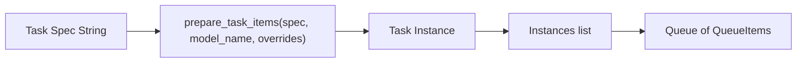
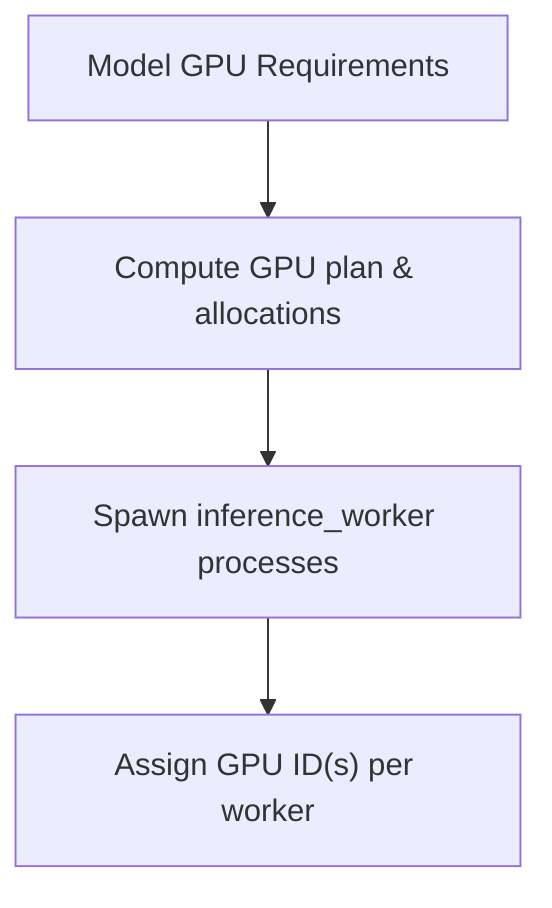
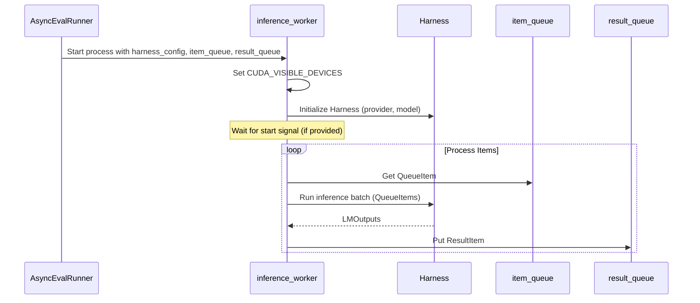
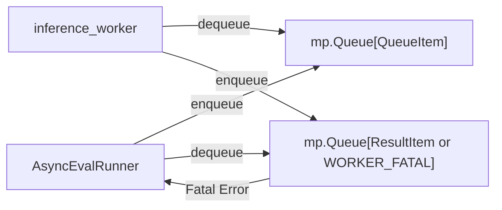
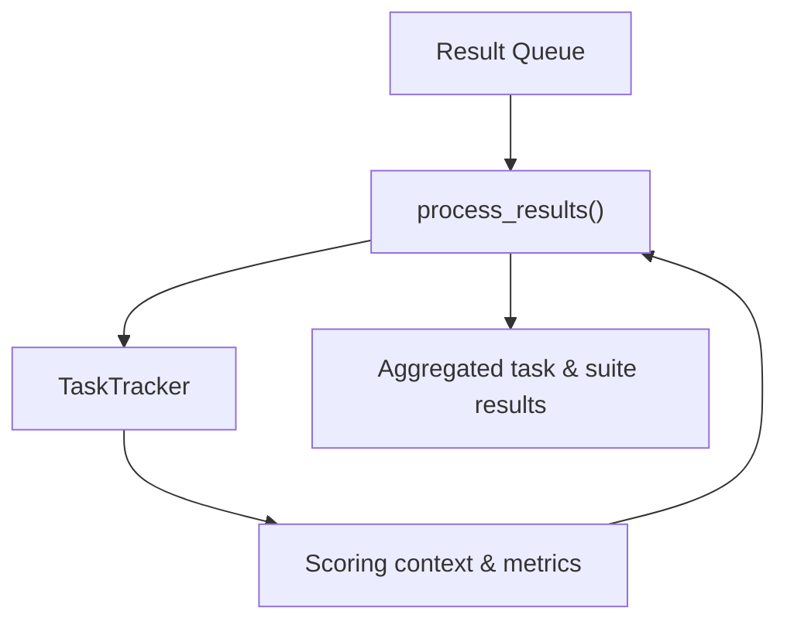

<!-- source: DeepWiki mcp.deepwiki.com · repo allenai/olmo-eval · page 2.2 Async Runner and Worker Architecture · fetched 2026-10-26 -->

# Async Runner and Worker Architecture

<details>
<summary>Relevant source files</summary>

The following files were used as context for generating this wiki page:

- [src/olmo_eval/common/console.py](src/olmo_eval/common/console.py)
- [src/olmo_eval/common/progress.py](src/olmo_eval/common/progress.py)
- [src/olmo_eval/evals/suites/math.py](src/olmo_eval/evals/suites/math.py)
- [src/olmo_eval/evals/tasks/aime.py](src/olmo_eval/evals/tasks/aime.py)
- [src/olmo_eval/inference/provider_manager.py](src/olmo_eval/inference/provider_manager.py)
- [src/olmo_eval/runners/asynq/batching/batched.py](src/olmo_eval/runners/asynq/batching/batched.py)
- [src/olmo_eval/runners/asynq/monitoring.py](src/olmo_eval/runners/asynq/monitoring.py)
- [src/olmo_eval/runners/asynq/preparation.py](src/olmo_eval/runners/asynq/preparation.py)
- [src/olmo_eval/runners/asynq/results.py](src/olmo_eval/runners/asynq/results.py)
- [src/olmo_eval/runners/asynq/runner.py](src/olmo_eval/runners/asynq/runner.py)
- [src/olmo_eval/runners/asynq/types.py](src/olmo_eval/runners/asynq/types.py)
- [src/olmo_eval/runners/asynq/workers.py](src/olmo_eval/runners/asynq/workers.py)
- [src/olmo_eval/runners/common/mixins.py](src/olmo_eval/runners/common/mixins.py)
- [src/olmo_eval/runners/io/storage.py](src/olmo_eval/runners/io/storage.py)

</details>


## Purpose and Scope

This page provides a comprehensive technical overview of the **AsyncEvalRunner** multi-process architecture within OLMo-Eval. It covers how evaluation tasks are prepared and scheduled, GPU resource planning, the functioning of inference worker processes, inter-process communication via `QueueItem` and `ResultItem` data structures, batching strategies for efficient inference, and the aggregation of results.

This architecture enables scalable, asynchronous evaluation of language models by distributing evaluation workloads across multiple GPU workers and processes, maximizing throughput while balancing latency.

---

## 1. High-Level Overview

The async evaluation runner is designed to concurrently execute evaluation instances over multiple tasks and models, using a **multi-process architecture**. The key components of this architecture and their relationships are:

```mermaid
flowchart TD
    subgraph AsyncEvalRunner_Orchestrator["AsyncEvalRunner (Main Process)"]
        AE[Task & Instance Preparation]
        GPUPlan[GPU Planning & Allocation]
        WorkerSpawn[Spawn inference_worker processes]
        SendQueue[Enqueue QueueItems]
        Aggregate[Result aggregation & scoring]
    end

    subgraph Workers["Inference Workers (worker processes)"]
        WorkerProc[inference_worker function]
        ItemQueue[mp.Queue (QueueItems)]
        ResultQueue[mp.Queue (ResultItems)]
        Harness[Harness & InferenceProvider]
        Batching[Batching Strategy]
    end

    AE --> GPUPlan
    GPUPlan --> WorkerSpawn
    WorkerSpawn --> ItemQueue
    ItemQueue --> WorkerProc
    WorkerProc --> ResultQueue
    ResultQueue --> Aggregate
```

- The **main process** (`AsyncEvalRunner`) prepares tasks and decomposes them into individual instances wrapped as `QueueItem`.
- A **GPU resource plan** determines how many GPU workers to launch and on which GPUs.
- Multiple **worker processes** run the `inference_worker` function, each owning access to a GPU or set of GPUs and a configured Harness wrapping model inference providers.
- Workers consume requests via a **multiprocessing item queue** (`QueueItem`s), performing inference and batch processing.
- Results for individual instances are returned to the main process via a **result queue** (`ResultItem`s).
- The main process aggregates results, performs inline or asynchronous scoring, and produces the final evaluation outputs.

Sources: [src/olmo_eval/runners/asynq/runner.py:1-191](), [src/olmo_eval/runners/asynq/workers.py:1-125](), [src/olmo_eval/runners/asynq/types.py:1-101]()

---

## 2. Task Preparation and QueueItem Creation

The evaluation flow begins with preparing each **task** for a given model:

- The async runner calls `prepare_task_items` to:
  - Instantiate the task object (`Task`) via `get_task(spec)`.
  - Apply any configuration overrides (e.g. `num_fewshot`, `limit`).
  - Sample/limit the task instances if required.
  - Format each instance into a prebuilt language model request (`LMRequest`).
  - Wrap each instance with metadata into a `QueueItem`.
  
The output is a tuple of `(Task, List[QueueItem])`.

Each `QueueItem` includes:

| Field          | Description                               |
|----------------|-------------------------------------------|
| `model_name`   | The model identifier                      |
| `task_id`      | Task specification string                 |
| `instance_idx` | Index of instance within the task        |
| `instance`     | The input instance object (`Instance`)   |
| `request`      | Pre-serialized LM request (`LMRequest`)  |
| `sampling_params` | Sampling parameters for inference      |

This decoupling allows the runner to create a queue of ready-to-run inference requests across many tasks and models.



Sources: [src/olmo_eval/runners/asynq/preparation.py:20-74](), [src/olmo_eval/runners/asynq/types.py:21-33]()

---

## 3. GPU Planning and Worker Process Launch

Before starting workers, the runner performs GPU planning:

- Based on requested GPU resources from model and task configurations, the runner calculates:
  - How many workers to launch.
  - Which GPU ID(s) each worker will use.
- Workers are typically pinned to one or multiple GPUs via environment variables (`CUDA_VISIBLE_DEVICES`).
- The runner spawns separate OS processes to run `inference_worker` function with assigned GPU configuration.

This parallelization enables full utilisation of multiple GPUs for high throughput.



Sources: [src/olmo_eval/runners/asynq/runner.py:100-172](), [src/olmo_eval/runners/asynq/workers.py:20-79]()

---

## 4. Inference Worker Process Architecture

Each worker process runs the `inference_worker` function, which performs the inference and batching loop:

**Initialization:**

- Set environment variable `CUDA_VISIBLE_DEVICES` for assigned GPUs.
- Deserialize and load `HarnessConfig`.
- Construct the `Harness` object which encapsulates:
  - The configured model provider (e.g., vLLM, huggingface).
  - Model loading parameters, concurrency limits.
  - Optional scaffolds (tools, sandboxing).
  - Metrics reporting infrastructure.
- Optionally create logs directory and configure tracing for specialized scaffolds.
- Validate scaffolds early to fail fast.

**Batching & Processing Loop:**

- Fetch `QueueItem` instances from `item_queue`.
- Use a configured batching strategy (streaming or chunked).
- For text Completion or Loglikelihood requests, calls are batched before inference.
- For Chat requests, concurrency is managed with async coroutines and yielded back concurrently.
- Results are gathered as `ResultItem` and put onto `result_queue`.
- Handles retries and failures gracefully.



Sources: [src/olmo_eval/runners/asynq/workers.py:20-187](), [src/olmo_eval/runners/asynq/batching/batched.py (inferred functionality)]()

---

## 5. QueueItem and ResultItem Communication

Inter-process communication between the async runner and workers is done via **multiprocessing queues** with defined data classes:

### QueueItem

Represents one evaluation instance scheduled for inference:

- Fields include model_name, task_id, instance index, task instance, and pre-formatted LMRequest.
- Workers pull `QueueItem`s from the shared input queue, blocking and continuing until signaled to shut down.

### ResultItem

Encapsulates results returned from workers per instance:

- Contains the original model_name, task_id, instance_idx.
- Holds the list of `LMOutput`s generated.
- May include error messages and attempt counts.
- Used by the main process to track completion and scoring.

### Worker Fatal Error Signal

- There is a sentinel value `WORKER_FATAL` used to signal critical crashes from workers.
- Main process monitors the result queue for this sentinel to terminate all workers on fatal errors.



Sources: [src/olmo_eval/runners/asynq/types.py:20-100](), [src/olmo_eval/runners/asynq/monitoring.py:10-75]()

---

## 6. Batching Strategies

Batching is crucial for improving GPU throughput and lowering latency. The async runner supports multiple batching modes configurable per provider:

- **Streaming Strategy**: Maintains an adaptive streaming batch size with concurrency limits controlling maximum in-flight requests.
- **Chunked Strategy**: Processes input in fixed-size chunks for batched inference.

The batching logic is encapsulated in strategy classes retrieved from `get_strategy(batch_config)` inside the worker.

Workers take `QueueItem`s continuously, aggregate them based on the batching policy, invoke inference with the `Harness.provider`, then emit `ResultItem`s for each input.

Most modern model providers (e.g., vLLM) support batched generation natively, allowing efficient token-wise processing across multiple requests.

Sources: [src/olmo_eval/runners/asynq/workers.py:155-188](), inferred from batching imports in the worker code.

---

## 7. Result Aggregation and Scoring

The main AsyncEvalRunner process handles collecting `ResultItem`s and updating task progress trackers:

- Per-task `TaskTracker` objects maintain counts of completed, failed, and pending instances.
- As results arrive, the runner performs **inline async scoring**: scoring responses, computing metrics (accuracy, pass@k, etc.), and updating partial results.
- The system can offload some scoring steps to asynchronous workers if the task requires sandboxed or external execution.
- Final metrics are aggregated according to suite-level aggregation rules.
- Results can be saved locally, uploaded to S3, and logged.

The result processing function `process_results` manages concurrent scoring with semaphores to limit concurrency and logs progress via `ProgressLogger`.



Sources: [src/olmo_eval/runners/asynq/results.py:70-220](), [src/olmo_eval/runners/asynq/preparation.py:90-178]()

---

## 8. Summary Diagram: From Task to Results in Code

The figure below presents an end-to-end mapping of natural language evaluation concepts to the key code classes/functions involved in the async runner architecture:

```mermaid
graph TB
    subgraph "Evaluation Flow"
        TaskSpec["Task Spec"] --> prepare_task_items
        prepare_task_items["prepare_task_items()"] --> QueueItems["List of QueueItem"]
        QueueItems --> AsyncEvalRunner["AsyncEvalRunner.enqueue_items()"]
        AsyncEvalRunner --> WorkerProcesses["Spawn inference_worker * N"]
    end
    
    subgraph "Worker Implementation"
        WorkerProcesses --> Mgmt["Set CUDA_VISIBLE_DEVICES & Init Harness"]
        Mgmt --> BatchingStrategy["Batching Strategy (streaming/chunked)"]
        BatchingStrategy --> PerformInference["Harness.provider.infer()"]
        PerformInference --> ResultItems["Queue ResultItem"]
        ResultItems --> AsyncEvalRunner["Result queue reception"]
    end
    
    subgraph "Result Processing"
        AsyncEvalRunner --> process_results["process_results()"]
        process_results --> TaskTracker["TaskTracker (per task)"]
        TaskTracker --> Scoring["Inline or async scoring"]
        Scoring --> Aggregate["Aggregate final TaskResult & Metrics"]
    end
    
    %% Code entity labels
    TaskSpec note right
        code: Task spec string
    end
    prepare_task_items note right
        code: src/olmo_eval/runners/asynq/preparation.py:20-74
    end
    QueueItems note right
        code: src/olmo_eval/runners/asynq/types.py:21-33
    end
    AsyncEvalRunner note right
        code: src/olmo_eval/runners/asynq/runner.py
    end
    inference_worker note right
        code: src/olmo_eval/runners/asynq/workers.py:20-187
    end
    process_results note right
        code: src/olmo_eval/runners/asynq/results.py:70-220
    end
    TaskTracker note right
        code: src/olmo_eval/runners/asynq/types.py:35-78
    end
```

---

## 9. Key Classes and Functions Reference

| Name                    | Location                                              | Responsibilities                                     |
| ----------------------- | ----------------------------------------------------| --------------------------------------------------- |
| `AsyncEvalRunner`       | `src/olmo_eval/runners/asynq/runner.py`             | Orchestrates evaluation pipeline, worker management, item and result queues handling |
| `prepare_task_items`    | `src/olmo_eval/runners/asynq/preparation.py:20-74`  | Prepare tasks and generate QueueItems               |
| `inference_worker`      | `src/olmo_eval/runners/asynq/workers.py:20-187`     | Worker process: initialize Harness, run batching, yield ResultItems |
| `QueueItem`             | `src/olmo_eval/runners/asynq/types.py:21-33`        | Data container for queued inference requests        |
| `ResultItem`            | `src/olmo_eval/runners/asynq/types.py:79-98`        | Data container for results returned from workers    |
| `process_results`       | `src/olmo_eval/runners/asynq/results.py:70-220`     | Collects results, performs scoring, aggregates metrics |
| `TaskTracker`           | `src/olmo_eval/runners/asynq/types.py:35-78`        | Maintains per-task progress and responses            |
| `BatchConfig` & strategy| `src/olmo_eval/runners/asynq/batching/batched.py`   | Defines batching approaches for efficient throughput |

---

## 10. Additional Notes

- The architecture provides robustness by:
  - Monitoring worker health and catching fatal errors early.
  - Gracefully shutting down workers with timeouts.
  - Retrying failed instances and handling partial failures at the task level.
- Model providers and scaffolds can extend worker functionality with tool usage, sandboxing, and agent-like traces.
- The runner persists outputs, results, and logs to configurable local directories or remote storage like S3.

---

# References

- Async runner main logic: `src/olmo_eval/runners/asynq/runner.py:1-191`  
- Worker process implementation: `src/olmo_eval/runners/asynq/workers.py:20-187`  
- Task preparation and QueueItems: `src/olmo_eval/runners/asynq/preparation.py:20-74`  
- QueueItem and ResultItem types: `src/olmo_eval/runners/asynq/types.py:21-100`  
- Result processing and aggregation: `src/olmo_eval/runners/asynq/results.py:70-220`  
- Worker monitoring: `src/olmo_eval/runners/asynq/monitoring.py:10-75`  
- Batching strategy guidance: `src/olmo_eval/runners/asynq/workers.py:155-188` (and batching submodules)

Sources:  
[src/olmo_eval/runners/asynq/runner.py](),  
[src/olmo_eval/runners/asynq/workers.py](),  
[src/olmo_eval/runners/asynq/types.py](),  
[src/olmo_eval/runners/asynq/preparation.py](),  
[src/olmo_eval/runners/asynq/results.py](),  
[src/olmo_eval/runners/asynq/monitoring.py]()

---

