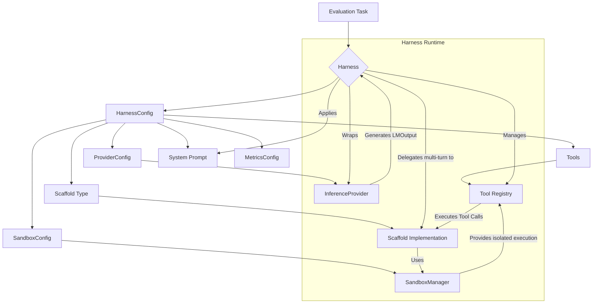
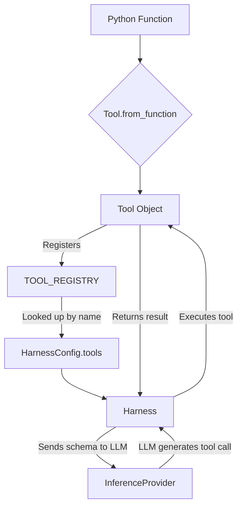
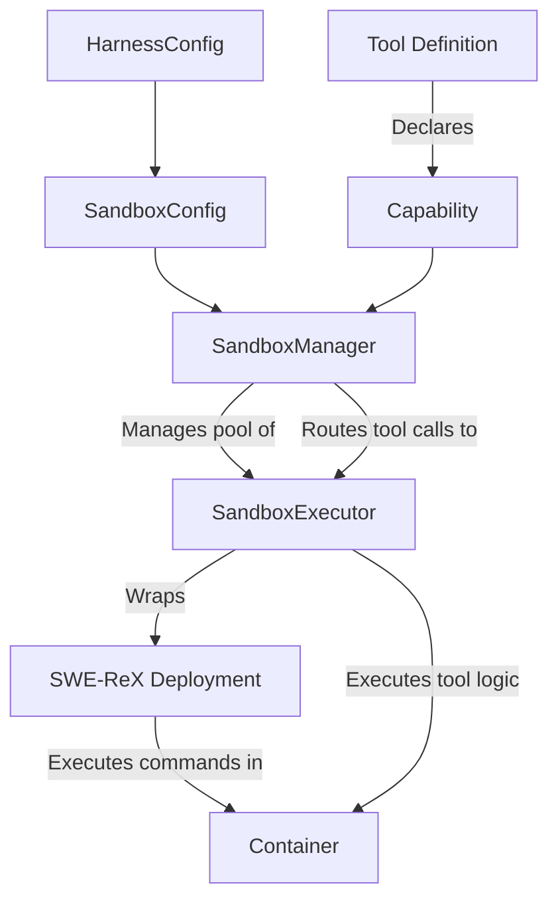
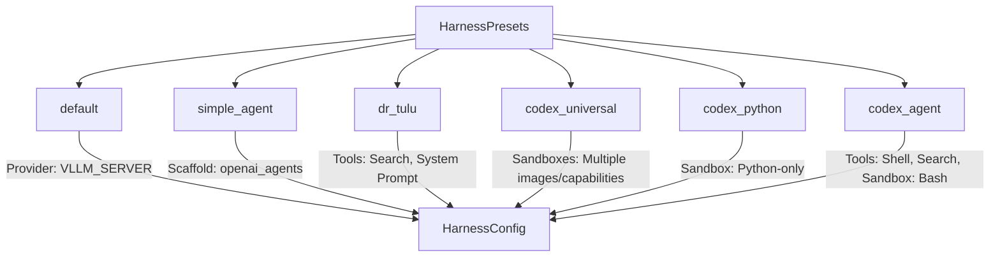

<!-- source: DeepWiki mcp.deepwiki.com · repo allenai/olmo-eval · page 2.3 Harness and Scaffolds · fetched 2026-10-26 -->

# Harness and Scaffolds

<details>
<summary>Relevant source files</summary>

The following files were used as context for generating this wiki page:

- [src/olmo_eval/cli/run_external.py](src/olmo_eval/cli/run_external.py)
- [src/olmo_eval/common/configs.py](src/olmo_eval/common/configs.py)
- [src/olmo_eval/harness/adapters/openhands.py](src/olmo_eval/harness/adapters/openhands.py)
- [src/olmo_eval/harness/config.py](src/olmo_eval/harness/config.py)
- [src/olmo_eval/harness/harness.py](src/olmo_eval/harness/harness.py)
- [src/olmo_eval/harness/presets.py](src/olmo_eval/harness/presets.py)
- [src/olmo_eval/harness/sandbox/config.py](src/olmo_eval/harness/sandbox/config.py)
- [src/olmo_eval/harness/sandbox/executor.py](src/olmo_eval/harness/sandbox/executor.py)
- [src/olmo_eval/harness/sandbox/manager.py](src/olmo_eval/harness/sandbox/manager.py)
- [src/olmo_eval/harness/tools/registry.py](src/olmo_eval/harness/tools/registry.py)
- [src/olmo_eval/harness/tools/shell.py](src/olmo_eval/harness/tools/shell.py)
- [src/olmo_eval/harness/tools/tool.py](src/olmo_eval/harness/tools/tool.py)
- [src/olmo_eval/runners/asynq/processing.py](src/olmo_eval/runners/asynq/processing.py)

</details>


This page describes the Harness runtime layer, a core component in OLMo-Eval responsible for orchestrating how a language model interacts with its environment during an evaluation. It covers the `HarnessConfig` dataclass, how inference providers are wrapped, the integration of tools and system prompts, sandbox execution, and the role of scaffolds for multi-turn interactions.

## Harness Overview

The `Harness` class [src/olmo_eval/harness/harness.py:22-32]() acts as an abstraction layer that sits between the evaluation task and the raw inference provider. It allows for consistent application of various runtime behaviors such as:
*   **Tools**: Functions the model can call to interact with external systems or perform specific actions.
*   **System Prompts**: Instructions or context prepended to model inputs.
*   **Auxiliary Providers**: Additional inference providers for specific sub-tasks.
*   **Sandboxing**: Isolated environments for executing code or shell commands.
*   **Metrics Collection**: Instrumentation for gathering performance data.
*   **Scaffolds**: Multi-turn control flows for agentic behavior.

This design enables the same task definition to be evaluated in different modes (e.g., plain generation, tool-using agent, multi-turn agent) without modification.

### Harness Architecture

The `Harness` initializes with a `HarnessConfig` [src/olmo_eval/harness/harness.py:39-45]() and lazily creates its `InferenceProvider` [src/olmo_eval/harness/harness.py:47-64]() and `Scaffold` [src/olmo_eval/harness/harness.py:66-82]() instances upon first access.



Sources: [src/olmo_eval/harness/harness.py:22-32](), [src/olmo_eval/harness/harness.py:39-45](), [src/olmo_eval/harness/harness.py:47-64](), [src/olmo_eval/harness/harness.py:66-82](), [src/olmo_eval/harness/config.py:21-54]()

## HarnessConfig

The `HarnessConfig` dataclass [src/olmo_eval/harness/config.py:21-54]() is the immutable blueprint for a `Harness` instance. It defines all aspects of the runtime environment.

| Field Name | Type | Description |
| :--------- | :--- | :---------- |
| `name` | `str` | A unique name for this harness configuration. |
| `provider` | `ProviderConfig` | Configuration for the primary inference provider. |
| `auxiliary_providers` | `Mapping[str, ProviderConfig]` | Additional providers for specific tools or sub-tasks. |
| `tools` | `tuple[Tool \| str, ...]` | A tuple of `Tool` objects or tool names to be registered. |
| `system_prompt` | `str \| None` | An optional system prompt to prepend to model inputs. |
| `tool_choice` | `Literal["auto", "none", "required"] \| str` | Strategy for tool calling (e.g., "auto" for LLM to decide). |
| `scaffold` | `str \| None` | The name of the scaffold to use for multi-turn interactions. |
| `required_secrets` | `tuple[str, ...]` | Environment variables that must be set for the harness to function. |
| `max_turns` | `int \| None` | Maximum number of turns for multi-turn scaffolds. |
| `max_concurrency` | `int \| None` | Maximum concurrent requests the harness can handle. |
| `scoring_concurrency` | `int \| None` | Concurrency for scoring processes. |
| `scoring_process_pools` | `Mapping[str, ProcessScoringPoolConfig]` | Configuration for dedicated process pools for scoring. |
| `sandboxes` | `tuple[SandboxConfig, ...]` | Configurations for sandboxed execution environments. |
| `scaffold_kwargs` | `dict[str, Any]` | Additional keyword arguments passed to the scaffold. |
| `sandbox_pool_instances` | `int \| None` | Number of sandbox instances to create in a pool. |
| `sandbox_pool_min_instances` | `int \| None` | Minimum number of sandbox instances that must start successfully. |
| `metrics` | `MetricsConfig \| None` | Configuration for metrics collection. |
| `batching` | `BatchConfig \| None` | Configuration for request batching. |
| `scorer_startup_timeout` | `float \| None` | Timeout for scorer process startup. |

Sources: [src/olmo_eval/harness/config.py:21-54]()

### Provider Wrapping

The `Harness` wraps the primary `InferenceProvider` specified in `HarnessConfig.provider` [src/olmo_eval/harness/harness.py:47-64](). If `HarnessConfig.metrics` [src/olmo_eval/harness/config.py:51]() is enabled, the provider is further wrapped with an `InstrumentedProvider` [src/olmo_eval/harness/harness.py:56-61]() to collect detailed metrics, including optional GPU monitoring.

### System Prompts

A `system_prompt` [src/olmo_eval/harness/config.py:40]() can be specified in the `HarnessConfig`. This prompt is automatically prepended to the `LMRequest` messages before being sent to the underlying `InferenceProvider` [src/olmo_eval/harness/harness.py:114](). This allows for consistent instruction or contextualization of the model's responses across all requests processed by the harness.

### Tools

Tools are functions that the language model can invoke to perform specific actions or retrieve information. They are defined as `Tool` objects [src/olmo_eval/harness/tools/tool.py:110-133]() and registered globally using `register_tool` [src/olmo_eval/harness/tools/registry.py:20-46]().

*   **`Tool` Class**: Combines the tool's schema (for the LLM) and its implementation (for execution) [src/olmo_eval/harness/tools/tool.py:110-133](). The schema is automatically derived from the function's type hints and docstrings using `Tool.from_function` [src/olmo_eval/harness/tools/tool.py:173-213]().
*   **Tool Registry**: The `TOOL_REGISTRY` [src/olmo_eval/harness/tools/registry.py:17]() stores `Tool` instances by name, allowing them to be looked up by workers. This is crucial for cross-process serialization, as only tool names are serialized in `HarnessConfig` [src/olmo_eval/harness/config.py:60-63]().
*   **`@registered_tool` Decorator**: A convenience decorator to define and register a tool in one step [src/olmo_eval/harness/tools/registry.py:135-184]().
*   **Tool Execution**: When a model generates a tool call, the `Harness` (via its scaffold) executes the corresponding `Tool.execute` function [src/olmo_eval/harness/tools/tool.py:148-162]().



Sources: [src/olmo_eval/harness/tools/tool.py:110-133](), [src/olmo_eval/harness/tools/tool.py:173-213](), [src/olmo_eval/harness/tools/registry.py:17](), [src/olmo_eval/harness/config.py:60-63](), [src/olmo_eval/harness/tools/registry.py:135-184](), [src/olmo_eval/harness/tools/tool.py:148-162]()

### Sandbox Integration

Some tools require an isolated execution environment, such as a shell or a specific programming language interpreter. This is handled by the sandbox system:

*   **`SandboxConfig`**: Defines the container image, mode (Docker, Modal), capabilities (e.g., `Capability.BASH`, `Capability.PYTHON`), and other parameters for a sandbox environment [src/olmo_eval/harness/sandbox/config.py:61-120]().
*   **`SandboxManager`**: Manages a pool of `SandboxExecutor` instances, routing requests to executors that provide the required capabilities [src/olmo_eval/harness/sandbox/manager.py:70-90](). It handles starting and stopping sandboxes, and can maintain persistent sessions for tools that require state continuity.
*   **`SandboxExecutor`**: Wraps a SWE-ReX deployment to execute commands within an isolated container [src/olmo_eval/harness/sandbox/executor.py:73-83]().
*   **Tool Capabilities**: Tools can declare required `sandbox` capabilities [src/olmo_eval/harness/tools/tool.py:132](). The `SandboxManager` ensures that tool calls are routed to a sandbox that meets these requirements. For example, the `execute_bash` tool [src/olmo_eval/harness/tools/shell.py:19-30]() requires `Capability.BASH`.



Sources: [src/olmo_eval/harness/sandbox/config.py:61-120](), [src/olmo_eval/harness/sandbox/manager.py:70-90](), [src/olmo_eval/harness/sandbox/executor.py:73-83](), [src/olmo_eval/harness/tools/tool.py:132](), [src/olmo_eval/harness/tools/shell.py:19-30]()

## Scaffolds

Scaffolds provide the control flow for multi-turn interactions, enabling agentic behavior. When `HarnessConfig.scaffold` [src/olmo_eval/harness/config.py:41]() is set, the `Harness.run()` method [src/olmo_eval/harness/harness.py:155-187]() delegates execution to the specified scaffold.

*   **`Scaffold` Abstract Base Class**: Defines the interface for multi-turn execution.
*   **`openai_agents` Scaffold**: Implements a multi-turn agent loop compatible with OpenAI's function calling API. It iteratively sends requests to the model, parses tool calls from the response, executes them, and feeds the results back to the model until a final answer is produced or `max_turns` is reached.
*   **`openhands` Scaffold**: An adapter for the OpenHands SDK, allowing OpenHands agents to utilize OLMo-Eval's sandbox runtimes [src/olmo_eval/harness/adapters/openhands.py:34-77](). This enables complex, multi-step problem-solving within a sandboxed environment.

```mermaid
graph TD
    A[LMRequest (Initial)] --> B{Harness.run()};
    B -- "Delegates to" --> C[Scaffold (e.g., openai_agents)];
    C -- "Sends to" --> D[InferenceProvider];
    D -- "LMOutput (with/without tool calls)" --> C;
    C -- "If tool calls" --> E[Tool Execution];
    E -- "Tool Output" --> C;
    C -- "Loop until max_turns or final answer" --> D;
    C -- "Returns" --> F[HarnessResult];
```

Sources: [src/olmo_eval/harness/harness.py:155-187](), [src/olmo_eval/harness/adapters/openhands.py:34-77]()

## Harness Presets

OLMo-Eval provides pre-built `HarnessConfig` presets in `HarnessPresets` [src/olmo_eval/harness/presets.py:65-67]() for common evaluation scenarios. These presets simplify configuration and ensure consistent setups. Presets are lazily loaded using the `_Lazy` descriptor [src/olmo_eval/harness/presets.py:38-54]().

Some notable presets include:

*   **`default`**: A basic harness using `vllm_server` for inference and batched processing [src/olmo_eval/harness/presets.py:69-77]().
*   **`simple_agent`**: Configures a harness for agentic behavior using the `openai_agents` scaffold with streaming batching [src/olmo_eval/harness/presets.py:79-92]().
*   **`dr_tulu`**: A specific agent preset for the "Dr. Tulu" model, including web and academic search tools, a custom system prompt, and the `openai_agents` scaffold [src/olmo_eval/harness/presets.py:94-112](). It also specifies required secrets for tool access.
*   **`codex_universal`**: Configures multiple sandbox environments with different images and capabilities for universal code execution [src/olmo_eval/harness/presets.py:114-143]().
*   **`codex_python`**: A specialized sandbox configuration for Python-only code execution [src/olmo_eval/harness/presets.py:145-164]().
*   **`codex_agent`**: A coding agent preset that combines the `openai_agents` scaffold with shell execution tools and a sandboxed environment for bash commands [src/olmo_eval/harness/presets.py:166-197]().



Sources: [src/olmo_eval/harness/presets.py:65-67](), [src/olmo_eval/harness/presets.py:38-54](), [src/olmo_eval/harness/presets.py:69-77](), [src/olmo_eval/harness/presets.py:79-92](), [src/olmo_eval/harness/presets.py:94-112](), [src/olmo_eval/harness/presets.py:114-143](), [src/olmo_eval/harness/presets.py:145-164](), [src/olmo_eval/harness/presets.py:166-197]()

---

