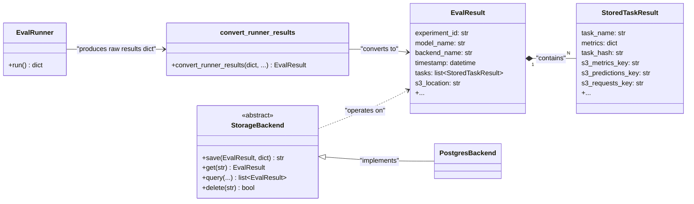
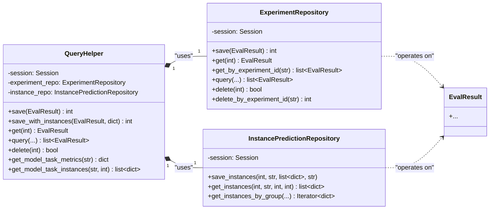

<!-- source: DeepWiki mcp.deepwiki.com · repo allenai/olmo-eval · page 2.4 Result Storage and Querying · fetched 2026-10-26 -->

# Result Storage and Querying

<details>
<summary>Relevant source files</summary>

The following files were used as context for generating this wiki page:

- [.pre-commit-config.yaml](.pre-commit-config.yaml)
- [alembic/README.md](alembic/README.md)
- [alembic/metrics.ini](alembic/metrics.ini)
- [alembic/metrics/env.py](alembic/metrics/env.py)
- [alembic/metrics/script.py.mako](alembic/metrics/script.py.mako)
- [alembic/metrics/versions/20260219_initial_schema.py](alembic/metrics/versions/20260219_initial_schema.py)
- [alembic/metrics/versions/20260220_add_gpu_summary_index.py](alembic/metrics/versions/20260220_add_gpu_summary_index.py)
- [alembic/metrics/versions/20260220_drop_percentile_latencies.py](alembic/metrics/versions/20260220_drop_percentile_latencies.py)
- [src/olmo_eval/cli/results/query.py](src/olmo_eval/cli/results/query.py)
- [src/olmo_eval/cli/results/s3.py](src/olmo_eval/cli/results/s3.py)
- [src/olmo_eval/common/console.py](src/olmo_eval/common/console.py)
- [src/olmo_eval/runners/common/mixins.py](src/olmo_eval/runners/common/mixins.py)
- [src/olmo_eval/runners/io/storage.py](src/olmo_eval/runners/io/storage.py)
- [src/olmo_eval/storage/backends/postgres/models.py](src/olmo_eval/storage/backends/postgres/models.py)
- [src/olmo_eval/storage/backends/postgres/queries.py](src/olmo_eval/storage/backends/postgres/queries.py)
- [src/olmo_eval/storage/backends/postgres/repository.py](src/olmo_eval/storage/backends/postgres/repository.py)
- [src/olmo_eval/storage/base.py](src/olmo_eval/storage/base.py)
- [tests/integration/test_repository.py](tests/integration/test_repository.py)
- [tests/integration/test_storage_postgres_new.py](tests/integration/test_storage_postgres_new.py)

</details>


This page details how OLMo-Eval stores evaluation results and how users can query and view them. It covers the `StorageBackend` abstraction, the PostgreSQL implementation for structured results and metrics, S3 for artifact storage, and the command-line interface (CLI) tools for querying and viewing these results.

## StorageBackend Abstraction

The `StorageBackend` is an abstract base class that defines the interface for saving, retrieving, and querying evaluation results. This abstraction allows OLMo-Eval to support various storage solutions without changing the core evaluation logic.

The key methods defined in `StorageBackend` are:
*   `save(result: EvalResult, instances_by_task: dict[str, list[dict[str, Any]]] | None = None) -> str`: Saves an `EvalResult` and optionally instance-level predictions. Returns the `experiment_id`.
*   `get(experiment_id: str) -> EvalResult | None`: Retrieves an `EvalResult` by its `experiment_id`.
*   `query(...) -> list[EvalResult]`: Queries evaluation results based on various filters like `model_name`, `task_name`, `start_time`, and `end_time`.
*   `delete(experiment_id: str) -> bool`: Deletes an evaluation result.

The `convert_runner_results` function [src/olmo_eval/storage/base.py:89-194]() is responsible for transforming the raw results dictionary produced by the `EvalRunner` into an `EvalResult` dataclass, which is then passed to the `StorageBackend`. This conversion also handles the construction of S3 keys for predictions and requests if S3 storage is configured.


**Diagram: StorageBackend Abstraction**
Sources: [src/olmo_eval/storage/base.py:20-86](), [src/olmo_eval/storage/base.py:89-194]()

## PostgreSQL Backend

The primary `StorageBackend` implementation uses PostgreSQL, leveraging SQLAlchemy for Object-Relational Mapping (ORM). This backend stores structured evaluation results and metadata, enabling powerful querying capabilities.

### ORM Models

The PostgreSQL backend uses several SQLAlchemy ORM models to represent evaluation data:

*   `Experiment` [src/olmo_eval/storage/backends/postgres/models.py:19-96](): Represents a single evaluation run for a specific model. It stores high-level information like `experiment_id`, `model_name`, `timestamp`, `author`, `git_ref`, and a reference to the S3 location where detailed artifacts are stored. Note that `experiment_id` is not unique; multiple models run in a single launch can share the same `experiment_id`, with each model getting a unique `Experiment.id` (primary key).
*   `TaskResult` [src/olmo_eval/storage/backends/postgres/models.py:105-154](): Stores aggregated metrics and configuration for a specific task within an `Experiment`. It includes `task_name`, `task_hash`, `metrics` (a JSONB field for nested metric scores), `num_instances`, and S3 keys for task-specific metrics, predictions, and requests. It has a foreign key `experiment_pk` linking it to an `Experiment`.
*   `InstancePrediction` [src/olmo_eval/storage/backends/postgres/models.py:156-200](): Stores instance-level predictions and metrics. This model is crucial for detailed analysis and debugging. It includes `native_id` (the original ID of the instance), `instance_metrics` (a JSONB field for per-instance metric values), and foreign keys `experiment_pk` and `task_hash` to link back to the parent `Experiment` and `TaskResult`.

These models are defined in [src/olmo_eval/storage/backends/postgres/models.py]().

```mermaid
erDiagram
    "Experiment" {
        INTEGER id PK
        VARCHAR experiment_id INDEX
        VARCHAR model_name INDEX
        VARCHAR model_hash INDEX
        TIMESTAMP timestamp INDEX
        VARCHAR experiment_name
        VARCHAR workspace
        VARCHAR author INDEX
        ARRAY tags
        VARCHAR git_ref
        VARCHAR revision
        VARCHAR s3_location
        VARCHAR model_path
        VARCHAR experiment_group INDEX
        JSONB metadata_
        DOUBLE_PRECISION experiment_duration_seconds
        JSONB provider_init_seconds
        TIMESTAMP created_at
    }
    "TaskResult" {
        INTEGER id PK
        INTEGER experiment_pk FK INDEX
        VARCHAR model_hash INDEX
        VARCHAR task_name INDEX
        VARCHAR task_hash INDEX
        JSONB task_config
        JSONB metrics
        INTEGER num_instances
        VARCHAR primary_metric
        VARCHAR s3_metrics_key
        VARCHAR s3_predictions_key
        VARCHAR s3_requests_key
        DOUBLE_PRECISION duration_seconds
    }
    "InstancePrediction" {
        INTEGER id PK
        INTEGER experiment_pk FK INDEX
        VARCHAR task_hash INDEX
        VARCHAR experiment_group
        VARCHAR native_id INDEX
        JSONB instance_metrics
    }

    "Experiment" ||--o{ "TaskResult" : "has"
    "Experiment" ||--o{ "InstancePrediction" : "has"
```
**Diagram: PostgreSQL ORM Models**
Sources: [src/olmo_eval/storage/backends/postgres/models.py:19-96](), [src/olmo_eval/storage/backends/postgres/models.py:105-154](), [src/olmo_eval/storage/backends/postgres/models.py:156-200]()

### Alembic Migrations

Alembic is used for managing database schema migrations for two separate PostgreSQL databases:
*   **`olmo_eval`**: Stores evaluation results, experiments, and task metrics.
*   **`olmo_eval_metrics`**: Stores inference performance telemetry (covered in 5.3. Inference Metrics and Telemetry).

The migration scripts are located in the `alembic/` directory, with separate configurations and version directories for each database (e.g., `alembic/results.ini` and `alembic/metrics.ini`).

Migrations can be run using the `scripts/internal/db-migrate` script or `make db-upgrade`. New migrations are created using `alembic -c alembic/results.ini revision --autogenerate -m "Add column"` for the results database.

Sources: [alembic/README.md:1-62]()

### Repository Layer and QueryHelper

The `ExperimentRepository` [src/olmo_eval/storage/backends/postgres/repository.py:35-280]() and `InstancePredictionRepository` [src/olmo_eval/storage/backends/postgres/repository.py:283-360]() classes provide a repository pattern for interacting with the database. They encapsulate the SQLAlchemy session and provide methods for `save`, `get`, `query`, and `delete` operations on `Experiment` and `InstancePrediction` entities.

The `QueryHelper` [src/olmo_eval/storage/backends/postgres/queries.py:20-30]() class acts as a facade, simplifying common query patterns and orchestrating operations across multiple repositories. For example, `QueryHelper.save_with_instances` [src/olmo_eval/storage/backends/postgres/queries.py:45-98]() saves an `EvalResult` and its associated `InstancePrediction` records, handling the denormalization of `experiment_group` and `task_hash` for efficient querying.


**Diagram: Repository Layer and QueryHelper**
Sources: [src/olmo_eval/storage/backends/postgres/repository.py:35-280](), [src/olmo_eval/storage/backends/postgres/repository.py:283-360](), [src/olmo_eval/storage/backends/postgres/queries.py:20-30](), [src/olmo_eval/storage/backends/postgres/queries.py:45-98]()

## S3 Artifact Storage

While the PostgreSQL database stores structured metadata and aggregated metrics, detailed artifacts like raw predictions, requests, and task-specific metrics JSON files are stored in S3. This separation allows the database to remain lean and performant for querying, while S3 handles large, unstructured data.

The `RunnerResultsMixin` [src/olmo_eval/runners/common/mixins.py:57-70]() includes methods like `_upload_to_s3` [src/olmo_eval/runners/common/mixins.py:175-196]() which wraps the `upload_to_s3` function [src/olmo_eval/runners/io/storage.py:26-154](). This function handles the concurrent upload of all relevant output files from the local `output_dir` to a specified S3 bucket.

The S3 path structure is organized to facilitate easy retrieval:
`s3://{bucket}/{prefix}/{group}/{model_name}_{hash_last_6}/{experiment_id}/`

Within this base path, specific files are stored:
*   `metrics.json`: Aggregated metrics for the entire run.
*   `predictions/{task_name}.jsonl`: Instance-level predictions for each task.
*   `requests/{task_name}.jsonl`: Raw LM requests and outputs for each task.

The `EvalResult` and `StoredTaskResult` dataclasses store the S3 keys (`s3_location`, `s3_metrics_key`, `s3_predictions_key`, `s3_requests_key`) as references to these artifacts.

Sources: [src/olmo_eval/runners/common/mixins.py:57-70](), [src/olmo_eval/runners/common/mixins.py:175-196](), [src/olmo_eval/runners/io/storage.py:26-154]()

## Results Query and Viewer CLI Commands

OLMo-Eval provides CLI commands to interact with the stored results.

### `olmo-eval results query`

The `olmo-eval results query` command [src/olmo_eval/cli/results/query.py:26-131]() allows users to retrieve evaluation results from the PostgreSQL database using various filters.

**Key features:**
*   **Filtering**: Query by `experiment_id`, `model_name` (prefix), `model_hash` (prefix), `task_name` (prefix), `task_hash` (prefix), or `experiment_group` (prefix).
*   **Output Formats**: Display results as a human-readable table (default), JSON, or CSV.
*   **Instance-level Data**: Use `--instances` to include instance-level predictions, which is particularly useful when outputting to JSON or CSV for detailed analysis.
*   **Comparison Mode**: When no specific `experiment_id` is provided, it operates in a comparison mode, showing results for multiple models across tasks.
*   **Pagination**: Supports `--limit` and `--after-id` for paginating through large result sets.
*   **Historical vs. Latest/Best**: `--all` shows all historical results, `--recent` shows the most recent per model, and by default, it shows the "best" (highest primary metric) result per model.

**Example Usage:**
```bash
# Get experiment by ID
olmo-eval results query --experiment exp_001

# Compare models on tasks
olmo-eval results query -m llama3.1-8b -m qwen2.5-72b -t mmlu -t gsm8k

# Get instances for a task in CSV format
olmo-eval results query --task mmlu --instances --format csv > mmlu_instances.csv

# Get instances for an experiment group in JSON format
olmo-eval results query -G my-benchmark --instances --format json > my_benchmark_instances.json
```

The `_query_experiments` function [src/olmo_eval/cli/results/query.py:185-193]() uses the `ExperimentRepository` to fetch `EvalResult` objects based on the provided filters. If `--instances` is specified, `_query_instances` [src/olmo_eval/cli/results/query.py:206-214]() (which uses `QueryHelper.get_model_task_instances`) is called to retrieve the detailed instance predictions. For large `experiment_group` instance queries, `_stream_experiment_group_instances` [src/olmo_eval/cli/results/query.py:236-250]() is used to stream data directly to output, avoiding loading all instances into memory.

Sources: [src/olmo_eval/cli/results/query.py:26-131](), [src/olmo_eval/cli/results/query.py:185-193](), [src/olmo_eval/cli/results/query.py:206-214](), [src/olmo_eval/cli/results/query.py:236-250]()

### `olmo-eval results viewer`

The `olmo-eval results viewer` command (not detailed in provided files but mentioned in the TOC) launches an interactive web-based viewer for comparing evaluation results. This viewer likely leverages the same querying capabilities as the `query` command but presents them in a graphical, interactive format, often used for pairwise comparisons and deeper analysis.

Sources: None (mentioned in TOC, but no specific file content provided for this command).

```mermaid
graph TD
    subgraph "Evaluation Pipeline"
        A[EvalRunner.run()] --> B{Raw Results Dict}
        B --> C[convert_runner_results()]
        C --> D[EvalResult Dataclass]
    end

    subgraph "Storage Backends"
        D --> E[StorageBackend.save()]
        E --> F[PostgresBackend.save()]
        F --> G[ExperimentRepository.save()]
        G --> H[PostgreSQL DB (olmo_eval)]
        G --> I[InstancePredictionRepository.save_instances()]
        I --> H
        D --> J[RunnerResultsMixin._upload_to_s3()]
        J --> K[S3 Artifact Storage]
    end

    subgraph "Querying and Viewing"
        L[olmo-eval results query CLI] --> M[QueryHelper.query()]
        M --> H
        M --> N{Output Format}
        N -- "table" --> O[print_experiments_table()]
        N -- "json/csv" --> P[formatters]
        L -- "--instances" --> Q[QueryHelper.get_model_task_instances()]
        Q --> H
        Q --> N
        R[olmo-eval results viewer CLI] --> M
    end

    style H fill:#f9f,stroke:#333,stroke-width:2px
    style K fill:#f9f,stroke:#333,stroke-width:2px
```
**Diagram: Data Flow for Result Storage and Querying**
Sources: [src/olmo_eval/storage/base.py:89-194](), [src/olmo_eval/storage/backends/postgres/repository.py:106-162](), [src/olmo_eval/storage/backends/postgres/repository.py:300-310](), [src/olmo_eval/runners/common/mixins.py:175-196](), [src/olmo_eval/runners/io/storage.py:26-154](), [src/olmo_eval/cli/results/query.py:26-131](), [src/olmo_eval/cli/results/query.py:185-193](), [src/olmo_eval/cli/results/query.py:206-214]()

---

