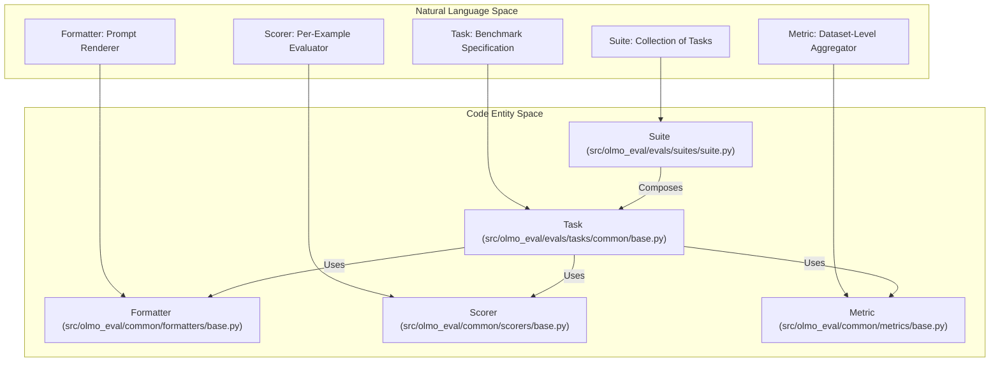
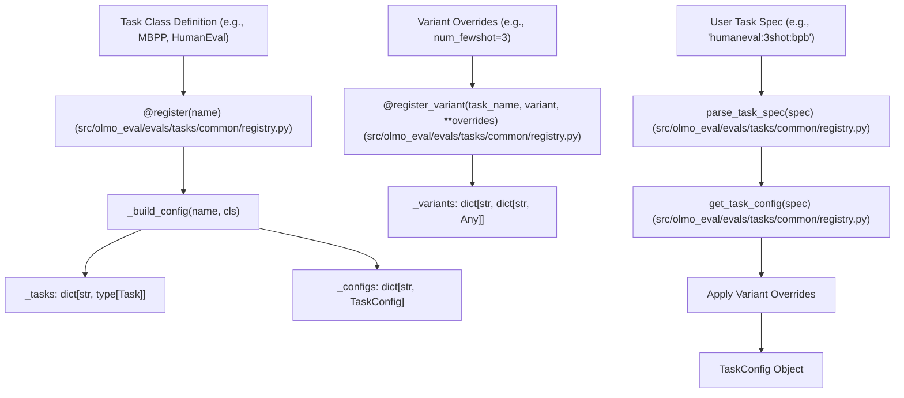

<!-- source: DeepWiki mcp.deepwiki.com · repo allenai/olmo-eval · page 3 Task System · fetched 2026-10-26 -->

# Task System

<details>
<summary>Relevant source files</summary>

The following files were used as context for generating this wiki page:

- [README.md](README.md)
- [src/olmo_eval/common/scorers/base.py](src/olmo_eval/common/scorers/base.py)
- [src/olmo_eval/evals/tasks/common/base.py](src/olmo_eval/evals/tasks/common/base.py)
- [src/olmo_eval/evals/tasks/common/registry.py](src/olmo_eval/evals/tasks/common/registry.py)
- [src/olmo_eval/evals/tasks/humaneval.py](src/olmo_eval/evals/tasks/humaneval.py)
- [src/olmo_eval/evals/tasks/mbpp.py](src/olmo_eval/evals/tasks/mbpp.py)
- [src/olmo_eval/evals/tasks/multilingual_mbpp.py](src/olmo_eval/evals/tasks/multilingual_mbpp.py)
- [src/olmo_eval/launch/config.py](src/olmo_eval/launch/config.py)
- [tests/core/test_metrics.py](tests/core/test_metrics.py)

</details>


The Task System in OLMo-Eval provides a standardized framework for evaluating large language models (LLMs) across various benchmarks and tasks. It defines how tasks are structured, registered, and organized into suites for comprehensive evaluation. This system is fundamental to enabling reproducible and comparable assessment of language model capabilities within the repository.

This page provides a high-level overview of the Task System. For detailed information on specific components, refer to the child pages:
- [Task Base Class and Registry](#3.1) — Explains the core `Task` class, data flow, and registration mechanisms.
- [Scorers and Metrics](#3.2) — Details how model outputs are scored and aggregated into metrics.
- [Few-Shot Learning and Answer Extraction](#3.3) — Covers the few-shot prompting approach and utilities for extracting answers from model responses.

## Core Concepts

The Task System is built around several core abstractions that define how evaluations are conducted:

*   **Task**: A benchmark specification that defines how to load data, format prompts, and score model outputs for a specific evaluation.
*   **Suite**: A collection of tasks and/or nested suites, allowing for batch evaluation and hierarchical result aggregation.
*   **Formatter**: Responsible for rendering an `Instance` and its few-shot context into an `LMRequest` (the prompt sent to the language model).
*   **Scorer**: Evaluates a single `LMOutput` against the gold answer, producing a raw score or judgment.
*   **Metric**: Aggregates per-example scores from a `Scorer` to produce a dataset-level performance measure.

These concepts work together to define a complete evaluation pipeline for any given task.

### Task System Abstractions


Sources: [README.md:66-77](), [src/olmo_eval/evals/tasks/common/base.py:112-150](), [src/olmo_eval/evals/suites/suite.py:1-10](), [src/olmo_eval/common/formatters/base.py:1-10](), [src/olmo_eval/common/scorers/base.py:14-26](), [src/olmo_eval/common/metrics/base.py:1-10]()

## Task Definition and Registration

Tasks are defined as Python classes inheriting from `Task` [src/olmo_eval/evals/tasks/common/base.py:222](). They specify how to load data, process documents into `Instance` objects, format prompts, and extract answers.

### Task Registration Flow


Sources: [README.md:79-100](), [src/olmo_eval/evals/tasks/common/registry.py:23-70](), [src/olmo_eval/evals/tasks/common/registry.py:73-103](), [src/olmo_eval/evals/tasks/common/registry.py:190-218]()

Tasks are registered using the `@register` decorator [src/olmo_eval/evals/tasks/common/registry.py:42-70](), which associates a string name with the `Task` class. This decorator automatically constructs a `TaskConfig` [src/olmo_eval/evals/tasks/common/base.py:112-150]() from the class attributes.

Example:
```python
# src/olmo_eval/evals/tasks/mbpp.py
@register("mbpp")
class MBPP(MBPPBase):
    data_source = DataSource(path="google-research-datasets/mbpp")
    sampling_params = SamplingParams(
        max_tokens=1024,
        temperature=0.0,
        stop_sequences=MBPP_STOP_SEQUENCES,
    )
```
Sources: [src/olmo_eval/evals/tasks/mbpp.py:132-142]()

### Task Variants

The system supports task variants, which are named presets that apply specific overrides to a base task's configuration. Variants are registered using `@register_variant` [src/olmo_eval/evals/tasks/common/registry.py:73-103](). They allow for composable evaluation settings, such as different few-shot counts or formatting styles.

Example:
```python
# src/olmo_eval/evals/tasks/humaneval.py
register_variant(
    "humaneval",
    "3shot",
    num_fewshot=3,
    fewshot_seed=1234,
    formatter=CompletionFormatter(),
)
```
Sources: [src/olmo_eval/evals/tasks/humaneval.py:188-196]()

A task specification like `"humaneval:3shot:bpb"` [README.md:99]() would apply the `3shot` variant and then the `bpb` variant to the base `humaneval` task. The `parse_task_spec` function [src/olmo_eval/evals/tasks/common/registry.py:190-218]() handles parsing these specifications.

For more details on the `Task` base class, `Instance`/`LMRequest`/`LMOutput` data flow, and the registration process, see [Task Base Class and Registry](#3.1).

## Suites

Suites provide a way to group multiple tasks for batch evaluation and aggregate their results. They are defined as `Suite` objects [README.md:117-123]() and can contain individual tasks or other nested suites.

Example:
```python
# README.md
register(Suite(
    name="my_suite",
    tasks=("task_a:3shot", "task_b:3shot", "task_c:3shot"),
))
```
Sources: [README.md:117-123]()

Suites support different aggregation strategies for combining task results, such as `AVERAGE`, `AVERAGE_OF_AVERAGES`, `DISPLAY_ONLY`, and `NONE` [README.md:129-135](). This allows for flexible reporting of overall performance across a collection of benchmarks.

## Scorers and Metrics

After a language model generates responses, `Scorer` objects evaluate each `LMOutput` against the `Instance`'s gold answer. `Metric` objects then aggregate these individual scores to provide a dataset-level performance measure.

### Scorers

A `Scorer` [src/olmo_eval/common/scorers/base.py:14-26]() is an abstract base class that defines the `score()` method. Concrete implementations include:
*   `ExactMatchScorer` [src/olmo_eval/common/scorers/base.py:67-84](): Scores 1.0 if the extracted answer exactly matches the gold answer.
*   `MultipleChoiceScorer` [src/olmo_eval/common/scorers/base.py:87-98](): Scores multiple-choice questions by comparing selected indices or letters.
*   `CodeExecutionScorer` [src/olmo_eval/common/scorers/base.py:218-230](): Executes generated code in a sandbox to determine correctness.

For scorers that require asynchronous execution or run in a subprocess (e.g., code execution), `ProcessScorer` [src/olmo_eval/common/scorers/base.py:48-63]() is used.

For a comprehensive list of scorers and their details, see [Scorers and Metrics](#3.2).

### Metrics

A `Metric` [src/olmo_eval/common/metrics/base.py:1-10]() is an abstract base class that defines the `compute()` method, which takes a list of `Response` objects and returns a float score. Common metrics include:
*   `AccuracyMetric` [src/olmo_eval/common/metrics/base.py:14-26](): Calculates the proportion of correctly scored instances.
*   `BPBMetricInstanceAvg` [src/olmo_eval/common/metrics/base.py:100-112]() and `BPBMetricByteAvg` [src/olmo_eval/common/metrics/base.py:115-127](): Compute bits per byte, a measure of language model performance based on log-probabilities.

For a comprehensive list of metrics and their details, see [Scorers and Metrics](#3.2).

## Few-Shot Learning and Answer Extraction

The Task System supports few-shot learning, where a small number of example input-output pairs are included in the prompt to guide the model's response. It also provides utilities for extracting the final answer from the model's raw output.

### Few-Shot Configuration

Tasks can specify `num_fewshot` and `fewshot_seed` in their `TaskConfig` [src/olmo_eval/evals/tasks/common/base.py:141-142]() to control the number and selection of few-shot examples. The `fewshot_source` [src/olmo_eval/evals/tasks/common/base.py:136]() can also be configured to specify where few-shot examples are loaded from.

Few-shot examples can be fixed (pre-defined) or dynamically sampled from a specified data split (e.g., a "dev" or "train" split). For tasks like HumanEval, where few-shot examples might overlap with test instances, the system includes logic to deduplicate examples [src/olmo_eval/evals/tasks/humaneval.py:99-108]().

### Answer Extraction

After a model generates text, an `answer_extractor` [src/olmo_eval/evals/tasks/common/base.py:153]() function is used to parse the relevant answer from the raw `LMOutput.text`. This is crucial for tasks where the model's output might contain extraneous information (e.g., reasoning steps, conversational filler).

Examples of answer extraction include:
*   Extracting code blocks from generated text [src/olmo_eval/evals/extract.py:1-10]().
*   Extracting multiple-choice answers (e.g., "A", "B", "C").
*   Extracting numerical answers for math problems.

For more details on few-shot learning configurations and answer extraction utilities, see [Few-Shot Learning and Answer Extraction](#3.3).

---

