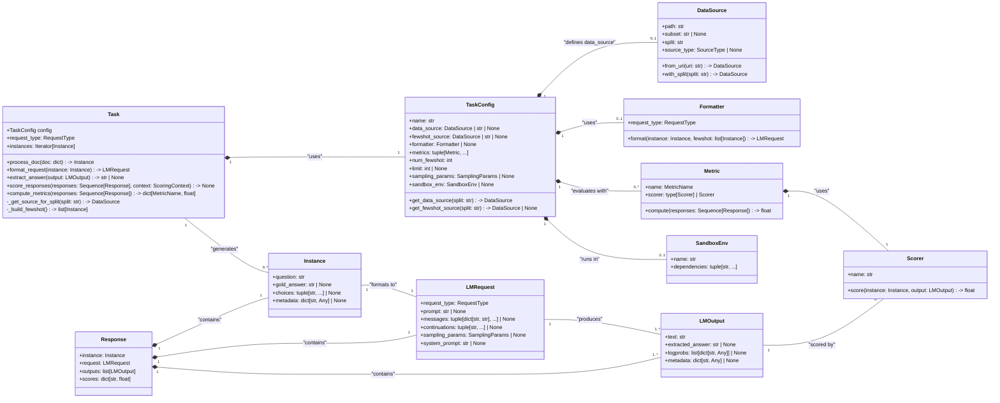

<!-- source: DeepWiki mcp.deepwiki.com · repo allenai/olmo-eval · page 3.1 Task Base Class and Registry · fetched 2026-10-26 -->

# Task Base Class and Registry

<details>
<summary>Relevant source files</summary>

The following files were used as context for generating this wiki page:

- [src/olmo_eval/common/formatters.py](src/olmo_eval/common/formatters.py)
- [src/olmo_eval/common/scorers/base.py](src/olmo_eval/common/scorers/base.py)
- [src/olmo_eval/data/backends/huggingface.py](src/olmo_eval/data/backends/huggingface.py)
- [src/olmo_eval/data/sources.py](src/olmo_eval/data/sources.py)
- [src/olmo_eval/evals/suites/astabench.py](src/olmo_eval/evals/suites/astabench.py)
- [src/olmo_eval/evals/tasks/common/base.py](src/olmo_eval/evals/tasks/common/base.py)
- [src/olmo_eval/evals/tasks/common/registry.py](src/olmo_eval/evals/tasks/common/registry.py)
- [src/olmo_eval/evals/tasks/humaneval.py](src/olmo_eval/evals/tasks/humaneval.py)
- [src/olmo_eval/evals/tasks/mbpp.py](src/olmo_eval/evals/tasks/mbpp.py)
- [src/olmo_eval/evals/tasks/multilingual_mbpp.py](src/olmo_eval/evals/tasks/multilingual_mbpp.py)
- [tests/core/test_metrics.py](tests/core/test_metrics.py)

</details>


This page details the core components for defining and managing evaluation tasks within the OLMo-Eval framework. It covers the `Task` base class, the data flow for instances, requests, and outputs, the registration mechanisms (`@register` and `@register_variant`), `DataSource` configuration, and the various formatters available.

## The `Task` Base Class

The `Task` class [src/olmo_eval/evals/tasks/common/base.py:220-500]() is the fundamental building block for any evaluation task in OLMo-Eval. It provides the interface and common logic for loading data, formatting prompts, extracting answers, and scoring model outputs.

Tasks inherit from `Task` and define specific behaviors through methods and class attributes. The `TaskConfig` dataclass [src/olmo_eval/evals/tasks/common/base.py:112-177]() holds all configurable parameters for a task, such as data sources, few-shot settings, metrics, and sampling parameters.


Sources: [src/olmo_eval/evals/tasks/common/base.py:112-177](), [src/olmo_eval/evals/tasks/common/base.py:220-500](), [src/olmo_eval/common/formatters.py:10-36](), [src/olmo_eval/common/scorers/base.py:13-43](), [src/olmo_eval/common/metrics.py:13-30](), [src/olmo_eval/common/types.py:19-28](), [src/olmo_eval/common/types.py:30-40](), [src/olmo_eval/common/types.py:42-50](), [src/olmo_eval/common/types.py:52-60](), [src/olmo_eval/data/sources.py:22-45]()

### Data Flow: `Instance`, `LMRequest`, `LMOutput`

The evaluation process involves a clear data flow between `Instance`, `LMRequest`, and `LMOutput` objects:

1.  **`Instance`**: Represents a single evaluation example from a dataset. It contains the `question`, `gold_answer`, optional `choices`, and `metadata`.
    *   Generated by `Task.process_doc()` [src/olmo_eval/evals/tasks/common/base.py:300-301]() from raw dataset documents.
    *   Example: A question from MMLU, a code problem from HumanEval.
2.  **`LMRequest`**: Represents the formatted input sent to the language model. It includes the `request_type` (e.g., `COMPLETION`, `CHAT`, `LOGLIKELIHOOD`), `prompt` (for completion/loglikelihood), `messages` (for chat), and `sampling_params`.
    *   Created by `Task.format_request()` [src/olmo_eval/evals/tasks/common/base.py:310-311]() (which often delegates to a `Formatter`) from an `Instance` and optional few-shot examples.
3.  **`LMOutput`**: Represents the raw output received from the language model for a given `LMRequest`. It contains the `text` generated by the model, optional `logprobs`, and `metadata`.
    *   Produced by an `InferenceProvider` in response to an `LMRequest`.
    *   The `extracted_answer` field is populated by `Task.extract_answer()` [src/olmo_eval/evals/tasks/common/base.py:320-321]() after the model output is received.
4.  **`Response`**: Encapsulates an `Instance`, the `LMRequest` made for it, and the `LMOutput`s received. It also stores the `scores` computed for the outputs.

```mermaid
graph TD
    A[Raw Dataset Document] --> B{Task.process_doc()}
    B --> C[Instance]
    C --> D{Task.format_request()}
    D --> E[LMRequest]
    E --> F[InferenceProvider]
    F --> G[LMOutput]
    G --> H{Task.extract_answer()}
    H --> I[LMOutput with extracted_answer]
    I --> J{Task.score_responses()}
    J --> K[Response with scores]
    K --> L{Task.compute_metrics()}
    L --> M[Metrics]

    subgraph "Data Objects"
        C
        E
        G
        I
        K
    end
```
Sources: [src/olmo_eval/evals/tasks/common/base.py:220-500](), [src/olmo_eval/common/types.py:19-28](), [src/olmo_eval/common/types.py:30-40](), [src/olmo_eval/common/types.py:42-50](), [src/olmo_eval/common/types.py:52-60]()

## Task Configuration (`TaskConfig`)

The `TaskConfig` dataclass [src/olmo_eval/evals/tasks/common/base.py:112-177]() centralizes all parameters for a task. When a task class is registered, its class attributes that match `TaskConfig` fields are used to construct a default `TaskConfig` for that task.

Key fields in `TaskConfig` include:
*   `name`: Unique identifier for the task.
*   `data_source`: Specifies where to load the dataset from, using a `DataSource` object or a URI string.
*   `fewshot_source`: Similar to `data_source`, but for few-shot examples.
*   `formatter`: An instance of a `Formatter` subclass to control prompt construction.
*   `metrics`: A tuple of `Metric` objects to be computed for the task.
*   `num_fewshot`: Number of few-shot examples to include.
*   `limit`: Maximum number of instances to evaluate.
*   `sampling_params`: Parameters for model generation (e.g., `temperature`, `max_tokens`).
*   `sandbox_env`: Configuration for a sandbox environment if code execution is required.

Sources: [src/olmo_eval/evals/tasks/common/base.py:112-177]()

## `DataSource`

The `DataSource` dataclass [src/olmo_eval/data/sources.py:22-45]() provides a unified way to specify the location of datasets. It supports various source types:
*   **HuggingFace Hub**: `hf://cais/mmlu` or `cais/mmlu`
*   **S3**: `s3://bucket/path/to/file.jsonl`
*   **GCS**: `gs://bucket/path/to/file.parquet`
*   **Local files**: `/path/to/file.jsonl` or `file:///path/to/file.jsonl`

The `DataSource.from_uri()` class method [src/olmo_eval/data/sources.py:76-130]() can parse a URI string into a `DataSource` object, automatically detecting the `source_type`.

Sources: [src/olmo_eval/data/sources.py:22-45](), [src/olmo_eval/data/sources.py:76-130]()

## Formatters (`CompletionFormatter`, `ChatFormatter`, `PPLFormatter`)

`Formatter` subclasses [src/olmo_eval/common/formatters.py:10-36]() are responsible for converting an `Instance` and optional few-shot examples into an `LMRequest`. This allows tasks to define how prompts are constructed for different model types (completion, chat) or evaluation modes (loglikelihood).

### `CompletionFormatter`

Formats instances into a single string `prompt` for completion models. It handles few-shot examples by concatenating them with a `fewshot_separator`.
*   `request_type`: `RequestType.COMPLETION`
*   Example usage: `CompletionFormatter(template="{question}", fewshot_separator="\n\n")` [src/olmo_eval/common/formatters.py:91-123]()

### `ChatFormatter`

Formats instances into a list of `messages` for chat-based models. It supports `system_prompt`, `user_template`, and `assistant_template` for structuring the conversation.
*   `request_type`: `RequestType.CHAT`
*   Example usage: `ChatFormatter(system_prompt="You are a helpful assistant.", user_template="Question: {question}")` [src/olmo_eval/common/formatters.py:39-89]()

### `MultipleChoiceLogprobFormatter` (PPLFormatter)

This formatter is used for perplexity (PPL) based evaluations, typically for multiple-choice tasks where the model's log-likelihood over a set of continuations is measured. It constructs a prompt and a list of `continuations` (the choices).
*   `request_type`: `RequestType.LOGLIKELIHOOD`
*   Example usage: `PPLFormatter(leading_space=True, answer_prefix=" ")` [src/olmo_eval/evals/tasks/humaneval.py:167-172]() (Note: `PPLFormatter` is an alias or specific configuration of a loglikelihood formatter, often `MultipleChoiceLogprobFormatter` or similar, tailored for PPL calculation).

Sources: [src/olmo_eval/common/formatters.py:39-89](), [src/olmo_eval/common/formatters.py:91-123](), [src/olmo_eval/common/formatters.py:163-208](), [src/olmo_eval/evals/tasks/humaneval.py:167-172]()

## Task Registry: `@register` and `@register_variant`

Tasks are made discoverable and configurable through a registry system using decorators.

### `@register(name: str)`

The `@register` decorator [src/olmo_eval/evals/tasks/common/registry.py:42-70]() is used to register a base `Task` class with a unique name. When a task class is decorated with `@register`, a `TaskConfig` is automatically built from its class attributes and stored in the `_configs` registry.

```python
# Example from src/olmo_eval/evals/tasks/humaneval.py
@register("humaneval")
class HumanEval(Task):
    data_source = DataSource(path="openai_humaneval")
    sampling_params = SamplingParams(
        max_tokens=1024,
        temperature=0.0,
        stop_sequences=HUMANEVAL_STOP_SEQUENCES,
    )
    fewshot_split: str = "test"
    # ... other task-specific methods
```
Sources: [src/olmo_eval/evals/tasks/common/registry.py:42-70](), [src/olmo_eval/evals/tasks/humaneval.py:27-36]()

### `@register_variant(task_name: str, variant: str, **overrides: Any)`

The `@register_variant` function [src/olmo_eval/evals/tasks/common/registry.py:73-104]() allows defining variations of an existing registered task. Variants are composable presets that override specific fields in the base task's `TaskConfig`. This enables defining different evaluation modes (e.g., few-shot, zero-shot, different metrics, different formatters) without duplicating the entire task logic.

A variant is identified by appending `:<variant_name>` to the base task name (e.g., `humaneval:3shot:bpb`).

```python
# Example from src/olmo_eval/evals/tasks/humaneval.py
register_variant(
    "humaneval",
    "bpb",
    formatter=PPLFormatter(leading_space=True, answer_prefix=" "),
    metrics=(BPBMetricInstanceAvg(),),
)

register_variant(
    "humaneval",
    "3shot",
    num_fewshot=3,
    fewshot_seed=1234,
    formatter=CompletionFormatter(),
)
```
Sources: [src/olmo_eval/evals/tasks/common/registry.py:73-104](), [src/olmo_eval/evals/tasks/humaneval.py:167-172](), [src/olmo_eval/evals/tasks/humaneval.py:190-196]()

### Task Specification Parsing

The `parse_task_spec()` function [src/olmo_eval/evals/tasks/common/registry.py:190-217]() parses a task specification string (e.g., `"humaneval:3shot:bpb"`) into its base task name and a list of variants. The `get_task()` function [src/olmo_eval/evals/tasks/common/registry.py:223-249]() then applies these variants sequentially to the base `TaskConfig` to produce the final configuration for the requested task.

```mermaid
graph TD
    A[Task Spec String<br>"humaneval:3shot:bpb"] --> B{parse_task_spec()}
    B --> C[Base Task Name: "humaneval"]
    B --> D[Variants: ["3shot", "bpb"]]
    C --> E[Initial TaskConfig<br>(from @register("humaneval"))]
    D --> F{Apply "3shot" variant overrides}
    E --> F
    F --> G[TaskConfig with 3shot settings]
    D --> H{Apply "bpb" variant overrides}
    G --> H
    H --> I[Final TaskConfig<br>(for humaneval:3shot:bpb)]
    I --> J[Instantiate Task]
```
Sources: [src/olmo_eval/evals/tasks/common/registry.py:190-217](), [src/olmo_eval/evals/tasks/common/registry.py:223-249]()

## Suite Registry

While tasks define individual evaluation units, `Suites` group related tasks together. The suite registry, managed by `make_suite()` [src/olmo_eval/evals/suites/registry.py:13-20](), allows defining collections of tasks that can be run together. For example, the `astabench` suite groups `astabench_scholarqa` [src/olmo_eval/evals/suites/astabench.py:5-9]().

Sources: [src/olmo_eval/evals/suites/registry.py:13-20](), [src/olmo_eval/evals/suites/astabench.py:5-9]()

## Sandbox Environments

For tasks requiring code execution (e.g., HumanEval, MBPP), `SandboxEnv` [src/olmo_eval/evals/tasks/common/base.py:87-102]() defines a named environment with specific dependencies. This allows tasks to declare their runtime requirements, ensuring that code is executed in an isolated and correctly configured environment.

```python
# Example from src/olmo_eval/evals/tasks/common/base.py
@dataclass(frozen=True, slots=True)
class SandboxEnv:
    name: str
    dependencies: tuple[str, ...] = ()
    dockerfile_extra: tuple[str, ...] = ()
```
Sources: [src/olmo_eval/evals/tasks/common/base.py:87-102]()

---

