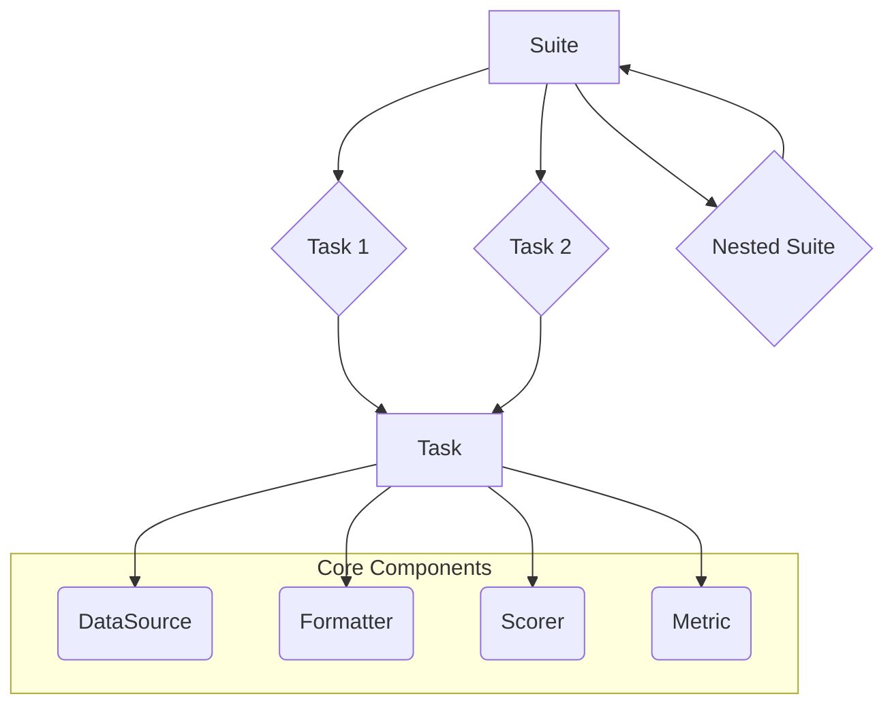

<!-- source: DeepWiki mcp.deepwiki.com · repo allenai/olmo-eval · page 4 Benchmarks and Suites · fetched 2026-10-26 -->

# Benchmarks and Suites

Relevant source files

The following files were used as context for generating this wiki page:

- [README.md](README.md)
- [src/olmo_eval/evals/suites/mmlu.py](src/olmo_eval/evals/suites/mmlu.py)
- [src/olmo_eval/evals/suites/olmobase.py](src/olmo_eval/evals/suites/olmobase.py)
- [src/olmo_eval/evals/tasks/arc.py](src/olmo_eval/evals/tasks/arc.py)
- [src/olmo_eval/evals/tasks/csqa.py](src/olmo_eval/evals/tasks/csqa.py)
- [src/olmo_eval/evals/tasks/gsm8k.py](src/olmo_eval/evals/tasks/gsm8k.py)
- [src/olmo_eval/evals/tasks/hellaswag.py](src/olmo_eval/evals/tasks/hellaswag.py)
- [src/olmo_eval/evals/tasks/medmcqa.py](src/olmo_eval/evals/tasks/medmcqa.py)
- [src/olmo_eval/evals/tasks/piqa.py](src/olmo_eval/evals/tasks/piqa.py)
- [src/olmo_eval/evals/tasks/socialiqa.py](src/olmo_eval/evals/tasks/socialiqa.py)
- [src/olmo_eval/evals/tasks/winogrande.py](src/olmo_eval/evals/tasks/winogrande.py)
- [src/olmo_eval/launch/config.py](src/olmo_eval/launch/config.py)

This page provides a high-level overview of the benchmarks and evaluation suites available within OLMo-Eval, organized by domain. OLMo-Eval offers a comprehensive set of tasks and suites to assess various capabilities of language models, from mathematical reasoning to coding proficiency and safety.

The system is designed around the concepts of `Task` and `Suite` [README.md:78-79](). A `Task` defines a specific benchmark, including its data source, formatting, and scoring logic [README.md:80-81](). A `Suite` groups multiple tasks or other suites, allowing for batch evaluation and aggregated results [README.md:113-114](). Suites can use different aggregation strategies, such as `AVERAGE` or `AVERAGE_OF_AVERAGES`, to combine scores from their constituent tasks [README.md:126-135]().

## Math and Reasoning Benchmarks

The math and reasoning domain includes a variety of tasks designed to test a model's ability to solve mathematical problems, understand logical relationships, and perform complex reasoning. These benchmarks often involve numerical calculations, symbolic manipulation, and multi-step problem-solving.

For details on specific benchmarks like AIME, Minerva Math, MATH-500, GSM8K, GSM-Symbolic, HMMT, ZebraLogic, DROP, and their associated suites, see [Math and Reasoning Benchmarks](#4.1).

Sources: [src/olmo_eval/evals/suites/olmobase.py:83-93]()

## Science and Knowledge Benchmarks

This category encompasses benchmarks that evaluate a model's general knowledge, scientific understanding, and ability to answer factual questions across various domains. These tasks often involve retrieving information, comprehending scientific texts, and demonstrating common sense.

For details on specific benchmarks like GPQA, LabBench, MedQA, MMLU, ARC, BoolQ, HellaSwag, PIQA, CSQA, WinoGrande, and their associated suites, see [Science and Knowledge Benchmarks](#4.2).

Sources: [src/olmo_eval/evals/suites/olmobase.py:124-178](), [src/olmo_eval/evals/tasks/arc.py:86-95](), [src/olmo_eval/evals/tasks/csqa.py:24-31](), [src/olmo_eval/evals/tasks/hellaswag.py:63-69](), [src/olmo_eval/evals/tasks/medmcqa.py:19-26](), [src/olmo_eval/evals/tasks/piqa.py:20-27](), [src/olmo_eval/evals/tasks/socialiqa.py:22-30](), [src/olmo_eval/evals/tasks/winogrande.py:65-72]()

## Coding Benchmarks

Coding benchmarks assess a model's ability to generate, complete, and debug code in various programming languages. These tasks often require understanding problem descriptions, implementing algorithms, and producing executable code that passes test cases.

For details on specific benchmarks like HumanEval, MBPP, MultiPL-E, BigCodeBench, DS1000, HumanEvalFIM, DeepSeek LeetCode, CodeFresh, and the `code` suite, see [Coding Benchmarks](#4.3).

Sources: [src/olmo_eval/evals/suites/olmobase.py:110-118]()

## Safety and Instruction-Following Benchmarks

This domain focuses on evaluating a model's adherence to instructions, its ability to follow safety guidelines, and its resistance to generating harmful or undesirable content. These benchmarks often involve complex prompts, adversarial inputs, and human-in-the-loop evaluation.

For details on specific benchmarks like HarmBench (with LLM-as-judge), IFEval, IFBench (ifeval_ood, ifeval_mt), ASTAbench, SimpleQA, and the `ifbench` suite, see [Safety and Instruction-Following Benchmarks](#4.4).

## Benchmark Organization

The benchmarks are organized into `Task` and `Suite` objects. A `Task` represents a single evaluation dataset and its associated logic, while a `Suite` is a collection of tasks or other suites. This hierarchical structure allows for flexible and comprehensive evaluation.

### Task and Suite Relationship

Sources: [README.md:80-81](), [README.md:113-114]()

### Example Suite Structure: `olmobase`

The `olmobase` suite [src/olmo_eval/evals/suites/olmobase.py:120]() is a meta-suite that aggregates results from various sub-suites and individual tasks across different domains. It demonstrates how `Suite` objects can be nested and how `AggregationStrategy.AVERAGE_OF_AVERAGES` [README.md:129-135]() is used to provide a balanced overall score.

```mermaid
graph TD
    OlmoBase["olmobase:easy:qa:rc (Suite)"] --> ArcRC["arc:rc:olmo3base (Suite)"]
    OlmoBase --> MMLURC["mmlu:rc:olmo3base (Suite)"]
    OlmoBase --> CSQARC["csqa:rc:olmo3base (Task)"]
    OlmoBase --> HellaSwagRC["hellaswag:rc:olmo3base (Task)"]
    OlmoBase --> WinoGrandeRC["winogrande:rc:olmo3base (Task)"]
    OlmoBase --> SocialIQARC["socialiqa:rc:olmo3base (Task)"]
    OlmoBase --> PIQARC["piqa:rc:olmo3base (Task)"]
    OlmoBase --> BasicSkillsRC["basic_skills:rc:olmo3base (Suite)"]
    OlmoBase --> LabBenchDBQA["lab_bench_dbqa:olmo3base (Task)"]
    OlmoBase --> LabBenchProtocolQA["lab_bench_protocolqa:olmo3base (Task)"]
    OlmoBase --> Lambada["lambada (Task)"]
    OlmoBase --> MedMCQARC["medmcqa:rc:olmo3base (Task)"]
    OlmoBase --> MedQARC["medqa_en:rc:olmo3base (Task)"]
    OlmoBase --> SciRiffYesNoRC["sciriff_yesno:rc:olmo3base (Task)"]

    ArcRC --> ArcChallengeRC["arc_challenge:rc:olmo3base (Task)"]
    ArcRC --> ArcEasyRC["arc_easy:rc:olmo3base (Task)"]

    MMLURC --> MMLUSubject1["mmlu:stem:rc:olmo3base (Suite)"]
    MMLURC --> MMLUSubject2["mmlu:humanities:rc:olmo3base (Suite)"]
    MMLURC --> MMLUSubject3["mmlu:social_sciences:rc:olmo3base (Suite)"]
    MMLURC --> MMLUSubject4["mmlu:other:rc:olmo3base (Suite)"]

    BasicSkillsRC --> BasicSkillTask1["basic_skills_subtask1:rc:olmo3base (Task)"]
    BasicSkillsRC --> BasicSkillTaskN["... (N Tasks)"]

    style OlmoBase fill:#f9f,stroke:#333,stroke-width:2px
    style ArcRC fill:#ccf,stroke:#333,stroke-width:2px
    style MMLURC fill:#ccf,stroke:#333,stroke-width:2px
    style BasicSkillsRC fill:#ccf,stroke:#333,stroke-width:2px
```

Sources: [src/olmo_eval/evals/suites/olmobase.py:124-150]()

This structure allows for granular evaluation at the task level and aggregated reporting at various suite levels, providing both detailed insights and high-level summaries of model performance.

---

