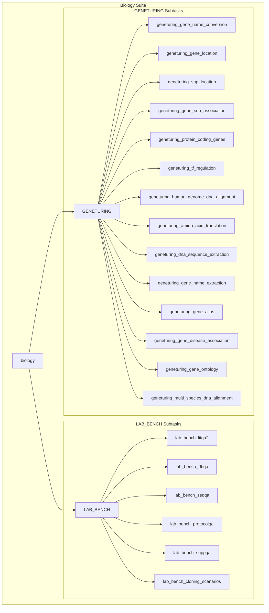

<!-- source: DeepWiki mcp.deepwiki.com · repo allenai/olmo-eval · page 4.2 Science and Knowledge Benchmarks · fetched 2026-10-26 -->

# Science and Knowledge Benchmarks

Relevant source files

The following files were used as context for generating this wiki page:

- [src/olmo_eval/evals/extract/mcq.py](src/olmo_eval/evals/extract/mcq.py)
- [src/olmo_eval/evals/suites/biology.py](src/olmo_eval/evals/suites/biology.py)
- [src/olmo_eval/evals/suites/mmlu.py](src/olmo_eval/evals/suites/mmlu.py)
- [src/olmo_eval/evals/suites/olmobase.py](src/olmo_eval/evals/suites/olmobase.py)
- [src/olmo_eval/evals/suites/science.py](src/olmo_eval/evals/suites/science.py)
- [src/olmo_eval/evals/tasks/arc.py](src/olmo_eval/evals/tasks/arc.py)
- [src/olmo_eval/evals/tasks/csqa.py](src/olmo_eval/evals/tasks/csqa.py)
- [src/olmo_eval/evals/tasks/gpqa.py](src/olmo_eval/evals/tasks/gpqa.py)
- [src/olmo_eval/evals/tasks/gsm8k.py](src/olmo_eval/evals/tasks/gsm8k.py)
- [src/olmo_eval/evals/tasks/hellaswag.py](src/olmo_eval/evals/tasks/hellaswag.py)
- [src/olmo_eval/evals/tasks/lab_bench.py](src/olmo_eval/evals/tasks/lab_bench.py)
- [src/olmo_eval/evals/tasks/medmcqa.py](src/olmo_eval/evals/tasks/medmcqa.py)
- [src/olmo_eval/evals/tasks/medqa.py](src/olmo_eval/evals/tasks/medqa.py)
- [src/olmo_eval/evals/tasks/piqa.py](src/olmo_eval/evals/tasks/piqa.py)
- [src/olmo_eval/evals/tasks/socialiqa.py](src/olmo_eval/evals/tasks/socialiqa.py)
- [src/olmo_eval/evals/tasks/winogrande.py](src/olmo_eval/evals/tasks/winogrande.py)
- [tests/evals/extract/test_mcq.py](tests/evals/extract/test_mcq.py)
- [tests/evals/suites/test_science.py](tests/evals/suites/test_science.py)
- [tests/evals/tasks/test_gpqa.py](tests/evals/tasks/test_gpqa.py)
- [tests/evals/tasks/test_lab_bench.py](tests/evals/tasks/test_lab_bench.py)
- [tests/evals/tasks/test_medqa.py](tests/evals/tasks/test_medqa.py)

This page details the science and knowledge benchmarks available in OLMo-Eval. These benchmarks assess a model's understanding and reasoning capabilities across various scientific domains and general knowledge. The tasks are typically multiple-choice questions, often requiring complex reasoning or factual recall.

Sources: [src/olmo_eval/evals/tasks/gpqa.py:1-4](), [src/olmo_eval/evals/tasks/lab_bench.py:1-4](), [src/olmo_eval/evals/tasks/medqa.py:1-4]()

## GPQA (Graduate-Level Google-Proof Q&A)

GPQA is a multiple-choice benchmark designed to test graduate-level scientific knowledge. It features 4-way questions spanning biology, physics, and chemistry. The dataset is available in three quality tiers: `diamond`, `main`, and `extended`. Additionally, tasks can be filtered by broad subject (biology, chemistry, physics).

### Task Structure

The `GPQATask` class [src/olmo_eval/evals/tasks/gpqa.py:109-111]() is the base for all GPQA tasks. It processes documents from the `Idavidrein/gpqa` dataset [src/olmo_eval/evals/tasks/gpqa.py:37]() and converts them into `Instance` objects [src/olmo_eval/evals/tasks/gpqa.py:168-173](). Each instance includes a question, a set of choices, and the gold answer. Choices are deterministically shuffled per question to prevent models from learning positional biases [src/olmo_eval/evals/tasks/gpqa.py:151-153]().

GPQA tasks support both standard multiple-choice (MC) and bits-per-byte (BPB) variants. The default `_SYSTEM_PROMPT` [src/olmo_eval/evals/tasks/gpqa.py:93-97]() encourages step-by-step reasoning before selecting an answer.

### Answer Extraction

Answer extraction for GPQA tasks uses a priority-ordered set of regular expressions defined in `_PATTERNS` [src/olmo_eval/evals/extract/mcq.py:14-25](). The `extract_mcq_answer` function [src/olmo_eval/evals/extract/mcq.py:28-37]() attempts to find the last match from the most specific pattern that fires. Patterns include "ANSWER: X", `\boxed{X}`, `(X)`, and `**X)`.

### Subject Grouping

GPQA tasks can be filtered by subject groups (biology, chemistry, physics) using the `subject_group` attribute of `GPQATask` [src/olmo_eval/evals/tasks/gpqa.py:113](). The `_SUBJECT_GROUPS` dictionary [src/olmo_eval/evals/tasks/gpqa.py:55-80]() maps subdomains to these broader categories.

### Registered Tasks

The following GPQA tasks are registered:
- `gpqa_diamond`
- `gpqa_main`
- `gpqa_extended`
- `gpqa_{subset}_biology`
- `gpqa_{subset}_chemistry`
- `gpqa_{subset}_physics`

Each of these also has `:mc` (logprob-based MC scoring) and `:bpb` (bits-per-byte evaluation) variants [src/olmo_eval/evals/tasks/gpqa.py:219-221]().

Sources: [src/olmo_eval/evals/tasks/gpqa.py:1-14](), [src/olmo_eval/evals/tasks/gpqa.py:37](), [src/olmo_eval/evals/tasks/gpqa.py:55-80](), [src/olmo_eval/evals/tasks/gpqa.py:93-97](), [src/olmo_eval/evals/tasks/gpqa.py:109-111](), [src/olmo_eval/evals/tasks/gpqa.py:151-153](), [src/olmo_eval/evals/tasks/gpqa.py:168-173](), [src/olmo_eval/evals/tasks/gpqa.py:219-221](), [src/olmo_eval/evals/extract/mcq.py:14-25](), [src/olmo_eval/evals/extract/mcq.py:28-37]()

## LabBench

LAB-Bench is a biology research benchmark comprising 8 subtasks, 6 of which are text-only and implemented in OLMo-Eval. These subtasks cover various aspects of biological knowledge and reasoning.

### Subtasks

The implemented text-only subtasks are:
- `lab_bench_litqa2`: Literature-based QA
- `lab_bench_dbqa`: Biological database QA
- `lab_bench_seqqa`: DNA/protein sequence analysis
- `lab_bench_protocolqa`: Lab protocol QA
- `lab_bench_suppqa`: Supplementary material QA
- `lab_bench_cloning_scenarios`: Molecular cloning scenarios

Each subtask supports `:mc` (logprob-based) and `:bpb` (bits-per-byte) variants [src/olmo_eval/evals/tasks/lab_bench.py:14-15]().

### Task Implementation

The `LabBenchTask` class [src/olmo_eval/evals/tasks/lab_bench.py:119]() handles the processing of LAB-Bench documents. A key feature is the inclusion of a `_REFUSE_CHOICE` ("Insufficient information to answer the question") [src/olmo_eval/evals/tasks/lab_bench.py:50]() in the multiple-choice options. This allows models to explicitly refuse to answer if they lack sufficient information.

For `lab_bench_protocolqa`, the protocol text is prepended to the question to provide context [tests/evals/tasks/test_lab_bench.py:151-162]().

### Metrics

LAB-Bench introduces two custom metrics:
- `PrecisionMetric`: Calculates accuracy excluding refusals (correct / non-refused) [src/olmo_eval/evals/tasks/lab_bench.py:61-86]().
- `CoverageMetric`: Measures the fraction of responses where the model committed (did not refuse) [src/olmo_eval/evals/tasks/lab_bench.py:89-110]().

### Answer Extraction

Similar to GPQA, answer extraction for LAB-Bench tasks uses the `_ANSWER_PATTERN` regex [src/olmo_eval/evals/tasks/lab_bench.py:47]() to identify "ANSWER: X" in the model's output.

Sources: [src/olmo_eval/evals/tasks/lab_bench.py:1-15](), [src/olmo_eval/evals/tasks/lab_bench.py:47](), [src/olmo_eval/evals/tasks/lab_bench.py:50](), [src/olmo_eval/evals/tasks/lab_bench.py:61-86](), [src/olmo_eval/evals/tasks/lab_bench.py:89-110](), [src/olmo_eval/evals/tasks/lab_bench.py:119](), [tests/evals/tasks/test_lab_bench.py:151-162]()

## MedQA

MedQA is a USMLE-style medical multiple-choice QA benchmark, focusing on medical knowledge. The test split contains 1,273 questions.

### Task Structure

The `MedQA` class [src/olmo_eval/evals/tasks/medqa.py:42]() processes documents from the `davidheineman/medqa-en` dataset [src/olmo_eval/evals/tasks/medqa.py:46](). It shuffles choices deterministically per question while tracking the original positions to ensure the gold answer remains correctly identified [src/olmo_eval/evals/tasks/medqa.py:78-84](). The `_SYSTEM_PROMPT` [src/olmo_eval/evals/tasks/medqa.py:31-35]() guides the model to reason and select the best answer.

### Answer Extraction

MedQA uses the shared `extract_mcq_answer` utility [src/olmo_eval/evals/extract/mcq.py:28-37]() to extract the MCQ letter from model output [src/olmo_eval/evals/tasks/medqa.py:139-141](). For logprob-based MC scoring, it identifies the choice with the highest log-probability [src/olmo_eval/evals/tasks/medqa.py:117-137]().

### Registered Tasks

- `medqa` (default chat-based)
- `medqa:mc` (logprob-based MC scoring)
- `medqa:bpb` (bits-per-byte evaluation)

Sources: [src/olmo_eval/evals/tasks/medqa.py:1-4](), [src/olmo_eval/evals/tasks/medqa.py:31-35](), [src/olmo_eval/evals/tasks/medqa.py:42](), [src/olmo_eval/evals/tasks/medqa.py:46](), [src/olmo_eval/evals/tasks/medqa.py:78-84](), [src/olmo_eval/evals/tasks/medqa.py:117-137](), [src/olmo_eval/evals/tasks/medqa.py:139-141](), [src/olmo_eval/evals/extract/mcq.py:28-37]()

## MMLU (Massive Multitask Language Understanding)

MMLU is a comprehensive benchmark covering 57 subjects across STEM, humanities, social sciences, and more. OLMo-Eval integrates MMLU tasks, particularly focusing on STEM and medicine-related subsets within the science suites.

### Integration with Science Suites

- `science:core` includes `mmlu:stem` [src/olmo_eval/evals/suites/science.py:104]().
- `science:medicine` includes specific medicine-related MMLU tasks such as `mmlu_anatomy`, `mmlu_clinical_knowledge`, `mmlu_college_medicine`, `mmlu_human_aging`, `mmlu_medical_genetics`, `mmlu_nutrition`, `mmlu_professional_medicine`, and `mmlu_virology` [src/olmo_eval/evals/suites/science.py:56-63]().

Sources: [src/olmo_eval/evals/suites/science.py:56-63](), [src/olmo_eval/evals/suites/science.py:104]()

## ARC (AI2 Reasoning Challenge)

ARC is a question-answering dataset designed to test a model's ability to answer science questions that require reasoning. It has two subsets: `arc_easy` and `arc_challenge`.

### Integration with Science Suites

- `science:core` includes both `arc_easy` and `arc_challenge` [src/olmo_eval/evals/suites/science.py:101-102]().

Sources: [src/olmo_eval/evals/suites/science.py:101-102]()

## BoolQ

BoolQ is a question answering dataset where questions are naturally occurring, unscripted, and require a yes/no answer.

Sources: [src/olmo_eval/evals/tasks/boolq.py]()

## HellaSwag

HellaSwag is a benchmark for commonsense reasoning, requiring models to choose the most plausible ending to a given context.

Sources: [src/olmo_eval/evals/tasks/hellaswag.py]()

## PIQA (Physical Interaction QA)

PIQA evaluates commonsense physical reasoning, asking models to choose the correct solution to everyday physical tasks.

Sources: [src/olmo_eval/evals/tasks/piqa.py]()

## CSQA (CommonsenseQA)

CSQA is a multiple-choice question answering dataset that requires different types of commonsense knowledge to answer.

Sources: [src/olmo_eval/evals/tasks/csqa.py]()

## WinoGrande

WinoGrande is a large-scale dataset for commonsense reasoning, designed to be robust against statistical heuristics. It focuses on pronoun resolution.

### Task Structure

The `Winogrande` class [src/olmo_eval/evals/tasks/winogrande.py:66]() processes documents from the `winogrande` dataset [src/olmo_eval/evals/tasks/winogrande.py:67](). It converts each document into an `Instance` with a question (sentence with a blank), two options, and the gold answer [src/olmo_eval/evals/tasks/winogrande.py:36-47]().

### Formatting and Request Types

WinoGrande supports two main formatting approaches:
- **Multiple Choice (MC)**: The prompt presents the sentence with a blank and lists the choices. The model selects a letter [src/olmo_eval/evals/tasks/winogrande.py:56-62]().
- **Reading Comprehension (RC)**: This format uses the Trinh & Le (2018) partial evaluation. Each option is placed in the prompt context, and only the text after the blank is scored as the continuation [src/olmo_eval/evals/tasks/winogrande.py:160-177]().

### Few-Shot Examples

WinoGrande tasks can use fixed few-shot examples from `WINOGRANDE_FIXED_FEWSHOT` [src/olmo_eval/evals/tasks/winogrande.py:109-133]() for specific variants like `olmo3base` and `xlarge` [src/olmo_eval/evals/tasks/winogrande.py:186-190]().

### Registered Variants

- `winogrande` (default RC format)
- `winogrande:rc` (explicit RC format)
- `winogrande:mc` (multiple-choice format)
- `winogrande:olmo3base` (5-shot, limited to 10k examples, fixed few-shot source)
- `winogrande:xlarge` (same as `olmo3base`)

Sources: [src/olmo_eval/evals/tasks/winogrande.py:1-10](), [src/olmo_eval/evals/tasks/winogrande.py:36-47](), [src/olmo_eval/evals/tasks/winogrande.py:56-62](), [src/olmo_eval/evals/tasks/winogrande.py:66](), [src/olmo_eval/evals/tasks/winogrande.py:67](), [src/olmo_eval/evals/tasks/winogrande.py:109-133](), [src/olmo_eval/evals/tasks/winogrande.py:160-177](), [src/olmo_eval/evals/tasks/winogrande.py:186-190]()

## Biology, Science, and OLMoBase Suites

OLMo-Eval organizes these individual tasks into logical suites for easier evaluation and reporting.

### Biology Suite

The `biology` suite [src/olmo_eval/evals/suites/biology.py:67-71]() combines the `LAB_BENCH` suite and the `GENETURING` suite.
- `LAB_BENCH` [src/olmo_eval/evals/suites/biology.py:18-22]() includes all 6 text-only LAB-Bench subtasks. Variants `LAB_BENCH_MC` and `LAB_BENCH_BPB` are also available [src/olmo_eval/evals/suites/biology.py:24-33]().
- `GENETURING` [src/olmo_eval/evals/suites/biology.py:57-61]() includes 14 genomics Q&A modules.

Diagram: Biology Suite Composition

Sources: [src/olmo_eval/evals/suites/biology.py:9-16](), [src/olmo_eval/evals/suites/biology.py:18-22](), [src/olmo_eval/evals/suites/biology.py:24-33](), [src/olmo_eval/evals/suites/biology.py:40-54](), [src/olmo_eval/evals/suites/biology.py:57-61](), [src/olmo_eval/evals/suites/biology.py:67-71]()

### Science Suites

The `science` suites provide a non-overlapping hierarchy for aggregate reporting, designed to avoid task duplication.
- `science:core`: Broad STEM knowledge, including `arc_easy`, `arc_challenge`, `sciq`, and `mmlu:stem` [src/olmo_eval/evals/suites/science.py:98-108]().
- `science:biology`: Biology, genomics, and wet-lab science, including the `biology` suite and GPQA biology tasks [src/olmo_eval/evals/suites/science.py:110-118]().
- `science:medicine`: Medical QA and medicine-focused knowledge, including `medmcqa`, `medqa_en`, and specific MMLU medicine tasks [src/olmo_eval/evals/suites/science.py:120-131]().
- `science:physical`: Chemistry and physics tasks from GPQA [src/olmo_eval/evals/suites/science.py:133-141]().
- `science:research`: Scientific literature understanding and evidence use tasks [src/olmo_eval/evals/suites/science.py:143-152]().
- `science:math`: Mathematical reasoning tasks relevant to science [src/olmo_eval/evals/suites/science.py:154-166]().
- `science:nojudge`: All science tasks that do not require external LLM judges [src/olmo_eval/evals/suites/science.py:168-181]().
- `science:judge`: Science tasks that require external LLM-as-judge scoring (e.g., `astabench`) [src/olmo_eval/evals/suites/science.py:183-188]().
- `science:all`: A comprehensive, non-overlapping umbrella suite covering all science tasks [src/olmo_eval/evals/suites/science.py:190-197]().

```mermaid
graph TD
    SA[science:all] --> SNJ[science:nojudge]
    SA --> SJ[science:judge]

    SNJ --> SC[science:core]
    SNJ --> SB[science:biology]
    SNJ --> SM[science:medicine]
    SNJ --> SP[science:physical]
    SNJ --> SR_nojudge[qasper_yesno]
    SNJ --> SR_nojudge2[sciriff_yesno]
    SNJ --> SMath[science:math]

    SJ --> Astabench[astabench]

    SC --> ARC_E[arc_easy]
    SC --> ARC_C[arc_challenge]
    SC --> SCIQ[sciq]
    SC --> MMLU_STEM[mmlu:stem]

    SB --> BiologySuite[biology]
    SB --> GPQA_Bio_D[gpqa_diamond_biology]
    SB --> GPQA_Bio_M[gpqa_main_biology]
    SB --> GPQA_Bio_E[gpqa_extended_biology]

    SM --> MedMCQA[medmcqa]
    SM --> MedQA_EN[medqa_en]
    SM --> MMLU_Anatomy[mmlu_anatomy]
    SM --> MMLU_Clinical[mmlu_clinical_knowledge]
    SM --> MMLU_CollegeMed[mmlu_college_medicine]
    SM --> MMLU_HumanAging[mmlu_human_aging]
    SM --> MMLU_MedGenetics[mmlu_medical_genetics]
    SM --> MMLU_Nutrition[mmlu_nutrition]
    SM --> MMLU_ProfMed[mmlu_professional_medicine]
    SM --> MMLU_Virology[mmlu_virology]

    SP --> GPQA_Chem_D[gpqa_diamond_chemistry]
    SP --> GPQA_Chem_M[gpqa_main_chemistry]
    SP --> GPQA_Chem_E[gpqa_extended_chemistry]
    SP --> GPQA_Phys_D[gpqa_diamond_physics]
    SP --> GPQA_Phys_M[gpqa_main_physics]
    SP --> GPQA_Phys_E[gpqa_extended_physics]

    SMath --> GSM8K[gsm8k]
    SMath --> GSMSymbolic[gsm_symbolic]
    SMath --> MinervaMath[minerva_math]
    SMath --> Math500[math500]
    SMath --> AIME2024[aime_2024]
    SMath --> AIME2025[aime_2025]
```

Diagram: Science Suite Hierarchy

Sources: [src/olmo_eval/evals/suites/science.py:1-25](), [src/olmo_eval/evals/suites/science.py:98-108](), [src/olmo_eval/evals/suites/science.py:110-118](), [src/olmo_eval/evals/suites/science.py:120-131](), [src/olmo_eval/evals/suites/science.py:133-141](), [src/olmo_eval/evals/suites/science.py:143-152](), [src/olmo_eval/evals/suites/science.py:154-166](), [src/olmo_eval/evals/suites/science.py:168-181](), [src/olmo_eval/evals/suites/science.py:183-188](), [src/olmo_eval/evals/suites/science.py:190-197]()

### OLMoBase Suite

The `olmobase` suite [src/olmo_eval/evals/suites/olmobase.py]() is a collection of tasks used for foundational model evaluation, including several science and knowledge benchmarks. It typically includes:
- `arc_challenge`
- `boolq`
- `hellaswag`
- `piqa`
- `csqa`
- `winogrande`
- `medqa`
- `mmlu` (various subsets)
- `gpqa` (various subsets)

Sources: [src/olmo_eval/evals/suites/olmobase.py]()

---

