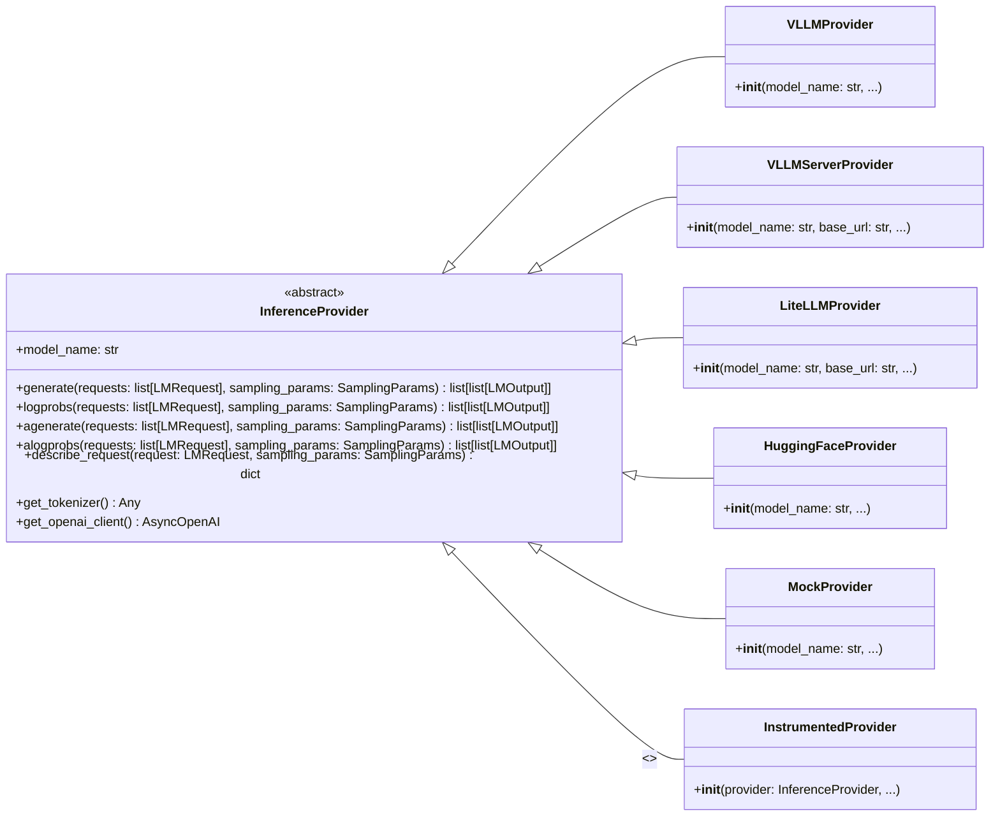

<!-- source: DeepWiki mcp.deepwiki.com · repo allenai/olmo-eval · page 5 Inference Providers · fetched 2026-10-26 -->

# Inference Providers

<details>
<summary>Relevant source files</summary>

The following files were used as context for generating this wiki page:

- [src/olmo_eval/common/types/base.py](src/olmo_eval/common/types/base.py)
- [src/olmo_eval/common/types/tools.py](src/olmo_eval/common/types/tools.py)
- [src/olmo_eval/inference/base.py](src/olmo_eval/inference/base.py)
- [src/olmo_eval/inference/dispatch.py](src/olmo_eval/inference/dispatch.py)
- [src/olmo_eval/inference/providers/config.py](src/olmo_eval/inference/providers/config.py)
- [tests/cli/beaker/__init__.py](tests/cli/beaker/__init__.py)
- [tests/cli/beaker/test_launch.py](tests/cli/beaker/test_launch.py)
- [tests/providers/test_vllm_server_logprobs.py](tests/providers/test_vllm_server_logprobs.py)
- [tests/storage/test_base.py](tests/storage/test_base.py)

</details>


This page provides an overview of the inference provider system in OLMo-Eval. It introduces the core `InferenceProvider` abstraction, describes the various available backends for different model types and deployment scenarios, and explains how these providers are configured and selected for evaluations. Detailed information for each provider type can be found in their respective child pages.

## The `InferenceProvider` Abstraction

At the heart of the inference system is the `InferenceProvider` abstract base class [src/olmo_eval/inference/base.py:14-21](). This class defines the common interface that all language model inference backends must implement, ensuring a consistent way to interact with different models regardless of their underlying technology or deployment.

All providers must implement the synchronous `generate` and `logprobs` methods [src/olmo_eval/inference/base.py:33-66](). For performance in asynchronous contexts, providers that support it should also override the `agenerate` and `alogprobs` methods [src/olmo_eval/inference/base.py:68-104](). The `describe_request` method [src/olmo_eval/inference/base.py:106-147]() provides a way to trace the effective request parameters sent to the provider, which is useful for debugging and reproducibility.


Sources: [src/olmo_eval/inference/base.py:14-21](), [src/olmo_eval/inference/base.py:33-66](), [src/olmo_eval/inference/base.py:68-104](), [src/olmo_eval/inference/base.py:106-147]()

## Provider Configuration and Selection

Inference providers are configured using the `ProviderConfig` dataclass [src/olmo_eval/inference/providers/config.py:19-61](). This immutable configuration object encapsulates all necessary details to instantiate a provider, including the `kind` of provider, the `model` identifier, and various parameters specific to the backend.

The `ProviderConfig` includes fields like `kind` (e.g., "vllm", "vllm_server", "hf", "litellm", "mock"), `model` name or path, `alias` for display, `base_url` for API-based providers, and `tokenizer` specification. It also handles model loading parameters such as `revision`, `force_download`, `trust_remote_code`, `dtype`, and `max_model_len`. Operational parameters like `max_concurrency` and `num_instances` are also part of the configuration.

The `create_provider` method [src/olmo_eval/inference/providers/config.py:112-129]() uses a factory pattern to instantiate the correct `InferenceProvider` subclass based on the `kind` specified in the configuration. It also validates any `required_secrets` [src/olmo_eval/inference/providers/config.py:145-151]() before creation.

```mermaid
graph TD
    subgraph "Configuration and Instantiation"
        A[ProviderConfig] --> B{kind: ProviderKind};
        B -- "vllm" --> C[VLLMProvider];
        B -- "vllm_server" --> D[VLLMServerProvider];
        B -- "litellm" --> E[LiteLLMProvider];
        B -- "hf" --> F[HuggingFaceProvider];
        B -- "mock" --> G[MockProvider];
        A -- "model, alias, base_url, tokenizer, ..." --> B;
        B -- "create_provider()" --> H[InferenceProvider Instance];
    end

    subgraph "ProviderConfig Details"
        A -- "kind: ProviderKind" --> A_kind[ProviderKind.VLLM_SERVER, etc.];
        A -- "model: str" --> A_model[e.g., "meta-llama/Llama-2-7b-hf"];
        A -- "alias: str" --> A_alias[e.g., "llama2-7b"];
        A -- "base_url: str" --> A_base_url[e.g., "http://localhost:8000/v1"];
        A -- "tokenizer: str" --> A_tokenizer[e.g., "meta-llama/Llama-2-7b-hf"];
        A -- "dtype: str" --> A_dtype[e.g., "bfloat16"];
        A -- "max_model_len: int" --> A_max_model_len[e.g., 4096];
        A -- "max_concurrency: int" --> A_max_concurrency[e.g., 128];
        A -- "num_instances: int" --> A_num_instances[e.g., 1];
        A -- "required_secrets: tuple[str]" --> A_secrets[e.g., ("OPENAI_API_KEY",)];
        A -- "package: str" --> A_package[e.g., "vllm @ git+..."];
        A -- "dependencies: tuple[str]" --> A_deps[e.g., ("some-package==1.0",)];
        A -- "kwargs: Mapping[str, Any]" --> A_kwargs[Additional arguments];
    end

    subgraph "GPU Resource Management"
        A -- "requires_gpu" --> A_gpu_prop[True for vllm, vllm_server, hf];
        A -- "requires_local_gpu" --> A_local_gpu_prop[True for local vllm, hf, or vllm_server without base_url];
    end
```
Sources: [src/olmo_eval/inference/providers/config.py:19-61](), [src/olmo_eval/inference/providers/config.py:112-129](), [src/olmo_eval/inference/providers/config.py:145-151]()

### Model Hashing

To ensure reproducibility and consistent identification of model configurations across different runs and experiments, OLMo-Eval computes a deterministic hash for each `ProviderConfig`. The `compute_model_hash` function [src/olmo_eval/common/types/base.py:104-132]() generates a 16-character hex string hash. This hash is crucial for associating evaluation results with specific model setups.

Crucially, this hashing mechanism normalizes the configuration by ignoring operational fields that do not affect the model's behavior or identity, such as `api_base`, `base_url`, `max_concurrency`, `num_instances`, and `required_secrets` [src/olmo_eval/common/types/base.py:19-29](). Similarly, certain `kwargs` related to backend tuning (e.g., `tensor_parallel_size`, `gpu_memory_utilization`) are also ignored [src/olmo_eval/common/types/base.py:31-46](). This ensures that changes in deployment specifics do not lead to different model hashes, while changes that *do* affect model output (e.g., `trust_remote_code`, `attention_backend`) correctly result in a new hash [tests/storage/test_base.py:145-157](), [tests/storage/test_base.py:183-202]().

Sources: [src/olmo_eval/common/types/base.py:104-132](), [src/olmo_eval/common/types/base.py:19-29](), [src/olmo_eval/common/types/base.py:31-46](), [tests/storage/test_base.py:145-157](), [tests/storage/test_base.py:183-202]()

## Available Provider Backends

OLMo-Eval supports several types of inference providers, each tailored to different use cases:

*   **vLLM Providers**: For high-throughput local inference using vLLM. This includes both in-process (`VLLMProvider`) and server-based (`VLLMServerProvider`) deployments. For details, see [vLLM Providers](#5.1).
*   **LiteLLM Provider**: For integrating with commercial and open-source API-based models via LiteLLM. For details, see [LiteLLM and HuggingFace Providers](#5.2).
*   **HuggingFace Provider**: For local inference using HuggingFace Transformers models. For details, see [LiteLLM and HuggingFace Providers](#5.2).
*   **Mock Provider**: A dummy provider used primarily for testing and dry runs. For details, see [LiteLLM and HuggingFace Providers](#5.2).

## Inference Metrics and Telemetry

All inference providers can be wrapped by an `InstrumentedProvider` to collect detailed metrics about requests, responses, and GPU utilization. This telemetry is crucial for understanding model performance and resource consumption during evaluations. For details, see [Inference Metrics and Telemetry](#5.3).

---

