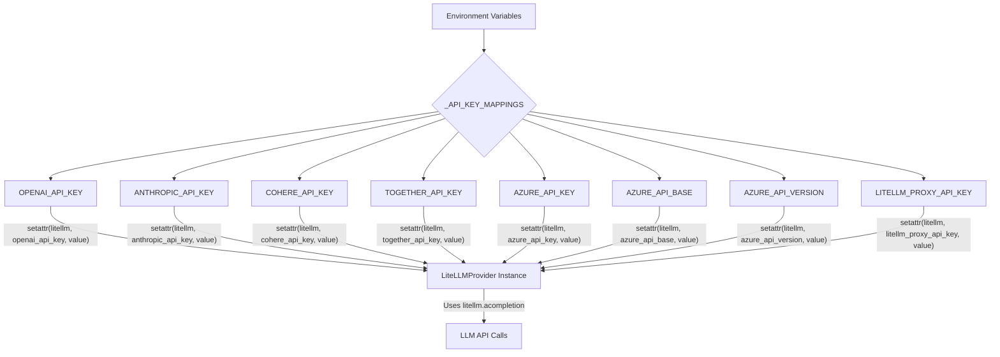

<!-- source: DeepWiki mcp.deepwiki.com · repo allenai/olmo-eval · page 5.2 LiteLLM and HuggingFace Providers · fetched 2026-10-26 -->

# LiteLLM and HuggingFace Providers

<details>
<summary>Relevant source files</summary>

The following files were used as context for generating this wiki page:

- [src/olmo_eval/common/constants/models.py](src/olmo_eval/common/constants/models.py)
- [src/olmo_eval/evals/tasks/zebralogic.py](src/olmo_eval/evals/tasks/zebralogic.py)
- [src/olmo_eval/inference/hf_cache.py](src/olmo_eval/inference/hf_cache.py)
- [src/olmo_eval/inference/providers/huggingface.py](src/olmo_eval/inference/providers/huggingface.py)
- [src/olmo_eval/inference/providers/litellm.py](src/olmo_eval/inference/providers/litellm.py)
- [src/olmo_eval/inference/providers/mock.py](src/olmo_eval/inference/providers/mock.py)
- [src/olmo_eval/inference/providers/vllm.py](src/olmo_eval/inference/providers/vllm.py)
- [src/olmo_eval/runners/io/builders.py](src/olmo_eval/runners/io/builders.py)
- [tests/runners/io/test_builders.py](tests/runners/io/test_builders.py)

</details>


This page documents the `LiteLLMProvider` for interacting with commercial Language Model APIs and the `HuggingFaceProvider` for performing local inference using models from the Hugging Face Transformers library. It also covers the `MockProvider` used for testing purposes. These providers implement the `InferenceProvider` interface, enabling OLMo-Eval to interact with various LLM backends.

## LiteLLMProvider

The `LiteLLMProvider` [src/olmo_eval/inference/providers/litellm.py:24-172]() leverages the LiteLLM library to provide a unified interface for interacting with a wide range of commercial and open-source LLM APIs, including OpenAI, Anthropic, Cohere, and custom OpenAI-compatible endpoints.

### Configuration

The `LiteLLMProvider` is initialized with a `model_name` and can be configured with an optional `base_url` for custom API endpoints or `api_base` for LiteLLM's internal routing. It supports concurrency and retry mechanisms.

```python
class LiteLLMProvider(InferenceProvider):
    def __init__(
        self,
        model_name: str,
        base_url: str | None = None,
        api_base: str | None = None,
        max_concurrency: int = 32,
        max_retries: int = 3,
        retry_delay: float = 1.0,
        **api_kwargs,
    ) -> None:
        # ...
```
Sources: [src/olmo_eval/inference/providers/litellm.py:45-59]()

API keys and other credentials are automatically loaded from environment variables based on predefined mappings [src/olmo_eval/inference/providers/litellm.py:28-37]().


**LiteLLM API Key Configuration**
Sources: [src/olmo_eval/inference/providers/litellm.py:84-90](), [src/olmo_eval/inference/providers/litellm.py:28-37]()

### Request Handling

The `_generate_single_impl` method [src/olmo_eval/inference/providers/litellm.py:112-172]() handles converting an `LMRequest` and `SamplingParams` into a format suitable for `litellm.acompletion`. It supports both chat-style messages and raw prompts. Key parameters like `temperature`, `max_completion_tokens`, and `stop_sequences` are mapped. Log probabilities are always requested to enable metrics computation.

```python
    async def _generate_single_impl(
        self, request: LMRequest, params: SamplingParams
    ) -> list[LMOutput]:
        # Build messages from request
        if request.messages:
            messages = [dict(m) for m in request.messages]
        else:
            messages = [{"role": "user", "content": request.prompt}]

        # Prepare API kwargs
        kwargs: dict[str, Any] = {
            "api_base": self.api_base,
            "model": self.model_name,
            "messages": messages,
            "n": params.num_samples,
            "max_completion_tokens": params.max_tokens,
            **self.api_kwargs,
        }
        # ...
        response = await self._litellm.acompletion(**kwargs)
        # ...
```
Sources: [src/olmo_eval/inference/providers/litellm.py:112-142]()

The `LMOutput` objects returned by the provider include the generated text, log probabilities, and metadata such as `sum_logits` and `num_tokens` [src/olmo_eval/inference/providers/litellm.py:144-172]().

### Model Presets

Several commercial models are pre-configured as `ProviderConfig` objects in `get_model_presets` [src/olmo_eval/common/constants/models.py:12-139](), allowing them to be easily referenced by name (e.g., "gpt-4o", "claude-3-opus"). These presets specify the `ProviderKind.LITELLM`, the model identifier, `api_base`, and any `required_secrets` (environment variables) needed.

```python
        "gpt-4o": ProviderConfig(
            kind=ProviderKind.LITELLM,
            model="gpt-4o",
            api_base="https://api.openai.com/v1",
            required_secrets=("OPENAI_API_KEY",),
        ),
        "claude-3-opus": ProviderConfig(
            kind=ProviderKind.LITELLM,
            model="anthropic/claude-3-opus-20240229",
            api_base="https://api.anthropic.com",
            required_secrets=("ANTHROPIC_API_KEY",),
        ),
```
Sources: [src/olmo_eval/common/constants/models.py:93-115]()

## HuggingFaceProvider

The `HuggingFaceProvider` [src/olmo_eval/inference/providers/huggingface.py:33-194]() enables local inference using models from the Hugging Face Transformers library. It loads models and tokenizers directly into memory and performs generation on the available device (CUDA, MPS, or CPU).

### Initialization

The provider initializes a `transformers.AutoTokenizer` and `transformers.AutoModelForCausalLM` from the specified `model_name` (or separate `tokenizer` path). It automatically detects the best available device (`cuda`, `mps`, or `cpu`) and moves the model to it [src/olmo_eval/inference/providers/huggingface.py:22-30](), [src/olmo_eval/inference/providers/huggingface.py:89-91]().

```python
class HuggingFaceProvider(InferenceProvider):
    def __init__(self, model_name: str, tokenizer: str | None = None, **model_kwargs) -> None:
        # ...
        self.tokenizer: Any = AutoTokenizer.from_pretrained(tokenizer_path, **tokenizer_kwargs)
        self.model: Any = AutoModelForCausalLM.from_pretrained(model_name, **model_kwargs)
        self.device = _get_device()
        self.model.to(self.device)
        self.model.eval()
```
Sources: [src/olmo_eval/inference/providers/huggingface.py:62-92]()

It also filters out `model_kwargs` that are not relevant to Hugging Face's `from_pretrained` method, such as `vLLM`-specific parameters [src/olmo_eval/inference/providers/huggingface.py:36-48](), [src/olmo_eval/inference/providers/huggingface.py:79-80]().

### Generation

The `generate` method [src/olmo_eval/inference/providers/huggingface.py:134-194]() processes a list of `LMRequest` objects. For each request, it tokenizes the prompt, generates output using `model.generate`, and then truncates the output at any specified `stop_sequences` [src/olmo_eval/inference/providers/huggingface.py:117-132](). Log probabilities are computed for the generated tokens to populate the `LMOutput` metadata.

```python
    def generate(
        self,
        requests: list[LMRequest],
        sampling_params: SamplingParams | None = None,
    ) -> list[list[LMOutput]]:
        import torch

        params = self._default_sampling_params(sampling_params)
        gen_kwargs = self._build_generate_kwargs(params)

        results = []
        for request in requests:
            prompt = request.prompt
            encoded = self.tokenizer(prompt, return_tensors="pt").to(self.device)
            prompt_len = encoded["input_ids"].shape[1]

            request_outputs = []
            for _ in range(params.num_samples):
                with torch.no_grad():
                    output_ids = self.model.generate(**encoded, **gen_kwargs)[0]

                gen_ids = output_ids[prompt_len:]
                gen_ids, text = self._truncate_at_stop(gen_ids, params.stop_sequences)

                # Always compute logprobs for metrics
                logprob_entries = None
                metadata: dict[str, Any] = {}
                if len(gen_ids) > 0:
                    # ... logprob computation ...
                request_outputs.append(
                    LMOutput(text=text, logprobs=logprob_entries, metadata=metadata)
                )
            results.append(request_outputs)
        return results
```
Sources: [src/olmo_eval/inference/providers/huggingface.py:134-194]()

### HuggingFaceProvider Data Flow
```mermaid
graph TD
    A[LMRequest] --> B{HuggingFaceProvider.generate()}
    B --> C[tokenizer(prompt)]
    C --> D[model.generate()]
    D --> E[Truncate at Stop Sequences]
    E --> F[Compute LogProbs]
    F --> G[LMOutput]
    G --> H[List[List[LMOutput]]]
```
**HuggingFaceProvider Data Flow**
Sources: [src/olmo_eval/inference/providers/huggingface.py:134-194]()

## MockProvider

The `MockProvider` [src/olmo_eval/inference/providers/mock.py:7-89]() is a simple provider designed for testing and debugging. It returns fixed, predefined responses for both generation and log-likelihood requests, allowing evaluation logic to be tested without requiring an actual LLM backend.

### Fixed Responses

For `generate` requests, it returns a fixed text " mock response. The answer is (A), or \boxed{42}" with mock log probabilities [src/olmo_eval/inference/providers/mock.py:26-41](). For `logprobs` requests, it returns the requested continuation with mock log probabilities [src/olmo_eval/inference/providers/mock.py:63-77]().

```python
class MockProvider(InferenceProvider):
    def generate(
        self,
        requests: list[LMRequest],
        sampling_params: SamplingParams | None = None,
    ) -> list[list[LMOutput]]:
        # ...
        mock_output = LMOutput(
            text=" mock response. The answer is (A), or \\boxed{42}",
            logprobs=mock_logprobs,
            metadata={
                "sum_logits": sum_logits,
                "num_tokens": len(mock_logprobs),
                "num_tokens_all": len(mock_logprobs),
            },
        )
        return [[mock_output for _ in range(num_samples)] for _ in requests]
```
Sources: [src/olmo_eval/inference/providers/mock.py:22-41]()

### Model Presets

The `MockProvider` is also available as a preset in `get_model_presets` [src/olmo_eval/common/constants/models.py:123-126]() with the name "mock".

```python
        "mock": ProviderConfig(
            kind=ProviderKind.MOCK,
            model="mock",
        ),
```
Sources: [src/olmo_eval/common/constants/models.py:123-126]()

## Common Provider Interactions

All providers implement the `InferenceProvider` abstract base class, which defines common methods like `generate`, `agenerate`, `logprobs`, `alogprobs`, and `describe_request`. This ensures a consistent interface for the evaluation harness.

The `build_predictions` function [src/olmo_eval/runners/io/builders.py:14-129]() processes the `LMOutput` objects returned by any provider. It extracts generated text, log probabilities, and metadata to construct prediction dictionaries for output. It handles cases where log probabilities might not be available, omitting related fields [src/olmo_eval/runners/io/builders.py:74-76](), [tests/runners/io/test_builders.py:74-95]().

```mermaid
graph TD
    A[LMRequest] --> B{InferenceProvider.generate()}
    B --> C[LMOutput]
    C --> D{build_predictions()}
    D --> E[Prediction Dictionary]
    E --> F[JSONL Output]

    subgraph InferenceProvider
        B_sub[LiteLLMProvider]
        B_sub2[HuggingFaceProvider]
        B_sub3[MockProvider]
    end
    B --> B_sub
    B --> B_sub2
    B --> B_sub3
```
**Inference Provider to Prediction Output Flow**
Sources: [src/olmo_eval/inference/providers/litellm.py:112-172](), [src/olmo_eval/inference/providers/huggingface.py:134-194](), [src/olmo_eval/inference/providers/mock.py:22-41](), [src/olmo_eval/runners/io/builders.py:14-129]()

Sources: [src/olmo_eval/inference/providers/litellm.py:24-172](), [src/olmo_eval/inference/providers/huggingface.py:33-194](), [src/olmo_eval/inference/providers/mock.py:7-89](), [src/olmo_eval/common/constants/models.py:12-139](), [src/olmo_eval/runners/io/builders.py:14-129](), [tests/runners/io/test_builders.py:74-95]()

---

