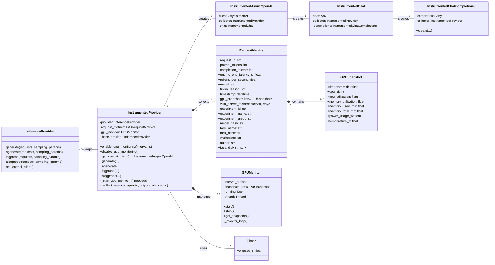
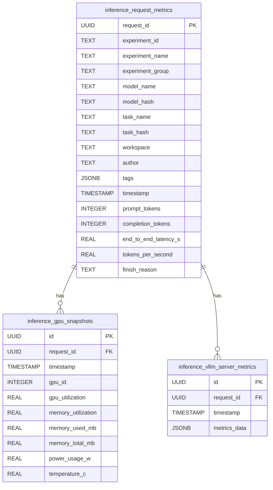

<!-- source: DeepWiki mcp.deepwiki.com · repo allenai/olmo-eval · page 5.3 Inference Metrics and Telemetry · fetched 2026-10-26 -->

# Inference Metrics and Telemetry

Relevant source files

The following files were used as context for generating this wiki page:

- [src/olmo_eval/common/logging.py](src/olmo_eval/common/logging.py)
- [src/olmo_eval/evals/constants/code.py](src/olmo_eval/evals/constants/code.py)
- [src/olmo_eval/evals/external/benchmarks/scicode/eval.py](src/olmo_eval/evals/external/benchmarks/scicode/eval.py)
- [src/olmo_eval/evals/tasks/deepseek_leetcode.py](src/olmo_eval/evals/tasks/deepseek_leetcode.py)
- [src/olmo_eval/evals/tasks/humanevalfim.py](src/olmo_eval/evals/tasks/humanevalfim.py)
- [src/olmo_eval/evals/tasks/multipl_e.py](src/olmo_eval/evals/tasks/multipl_e.py)
- [src/olmo_eval/harness/sandbox/image.py](src/olmo_eval/harness/sandbox/image.py)
- [src/olmo_eval/inference/metrics/core/collector.py](src/olmo_eval/inference/metrics/core/collector.py)
- [src/olmo_eval/inference/metrics/core/config.py](src/olmo_eval/inference/metrics/core/config.py)
- [src/olmo_eval/runners/processing/metrics.py](src/olmo_eval/runners/processing/metrics.py)
- [tests/launch/test_config.py](tests/launch/test_config.py)

This page details the mechanisms within OLMo-Eval for collecting and reporting inference-time metrics and telemetry. This includes the `InstrumentedProvider` wrapper, the `RequestMetrics` data structure, GPU monitoring capabilities, the database schema for storing these metrics, and the `olmo-eval metrics plot` CLI command for visualization.

## InstrumentedProvider Wrapper

The `InstrumentedProvider` [src/olmo_eval/inference/metrics/core/collector.py:105-113]() is a wrapper class that intercepts calls to an underlying `InferenceProvider` [src/olmo_eval/inference/base.py]() to collect performance metrics. It acts as a decorator, allowing any `InferenceProvider` implementation to be instrumented without modifying its core logic.

When an `InferenceProvider` is wrapped by `InstrumentedProvider`, all calls to its `generate()`, `agenerate()`, `logprobs()`, and `alogprobs()` methods are timed. For providers that use the OpenAI client directly (e.g., `LiteLLMProvider`), `InstrumentedAsyncOpenAI` [src/olmo_eval/inference/metrics/core/collector.py:88-103]() and `InstrumentedChatCompletions` [src/olmo_eval/inference/metrics/core/collector.py:20-67]() are used to intercept `chat.completions.create()` calls.

The `base_provider` property [src/olmo_eval/inference/metrics/core/collector.py:127-132]() allows unwrapping nested `InstrumentedProvider` instances to access the original provider. This is particularly useful in scenarios like SciCode external evaluations, where the underlying provider type needs to be checked [src/olmo_eval/evals/external/benchmarks/scicode/eval.py:111-117]().

**Diagram: InstrumentedProvider and Metrics Collection Flow**

Sources:
- [src/olmo_eval/inference/metrics/core/collector.py:20-67]()
- [src/olmo_eval/inference/metrics/core/collector.py:88-103]()
- [src/olmo_eval/inference/metrics/core/collector.py:105-113]()
- [src/olmo_eval/inference/metrics/core/collector.py:127-132]()
- [src/olmo_eval/evals/external/benchmarks/scicode/eval.py:111-117]()

## RequestMetrics Collection

The `RequestMetrics` [src/olmo_eval/inference/metrics/core/schema.py:10-30]() dataclass captures detailed information about each inference request. This includes:
*   `request_id`: A unique identifier for the request.
*   `prompt_tokens`, `completion_tokens`: Token counts for input and output.
*   `end_to_end_latency_s`: Total time taken for the request.
*   `tokens_per_second`: Throughput calculated from completion tokens and latency.
*   `model`, `finish_reason`: Model name and why generation stopped.
*   `timestamp`: When the request was processed.
*   `gpu_snapshots`: A list of `GPUSnapshot` objects if GPU monitoring is enabled.
*   `vllm_server_metrics`: Raw metrics from vLLM's `/metrics` endpoint, if collected.
*   Metadata fields: `experiment_id`, `experiment_name`, `experiment_group`, `model_hash`, `task_name`, `task_hash`, `workspace`, `author`, and `tags` for contextualizing the metrics. These metadata fields are populated from the `MetricsConfig` [src/olmo_eval/inference/metrics/core/config.py:25-68]() provided during evaluation setup.

The `_collect_metrics` method [src/olmo_eval/inference/metrics/core/collector.py:220-256]() within `InstrumentedProvider` is responsible for populating these fields after each `generate`/`logprobs` call.

## GPU Monitoring

GPU monitoring is an optional feature enabled via `MetricsConfig.collect_gpu` [src/olmo_eval/inference/metrics/core/config.py:43](). When enabled, the `InstrumentedProvider` starts a `GPUMonitor` [src/olmo_eval/inference/metrics/core/gpu.py:10-11]() in a background thread.

The `GPUMonitor` [src/olmo_eval/inference/metrics/core/gpu.py:10-11]() periodically samples GPU statistics (utilization, memory usage, power, temperature) using `pynvml` (NVIDIA Management Library). Each sample is stored as a `GPUSnapshot` [src/olmo_eval/inference/metrics/core/schema.py:33-43](). These snapshots are then associated with the `RequestMetrics` [src/olmo_eval/inference/metrics/core/schema.py:10-30]() collected during the inference period.

The `_start_gpu_monitor_if_needed()` [src/olmo_eval/inference/metrics/core/collector.py:215-218]() method ensures the monitor is active during inference calls, and `disable_gpu_monitoring()` [src/olmo_eval/inference/metrics/core/collector.py:143-148]() stops the background thread.

## Metrics Database Schema (Alembic)

Inference metrics are stored in a PostgreSQL database, managed by Alembic migrations. The schema is defined by SQLAlchemy ORM models.

The primary tables for metrics are:
*   `inference_request_metrics`: Stores individual `RequestMetrics` [src/olmo_eval/inference/metrics/core/schema.py:10-30]() entries, including token counts, latencies, and metadata.
*   `inference_gpu_snapshots`: Stores `GPUSnapshot` [src/olmo_eval/inference/metrics/core/schema.py:33-43]() data, linked to `inference_request_metrics` via `request_id`.
*   `inference_vllm_server_metrics`: Stores raw vLLM server metrics, also linked to `inference_request_metrics`.

The `MetricsConfig` [src/olmo_eval/inference/metrics/core/config.py:25-68]() determines which reporters are active, including `ReporterType.DB` [src/olmo_eval/inference/metrics/core/config.py:19-20]() for database storage.

**Diagram: Inference Metrics Database Schema**

Sources:
- [src/olmo_eval/inference/metrics/core/schema.py:10-30]()
- [src/olmo_eval/inference/metrics/core/schema.py:33-43]()
- [src/olmo_eval/inference/metrics/core/config.py:19-20]()
- [src/olmo_eval/inference/metrics/core/config.py:25-68]()

## `olmo-eval metrics plot` CLI Command

The `olmo-eval metrics plot` command provides a way to visualize the collected inference metrics. This command typically queries the metrics database and generates plots to analyze performance characteristics such as latency, throughput, and GPU utilization over time or across different models/tasks.

While the exact implementation of the plotting command is not provided in the given files, the `MetricsOutput` [src/olmo_eval/runners/common/models.py:10-27]() and `TaskMetricsEntry` [src/olmo_eval/runners/common/models.py:30-41]() dataclasses, along with `build_single_model_metrics` [src/olmo_eval/runners/processing/metrics.py:20-115]() and `build_multi_model_metrics` [src/olmo_eval/runners/processing/metrics.py:118-190]() functions, indicate how evaluation results are structured for reporting and analysis. These structures would be the input for any plotting utility.

The `MetricsConfig` [src/olmo_eval/inference/metrics/core/config.py:25-68]() also defines `METRICS_SUBDIR` and `METRICS_FILENAME_SUFFIX` [src/olmo_eval/inference/metrics/core/config.py:13-14]() for file-based reporting, suggesting that metrics can also be stored as JSONL files, which could be another source for plotting.

Sources:
- [src/olmo_eval/runners/common/models.py:10-27]()
- [src/olmo_eval/runners/common/models.py:30-41]()
- [src/olmo_eval/runners/processing/metrics.py:20-115]()
- [src/olmo_eval/runners/processing/metrics.py:118-190]()
- [src/olmo_eval/inference/metrics/core/config.py:13-14]()
- [src/olmo_eval/inference/metrics/core/config.py:25-68]()

---

