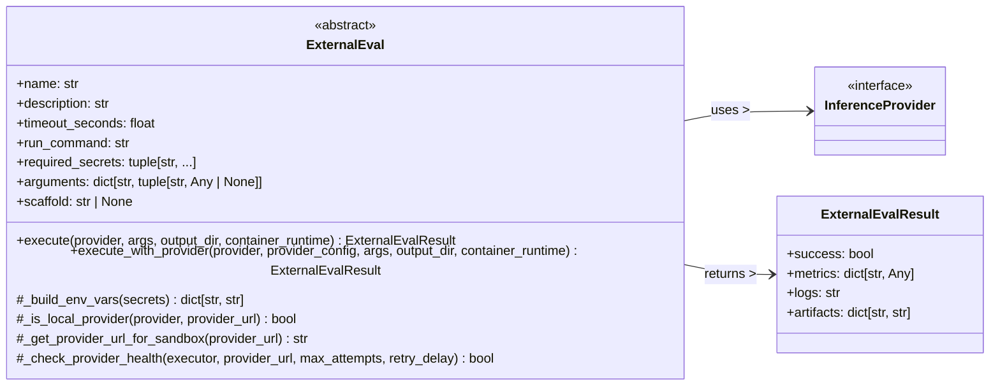

<!-- source: DeepWiki mcp.deepwiki.com · repo allenai/olmo-eval · page 6 External Evaluations · fetched 2026-10-26 -->

# External Evaluations

<details>
<summary>Relevant source files</summary>

The following files were used as context for generating this wiki page:

- [README.md](README.md)
- [src/olmo_eval/cli/run_external.py](src/olmo_eval/cli/run_external.py)
- [src/olmo_eval/common/configs.py](src/olmo_eval/common/configs.py)
- [src/olmo_eval/evals/external/base.py](src/olmo_eval/evals/external/base.py)
- [src/olmo_eval/evals/external/network.py](src/olmo_eval/evals/external/network.py)
- [src/olmo_eval/harness/adapters/openhands.py](src/olmo_eval/harness/adapters/openhands.py)
- [src/olmo_eval/launch/beaker/constants.py](src/olmo_eval/launch/beaker/constants.py)
- [src/olmo_eval/launch/config.py](src/olmo_eval/launch/config.py)

</details>


The `ExternalEval` framework in OLMo-Eval provides a robust mechanism for integrating and running benchmarks that require specialized execution environments, such as sandboxed containers, or involve complex multi-step orchestration beyond the standard `Task` and `Harness` pipeline. This is particularly useful for benchmarks that involve code execution, agentic behavior, or interaction with external systems.

The core idea is to encapsulate the entire evaluation logic within a dedicated class that manages its own execution environment, communication with the Language Model (LM), and result processing. This allows for greater flexibility and isolation, ensuring that complex benchmarks can run reliably without interfering with the main OLMo-Eval process.

### When to use `ExternalEval`

You should consider using `ExternalEval` for benchmarks that:
*   Require sandboxed execution (e.g., for code generation and execution, agentic tasks).
*   Involve multi-step interactions with the LM or external tools.
*   Have specific environment dependencies that are difficult to manage within the standard `Harness`.
*   Are standalone evaluation frameworks that OLMo-Eval needs to orchestrate.

For details on specific external evaluations, refer to their dedicated child pages.

## External Evaluation Architecture

The `ExternalEval` base class [src/olmo_eval/evals/external/base.py:23-29]() defines the interface for these specialized evaluations. Each concrete `ExternalEval` implementation is responsible for its own execution logic, typically involving:
1.  **Setting up the environment**: This often includes launching a container (Docker or Podman) using `swe-rex` for sandboxed execution.
2.  **Communicating with the LM**: The `ExternalEval` receives an `InferenceProvider` instance [src/olmo_eval/evals/external/base.py:70-71]() to make calls to the target LM.
3.  **Orchestrating the benchmark**: This can involve multiple LM calls, tool use, and custom logic.
4.  **Processing results**: The evaluation collects its own metrics and returns an `ExternalEvalResult` [src/olmo_eval/evals/external/base.py:15]().

The `olmo-eval run-external` CLI command [src/olmo_eval/cli/run_external.py:26]() is used to initiate these evaluations, providing options for model selection, output directories, container runtime, and evaluation-specific arguments.

### ExternalEval Class Structure

The `ExternalEval` abstract base class [src/olmo_eval/evals/external/base.py:23-29]() defines several key properties and methods:


**Diagram: `ExternalEval` Class Structure**

Sources: [src/olmo_eval/evals/external/base.py:23-29](), [src/olmo_eval/evals/external/base.py:70-71](), [src/olmo_eval/evals/external/base.py:15]()

Key components:
*   `name` [src/olmo_eval/evals/external/base.py:28-29](): A unique identifier for the evaluation.
*   `description` [src/olmo_eval/evals/external/base.py:31-32](): A brief explanation of the evaluation's purpose.
*   `timeout_seconds` [src/olmo_eval/evals/external/base.py:34-35](): The maximum time allowed for the evaluation to complete.
*   `required_secrets` [src/olmo_eval/evals/external/base.py:53-54](): A tuple of environment variable names that must be passed into the sandbox.
*   `arguments` [src/olmo_eval/evals/external/base.py:56-61](): Defines evaluation-specific arguments that can be passed via the CLI.
*   `scaffold` [src/olmo_eval/evals/external/base.py:63-64](): Indicates if the evaluation uses a specific scaffold (e.g., `openhands`).
*   `execute` [src/olmo_eval/evals/external/base.py:69-84](): The abstract method that concrete implementations must override to define their evaluation logic. It takes an `InferenceProvider` and evaluation-specific arguments.
*   `_build_env_vars` [src/olmo_eval/evals/external/base.py:121-137](): A helper method to construct environment variables for the sandbox, ensuring all `required_secrets` are present.
*   `_is_local_provider` [src/olmo_eval/evals/external/base.py:139-169]() and `_get_provider_url_for_sandbox` [src/olmo_eval/evals/external/base.py:171-210](): Utilities for handling provider URLs, especially for local inference servers that need to be accessible from within a container.

## Running External Evaluations

External evaluations are run using the `olmo-eval run-external` CLI command [src/olmo_eval/cli/run_external.py:26](). This command handles the setup of the inference provider, the container runtime, and passes arguments to the specific `ExternalEval` implementation.

```bash
olmo-eval run-external \
    -m <model_name_or_path> \
    -e <external_eval_name> \
    --output-dir <path/to/results> \
    --runtime <docker_or_podman> \
    -a <eval_arg_key>=<eval_arg_value>
```

The `--runtime` option [src/olmo_eval/cli/run_external.py:70-75]() specifies whether to use Docker or Podman for sandboxed execution. Network configuration for containers is handled by `get_docker_network_args` [src/olmo_eval/evals/external/network.py:8-29](), which ensures the LM server is reachable from within the sandbox.

### Example CLI Usage

```bash
# Run tau2_bench on a model
olmo-eval run-external -m meta-llama/Llama-3.1-8B-Instruct -e tau2_bench

# Run with custom arguments (key=value format)
olmo-eval run-external -m my-model -e tau2_bench -a domain=retail -a num_trials=10

# Run with custom arguments (JSON format)
olmo-eval run-external -m my-model -e tau2_bench -a '{"domain": "retail", "num_trials": 10}'

# Run with custom output directory
olmo-eval run-external -m my-model -e tau2_bench -O ./results

# Run multiple evaluations
olmo-eval run-external -m my-model -e tau2_bench -e scicode_bench
```
Sources: [src/olmo_eval/cli/run_external.py:189-204]()

## Specific External Benchmarks

OLMo-Eval includes implementations for several external benchmarks. Each of these extends the `ExternalEval` base class and provides its own specific logic for execution and result processing.

*   **SciCode Benchmark**: This benchmark focuses on multi-step scientific code generation and execution within a sandboxed environment. For details, see [SciCode Benchmark](#6.1).
*   **TAU2 and TerminalBench**: These benchmarks involve agentic interactions and terminal-based tasks, often leveraging scaffolds like OpenHands. For details, see [TAU2 and TerminalBench](#6.2).

Sources: [src/olmo_eval/cli/run_external.py:26](), [src/olmo_eval/evals/external/base.py:23-29](), [src/olmo_eval/evals/external/base.py:121-137](), [src/olmo_eval/evals/external/base.py:139-169](), [src/olmo_eval/evals/external/base.py:171-210](), [src/olmo_eval/evals/external/network.py:8-29]()

---

