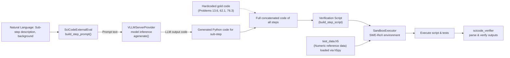
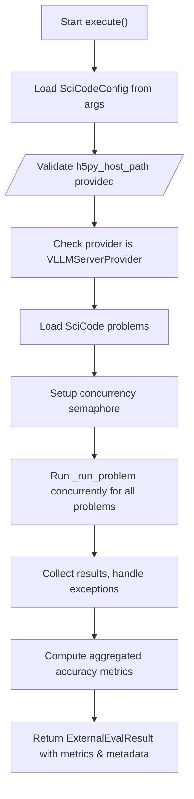
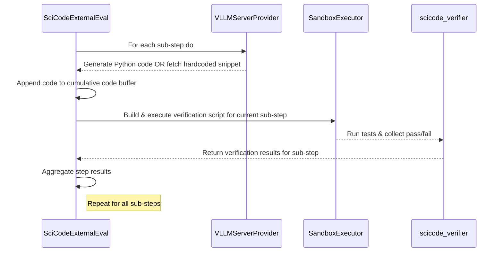

<!-- source: DeepWiki mcp.deepwiki.com · repo allenai/olmo-eval · page 6.1 SciCode Benchmark · fetched 2026-10-26 -->

# SciCode Benchmark

<details>
<summary>Relevant source files</summary>

The following files were used as context for generating this wiki page:

- [src/olmo_eval/evals/external/benchmarks/scicode/__init__.py](src/olmo_eval/evals/external/benchmarks/scicode/__init__.py)
- [src/olmo_eval/evals/external/benchmarks/scicode/eval.py](src/olmo_eval/evals/external/benchmarks/scicode/eval.py)
- [src/olmo_eval/evals/external/benchmarks/scicode/loader.py](src/olmo_eval/evals/external/benchmarks/scicode/loader.py)
- [src/olmo_eval/evals/external/benchmarks/scicode/prompts.py](src/olmo_eval/evals/external/benchmarks/scicode/prompts.py)
- [src/olmo_eval/evals/external/benchmarks/scicode/verifier.py](src/olmo_eval/evals/external/benchmarks/scicode/verifier.py)
- [src/olmo_eval/harness/sandbox/executor.py](src/olmo_eval/harness/sandbox/executor.py)
- [src/olmo_eval/harness/sandbox/image.py](src/olmo_eval/harness/sandbox/image.py)
- [src/olmo_eval/harness/sandbox/manager.py](src/olmo_eval/harness/sandbox/manager.py)
- [src/olmo_eval/harness/tools/registry.py](src/olmo_eval/harness/tools/registry.py)
- [src/olmo_eval/harness/tools/shell.py](src/olmo_eval/harness/tools/shell.py)
- [src/olmo_eval/harness/tools/tool.py](src/olmo_eval/harness/tools/tool.py)
- [src/olmo_eval/inference/metrics/core/collector.py](src/olmo_eval/inference/metrics/core/collector.py)
- [tests/evals/external/benchmarks/test_scicode_external.py](tests/evals/external/benchmarks/test_scicode_external.py)

</details>


The **SciCode Benchmark** is an external evaluation implemented in the OLMo-Eval codebase to assess multi-step scientific code generation capabilities of language models. It is realized as an `ExternalEval` subclass, enabling fine-grained control over sequential code generation for scientific problem sub-steps, execution of the generated code inside a sandboxed Python environment using the SWE-ReX framework, and verification of outputs against numeric reference data accessed via the `h5py` library.

This page provides a comprehensive technical overview of the **SciCodeExternalEval** implementation, including its orchestration of inference calls, sandbox execution strategy, data handling requirements, configuration parameters defined by `SciCodeConfig`, and verification pipeline.

---

## 1. Purpose and Scope

The SciCode benchmark focuses on evaluating language models on realistic, multi-step scientific problems sourced from the HuggingFace dataset `SciCode1/SciCode`. Each problem consists of several sub-steps that must be solved sequentially by generating Python code for each step. The correctness of each sub-step is tested against stored numeric reference data loaded from an HDF5 file (`test_data.h5`) containing precomputed ground-truth values.

The core features include:

- Sequential generation of Python code for each sub-step using the same `InferenceProvider`.
- Inline injection of hardcoded gold snippets for specifically challenging predefined steps (problems 13.6, 62.1, and 76.3).
- Execution of the combined code and tests in an isolated container sandbox with scientific Python packages installed.
- Use of `h5py` to reference structured numeric test data.
- Robust timeout and concurrency handling.

---

## 2. Implementation Overview: `SciCodeExternalEval`

The main class implementing the SciCode benchmark is `SciCodeExternalEval` which extends `ExternalEval`. Its responsibilities include loading problem data, orchestrating sequential sub-step LLM generations, building test scripts, managing the sandbox environment, executing generated code, verifying correctness, and aggregating results.

### Key Properties

- **Name & Description**
  - Name: `"scicode"`
  - Description: `"SciCode: multi-step scientific code generation (65 problems, 288 sub-steps)."`

- **Timeout**
  - Hard timeout of 4 hours (`timeout_seconds = 14400.0`), reflecting the computational intensity.

### Core Method: `execute`

Signature:
```python
async def execute(
    self,
    provider: InferenceProvider,
    args: dict[str, Any],
    output_dir: str | None = None,
    container_runtime: str = "podman",
) -> ExternalEvalResult
```

- Parses inputs into a strongly-typed `SciCodeConfig`.
- Validates presence of the required host path to the `test_data.h5` reference file.
- Enforces that the inference provider is a `VLLMServerProvider` supporting chat templates.
- Loads the SciCode problems and sub-steps from the HuggingFace dataset via `scicode_loader.load_problems`.
- Sets up sampling parameters for generation (max tokens, temperature).
- Executes problems concurrently, limited by `max_concurrency`.
- For each problem, runs `_run_problem` to generate code per sub-step, execute, and verify.
- Aggregates sub-step and main problem accuracies into metrics.
- Optionally writes detailed step and problem-level outputs to `output_dir`.
- Returns an `ExternalEvalResult` with success status, metrics, and metadata.

Sources: `src/olmo_eval/evals/external/benchmarks/scicode/eval.py:68-260`()

---

## 3. Data Loading and Representation

### `SciCodeProblem` DataClass

Each problem instance loaded represents the entire problem including metadata and a sequence of sub-steps. Defined in `loader.py`:

- `problem_id`: Unique identifier for each scientific problem.
- `problem_name`: Descriptive string.
- `required_dependencies`: String listing imports needed for the problem.
- `sub_steps`: List of dictionaries representing each sub-step with fields like number, description, function header, test cases, and optional background knowledge.
- Optionally contains general solution and metadata fields.

The loader function `load_problems` fetches these from the dataset with optional filtering.

Sources: `src/olmo_eval/evals/external/benchmarks/scicode/loader.py:11-66`()

---

## 4. Prompt Construction for Multi-Step Generation

SciCode requires generating code for each sub-step sequentially, where each sub-step prompt references code generated in earlier steps. Prompt construction is handled in `prompts.py`:

- Supports injecting either problem sub-step background or not, toggled by the `with_background` flag.
- For sub-step `i`, the prompt contains textual descriptions and code of previous sub-steps `0..i-1`.
- Hardcoded gold snippets for specific problematic sub-steps are stored and injected instead of calling the model.
- Emphasizes strict generation of a single Python code block containing only the current step’s function implementation without extraneous imports or test code.

Key function:

```python
def build_step_prompt(sub_steps, required_dependencies, step_idx, previous_llm_code, with_background) -> str
```

This returns a prompt string to send to the language model for step `step_idx`, incorporating all prior steps' code/results.

Sources: `src/olmo_eval/evals/external/benchmarks/scicode/prompts.py:13-146`()

---

## 5. Sandbox Execution with SWE-ReX

### Sandbox Environment Needs

- The generated Python code and verification scripts run in a container sandbox managed via the SWE-ReX framework.
- The container image includes scientific libraries: `numpy`, `scipy`, `sympy`, `h5py`.
- The numeric ground-truth data file `test_data.h5` must be mounted inside the container. Its path is configurable via `h5py_host_path` (host path) and `h5py_container_path` (container path).
- The default container image is settable using `sandbox_image` with a carefully prepared base to support Python 3.12 and scientific packages.

### SWE-ReX Support in OLMo-Eval

- SWE-ReX enables launching persistent container sandboxes that accept commands for isolated execution.
- `SandboxManager` and `SandboxExecutor` classes in the harness subsystem provide asynchronous sandbox lifecycle and command execution management.
- For SciCode, each sub-step test script is executed in a fresh sandboxed interpreter via these utilities.

### Building Container Images with `swe-rex`

- The helper `get_swerex_image` constructs or pulls prebuilt container images with swe-rex pre-installed, as SCIcode test executions rely heavily on this tooling.
- Images may be cached locally or pushed and pulled from registries for scalable deployment.

Sources: 
- `src/olmo_eval/evals/external/benchmarks/scicode/eval.py:24-47,73-138`()
- `src/olmo_eval/harness/sandbox/image.py:1-110`()
- `src/olmo_eval/harness/sandbox/manager.py:52-230`()
- `src/olmo_eval/harness/sandbox/executor.py:1-300`()

---

## 6. Verification Logic: Test Script Construction and Execution

Verification scripts for each sub-step are dynamically generated Python scripts that:

- Import the required dependencies.
- Inline a helper function for processing the HDF5 reference file without needing the upstream SciCode Python package.
- Import all previously generated sub-step code as combined in `full_code`.
- Extract the numeric test targets for the current sub-step from `test_data.h5` using `process_hdf5_to_tuple`.
- Run all assert test cases specified in the sub-step, binding targets per test.

The key function to generate the verification script is:

```python
def build_step_script(
    step: dict[str, Any],
    required_dependencies: str,
    full_code: str,
    hardcoded_prelude: str,
    h5py_file: str
) -> str
```

This returns a single executable Python source string to be run inside the sandbox.

Verification is performed by sending this script for execution in the sandbox, capturing exit status and outputs to determine pass/failure per test.

Sources: `src/olmo_eval/evals/external/benchmarks/scicode/verifier.py:1-118`()

---

## 7. `SciCodeConfig`: Configuration Parameters

The configuration for the SciCode evaluation run is encapsulated in the `SciCodeConfig` data class:

| Parameter            | Type             | Default                  | Description                                                       |
|----------------------|------------------|--------------------------|-------------------------------------------------------------------|
| `split`              | `str`            | `"test"`                 | Which dataset split to evaluate (`test` or `validation`)          |
| `problem_ids`         | `list[str] \| None` | `None`                 | Optional filter to evaluate only specific problem IDs             |
| `with_background`    | `bool`           | `True`                   | Whether to include background scientific knowledge in prompts    |
| `enable_thinking`    | `bool`           | `False`                  | Enables "thinking" chain-of-thought to improve reasoning in prompts |
| `max_tokens`          | `int`            | 16384                    | Max tokens allowed in LLM generation per sub-step                 |
| `temperature`         | `float`          | 0.6                      | Sampling temperature for code generation                          |
| `max_concurrency`     | `int`            | 4                        | Max concurrent problems generated in parallel                     |
| `command_timeout`     | `float`          | 600.0                    | Timeout (seconds) to limit code execution in sandbox per step     |
| `startup_timeout`     | `float`          | 300.0                    | Max time to wait for sandbox startup                              |
| `h5py_host_path`      | `str`            | `""`                     | Host machine path to `test_data.h5` reference data file           |
| `h5py_container_path` | `str`            | `"/workspace/scicode_test_data.h5"` | Internal path inside container for the data file |
| `sandbox_image`       | `str`            | `"ghcr.io/astral-sh/uv:python3.12-bookworm-slim"` | Container image for sandbox |

These parameters control dataset selection, prompt content, generation quality, concurrency, sandbox environment, and timeouts.

Sources: `src/olmo_eval/evals/external/benchmarks/scicode/eval.py:50-67`()

---

## 8. Detailed Data Flow and Execution Sequence

The following diagram illustrates how the benchmark operates from natural language sub-step representations to code generation and sandbox execution verification by connecting OLMo-Eval components and external systems:



Explanation:
- Natural language descriptions from SciCode are converted into prompts with optional background.
- The prompt is fed to the LLM provider (`VLLMServerProvider`) which generates Python code per sub-step.
- For certain problematic steps, predefined hardcoded snippets replace LLM-generated code.
- All sub-step codes are concatenated progressively.
- A verification script is constructed embedding required dependencies, the concatenated code, and loading HDF5 numeric test targets.
- The script runs inside the isolated `SandboxExecutor` backed by SWE-ReX and the specified container image.
- The HDF5 file containing numeric ground truth is mounted inside the container.
- Script execution produces test pass/fail results parsed by the verifier logic.
- Results are aggregated and accuracy metrics for sub-steps and problems are computed.

Sources: `src/olmo_eval/evals/external/benchmarks/scicode/eval.py:68-260, src/olmo_eval/evals/external/benchmarks/scicode/prompts.py:150-170, src/olmo_eval/evals/external/benchmarks/scicode/verifier.py:90-115`()

---

## 9. Verification and Result Aggregation

- After running all sub-steps for a problem, results include:
  - Pass/fail per sub-step.
  - Total number of scorable sub-steps (excluding hardcoded).
  - Overall problem all_passed flag.
  - Optional error messages.

- Metrics are aggregated globally:
  - `sub_step_accuracy`: fraction of all sub-steps passed.
  - `main_problem_accuracy`: fraction of problems where all sub-steps passed.
  - Counts of problems and sub-steps evaluated.

- Results are encapsulated in an `ExternalEvalResult` object with detailed metadata, model info, and optional output directory dumps.

---

## 10. Summary Table: Critical Classes/Functions

| Class/Function                 | Description                                            | Location                            |
|-------------------------------|--------------------------------------------------------|-----------------------------------|
| `SciCodeExternalEval`          | Main external evaluation class for SciCode benchmark   | `eval.py` [68-260]()              |
| `SciCodeConfig`                | Configuration parameters for SciCode external eval     | `eval.py` [50-67]()               |
| `load_problems`                | Loads SciCode problems from dataset                     | `loader.py` [23-66]()             |
| `build_step_prompt`            | Constructs prompt for sequential sub-step generation    | `prompts.py` [153-193]()          |
| `HARDCODED_SNIPPETS`           | Hardcoded gold snippets for specific problem sub-steps | `prompts.py` [14-85]()            |
| `build_step_script`            | Creates the Python test script for a given sub-step    | `verifier.py` [91-115]()          |
| `SandboxExecutor`              | Manages isolated sandbox lifecycle & command execution | `sandbox/executor.py` [73-300]()  |
| `get_swerex_image`             | Builds derives container image with swe-rex installed  | `sandbox/image.py` [60-110]()     |

---

## References and Related Files

- **Test coverage for SciCodeExternalEval:** The `tests/evals/external/benchmarks/test_scicode_external.py` file implements extensive unit and integration tests including mocks for provider generation and verification logic, ensuring code generation happens per scorable sub-step and injection of hardcoded snippets for known problem IDs [tests/evals/external/benchmarks/test_scicode_external.py:20-200]().

- **Sandbox and SWE-ReX integration:** OLMo-Eval leverages `SandboxManager` and `SandboxExecutor` classes for sandbox provisioning and execution, wrapping SWE-ReX container deployments [harness/sandbox/manager.py:52-250](), [harness/sandbox/executor.py:73-300](). Images used have Python with scientific packages plus swe-rex installed, built via `get_swerex_image()` utility [harness/sandbox/image.py:60-110]().

---

This foundation enables rigorous and isolated multi-step scientific code generation evaluation with accurate numeric verification, supporting research into advancing model capabilities for complex scientific computation.

---

# Appendix: SciCode Evaluation Class High-Level Flow



Sources: `src/olmo_eval/evals/external/benchmarks/scicode/eval.py:90-190`()

---

# Appendix: Multi-step Code Generation Sequence (Per Problem)



Sources: `src/olmo_eval/evals/external/benchmarks/scicode/eval.py:120-200`, `verifier.py:90-115`()

---

# Sources

- `src/olmo_eval/evals/external/benchmarks/scicode/eval.py:1-260`  
- `src/olmo_eval/evals/external/benchmarks/scicode/prompts.py:1-146`  
- `src/olmo_eval/evals/external/benchmarks/scicode/verifier.py:1-115`  
- `src/olmo_eval/evals/external/benchmarks/scicode/loader.py:1-66`  
- `src/olmo_eval/harness/sandbox/image.py:1-110`  
- `src/olmo_eval/harness/sandbox/manager.py:50-230`  
- `src/olmo_eval/harness/sandbox/executor.py:70-300`  
- `tests/evals/external/benchmarks/test_scicode_external.py:10-200`

---

