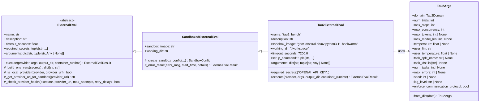
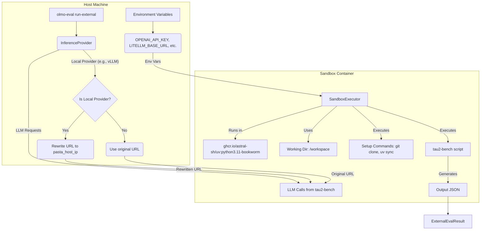
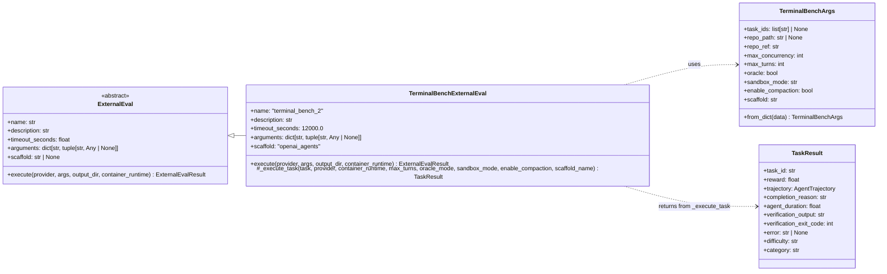

<!-- source: DeepWiki mcp.deepwiki.com · repo allenai/olmo-eval · page 6.2 TAU2 and TerminalBench · fetched 2026-10-26 -->

# TAU2 and TerminalBench

<details>
<summary>Relevant source files</summary>

The following files were used as context for generating this wiki page:

- [src/olmo_eval/common/config/infrastructure.py](src/olmo_eval/common/config/infrastructure.py)
- [src/olmo_eval/evals/external/base.py](src/olmo_eval/evals/external/base.py)
- [src/olmo_eval/evals/external/benchmarks/tau2/__init__.py](src/olmo_eval/evals/external/benchmarks/tau2/__init__.py)
- [src/olmo_eval/evals/external/benchmarks/tau2/eval.py](src/olmo_eval/evals/external/benchmarks/tau2/eval.py)
- [src/olmo_eval/evals/external/benchmarks/terminal_bench/eval.py](src/olmo_eval/evals/external/benchmarks/terminal_bench/eval.py)
- [src/olmo_eval/evals/external/network.py](src/olmo_eval/evals/external/network.py)
- [src/olmo_eval/launch/beaker/constants.py](src/olmo_eval/launch/beaker/constants.py)

</details>


This page details the integration of TAU2 and TerminalBench as external evaluations within the OLMo-Eval framework. It covers their `ExternalEval` implementations, how they leverage scaffolds and sandbox environments, and the configuration options available when running them via the `olmo-eval run-external` command.

## TAU2 External Evaluation

TAU2-bench is an evaluation for language model agents on customer service tasks, measuring task completion and constraint satisfaction. OLMo-Eval uses a "verified" version of the benchmark that addresses issues in the original.

### Implementation: `Tau2ExternalEval`

The `Tau2ExternalEval` class [src/olmo_eval/evals/external/benchmarks/tau2/eval.py:105-400]() inherits from `SandboxedExternalEval` [src/olmo_eval/evals/external/base.py:1-229](), indicating that it runs within a sandboxed environment.

#### Key Properties and Methods

*   `name`: Returns `"tau2_bench"` [src/olmo_eval/evals/external/benchmarks/tau2/eval.py:108-110]().
*   `description`: Provides a summary of the evaluation [src/olmo_eval/evals/external/benchmarks/tau2/eval.py:112-116]().
*   `sandbox_image`: Specifies the Docker image used for the sandbox, currently `"ghcr.io/astral-sh/uv:python3.11-bookworm"` [src/olmo_eval/evals/external/benchmarks/tau2/eval.py:120-123]().
*   `working_dir`: Sets the working directory inside the sandbox to `"/workspace"` [src/olmo_eval/evals/external/benchmarks/tau2/eval.py:125-127]().
*   `timeout_seconds`: Defines the maximum execution time for the evaluation (7200 seconds) [src/olmo_eval/evals/external/benchmarks/tau2/eval.py:129-131]().
*   `setup_command`: A tuple of shell commands executed to set up the environment within the sandbox. This includes cloning the `tau2-bench-verified` repository, checking out a specific commit, and installing dependencies using `uv sync` [src/olmo_eval/evals/external/benchmarks/tau2/eval.py:133-144]().
*   `required_secrets`: Specifies environment variables that must be forwarded to the sandbox, such as `"OPENAI_API_KEY"` [src/olmo_eval/evals/external/benchmarks/tau2/eval.py:146-148]().
*   `arguments`: A dictionary defining the configurable arguments for the evaluation, including `domain`, `num_trials`, `max_steps`, `max_tokens`, `user_llm`, and task filtering options [src/olmo_eval/evals/external/benchmarks/tau2/eval.py:151-169](). These arguments are parsed into a `Tau2Args` dataclass [src/olmo_eval/evals/external/benchmarks/tau2/eval.py:49-102]().
*   `execute()`: The core asynchronous method that orchestrates the evaluation [src/olmo_eval/evals/external/benchmarks/tau2/eval.py:171-400]().
    *   It initializes `Tau2Args` from the provided arguments.
    *   Determines the provider's URL and model name, and checks if it's a local provider using `_is_local_provider()` [src/olmo_eval/evals/external/base.py:138-169]().
    *   Creates a `SandboxExecutor` instance [src/olmo_eval/evals/external/benchmarks/tau2/eval.py:189-190]().
    *   Configures the sandbox, including port mappings for local providers and environment variables.
    *   If a local provider is detected, it performs a health check using `_check_provider_health()` [src/olmo_eval/evals/external/base.py:211-229]() to ensure the provider is reachable from within the sandbox.
    *   Constructs the command to run the `tau2_bench` script within the sandbox, passing all relevant arguments.
    *   Executes the command using `sandbox.run_command()` [src/olmo_eval/evals/external/benchmarks/tau2/eval.py:309-310]().
    *   Parses the JSON output from the `tau2_bench` script to extract metrics and results.
    *   Returns an `ExternalEvalResult` [src/olmo_eval/evals/external/result.py]() containing the aggregated metrics and raw output.

#### `Tau2Args` Dataclass

The `Tau2Args` dataclass [src/olmo_eval/evals/external/benchmarks/tau2/eval.py:49-102]() defines the various parameters that can be configured for a TAU2 evaluation run. It includes settings for the evaluation domain, number of trials, agent steps, concurrency, LLM parameters for both the agent and the simulated user, and task filtering options. The `from_dict` class method handles parsing these arguments, including special handling for `task_ids` which can be a comma-separated string or a list.


Title: `Tau2ExternalEval` Class Diagram

Sources:
*   src/olmo_eval/evals/external/benchmarks/tau2/eval.py:105-400
*   src/olmo_eval/evals/external/benchmarks/tau2/eval.py:108-110
*   src/olmo_eval/evals/external/benchmarks/tau2/eval.py:112-116
*   src/olmo_eval/evals/external/benchmarks/tau2/eval.py:120-123
*   src/olmo_eval/evals/external/benchmarks/tau2/eval.py:125-127
*   src/olmo_eval/evals/external/benchmarks/tau2/eval.py:129-131
*   src/olmo_eval/evals/external/benchmarks/tau2/eval.py:133-144
*   src/olmo_eval/evals/external/benchmarks/tau2/eval.py:146-148
*   src/olmo_eval/evals/external/benchmarks/tau2/eval.py:151-169
*   src/olmo_eval/evals/external/benchmarks/tau2/eval.py:171-400
*   src/olmo_eval/evals/external/benchmarks/tau2/eval.py:49-102
*   src/olmo_eval/evals/external/base.py:1-229
*   src/olmo_eval/evals/external/base.py:138-169
*   src/olmo_eval/evals/external/base.py:211-229
*   src/olmo_eval/evals/external/result.py

### Sandbox Configuration for TAU2

The `Tau2ExternalEval` uses a `SandboxExecutor` [src/olmo_eval/evals/external/benchmarks/tau2/eval.py:189-190]() to run the evaluation in an isolated container.

*   **Image**: `ghcr.io/astral-sh/uv:python3.11-bookworm` [src/olmo_eval/evals/external/benchmarks/tau2/eval.py:120-123]()
*   **Working Directory**: `/workspace` [src/olmo_eval/evals/external/benchmarks/tau2/eval.py:125-127]()
*   **Environment Variables**: `OPENAI_API_KEY` is required and passed through [src/olmo_eval/evals/external/benchmarks/tau2/eval.py:146-148](). Other environment variables related to the LLM provider (e.g., `LITELLM_BASE_URL`, `LITELLM_MODEL_NAME`) are also set dynamically based on the `InferenceProvider` [src/olmo_eval/evals/external/benchmarks/tau2/eval.py:200-207]().
*   **Network**: If the `InferenceProvider` is detected as local (e.g., a vLLM server), the sandbox is configured to allow communication with the host machine. This involves rewriting `localhost` URLs to use the `pasta_host_ip` [src/olmo_eval/evals/external/base.py:171-209]() and setting up appropriate network arguments for Docker or Podman [src/olmo_eval/evals/external/network.py:8-30]().


Title: TAU2 Sandbox Execution Flow

Sources:
*   src/olmo_eval/evals/external/benchmarks/tau2/eval.py:189-190
*   src/olmo_eval/evals/external/benchmarks/tau2/eval.py:120-123
*   src/olmo_eval/evals/external/benchmarks/tau2/eval.py:125-127
*   src/olmo_eval/evals/external/benchmarks/tau2/eval.py:146-148
*   src/olmo_eval/evals/external/benchmarks/tau2/eval.py:200-207
*   src/olmo_eval/evals/external/base.py:171-209
*   src/olmo_eval/evals/external/network.py:8-30

## TerminalBench External Evaluation

Terminal-Bench 2.0 evaluates LLM agents on 89 diverse terminal tasks. This evaluation uses a per-task container orchestration approach, where each task runs in its own isolated sandbox.

### Implementation: `TerminalBenchExternalEval`

The `TerminalBenchExternalEval` class [src/olmo_eval/evals/external/benchmarks/terminal_bench/eval.py:92-300]() inherits from `ExternalEval` [src/olmo_eval/evals/external/base.py:1-229](). Unlike `Tau2ExternalEval`, it manages sandbox creation and execution for each task individually rather than relying on `SandboxedExternalEval`'s single sandbox approach.

#### Key Properties and Methods

*   `name`: Returns `"terminal_bench_2"` [src/olmo_eval/evals/external/benchmarks/terminal_bench/eval.py:95-97]().
*   `description`: Describes the evaluation's purpose [src/olmo_eval/evals/external/benchmarks/terminal_bench/eval.py:99-101]().
*   `timeout_seconds`: Sets a generous timeout for all tasks (12000 seconds) [src/olmo_eval/evals/external/benchmarks/terminal_bench/eval.py:103-105]().
*   `arguments`: Defines configurable parameters like `task_ids`, `repo_path`, `max_concurrency`, `max_turns`, `oracle` mode, `sandbox_mode`, and `scaffold` [src/olmo_eval/evals/external/benchmarks/terminal_bench/eval.py:108-118](). These are parsed into a `TerminalBenchArgs` dataclass [src/olmo_eval/evals/external/benchmarks/terminal_bench/eval.py:44-73]().
*   `scaffold`: Specifies that this evaluation uses the `"openai_agents"` scaffold [src/olmo_eval/evals/external/benchmarks/terminal_bench/eval.py:120-122]().
*   `execute()`: The main asynchronous method for running the evaluation [src/olmo_eval/evals/external/benchmarks/terminal_bench/eval.py:124-300]().
    *   Validates the specified scaffold using `validate_scaffold()` [src/olmo_eval/harness/scaffolds/__init__.py]().
    *   Loads tasks using `TerminalBenchLoader` [src/olmo_eval/evals/external/benchmarks/terminal_bench/loader.py](), either from a local path or by cloning the repository.
    *   Uses an `asyncio.Semaphore` to limit the number of concurrent task executions based on `max_concurrency` [src/olmo_eval/evals/external/benchmarks/terminal_bench/eval.py:166-167]().
    *   Calls `_execute_task()` for each task, which handles the individual sandbox setup and agent execution [src/olmo_eval/evals/external/benchmarks/terminal_bench/eval.py:169-179]().
    *   Aggregates results from all tasks and calculates overall metrics.
    *   Returns an `ExternalEvalResult` [src/olmo_eval/evals/external/result.py]().
*   `_execute_task()`: An internal asynchronous method responsible for running a single Terminal-Bench task [src/olmo_eval/evals/external/benchmarks/terminal_bench/eval.py:302-490]().
    *   Initializes a `SandboxManager` [src/olmo_eval/harness/sandbox/manager.py]() and a `TerminalBenchVerifier` [src/olmo_eval/evals/external/benchmarks/terminal_bench/verifier.py]().
    *   Sets up the sandbox configuration, including the `swerex` image, network arguments, and environment variables.
    *   Initializes the `Harness` [src/olmo_eval/harness/harness.py]() with the specified scaffold (`openai_agents`) and the sandbox.
    *   Runs the agent within the harness, capturing the trajectory.
    *   Verifies the task completion using the `TerminalBenchVerifier`.
    *   Returns a `TaskResult` [src/olmo_eval/evals/external/benchmarks/terminal_bench/eval.py:76-90]().

#### `TerminalBenchArgs` Dataclass

The `TerminalBenchArgs` dataclass [src/olmo_eval/evals/external/benchmarks/terminal_bench/eval.py:44-73]() holds configuration for Terminal-Bench runs, including task selection, repository details, concurrency, maximum turns, and sandbox/scaffold settings.


Title: `TerminalBenchExternalEval` Class Diagram

Sources:
*   src/olmo_eval/evals/external/benchmarks/terminal_bench/eval.py:92-300
*   src/olmo_eval/evals/external/benchmarks/terminal_bench/eval.py:95-97
*   src/olmo_eval/evals/external/benchmarks/terminal_bench/eval.py:99-101
*   src/olmo_eval/evals/external/benchmarks/terminal_bench/eval.py:103-105
*   src/olmo_eval/evals/external/benchmarks/terminal_bench/eval.py:108-118
*   src/olmo_eval/evals/external/benchmarks/terminal_bench/eval.py:120-122
*   src/olmo_eval/evals/external/benchmarks/terminal_bench/eval.py:124-300
*   src/olmo_eval/evals/external/benchmarks/terminal_bench/eval.py:166-167
*   src/olmo_eval/evals/external/benchmarks/terminal_bench/eval.py:169-179
*   src/olmo_eval/evals/external/benchmarks/terminal_bench/eval.py:302-490
*   src/olmo_eval/evals/external/benchmarks/terminal_bench/eval.py:76-90
*   src/olmo_eval/evals/external/benchmarks/terminal_bench/eval.py:44-73
*   src/olmo_eval/evals/external/base.py:1-229
*   src/olmo_eval/harness/scaffolds/__init__.py
*   src/olmo_eval/evals/external/benchmarks/terminal_bench/loader.py
*   src/olmo_eval/harness/sandbox/manager.py
*   src/olmo_eval/evals/external/benchmarks/terminal_bench/verifier.py
*   src/olmo_eval/harness/harness.py
*   src/olmo_eval/evals/external/result.py

### Scaffold Usage and Sandbox Configuration for TerminalBench

TerminalBench leverages the `openai_agents` scaffold [src/olmo_eval/evals/external/benchmarks/terminal_bench/eval.py:120-122]() to interact with the LLM and execute commands within the sandbox.

*   **Scaffold**: The `openai_agents` scaffold provides the necessary tools and prompt structure for the LLM to act as an agent in a terminal environment. The `SYSTEM_PROMPT` [src/olmo_eval/evals/external/benchmarks/terminal_bench/eval.py:33-41]() defines the agent's role and available tools (`execute_bash_session`, `submit`).
*   **Sandbox Mode**: The `sandbox_mode` argument [src/olmo_eval/evals/external/benchmarks/terminal_bench/eval.py:116]() can be `"docker"` or `"modal"`. The default is `"docker"`.
*   **Sandbox Image**: The `swerex` image (obtained via `get_swerex_image()` [src/olmo_eval/harness/sandbox/image.py]()) is used for the sandbox, providing a robust environment for executing bash commands.
*   **Network**: Similar to TAU2, network arguments are configured to allow the sandbox to communicate with the host machine, especially for local LLM providers. This uses `get_docker_network_args()` [src/olmo_eval/evals/external/network.py:8-30]() which handles differences between Docker and Podman. For Podman, it uses `pasta` networking with `--map-guest-addr` and a fixed `pasta_host_ip` [src/olmo_eval/launch/beaker/constants.py:23](), along with a DNS server to avoid timeouts.
*   **Per-Task Sandboxes**: A key aspect of TerminalBench is that each task gets its own isolated sandbox, managed by `SandboxManager` [src/olmo_eval/harness/sandbox/manager.py](). This ensures task isolation and prevents interference between tasks.

```mermaid
graph TD
    subgraph Host Machine
        A[olmo-eval run-external] --> B(InferenceProvider)
        C[TerminalBenchExternalEval.execute()]
        C -- "Loads Tasks" --> D(TerminalBenchLoader)
        D -- "Tasks" --> E(asyncio.Semaphore)
        E -- "Limits Concurrency" --> F(TerminalBenchExternalEval._execute_task())
    end

    subgraph Per-Task Sandbox (repeated for each task)
        F -- "Initializes" --> G(SandboxManager)
        G -- "Configures Sandbox" --> H(SandboxConfig)
        H -- "Image" --> I[swerex image]
        H -- "Network Args" --> J(get_docker_network_args)
        H -- "Env Vars" --> K(LLM_API_KEY, LITELLM_BASE_URL, etc.)
        G -- "Initializes" --> L(Harness)
        L -- "Uses Scaffold" --> M[openai_agents]
        M -- "System Prompt" --> N[You are an AI assistant...]
        M -- "Tools" --> O[execute_bash_session, submit]
        L -- "Runs Agent" --> P(Agent Trajectory)
        P -- "Verifies" --> Q(TerminalBenchVerifier)
        Q -- "Result" --> R(TaskResult)
    end

    F -- "Calls" --> G
    F -- "Returns" --> R
    R --> S[ExternalEvalResult]
```
Title: TerminalBench Scaffold and Sandbox Flow

Sources:
*   src/olmo_eval/evals/external/benchmarks/terminal_bench/eval.py:120-122
*   src/olmo_eval/evals/external/benchmarks/terminal_bench/eval.py:33-41
*   src/olmo_eval/evals/external/benchmarks/terminal_bench/eval.py:116
*   src/olmo_eval/harness/sandbox/image.py
*   src/olmo_eval/evals/external/network.py:8-30
*   src/olmo_eval/launch/beaker/constants.py:23
*   src/olmo_eval/harness/sandbox/manager.py

## Running External Evaluations via `olmo-eval run-external`

Both TAU2 and TerminalBench evaluations are executed using the `olmo-eval run-external` CLI command. This command allows specifying the external evaluation by its name and passing arguments specific to that evaluation.

### Command Structure

```bash
olmo-eval run-external <evaluation_name> \
    --provider <provider_config_name> \
    [--arg <key>=<value>] \
    [--output-dir <path>] \
    [--container-runtime <runtime>]
```

### Example for TAU2

To run TAU2-bench with a local vLLM provider, specifying the `airline` domain and 2 trials:

```bash
olmo-eval run-external tau2_bench \
    --provider vllm-local \
    --arg domain=airline \
    --arg num_trials=2 \
    --arg max_steps=10 \
    --output-dir ./tau2_results
```

### Example for TerminalBench

To run TerminalBench with an OpenAI provider, limiting to specific tasks and 2 concurrent sandboxes:

```bash
export OPENAI_API_KEY="sk-..." # Ensure API key is set for the provider
olmo-eval run-external terminal_bench_2 \
    --provider openai \
    --arg task_ids="ls-1,cat-1" \
    --arg max_concurrency=2 \
    --arg max_turns=20 \
    --output-dir ./terminalbench_results
```

### Environment Variables and Secrets

For external evaluations that require API keys or other sensitive information, these should be provided as environment variables on the host machine. The `ExternalEval` implementation will then forward the `required_secrets` [src/olmo_eval/evals/external/base.py:50-52]() to the sandbox. For example, `OPENAI_API_KEY` is a `required_secret` for TAU2 [src/olmo_eval/evals/external/benchmarks/tau2/eval.py:146-148]().

### Infrastructure Configuration

The `InfrastructureConfig` [src/olmo_eval/common/config/infrastructure.py:15-68]() class, populated from environment variables, dictates how `olmo-eval` interacts with the underlying infrastructure, including the `container_runtime` (Docker or Podman) and `pasta_host_ip` for network communication with sandboxes. These settings are crucial for ensuring the sandboxes can communicate with local LLM providers.

Sources:
*   src/olmo_eval/evals/external/base.py:50-52
*   src/olmo_eval/evals/external/benchmarks/tau2/eval.py:146-148
*   src/olmo_eval/common/config/infrastructure.py:15-68

---

