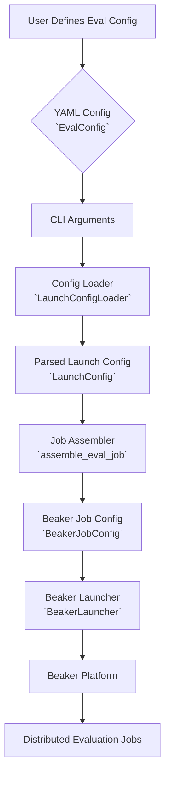

<!-- source: DeepWiki mcp.deepwiki.com · repo allenai/olmo-eval · page 7 Beaker Integration · fetched 2026-10-26 -->

# Beaker Integration

Relevant source files

The following files were used as context for generating this wiki page:

- [README.md](README.md)
- [src/olmo_eval/cli/beaker/config_loader.py](src/olmo_eval/cli/beaker/config_loader.py)
- [src/olmo_eval/cli/beaker/job_assembler.py](src/olmo_eval/cli/beaker/job_assembler.py)
- [src/olmo_eval/launch/beaker/launcher.py](src/olmo_eval/launch/beaker/launcher.py)
- [src/olmo_eval/launch/config.py](src/olmo_eval/launch/config.py)

This page provides an overview of how OLMo-Eval integrates with Beaker, an AI2 cluster management system, to launch and manage distributed evaluation jobs. Beaker integration enables running evaluations on powerful compute resources, managing job dependencies, and tracking experiments efficiently.

This is a parent page. For detailed information on specific aspects of Beaker integration, please refer to the child pages:
*   [Beaker Launch Configuration](#7.1) — Explains the configuration dataclasses and how to define Beaker jobs using YAML.
*   [BeakerLauncher and Group Management](#7.2) — Documents the `BeakerLauncher` class and CLI commands for managing Beaker experiments and groups.

## Overview of Beaker Integration

OLMo-Eval leverages Beaker to orchestrate evaluation runs, particularly for large models or extensive task suites that require significant computational resources. The integration focuses on defining evaluation jobs as Beaker experiments, allowing for:

*   **Distributed Execution**: Running multiple evaluation tasks or models concurrently across different Beaker jobs.
*   **Resource Management**: Specifying GPU requirements, clusters, and budgets.
*   **Reproducibility**: Packaging the evaluation environment and code for consistent runs.
*   **Experiment Tracking**: Grouping related jobs and monitoring their status.

The core workflow involves defining job configurations, assembling them into Beaker experiment specifications, and then launching these experiments via a dedicated launcher.

Sources: [src/olmo_eval/cli/beaker/config_loader.py:71-78](), [src/olmo_eval/cli/beaker/job_assembler.py:1-3](), [src/olmo_eval/launch/beaker/launcher.py:1-17]()

## Beaker Launch Configuration

Defining a Beaker evaluation job in OLMo-Eval starts with configuration. This involves several dataclasses that capture the necessary parameters for an evaluation run and its deployment on Beaker.

The primary configuration for defining an evaluation is `EvalConfig` [src/olmo_eval/launch/config.py:114-145](), which is typically loaded from a YAML file. This configuration specifies the models, tasks, and general Beaker-related settings like cluster, priority, and budget.

Command-line arguments are then merged with or override the `EvalConfig` using the `LaunchConfigLoader` [src/olmo_eval/cli/beaker/config_loader.py:71-78]() to produce a `LaunchConfig` [src/olmo_eval/cli/beaker/config_loader.py:18-70](). This `LaunchConfig` represents the fully resolved parameters for a Beaker launch.

Finally, the `job_assembler` module [src/olmo_eval/cli/beaker/job_assembler.py:1-3]() takes the `LaunchConfig` and constructs one or more `BeakerJobConfig` [src/olmo_eval/launch/beaker/launcher.py:49]() instances. Each `BeakerJobConfig` represents a single Beaker experiment specification, including the command to run, environment variables, resource requirements, and dependencies.

For a detailed explanation of these configuration classes, the `config_loader`, `job_assembler`, and example YAML configurations, see [Beaker Launch Configuration](#7.1).
Sources: [src/olmo_eval/launch/config.py:114-145](), [src/olmo_eval/cli/beaker/config_loader.py:18-70](), [src/olmo_eval/cli/beaker/config_loader.py:71-78](), [src/olmo_eval/cli/beaker/job_assembler.py:1-3](), [src/olmo_eval/launch/beaker/launcher.py:49]()

## BeakerLauncher and Group Management

The `BeakerLauncher` class [src/olmo_eval/launch/beaker/launcher.py:15]() is the central component for interacting with the Beaker platform. It provides methods to launch experiments, monitor their status, and manage groups of related experiments.

Key functionalities of `BeakerLauncher` include:

*   `launch()`: Submits a `BeakerJobConfig` to Beaker, creating a new experiment.
*   `follow_experiment()`: Tracks the progress and logs of a running Beaker experiment.
*   `get_or_create_group()`: Manages Beaker experiment groups, allowing multiple related jobs to be tracked together.
*   `get_group_status()`: Retrieves the current status of all experiments within a Beaker group.
*   `cancel_group()`: Terminates all running experiments within a specified Beaker group.
*   `build_install_command()`: Generates the `uv` installation command for the Beaker job, ensuring all necessary dependencies and optional extras are installed.

The `beaker group` CLI commands also provide a way to interact with and manage these experiment groups directly from the command line.

For a comprehensive guide on using the `BeakerLauncher` and managing Beaker experiment groups, refer to [BeakerLauncher and Group Management](#7.2).
Sources: [src/olmo_eval/launch/beaker/launcher.py:15](), [src/olmo_eval/launch/beaker/launcher.py:51]()

---

