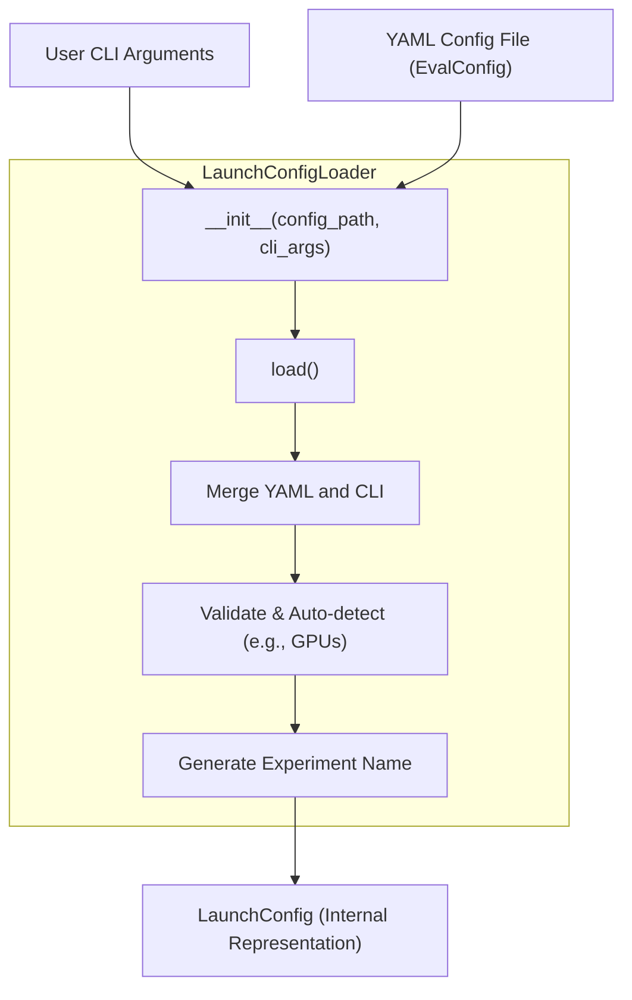
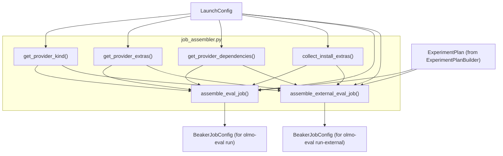

<!-- source: DeepWiki mcp.deepwiki.com · repo allenai/olmo-eval · page 7.1 Beaker Launch Configuration · fetched 2026-10-26 -->

# Beaker Launch Configuration

<details>
<summary>Relevant source files</summary>

The following files were used as context for generating this wiki page:

- [README.md](README.md)
- [src/olmo_eval/cli/beaker/config_loader.py](src/olmo_eval/cli/beaker/config_loader.py)
- [src/olmo_eval/cli/beaker/job_assembler.py](src/olmo_eval/cli/beaker/job_assembler.py)
- [src/olmo_eval/cli/beaker/launch.py](src/olmo_eval/cli/beaker/launch.py)
- [src/olmo_eval/launch/beaker/launcher.py](src/olmo_eval/launch/beaker/launcher.py)
- [src/olmo_eval/launch/config.py](src/olmo_eval/launch/config.py)

</details>


This page details the configuration system for launching evaluation jobs on Beaker using OLMo-Eval. It covers the `LaunchConfig` and `EvalConfig` dataclasses, the `BeakerJobConfig` for Beaker-specific settings, and the `config_loader` and `job_assembler` modules that process these configurations. Examples of YAML configurations are also provided.

## Purpose and Scope

The Beaker integration in OLMo-Eval allows users to define and launch complex evaluation experiments on the Beaker platform. This involves specifying models, tasks, Beaker resources (clusters, GPUs, budgets), and various runtime parameters. This document explains the core data structures and logic that translate user-defined configurations into executable Beaker jobs.

Sources: [src/olmo_eval/launch/beaker/launcher.py:1-17]()

## Configuration Dataclasses

OLMo-Eval uses several dataclasses to represent and manage Beaker launch configurations.

### `LaunchConfig`

The `LaunchConfig` dataclass [src/olmo_eval/cli/beaker/config_loader.py:18-70]() is an internal representation of the parsed and validated configuration for a Beaker launch. It combines settings from both YAML files and command-line arguments.

Key fields include:
*   `name`: Name of the experiment.
*   `model_specs`: List of model names or paths to evaluate.
*   `task_specs`: List of task names to run.
*   `cluster`: Beaker cluster to use (e.g., "h100", "a100").
*   `workspace`: Beaker workspace for the job.
*   `budget`: Beaker budget to charge.
*   `max_gpus_per_node`: Maximum GPUs allowed per node for a single experiment.
*   `priority`: Job priority ("low", "normal", "high", "urgent").
*   `preemptible`: Whether the job can be preempted.
*   `timeout`: Job timeout (e.g., "6h").
*   `retries`: Number of retries on failure.
*   `image`: Custom Beaker container image.
*   `groups`: Beaker groups to associate with the experiment.
*   `gpus`: Number of GPUs required for the job.
*   `s3_bucket`, `s3_prefix`, `s3_region`: S3 configuration for result storage.
*   `store`: Whether to persist results to the configured database.
*   `debug_requests`, `debug_provider`: Debugging flags.
*   `force_download_model`: Force re-download of Hugging Face models.
*   `save_predictions`, `save_requests`: Flags for saving detailed outputs.
*   `inspect_*`: Flags for inspecting various stages of the evaluation.
*   `harness`, `harness_overrides`: Harness configuration.
*   `uv_cache_dir`: UV cache directory.
*   `secret_env_overrides`, `env_vars`: Environment variable and secret management.

Sources: [src/olmo_eval/cli/beaker/config_loader.py:18-70]()

### `EvalConfig` (YAML-based)

The `EvalConfig` dataclass [src/olmo_eval/launch/config.py:114-145]() provides a YAML-friendly structure for defining Beaker evaluation jobs. It uses `OmegaConf` for loading and merging configurations from files.

```python
@dataclass
class EvalConfig:
    name: str = MISSING
    models: list[str] = MISSING
    tasks: list[str] = MISSING

    cluster: str | None = None
    max_gpus_per_node: int = DEFAULT_MAX_GPUS_PER_NODE

    priority: str = "normal"
    preemptible: bool = True
    timeout: str = "24h"
    retries: int | None = None

    gpus: int = 1

    workspace: str | None = None
    budget: str | None = None
    beaker_image: str | None = None
    description: str | None = None
    groups: list[str] | None = None
```

`EvalConfig` can be loaded from a YAML file using `EvalConfig.from_yaml(path)` [src/olmo_eval/launch/config.py:147-162]() or from a dictionary using `EvalConfig.from_dict(data)` [src/olmo_eval/launch/config.py:164-168](). It supports merging with command-line overrides.

Sources: [src/olmo_eval/launch/config.py:114-145](), [src/olmo_eval/launch/config.py:147-162](), [src/olmo_eval/launch/config.py:164-168]()

### `BeakerJobConfig`

The `BeakerJobConfig` dataclass [src/olmo_eval/launch/beaker/launcher.py:24-43]() is the lowest-level representation of a single Beaker job, directly mapping to the parameters required by the `beaker-gantry` library. It's designed to be flexible and includes fields for:

*   `name`: Job name.
*   `command`: The shell command to execute.
*   `cluster`: Target Beaker cluster.
*   `workspace`: Beaker workspace.
*   `budget`: Beaker budget.
*   `num_gpus`: Number of GPUs to allocate.
*   `image`: Docker image to use.
*   `priority`: Job priority.
*   `timeout`: Job timeout.
*   `groups`: Beaker groups.
*   `preemptible`: Whether the job is preemptible.
*   `retries`: Number of retries.
*   `env_vars`: Environment variables.
*   `env_secrets`: Beaker secrets to inject as environment variables.
*   `weka_buckets`: Weka buckets to mount.
*   `mount_s3_cache`: Whether to mount S3 cache.
*   `result_path`: Path where results will be stored.
*   `description`: Job description.

```python
@dataclass(frozen=True)
class BeakerJobConfig:
    name: str
    command: list[str]
    cluster: str
    workspace: str
    budget: str | None = None
    num_gpus: int = 1
    image: str = BEAKER_DEFAULT_IMAGE
    priority: str = "normal"
    timeout: str = "24h"
    groups: list[str] = field(default_factory=list)
    preemptible: bool = True
    retries: int | None = None
    env_vars: dict[str, str] = field(default_factory=dict)
    env_secrets: list[BeakerEnvSecret] = field(default_factory=list)
    weka_buckets: list[BeakerWekaBucket] = field(default_factory=list)
    mount_s3_cache: bool = False
    result_path: str | None = None
    description: str | None = None
```

Sources: [src/olmo_eval/launch/beaker/launcher.py:24-43]()

## Configuration Loading and Assembly

The process of converting user input (CLI arguments and YAML files) into `BeakerJobConfig` instances involves two main components: `LaunchConfigLoader` and the `job_assembler` functions.

### `LaunchConfigLoader`

The `LaunchConfigLoader` class [src/olmo_eval/cli/beaker/config_loader.py:71-77]() is responsible for:
1.  Loading an `EvalConfig` from a specified YAML file [src/olmo_eval/cli/beaker/config_loader.py:86-94]().
2.  Merging the YAML configuration with command-line arguments [src/olmo_eval/cli/beaker/config_loader.py:111-143](). CLI arguments always take precedence.
3.  Performing validation and auto-detection, such as inferring GPU requirements based on the model and harness [src/olmo_eval/cli/beaker/config_loader.py:149-151]().
4.  Generating a `LaunchConfig` instance [src/olmo_eval/cli/beaker/config_loader.py:181-209]() that represents the final, consolidated configuration.

**Diagram: Configuration Loading Flow**



Sources: [src/olmo_eval/cli/beaker/config_loader.py:71-77](), [src/olmo_eval/cli/beaker/config_loader.py:86-94](), [src/olmo_eval/cli/beaker/config_loader.py:111-143](), [src/olmo_eval/cli/beaker/config_loader.py:149-151](), [src/olmo_eval/cli/beaker/config_loader.py:181-209]()

### `job_assembler`

The `job_assembler.py` module [src/olmo_eval/cli/beaker/job_assembler.py:1-19]() contains functions that take the `LaunchConfig` and `ExperimentPlan` (which details how tasks are split across jobs) and construct one or more `BeakerJobConfig` instances.

Key functions:
*   `get_provider_kind(model_spec)` [src/olmo_eval/cli/beaker/job_assembler.py:21-39()]: Determines the inference provider type (e.g., "vllm", "litellm") for a given model.
*   `get_provider_extras(model_spec)` [src/olmo_eval/cli/beaker/job_assembler.py:42-63()]: Identifies necessary `uv` extras (e.g., "vllm", "litellm") for the provider.
*   `get_provider_dependencies(model_spec)` [src/olmo_eval/cli/beaker/job_assembler.py:66-79()]: Extracts runtime dependencies from the provider configuration.
*   `collect_install_extras(...)` [src/olmo_eval/cli/beaker/job_assembler.py:82-128()]: Gathers all required `uv` extras based on enabled features (storage, sandbox, metrics, etc.).
*   `assemble_eval_job(...)` [src/olmo_eval/cli/beaker/job_assembler.py:220-329()]: Constructs a `BeakerJobConfig` for a standard evaluation job. This involves building the `olmo-eval run` command, setting environment variables, and configuring Beaker-specific mounts and secrets.
*   `assemble_external_eval_job(...)` [src/olmo_eval/cli/beaker/job_assembler.py:131-218()]: Constructs a `BeakerJobConfig` for an external evaluation job, building the `olmo-eval run-external` command.

**Diagram: Job Assembly Flow**



Sources: [src/olmo_eval/cli/beaker/job_assembler.py:1-19](), [src/olmo_eval/cli/beaker/job_assembler.py:21-39](), [src/olmo_eval/cli/beaker/job_assembler.py:42-63](), [src/olmo_eval/cli/beaker/job_assembler.py:66-79](), [src/olmo_eval/cli/beaker/job_assembler.py:82-128](), [src/olmo_eval/cli/beaker/job_assembler.py:220-329](), [src/olmo_eval/cli/beaker/job_assembler.py:131-218]()

## Example YAML Configurations

YAML configuration files provide a structured way to define complex evaluation setups. These files are processed by `LaunchConfigLoader` and can be overridden by CLI arguments.

### Basic Evaluation

This example defines an evaluation for a single model on two tasks.

```yaml
# examples/beaker/configs/basic_eval.yaml
name: my-first-beaker-eval
models:
  - mock # Use the mock provider for testing
tasks:
  - mmlu
  - gsm8k
cluster: ai2/general-purpose # Specify your Beaker cluster
workspace: ai2/my-workspace # Specify your Beaker workspace
budget: ai2/my-budget # Specify your Beaker budget
gpus: 1 # Number of GPUs per job
priority: normal
timeout: 1h
```

To run this, you would use:
```bash
olmo-eval beaker launch -f examples/beaker/configs/basic_eval.yaml
```

Sources: [examples/beaker/configs/basic_eval.yaml]()

### Multi-Model, Multi-Task Evaluation

This configuration evaluates multiple models across several tasks, demonstrating how to define a suite of evaluations.

```yaml
# examples/beaker/configs/multi_model_multi_task.yaml
name: multi-model-benchmark
models:
  - llama3.1-8b
  - olmo-2-7b
tasks:
  - mmlu
  - gpqa
  - humaneval:3shot
cluster: ai2/a100-80gb
workspace: ai2/my-workspace
budget: ai2/my-budget
gpus: 1
priority: high
preemptible: false
timeout: 6h
groups:
  - my-benchmark-group
```

This would launch separate Beaker jobs for each model-task combination, all grouped under `my-benchmark-group`.

Sources: [examples/beaker/configs/multi_model_multi_task.yaml]()

### Evaluation with Overrides and Custom Image

This example shows how to apply task-specific overrides and use a custom Docker image.

```yaml
# examples/beaker/configs/overrides_and_image.yaml
name: custom-image-eval
models:
  - mock
tasks:
  - mmlu
  - gsm8k
task_overrides:
  mmlu:
    - limit=100
  gsm8k:
    - limit=50
cluster: ai2/general-purpose
workspace: ai2/my-workspace
budget: ai2/my-budget
gpus: 1
beaker_image: ai2-tylerm/my-custom-olmo-eval-image:latest
```

Sources: [examples/beaker/configs/overrides_and_image.yaml]()

### External Evaluation

For benchmarks that require a custom execution environment or complex setup, `external_evals` can be used.

```yaml
# examples/beaker/configs/external_eval.yaml
name: scicode-external-eval
models:
  - mock
external_evals:
  - scicode
eval_args:
  domain: biology
  difficulty: medium
cluster: ai2/a100-80gb
workspace: ai2/my-workspace
budget: ai2/my-budget
gpus: 1
timeout: 12h
```

Sources: [examples/beaker/configs/external_eval.yaml]()

## `print_experiment_config` Utility

The `print_experiment_config` function [src/olmo_eval/launch/beaker/launcher.py:65-139]() provides a way to pretty-print a Beaker experiment specification with syntax highlighting and a summary header. This is particularly useful during dry runs (`--dry-run`) to review the generated Beaker job configuration before submission.

```python
print_experiment_config(spec_dict, name=config.name, show_header=True)
```

It extracts key information like model, tasks, priority, GPU count, and clusters from the Beaker spec and presents it in a readable format.

Sources: [src/olmo_eval/launch/beaker/launcher.py:65-139]()

## Task Priority Configuration

Tasks can specify a priority level using an `@priority` suffix (e.g., `mmlu@high`). The `parse_task_with_priority` function [src/olmo_eval/launch/beaker/launcher.py:146-174]() extracts this priority, and `validate_priority_configuration` [src/olmo_eval/launch/beaker/launcher.py:176-214]() groups tasks by their specified priority. This allows for fine-grained control over how different tasks are scheduled on Beaker.

Valid priorities are "low", "normal", "high", and "urgent" [src/olmo_eval/launch/beaker/launcher.py:143]().

Sources: [src/olmo_eval/launch/beaker/launcher.py:146-174](), [src/olmo_eval/launch/beaker/launcher.py:176-214](), [src/olmo_eval/launch/beaker/launcher.py:143]()

---

