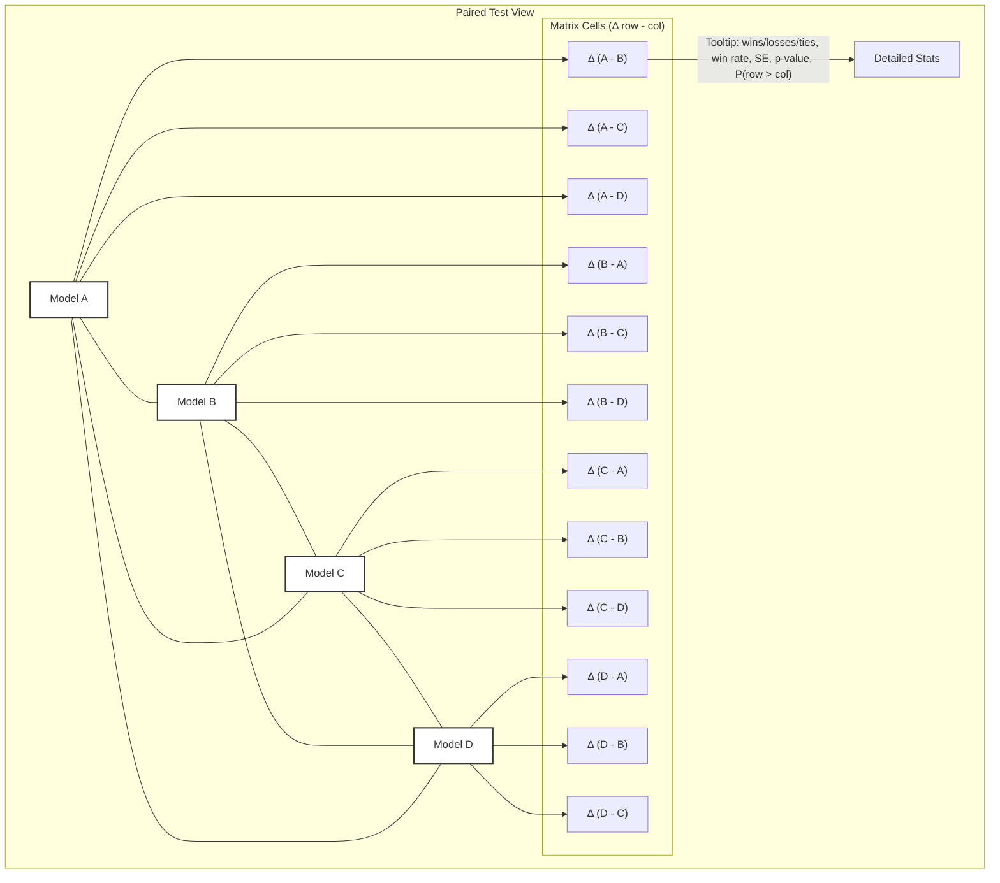

<!-- source: DeepWiki mcp.deepwiki.com · repo allenai/olmo-eval · page 8 Analysis and Results Viewer · fetched 2026-10-26 -->

# Analysis and Results Viewer

<details>
<summary>Relevant source files</summary>

The following files were used as context for generating this wiki page:

- [README.md](README.md)
- [src/olmo_eval/analysis/README.md](src/olmo_eval/analysis/README.md)
- [src/olmo_eval/analysis/__init__.py](src/olmo_eval/analysis/__init__.py)
- [src/olmo_eval/analysis/eval_power.py](src/olmo_eval/analysis/eval_power.py)
- [src/olmo_eval/analysis/examples/results-viewer/paired-test-tooltip.png](src/olmo_eval/analysis/examples/results-viewer/paired-test-tooltip.png)
- [src/olmo_eval/analysis/examples/results-viewer/paired-test.png](src/olmo_eval/analysis/examples/results-viewer/paired-test.png)
- [src/olmo_eval/analysis/examples/results-viewer/results-table.png](src/olmo_eval/analysis/examples/results-viewer/results-table.png)
- [src/olmo_eval/analysis/pairwise.py](src/olmo_eval/analysis/pairwise.py)
- [src/olmo_eval/analysis/pairwise_metrics.py](src/olmo_eval/analysis/pairwise_metrics.py)
- [src/olmo_eval/analysis/pairwise_viewer/__init__.py](src/olmo_eval/analysis/pairwise_viewer/__init__.py)
- [src/olmo_eval/analysis/pairwise_viewer/static/browser.css](src/olmo_eval/analysis/pairwise_viewer/static/browser.css)
- [src/olmo_eval/analysis/pairwise_viewer/templates/browser.html](src/olmo_eval/analysis/pairwise_viewer/templates/browser.html)
- [src/olmo_eval/analysis/pairwise_viewer_payload.py](src/olmo_eval/analysis/pairwise_viewer_payload.py)
- [src/olmo_eval/cli/results/__init__.py](src/olmo_eval/cli/results/__init__.py)
- [src/olmo_eval/launch/config.py](src/olmo_eval/launch/config.py)

</details>


This page provides a high-level overview of the analysis tools available in `olmo-eval`. These tools facilitate understanding evaluation outcomes through results querying, statistical analysis, and an interactive viewer for pairwise comparisons.

For detailed information on specific tools, refer to the child pages:
- [Results Query and Pairwise Viewer](#8.1)
- [API Reference](#8.2)

## Overview of Analysis Tools

The `olmo-eval` framework offers several mechanisms to inspect and analyze evaluation results. These include command-line utilities for querying stored results, and a powerful interactive web-based viewer for conducting pairwise statistical comparisons between models. The core idea behind the pairwise analysis is to provide a robust statistical understanding of model performance differences, especially when comparing models on shared evaluation instances.

### Results Querying

The `olmo-eval results query` command-line interface allows users to retrieve and filter evaluation results stored in the backend. This is useful for quickly accessing aggregate metrics or specific run details without needing to launch the full viewer.

Sources: [src/olmo_eval/cli/results/__init__.py:16]()

### Pairwise Comparison Viewer

The `olmo-eval results viewer` command launches an interactive web application that visualizes pairwise comparisons between models. This viewer is designed to highlight statistically significant differences and effect sizes, moving beyond simple aggregate score comparisons. It focuses on the shared evaluation instances between models to provide a more precise comparison.

The viewer presents a matrix where each cell represents a head-to-head comparison between two models. It displays metrics such as win rates, standard errors, and p-values, helping users understand not just *which* model performed better, but also *how much* better and with *what statistical confidence*.

Sources: [src/olmo_eval/cli/results/__init__.py:17](), [src/olmo_eval/analysis/README.md:1-16]()

### Statistical Analysis

Underpinning the pairwise viewer are statistical methods like the paired sign test and the calculation of Minimum Detectable Effect (MDE80). These methods quantify the statistical significance of observed differences and the power of the evaluation to detect true effects.

- **Paired Sign Test**: Compares two models on a shared set of instances, classifying each instance as a win for model A, a win for model B, or a tie. It then uses a normal approximation to determine the p-value for the observed win rate.
- **MDE80**: Represents the smallest true effect size that the evaluation is likely to detect with 80% statistical power at a given alpha level. This helps in understanding the precision of the evaluation.

For a deeper dive into the methodology and the interactive UI, see [Results Query and Pairwise Viewer](#8.1).

Sources: [src/olmo_eval/analysis/README.md:106-140](), [src/olmo_eval/analysis/README.md:142-178](), [src/olmo_eval/analysis/eval_power.py:70-85]()

## Analysis and Viewer Architecture

The analysis and results viewer components are built upon a structured data flow, starting from raw evaluation results and culminating in an interactive web interface.

### Data Flow for Pairwise Viewer

The `PairwiseResult` dataclass [src/olmo_eval/analysis/pairwise.py:209-230]() encapsulates the core data needed for pairwise comparisons, including model metadata, individual pair statistics (`PairStats` [src/olmo_eval/analysis/pairwise.py:35-94]()), and overall evaluation context. This data is then transformed into a payload suitable for the web viewer by `build_pairwise_viewer_payload` [src/olmo_eval/analysis/pairwise_viewer_payload.py:168-201]().

#### Pairwise Viewer Data Flow
```mermaid
graph TD
    A[Evaluation Results] --> B{StorageBackend}
    B --> C[Query Results]
    C --> D[Pairwise Analysis Logic]
    D -- "PairwiseResult" --> E[build_pairwise_viewer_payload()]
    E -- "JSON Payload" --> F[Web Browser UI]
    F --> G[Interactive Visualization]

    subgraph "Code Entities"
        D -- "src/olmo_eval/analysis/pairwise.py" --> E
        E -- "src/olmo_eval/analysis/pairwise_viewer_payload.py" --> F
        F -- "src/olmo_eval/analysis/pairwise_viewer/templates/browser.html" --> G
        G -- "src/olmo_eval/analysis/pairwise_viewer/static/browser.css" --> G
    end
```
Sources: [src/olmo_eval/analysis/pairwise.py:209-230](), [src/olmo_eval/analysis/pairwise_viewer_payload.py:168-201](), [src/olmo_eval/analysis/pairwise_viewer/templates/browser.html:1-63](), [src/olmo_eval/analysis/pairwise_viewer/static/browser.css:1-308]()

### Interactive Web UI

The web-based viewer is rendered using an HTML template [src/olmo_eval/analysis/pairwise_viewer/templates/browser.html:1-63]() and styled with CSS [src/olmo_eval/analysis/pairwise_viewer/static/browser.css:1-308](). It provides two main views:
- **Paired Test**: Displays the pairwise comparison matrix, showing `Δ (row - col)` and color-coded significance. Tooltips provide detailed statistical information for each cell.
- **Results Table**: Presents absolute task-level scores, allowing users to inspect the underlying performance data that contributes to the pairwise differences.

#### Pairwise Viewer UI Components
```mermaid
graph TD
    A[olmo-eval results viewer CLI] --> B{Flask Server}
    B --> C[browser.html Template]
    C --> D[Payload JSON (window.RESULTS_VIEWER_DATA)]
    D --> E[JavaScript Logic]
    E --> F[Interactive UI]

    subgraph "UI Elements"
        F --> F1["Topbar (brand, scope, filters)"]
        F --> F2["Tabs (paired test, results)"]
        F --> F3["Matrix View (heatmap, tooltips)"]
        F --> F4["Results Table View"]
        F --> F5["Model Config Modal"]
    end

    subgraph "Code Entities"
        B -- "src/olmo_eval/cli/results/viewer.py" --> C
        C -- "src/olmo_eval/analysis/pairwise_viewer/templates/browser.html" --> D
        D -- "src/olmo_eval/analysis/pairwise_viewer_payload.py" --> E
        E -- "src/olmo_eval/analysis/pairwise_viewer/static/browser.css" --> F
    end
```
Sources: [src/olmo_eval/cli/results/__init__.py:17](), [src/olmo_eval/analysis/pairwise_viewer/templates/browser.html:1-63](), [src/olmo_eval/analysis/pairwise_viewer_payload.py:168-201](), [src/olmo_eval/analysis/pairwise_viewer/static/browser.css:1-308]()

For a visual example of the paired test view, refer to the image below:

**Paired test view in the results viewer**

Sources: [src/olmo_eval/analysis/README.md:16]()

For more details on the interactive viewer and the statistical methods, see [Results Query and Pairwise Viewer](#8.1).

---

