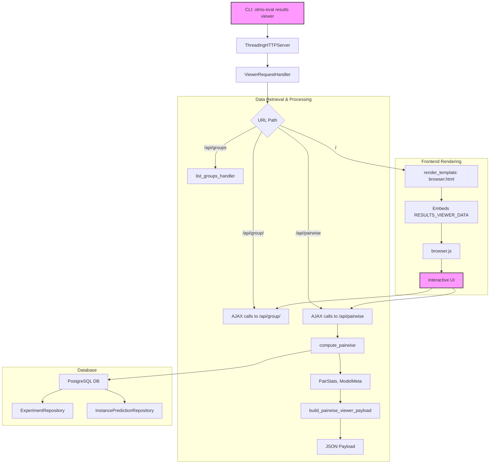

<!-- source: DeepWiki mcp.deepwiki.com · repo allenai/olmo-eval · page 8.1 Results Query and Pairwise Viewer · fetched 2026-10-26 -->

# Results Query and Pairwise Viewer

<details>
<summary>Relevant source files</summary>

The following files were used as context for generating this wiki page:

- [.pre-commit-config.yaml](.pre-commit-config.yaml)
- [src/olmo_eval/analysis/README.md](src/olmo_eval/analysis/README.md)
- [src/olmo_eval/analysis/pairwise.py](src/olmo_eval/analysis/pairwise.py)
- [src/olmo_eval/analysis/pairwise_viewer/static/browser.css](src/olmo_eval/analysis/pairwise_viewer/static/browser.css)
- [src/olmo_eval/analysis/pairwise_viewer/static/browser.js](src/olmo_eval/analysis/pairwise_viewer/static/browser.js)
- [src/olmo_eval/analysis/pairwise_viewer/static/shared.css](src/olmo_eval/analysis/pairwise_viewer/static/shared.css)
- [src/olmo_eval/analysis/pairwise_viewer/templates/browser.html](src/olmo_eval/analysis/pairwise_viewer/templates/browser.html)
- [src/olmo_eval/analysis/pairwise_viewer_payload.py](src/olmo_eval/analysis/pairwise_viewer_payload.py)
- [src/olmo_eval/cli/results/__init__.py](src/olmo_eval/cli/results/__init__.py)
- [src/olmo_eval/cli/results/query.py](src/olmo_eval/cli/results/query.py)
- [src/olmo_eval/cli/results/viewer_server.py](src/olmo_eval/cli/results/viewer_server.py)
- [src/olmo_eval/storage/backends/postgres/queries.py](src/olmo_eval/storage/backends/postgres/queries.py)
- [src/olmo_eval/storage/backends/postgres/repository.py](src/olmo_eval/storage/backends/postgres/repository.py)
- [src/olmo_eval/storage/base.py](src/olmo_eval/storage/base.py)
- [tests/analysis/test_pairwise.py](tests/analysis/test_pairwise.py)
- [tests/cli/test_pairwise.py](tests/cli/test_pairwise.py)
- [tests/core/harness/test_config.py](tests/core/harness/test_config.py)

</details>


This page documents the `olmo-eval results query` and `olmo-eval results viewer` CLI commands, the methodology behind pairwise comparisons (paired sign test, MDE80, effect size), and the interactive browser UI for analyzing evaluation results.

## Results Query CLI (`olmo-eval results query`)

The `olmo-eval results query` command allows users to retrieve evaluation results from the PostgreSQL database backend using various filters. It supports filtering by experiment ID, model name, model hash, task name, task hash, and experiment group. Results can be output in table, JSON, or CSV format.

### Command Line Interface

The `query` command is defined in `src/olmo_eval/cli/results/query.py` [src/olmo_eval/cli/results/query.py:26-131]().

```bash
olmo-eval results query [OPTIONS]
```

**Options:**

| Option | Shorthand | Type | Description |
| :----- | :-------- | :--- | :---------- |
| `--experiment` | `-e` | `str` (multiple) | Experiment ID(s) to query. |
| `--model` | `-m` | `str` (multiple) | Model name prefix(es) to query. |
| `--model-hash` | `-M` | `str` (multiple) | Model hash prefix(es) to query. |
| `--task` | `-t` | `str` (multiple) | Task name prefix(es) to filter. |
| `--task-hash` | `-T` | `str` (multiple) | Task hash prefix(es) to filter by. |
| `--experiment-group` | `-G` | `str` (multiple) | Experiment group prefix(es) to filter by. |
| `--instances` | `--no-instances` | `bool` | Include instance-level predictions (requires `--format json` or `csv`). |
| `--limit` | `-n` | `int` | Maximum instances to return (default: no limit). |
| `--after-id` | | `int` | Return instances after this ID (for keyset pagination). |
| `--format` | `-f` | `table`, `json`, `csv` | Output format (default: `table`). |
| `--all` | `-a` | `flag` | Show all historical results instead of just the best per model. |
| `--recent` | `-r` | `flag` | Show most recent result per model instead of the best. |
| `--db-host`, `--db-port`, `--db-name`, `--db-user`, `--db-password` | | `str`/`int` | Database connection options. |

Sources: [src/olmo_eval/cli/results/query.py:26-131]()

### Query Logic

The `query` function [src/olmo_eval/cli/results/query.py:113-234]() orchestrates the retrieval of results. It uses the `QueryHelper` [src/olmo_eval/storage/backends/postgres/queries.py:21-32]() and `ExperimentRepository` [src/olmo_eval/storage/backends/postgres/repository.py:35-46]() classes to interact with the PostgreSQL database.

1.  **Filter Validation**: Ensures at least one filter (`--experiment`, `--model`, `--model-hash`, `--task`, `--task-hash`, or `--experiment-group`) is provided [src/olmo_eval/cli/results/query.py:161-165]().
2.  **Database Session**: Establishes a database session using `get_database_session` [src/olmo_eval/cli/results/query.py:171-172]().
3.  **Instance Streaming**: If `--experiment-group` and `--instances` are specified, it streams instance data directly to output using `_stream_experiment_group_instances` [src/olmo_eval/cli/results/query.py:179-182](). This is optimized for large datasets.
4.  **Experiment Fetching**: Calls `_query_experiments` [src/olmo_eval/cli/results/query.py:185-193]() to retrieve `EvalResult` objects based on the provided filters. The `ExperimentRepository.query` method [src/olmo_eval/storage/backends/postgres/repository.py:61-104]() constructs the SQL query with `AND` logic for different filter types and `OR` logic for multiple values within a single filter (e.g., multiple `--model` values).
5.  **Instance Fetching**: If `--instances` is requested, `_query_instances` [src/olmo_eval/cli/results/query.py:205-215]() is called to fetch instance-level predictions.
6.  **Output Formatting**: The `_output_results` function [src/olmo_eval/cli/results/query.py:223-233]() formats and prints the results based on the `--format` option.

### Data Flow for Querying

```mermaid
graph TD
    A[CLI: olmo-eval results query] --> B{Filter Options}
    B --> C[get_database_session]
    C --> D[SQLAlchemy Session]
    D --> E[QueryHelper]
    E --> F[ExperimentRepository]
    E --> G[InstancePredictionRepository]

    subgraph "Experiment Query"
        F --> F1{_build_query_stmt}
        F1 --> F2[SELECT Experiment FROM DB]
        F2 --> F3[Apply WHERE clauses for model_name, task_name, etc.]
        F3 --> F4[ORDER BY timestamp DESC]
        F4 --> F5[LIMIT/OFFSET]
        F5 --> F6[EvalResult Objects]
    end

    subgraph "Instance Query (if --instances)"
        G --> G1[SELECT InstancePrediction FROM DB]
        G1 --> G2[Apply WHERE clauses for experiment_pk, task_hash]
        G2 --> G3[LIMIT/OFFSET]
        G3 --> G4[Instance Data]
    end

    F6 --> H[Output Formatting]
    G4 --> H

    H --> I[Console Output (Table, JSON, CSV)]
    H --> J[File Output (if redirected)]

    style A fill:#f9f,stroke:#333,stroke-width:2px
    style I fill:#f9f,stroke:#333,stroke-width:2px
```

Sources:
- `src/olmo_eval/cli/results/query.py`
- `src/olmo_eval/storage/backends/postgres/queries.py`
- `src/olmo_eval/storage/backends/postgres/repository.py`

## Pairwise Viewer CLI (`olmo-eval results viewer`)

The `olmo-eval results viewer` command launches a local web server that provides an interactive UI for pairwise comparison of model performance. It allows users to compare models across tasks, visualize win/loss/tie rates, and inspect statistical significance.

### Command Line Interface

The `viewer` command is defined in `src/olmo_eval/cli/results/viewer.py` [src/olmo_eval/cli/results/viewer.py:26-100]().

```bash
olmo-eval results viewer [OPTIONS]
```

**Options:**

| Option | Shorthand | Type | Description |
| :----- | :-------- | :--- | :---------- |
| `--port` | `-p` | `int` | Port to run the server on (default: 8000). |
| `--host` | | `str` | Host to bind the server to (default: `127.0.0.1`). |
| `--model` | `-m` | `str` (multiple) | Model name prefix(es) to include. |
| `--exclude-model` | | `str` (multiple) | Model name prefix(es) to exclude. |
| `--model-hash` | `-M` | `str` (multiple) | Model hash prefix(es) to include. |
| `--exclude-model-hash` | | `str` (multiple) | Model hash prefix(es) to exclude. |
| `--suite` | `-s` | `str` (multiple) | Suite name(s) to include. |
| `--task` | `-t` | `str` (multiple) | Task name prefix(es) to include. |
| `--exclude-task` | | `str` (multiple) | Task name prefix(es) to exclude. |
| `--task-hash` | `-T` | `str` (multiple) | Task hash prefix(es) to include. |
| `--exclude-task-hash` | | `str` (multiple) | Task hash prefix(es) to exclude. |
| `--experiment-group` | `-G` | `str` (multiple) | Experiment group prefix(es) to include. |
| `--repeated-runs` | | `flag` | Include all runs, not just the latest. |
| `--format` | `-f` | `json`, `html` | Output format (default: `html` for server, `json` for dump). |
| `--output` | `-o` | `str` | Output file path (for `json` or `html` dump). |
| `--db-host`, `--db-port`, `--db-name`, `--db-user`, `--db-password` | | `str`/`int` | Database connection options. |

Sources: [src/olmo_eval/cli/results/viewer.py:26-100]()

### Pairwise Comparison Methodology

The pairwise comparison logic is implemented in `src/olmo_eval/analysis/pairwise.py` [src/olmo_eval/analysis/pairwise.py:32-33]() and `src/olmo_eval/cli/results/viewer_server.py` [src/olmo_eval/cli/results/viewer_server.py:32-41](). It relies on instance-level scores to perform a paired sign test.

#### 1. Data Collection

The viewer collects instance-level scores for all selected models and tasks. For each task, it identifies instances where all compared models have a score.

#### 2. Paired Sign Test

For every pair of models (Model A and Model B) on a given task, the system compares their scores on each shared instance:
*   **Win for A**: Model A's score is significantly better than Model B's (score A - score B > margin).
*   **Win for B**: Model B's score is significantly better than Model A's (score B - score A > margin).
*   **Tie**: The scores are within a defined `margin` of each other.

The `_comparison_score` function [src/olmo_eval/analysis/pairwise.py:1000-1010]() determines the outcome for each instance. The `PairStats` dataclass [src/olmo_eval/analysis/pairwise.py:40-49]() stores the counts of wins, losses, and ties.

#### 3. Statistical Significance

The viewer calculates the probability that Model A is better than Model B (`prob_a_gt_b`) and a p-value for the comparison.
*   `n_contested`: The number of instances where there was a clear win for either model (excluding ties) [src/olmo_eval/analysis/pairwise.py:51-52]().
*   `win_rate_a`: The proportion of wins for Model A among contested instances [src/olmo_eval/analysis/pairwise.py:54-55]().
*   `se`: The standard error of the win rate, used for constructing confidence intervals and p-values [src/olmo_eval/analysis/pairwise.py:57-60]().
*   `prob_a_gt_b`: Calculated using a normal approximation to the binomial distribution, representing the probability that Model A is truly better than Model B [src/olmo_eval/analysis/pairwise.py:62-65]().
*   `p_value`: The two-sided p-value from the paired sign test, indicating the probability of observing such a difference (or more extreme) if there were no true difference between the models [src/olmo_eval/analysis/pairwise.py:67-70]().

Sources: [src/olmo_eval/analysis/pairwise.py:40-70]()

#### 4. Minimum Detectable Effect (MDE80)

The MDE80 (Minimum Detectable Effect at 80% power) is calculated using `minimum_detectable_effect` [src/olmo_eval/analysis/eval_power.py:10-24](). This metric indicates the smallest true difference in win rates that the current sample size could reliably detect with 80% statistical power. It helps assess whether a non-significant result is due to a true lack of difference or simply insufficient data.

Sources: [src/olmo_eval/analysis/eval_power.py:10-24]()

#### 5. Effect Size

The effect size is represented by the difference in win rates (`win_rate_a - win_rate_b`). This provides a direct measure of the magnitude of the difference between two models.

### Interactive Browser UI

The `olmo-eval results viewer` command starts a local HTTP server [src/olmo_eval/cli/results/viewer_server.py:15-16]() that serves an interactive web application.

#### Architecture



Sources:
- `src/olmo_eval/cli/results/viewer_server.py`
- `src/olmo_eval/analysis/pairwise.py`
- `src/olmo_eval/analysis/pairwise_viewer_payload.py`
- `src/olmo_eval/analysis/pairwise_viewer/templates/browser.html`
- `src/olmo_eval/analysis/pairwise_viewer/static/browser.js`
- `src/olmo_eval/analysis/pairwise_viewer/static/shared.css`

#### Key Components

*   **`ThreadingHTTPServer`**: A standard Python HTTP server that handles incoming requests [src/olmo_eval/cli/results/viewer_server.py:1400-1401]().
*   **`ViewerRequestHandler`**: A custom request handler that dispatches requests to appropriate methods based on the URL path [src/olmo_eval/cli/results/viewer_server.py:1403-1404]().
    *   `do_GET`: Handles GET requests, serving static assets, HTML templates, and API endpoints.
    *   `_serve_static_asset`: Serves CSS and JavaScript files [src/olmo_eval/cli/results/viewer_server.py:1290-1300]().
    *   `_serve_html_page`: Renders the main `browser.html` template, embedding initial data [src/olmo_eval/cli/results/viewer_server.py:1302-1314]().
    *   `_handle_api_request`: Routes API calls to specific handlers like `pairwise_handler` [src/olmo_eval/cli/results/viewer_server.py:1316-1329]().
*   **`_TimedValueCache`**: An in-memory cache used by the server to store results of expensive computations (e.g., pairwise comparisons) for a short period, improving responsiveness [src/olmo_eval/cli/results/viewer_server.py:102-155]().
*   **`browser.html`**: The main HTML template for the viewer, which includes the necessary CSS (`shared.css`, `browser.css`) and JavaScript (`browser.js`) [src/olmo_eval/analysis/pairwise_viewer/templates/browser.html]().
*   **`browser.js`**: The client-side JavaScript application that powers the interactive UI [src/olmo_eval/analysis/pairwise_viewer/static/browser.js](). It fetches data from the server's API endpoints, renders tables and matrices, and handles user interactions (filtering, sorting, model exclusion).
    *   `window.RESULTS_VIEWER_DATA`: The initial data payload embedded directly into the HTML by the server [src/olmo_eval/analysis/pairwise_viewer/static/browser.js:2]().
    *   `persistState`, `loadState`, `loadSetState`: Functions for managing UI state in `localStorage` [src/olmo_eval/analysis/pairwise_viewer/static/browser.js:38-49]().
    *   `render`: The main rendering function that updates the UI based on current state and data [src/olmo_eval/analysis/pairwise_viewer/static/browser.js:300-301]().
    *   `submitScopeForm`: Handles changes to filters and triggers a page reload with new URL parameters [src/olmo_eval/analysis/pairwise_viewer/static/browser.js:162-180]().

#### Features

The interactive UI provides:
*   **Model Selection**: Filter models by name, hash, or experiment group.
*   **Task/Suite Selection**: Filter tasks by name, hash, or select entire suites.
*   **Pairwise Matrix View**: A heatmap-like matrix showing win/loss/tie rates between all pairs of models for the selected tasks.
*   **Detailed Table View**: A sortable table displaying metrics, win rates, p-values, and MDE80 for each model and task.
*   **Model Configuration Modal**: Allows viewing the full configuration of a model.
*   **Exclusion Filters**: Temporarily exclude models or tasks from the comparison.
*   **Regex Filtering**: Filter models and tasks using regular expressions.

Sources:
- `src/olmo_eval/analysis/pairwise_viewer/static/browser.js`
- `src/olmo_eval/cli/results/viewer_server.py`

---

