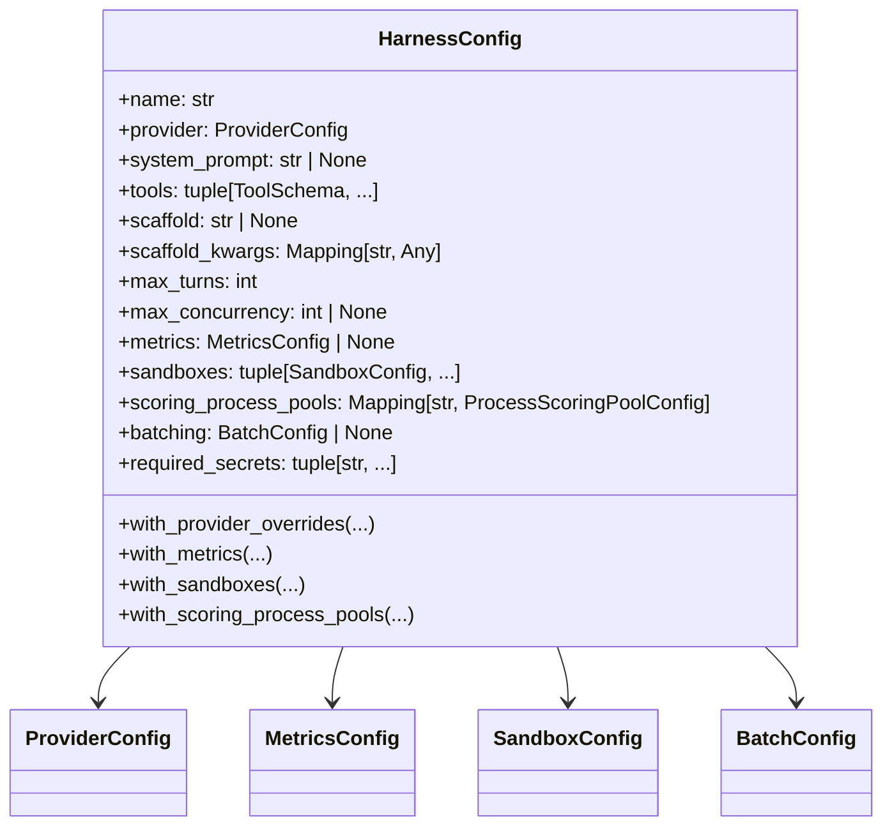
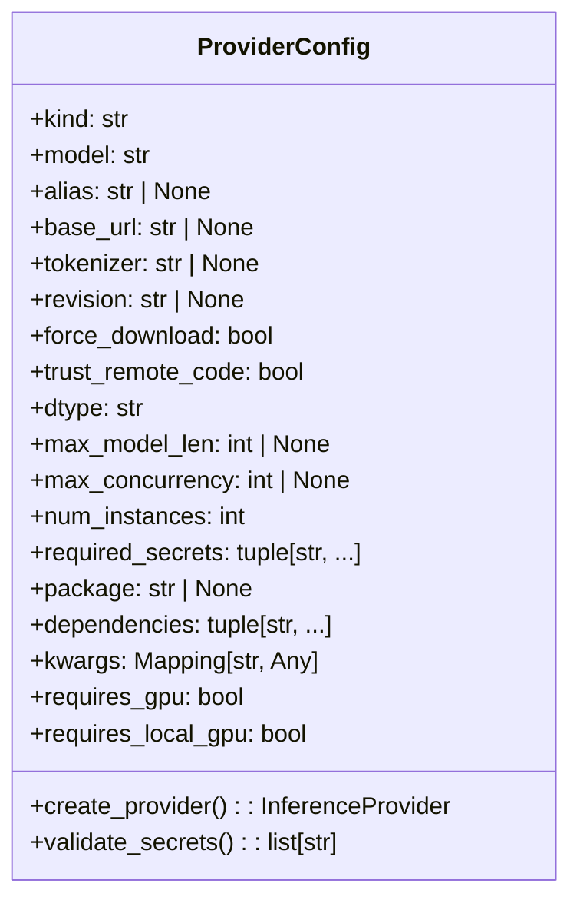

<!-- source: DeepWiki mcp.deepwiki.com · repo allenai/olmo-eval · page 8.2 API Reference · fetched 2026-10-26 -->

# API Reference

<details>
<summary>Relevant source files</summary>

The following files were used as context for generating this wiki page:

- [src/olmo_eval/cli/run/__init__.py](src/olmo_eval/cli/run/__init__.py)
- [src/olmo_eval/cli/run/config.py](src/olmo_eval/cli/run/config.py)
- [src/olmo_eval/common/progress.py](src/olmo_eval/common/progress.py)
- [src/olmo_eval/common/types/base.py](src/olmo_eval/common/types/base.py)
- [src/olmo_eval/harness/config.py](src/olmo_eval/harness/config.py)
- [src/olmo_eval/harness/harness.py](src/olmo_eval/harness/harness.py)
- [src/olmo_eval/harness/presets.py](src/olmo_eval/harness/presets.py)
- [src/olmo_eval/harness/sandbox/config.py](src/olmo_eval/harness/sandbox/config.py)
- [src/olmo_eval/inference/__init__.py](src/olmo_eval/inference/__init__.py)
- [src/olmo_eval/inference/providers/config.py](src/olmo_eval/inference/providers/config.py)
- [src/olmo_eval/runners/asynq/monitoring.py](src/olmo_eval/runners/asynq/monitoring.py)
- [src/olmo_eval/runners/asynq/processing.py](src/olmo_eval/runners/asynq/processing.py)
- [src/olmo_eval/runners/asynq/results.py](src/olmo_eval/runners/asynq/results.py)
- [src/olmo_eval/runners/asynq/runner.py](src/olmo_eval/runners/asynq/runner.py)
- [src/olmo_eval/runners/asynq/types.py](src/olmo_eval/runners/asynq/types.py)
- [src/olmo_eval/runners/asynq/workers.py](src/olmo_eval/runners/asynq/workers.py)
- [tests/cli/beaker/__init__.py](tests/cli/beaker/__init__.py)
- [tests/cli/beaker/test_launch.py](tests/cli/beaker/test_launch.py)
- [tests/core/test_configs.py](tests/core/test_configs.py)
- [tests/providers/test_vllm_server_logprobs.py](tests/providers/test_vllm_server_logprobs.py)
- [tests/storage/test_base.py](tests/storage/test_base.py)

</details>


This page provides a technical reference for key programmatic interfaces within the OLMo-Eval framework. It details the implementation, data flow, and core functionalities of `AsyncEvalRunner`, `Harness`, `InferenceProvider`, Task/Suite registration mechanisms, `ExternalEval`, `StorageBackend`, and `BeakerLauncher` APIs.

## AsyncEvalRunner

The `AsyncEvalRunner` orchestrates the end-to-end evaluation process, managing task preparation, GPU planning, inference workers, result aggregation, and scoring. It leverages a multi-process architecture for parallel execution.

### Architecture Overview

The `AsyncEvalRunner` spawns multiple `inference_worker` processes, each responsible for handling inference requests using a `Harness` instance. Communication between the runner and workers occurs via `multiprocessing.Queue` objects, specifically `item_queue` for sending requests and `result_queue` for receiving results.

```mermaid
graph TD
    A[AsyncEvalRunner] -->|Spawns| B(inference_worker 1)
    A -->|Spawns| C(inference_worker 2)
    A -->|...| D(inference_worker N)

    A -->|Sends QueueItem| B
    A -->|Sends QueueItem| C
    A -->|Sends QueueItem| D

    B -->|Sends ResultItem| A
    C -->|Sends ResultItem| A
    D -->|Sends ResultItem| A

    subgraph Inference Worker Process
        B --> E[Harness]
        E --> F[InferenceProvider]
        E --> G[Scaffold (optional)]
    end

    A --> H[Result Aggregation & Scoring]
    H --> I[StorageBackend]
```

Sources: [src/olmo_eval/runners/asynq/runner.py:1-470](), [src/olmo_eval/runners/asynq/workers.py:20-188]()

### Key Components and Data Flow

#### `inference_worker` Process

Each `inference_worker` process [src/olmo_eval/runners/asynq/workers.py:20-188]() initializes a `Harness` instance [src/olmo_eval/runners/asynq/workers.py:59-59]() based on a provided `HarnessConfig` [src/olmo_eval/runners/asynq/workers.py:60-60](). It then enters a loop to process `QueueItem`s from `item_queue` and puts `ResultItem`s into `result_queue`.

- **Initialization**:
    - Sets `CUDA_VISIBLE_DEVICES` based on assigned `gpu_ids` [src/olmo_eval/runners/asynq/workers.py:65-66]().
    - Creates a `Harness` instance with the given `harness_config_dict` [src/olmo_eval/runners/asynq/workers.py:126-126]().
    - Lazily initializes the `InferenceProvider` and `Scaffold` within the `Harness` [src/olmo_eval/runners/asynq/workers.py:129-130](), [src/olmo_eval/runners/asynq/workers.py:152-153]().
    - Initializes metrics reporters [src/olmo_eval/runners/asynq/workers.py:138-138]().
- **Processing**:
    - Uses a batching strategy (`streaming` or `batched`) defined by `BatchConfig` [src/olmo_eval/runners/asynq/workers.py:155-160]() to handle `LMRequest`s.
    - For `CHAT` requests, it calls `harness.run()` [src/olmo_eval/runners/asynq/processing.py:103-104]() for multi-turn execution.
    - For `COMPLETION` or `LOGLIKELIHOOD` requests, it batches them and calls `harness.provider.agenerate()` or `harness.provider.alogprobs()` [src/olmo_eval/runners/asynq/processing.py:193-195]().
    - Wraps results in `ResultItem` [src/olmo_eval/runners/asynq/types.py:80-93]() and places them in `result_queue`.
    - Handles exceptions during processing, logging errors and sending `ResultItem`s with error details [src/olmo_eval/runners/asynq/processing.py:136-155]().

#### `QueueItem` and `ResultItem`

These dataclasses facilitate communication between the `AsyncEvalRunner` and `inference_worker` processes.

- **`QueueItem`**: Represents a single instance ready for generation [src/olmo_eval/runners/asynq/types.py:22-32]().
    - `model_name`: Model identifier.
    - `task_id`: Task specification string.
    - `instance_idx`: Index of the instance within the task.
    - `instance`: The `Instance` object containing the prompt, gold answer, etc.
    - `request`: The pre-formatted `LMRequest` for the model.
    - `sampling_params`: Parameters for sampling.
    - `attempt`: Retry attempt number.
- **`ResultItem`**: Contains the results for a single instance from a worker [src/olmo_eval/runners/asynq/types.py:80-93]().
    - `model_name`, `task_id`, `instance_idx`, `instance`, `request`: Identifiers and original request.
    - `outputs`: List of `LMOutput` objects from the model.
    - `error`: Error message if processing failed.
    - `attempt`: Retry attempt number.
    - `request_trace`: Detailed trace of the request.

Sources: [src/olmo_eval/runners/asynq/types.py:22-32](), [src/olmo_eval/runners/asynq/types.py:80-93]()

#### Result Aggregation and Scoring

The `AsyncEvalRunner`'s main process continuously pulls `ResultItem`s from the `result_queue`.

- **`process_results`**: This asynchronous function [src/olmo_eval/runners/asynq/results.py:71-200]() handles incoming `ResultItem`s.
    - It uses `TaskTracker` objects [src/olmo_eval/runners/asynq/types.py:35-77]() to monitor the completion status of each task.
    - Scoring is performed inline using `asyncio` tasks and a semaphore (`scoring_semaphore`) to limit concurrency [src/olmo_eval/runners/asynq/results.py:117-117]().
    - For tasks requiring async scorers (e.g., sandboxed code execution), a dedicated scoring worker might be used.
    - Once all instances for a task are processed and scored, `compute_task_metrics` [src/olmo_eval/runners/asynq/results.py:141-141]() is called to calculate final metrics.
    - Results are then stored via `StorageBackend` [src/olmo_eval/runners/asynq/results.py:153-156]().

Sources: [src/olmo_eval/runners/asynq/results.py:71-200](), [src/olmo_eval/runners/asynq/types.py:35-77]()

## Harness

The `Harness` class [src/olmo_eval/harness/harness.py:33-33]() acts as a runtime orchestration layer, combining an `InferenceProvider` with additional behaviors like tools, system prompts, metrics collection, and optional scaffolds. It allows tasks to run in various modes (plain, tool-using, scaffolded) without modifying their definitions.

### Core Functionality

- **Initialization**: Takes a `HarnessConfig` [src/olmo_eval/harness/harness.py:36-42]() which specifies the provider, tools, system prompt, and other runtime settings.
- **Lazy Provider Creation**: The `provider` property [src/olmo_eval/harness/harness.py:46-64]() lazily creates the `InferenceProvider` from `config.provider` on first access. It also wraps the provider with `InstrumentedProvider` [src/olmo_eval/harness/harness.py:57-57]() if metrics collection is enabled.
- **Lazy Scaffold Creation**: The `scaffold` property [src/olmo_eval/harness/harness.py:67-83]() lazily creates a `Scaffold` instance if `config.scaffold` is set. Scaffolds enable multi-turn interactions.
- **Single-turn Interface**: Provides `generate()` [src/olmo_eval/harness/harness.py:97-115](), `logprobs()` [src/olmo_eval/harness/harness.py:118-130](), and their async counterparts `agenerate()` [src/olmo_eval/harness/harness.py:133-138](), `alogprobs()` [src/olmo_eval/harness/harness.py:141-146]() for direct model interaction. These methods apply the harness configuration (e.g., system prompt, tools) to `LMRequest`s before passing them to the underlying provider.
- **Multi-turn Interface**: The `run()` method [src/olmo_eval/harness/harness.py:155-186]() delegates to the configured `Scaffold` for multi-turn execution, handling agentic loops and tool calls. This method returns a `HarnessResult` [src/olmo_eval/harness/harness.py:161-161]() containing the trajectory and final output.
- **Cleanup**: The `cleanup()` method [src/olmo_eval/harness/harness.py:188-192]() shuts down metrics reporters and cleans up scaffold resources.

### `HarnessConfig`

The `HarnessConfig` dataclass [src/olmo_eval/harness/config.py:20-20]() defines the configuration for a `Harness` instance.



Key fields include:
- `provider`: A `ProviderConfig` [src/olmo_eval/harness/config.py:23-23]() to configure the `InferenceProvider`.
- `system_prompt`: An optional system prompt to prepend to model interactions.
- `tools`: A tuple of `ToolSchema` objects [src/olmo_eval/harness/config.py:25-25]() for tool-using agents.
- `scaffold`: The name of a `Scaffold` to use for multi-turn interactions.
- `metrics`: A `MetricsConfig` [src/olmo_eval/harness/config.py:30-30]() for collecting inference metrics.
- `sandboxes`: A tuple of `SandboxConfig` objects [src/olmo_eval/harness/config.py:31-31]() for sandboxed execution environments.
- `batching`: A `BatchConfig` [src/olmo_eval/harness/config.py:33-33]() for controlling inference batching strategy.

### Harness Presets

The `HarnessPresets` class [src/olmo_eval/harness/presets.py:65-65]() provides pre-built `HarnessConfig` instances for common evaluation scenarios, such as `default`, `dr_tulu` (for tool-using agents), `codex_python` (for Python code execution), and `codex_agent` (for coding agents). These presets simplify configuration by providing sensible defaults for providers, tools, system prompts, and sandboxes.

Sources: [src/olmo_eval/harness/harness.py:33-33](), [src/olmo_eval/harness/config.py:20-20](), [src/olmo_eval/harness/presets.py:65-65]()

## InferenceProvider

The `InferenceProvider` is an abstract base class [src/olmo_eval/inference/base.py:1-1]() that defines the interface for interacting with language models. Concrete implementations handle different model backends (e.g., vLLM, HuggingFace, LiteLLM).

### `ProviderConfig`

The `ProviderConfig` dataclass [src/olmo_eval/inference/providers/config.py:19-19]() holds all necessary information to instantiate an `InferenceProvider`.



Key attributes:
- `kind`: The type of provider (e.g., `vllm`, `vllm_server`, `hf`, `litellm`, `mock`) [src/olmo_eval/inference/providers/config.py:45-45]().
- `model`: The model name or path [src/olmo_eval/inference/providers/config.py:46-46]().
- `base_url`: For API-based providers, the endpoint URL [src/olmo_eval/inference/providers/config.py:48-48]().
- `tokenizer`: Optional tokenizer path/identifier [src/olmo_eval/inference/providers/config.py:50-50]().
- `max_model_len`: Maximum sequence length [src/olmo_eval/inference/providers/config.py:55-55]().
- `max_concurrency`: Maximum concurrent requests [src/olmo_eval/inference/providers/config.py:56-56]().
- `required_secrets`: Environment variables that must be set for the provider to function [src/olmo_eval/inference/providers/config.py:58-58]().
- `dependencies`: Additional package specifiers for runtime installation [src/olmo_eval/inference/providers/config.py:60-60]().

The `create_provider()` method [src/olmo_eval/inference/providers/config.py:112-112]() acts as a factory, instantiating the correct `InferenceProvider` subclass based on the `kind` attribute and passing relevant `kwargs`.

### `LMRequest` and `LMOutput`

These dataclasses define the standard input and output formats for language model interactions.

- **`LMRequest`**: Represents a request to a language model [src/olmo_eval/common/types/base.py:223-223]().
    - `request_type`: `CHAT`, `COMPLETION`, or `LOGLIKELIHOOD` [src/olmo_eval/common/types/base.py:171-176]().
    - `messages`: For `CHAT` requests, a list of message dictionaries.
    - `prompt`: For `COMPLETION` or `LOGLIKELIHOOD` requests, the input text.
    - `continuation`: For `LOGLIKELIHOOD` requests, the text to score.
    - `tools`: Optional tool schemas for tool-using models.
- **`LMOutput`**: Represents the output from a language model [src/olmo_eval/common/types/base.py:233-233]().
    - `text`: The generated text.
    - `logprob`: The log probability of the generated text.
    - `logprobs`: Detailed log probabilities per token.
    - `finish_reason`: Reason for generation stopping.
    - `tool_calls`: Detected tool calls.
    - `metadata`: Additional metadata.

Sources: [src/olmo_eval/inference/providers/config.py:19-19](), [src/olmo_eval/common/types/base.py:223-223](), [src/olmo_eval/common/types/base.py:233-233]()

## Task and Suite Registration

The OLMo-Eval framework uses a registration system to define and organize evaluation tasks and suites.

### `Task` Base Class

All evaluation tasks inherit from a `Task` base class (not explicitly shown in provided files, but implied by usage in `TaskTracker` [src/olmo_eval/runners/asynq/types.py:41-41]() and `_count_execution_scorers` [src/olmo_eval/runners/asynq/runner.py:99-99]()). A `Task` defines how to:
- Load instances (`Instance` objects [src/olmo_eval/common/types/base.py:200-219]()).
- Format `LMRequest`s from instances.
- Score `LMOutput`s against gold answers.
- Compute metrics.

### `@register` and `@register_variant` Decorators

These decorators (not explicitly shown in provided files, but standard for task registration) are used to make tasks discoverable by the framework.
- `@register`: Registers a task class with a unique identifier.
- `@register_variant`: Registers a variant of an existing task, often with different configurations (e.g., few-shot settings, specific splits).

### `DataSource`

The `DataSource` abstraction (not explicitly shown) handles loading evaluation data for tasks, abstracting away the underlying storage mechanism (e.g., local files, S3).

### Formatters

Formatters (e.g., `CompletionFormatter`, `ChatFormatter`, `PPLFormatter` - not explicitly shown) are responsible for converting `Instance` objects into `LMRequest`s suitable for different model types and evaluation modes.

### Suite Registry

Tasks are organized into suites. The suite registry (not explicitly shown) allows grouping related tasks and running them together.

Sources: [src/olmo_eval/runners/asynq/types.py:41-41](), [src/olmo_eval/runners/asynq/runner.py:99-99](), [src/olmo_eval/common/types/base.py:200-219]()

## ExternalEval

The `ExternalEval` framework (not explicitly shown in provided files, but referenced in the TOC) is designed for benchmarks that require complex, multi-step orchestration or sandboxed execution environments beyond what the standard `Harness` can provide. This is typically used for benchmarks like SciCode, TAU2, or TerminalBench.

Key characteristics:
- **Sandboxed Execution**: Often integrates with external sandbox managers (e.g., `swe-rex`) for secure code execution.
- **Multi-step Orchestration**: Manages a sequence of interactions, potentially involving code generation, execution, and verification.
- **Custom Logic**: Allows for highly specialized evaluation logic that doesn't fit the standard `LMRequest`/`LMOutput` flow.

Sources: (Referenced in TOC, but no direct code citations in provided files)

## StorageBackend

The `StorageBackend` abstraction (not explicitly shown in provided files, but referenced in `AsyncEvalRunner` [src/olmo_eval/runners/asynq/runner.py:33-33]()) provides a unified interface for persisting evaluation results, metrics, and artifacts.

Common implementations include:
- **PostgreSQL Backend**: Stores structured results and metrics in a relational database. This typically involves ORM models and Alembic migrations for schema management.
- **S3 Artifact Storage**: Stores raw predictions, logs, and other large files in an S3-compatible object storage.

The `AsyncEvalRunner` uses the `StorageBackend` to save `TaskResult` objects [src/olmo_eval/runners/asynq/results.py:103-103]() after scoring and aggregation.

Sources: [src/olmo_eval/runners/asynq/runner.py:33-33](), [src/olmo_eval/runners/asynq/results.py:103-103]()

## BeakerLauncher APIs

The `BeakerLauncher` (not explicitly shown in provided files, but referenced in `TestHarnessOverridesProviderDependencies` [tests/cli/beaker/test_launch.py:53-53]()) integrates OLMo-Eval with the Beaker platform for launching distributed evaluation jobs. It manages job configuration, launching, and group management on Beaker.

### `LaunchConfig` and `EvalConfig`

- **`LaunchConfig`**: A dataclass (not explicitly shown, but used in `TestHarnessOverridesProviderDependencies` [tests/cli/beaker/test_launch.py:90-90]()) that defines the overall configuration for a Beaker launch, including model specs, task specs, cluster, workspace, and harness overrides.
- **`EvalConfig`**: A YAML-based configuration (not explicitly shown) that can be loaded to define evaluation parameters.

### `BeakerJobConfig`

This dataclass (not explicitly shown, but referenced in `TestHarnessOverridesProviderDependencies` [tests/cli/beaker/test_launch.py:127-127]()) represents the final configuration for a Beaker job, assembled from `LaunchConfig` and other parameters. It includes details like image, commands, environment variables, and resource requirements.

### `JobConfigAssembler`

The `JobConfigAssembler` [tests/cli/beaker/test_launch.py:120-120]() is responsible for taking a `LaunchConfig` and an `ExperimentPlan` and assembling a `BeakerJobConfig`. This involves:
- Applying harness overrides [tests/cli/beaker/test_launch.py:57-57]().
- Extracting provider-specific packages and dependencies [tests/cli/beaker/test_launch.py:129-131]().
- Configuring environment variables and secrets.
- Setting up resource requests.

### `BeakerLauncher` Class

The `BeakerLauncher` class (not explicitly shown) provides methods for interacting with the Beaker API:
- `launch()`: Submits evaluation jobs to Beaker.
- `follow_experiment()`: Monitors the status of a Beaker experiment.
- `get_or_create_group()`: Manages Beaker experiment groups.
- `get_group_status()`: Retrieves the status of an experiment group.
- `cancel_group()`: Cancels an experiment group.
- `build_install_command()`: Generates the installation command for the Beaker environment, incorporating `provider.package` and `provider.dependencies` [tests/cli/beaker/test_launch.py:141-146]().

Sources: [tests/cli/beaker/test_launch.py:53-53](), [tests/cli/beaker/test_launch.py:90-90](), [tests/cli/beaker/test_launch.py:120-120](), [tests/cli/beaker/test_launch.py:127-127](), [tests/cli/beaker/test_launch.py:129-131](), [tests/cli/beaker/test_launch.py:141-146]()

---

