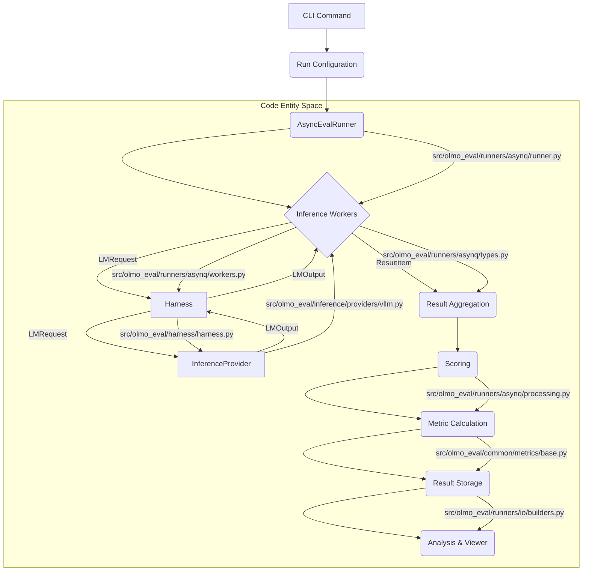
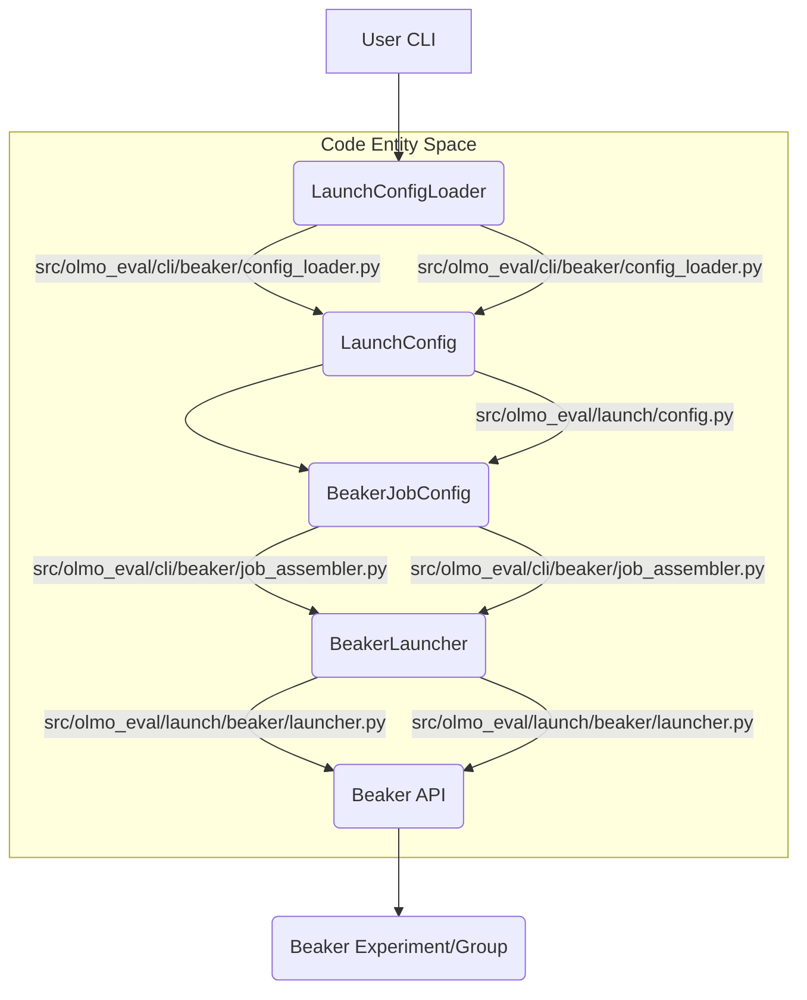

<!-- source: DeepWiki mcp.deepwiki.com · repo allenai/olmo-eval · page 9 Glossary · fetched 2026-10-26 -->

# Glossary

Relevant source files

The following files were used as context for generating this wiki page:

- [README.md](README.md)
- [pyproject.toml](pyproject.toml)
- [src/olmo_eval/cli/beaker/config_loader.py](src/olmo_eval/cli/beaker/config_loader.py)
- [src/olmo_eval/cli/beaker/job_assembler.py](src/olmo_eval/cli/beaker/job_assembler.py)
- [src/olmo_eval/common/metrics/base.py](src/olmo_eval/common/metrics/base.py)
- [src/olmo_eval/common/progress.py](src/olmo_eval/common/progress.py)
- [src/olmo_eval/common/scorers/base.py](src/olmo_eval/common/scorers/base.py)
- [src/olmo_eval/common/scorers/llm_judge.py](src/olmo_eval/common/scorers/llm_judge.py)
- [src/olmo_eval/evals/tasks/common/base.py](src/olmo_eval/evals/tasks/common/base.py)
- [src/olmo_eval/evals/tasks/harmbench.py](src/olmo_eval/evals/tasks/harmbench.py)
- [src/olmo_eval/harness/config.py](src/olmo_eval/harness/config.py)
- [src/olmo_eval/harness/harness.py](src/olmo_eval/harness/harness.py)
- [src/olmo_eval/harness/presets.py](src/olmo_eval/harness/presets.py)
- [src/olmo_eval/harness/sandbox/config.py](src/olmo_eval/harness/sandbox/config.py)
- [src/olmo_eval/inference/providers/huggingface.py](src/olmo_eval/inference/providers/huggingface.py)
- [src/olmo_eval/inference/providers/vllm.py](src/olmo_eval/inference/providers/vllm.py)
- [src/olmo_eval/launch/beaker/launcher.py](src/olmo_eval/launch/beaker/launcher.py)
- [src/olmo_eval/launch/config.py](src/olmo_eval/launch/config.py)
- [src/olmo_eval/runners/asynq/monitoring.py](src/olmo_eval/runners/asynq/monitoring.py)
- [src/olmo_eval/runners/asynq/processing.py](src/olmo_eval/runners/asynq/processing.py)
- [src/olmo_eval/runners/asynq/results.py](src/olmo_eval/runners/asynq/results.py)
- [src/olmo_eval/runners/asynq/runner.py](src/olmo_eval/runners/asynq/runner.py)
- [src/olmo_eval/runners/asynq/types.py](src/olmo_eval/runners/asynq/types.py)
- [src/olmo_eval/runners/asynq/workers.py](src/olmo_eval/runners/asynq/workers.py)
- [src/olmo_eval/runners/io/builders.py](src/olmo_eval/runners/io/builders.py)
- [tests/runners/io/test_builders.py](tests/runners/io/test_builders.py)
- [uv.lock](uv.lock)

This page defines key terms, jargon, and abbreviations used within the `olmo-eval` codebase. It aims to provide an onboarding engineer with a clear understanding of the system's components and their roles, including pointers to relevant code.

## Core Abstractions

### Task
A `Task` is the fundamental unit of evaluation, defining how to load data, format prompts, and score model outputs for a specific benchmark. Tasks are registered using the `@register` decorator [README.md:86-86]().
Sources: [README.md:78-92](), [src/olmo_eval/evals/tasks/common/base.py:1-1]()

### Suite
A `Suite` is a collection of `Task`s and/or nested `Suite`s that allows for batch evaluation and defines how results are aggregated. Suites can use different aggregation strategies like `AVERAGE` or `AVERAGE_OF_AVERAGES` [README.md:128-131]().
Sources: [README.md:113-164]()

### Harness
The `Harness` is the execution runtime layer that wraps an `InferenceProvider` and integrates tools, scaffolds, and runtime behaviors. It's configured via `HarnessConfig` [src/olmo_eval/harness/harness.py:1-1](). Presets like `dr_tulu` [src/olmo_eval/harness/presets.py:95-112]() provide common configurations.
Sources: [README.md:73-73](), [src/olmo_eval/harness/harness.py:1-1](), [src/olmo_eval/harness/presets.py:66-77](), [src/olmo_eval/harness/presets.py:95-112]()

### InferenceProvider
An `InferenceProvider` is an abstraction for interacting with language models. It defines methods for generating text and computing log probabilities. Examples include `VLLMProvider` [src/olmo_eval/inference/providers/vllm.py:99-100]() for local vLLM inference, `LiteLLMProvider` for commercial APIs, and `HuggingFaceProvider` [src/olmo_eval/inference/providers/huggingface.py:1-1]() for Hugging Face `transformers` models.
Sources: [README.md:72-72](), [src/olmo_eval/inference/providers/vllm.py:99-100](), [src/olmo_eval/inference/providers/huggingface.py:1-1]()

### Instance
An `Instance` represents a single example from a dataset that is fed to the model for evaluation. It typically contains the input `question` and the `gold_answer` [src/olmo_eval/evals/tasks/harmbench.py:65-66]().
Sources: [src/olmo_eval/evals/tasks/harmbench.py:64-73]()

### LMRequest
An `LMRequest` encapsulates the input to the language model, including the prompt, request type (e.g., `COMPLETION`, `CHAT`, `LOGLIKELIHOOD`), and sampling parameters [src/olmo_eval/common/types.py:1-1]().
Sources: [src/olmo_eval/common/types.py:1-1]()

### LMOutput
An `LMOutput` represents the response from the language model, containing the generated text, log probabilities, and other relevant information [src/olmo_eval/common/types.py:1-1]().
Sources: [src/olmo_eval/common/types.py:1-1]()

### Scorer
A `Scorer` evaluates a single `LMOutput` against an `Instance`'s `gold_answer` to produce a raw score or judgment. Examples include `ExactMatchScorer` and `LLMJudgeScorer` [src/olmo_eval/common/scorers/llm_judge.py:152-153]().
Sources: [README.md:75-75](), [src/olmo_eval/common/scorers/base.py:1-1](), [src/olmo_eval/common/scorers/llm_judge.py:152-153]()

### Metric
A `Metric` aggregates scores from multiple `Response` objects (each containing an `Instance` and its `LMOutput` and scores) to produce a dataset-level evaluation score. Examples include `AccuracyMetric` and `F1Metric` [src/olmo_eval/common/metrics/base.py:123-135]().
Sources: [README.md:76-76](), [src/olmo_eval/common/metrics/base.py:25-41](), [src/olmo_eval/common/metrics/base.py:123-135]()

## Evaluation Flow

The evaluation process in `olmo-eval` follows a structured pipeline:

Title: Evaluation Pipeline Overview
Sources: [src/olmo_eval/runners/asynq/runner.py:1-1](), [src/olmo_eval/runners/asynq/workers.py:1-1](), [src/olmo_eval/harness/harness.py:1-1](), [src/olmo_eval/inference/providers/vllm.py:1-1](), [src/olmo_eval/runners/asynq/types.py:1-1](), [src/olmo_eval/runners/asynq/processing.py:1-1](), [src/olmo_eval/common/metrics/base.py:1-1](), [src/olmo_eval/runners/io/builders.py:1-1]()

### AsyncEvalRunner
The `AsyncEvalRunner` orchestrates the entire evaluation. It manages `inference_worker` processes, GPU planning, and communication between workers and the main process using queues [src/olmo_eval/runners/asynq/runner.py:1-1]().
Sources: [src/olmo_eval/runners/asynq/runner.py:1-1]()

### Inference Worker
An `inference_worker` is a separate process launched by the `AsyncEvalRunner` that initializes a `Harness` and processes `QueueItem`s (containing `Instance`s) to generate `LMOutput`s. It sends `ResultItem`s back to the main process [src/olmo_eval/runners/asynq/workers.py:31-49]().
Sources: [src/olmo_eval/runners/asynq/workers.py:31-49]()

### QueueItem / ResultItem
`QueueItem`s are data structures sent to `inference_worker`s, typically containing `Instance`s to be processed. `ResultItem`s are returned by workers, containing the `LMOutput` and other evaluation results [src/olmo_eval/runners/asynq/types.py:1-1]().
Sources: [src/olmo_eval/runners/asynq/types.py:1-1]()

## Beaker Integration

`olmo-eval` integrates with Beaker for launching distributed evaluation jobs.

Title: Beaker Integration Flow
Sources: [src/olmo_eval/cli/beaker/config_loader.py:1-1](), [src/olmo_eval/launch/config.py:1-1](), [src/olmo_eval/cli/beaker/job_assembler.py:1-1](), [src/olmo_eval/launch/beaker/launcher.py:1-1]()

### LaunchConfig
A `LaunchConfig` is a dataclass that holds the parsed and validated configuration for a Beaker job, potentially loaded from a YAML file or CLI arguments [src/olmo_eval/cli/beaker/config_loader.py:18-20]().
Sources: [src/olmo_eval/cli/beaker/config_loader.py:18-20]()

### BeakerJobConfig
A `BeakerJobConfig` is a dataclass used by the `BeakerLauncher` to define the specifics of a Beaker job, including command, cluster, workspace, and resource requirements [src/olmo_eval/launch/beaker/launcher.py:49-50]().
Sources: [src/olmo_eval/launch/beaker/launcher.py:49-50]()

### BeakerLauncher
The `BeakerLauncher` is responsible for interacting with the Beaker API to launch, manage, and monitor evaluation jobs. It uses `BeakerJobConfig` to construct and submit experiments [src/olmo_eval/launch/beaker/launcher.py:50-50]().
Sources: [src/olmo_eval/launch/beaker/launcher.py:50-50]()

## Other Terms

### uv
`uv` is a fast Python package installer and resolver used by `olmo-eval` for reproducible builds. The `pyproject.toml` [pyproject.toml:1-1]() and `uv.lock` [uv.lock:1-1]() files define the project's dependencies and their exact versions.
Sources: [README.md:20-21](), [pyproject.toml:1-1](), [uv.lock:1-1]()

### Scaffold
A `scaffold` is a component within the `Harness` that provides structured interaction patterns, such as agentic evaluation with tool calling. Examples include `openai_agents` and `openhands` [pyproject.toml:60-69]().
Sources: [README.md:73-73](), [pyproject.toml:60-69]()

### Sandbox
A `sandbox` provides an isolated environment for executing code, particularly for coding benchmarks or agentic evaluations that require shell access. `olmo-eval` supports Docker, Podman, or Modal-based sandboxes [src/olmo_eval/harness/sandbox/config.py:1-1]().
Sources: [README.md:13-13](), [src/olmo_eval/harness/sandbox/config.py:1-1]()

### LLM-as-judge
`LLM-as-judge` refers to using a language model to evaluate the output of another language model, especially for open-ended tasks where traditional metrics are difficult to apply. The `LLMJudgeScorer` [src/olmo_eval/common/scorers/llm_judge.py:152-153]() is an implementation of this concept.
Sources: [README.md:15-15](), [src/olmo_eval/common/scorers/llm_judge.py:152-153]()

### Dry Run
A `dry run` allows users to preview an evaluation without actually running inference on a model. This is useful for debugging task definitions and prompt formatting [README.md:59-59]().
Sources: [README.md:59-59]()

### Tensor Parallelism (TP)
`Tensor Parallelism` is a technique used in distributed inference, particularly with vLLM, where model tensors are sharded across multiple GPUs to allow larger models or faster inference. The `tensor_parallel_size` parameter controls this [src/olmo_eval/cli/beaker/job_assembler.py:176-177]().
Sources: [src/olmo_eval/cli/beaker/job_assembler.py:176-177]()

### RequestType
`RequestType` is an enum that specifies the type of request being made to the language model, such as `COMPLETION`, `CHAT`, or `LOGLIKELIHOOD` [src/olmo_eval/common/types.py:1-1](). This influences how the `InferenceProvider` processes the request.
Sources: [src/olmo_eval/common/types.py:1-1]()

### SamplingParams
`SamplingParams` define the parameters used during text generation, such as `temperature`, `top_p`, `max_tokens`, etc. [src/olmo_eval/common/types.py:1-1]().
Sources: [src/olmo_eval/common/types.py:1-1]()