# Page: Overview

# Overview

<details>
<summary>Relevant source files</summary>

The following files were used as context for generating this wiki page:

- [DEVELOPMENT.md](DEVELOPMENT.md)
- [README.md](README.md)
- [pyproject.toml](pyproject.toml)
- [src/olmo_eval/__init__.py](src/olmo_eval/__init__.py)
- [src/olmo_eval/cli/beaker/group.py](src/olmo_eval/cli/beaker/group.py)
- [src/olmo_eval/cli/beaker/watch.py](src/olmo_eval/cli/beaker/watch.py)
- [src/olmo_eval/launch/config.py](src/olmo_eval/launch/config.py)
- [src/olmo_eval/storage/__init__.py](src/olmo_eval/storage/__init__.py)
- [uv.lock](uv.lock)

</details>


This project, `olmo-eval`, provides a unified workbench for evaluating large language models (LLMs) throughout their development lifecycle [pyproject.toml:2-4](). It offers a flexible and extensible framework for running evaluations, managing benchmarks, and analyzing results.

**Note**: OLMo-Eval has been superseded by the OLMES repository (Open Language Model Evaluation System) available at https://github.com/allenai/olmes.

Sources: [pyproject.toml:2-4]()

## Purpose and Scope

`olmo-eval` is designed to streamline the process of evaluating language models. Its key features include:

*   A registry of benchmark tasks and composable suites, supporting named variants for different settings like few-shot learning, prompt formatting, and scoring [README.md:11-12]().
*   Support for various inference providers, including `vLLM` for local inference, `LiteLLM` for commercial APIs, and a `mock` provider for testing and dry runs [README.md:13-14]().
*   A `Harness` abstraction that decouples execution policy from task definition, enabling tasks to be run with or without tool augmentation [README.md:15-16]().
*   Capabilities for multi-turn agentic evaluation, tool calling, and sandboxed environments (Docker, Podman, Modal) [README.md:17-18]().
*   `LLM-as-judge` scoring, allowing auxiliary models to evaluate responses [README.md:19]().
*   Storage for aggregate and instance-level predictions [README.md:20]().
*   Inspection tools for viewing instances, formatted prompts, token arrays, and model responses [README.md:21]().

For details on installation and initial setup, see [Installation and Setup](#1.1). For a deeper dive into the core terminology and concepts, refer to [Key Concepts](#1.2).

Sources: [README.md:7-21]()

## System Architecture

### High-Level Architecture Overview

The `olmo-eval` framework orchestrates evaluations by defining tasks and suites, executing them through various inference providers and harnesses, and storing the results.

```mermaid
graph TD
    A[User CLI Interaction] --> B{olmo-eval CLI}
    B --> C[Run Configuration]
    C --> D[AsyncEvalRunner]
    D --> E[Inference Workers]
    E --> F[InferenceProvider]
    F --> G[LLM (vLLM, LiteLLM, HF)]
    G --> E
    E --> H[Harness]
    H --> I[Task]
    I --> J[Scorer]
    J --> K[Metric]
    K --> L[Result Storage]
    L --> M[Results Query/Viewer]

    subgraph Core Components
        I
        J
        K
        F
        H
    end

    subgraph Evaluation Flow
        D
        E
        G
    end

    subgraph Data Flow
        C
        L
        M
    end
```
This diagram illustrates the overall flow from user interaction to result storage. The `olmo-eval` CLI [pyproject.toml:98]() initiates runs based on a `Run Configuration` [src/olmo_eval/launch/config.py:114-128](). The `AsyncEvalRunner` [src/olmo_eval/evaluator/runner.py]() manages `Inference Workers` [src/olmo_eval/evaluator/worker.py]() which interact with `InferenceProvider` implementations [src/olmo_eval/inference/provider.py]() to query LLMs. The `Harness` [src/olmo_eval/harness/harness.py]() wraps the provider and applies execution policies. `Task` definitions [src/olmo_eval/evals/tasks/common.py]() specify data loading, prompt formatting, and scoring logic using `Scorer` [src/olmo_eval/common/scorers/scorer.py]() and `Metric` [src/olmo_eval/common/metrics/metric.py]() components. Finally, results are persisted in `Result Storage` [src/olmo_eval/storage/__init__.py]() and can be queried or viewed.

Sources: [pyproject.toml:98](), [src/olmo_eval/launch/config.py:114-128](), [src/olmo_eval/evaluator/runner.py](), [src/olmo_eval/evaluator/worker.py](), [src/olmo_eval/inference/provider.py](), [src/olmo_eval/harness/harness.py](), [src/olmo_eval/evals/tasks/common.py](), [src/olmo_eval/common/scorers/scorer.py](), [src/olmo_eval/common/metrics/metric.py](), [src/olmo_eval/storage/__init__.py]()

### Evaluation Workbench Concept

The `olmo-eval` framework functions as an evaluation workbench, providing a structured environment for defining, executing, and analyzing LLM evaluations. It emphasizes composability and extensibility, allowing users to combine different tasks, models, and evaluation strategies.

```mermaid
graph TD
    subgraph "OLMo-Eval Workbench"
        A[Task Definitions] --> B[Suite Definitions]
        C[Inference Providers] --> D[Harnesses]
        B --> E[Evaluation Runner]
        D --> E
        E --> F[Scorers & Metrics]
        F --> G[Result Storage]
        G --> H[Analysis & Viewer]
    end

    A -- "Data, Formatting, Scoring" --> I[Task (e.g., humaneval)]
    B -- "Groups Tasks" --> J[Suite (e.g., olmobase:code)]
    C -- "Model Access" --> K[VLLMProvider]
    C -- "Model Access" --> L[LiteLLMProvider]
    D -- "Execution Policy" --> M[BaselineHarness]
    D -- "Execution Policy" --> N[AgenticHarness]
    E -- "Orchestrates Runs" --> O[AsyncEvalRunner]
    F -- "Evaluates Outputs" --> P[ExactMatchScorer]
    F -- "Aggregates Scores" --> Q[AccuracyMetric]
    G -- "Persists Data" --> R[PostgresBackend]
    H -- "Interprets Results" --> S[CLI Query/Plot]
    H -- "Interprets Results" --> T[Pairwise Viewer]

    style I fill:#ace,stroke:#333,stroke-width:2px
    style J fill:#ace,stroke:#333,stroke-width:2px
    style K fill:#ace,stroke:#333,stroke-width:2px
    style L fill:#ace,stroke:#333,stroke-width:2px
    style M fill:#ace,stroke:#333,stroke-width:2px
    style N fill:#ace,stroke:#333,stroke-width:2px
    style O fill:#ace,stroke:#333,stroke-width:2px
    style P fill:#ace,stroke:#333,stroke-width:2px
    style Q fill:#ace,stroke:#333,stroke-width:2px
    style R fill:#ace,stroke:#333,stroke-width:2px
    style S fill:#ace,stroke:#333,stroke-width:2px
    style T fill:#ace,stroke:#333,stroke-width:2px
```
This diagram illustrates how different components of the `olmo-eval` framework interact to form a complete evaluation workbench. `Task` definitions [README.md:78-80]() and `Suite` definitions [README.md:119-123]() are central to specifying what to evaluate. `Inference Providers` [src/olmo_eval/inference/provider.py]() like `VLLMProvider` [src/olmo_eval/inference/vllm_provider.py]() or `LiteLLMProvider` [src/olmo_eval/inference/litellm_provider.py]() handle model communication. `Harnesses` [src/olmo_eval/harness/harness.py]() (e.g., `BaselineHarness` or `AgenticHarness`) define how models interact with tasks. The `AsyncEvalRunner` [src/olmo_eval/evaluator/runner.py]() orchestrates the execution, feeding outputs to `Scorers` [src/olmo_eval/common/scorers/scorer.py]() and `Metrics` [src/olmo_eval/common/metrics/metric.py](). Results are stored in a `StorageBackend` [src/olmo_eval/storage/__init__.py]() (e.g., `PostgresBackend` [src/olmo_eval/storage/backends/postgres.py]()) and can be accessed via CLI tools or a `Pairwise Viewer` [src/olmo_eval/analysis/pairwise_viewer/__init__.py]().

Sources: [README.md:78-80](), [README.md:119-123](), [src/olmo_eval/inference/provider.py](), [src/olmo_eval/inference/vllm_provider.py](), [src/olmo_eval/inference/litellm_provider.py](), [src/olmo_eval/harness/harness.py](), [src/olmo_eval/evaluator/runner.py](), [src/olmo_eval/common/scorers/scorer.py](), [src/olmo_eval/common/metrics/metric.py](), [src/olmo_eval/storage/__init__.py](), [src/olmo_eval/storage/backends/postgres.py](), [src/olmo_eval/analysis/pairwise_viewer/__init__.py]()

## Core Components

### Tasks and Suites

`Tasks` define the specifics of an evaluation, including how to load data, format prompts, and score model outputs [README.md:78-80](). They are registered using the `@register` decorator [README.md:83](). `Variants` can be registered for a task to define specific evaluation presets, such as few-shot settings [README.md:96-98]().

`Suites` are collections that group multiple tasks or nested suites for batch evaluation [README.md:119-123](). They also define strategies for aggregating results from their constituent tasks [README.md:126-134]().

For more details, see [Key Concepts](#1.2).

Sources: [README.md:78-80](), [README.md:83](), [README.md:96-98](), [README.md:119-123](), [README.md:126-134]()

### Inference Providers

`Inference Providers` are responsible for interacting with language models to generate predictions. The framework supports various backends:

*   **`VLLMProvider`**: For local inference using `vLLM` [pyproject.toml:49-55]().
*   **`LiteLLMProvider`**: For accessing commercial APIs like OpenAI, Anthropic, etc., via `LiteLLM` [pyproject.toml:56-58]().
*   **`HuggingFaceProvider`**: For models hosted on Hugging Face [pyproject.toml:46-48]().
*   **`MockProvider`**: A dummy provider for dry runs and debugging [README.md:13-14]().

For more details, see [Key Concepts](#1.2).

Sources: [pyproject.toml:46-48](), [pyproject.toml:49-55](), [pyproject.toml:56-58](), [README.md:13-14]()

### Harnesses

A `Harness` defines the execution policy around an `InferenceProvider`, including tools, scaffolds, and system prompts [README.md:15-16](). This abstraction allows tasks to be run with different execution strategies (e.g., baseline vs. tool-augmented) without modification.

For more details, see [Key Concepts](#1.2).

Sources: [README.md:15-16]()

### Scorers and Metrics

`Scorers` compute a score for each individual instance/output pair [README.md:183](). `Metrics` then aggregate these per-example scores across a dataset to provide overall evaluation results [README.md:198]().

For more details, see [Key Concepts](#1.2).

Sources: [README.md:183](), [README.md:198]()

### Result Storage and Analysis

`olmo-eval` supports storing evaluation results, including aggregate metrics and instance-level predictions [README.md:20](). The `PostgresBackend` [src/olmo_eval/storage/__init__.py:36-44]() is available for persistent storage. The framework also provides tooling for querying results and a pairwise comparison viewer for analysis [src/olmo_eval/analysis/pairwise_viewer/__init__.py]().

Sources: [README.md:20](), [src/olmo_eval/storage/__init__.py:36-44](), [src/olmo_eval/analysis/pairwise_viewer/__init__.py]()

## Installation and Setup

`olmo-eval` uses `uv` for reproducible builds and dependency management [README.md:20]().

To get started:

1.  **Install `uv`**:
    ```bash
    curl -LsSf https://astral.sh/uv/install.sh | sh
    ```
2.  **Install Python 3.12**:
    ```bash
    uv python install 3.12
    ```
3.  **Install dependencies**:
    ```bash
    uv sync --frozen
    ```
    This command installs default dependency groups (`dev` and `vllm`) [pyproject.toml:107](). Optional dependency groups can be added using `--extra` (e.g., `agents`, `litellm`) [README.md:46](). Some groups, like `openhands` and `vllm`, have conflicting transitive dependencies and cannot be installed together [pyproject.toml:109-122]().

For detailed instructions, see [Installation and Setup](#1.1).

Sources: [README.md:20](), [README.md:28-32](), [README.md:35-39](), [README.md:46](), [README.md:49-50](), [pyproject.toml:107](), [pyproject.toml:109-122]()

## Workflow

A typical workflow involves:

1.  **Browsing Tasks and Suites**: Use `uv run olmo-eval suite inspect <suite_name>` to explore available benchmarks [README.md:53-55]().
2.  **Previewing a Run**: Use `uv run olmo-eval run -m mock -t <task_name> --dry-run` to test configurations without loading a model [README.md:58-61]().
3.  **Running Evaluations**: Execute evaluations with a specified model and task(s).
4.  **Analyzing Results**: Query and view results using CLI tools or the pairwise viewer.

Sources: [README.md:53-55](), [README.md:58-61]()

### Beaker Integration

`olmo-eval` integrates with Beaker for launching distributed evaluation jobs [pyproject.toml:75-77](). This allows for running evaluations on cloud infrastructure. Commands are available for managing Beaker groups, including `group info` [src/olmo_eval/cli/beaker/group.py:50]() and `watch` [src/olmo_eval/cli/beaker/watch.py:8]().

For more details, see [Beaker Integration](#7).

Sources: [pyproject.toml:75-77](), [src/olmo_eval/cli/beaker/group.py:50](), [src/olmo_eval/cli/beaker/watch.py:8]()

---

# Page: Installation and Setup

# Installation and Setup

<details>
<summary>Relevant source files</summary>

The following files were used as context for generating this wiki page:

- [.github/workflows/ci.yml](.github/workflows/ci.yml)
- [.gitignore](.gitignore)
- [DEVELOPMENT.md](DEVELOPMENT.md)
- [Dockerfile](Dockerfile)
- [Makefile](Makefile)
- [pyproject.toml](pyproject.toml)
- [scripts/beaker/push_beaker_image.sh](scripts/beaker/push_beaker_image.sh)
- [scripts/build_image.sh](scripts/build_image.sh)
- [scripts/verify.sh](scripts/verify.sh)
- [src/olmo_eval/__init__.py](src/olmo_eval/__init__.py)
- [src/olmo_eval/cli/beaker/group.py](src/olmo_eval/cli/beaker/group.py)
- [src/olmo_eval/cli/beaker/watch.py](src/olmo_eval/cli/beaker/watch.py)
- [src/olmo_eval/storage/__init__.py](src/olmo_eval/storage/__init__.py)
- [uv.lock](uv.lock)

</details>


This page provides comprehensive instructions for installing and setting up the OLMo-Eval framework, which is used for evaluating language models across a variety of NLP tasks. For information about key concepts and terminology used in OLMo-Eval, see [Key Concepts](#1.2).

## Overview of OLMo-Eval

OLMo-Eval is built on top of [ai2-tango](https://github.com/allenai/tango) and [ai2-catwalk](https://github.com/allenai/catwalk), providing a structured pipeline for evaluating language models. The framework allows you to evaluate multiple models on multiple task sets, with optional integration for reporting results to Google Sheets.

**Note of Deprecation**: OLMo-Eval has been superseded by the OLMES repository (Open Language Model Evaluation System).

Sources: [README.md:1-25]()

## Prerequisites

Before installing OLMo-Eval, ensure you have:

- Git installed
- Python 3.12 or higher [pyproject.toml:6]()
- `uv` package installer [DEVELOPMENT.md:11]()
- Access to a system with GPU support (recommended for larger models)

## Installation Process

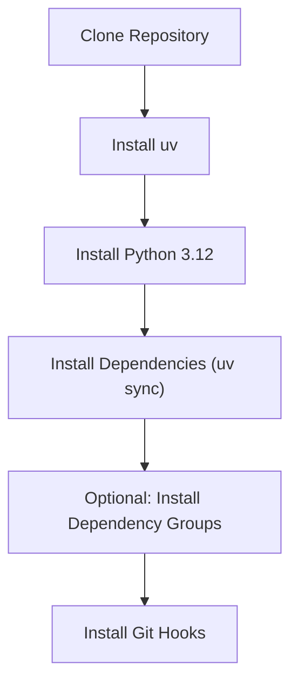

### Step 1: Clone the Repository

Clone the OLMo-Eval repository to your local machine.

```bash
git clone https://github.com/allenai/olmo-eval.git
cd olmo-eval
```
Sources: [DEVELOPMENT.md:6-8]()

### Step 2: Install `uv`

`uv` is a fast Python package installer and resolver. If you don't have it, install it using the provided script:

```bash
curl -LsSf https://astral.sh/uv/install.sh | sh
```
Sources: [DEVELOPMENT.md:10-11]()

### Step 3: Install Python 3.12

OLMo-Eval requires Python 3.12. If your system doesn't have it, `uv` can install it:

```bash
uv python install 3.12
```
Sources: [DEVELOPMENT.md:13-14]()

### Step 4: Install Dependencies and the Package

Install the project dependencies and the package itself in editable mode using `uv sync`. This uses the checked-in `uv.lock` file for reproducible builds.

```bash
uv sync --frozen
```
This command installs all core dependencies listed in `pyproject.toml` [pyproject.toml:23-38]() and the default dependency groups specified in `[tool.uv]` [pyproject.toml:107](), which currently include `dev` and `vllm` [pyproject.toml:107]().

Sources: [DEVELOPMENT.md:16-18]()

### Step 5: Optional Dependency Groups

OLMo-Eval supports several optional dependency groups for specific functionalities. You can install them using `uv sync --group <group_name>`.

| Group Name | Purpose | Installation Command | Dependencies |
| :--------- | :------ | :------------------- | :----------- |
| `hf` | HuggingFace Transformers integration | `uv sync --group hf` | `transformers` [pyproject.toml:47-48]() |
| `vllm` | vLLM inference engine (Linux/CUDA only) | `uv sync --group vllm` | `vllm[runai]`, `opencv-python-headless`, `torch-c-dlpack-ext` [pyproject.toml:49-55]() |
| `litellm` | LiteLLM for commercial APIs | `uv sync --group litellm` | `litellm` [pyproject.toml:56-58]() |
| `agents` | OpenAI Agents integration | `uv sync --group agents` | `openai-agents`, `httpx` [pyproject.toml:59-62]() |
| `analysis` | Data analysis and plotting tools | `uv sync --group analysis` | `matplotlib`, `seaborn`, `scipy` [pyproject.toml:63-66]() |
| `openhands` | OpenHands AI integration | `uv sync --group openhands` | `openhands-ai` [pyproject.toml:67-69]() |
| `sandbox` | Sandboxed execution with SWE-ReX | `uv sync --group sandbox` | `swe-rex[modal]` [pyproject.toml:70-72]() |
| `beaker` | Beaker platform integration | `uv sync --group beaker` | `beaker-py`, `beaker-gantry` [pyproject.toml:73-76]() |
| `s3` | S3 artifact storage | `uv sync --group s3` | `boto3`, `smart_open[s3]` [pyproject.toml:77-80]() |
| `postgres` | PostgreSQL database backend | `uv sync --group postgres` | `psycopg[binary]`, `sqlalchemy`, `alembic` [pyproject.toml:81-85]() |
| `gpu` | NVIDIA GPU monitoring | `uv sync --group gpu` | `nvidia-ml-py` [pyproject.toml:86-89]() |
| `clients` | OpenAI API client | `uv sync --group clients` | `openai` [pyproject.toml:90-92]() |
| `storage` | S3 and PostgreSQL storage | `uv sync --group storage` | `olmo-eval[s3,postgres]` [pyproject.toml:93-95]() |
| `dev` | Development tools and dependencies | `uv sync --group dev` | `pytest`, `pytest-cov`, `ruff`, `ty`, `pre-commit`, `olmo-eval[storage,beaker,hf,analysis]`, `jinja2`, `google-api-core`, `parameterized` [pyproject.toml:128-139]() |

Note that some groups have conflicting dependencies and cannot be installed together [pyproject.toml:109-122](). For example, `agents`, `openhands`, and `clients` are mutually exclusive with each other, and `vllm` is also mutually exclusive with `openhands`.

If you need to install a specific group and exclude a default one (like `vllm` on macOS), use `--no-group`:
```bash
uv sync --no-group vllm --group hf
```

Sources: [pyproject.toml:45-144](), [src/olmo_eval/storage/__init__.py:38-42]()

### Step 6: Install Git Hooks

Install pre-commit hooks to ensure code quality and formatting standards are met before committing.

```bash
uv run pre-commit install
```
Sources: [DEVELOPMENT.md:20-21]()

## First Run Commands

After installation, you can verify your setup and explore the framework using the `olmo-eval` CLI.

### Inspecting Suites and Tasks

Use `suite inspect` and `task inspect` to view available evaluation suites and their constituent tasks.

```bash
uv run olmo-eval suite inspect mmlu
uv run olmo-eval suite inspect gpqa
uv run olmo-eval suite inspect olmobase:code
```
Sources: [DEVELOPMENT.md:23-26]()

### Previewing a Run

You can perform a dry run of an evaluation without loading a model or performing actual inference. This is useful for checking configuration and task setup.

```bash
uv run olmo-eval run -m mock -t gsm8k --dry-run
```
The `-m mock` argument uses a mock inference provider, and `--dry-run` prevents actual computation.
Sources: [DEVELOPMENT.md:28-30]()

## Docker Image

OLMo-Eval provides Docker images for reproducible and isolated execution, especially useful for GPU-accelerated environments.

### Docker Image Build Process

The Docker image build process involves multiple stages:

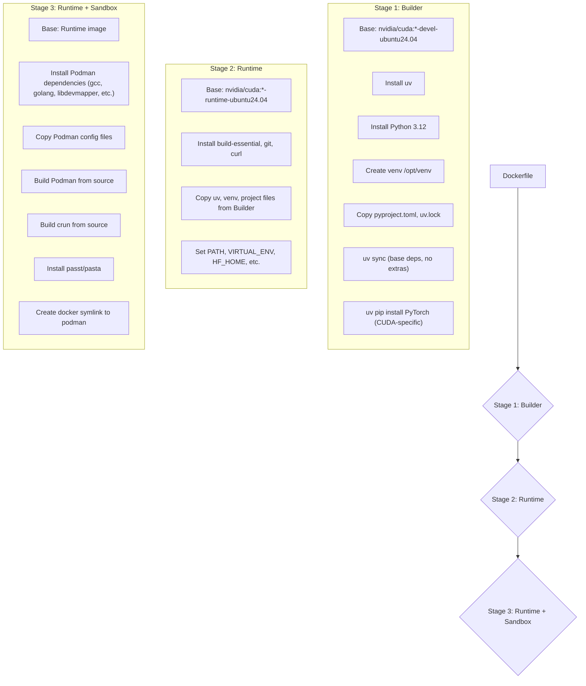
The `Dockerfile` [Dockerfile:1-150]() defines three stages:
1.  **Builder**: Sets up a Python virtual environment (`/opt/venv`) with `uv`, installs Python 3.12, core project dependencies from `uv.lock`, and CUDA-specific PyTorch. This stage uses a `nvidia/cuda:*-devel-ubuntu24.04` base image [Dockerfile:24]().
2.  **Runtime**: Creates a minimal image based on `nvidia/cuda:*-runtime-ubuntu24.04` [Dockerfile:58](). It copies the `uv` executable, the virtual environment, and project files from the `builder` stage. This image is suitable for running evaluations.
3.  **Runtime + Sandbox**: Extends the `runtime` image by adding Podman and its dependencies for sandboxed execution environments [Dockerfile:98](). This is used for benchmarks requiring isolated code execution.

### Building the Docker Image

Use the `scripts/build_image.sh` script to build the Docker image.

```bash
./scripts/build_image.sh [OPTIONS]
```

**Common Options:**

-   `--tag TAG`: Specify a custom image tag (default is auto-generated).
-   `--cuda-version VER`: Set the CUDA version (e.g., `12.8.0`).
-   `--torch-version VER`: Set the PyTorch version (e.g., `2.9.0`).
-   `--python-version VER`: Set the Python version (default: `3.12`).
-   `--platform PLATFORM`: Target platform (e.g., `linux/amd64`, `linux/arm64`).
-   `--sandbox`: Build the `runtime-sandbox` target with Podman support.
-   `--no-cache`: Force a rebuild without using Docker cache.

**Example:**

```bash
# Build with default settings (CUDA 12.8.1, Torch 2.9.0, Python 3.12, amd64)
./scripts/build_image.sh

# Build with CUDA 12.8.0 and sandbox support
./scripts/build_image.sh --cuda-version 12.8.0 --sandbox

# Build for ARM64 platform
./scripts/build_image.sh --platform linux/arm64
```
The script will output the generated tag and instructions for testing the image.
Sources: [scripts/build_image.sh:1-176]()

### Pushing to Beaker

The `scripts/beaker/push_beaker_image.sh` script facilitates pushing the built Docker image to Beaker, including versioning and archiving previous images for safe rollbacks.

```bash
./scripts/beaker/push_beaker_image.sh [OPTIONS]
```

**Common Options:**

-   `--source IMAGE`: Local Docker image to push (default: `olmo-eval:latest`).
-   `--beaker-image NAME`: Name for the image on Beaker (default: auto-generated from source tag).
-   `--workspace WS`: Beaker workspace (default: `ai2/oe-data`).
-   `--dry-run`: Preview the actions without executing.
-   `--force`: Force upload even if a temporary image exists.

**Example:**

```bash
# Push the most recently built image to Beaker
./scripts/beaker/push_beaker_image.sh

# Push a specific image with a custom Beaker name
./scripts/beaker/push_beaker_image.sh --source olmo-eval:cu128-trc290-amd64 --beaker-image my-olmo-eval-prod
```
The script ensures that the `beaker` CLI and `jq` are installed. It uploads the image as a temporary one, renames the existing image (if any) with a timestamp, and then promotes the temporary image to the final name.
Sources: [scripts/beaker/push_beaker_image.sh:1-191]()

## Configuration

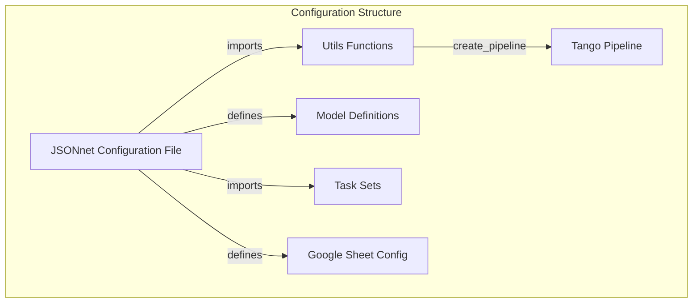

OLMo-Eval uses JSONnet configuration files to define evaluation pipelines. These configurations specify:

1. **Models to evaluate** - model paths, revisions, and GPU requirements
2. **Task sets** - collections of NLP tasks for evaluation
3. **Output options** - including Google Sheets integration

Sources: [configs/example_config.jsonnet:1-38](), [configs/evaluation_template.jsonnet:1-46]()

### Basic Configuration

The basic structure of a configuration file includes:

- Import statements for utility functions and task sets
- Model definitions with paths, revisions, and prediction parameters
- Task set definitions
- Optional Google Sheet integration

Example minimal configuration:

```jsonnet
local utils = import 'utils.libsonnet';
local gen_tasks = import 'task_sets/gen_tasks.libsonnet';

local gsheet = null;  // Set to Google Sheet name if needed

local models = [
    {
        model_path: "EleutherAI/pythia-1b",
        revision: "step140000",
        gpus_needed: 1,
        prediction_kwargs: {
            model_max_length: 2048,
            max_batch_tokens: 20480,
        }
    }
];

local task_sets = [
    gen_tasks.task_set,
];

{
    steps: utils.create_pipeline(models, task_sets, gsheet)
}
```

Sources: [configs/example_config.jsonnet:1-38]()

## Running Evaluations

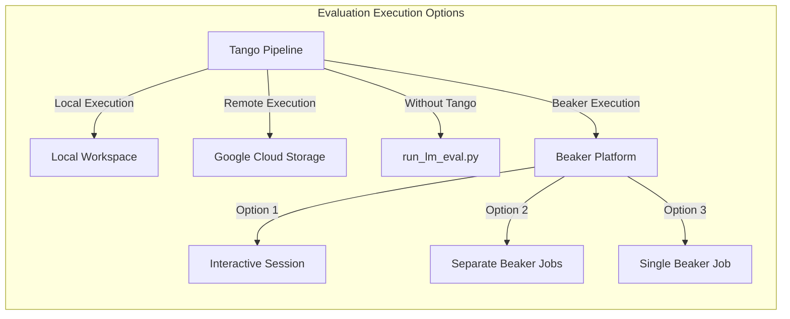

### Local Execution

To run an evaluation pipeline locally:

```bash
tango --settings tango.yml run configs/example_config.jsonnet --workspace my-eval-workspace
```

This executes all the steps defined in the configuration and saves the results in a local tango workspace called `my-eval-workspace`. If you rerun with additional tasks or models, it will only compute the new outputs.

You can load the results programmatically:

```python
from tango import Workspace
workspace = Workspace.from_url("local://my-eval-workspace")
result = workspace.step_result("combine-all-outputs")
```

Sources: [README.md:39-70]()

### Google Sheets Integration

To save output to a Google Sheet:

1. Enable Google Drive API in your GCE console
2. Set up a service account with appropriate permissions
3. Share the Google Sheet with the service account email
4. Download the API JSON key for the service account
5. Set the `gsheet` variable in your configuration
6. Set the `GDRIVE_SERVICE_ACCOUNT_JSON` environment variable

```bash
export GDRIVE_SERVICE_ACCOUNT_JSON=$(cat downloaded_credentials_file.json)
tango --settings tango.yml run configs/evaluation_template.jsonnet --workspace my-eval-workspace
```

Sources: [ADVANCED.md:1-17]()

### Remote Workspace

To use a Google Cloud Storage workspace:

1. Enable Google Datastore in your GCE console
2. Log in with Google Cloud CLI:

```bash
gcloud auth login
gcloud auth application-default login
gcloud config set project <your-project>
```

3. Run with a Google Storage workspace:

```bash
tango --settings tango.yml run configs/example_config.jsonnet --workspace gs://my-gs-workspace
```

Sources: [ADVANCED.md:19-41]()

### Running Without Tango

For debugging or simpler execution, you can use the `run_lm_eval.py` script directly:

```bash
python -m olmo_eval.run_lm_eval --config_file configs/run_lm_eval_example.jsonnet
```

Or with direct arguments:

```bash
python -m olmo_eval.run_lm_eval --model lm::pretrained=EleutherAI/pythia-160m,revision=step140000 \
    --task arc_challenge arc_easy --split validation \
    --full_output_file predictions.jsonl --metrics_file metrics.json --model_max_length 2048 \
    --max_batch_tokens 4096 --num_recorded_inputs 3 --num_shots 0
```

Sources: [ADVANCED.md:52-67](), [configs/run_lm_eval_example.jsonnet:1-16]()

## Execution Environments

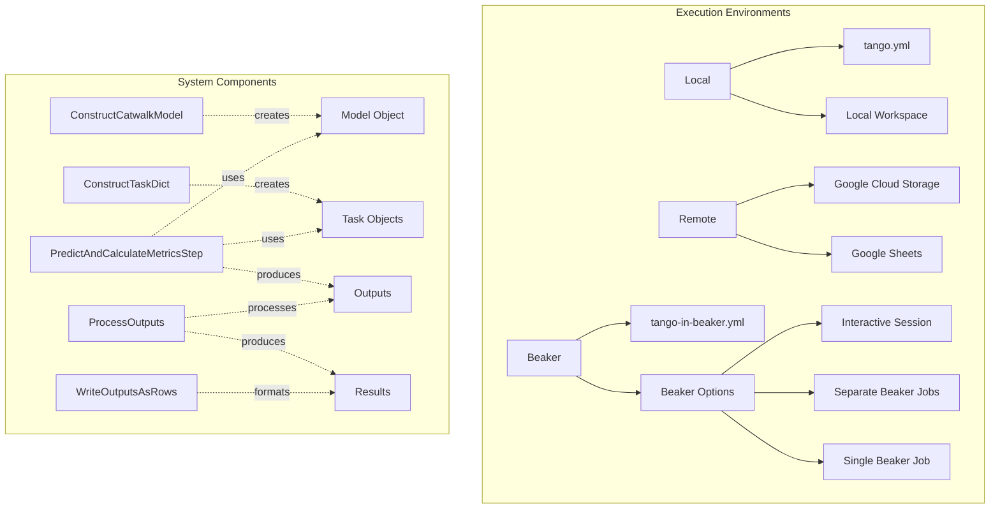

### Beaker Execution

OLMo-Eval supports running on [Beaker](https://beaker.org/), a platform for machine learning experiments. There are three options:

#### Option 1: Interactive Session

1. Start an interactive Beaker session with required GPUs
2. Run as you would locally:

```bash
tango --settings tango.yml run configs/example_config.jsonnet --workspace gs://my-gs-workspace
```

#### Option 2: Separate Beaker Jobs

Run each pipeline step as a different Beaker experiment, provisioning resources for each step separately:

```bash
tango --settings tango-in-beaker.yml run configs/example_config.jsonnet --workspace gs://my-gs-workspace
```

#### Option 3: Single Beaker Job

Use `beaker-gantry` to run the full pipeline in a single job:

```bash
gantry run --gpus 1 --venv base --workspace ai2/lm-eval --cluster ai2/aristo-cirrascale \
   --beaker-image oyvindt/OLMoEvalLatest \
   --env 'HF_DATASETS_CACHE=/net/nfs.cirrascale/aristo/oyvindt/hf_datasets_cache' -- \
   python olmo_eval/run_lm_eval.py \
   --model lm::pretrained=EleutherAI/pythia-160m,revision=step140000 \
   --task arc_challenge arc_easy boolq --split validation \
   --full_output_file /results/predictions.jsonl --metrics_file /results/metrics.json \
   --model_max_length 2048 --max_batch_tokens 4096 --num_recorded_inputs 3 \
   --num_shots 0
```

Additionally, the `olmo-eval beaker` CLI commands provide utilities for managing Beaker groups and watching experiment logs.

-   `olmo-eval beaker group info <group_name>`: Get detailed information about a Beaker group [src/olmo_eval/cli/beaker/group.py:50-70]().
-   `olmo-eval beaker group cancel <group_name>`: Cancel all experiments in a Beaker group [src/olmo_eval/cli/beaker/group.py:240-241]().
-   `olmo-eval beaker watch --experiment <experiment_id>`: Watch an experiment's logs in real-time [src/olmo_eval/cli/beaker/watch.py:8-21]().

Sources: [BEAKER.md:1-60](), [src/olmo_eval/cli/beaker/group.py:45-241](), [src/olmo_eval/cli/beaker/watch.py:1-41]()

## Key Configuration Files

| File | Purpose |
|------|---------|
| `tango.yml` | Configuration for local Tango execution |
| `tango-in-beaker.yml` | Configuration for Beaker execution |
| `configs/example_config.jsonnet` | Minimal example configuration |
| `configs/evaluation_template.jsonnet` | Template with multiple task sets |
| `configs/run_lm_eval_example.jsonnet` | Example for direct script execution |

Sources: [README.md:41-47](), [BEAKER.md:34-38](), [ADVANCED.md:66-67]()

## Troubleshooting

If your Google workspace enters a bad state, clear it with:

```bash
python scripts/empty_workspace.py my-gs-workspace
```

Sources: [ADVANCED.md:43-49]()

---

# Page: Key Concepts

# Key Concepts

<details>
<summary>Relevant source files</summary>

The following files were used as context for generating this wiki page:

- [README.md](README.md)
- [src/olmo_eval/common/metrics/__init__.py](src/olmo_eval/common/metrics/__init__.py)
- [src/olmo_eval/common/scorers/__init__.py](src/olmo_eval/common/scorers/__init__.py)
- [src/olmo_eval/common/scorers/base.py](src/olmo_eval/common/scorers/base.py)
- [src/olmo_eval/evals/tasks/common/base.py](src/olmo_eval/evals/tasks/common/base.py)
- [src/olmo_eval/harness/config.py](src/olmo_eval/harness/config.py)
- [src/olmo_eval/harness/harness.py](src/olmo_eval/harness/harness.py)
- [src/olmo_eval/harness/presets.py](src/olmo_eval/harness/presets.py)
- [src/olmo_eval/harness/sandbox/config.py](src/olmo_eval/harness/sandbox/config.py)
- [src/olmo_eval/launch/config.py](src/olmo_eval/launch/config.py)
- [src/olmo_eval/runners/asynq/processing.py](src/olmo_eval/runners/asynq/processing.py)

</details>


This page explains the fundamental concepts and terminology used throughout the OLMo-Eval framework, providing the necessary foundation for understanding how to evaluate language models using this repository. For installation instructions, see [Installation and Setup](#1.1), and for details on running evaluations, see [Evaluation Pipeline](#2).

## Core Evaluation Flow

OLMo-Eval provides a unified workbench for evaluating language models. The evaluation process is structured around several core abstractions that define how tasks are specified, how models interact with them, and how results are scored and aggregated. The overall flow involves defining tasks, grouping them into suites, executing them via a `Harness` and `InferenceProvider`, and then scoring and collecting metrics.

```mermaid
graph TD
    subgraph "Evaluation Flow"
        A[Task Definition] --> B[Instance Generation]
        B --> C[LMRequest Formatting]
        C --> D[InferenceProvider]
        D --> E[LMOutput Generation]
        E --> F[Scoring]
        F --> G[Metric Aggregation]
        G --> H[Results Storage]
    end

    subgraph "Code Entities"
        A -- "Task.get_instances()" --> B
        B -- "Task.format_instance()" --> C
        C -- "Harness.generate()/run()" --> D["InferenceProvider.agenerate()/alogprobs()"]
        D --> E
        E -- "Task.score_output()" --> F
        F -- "Task.compute_metrics()" --> G
        G -- "StorageBackend" --> H
    end
```
Sources: [README.md:66-77](), [src/olmo_eval/evals/tasks/common/base.py:20-28](), [src/olmo_eval/harness/harness.py:97-150](), [src/olmo_eval/runners/asynq/processing.py:158-196]()

## Key Abstractions

The OLMo-Eval framework is built around the following core abstractions:

| Abstraction | Description |
|-------------|-------------|
| **Task** | Defines how to load data, format prompts, and score outputs for a specific benchmark. |
| **Suite** | Groups multiple tasks and/or nested suites, defining how their results are aggregated. |
| **Harness** | The runtime layer that orchestrates inference, tool use, system prompts, and scaffolds. It wraps an `InferenceProvider`. |
| **InferenceProvider** | An interface for interacting with language models (e.g., vLLM, LiteLLM, HuggingFace). |
| **Instance** | A single example from a dataset, containing input data and the gold answer. |
| **LMRequest** | A formatted request sent to the language model, including prompt, sampling parameters, and metadata. |
| **LMOutput** | The response from the language model, including generated text, log probabilities, and extracted answers. |
| **Scorer** | Computes a numerical score for a single `LMOutput` against an `Instance`'s gold answer. |
| **Metric** | Aggregates scores from multiple `Scorer` outputs to produce a dataset-level performance measure. |

Sources: [README.md:66-77]()

### Task

A `Task` is the fundamental unit of evaluation. It encapsulates everything needed to run a benchmark:
- **Data Source**: Specifies where to load the dataset (e.g., Hugging Face dataset, local file).
- **Formatting**: Defines how an `Instance` is converted into an `LMRequest` (e.g., using `CompletionFormatter`, `ChatFormatter`).
- **Scoring Logic**: Contains one or more `Scorer` instances to evaluate `LMOutput`s.
- **Metrics**: Specifies `Metric` instances to aggregate scores.
- **Few-shot settings**: Configures the number and source of few-shot examples.
- **Runtime Dependencies**: Can specify Python packages or Dockerfile commands needed for execution, especially for sandboxed scoring.

Tasks are registered using the `@register` decorator [src/olmo_eval/evals/tasks/common/base.py:220](). Variants can be registered with `@register_variant` [src/olmo_eval/evals/tasks/common/base.py:230]() to define named evaluation presets (e.g., `humaneval:3shot:bpb`).

```python
from olmo_eval.evals.tasks.common import Task, register
from olmo_eval.data import DataSource

@register("my_task")
class MyTask(Task):
    # DataSource specifies path, subset (optional), and split
    data_source = DataSource(path="cais/mmlu", subset="abstract_algebra", split="test")
    # ... other task configurations like formatter, scorers, metrics
```
Sources: [README.md:79-86](), [src/olmo_eval/evals/tasks/common/base.py:112-186]()

### Suite

A `Suite` is a collection of `Task`s or other `Suite`s, allowing for hierarchical organization of evaluations. Suites define how results from their constituent tasks are aggregated.

```python
from olmo_eval.evals.suites import Suite, AggregationStrategy, register

# Nested suite with 3 tasks
multilingual_code = Suite(
    name="multilingual_code",
    tasks=("mbpp_python", "mbpp_java", "mbpp_rust"),
    aggregation=AggregationStrategy.AVERAGE,
)

# Parent suite using average of averages
register(Suite(
    name="code_eval",
    tasks=(
        "humaneval",        # Single task (score: 0.80)
        multilingual_code,  # Nested suite with 3 tasks (scores: 0.40, 0.50, 0.60)
    ),
    aggregation=AggregationStrategy.AVERAGE_OF_AVERAGES,
))
```
Sources: [README.md:113-164]()

**Aggregation Strategies**:
- `AVERAGE`: Simple average of all task scores (default).
- `AVERAGE_OF_AVERAGES`: Averages over child suite averages, giving equal weight to each child suite regardless of its number of tasks.
- `DISPLAY_ONLY`: Displays child results without computing a suite average.
- `NONE`: No aggregation; only individual task results are collected.
Sources: [README.md:129-135]()

### Harness

The `Harness` [src/olmo_eval/harness/harness.py:22-32]() is the runtime orchestration layer. It wraps an `InferenceProvider` and applies runtime behaviors such as:
- **System Prompts**: Prepends a system prompt to requests.
- **Tools**: Integrates external tools (e.g., search, code execution) that the model can call.
- **Scaffolds**: Enables multi-turn agentic behavior (e.g., `openai_agents`, `openhands`).
- **Sandboxes**: Provides isolated environments for executing tools (e.g., code execution).
- **Metrics Collection**: Gathers telemetry during inference.

The `Harness` allows the same task to be run in plain, tool-using, or scaffolded modes without modifying the task definition. It can perform single-turn generation (`generate`/`agenerate`) or multi-turn execution (`run`) if a scaffold is configured.

```mermaid
graph TD
    HarnessConfig[HarnessConfig] --> Harness[Harness]
    Harness --> InferenceProvider[InferenceProvider]
    Harness --> Tools[Tools]
    Harness --> Scaffolds[Scaffolds]
    Harness --> Sandboxes[Sandboxes]
    Harness --> Metrics[MetricsConfig]

    subgraph "Harness.run()"
        direction LR
        LMRequest[LMRequest] --> Scaffold[Scaffold.run()]
        Scaffold --> InferenceProvider
        Scaffold --> Tools
        Tools --> Sandboxes
        Scaffold --> HarnessResult[HarnessResult]
    end
```
Sources: [src/olmo_eval/harness/harness.py:22-32](), [src/olmo_eval/harness/config.py:23-54](), [src/olmo_eval/harness/presets.py:65-77]()

### InferenceProvider

An `InferenceProvider` [src/olmo_eval/inference/base.py:18-20]() is an interface for interacting with language models. It abstracts away the specifics of different model backends. OLMo-Eval supports:
- **VLLMProvider**: For local or server-based vLLM inference.
- **LiteLLMProvider**: For commercial APIs (e.g., OpenAI, Anthropic) via LiteLLM.
- **HuggingFaceProvider**: For local Hugging Face Transformers models.
- **MockProvider**: For dry runs and testing without actual model inference.

Providers implement methods for `generate` (text generation) and `logprobs` (log probability calculation), both synchronously and asynchronously.

```mermaid
graph TD
    InferenceProviderBase[InferenceProvider (Abstract)]
    InferenceProviderBase <|-- VLLMProvider[VLLMProvider]
    InferenceProviderBase <|-- LiteLLMProvider[LiteLLMProvider]
    InferenceProviderBase <|-- HuggingFaceProvider[HuggingFaceProvider]
    InferenceProviderBase <|-- MockProvider[MockProvider]

    subgraph "Methods"
        VLLMProvider -- "generate(requests, sampling_params)" --> LMOutputList[list[LMOutput]]
        VLLMProvider -- "logprobs(requests, sampling_params)" --> LMOutputList
        VLLMProvider -- "agenerate(requests, sampling_params)" --> LMOutputList
        VLLMProvider -- "alogprobs(requests, sampling_params)" --> LMOutputList
    end
```
Sources: [src/olmo_eval/inference/base.py:18-20](), [src/olmo_eval/inference/providers/vllm.py:24-26](), [src/olmo_eval/inference/providers/litellm.py:20-22](), [src/olmo_eval/inference/providers/huggingface.py:20-22]()

### Instance

An `Instance` [src/olmo_eval/common/types.py:100-106]() represents a single example from a dataset. It typically contains:
- `input`: The raw input data for the model.
- `gold_answer`: The correct answer for scoring.
- `metadata`: Additional information about the instance (e.g., ID, context).

Tasks are responsible for loading and processing raw data into `Instance` objects.

### LMRequest

An `LMRequest` [src/olmo_eval/common/types.py:110-120]() is a structured request sent to an `InferenceProvider`. It includes:
- `request_type`: Whether it's a `COMPLETION`, `LOGLIKELIHOOD`, or `CHAT` request.
- `prompt`: The text prompt for the model.
- `continuation`: (For `LOGLIKELIHOOD`) The text to score.
- `messages`: (For `CHAT`) A list of chat messages.
- `sampling_params`: Parameters controlling generation (e.g., temperature, top_p, max_tokens).
- `metadata`: Any additional request-specific metadata.

`Formatter`s are used by `Task`s to convert `Instance`s into `LMRequest`s.

### LMOutput

An `LMOutput` [src/olmo_eval/common/types.py:124-134]() is the structured response received from an `InferenceProvider`. It contains:
- `text`: The generated text.
- `log_prob`: The log probability of the generated text (if requested).
- `log_probs_per_token`: Log probabilities for each token.
- `extracted_answer`: The answer extracted from the generated text by the task's answer extraction logic.
- `metadata`: Any additional output-specific metadata (e.g., tool calls, scoring errors).

### Scorer

A `Scorer` [src/olmo_eval/common/scorers/base.py:14-19]() computes a numerical score (typically between 0.0 and 1.0) for a single `LMOutput` against an `Instance`'s `gold_answer`. Examples include:
- `ExactMatchScorer`: Checks for exact string equality [src/olmo_eval/common/scorers/base.py:67-84]().
- `MultipleChoiceScorer`: Compares selected options [src/olmo_eval/common/scorers/base.py:87-98]().
- `F1Scorer`: Computes token-level F1 score [src/olmo_eval/common/scorers/base.py:136-146]().
- `ProcessScorer`: Base class for CPU-heavy scorers that run in a subprocess [src/olmo_eval/common/scorers/base.py:48-63]().
- `CodeExecutionScorer`: Executes generated code in a sandbox to verify correctness [src/olmo_eval/common/scorers/code_execution.py:14-16]().
- `LLMJudgeScorer`: Uses another LLM to judge the quality of the output [src/olmo_eval/common/scorers/llm_judge.py:24-26]().

```mermaid
graph TD
    ScorerBase[Scorer (Abstract)]
    ScorerBase <|-- ExactMatchScorer[ExactMatchScorer]
    ScorerBase <|-- MultipleChoiceScorer[MultipleChoiceScorer]
    ScorerBase <|-- F1Scorer[F1Scorer]
    ScorerBase <|-- ProcessScorer[ProcessScorer]
    ProcessScorer <|-- CodeExecutionScorer[CodeExecutionScorer]
    ProcessScorer <|-- LLMJudgeScorer[LLMJudgeScorer]

    subgraph "Scorer.score()"
        Instance[Instance] --> ScorerBase
        LMOutput[LMOutput] --> ScorerBase
        ScorerBase --> Score[float]
    end
```
Sources: [src/olmo_eval/common/scorers/base.py:14-19](), [src/olmo_eval/common/scorers/base.py:67-84](), [src/olmo_eval/common/scorers/base.py:87-98](), [src/olmo_eval/common/scorers/base.py:136-146](), [src/olmo_eval/common/scorers/base.py:48-63](), [src/olmo_eval/common/scorers/code_execution.py:14-16](), [src/olmo_eval/common/scorers/llm_judge.py:24-26]()

### Metric

A `Metric` [src/olmo_eval/common/metrics/base.py:20-22]() aggregates the individual scores produced by `Scorer`s across all instances of a task to produce a single, dataset-level performance measure. Examples include:
- `AccuracyMetric`: Calculates the proportion of correctly scored instances [src/olmo_eval/common/metrics/base.py:30-32]().
- `F1Metric`: Aggregates F1 scores [src/olmo_eval/common/metrics/base.py:100-102]().
- `PassAtKMetric`: For coding tasks, measures the percentage of problems solved by at least one of `k` attempts [src/olmo_eval/common/metrics/base.py:160-162]().
- `BitsPerByteScorer`: Computes bits per byte from logprobs [src/olmo_eval/common/scorers/base.py:209-216]().

```mermaid
graph TD
    MetricBase[Metric (Abstract)]
    MetricBase <|-- AccuracyMetric[AccuracyMetric]
    MetricBase <|-- F1Metric[F1Metric]
    MetricBase <|-- PassAtKMetric[PassAtKMetric]
    MetricBase <|-- BPBMetricByteAvg[BPBMetricByteAvg]

    subgraph "Metric.compute()"
        Scores[list[float]] --> MetricBase
        MetricBase --> AggregatedScore[float]
    end
```
Sources: [src/olmo_eval/common/metrics/base.py:20-22](), [src/olmo_eval/common/metrics/base.py:30-32](), [src/olmo_eval/common/metrics/base.py:100-102](), [src/olmo_eval/common/metrics/base.py:160-162](), [src/olmo_eval/common/metrics/base.py:209-216]()

---

# Page: Evaluation Pipeline

# Evaluation Pipeline

<details>
<summary>Relevant source files</summary>

The following files were used as context for generating this wiki page:

- [README.md](README.md)
- [src/olmo_eval/cli/run/__init__.py](src/olmo_eval/cli/run/__init__.py)
- [src/olmo_eval/cli/run/config.py](src/olmo_eval/cli/run/config.py)
- [src/olmo_eval/common/progress.py](src/olmo_eval/common/progress.py)
- [src/olmo_eval/inference/__init__.py](src/olmo_eval/inference/__init__.py)
- [src/olmo_eval/launch/config.py](src/olmo_eval/launch/config.py)
- [src/olmo_eval/runners/asynq/monitoring.py](src/olmo_eval/runners/asynq/monitoring.py)
- [src/olmo_eval/runners/asynq/results.py](src/olmo_eval/runners/asynq/results.py)
- [src/olmo_eval/runners/asynq/runner.py](src/olmo_eval/runners/asynq/runner.py)
- [src/olmo_eval/runners/asynq/types.py](src/olmo_eval/runners/asynq/types.py)
- [src/olmo_eval/runners/asynq/workers.py](src/olmo_eval/runners/asynq/workers.py)
- [tests/core/test_configs.py](tests/core/test_configs.py)

</details>


The OLMo-Eval Evaluation Pipeline orchestrates end-to-end evaluations of language models, from command-line invocation to result storage. This page provides a high-level overview of the pipeline's stages, linking to child pages for detailed explanations of each component.

## Pipeline Overview

The evaluation pipeline begins with a CLI command, which parses configuration and sets up storage. An asynchronous runner then prepares tasks and manages inference workers. These workers perform inference using a configured harness, which wraps an inference provider and handles task-specific logic. Finally, results are scored, aggregated, and stored in a database and/or S3.

Here's a high-level diagram of the evaluation pipeline:

```mermaid
graph TD
    A[CLI Invocation] --> B{Run Configuration};
    B --> C[Storage Setup];
    C --> D[AsyncEvalRunner];
    D --> E[Task Preparation];
    E --> F[GPU Planning];
    F --> G[Inference Workers];
    G --> H[Harness];
    H --> I[Inference Provider];
    I --> J[LM Requests];
    J --> K[LM Outputs];
    K --> L[Scoring & Aggregation];
    L --> M[Result Storage];

    subgraph "Main Process"
        A -- "olmo-eval run" --> B;
        B -- "RunConfig" --> C;
        C -- "StorageBackend" --> D;
        D -- "prepare_task_items()" --> E;
        E -- "_plan_gpus()" --> F;
        F -- "multiprocessing.Process" --> G;
        G -- "QueueItem" --> H;
        H -- "InferenceProvider.generate()" --> I;
        I -- "LMRequest" --> J;
        J -- "LMOutput" --> K;
        K -- "process_results()" --> L;
        L -- "StorageBackend.save_results()" --> M;
    end

    subgraph "Worker Processes"
        G -- "inference_worker()" --> H;
        H -- "Harness.run_task_instance()" --> I;
    end

    style A fill:#f9f,stroke:#333,stroke-width:2px
    style B fill:#bbf,stroke:#333,stroke-width:2px
    style C fill:#bbf,stroke:#333,stroke-width:2px
    style D fill:#bbf,stroke:#333,stroke-width:2px
    style E fill:#ccf,stroke:#333,stroke-width:2px
    style F fill:#ccf,stroke:#333,stroke-width:2px
    style G fill:#ccf,stroke:#333,stroke-width:2px
    style H fill:#ccf,stroke:#333,stroke-width:2px
    style I fill:#ccf,stroke:#333,stroke-width:2px
    style J fill:#ccf,stroke:#333,stroke-width:2px
    style K fill:#ccf,stroke:#333,stroke-width:2px
    style L fill:#bbf,stroke:#333,stroke-width:2px
    style M fill:#bbf,stroke:#333,stroke-width:2px
```
Sources: [src/olmo_eval/cli/run/__init__.py:30-241](), [src/olmo_eval/runners/asynq/runner.py:29-33](), [src/olmo_eval/runners/asynq/preparation.py:16-17](), [src/olmo_eval/runners/asynq/runner.py:165-175](), [src/olmo_eval/runners/asynq/workers.py:31-38](), [src/olmo_eval/harness/__init__.py:1-1](), [src/olmo_eval/inference/__init__.py:1-1](), [src/olmo_eval/runners/asynq/results.py:84-104](), [src/olmo_eval/storage/__init__.py:1-1]()

## Pipeline Stages

The evaluation pipeline is broken down into several key stages, each managed by specific components:

### CLI and Run Configuration

The evaluation process starts with the `olmo-eval run` command. This command parses various options, including model specifications, task lists, and overrides. It constructs a `RunConfig` object, which encapsulates all parameters for the evaluation. Overrides allow dynamic adjustment of task or harness settings directly from the command line. A dry-run mode is available to inspect the configuration without executing the evaluation.

For details, see [CLI and Run Configuration](#2.1).

Sources: [src/olmo_eval/cli/run/__init__.py:30-241](), [src/olmo_eval/cli/run/config.py:177-185]()

### Async Runner and Worker Architecture

The core execution is managed by the `AsyncEvalRunner`. This runner employs a multi-process architecture, spawning `inference_worker` processes to handle model inference. It's responsible for preparing tasks, planning GPU allocation, and distributing `QueueItem` objects (representing individual instances to be processed) to workers. Workers return `ResultItem` objects, which the runner aggregates and processes. Batching strategies are applied to optimize throughput.

For details, see [Async Runner and Worker Architecture](#2.2).

Sources: [src/olmo_eval/runners/asynq/runner.py:29-33](), [src/olmo_eval/runners/asynq/workers.py:21-31](), [src/olmo_eval/runners/asynq/types.py:22-34](), [src/olmo_eval/runners/asynq/types.py:80-92]()

### Harness and Scaffolds

Within each `inference_worker`, a `Harness` instance is created based on a `HarnessConfig`. The harness acts as a runtime layer, wrapping an `InferenceProvider` (e.g., vLLM, LiteLLM, HuggingFace). It integrates tools, applies system prompts, and can incorporate scaffolds like `openai_agents` or `openhands` for agentic evaluations. Presets like `dr_tulu` simplify common harness configurations. The harness is responsible for executing the `LMRequest` and obtaining `LMOutput`.

For details, see [Harness and Scaffolds](#2.3).

Sources: [src/olmo_eval/runners/asynq/workers.py:59-60](), [src/olmo_eval/harness/config.py:1-1](), [src/olmo_eval/inference/__init__.py:5-6](), [src/olmo_eval/harness/scaffolds/__init__.py:1-1]()

### Result Storage and Querying

After inference, the `AsyncEvalRunner` collects `ResultItem`s, performs scoring, and aggregates metrics. The results are then persisted using a `StorageBackend`. The primary backend uses PostgreSQL for structured results and metrics, with Alembic migrations managing schema changes. S3 is used for storing larger artifacts like raw predictions or traces. The `olmo-eval results query` and `metrics plot` CLI commands allow users to retrieve and analyze stored evaluation data.

For details, see [Result Storage and Querying](#2.4).

Sources: [src/olmo_eval/runners/asynq/results.py:84-104](), [src/olmo_eval/storage/__init__.py:1-1](), [src/olmo_eval/cli/run/__init__.py:165-172]()

---

# Page: CLI and Run Configuration

# CLI and Run Configuration

<details>
<summary>Relevant source files</summary>

The following files were used as context for generating this wiki page:

- [README.md](README.md)
- [src/olmo_eval/cli/__init__.py](src/olmo_eval/cli/__init__.py)
- [src/olmo_eval/cli/run/__init__.py](src/olmo_eval/cli/run/__init__.py)
- [src/olmo_eval/cli/run/config.py](src/olmo_eval/cli/run/config.py)
- [src/olmo_eval/cli/run/factory.py](src/olmo_eval/cli/run/factory.py)
- [src/olmo_eval/cli/utils.py](src/olmo_eval/cli/utils.py)
- [src/olmo_eval/inference/__init__.py](src/olmo_eval/inference/__init__.py)
- [src/olmo_eval/launch/config.py](src/olmo_eval/launch/config.py)
- [tests/cli/test_arg_round_trip.py](tests/cli/test_arg_round_trip.py)
- [tests/core/test_configs.py](tests/core/test_configs.py)

</details>


This page details the command-line interface (CLI) commands available in `olmo-eval`, focusing on how to execute evaluations, inspect tasks and suites, query results, and plot metrics. It also covers the underlying run configuration dataclasses, how command-line overrides are applied, and the utility of dry-run mode.

## `olmo-eval` CLI Commands

The `olmo-eval` CLI provides several top-level commands for interacting with the evaluation framework. The main entry point is `olmo-eval`, which then dispatches to subcommands.
[src/olmo_eval/cli/__init__.py:30-43]()

### `olmo-eval run`

The `run` command is the primary way to execute evaluations. It orchestrates the entire evaluation pipeline, from model loading and task preparation to inference, scoring, and result storage.
[src/olmo_eval/cli/run/__init__.py:30-113]()

#### Usage

```bash
olmo-eval run -m <model_name_or_path> -t <task_spec_or_suite> [OPTIONS]
```

**Key Options:**

*   `-m, --model`: Specifies the model to evaluate. This can be a preset name (e.g., `llama3.1-8b`) or a direct path to a Hugging Face model.
    [src/olmo_eval/cli/run/__init__.py:33-39]()
*   `-t, --task`: Specifies one or more tasks or suites to run. Multiple `-t` flags can be used. Task specifications can include variants (e.g., `humaneval:3shot:bpb`).
    [src/olmo_eval/cli/run/__init__.py:40-47]()
*   `-o, --override`: Applies configuration overrides. Overrides are associated with the *preceding* `-t` (task) or `--harness` option.
    [src/olmo_eval/cli/run/__init__.py:48-53]()
*   `--harness`: Specifies a harness preset (e.g., `default`, `dr_tulu`).
    [src/olmo_eval/cli/run/options.py:10-15]()
*   `--dry-run`: Performs a dry run without executing inference. It prints the resolved configuration and exits, useful for validating setup.
    [src/olmo_eval/cli/run/__init__.py:103]()
*   `--store`: Enables storing results in the configured storage backend (PostgreSQL and S3).
    [src/olmo_eval/cli/run/__init__.py:86]()
*   `--output-dir`: Directory to save local output files (predictions, requests, metrics).
    [src/olmo_eval/cli/run/__init__.py:100]()

#### Example

```bash
# Preview a run for gsm8k task with mock provider
uv run olmo-eval run -m mock -t gsm8k --dry-run

# Run humaneval with 3-shot and bpb scoring, overriding the limit to 100 instances
uv run olmo-eval run -m llama3.1-8b -t humaneval:3shot:bpb -o limit=100

# Run with a specific harness preset and override a harness-level setting
uv run olmo-eval run --harness default -o provider.kind=vllm_server -m llama3.1-8b -t mmlu
```
Sources: [README.md:59-63](), [README.md:99](), [src/olmo_eval/cli/run/__init__.py:116-120]()

#### `run` Command Execution Flow

The `olmo-eval run` command follows a structured process to parse arguments, build configuration, set up storage, and execute the evaluation.

```mermaid
graph TD
    A[olmo-eval run CLI] --> B{Parse CLI Arguments};
    B --> C[reconstruct_ordered_args];
    C --> D[process_ordered_args];
    D --> E{RunConfigBuilder};
    E --> F[Build RunConfig];
    F --> G[Print RunConfig];
    F --> H{StorageSetup};
    H --> I[Setup Storage Backends];
    F --> J{RunnerFactory};
    J --> K[Create AsyncEvalRunner];
    K --> L{Runner.validate()};
    L -- "If dry_run" --> M[Runner.print_config()];
    L -- "Else" --> N[Runner.run()];
    N --> O[Evaluation Results];

    style A fill:#f9f,stroke:#333,stroke-width:2px
    style E fill:#f9f,stroke:#333,stroke-width:2px
    style H fill:#f9f,stroke:#333,stroke-width:2px
    style J fill:#f9f,stroke:#333,stroke-width:2px
```
Sources: [src/olmo_eval/cli/run/__init__.py:131-235]()

### `olmo-eval suite inspect`

This command allows you to inspect the tasks contained within a registered suite.
[src/olmo_eval/cli/suite.py:30-50]()

#### Usage

```bash
olmo-eval suite inspect <suite_name>
```

#### Example

```bash
uv run olmo-eval suite inspect mmlu
uv run olmo-eval suite inspect olmobase:code
```
Sources: [README.md:55-57]()

### `olmo-eval task inspect`

This command provides detailed information about a specific task, including its configuration, data source, formatter, and metrics.
[src/olmo_eval/cli/task.py:30-50]()

#### Usage

```bash
olmo-eval task inspect <task_spec>
```

#### Example

```bash
olmo-eval task inspect gsm8k
olmo-eval task inspect humaneval:3shot:bpb
```

### `olmo-eval results query`

This command allows querying evaluation results from the configured storage backend.
[src/olmo_eval/cli/results.py:30-100]()

#### Usage

```bash
olmo-eval results query [OPTIONS]
```

#### Example

```bash
olmo-eval results query --model llama3.1-8b --task mmlu
```

### `olmo-eval metrics plot`

This command generates plots of evaluation metrics, useful for visualizing performance trends.
[src/olmo_eval/cli/metrics.py:30-100]()

#### Usage

```bash
olmo-eval metrics plot [OPTIONS]
```

#### Example

```bash
olmo-eval metrics plot --model llama3.1-8b --metric accuracy
```

### Other CLI Commands

*   `olmo-eval tasks`: Lists all registered tasks and their variants.
    [src/olmo_eval/cli/__init__.py:46-67]()
*   `olmo-eval models`: Lists available model presets.
    [src/olmo_eval/cli/__init__.py:100-129]()
*   `olmo-eval harnesses`: Lists available harness presets.
    [src/olmo_eval/cli/__init__.py:132-160]()
*   `olmo-eval scaffolds`: Lists available harness scaffolds.
    [src/olmo_eval/cli/__init__.py:163-178]()
*   `olmo-eval suites`: Lists all registered suites.
    [src/olmo_eval/cli/__init__.py:181-195]()
*   `olmo-eval external-evals`: Lists available external evaluations.
    [src/olmo_eval/cli/__init__.py:198-212]()
*   `olmo-eval beaker`: Commands for managing Beaker jobs and groups.
    [src/olmo_eval/cli/beaker.py:10-11]()
*   `olmo-eval run-external`: Runs external evaluations.
    [src/olmo_eval/cli/run_external.py:10-11]()

Sources: [src/olmo_eval/cli/__init__.py:37-43]()

## Run Configuration Dataclasses

The `olmo-eval run` command constructs a `RunConfig` object, which encapsulates all parameters for an evaluation run. This configuration is built from CLI arguments, harness presets, and task definitions, with overrides applied.
[src/olmo_eval/cli/run/config.py:177-184]()

### `RunConfig`

The top-level configuration for an evaluation run.
[src/olmo_eval/cli/run/config.py:177-184]()

```python
@dataclass
class RunConfig:
    harness_config: HarnessConfig
    task_specs: list[TaskSpec]
    output_dir: Path
    storages: list[StorageBackend] = field(default_factory=list)
    s3_config: S3Config | None = None
    experiment_name: str | None = None
    experiment_group: str | None = None
    save_predictions: bool = False
    save_requests: bool = False
    inspect_instance: bool = False
    inspect_formatted: bool = False
    inspect_tokens: bool = False
    inspect_response: bool = False
    inspect_request: bool = False
    task_overrides: dict[str, list[str]] = field(default_factory=dict)
```
Sources: [src/olmo_eval/cli/run/config.py:177-194]()

### `HarnessConfig`

Defines the behavior of the evaluation harness, including the inference provider, tools, system prompts, and sandbox settings.
[src/olmo_eval/harness/config.py:29-50]()

```python
@dataclass
class HarnessConfig:
    name: str = "default"
    provider: ProviderConfig = field(default_factory=ProviderConfig)
    auxiliary_providers: dict[str, ProviderConfig] = field(default_factory=dict)
    tools: list[ToolConfig] = field(default_factory=list)
    system_prompt: str | None = None
    tool_choice: ToolChoice | None = None
    scaffold: ScaffoldConfig | None = None
    required_secrets: list[str] = field(default_factory=list)
    max_turns: int = 1
    max_concurrency: int = 1
    scoring_concurrency: int = 1
    scoring_process_pools: int = 1
    sandboxes: list[SandboxConfig] = field(default_factory=list)
    scaffold_kwargs: dict[str, Any] = field(default_factory=dict)
    sandbox_pool_instances: int | None = None
    sandbox_pool_min_instances: int | None = None
    metrics: list[MetricConfig] = field(default_factory=list)
    batching: BatchingConfig = field(default_factory=BatchingConfig)
    scorer_startup_timeout: int = 300
```
Sources: [src/olmo_eval/harness/config.py:29-50]()

### `ProviderConfig`

Configures the language model inference provider (e.g., vLLM, HuggingFace, LiteLLM).
[src/olmo_eval/inference/providers/config.py:20-30]()

```python
@dataclass
class ProviderConfig:
    kind: ProviderKind = ProviderKind.VLLM_SERVER
    model: str | None = None
    tokenizer: str | None = None
    dtype: str | None = None
    revision: str | None = None
    trust_remote_code: bool = True
    force_download: bool = False
    kwargs: dict[str, Any] = field(default_factory=dict)
```
Sources: [src/olmo_eval/inference/providers/config.py:20-30]()

### `TaskSpec`

Represents a single task to be evaluated, including its name and any specific overrides.
[src/olmo_eval/runners/common/models.py:10-14]()

```python
@dataclass(frozen=True)
class TaskSpec:
    name: str
    overrides: list[str] = field(default_factory=list)
    priority: str | None = None
```
Sources: [src/olmo_eval/runners/common/models.py:10-14]()

## Overrides and Dry-Run Mode

### How Overrides Work

Overrides allow dynamic modification of task and harness configurations directly from the command line without altering definition files.
[src/olmo_eval/cli/run/__init__.py:48-53]()

The `olmo-eval run` command uses `OrderedMultiOption` to track the order of `-t`, `--harness`, and `-o` flags.
[src/olmo_eval/cli/utils.py:30-35]()
The `reconstruct_ordered_args` function parses `sys.argv` to create a list of `FlaggedArg` objects, preserving the order.
[src/olmo_eval/cli/utils.py:42-85]()
Then, `process_ordered_args` associates `-o` overrides with the preceding `-t` (task) or `--harness` option.
[src/olmo_eval/cli/utils.py:142-195]()

```mermaid
graph TD
    A[CLI Input] --> B["-t task_a -o limit=10 -H default -o max_concurrency=2"];
    B --> C{reconstruct_ordered_args};
    C --> D[List of FlaggedArg];
    D --> E{process_ordered_args};
    E --> F[task_overrides: {"task_a": ["limit=10"]}];
    E --> G[harness_overrides: ["max_concurrency=2"]];
    F --> H[RunConfigBuilder];
    G --> H;
    H --> I[Apply overrides to TaskConfig and HarnessConfig];
    I --> J[Final RunConfig];
```
Sources: [src/olmo_eval/cli/utils.py:42-195](), [src/olmo_eval/cli/run/config.py:200-201]()

The `_apply_dotlist_overrides` function handles applying these dot-separated key-value overrides to nested dictionaries and lists within the configuration dataclasses. It supports JSON values, OmegaConf-style lists, booleans, integers, floats, and strings.
[src/olmo_eval/cli/run/config.py:95-174]()

**Override Validation:**
Overrides are validated against known fields of `TaskConfig` and `HarnessConfig` to prevent typos and ensure correct application.
[src/olmo_eval/cli/utils.py:177-190]()

*   `HARNESS_CONFIG_FIELDS`: Valid top-level fields for `HarnessConfig`.
    [src/olmo_eval/cli/utils.py:89-110]()
*   `TASK_CONFIG_FIELDS`: Valid top-level fields for `TaskConfig` (and `SamplingParams`).
    [src/olmo_eval/cli/utils.py:113-130]()

### Dry-Run Mode

The `--dry-run` flag is invaluable for debugging and verifying your evaluation setup without consuming computational resources.
[src/olmo_eval/cli/run/__init__.py:103]()

When `--dry-run` is enabled, the `olmo-eval run` command:
1.  Parses all arguments and builds the complete `RunConfig`.
2.  Prints the final, resolved `RunConfig` to the console.
3.  Performs validation checks on the configuration.
4.  Exits without initiating any model loading or inference.
[src/olmo_eval/cli/run/__init__.py:232-235]()

This allows users to inspect how overrides are applied, confirm task and harness settings, and catch configuration errors before starting a potentially long and expensive evaluation.
Sources: [src/olmo_eval/cli/run/__init__.py:232-235]()

---

# Page: Async Runner and Worker Architecture

# Async Runner and Worker Architecture

<details>
<summary>Relevant source files</summary>

The following files were used as context for generating this wiki page:

- [src/olmo_eval/common/console.py](src/olmo_eval/common/console.py)
- [src/olmo_eval/common/progress.py](src/olmo_eval/common/progress.py)
- [src/olmo_eval/evals/suites/math.py](src/olmo_eval/evals/suites/math.py)
- [src/olmo_eval/evals/tasks/aime.py](src/olmo_eval/evals/tasks/aime.py)
- [src/olmo_eval/inference/provider_manager.py](src/olmo_eval/inference/provider_manager.py)
- [src/olmo_eval/runners/asynq/batching/batched.py](src/olmo_eval/runners/asynq/batching/batched.py)
- [src/olmo_eval/runners/asynq/monitoring.py](src/olmo_eval/runners/asynq/monitoring.py)
- [src/olmo_eval/runners/asynq/preparation.py](src/olmo_eval/runners/asynq/preparation.py)
- [src/olmo_eval/runners/asynq/results.py](src/olmo_eval/runners/asynq/results.py)
- [src/olmo_eval/runners/asynq/runner.py](src/olmo_eval/runners/asynq/runner.py)
- [src/olmo_eval/runners/asynq/types.py](src/olmo_eval/runners/asynq/types.py)
- [src/olmo_eval/runners/asynq/workers.py](src/olmo_eval/runners/asynq/workers.py)
- [src/olmo_eval/runners/common/mixins.py](src/olmo_eval/runners/common/mixins.py)
- [src/olmo_eval/runners/io/storage.py](src/olmo_eval/runners/io/storage.py)

</details>


## Purpose and Scope

This page provides a comprehensive technical overview of the **AsyncEvalRunner** multi-process architecture within OLMo-Eval. It covers how evaluation tasks are prepared and scheduled, GPU resource planning, the functioning of inference worker processes, inter-process communication via `QueueItem` and `ResultItem` data structures, batching strategies for efficient inference, and the aggregation of results.

This architecture enables scalable, asynchronous evaluation of language models by distributing evaluation workloads across multiple GPU workers and processes, maximizing throughput while balancing latency.

---

## 1. High-Level Overview

The async evaluation runner is designed to concurrently execute evaluation instances over multiple tasks and models, using a **multi-process architecture**. The key components of this architecture and their relationships are:

```mermaid
flowchart TD
    subgraph AsyncEvalRunner_Orchestrator["AsyncEvalRunner (Main Process)"]
        AE[Task & Instance Preparation]
        GPUPlan[GPU Planning & Allocation]
        WorkerSpawn[Spawn inference_worker processes]
        SendQueue[Enqueue QueueItems]
        Aggregate[Result aggregation & scoring]
    end

    subgraph Workers["Inference Workers (worker processes)"]
        WorkerProc[inference_worker function]
        ItemQueue[mp.Queue (QueueItems)]
        ResultQueue[mp.Queue (ResultItems)]
        Harness[Harness & InferenceProvider]
        Batching[Batching Strategy]
    end

    AE --> GPUPlan
    GPUPlan --> WorkerSpawn
    WorkerSpawn --> ItemQueue
    ItemQueue --> WorkerProc
    WorkerProc --> ResultQueue
    ResultQueue --> Aggregate
```

- The **main process** (`AsyncEvalRunner`) prepares tasks and decomposes them into individual instances wrapped as `QueueItem`.
- A **GPU resource plan** determines how many GPU workers to launch and on which GPUs.
- Multiple **worker processes** run the `inference_worker` function, each owning access to a GPU or set of GPUs and a configured Harness wrapping model inference providers.
- Workers consume requests via a **multiprocessing item queue** (`QueueItem`s), performing inference and batch processing.
- Results for individual instances are returned to the main process via a **result queue** (`ResultItem`s).
- The main process aggregates results, performs inline or asynchronous scoring, and produces the final evaluation outputs.

Sources: [src/olmo_eval/runners/asynq/runner.py:1-191](), [src/olmo_eval/runners/asynq/workers.py:1-125](), [src/olmo_eval/runners/asynq/types.py:1-101]()

---

## 2. Task Preparation and QueueItem Creation

The evaluation flow begins with preparing each **task** for a given model:

- The async runner calls `prepare_task_items` to:
  - Instantiate the task object (`Task`) via `get_task(spec)`.
  - Apply any configuration overrides (e.g. `num_fewshot`, `limit`).
  - Sample/limit the task instances if required.
  - Format each instance into a prebuilt language model request (`LMRequest`).
  - Wrap each instance with metadata into a `QueueItem`.
  
The output is a tuple of `(Task, List[QueueItem])`.

Each `QueueItem` includes:

| Field          | Description                               |
|----------------|-------------------------------------------|
| `model_name`   | The model identifier                      |
| `task_id`      | Task specification string                 |
| `instance_idx` | Index of instance within the task        |
| `instance`     | The input instance object (`Instance`)   |
| `request`      | Pre-serialized LM request (`LMRequest`)  |
| `sampling_params` | Sampling parameters for inference      |

This decoupling allows the runner to create a queue of ready-to-run inference requests across many tasks and models.

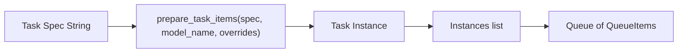

Sources: [src/olmo_eval/runners/asynq/preparation.py:20-74](), [src/olmo_eval/runners/asynq/types.py:21-33]()

---

## 3. GPU Planning and Worker Process Launch

Before starting workers, the runner performs GPU planning:

- Based on requested GPU resources from model and task configurations, the runner calculates:
  - How many workers to launch.
  - Which GPU ID(s) each worker will use.
- Workers are typically pinned to one or multiple GPUs via environment variables (`CUDA_VISIBLE_DEVICES`).
- The runner spawns separate OS processes to run `inference_worker` function with assigned GPU configuration.

This parallelization enables full utilisation of multiple GPUs for high throughput.

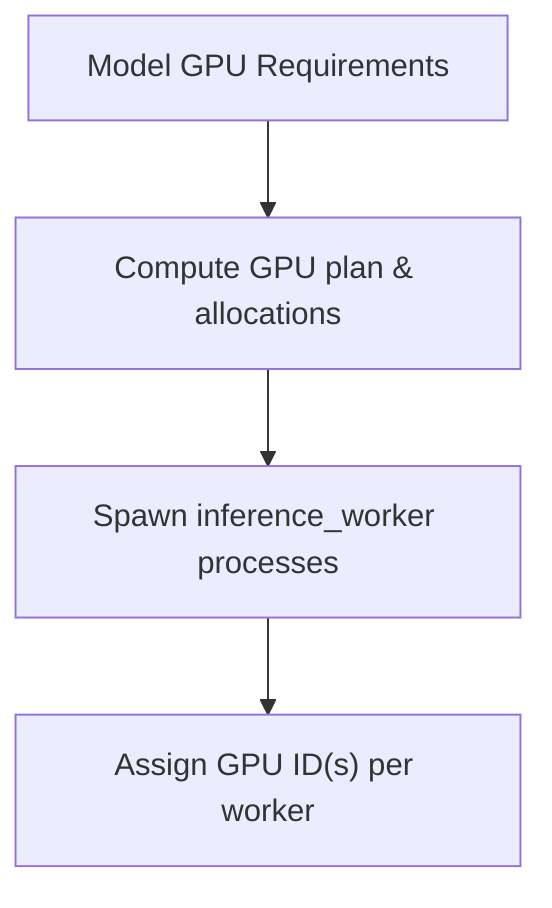

Sources: [src/olmo_eval/runners/asynq/runner.py:100-172](), [src/olmo_eval/runners/asynq/workers.py:20-79]()

---

## 4. Inference Worker Process Architecture

Each worker process runs the `inference_worker` function, which performs the inference and batching loop:

**Initialization:**

- Set environment variable `CUDA_VISIBLE_DEVICES` for assigned GPUs.
- Deserialize and load `HarnessConfig`.
- Construct the `Harness` object which encapsulates:
  - The configured model provider (e.g., vLLM, huggingface).
  - Model loading parameters, concurrency limits.
  - Optional scaffolds (tools, sandboxing).
  - Metrics reporting infrastructure.
- Optionally create logs directory and configure tracing for specialized scaffolds.
- Validate scaffolds early to fail fast.

**Batching & Processing Loop:**

- Fetch `QueueItem` instances from `item_queue`.
- Use a configured batching strategy (streaming or chunked).
- For text Completion or Loglikelihood requests, calls are batched before inference.
- For Chat requests, concurrency is managed with async coroutines and yielded back concurrently.
- Results are gathered as `ResultItem` and put onto `result_queue`.
- Handles retries and failures gracefully.

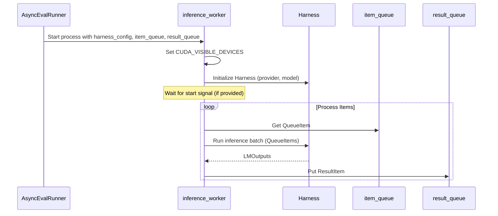

Sources: [src/olmo_eval/runners/asynq/workers.py:20-187](), [src/olmo_eval/runners/asynq/batching/batched.py (inferred functionality)]()

---

## 5. QueueItem and ResultItem Communication

Inter-process communication between the async runner and workers is done via **multiprocessing queues** with defined data classes:

### QueueItem

Represents one evaluation instance scheduled for inference:

- Fields include model_name, task_id, instance index, task instance, and pre-formatted LMRequest.
- Workers pull `QueueItem`s from the shared input queue, blocking and continuing until signaled to shut down.

### ResultItem

Encapsulates results returned from workers per instance:

- Contains the original model_name, task_id, instance_idx.
- Holds the list of `LMOutput`s generated.
- May include error messages and attempt counts.
- Used by the main process to track completion and scoring.

### Worker Fatal Error Signal

- There is a sentinel value `WORKER_FATAL` used to signal critical crashes from workers.
- Main process monitors the result queue for this sentinel to terminate all workers on fatal errors.

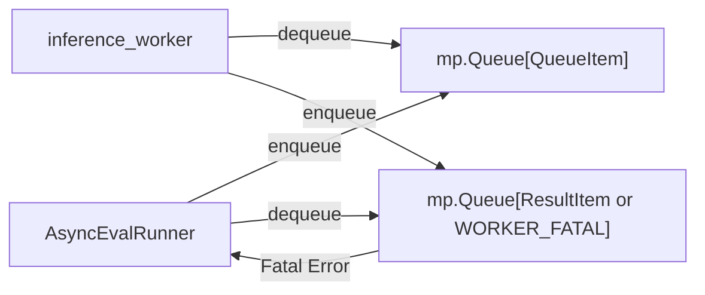

Sources: [src/olmo_eval/runners/asynq/types.py:20-100](), [src/olmo_eval/runners/asynq/monitoring.py:10-75]()

---

## 6. Batching Strategies

Batching is crucial for improving GPU throughput and lowering latency. The async runner supports multiple batching modes configurable per provider:

- **Streaming Strategy**: Maintains an adaptive streaming batch size with concurrency limits controlling maximum in-flight requests.
- **Chunked Strategy**: Processes input in fixed-size chunks for batched inference.

The batching logic is encapsulated in strategy classes retrieved from `get_strategy(batch_config)` inside the worker.

Workers take `QueueItem`s continuously, aggregate them based on the batching policy, invoke inference with the `Harness.provider`, then emit `ResultItem`s for each input.

Most modern model providers (e.g., vLLM) support batched generation natively, allowing efficient token-wise processing across multiple requests.

Sources: [src/olmo_eval/runners/asynq/workers.py:155-188](), inferred from batching imports in the worker code.

---

## 7. Result Aggregation and Scoring

The main AsyncEvalRunner process handles collecting `ResultItem`s and updating task progress trackers:

- Per-task `TaskTracker` objects maintain counts of completed, failed, and pending instances.
- As results arrive, the runner performs **inline async scoring**: scoring responses, computing metrics (accuracy, pass@k, etc.), and updating partial results.
- The system can offload some scoring steps to asynchronous workers if the task requires sandboxed or external execution.
- Final metrics are aggregated according to suite-level aggregation rules.
- Results can be saved locally, uploaded to S3, and logged.

The result processing function `process_results` manages concurrent scoring with semaphores to limit concurrency and logs progress via `ProgressLogger`.

```mermaid
flowchart TD
    ResultQueue["Result Queue"]
    ResultProcessor["process_results()"]
    TaskTracker["TaskTracker"]
    ScoreDB["Scoring context & metrics"]
    FinalResults["Aggregated task & suite results"]

    ResultQueue --> ResultProcessor
    ResultProcessor --> TaskTracker
    TaskTracker --> ScoreDB
    ScoreDB --> ResultProcessor
    ResultProcessor --> FinalResults
```

Sources: [src/olmo_eval/runners/asynq/results.py:70-220](), [src/olmo_eval/runners/asynq/preparation.py:90-178]()

---

## 8. Summary Diagram: From Task to Results in Code

The figure below presents an end-to-end mapping of natural language evaluation concepts to the key code classes/functions involved in the async runner architecture:

```mermaid
graph TB
    subgraph "Evaluation Flow"
        TaskSpec["Task Spec"] --> prepare_task_items
        prepare_task_items["prepare_task_items()"] --> QueueItems["List of QueueItem"]
        QueueItems --> AsyncEvalRunner["AsyncEvalRunner.enqueue_items()"]
        AsyncEvalRunner --> WorkerProcesses["Spawn inference_worker * N"]
    end
    
    subgraph "Worker Implementation"
        WorkerProcesses --> Mgmt["Set CUDA_VISIBLE_DEVICES & Init Harness"]
        Mgmt --> BatchingStrategy["Batching Strategy (streaming/chunked)"]
        BatchingStrategy --> PerformInference["Harness.provider.infer()"]
        PerformInference --> ResultItems["Queue ResultItem"]
        ResultItems --> AsyncEvalRunner["Result queue reception"]
    end
    
    subgraph "Result Processing"
        AsyncEvalRunner --> process_results["process_results()"]
        process_results --> TaskTracker["TaskTracker (per task)"]
        TaskTracker --> Scoring["Inline or async scoring"]
        Scoring --> Aggregate["Aggregate final TaskResult & Metrics"]
    end
    
    %% Code entity labels
    TaskSpec note right
        code: Task spec string
    end
    prepare_task_items note right
        code: src/olmo_eval/runners/asynq/preparation.py:20-74
    end
    QueueItems note right
        code: src/olmo_eval/runners/asynq/types.py:21-33
    end
    AsyncEvalRunner note right
        code: src/olmo_eval/runners/asynq/runner.py
    end
    inference_worker note right
        code: src/olmo_eval/runners/asynq/workers.py:20-187
    end
    process_results note right
        code: src/olmo_eval/runners/asynq/results.py:70-220
    end
    TaskTracker note right
        code: src/olmo_eval/runners/asynq/types.py:35-78
    end
```

---

## 9. Key Classes and Functions Reference

| Name                    | Location                                              | Responsibilities                                     |
| ----------------------- | ----------------------------------------------------| --------------------------------------------------- |
| `AsyncEvalRunner`       | `src/olmo_eval/runners/asynq/runner.py`             | Orchestrates evaluation pipeline, worker management, item and result queues handling |
| `prepare_task_items`    | `src/olmo_eval/runners/asynq/preparation.py:20-74`  | Prepare tasks and generate QueueItems               |
| `inference_worker`      | `src/olmo_eval/runners/asynq/workers.py:20-187`     | Worker process: initialize Harness, run batching, yield ResultItems |
| `QueueItem`             | `src/olmo_eval/runners/asynq/types.py:21-33`        | Data container for queued inference requests        |
| `ResultItem`            | `src/olmo_eval/runners/asynq/types.py:79-98`        | Data container for results returned from workers    |
| `process_results`       | `src/olmo_eval/runners/asynq/results.py:70-220`     | Collects results, performs scoring, aggregates metrics |
| `TaskTracker`           | `src/olmo_eval/runners/asynq/types.py:35-78`        | Maintains per-task progress and responses            |
| `BatchConfig` & strategy| `src/olmo_eval/runners/asynq/batching/batched.py`   | Defines batching approaches for efficient throughput |

---

## 10. Additional Notes

- The architecture provides robustness by:
  - Monitoring worker health and catching fatal errors early.
  - Gracefully shutting down workers with timeouts.
  - Retrying failed instances and handling partial failures at the task level.
- Model providers and scaffolds can extend worker functionality with tool usage, sandboxing, and agent-like traces.
- The runner persists outputs, results, and logs to configurable local directories or remote storage like S3.

---

# References

- Async runner main logic: `src/olmo_eval/runners/asynq/runner.py:1-191`  
- Worker process implementation: `src/olmo_eval/runners/asynq/workers.py:20-187`  
- Task preparation and QueueItems: `src/olmo_eval/runners/asynq/preparation.py:20-74`  
- QueueItem and ResultItem types: `src/olmo_eval/runners/asynq/types.py:21-100`  
- Result processing and aggregation: `src/olmo_eval/runners/asynq/results.py:70-220`  
- Worker monitoring: `src/olmo_eval/runners/asynq/monitoring.py:10-75`  
- Batching strategy guidance: `src/olmo_eval/runners/asynq/workers.py:155-188` (and batching submodules)

Sources:  
[src/olmo_eval/runners/asynq/runner.py](),  
[src/olmo_eval/runners/asynq/workers.py](),  
[src/olmo_eval/runners/asynq/types.py](),  
[src/olmo_eval/runners/asynq/preparation.py](),  
[src/olmo_eval/runners/asynq/results.py](),  
[src/olmo_eval/runners/asynq/monitoring.py]()

---

# Page: Harness and Scaffolds

# Harness and Scaffolds

<details>
<summary>Relevant source files</summary>

The following files were used as context for generating this wiki page:

- [src/olmo_eval/cli/run_external.py](src/olmo_eval/cli/run_external.py)
- [src/olmo_eval/common/configs.py](src/olmo_eval/common/configs.py)
- [src/olmo_eval/harness/adapters/openhands.py](src/olmo_eval/harness/adapters/openhands.py)
- [src/olmo_eval/harness/config.py](src/olmo_eval/harness/config.py)
- [src/olmo_eval/harness/harness.py](src/olmo_eval/harness/harness.py)
- [src/olmo_eval/harness/presets.py](src/olmo_eval/harness/presets.py)
- [src/olmo_eval/harness/sandbox/config.py](src/olmo_eval/harness/sandbox/config.py)
- [src/olmo_eval/harness/sandbox/executor.py](src/olmo_eval/harness/sandbox/executor.py)
- [src/olmo_eval/harness/sandbox/manager.py](src/olmo_eval/harness/sandbox/manager.py)
- [src/olmo_eval/harness/tools/registry.py](src/olmo_eval/harness/tools/registry.py)
- [src/olmo_eval/harness/tools/shell.py](src/olmo_eval/harness/tools/shell.py)
- [src/olmo_eval/harness/tools/tool.py](src/olmo_eval/harness/tools/tool.py)
- [src/olmo_eval/runners/asynq/processing.py](src/olmo_eval/runners/asynq/processing.py)

</details>


This page describes the Harness runtime layer, a core component in OLMo-Eval responsible for orchestrating how a language model interacts with its environment during an evaluation. It covers the `HarnessConfig` dataclass, how inference providers are wrapped, the integration of tools and system prompts, sandbox execution, and the role of scaffolds for multi-turn interactions.

## Harness Overview

The `Harness` class [src/olmo_eval/harness/harness.py:22-32]() acts as an abstraction layer that sits between the evaluation task and the raw inference provider. It allows for consistent application of various runtime behaviors such as:
*   **Tools**: Functions the model can call to interact with external systems or perform specific actions.
*   **System Prompts**: Instructions or context prepended to model inputs.
*   **Auxiliary Providers**: Additional inference providers for specific sub-tasks.
*   **Sandboxing**: Isolated environments for executing code or shell commands.
*   **Metrics Collection**: Instrumentation for gathering performance data.
*   **Scaffolds**: Multi-turn control flows for agentic behavior.

This design enables the same task definition to be evaluated in different modes (e.g., plain generation, tool-using agent, multi-turn agent) without modification.

### Harness Architecture

The `Harness` initializes with a `HarnessConfig` [src/olmo_eval/harness/harness.py:39-45]() and lazily creates its `InferenceProvider` [src/olmo_eval/harness/harness.py:47-64]() and `Scaffold` [src/olmo_eval/harness/harness.py:66-82]() instances upon first access.

```mermaid
graph TD
    A[Evaluation Task] --> B{Harness};
    B --> C[HarnessConfig];
    C --> D[ProviderConfig];
    C --> E[Tools];
    C --> F[System Prompt];
    C --> G[Scaffold Type];
    C --> H[SandboxConfig];
    C --> I[MetricsConfig];

    D --> J[InferenceProvider];
    E --> K[Tool Registry];
    G --> L[Scaffold Implementation];
    H --> M[SandboxManager];

    B -- "Wraps" --> J;
    B -- "Manages" --> K;
    B -- "Applies" --> F;
    B -- "Delegates multi-turn to" --> L;
    L -- "Uses" --> M;

    J -- "Generates LMOutput" --> B;
    K -- "Executes Tool Calls" --> L;
    M -- "Provides isolated execution" --> K;

    subgraph "Harness Runtime"
        B
        J
        K
        L
        M
    end
```

Sources: [src/olmo_eval/harness/harness.py:22-32](), [src/olmo_eval/harness/harness.py:39-45](), [src/olmo_eval/harness/harness.py:47-64](), [src/olmo_eval/harness/harness.py:66-82](), [src/olmo_eval/harness/config.py:21-54]()

## HarnessConfig

The `HarnessConfig` dataclass [src/olmo_eval/harness/config.py:21-54]() is the immutable blueprint for a `Harness` instance. It defines all aspects of the runtime environment.

| Field Name | Type | Description |
| :--------- | :--- | :---------- |
| `name` | `str` | A unique name for this harness configuration. |
| `provider` | `ProviderConfig` | Configuration for the primary inference provider. |
| `auxiliary_providers` | `Mapping[str, ProviderConfig]` | Additional providers for specific tools or sub-tasks. |
| `tools` | `tuple[Tool \| str, ...]` | A tuple of `Tool` objects or tool names to be registered. |
| `system_prompt` | `str \| None` | An optional system prompt to prepend to model inputs. |
| `tool_choice` | `Literal["auto", "none", "required"] \| str` | Strategy for tool calling (e.g., "auto" for LLM to decide). |
| `scaffold` | `str \| None` | The name of the scaffold to use for multi-turn interactions. |
| `required_secrets` | `tuple[str, ...]` | Environment variables that must be set for the harness to function. |
| `max_turns` | `int \| None` | Maximum number of turns for multi-turn scaffolds. |
| `max_concurrency` | `int \| None` | Maximum concurrent requests the harness can handle. |
| `scoring_concurrency` | `int \| None` | Concurrency for scoring processes. |
| `scoring_process_pools` | `Mapping[str, ProcessScoringPoolConfig]` | Configuration for dedicated process pools for scoring. |
| `sandboxes` | `tuple[SandboxConfig, ...]` | Configurations for sandboxed execution environments. |
| `scaffold_kwargs` | `dict[str, Any]` | Additional keyword arguments passed to the scaffold. |
| `sandbox_pool_instances` | `int \| None` | Number of sandbox instances to create in a pool. |
| `sandbox_pool_min_instances` | `int \| None` | Minimum number of sandbox instances that must start successfully. |
| `metrics` | `MetricsConfig \| None` | Configuration for metrics collection. |
| `batching` | `BatchConfig \| None` | Configuration for request batching. |
| `scorer_startup_timeout` | `float \| None` | Timeout for scorer process startup. |

Sources: [src/olmo_eval/harness/config.py:21-54]()

### Provider Wrapping

The `Harness` wraps the primary `InferenceProvider` specified in `HarnessConfig.provider` [src/olmo_eval/harness/harness.py:47-64](). If `HarnessConfig.metrics` [src/olmo_eval/harness/config.py:51]() is enabled, the provider is further wrapped with an `InstrumentedProvider` [src/olmo_eval/harness/harness.py:56-61]() to collect detailed metrics, including optional GPU monitoring.

### System Prompts

A `system_prompt` [src/olmo_eval/harness/config.py:40]() can be specified in the `HarnessConfig`. This prompt is automatically prepended to the `LMRequest` messages before being sent to the underlying `InferenceProvider` [src/olmo_eval/harness/harness.py:114](). This allows for consistent instruction or contextualization of the model's responses across all requests processed by the harness.

### Tools

Tools are functions that the language model can invoke to perform specific actions or retrieve information. They are defined as `Tool` objects [src/olmo_eval/harness/tools/tool.py:110-133]() and registered globally using `register_tool` [src/olmo_eval/harness/tools/registry.py:20-46]().

*   **`Tool` Class**: Combines the tool's schema (for the LLM) and its implementation (for execution) [src/olmo_eval/harness/tools/tool.py:110-133](). The schema is automatically derived from the function's type hints and docstrings using `Tool.from_function` [src/olmo_eval/harness/tools/tool.py:173-213]().
*   **Tool Registry**: The `TOOL_REGISTRY` [src/olmo_eval/harness/tools/registry.py:17]() stores `Tool` instances by name, allowing them to be looked up by workers. This is crucial for cross-process serialization, as only tool names are serialized in `HarnessConfig` [src/olmo_eval/harness/config.py:60-63]().
*   **`@registered_tool` Decorator**: A convenience decorator to define and register a tool in one step [src/olmo_eval/harness/tools/registry.py:135-184]().
*   **Tool Execution**: When a model generates a tool call, the `Harness` (via its scaffold) executes the corresponding `Tool.execute` function [src/olmo_eval/harness/tools/tool.py:148-162]().

```mermaid
graph TD
    A[Python Function] --> B{Tool.from_function};
    B --> C[Tool Object];
    C -- "Registers" --> D[TOOL_REGISTRY];
    D -- "Looked up by name" --> E[HarnessConfig.tools];
    E --> F[Harness];
    F -- "Sends schema to LLM" --> G[InferenceProvider];
    G -- "LLM generates tool call" --> F;
    F -- "Executes tool" --> C;
    C -- "Returns result" --> F;
```

Sources: [src/olmo_eval/harness/tools/tool.py:110-133](), [src/olmo_eval/harness/tools/tool.py:173-213](), [src/olmo_eval/harness/tools/registry.py:17](), [src/olmo_eval/harness/config.py:60-63](), [src/olmo_eval/harness/tools/registry.py:135-184](), [src/olmo_eval/harness/tools/tool.py:148-162]()

### Sandbox Integration

Some tools require an isolated execution environment, such as a shell or a specific programming language interpreter. This is handled by the sandbox system:

*   **`SandboxConfig`**: Defines the container image, mode (Docker, Modal), capabilities (e.g., `Capability.BASH`, `Capability.PYTHON`), and other parameters for a sandbox environment [src/olmo_eval/harness/sandbox/config.py:61-120]().
*   **`SandboxManager`**: Manages a pool of `SandboxExecutor` instances, routing requests to executors that provide the required capabilities [src/olmo_eval/harness/sandbox/manager.py:70-90](). It handles starting and stopping sandboxes, and can maintain persistent sessions for tools that require state continuity.
*   **`SandboxExecutor`**: Wraps a SWE-ReX deployment to execute commands within an isolated container [src/olmo_eval/harness/sandbox/executor.py:73-83]().
*   **Tool Capabilities**: Tools can declare required `sandbox` capabilities [src/olmo_eval/harness/tools/tool.py:132](). The `SandboxManager` ensures that tool calls are routed to a sandbox that meets these requirements. For example, the `execute_bash` tool [src/olmo_eval/harness/tools/shell.py:19-30]() requires `Capability.BASH`.

```mermaid
graph TD
    A[HarnessConfig] --> B[SandboxConfig];
    B --> C[SandboxManager];
    C -- "Manages pool of" --> D[SandboxExecutor];
    D -- "Wraps" --> E[SWE-ReX Deployment];
    E -- "Executes commands in" --> F[Container];

    G[Tool Definition] -- "Declares" --> H[Capability];
    H --> C;
    C -- "Routes tool calls to" --> D;
    D -- "Executes tool logic" --> F;
```

Sources: [src/olmo_eval/harness/sandbox/config.py:61-120](), [src/olmo_eval/harness/sandbox/manager.py:70-90](), [src/olmo_eval/harness/sandbox/executor.py:73-83](), [src/olmo_eval/harness/tools/tool.py:132](), [src/olmo_eval/harness/tools/shell.py:19-30]()

## Scaffolds

Scaffolds provide the control flow for multi-turn interactions, enabling agentic behavior. When `HarnessConfig.scaffold` [src/olmo_eval/harness/config.py:41]() is set, the `Harness.run()` method [src/olmo_eval/harness/harness.py:155-187]() delegates execution to the specified scaffold.

*   **`Scaffold` Abstract Base Class**: Defines the interface for multi-turn execution.
*   **`openai_agents` Scaffold**: Implements a multi-turn agent loop compatible with OpenAI's function calling API. It iteratively sends requests to the model, parses tool calls from the response, executes them, and feeds the results back to the model until a final answer is produced or `max_turns` is reached.
*   **`openhands` Scaffold**: An adapter for the OpenHands SDK, allowing OpenHands agents to utilize OLMo-Eval's sandbox runtimes [src/olmo_eval/harness/adapters/openhands.py:34-77](). This enables complex, multi-step problem-solving within a sandboxed environment.

```mermaid
graph TD
    A[LMRequest (Initial)] --> B{Harness.run()};
    B -- "Delegates to" --> C[Scaffold (e.g., openai_agents)];
    C -- "Sends to" --> D[InferenceProvider];
    D -- "LMOutput (with/without tool calls)" --> C;
    C -- "If tool calls" --> E[Tool Execution];
    E -- "Tool Output" --> C;
    C -- "Loop until max_turns or final answer" --> D;
    C -- "Returns" --> F[HarnessResult];
```

Sources: [src/olmo_eval/harness/harness.py:155-187](), [src/olmo_eval/harness/adapters/openhands.py:34-77]()

## Harness Presets

OLMo-Eval provides pre-built `HarnessConfig` presets in `HarnessPresets` [src/olmo_eval/harness/presets.py:65-67]() for common evaluation scenarios. These presets simplify configuration and ensure consistent setups. Presets are lazily loaded using the `_Lazy` descriptor [src/olmo_eval/harness/presets.py:38-54]().

Some notable presets include:

*   **`default`**: A basic harness using `vllm_server` for inference and batched processing [src/olmo_eval/harness/presets.py:69-77]().
*   **`simple_agent`**: Configures a harness for agentic behavior using the `openai_agents` scaffold with streaming batching [src/olmo_eval/harness/presets.py:79-92]().
*   **`dr_tulu`**: A specific agent preset for the "Dr. Tulu" model, including web and academic search tools, a custom system prompt, and the `openai_agents` scaffold [src/olmo_eval/harness/presets.py:94-112](). It also specifies required secrets for tool access.
*   **`codex_universal`**: Configures multiple sandbox environments with different images and capabilities for universal code execution [src/olmo_eval/harness/presets.py:114-143]().
*   **`codex_python`**: A specialized sandbox configuration for Python-only code execution [src/olmo_eval/harness/presets.py:145-164]().
*   **`codex_agent`**: A coding agent preset that combines the `openai_agents` scaffold with shell execution tools and a sandboxed environment for bash commands [src/olmo_eval/harness/presets.py:166-197]().

```mermaid
graph TD
    A[HarnessPresets] --> B[default];
    A --> C[simple_agent];
    A --> D[dr_tulu];
    A --> E[codex_universal];
    A --> F[codex_python];
    A --> G[codex_agent];

    B -- "Provider: VLLM_SERVER" --> H[HarnessConfig];
    C -- "Scaffold: openai_agents" --> H;
    D -- "Tools: Search, System Prompt" --> H;
    E -- "Sandboxes: Multiple images/capabilities" --> H;
    F -- "Sandbox: Python-only" --> H;
    G -- "Tools: Shell, Search, Sandbox: Bash" --> H;
```

Sources: [src/olmo_eval/harness/presets.py:65-67](), [src/olmo_eval/harness/presets.py:38-54](), [src/olmo_eval/harness/presets.py:69-77](), [src/olmo_eval/harness/presets.py:79-92](), [src/olmo_eval/harness/presets.py:94-112](), [src/olmo_eval/harness/presets.py:114-143](), [src/olmo_eval/harness/presets.py:145-164](), [src/olmo_eval/harness/presets.py:166-197]()

---

# Page: Result Storage and Querying

# Result Storage and Querying

<details>
<summary>Relevant source files</summary>

The following files were used as context for generating this wiki page:

- [.pre-commit-config.yaml](.pre-commit-config.yaml)
- [alembic/README.md](alembic/README.md)
- [alembic/metrics.ini](alembic/metrics.ini)
- [alembic/metrics/env.py](alembic/metrics/env.py)
- [alembic/metrics/script.py.mako](alembic/metrics/script.py.mako)
- [alembic/metrics/versions/20260219_initial_schema.py](alembic/metrics/versions/20260219_initial_schema.py)
- [alembic/metrics/versions/20260220_add_gpu_summary_index.py](alembic/metrics/versions/20260220_add_gpu_summary_index.py)
- [alembic/metrics/versions/20260220_drop_percentile_latencies.py](alembic/metrics/versions/20260220_drop_percentile_latencies.py)
- [src/olmo_eval/cli/results/query.py](src/olmo_eval/cli/results/query.py)
- [src/olmo_eval/cli/results/s3.py](src/olmo_eval/cli/results/s3.py)
- [src/olmo_eval/common/console.py](src/olmo_eval/common/console.py)
- [src/olmo_eval/runners/common/mixins.py](src/olmo_eval/runners/common/mixins.py)
- [src/olmo_eval/runners/io/storage.py](src/olmo_eval/runners/io/storage.py)
- [src/olmo_eval/storage/backends/postgres/models.py](src/olmo_eval/storage/backends/postgres/models.py)
- [src/olmo_eval/storage/backends/postgres/queries.py](src/olmo_eval/storage/backends/postgres/queries.py)
- [src/olmo_eval/storage/backends/postgres/repository.py](src/olmo_eval/storage/backends/postgres/repository.py)
- [src/olmo_eval/storage/base.py](src/olmo_eval/storage/base.py)
- [tests/integration/test_repository.py](tests/integration/test_repository.py)
- [tests/integration/test_storage_postgres_new.py](tests/integration/test_storage_postgres_new.py)

</details>


This page details how OLMo-Eval stores evaluation results and how users can query and view them. It covers the `StorageBackend` abstraction, the PostgreSQL implementation for structured results and metrics, S3 for artifact storage, and the command-line interface (CLI) tools for querying and viewing these results.

## StorageBackend Abstraction

The `StorageBackend` is an abstract base class that defines the interface for saving, retrieving, and querying evaluation results. This abstraction allows OLMo-Eval to support various storage solutions without changing the core evaluation logic.

The key methods defined in `StorageBackend` are:
*   `save(result: EvalResult, instances_by_task: dict[str, list[dict[str, Any]]] | None = None) -> str`: Saves an `EvalResult` and optionally instance-level predictions. Returns the `experiment_id`.
*   `get(experiment_id: str) -> EvalResult | None`: Retrieves an `EvalResult` by its `experiment_id`.
*   `query(...) -> list[EvalResult]`: Queries evaluation results based on various filters like `model_name`, `task_name`, `start_time`, and `end_time`.
*   `delete(experiment_id: str) -> bool`: Deletes an evaluation result.

The `convert_runner_results` function [src/olmo_eval/storage/base.py:89-194]() is responsible for transforming the raw results dictionary produced by the `EvalRunner` into an `EvalResult` dataclass, which is then passed to the `StorageBackend`. This conversion also handles the construction of S3 keys for predictions and requests if S3 storage is configured.

```mermaid
classDiagram
    direction LR
    class StorageBackend {
        <<abstract>>
        +save(EvalResult, dict) str
        +get(str) EvalResult
        +query(...) list~EvalResult~
        +delete(str) bool
    }
    class EvalResult {
        experiment_id: str
        model_name: str
        backend_name: str
        timestamp: datetime
        tasks: list~StoredTaskResult~
        s3_location: str
        +...
    }
    class StoredTaskResult {
        task_name: str
        metrics: dict
        task_hash: str
        s3_metrics_key: str
        s3_predictions_key: str
        s3_requests_key: str
        +...
    }
    class EvalRunner {
        +run() dict
    }
    class convert_runner_results {
        +convert_runner_results(dict, ...) EvalResult
    }

    EvalRunner --> convert_runner_results : "produces raw results dict"
    convert_runner_results --> EvalResult : "converts to"
    EvalResult "1" *-- "N" StoredTaskResult : "contains"
    StorageBackend <|-- PostgresBackend : "implements"
    StorageBackend ..> EvalResult : "operates on"
```
**Diagram: StorageBackend Abstraction**
Sources: [src/olmo_eval/storage/base.py:20-86](), [src/olmo_eval/storage/base.py:89-194]()

## PostgreSQL Backend

The primary `StorageBackend` implementation uses PostgreSQL, leveraging SQLAlchemy for Object-Relational Mapping (ORM). This backend stores structured evaluation results and metadata, enabling powerful querying capabilities.

### ORM Models

The PostgreSQL backend uses several SQLAlchemy ORM models to represent evaluation data:

*   `Experiment` [src/olmo_eval/storage/backends/postgres/models.py:19-96](): Represents a single evaluation run for a specific model. It stores high-level information like `experiment_id`, `model_name`, `timestamp`, `author`, `git_ref`, and a reference to the S3 location where detailed artifacts are stored. Note that `experiment_id` is not unique; multiple models run in a single launch can share the same `experiment_id`, with each model getting a unique `Experiment.id` (primary key).
*   `TaskResult` [src/olmo_eval/storage/backends/postgres/models.py:105-154](): Stores aggregated metrics and configuration for a specific task within an `Experiment`. It includes `task_name`, `task_hash`, `metrics` (a JSONB field for nested metric scores), `num_instances`, and S3 keys for task-specific metrics, predictions, and requests. It has a foreign key `experiment_pk` linking it to an `Experiment`.
*   `InstancePrediction` [src/olmo_eval/storage/backends/postgres/models.py:156-200](): Stores instance-level predictions and metrics. This model is crucial for detailed analysis and debugging. It includes `native_id` (the original ID of the instance), `instance_metrics` (a JSONB field for per-instance metric values), and foreign keys `experiment_pk` and `task_hash` to link back to the parent `Experiment` and `TaskResult`.

These models are defined in [src/olmo_eval/storage/backends/postgres/models.py]().

```mermaid
erDiagram
    "Experiment" {
        INTEGER id PK
        VARCHAR experiment_id INDEX
        VARCHAR model_name INDEX
        VARCHAR model_hash INDEX
        TIMESTAMP timestamp INDEX
        VARCHAR experiment_name
        VARCHAR workspace
        VARCHAR author INDEX
        ARRAY tags
        VARCHAR git_ref
        VARCHAR revision
        VARCHAR s3_location
        VARCHAR model_path
        VARCHAR experiment_group INDEX
        JSONB metadata_
        DOUBLE_PRECISION experiment_duration_seconds
        JSONB provider_init_seconds
        TIMESTAMP created_at
    }
    "TaskResult" {
        INTEGER id PK
        INTEGER experiment_pk FK INDEX
        VARCHAR model_hash INDEX
        VARCHAR task_name INDEX
        VARCHAR task_hash INDEX
        JSONB task_config
        JSONB metrics
        INTEGER num_instances
        VARCHAR primary_metric
        VARCHAR s3_metrics_key
        VARCHAR s3_predictions_key
        VARCHAR s3_requests_key
        DOUBLE_PRECISION duration_seconds
    }
    "InstancePrediction" {
        INTEGER id PK
        INTEGER experiment_pk FK INDEX
        VARCHAR task_hash INDEX
        VARCHAR experiment_group
        VARCHAR native_id INDEX
        JSONB instance_metrics
    }

    "Experiment" ||--o{ "TaskResult" : "has"
    "Experiment" ||--o{ "InstancePrediction" : "has"
```
**Diagram: PostgreSQL ORM Models**
Sources: [src/olmo_eval/storage/backends/postgres/models.py:19-96](), [src/olmo_eval/storage/backends/postgres/models.py:105-154](), [src/olmo_eval/storage/backends/postgres/models.py:156-200]()

### Alembic Migrations

Alembic is used for managing database schema migrations for two separate PostgreSQL databases:
*   **`olmo_eval`**: Stores evaluation results, experiments, and task metrics.
*   **`olmo_eval_metrics`**: Stores inference performance telemetry (covered in 5.3. Inference Metrics and Telemetry).

The migration scripts are located in the `alembic/` directory, with separate configurations and version directories for each database (e.g., `alembic/results.ini` and `alembic/metrics.ini`).

Migrations can be run using the `scripts/internal/db-migrate` script or `make db-upgrade`. New migrations are created using `alembic -c alembic/results.ini revision --autogenerate -m "Add column"` for the results database.

Sources: [alembic/README.md:1-62]()

### Repository Layer and QueryHelper

The `ExperimentRepository` [src/olmo_eval/storage/backends/postgres/repository.py:35-280]() and `InstancePredictionRepository` [src/olmo_eval/storage/backends/postgres/repository.py:283-360]() classes provide a repository pattern for interacting with the database. They encapsulate the SQLAlchemy session and provide methods for `save`, `get`, `query`, and `delete` operations on `Experiment` and `InstancePrediction` entities.

The `QueryHelper` [src/olmo_eval/storage/backends/postgres/queries.py:20-30]() class acts as a facade, simplifying common query patterns and orchestrating operations across multiple repositories. For example, `QueryHelper.save_with_instances` [src/olmo_eval/storage/backends/postgres/queries.py:45-98]() saves an `EvalResult` and its associated `InstancePrediction` records, handling the denormalization of `experiment_group` and `task_hash` for efficient querying.

```mermaid
classDiagram
    direction LR
    class QueryHelper {
        -session: Session
        -experiment_repo: ExperimentRepository
        -instance_repo: InstancePredictionRepository
        +save(EvalResult) int
        +save_with_instances(EvalResult, dict) int
        +get(int) EvalResult
        +query(...) list~EvalResult~
        +delete(int) bool
        +get_model_task_metrics(str) dict
        +get_model_task_instances(str, int) list~dict~
    }
    class ExperimentRepository {
        -session: Session
        +save(EvalResult) int
        +get(int) EvalResult
        +get_by_experiment_id(str) list~EvalResult~
        +query(...) list~EvalResult~
        +delete(int) bool
        +delete_by_experiment_id(str) int
    }
    class InstancePredictionRepository {
        -session: Session
        +save_instances(int, str, list~dict~, str)
        +get_instances(int, str, int, int) list~dict~
        +get_instances_by_group(...) Iterator~dict~
    }
    class EvalResult {
        +...
    }

    QueryHelper "1" *-- "1" ExperimentRepository : "uses"
    QueryHelper "1" *-- "1" InstancePredictionRepository : "uses"
    ExperimentRepository ..> EvalResult : "operates on"
    InstancePredictionRepository ..> EvalResult : "operates on"
```
**Diagram: Repository Layer and QueryHelper**
Sources: [src/olmo_eval/storage/backends/postgres/repository.py:35-280](), [src/olmo_eval/storage/backends/postgres/repository.py:283-360](), [src/olmo_eval/storage/backends/postgres/queries.py:20-30](), [src/olmo_eval/storage/backends/postgres/queries.py:45-98]()

## S3 Artifact Storage

While the PostgreSQL database stores structured metadata and aggregated metrics, detailed artifacts like raw predictions, requests, and task-specific metrics JSON files are stored in S3. This separation allows the database to remain lean and performant for querying, while S3 handles large, unstructured data.

The `RunnerResultsMixin` [src/olmo_eval/runners/common/mixins.py:57-70]() includes methods like `_upload_to_s3` [src/olmo_eval/runners/common/mixins.py:175-196]() which wraps the `upload_to_s3` function [src/olmo_eval/runners/io/storage.py:26-154](). This function handles the concurrent upload of all relevant output files from the local `output_dir` to a specified S3 bucket.

The S3 path structure is organized to facilitate easy retrieval:
`s3://{bucket}/{prefix}/{group}/{model_name}_{hash_last_6}/{experiment_id}/`

Within this base path, specific files are stored:
*   `metrics.json`: Aggregated metrics for the entire run.
*   `predictions/{task_name}.jsonl`: Instance-level predictions for each task.
*   `requests/{task_name}.jsonl`: Raw LM requests and outputs for each task.

The `EvalResult` and `StoredTaskResult` dataclasses store the S3 keys (`s3_location`, `s3_metrics_key`, `s3_predictions_key`, `s3_requests_key`) as references to these artifacts.

Sources: [src/olmo_eval/runners/common/mixins.py:57-70](), [src/olmo_eval/runners/common/mixins.py:175-196](), [src/olmo_eval/runners/io/storage.py:26-154]()

## Results Query and Viewer CLI Commands

OLMo-Eval provides CLI commands to interact with the stored results.

### `olmo-eval results query`

The `olmo-eval results query` command [src/olmo_eval/cli/results/query.py:26-131]() allows users to retrieve evaluation results from the PostgreSQL database using various filters.

**Key features:**
*   **Filtering**: Query by `experiment_id`, `model_name` (prefix), `model_hash` (prefix), `task_name` (prefix), `task_hash` (prefix), or `experiment_group` (prefix).
*   **Output Formats**: Display results as a human-readable table (default), JSON, or CSV.
*   **Instance-level Data**: Use `--instances` to include instance-level predictions, which is particularly useful when outputting to JSON or CSV for detailed analysis.
*   **Comparison Mode**: When no specific `experiment_id` is provided, it operates in a comparison mode, showing results for multiple models across tasks.
*   **Pagination**: Supports `--limit` and `--after-id` for paginating through large result sets.
*   **Historical vs. Latest/Best**: `--all` shows all historical results, `--recent` shows the most recent per model, and by default, it shows the "best" (highest primary metric) result per model.

**Example Usage:**
```bash
# Get experiment by ID
olmo-eval results query --experiment exp_001

# Compare models on tasks
olmo-eval results query -m llama3.1-8b -m qwen2.5-72b -t mmlu -t gsm8k

# Get instances for a task in CSV format
olmo-eval results query --task mmlu --instances --format csv > mmlu_instances.csv

# Get instances for an experiment group in JSON format
olmo-eval results query -G my-benchmark --instances --format json > my_benchmark_instances.json
```

The `_query_experiments` function [src/olmo_eval/cli/results/query.py:185-193]() uses the `ExperimentRepository` to fetch `EvalResult` objects based on the provided filters. If `--instances` is specified, `_query_instances` [src/olmo_eval/cli/results/query.py:206-214]() (which uses `QueryHelper.get_model_task_instances`) is called to retrieve the detailed instance predictions. For large `experiment_group` instance queries, `_stream_experiment_group_instances` [src/olmo_eval/cli/results/query.py:236-250]() is used to stream data directly to output, avoiding loading all instances into memory.

Sources: [src/olmo_eval/cli/results/query.py:26-131](), [src/olmo_eval/cli/results/query.py:185-193](), [src/olmo_eval/cli/results/query.py:206-214](), [src/olmo_eval/cli/results/query.py:236-250]()

### `olmo-eval results viewer`

The `olmo-eval results viewer` command (not detailed in provided files but mentioned in the TOC) launches an interactive web-based viewer for comparing evaluation results. This viewer likely leverages the same querying capabilities as the `query` command but presents them in a graphical, interactive format, often used for pairwise comparisons and deeper analysis.

Sources: None (mentioned in TOC, but no specific file content provided for this command).

```mermaid
graph TD
    subgraph "Evaluation Pipeline"
        A[EvalRunner.run()] --> B{Raw Results Dict}
        B --> C[convert_runner_results()]
        C --> D[EvalResult Dataclass]
    end

    subgraph "Storage Backends"
        D --> E[StorageBackend.save()]
        E --> F[PostgresBackend.save()]
        F --> G[ExperimentRepository.save()]
        G --> H[PostgreSQL DB (olmo_eval)]
        G --> I[InstancePredictionRepository.save_instances()]
        I --> H
        D --> J[RunnerResultsMixin._upload_to_s3()]
        J --> K[S3 Artifact Storage]
    end

    subgraph "Querying and Viewing"
        L[olmo-eval results query CLI] --> M[QueryHelper.query()]
        M --> H
        M --> N{Output Format}
        N -- "table" --> O[print_experiments_table()]
        N -- "json/csv" --> P[formatters]
        L -- "--instances" --> Q[QueryHelper.get_model_task_instances()]
        Q --> H
        Q --> N
        R[olmo-eval results viewer CLI] --> M
    end

    style H fill:#f9f,stroke:#333,stroke-width:2px
    style K fill:#f9f,stroke:#333,stroke-width:2px
```
**Diagram: Data Flow for Result Storage and Querying**
Sources: [src/olmo_eval/storage/base.py:89-194](), [src/olmo_eval/storage/backends/postgres/repository.py:106-162](), [src/olmo_eval/storage/backends/postgres/repository.py:300-310](), [src/olmo_eval/runners/common/mixins.py:175-196](), [src/olmo_eval/runners/io/storage.py:26-154](), [src/olmo_eval/cli/results/query.py:26-131](), [src/olmo_eval/cli/results/query.py:185-193](), [src/olmo_eval/cli/results/query.py:206-214]()

---

# Page: Task System

# Task System

<details>
<summary>Relevant source files</summary>

The following files were used as context for generating this wiki page:

- [README.md](README.md)
- [src/olmo_eval/common/scorers/base.py](src/olmo_eval/common/scorers/base.py)
- [src/olmo_eval/evals/tasks/common/base.py](src/olmo_eval/evals/tasks/common/base.py)
- [src/olmo_eval/evals/tasks/common/registry.py](src/olmo_eval/evals/tasks/common/registry.py)
- [src/olmo_eval/evals/tasks/humaneval.py](src/olmo_eval/evals/tasks/humaneval.py)
- [src/olmo_eval/evals/tasks/mbpp.py](src/olmo_eval/evals/tasks/mbpp.py)
- [src/olmo_eval/evals/tasks/multilingual_mbpp.py](src/olmo_eval/evals/tasks/multilingual_mbpp.py)
- [src/olmo_eval/launch/config.py](src/olmo_eval/launch/config.py)
- [tests/core/test_metrics.py](tests/core/test_metrics.py)

</details>


The Task System in OLMo-Eval provides a standardized framework for evaluating large language models (LLMs) across various benchmarks and tasks. It defines how tasks are structured, registered, and organized into suites for comprehensive evaluation. This system is fundamental to enabling reproducible and comparable assessment of language model capabilities within the repository.

This page provides a high-level overview of the Task System. For detailed information on specific components, refer to the child pages:
- [Task Base Class and Registry](#3.1) — Explains the core `Task` class, data flow, and registration mechanisms.
- [Scorers and Metrics](#3.2) — Details how model outputs are scored and aggregated into metrics.
- [Few-Shot Learning and Answer Extraction](#3.3) — Covers the few-shot prompting approach and utilities for extracting answers from model responses.

## Core Concepts

The Task System is built around several core abstractions that define how evaluations are conducted:

*   **Task**: A benchmark specification that defines how to load data, format prompts, and score model outputs for a specific evaluation.
*   **Suite**: A collection of tasks and/or nested suites, allowing for batch evaluation and hierarchical result aggregation.
*   **Formatter**: Responsible for rendering an `Instance` and its few-shot context into an `LMRequest` (the prompt sent to the language model).
*   **Scorer**: Evaluates a single `LMOutput` against the gold answer, producing a raw score or judgment.
*   **Metric**: Aggregates per-example scores from a `Scorer` to produce a dataset-level performance measure.

These concepts work together to define a complete evaluation pipeline for any given task.

### Task System Abstractions

```mermaid
graph TD
    subgraph "Natural Language Space"
        TaskConcept["Task: Benchmark Specification"]
        SuiteConcept["Suite: Collection of Tasks"]
        FormatterConcept["Formatter: Prompt Renderer"]
        ScorerConcept["Scorer: Per-Example Evaluator"]
        MetricConcept["Metric: Dataset-Level Aggregator"]
    end

    subgraph "Code Entity Space"
        TaskClass["Task (src/olmo_eval/evals/tasks/common/base.py)"]
        SuiteClass["Suite (src/olmo_eval/evals/suites/suite.py)"]
        FormatterInterface["Formatter (src/olmo_eval/common/formatters/base.py)"]
        ScorerInterface["Scorer (src/olmo_eval/common/scorers/base.py)"]
        MetricInterface["Metric (src/olmo_eval/common/metrics/base.py)"]
    end

    TaskConcept --> TaskClass
    SuiteConcept --> SuiteClass
    FormatterConcept --> FormatterInterface
    ScorerConcept --> ScorerInterface
    MetricConcept --> MetricInterface

    TaskClass --"Uses"--> FormatterInterface
    TaskClass --"Uses"--> ScorerInterface
    TaskClass --"Uses"--> MetricInterface
    SuiteClass --"Composes"--> TaskClass
```
Sources: [README.md:66-77](), [src/olmo_eval/evals/tasks/common/base.py:112-150](), [src/olmo_eval/evals/suites/suite.py:1-10](), [src/olmo_eval/common/formatters/base.py:1-10](), [src/olmo_eval/common/scorers/base.py:14-26](), [src/olmo_eval/common/metrics/base.py:1-10]()

## Task Definition and Registration

Tasks are defined as Python classes inheriting from `Task` [src/olmo_eval/evals/tasks/common/base.py:222](). They specify how to load data, process documents into `Instance` objects, format prompts, and extract answers.

### Task Registration Flow

```mermaid
graph TD
    TaskDefinition["Task Class Definition (e.g., MBPP, HumanEval)"]
    RegisterDecorator["@register(name) (src/olmo_eval/evals/tasks/common/registry.py)"]
    TaskConfigBuild["_build_config(name, cls)"]
    TaskRegistry["_tasks: dict[str, type[Task]]"]
    ConfigRegistry["_configs: dict[str, TaskConfig]"]

    VariantDefinition["Variant Overrides (e.g., num_fewshot=3)"]
    RegisterVariantDecorator["@register_variant(task_name, variant, **overrides) (src/olmo_eval/evals/tasks/common/registry.py)"]
    VariantRegistry["_variants: dict[str, dict[str, Any]]"]

    TaskDefinition --> RegisterDecorator
    RegisterDecorator --> TaskConfigBuild
    TaskConfigBuild --> TaskRegistry
    TaskConfigBuild --> ConfigRegistry

    VariantDefinition --> RegisterVariantDecorator
    RegisterVariantDecorator --> VariantRegistry

    UserSpec["User Task Spec (e.g., 'humaneval:3shot:bpb')"]
    ParseTaskSpec["parse_task_spec(spec) (src/olmo_eval/evals/tasks/common/registry.py)"]
    GetTaskConfig["get_task_config(spec) (src/olmo_eval/evals/tasks/common/registry.py)"]
    ApplyVariants["Apply Variant Overrides"]
    FinalTaskConfig["TaskConfig Object"]

    UserSpec --> ParseTaskSpec
    ParseTaskSpec --> GetTaskConfig
    GetTaskConfig --> ApplyVariants
    ApplyVariants --> FinalTaskConfig
```
Sources: [README.md:79-100](), [src/olmo_eval/evals/tasks/common/registry.py:23-70](), [src/olmo_eval/evals/tasks/common/registry.py:73-103](), [src/olmo_eval/evals/tasks/common/registry.py:190-218]()

Tasks are registered using the `@register` decorator [src/olmo_eval/evals/tasks/common/registry.py:42-70](), which associates a string name with the `Task` class. This decorator automatically constructs a `TaskConfig` [src/olmo_eval/evals/tasks/common/base.py:112-150]() from the class attributes.

Example:
```python
# src/olmo_eval/evals/tasks/mbpp.py
@register("mbpp")
class MBPP(MBPPBase):
    data_source = DataSource(path="google-research-datasets/mbpp")
    sampling_params = SamplingParams(
        max_tokens=1024,
        temperature=0.0,
        stop_sequences=MBPP_STOP_SEQUENCES,
    )
```
Sources: [src/olmo_eval/evals/tasks/mbpp.py:132-142]()

### Task Variants

The system supports task variants, which are named presets that apply specific overrides to a base task's configuration. Variants are registered using `@register_variant` [src/olmo_eval/evals/tasks/common/registry.py:73-103](). They allow for composable evaluation settings, such as different few-shot counts or formatting styles.

Example:
```python
# src/olmo_eval/evals/tasks/humaneval.py
register_variant(
    "humaneval",
    "3shot",
    num_fewshot=3,
    fewshot_seed=1234,
    formatter=CompletionFormatter(),
)
```
Sources: [src/olmo_eval/evals/tasks/humaneval.py:188-196]()

A task specification like `"humaneval:3shot:bpb"` [README.md:99]() would apply the `3shot` variant and then the `bpb` variant to the base `humaneval` task. The `parse_task_spec` function [src/olmo_eval/evals/tasks/common/registry.py:190-218]() handles parsing these specifications.

For more details on the `Task` base class, `Instance`/`LMRequest`/`LMOutput` data flow, and the registration process, see [Task Base Class and Registry](#3.1).

## Suites

Suites provide a way to group multiple tasks for batch evaluation and aggregate their results. They are defined as `Suite` objects [README.md:117-123]() and can contain individual tasks or other nested suites.

Example:
```python
# README.md
register(Suite(
    name="my_suite",
    tasks=("task_a:3shot", "task_b:3shot", "task_c:3shot"),
))
```
Sources: [README.md:117-123]()

Suites support different aggregation strategies for combining task results, such as `AVERAGE`, `AVERAGE_OF_AVERAGES`, `DISPLAY_ONLY`, and `NONE` [README.md:129-135](). This allows for flexible reporting of overall performance across a collection of benchmarks.

## Scorers and Metrics

After a language model generates responses, `Scorer` objects evaluate each `LMOutput` against the `Instance`'s gold answer. `Metric` objects then aggregate these individual scores to provide a dataset-level performance measure.

### Scorers

A `Scorer` [src/olmo_eval/common/scorers/base.py:14-26]() is an abstract base class that defines the `score()` method. Concrete implementations include:
*   `ExactMatchScorer` [src/olmo_eval/common/scorers/base.py:67-84](): Scores 1.0 if the extracted answer exactly matches the gold answer.
*   `MultipleChoiceScorer` [src/olmo_eval/common/scorers/base.py:87-98](): Scores multiple-choice questions by comparing selected indices or letters.
*   `CodeExecutionScorer` [src/olmo_eval/common/scorers/base.py:218-230](): Executes generated code in a sandbox to determine correctness.

For scorers that require asynchronous execution or run in a subprocess (e.g., code execution), `ProcessScorer` [src/olmo_eval/common/scorers/base.py:48-63]() is used.

For a comprehensive list of scorers and their details, see [Scorers and Metrics](#3.2).

### Metrics

A `Metric` [src/olmo_eval/common/metrics/base.py:1-10]() is an abstract base class that defines the `compute()` method, which takes a list of `Response` objects and returns a float score. Common metrics include:
*   `AccuracyMetric` [src/olmo_eval/common/metrics/base.py:14-26](): Calculates the proportion of correctly scored instances.
*   `BPBMetricInstanceAvg` [src/olmo_eval/common/metrics/base.py:100-112]() and `BPBMetricByteAvg` [src/olmo_eval/common/metrics/base.py:115-127](): Compute bits per byte, a measure of language model performance based on log-probabilities.

For a comprehensive list of metrics and their details, see [Scorers and Metrics](#3.2).

## Few-Shot Learning and Answer Extraction

The Task System supports few-shot learning, where a small number of example input-output pairs are included in the prompt to guide the model's response. It also provides utilities for extracting the final answer from the model's raw output.

### Few-Shot Configuration

Tasks can specify `num_fewshot` and `fewshot_seed` in their `TaskConfig` [src/olmo_eval/evals/tasks/common/base.py:141-142]() to control the number and selection of few-shot examples. The `fewshot_source` [src/olmo_eval/evals/tasks/common/base.py:136]() can also be configured to specify where few-shot examples are loaded from.

Few-shot examples can be fixed (pre-defined) or dynamically sampled from a specified data split (e.g., a "dev" or "train" split). For tasks like HumanEval, where few-shot examples might overlap with test instances, the system includes logic to deduplicate examples [src/olmo_eval/evals/tasks/humaneval.py:99-108]().

### Answer Extraction

After a model generates text, an `answer_extractor` [src/olmo_eval/evals/tasks/common/base.py:153]() function is used to parse the relevant answer from the raw `LMOutput.text`. This is crucial for tasks where the model's output might contain extraneous information (e.g., reasoning steps, conversational filler).

Examples of answer extraction include:
*   Extracting code blocks from generated text [src/olmo_eval/evals/extract.py:1-10]().
*   Extracting multiple-choice answers (e.g., "A", "B", "C").
*   Extracting numerical answers for math problems.

For more details on few-shot learning configurations and answer extraction utilities, see [Few-Shot Learning and Answer Extraction](#3.3).

---

# Page: Task Base Class and Registry

# Task Base Class and Registry

<details>
<summary>Relevant source files</summary>

The following files were used as context for generating this wiki page:

- [src/olmo_eval/common/formatters.py](src/olmo_eval/common/formatters.py)
- [src/olmo_eval/common/scorers/base.py](src/olmo_eval/common/scorers/base.py)
- [src/olmo_eval/data/backends/huggingface.py](src/olmo_eval/data/backends/huggingface.py)
- [src/olmo_eval/data/sources.py](src/olmo_eval/data/sources.py)
- [src/olmo_eval/evals/suites/astabench.py](src/olmo_eval/evals/suites/astabench.py)
- [src/olmo_eval/evals/tasks/common/base.py](src/olmo_eval/evals/tasks/common/base.py)
- [src/olmo_eval/evals/tasks/common/registry.py](src/olmo_eval/evals/tasks/common/registry.py)
- [src/olmo_eval/evals/tasks/humaneval.py](src/olmo_eval/evals/tasks/humaneval.py)
- [src/olmo_eval/evals/tasks/mbpp.py](src/olmo_eval/evals/tasks/mbpp.py)
- [src/olmo_eval/evals/tasks/multilingual_mbpp.py](src/olmo_eval/evals/tasks/multilingual_mbpp.py)
- [tests/core/test_metrics.py](tests/core/test_metrics.py)

</details>


This page details the core components for defining and managing evaluation tasks within the OLMo-Eval framework. It covers the `Task` base class, the data flow for instances, requests, and outputs, the registration mechanisms (`@register` and `@register_variant`), `DataSource` configuration, and the various formatters available.

## The `Task` Base Class

The `Task` class [src/olmo_eval/evals/tasks/common/base.py:220-500]() is the fundamental building block for any evaluation task in OLMo-Eval. It provides the interface and common logic for loading data, formatting prompts, extracting answers, and scoring model outputs.

Tasks inherit from `Task` and define specific behaviors through methods and class attributes. The `TaskConfig` dataclass [src/olmo_eval/evals/tasks/common/base.py:112-177]() holds all configurable parameters for a task, such as data sources, few-shot settings, metrics, and sampling parameters.

```mermaid
classDiagram
    direction LR
    class Task {
        +TaskConfig config
        +request_type: RequestType
        +instances: Iterator[Instance]
        +process_doc(doc: dict) -> Instance
        +format_request(instance: Instance) -> LMRequest
        +extract_answer(output: LMOutput) -> str | None
        +score_responses(responses: Sequence[Response], context: ScoringContext) -> None
        +compute_metrics(responses: Sequence[Response]) -> dict[MetricName, float]
        -_get_source_for_split(split: str) -> DataSource
        -_build_fewshot() -> list[Instance]
    }
    class TaskConfig {
        +name: str
        +data_source: DataSource | str | None
        +fewshot_source: DataSource | str | None
        +formatter: Formatter | None
        +metrics: tuple[Metric, ...]
        +num_fewshot: int
        +limit: int | None
        +sampling_params: SamplingParams | None
        +sandbox_env: SandboxEnv | None
        +get_data_source(split: str) -> DataSource
        +get_fewshot_source(split: str) -> DataSource | None
    }
    class DataSource {
        +path: str
        +subset: str | None
        +split: str
        +source_type: SourceType | None
        +from_uri(uri: str) -> DataSource
        +with_split(split: str) -> DataSource
    }
    class Formatter {
        +request_type: RequestType
        +format(instance: Instance, fewshot: list[Instance]) -> LMRequest
    }
    class Scorer {
        +name: str
        +score(instance: Instance, output: LMOutput) -> float
    }
    class Metric {
        +name: MetricName
        +scorer: type[Scorer] | Scorer
        +compute(responses: Sequence[Response]) -> float
    }
    class Instance {
        +question: str
        +gold_answer: str | None
        +choices: tuple[str, ...] | None
        +metadata: dict[str, Any] | None
    }
    class LMRequest {
        +request_type: RequestType
        +prompt: str | None
        +messages: tuple[dict[str, str], ...] | None
        +continuations: tuple[str, ...] | None
        +sampling_params: SamplingParams | None
        +system_prompt: str | None
    }
    class LMOutput {
        +text: str
        +extracted_answer: str | None
        +logprobs: list[dict[str, Any]] | None
        +metadata: dict[str, Any] | None
    }
    class Response {
        +instance: Instance
        +request: LMRequest
        +outputs: list[LMOutput]
        +scores: dict[str, float]
    }
    class SandboxEnv {
        +name: str
        +dependencies: tuple[str, ...]
    }

    Task "1" *-- "1" TaskConfig : "uses"
    TaskConfig "1" *-- "0..1" DataSource : "defines data_source"
    TaskConfig "1" *-- "0..1" Formatter : "uses"
    TaskConfig "1" *-- "0..*" Metric : "evaluates with"
    TaskConfig "1" *-- "0..1" SandboxEnv : "runs in"
    Metric "1" *-- "1" Scorer : "uses"
    Task "1" -- "0..*" Instance : "generates"
    Instance "1" -- "1" LMRequest : "formats to"
    LMRequest "1" -- "1..*" LMOutput : "produces"
    Response "1" *-- "1" Instance : "contains"
    Response "1" *-- "1" LMRequest : "contains"
    Response "1" *-- "1..*" LMOutput : "contains"
    LMOutput "1" -- "0..*" Scorer : "scored by"
```
Sources: [src/olmo_eval/evals/tasks/common/base.py:112-177](), [src/olmo_eval/evals/tasks/common/base.py:220-500](), [src/olmo_eval/common/formatters.py:10-36](), [src/olmo_eval/common/scorers/base.py:13-43](), [src/olmo_eval/common/metrics.py:13-30](), [src/olmo_eval/common/types.py:19-28](), [src/olmo_eval/common/types.py:30-40](), [src/olmo_eval/common/types.py:42-50](), [src/olmo_eval/common/types.py:52-60](), [src/olmo_eval/data/sources.py:22-45]()

### Data Flow: `Instance`, `LMRequest`, `LMOutput`

The evaluation process involves a clear data flow between `Instance`, `LMRequest`, and `LMOutput` objects:

1.  **`Instance`**: Represents a single evaluation example from a dataset. It contains the `question`, `gold_answer`, optional `choices`, and `metadata`.
    *   Generated by `Task.process_doc()` [src/olmo_eval/evals/tasks/common/base.py:300-301]() from raw dataset documents.
    *   Example: A question from MMLU, a code problem from HumanEval.
2.  **`LMRequest`**: Represents the formatted input sent to the language model. It includes the `request_type` (e.g., `COMPLETION`, `CHAT`, `LOGLIKELIHOOD`), `prompt` (for completion/loglikelihood), `messages` (for chat), and `sampling_params`.
    *   Created by `Task.format_request()` [src/olmo_eval/evals/tasks/common/base.py:310-311]() (which often delegates to a `Formatter`) from an `Instance` and optional few-shot examples.
3.  **`LMOutput`**: Represents the raw output received from the language model for a given `LMRequest`. It contains the `text` generated by the model, optional `logprobs`, and `metadata`.
    *   Produced by an `InferenceProvider` in response to an `LMRequest`.
    *   The `extracted_answer` field is populated by `Task.extract_answer()` [src/olmo_eval/evals/tasks/common/base.py:320-321]() after the model output is received.
4.  **`Response`**: Encapsulates an `Instance`, the `LMRequest` made for it, and the `LMOutput`s received. It also stores the `scores` computed for the outputs.

```mermaid
graph TD
    A[Raw Dataset Document] --> B{Task.process_doc()}
    B --> C[Instance]
    C --> D{Task.format_request()}
    D --> E[LMRequest]
    E --> F[InferenceProvider]
    F --> G[LMOutput]
    G --> H{Task.extract_answer()}
    H --> I[LMOutput with extracted_answer]
    I --> J{Task.score_responses()}
    J --> K[Response with scores]
    K --> L{Task.compute_metrics()}
    L --> M[Metrics]

    subgraph "Data Objects"
        C
        E
        G
        I
        K
    end
```
Sources: [src/olmo_eval/evals/tasks/common/base.py:220-500](), [src/olmo_eval/common/types.py:19-28](), [src/olmo_eval/common/types.py:30-40](), [src/olmo_eval/common/types.py:42-50](), [src/olmo_eval/common/types.py:52-60]()

## Task Configuration (`TaskConfig`)

The `TaskConfig` dataclass [src/olmo_eval/evals/tasks/common/base.py:112-177]() centralizes all parameters for a task. When a task class is registered, its class attributes that match `TaskConfig` fields are used to construct a default `TaskConfig` for that task.

Key fields in `TaskConfig` include:
*   `name`: Unique identifier for the task.
*   `data_source`: Specifies where to load the dataset from, using a `DataSource` object or a URI string.
*   `fewshot_source`: Similar to `data_source`, but for few-shot examples.
*   `formatter`: An instance of a `Formatter` subclass to control prompt construction.
*   `metrics`: A tuple of `Metric` objects to be computed for the task.
*   `num_fewshot`: Number of few-shot examples to include.
*   `limit`: Maximum number of instances to evaluate.
*   `sampling_params`: Parameters for model generation (e.g., `temperature`, `max_tokens`).
*   `sandbox_env`: Configuration for a sandbox environment if code execution is required.

Sources: [src/olmo_eval/evals/tasks/common/base.py:112-177]()

## `DataSource`

The `DataSource` dataclass [src/olmo_eval/data/sources.py:22-45]() provides a unified way to specify the location of datasets. It supports various source types:
*   **HuggingFace Hub**: `hf://cais/mmlu` or `cais/mmlu`
*   **S3**: `s3://bucket/path/to/file.jsonl`
*   **GCS**: `gs://bucket/path/to/file.parquet`
*   **Local files**: `/path/to/file.jsonl` or `file:///path/to/file.jsonl`

The `DataSource.from_uri()` class method [src/olmo_eval/data/sources.py:76-130]() can parse a URI string into a `DataSource` object, automatically detecting the `source_type`.

Sources: [src/olmo_eval/data/sources.py:22-45](), [src/olmo_eval/data/sources.py:76-130]()

## Formatters (`CompletionFormatter`, `ChatFormatter`, `PPLFormatter`)

`Formatter` subclasses [src/olmo_eval/common/formatters.py:10-36]() are responsible for converting an `Instance` and optional few-shot examples into an `LMRequest`. This allows tasks to define how prompts are constructed for different model types (completion, chat) or evaluation modes (loglikelihood).

### `CompletionFormatter`

Formats instances into a single string `prompt` for completion models. It handles few-shot examples by concatenating them with a `fewshot_separator`.
*   `request_type`: `RequestType.COMPLETION`
*   Example usage: `CompletionFormatter(template="{question}", fewshot_separator="\n\n")` [src/olmo_eval/common/formatters.py:91-123]()

### `ChatFormatter`

Formats instances into a list of `messages` for chat-based models. It supports `system_prompt`, `user_template`, and `assistant_template` for structuring the conversation.
*   `request_type`: `RequestType.CHAT`
*   Example usage: `ChatFormatter(system_prompt="You are a helpful assistant.", user_template="Question: {question}")` [src/olmo_eval/common/formatters.py:39-89]()

### `MultipleChoiceLogprobFormatter` (PPLFormatter)

This formatter is used for perplexity (PPL) based evaluations, typically for multiple-choice tasks where the model's log-likelihood over a set of continuations is measured. It constructs a prompt and a list of `continuations` (the choices).
*   `request_type`: `RequestType.LOGLIKELIHOOD`
*   Example usage: `PPLFormatter(leading_space=True, answer_prefix=" ")` [src/olmo_eval/evals/tasks/humaneval.py:167-172]() (Note: `PPLFormatter` is an alias or specific configuration of a loglikelihood formatter, often `MultipleChoiceLogprobFormatter` or similar, tailored for PPL calculation).

Sources: [src/olmo_eval/common/formatters.py:39-89](), [src/olmo_eval/common/formatters.py:91-123](), [src/olmo_eval/common/formatters.py:163-208](), [src/olmo_eval/evals/tasks/humaneval.py:167-172]()

## Task Registry: `@register` and `@register_variant`

Tasks are made discoverable and configurable through a registry system using decorators.

### `@register(name: str)`

The `@register` decorator [src/olmo_eval/evals/tasks/common/registry.py:42-70]() is used to register a base `Task` class with a unique name. When a task class is decorated with `@register`, a `TaskConfig` is automatically built from its class attributes and stored in the `_configs` registry.

```python
# Example from src/olmo_eval/evals/tasks/humaneval.py
@register("humaneval")
class HumanEval(Task):
    data_source = DataSource(path="openai_humaneval")
    sampling_params = SamplingParams(
        max_tokens=1024,
        temperature=0.0,
        stop_sequences=HUMANEVAL_STOP_SEQUENCES,
    )
    fewshot_split: str = "test"
    # ... other task-specific methods
```
Sources: [src/olmo_eval/evals/tasks/common/registry.py:42-70](), [src/olmo_eval/evals/tasks/humaneval.py:27-36]()

### `@register_variant(task_name: str, variant: str, **overrides: Any)`

The `@register_variant` function [src/olmo_eval/evals/tasks/common/registry.py:73-104]() allows defining variations of an existing registered task. Variants are composable presets that override specific fields in the base task's `TaskConfig`. This enables defining different evaluation modes (e.g., few-shot, zero-shot, different metrics, different formatters) without duplicating the entire task logic.

A variant is identified by appending `:<variant_name>` to the base task name (e.g., `humaneval:3shot:bpb`).

```python
# Example from src/olmo_eval/evals/tasks/humaneval.py
register_variant(
    "humaneval",
    "bpb",
    formatter=PPLFormatter(leading_space=True, answer_prefix=" "),
    metrics=(BPBMetricInstanceAvg(),),
)

register_variant(
    "humaneval",
    "3shot",
    num_fewshot=3,
    fewshot_seed=1234,
    formatter=CompletionFormatter(),
)
```
Sources: [src/olmo_eval/evals/tasks/common/registry.py:73-104](), [src/olmo_eval/evals/tasks/humaneval.py:167-172](), [src/olmo_eval/evals/tasks/humaneval.py:190-196]()

### Task Specification Parsing

The `parse_task_spec()` function [src/olmo_eval/evals/tasks/common/registry.py:190-217]() parses a task specification string (e.g., `"humaneval:3shot:bpb"`) into its base task name and a list of variants. The `get_task()` function [src/olmo_eval/evals/tasks/common/registry.py:223-249]() then applies these variants sequentially to the base `TaskConfig` to produce the final configuration for the requested task.

```mermaid
graph TD
    A[Task Spec String<br>"humaneval:3shot:bpb"] --> B{parse_task_spec()}
    B --> C[Base Task Name: "humaneval"]
    B --> D[Variants: ["3shot", "bpb"]]
    C --> E[Initial TaskConfig<br>(from @register("humaneval"))]
    D --> F{Apply "3shot" variant overrides}
    E --> F
    F --> G[TaskConfig with 3shot settings]
    D --> H{Apply "bpb" variant overrides}
    G --> H
    H --> I[Final TaskConfig<br>(for humaneval:3shot:bpb)]
    I --> J[Instantiate Task]
```
Sources: [src/olmo_eval/evals/tasks/common/registry.py:190-217](), [src/olmo_eval/evals/tasks/common/registry.py:223-249]()

## Suite Registry

While tasks define individual evaluation units, `Suites` group related tasks together. The suite registry, managed by `make_suite()` [src/olmo_eval/evals/suites/registry.py:13-20](), allows defining collections of tasks that can be run together. For example, the `astabench` suite groups `astabench_scholarqa` [src/olmo_eval/evals/suites/astabench.py:5-9]().

Sources: [src/olmo_eval/evals/suites/registry.py:13-20](), [src/olmo_eval/evals/suites/astabench.py:5-9]()

## Sandbox Environments

For tasks requiring code execution (e.g., HumanEval, MBPP), `SandboxEnv` [src/olmo_eval/evals/tasks/common/base.py:87-102]() defines a named environment with specific dependencies. This allows tasks to declare their runtime requirements, ensuring that code is executed in an isolated and correctly configured environment.

```python
# Example from src/olmo_eval/evals/tasks/common/base.py
@dataclass(frozen=True, slots=True)
class SandboxEnv:
    name: str
    dependencies: tuple[str, ...] = ()
    dockerfile_extra: tuple[str, ...] = ()
```
Sources: [src/olmo_eval/evals/tasks/common/base.py:87-102]()

---

# Page: Scorers and Metrics

# Scorers and Metrics

<details>
<summary>Relevant source files</summary>

The following files were used as context for generating this wiki page:

- [src/olmo_eval/common/inspection.py](src/olmo_eval/common/inspection.py)
- [src/olmo_eval/common/metrics/__init__.py](src/olmo_eval/common/metrics/__init__.py)
- [src/olmo_eval/common/metrics/base.py](src/olmo_eval/common/metrics/base.py)
- [src/olmo_eval/common/metrics/ifeval.py](src/olmo_eval/common/metrics/ifeval.py)
- [src/olmo_eval/common/scorers/__init__.py](src/olmo_eval/common/scorers/__init__.py)
- [src/olmo_eval/common/scorers/code_execution/code_execution.py](src/olmo_eval/common/scorers/code_execution/code_execution.py)
- [src/olmo_eval/common/scorers/ifeval.py](src/olmo_eval/common/scorers/ifeval.py)
- [src/olmo_eval/common/scorers/llm_judge.py](src/olmo_eval/common/scorers/llm_judge.py)
- [src/olmo_eval/common/scorers/tools.py](src/olmo_eval/common/scorers/tools.py)
- [src/olmo_eval/common/scorers/trajectory.py](src/olmo_eval/common/scorers/trajectory.py)
- [src/olmo_eval/evals/tasks/bigcodebench.py](src/olmo_eval/evals/tasks/bigcodebench.py)
- [src/olmo_eval/evals/tasks/ds1000.py](src/olmo_eval/evals/tasks/ds1000.py)
- [src/olmo_eval/evals/tasks/harmbench.py](src/olmo_eval/evals/tasks/harmbench.py)
- [tests/cli/test_dotlist_overrides.py](tests/cli/test_dotlist_overrides.py)
- [tests/core/test_reliability_metrics.py](tests/core/test_reliability_metrics.py)

</details>


This page documents the `Scorer` and `Metric` abstractions within OLMo-Eval, which are fundamental for evaluating model outputs. It covers their purpose, how they interact, and provides details on various concrete implementations, including `ExactMatchScorer`, `LLMJudgeScorer`, `SafetyScorer`, `IFEvalScorer`, code execution scorers, `AccuracyMetric`, `SubsetAccuracyMetric`, and Bits Per Byte (BPB) metrics.

## Scorer Abstraction

The `Scorer` is a fundamental abstraction in OLMo-Eval responsible for assigning a numerical score to a single model output (`LMOutput`) given the original evaluation instance (`Instance`). Scorers are typically stateless and operate on a per-instance basis.

### `Scorer` Class

The base `Scorer` class is an abstract dataclass defined in `src/olmo_eval/common/scorers/base.py`.
[src/olmo_eval/common/scorers/base.py:20-29]()

```python
@dataclass(frozen=True)
class Scorer(ABC):
    """Abstract base class for scoring a single model output.

    Subclasses must define:
        - name: str class attribute identifying the scorer
        - score(): method to compute a score for a single instance/output pair
    """

    name: str = ""

    @abstractmethod
    def score(self, instance: Instance, output: LMOutput) -> float:
        """Compute a score for a single instance and model output."""
        ...
```

Key characteristics:
*   `name`: A string identifier for the scorer. [src/olmo_eval/common/scorers/base.py:27-27]()
*   `score(self, instance: Instance, output: LMOutput) -> float`: The abstract method that concrete scorers must implement. It takes an `Instance` and an `LMOutput` and returns a `float` score, typically between 0.0 and 1.0. [src/olmo_eval/common/scorers/base.py:29-31]()

### `ContextScorer` and `ExecutionScorer`

Some scorers require additional context, such as an execution environment for running code or an inference pool for LLM-as-judge evaluations. These are handled by `ContextScorer` and `ExecutionScorer`.

*   `ContextScorer`: An abstract base class for scorers that require a `ScoringContext` (e.g., for an `InferencePool`). It provides an `ascore_with_context` method for asynchronous scoring. [src/olmo_eval/common/scorers/execution.py:20-20]()
*   `ExecutionScorer`: A specialized `ContextScorer` that specifically requires an `ExecutionEnvironment` (i.e., a sandbox) for running code. It provides an `ascore` method that takes an `ExecutionEnvironment`. [src/olmo_eval/common/scorers/execution.py:40-40]()

### Scorer-Metric Interaction Diagram

The following diagram illustrates the relationship between `Scorer` and `Metric` and how they process `Instance` and `LMOutput` objects.

```mermaid
graph TD
    A[Instance] --> B{LMOutput};
    B --> C[Scorer.score(instance, output)];
    C --> D[float Score];
    D --> E[Response];
    E --> F[Metric.compute(responses)];
    F --> G[float Aggregate Metric];

    subgraph "Scoring Process"
        C
        D
    end

    subgraph "Metric Aggregation"
        F
        G
    end

    style A fill:#ace,stroke:#333,stroke-width:2px
    style B fill:#ace,stroke:#333,stroke-width:2px
    style E fill:#ace,stroke:#333,stroke-width:2px
```
Sources: [src/olmo_eval/common/scorers/base.py:20-31](), [src/olmo_eval/common/metrics/base.py:26-41]()

### Concrete Scorer Implementations

OLMo-Eval provides a variety of concrete `Scorer` implementations for different evaluation needs.

#### `ExactMatchScorer`

*   **Purpose**: Checks for an exact string match between the model's extracted answer and the gold answer.
*   **Class**: `ExactMatchScorer` [src/olmo_eval/common/scorers/base.py:34-34]()
*   **Behavior**: Returns 1.0 if `output.extracted_answer` exactly matches `instance.gold_answer`, otherwise 0.0. It can be configured to be case-sensitive or not, and to strip whitespace. [src/olmo_eval/common/scorers/base.py:34-59]()

#### `LLMJudgeScorer`

*   **Purpose**: Uses another Language Model (LLM) to act as a judge to evaluate the quality of a model's response. This is particularly useful for open-ended generation tasks where a simple string match is insufficient.
*   **Class**: `LLMJudgeScorer` (abstract base), `SimpleQAJudgeScorer`, `RubricJudgeScorer`, `SafetyScorer`. [src/olmo_eval/common/scorers/llm_judge.py:152-152](), [src/olmo_eval/common/scorers/__init__.py:25-27]()
*   **Mechanism**:
    *   Subclasses implement `format_judge_prompt()` to construct a prompt for the judge LLM, including the question, gold answer, and model's answer. [src/olmo_eval/common/scorers/llm_judge.py:168-178]()
    *   Subclasses implement `parse_judge_response()` to extract a numerical score from the judge LLM's output. [src/olmo_eval/common/scorers/llm_judge.py:181-189]()
    *   It requires asynchronous execution via `ascore_with_context()` because it makes an external API call to the judge LLM. [src/olmo_eval/common/scorers/llm_judge.py:192-197]()
    *   Can use an OpenAI API key (`OPENAI_API_KEY`) or an `InferenceProvider` from the `ScoringContext`. [src/olmo_eval/common/scorers/llm_judge.py:93-147](), [src/olmo_eval/common/scorers/llm_judge.py:199-220]()
*   **Variants**:
    *   `SimpleQAJudgeScorer`: Grades responses as "CORRECT", "INCORRECT", or "NOT_ATTEMPTED" based on a predefined prompt template. [src/olmo_eval/common/scorers/llm_judge.py:49-54](), [src/olmo_eval/common/scorers/llm_judge.py:223-223]()
    *   `RubricJudgeScorer`: Evaluates responses against a provided rubric. [src/olmo_eval/common/scorers/llm_judge.py:24-37](), [src/olmo_eval/common/scorers/llm_judge.py:259-259]()
    *   `SafetyScorer`: A specialized LLM judge for safety evaluations, often used in benchmarks like HarmBench. It uses specific prompt formats (`SAFETY_INPUT_FORMAT`, `WILDGUARD_INPUT_FORMAT`) to assess harmfulness and refusal. [src/olmo_eval/common/scorers/llm_judge.py:59-90](), [src/olmo_eval/common/scorers/llm_judge.py:295-295]()

#### `IFEvalScorer`

*   **Purpose**: Evaluates instruction-following capabilities using the `ifbench` package.
*   **Class**: `IFEvalScorer` [src/olmo_eval/common/scorers/ifeval.py:59-59]()
*   **Behavior**: It checks if a model's response follows a set of instructions specified in `instance.metadata`. It produces both "strict" and "loose" pass/fail results for each instruction and stores them in `output.metadata["ifeval"]`. The `score()` method returns the prompt-level loose accuracy. [src/olmo_eval/common/scorers/ifeval.py:67-104]()
*   **Loose Scoring**: Generates multiple variants of the response (e.g., stripping asterisks, removing first/last lines) to check for a "loose" pass. [src/olmo_eval/common/scorers/ifeval.py:21-36]()

#### Code Execution Scorers

These scorers evaluate code generated by the model by executing it in a sandboxed environment. They are subclasses of `ExecutionScorer`.

*   `CodeExecutionScorer`:
    *   **Purpose**: Executes generated code against provided test cases. [src/olmo_eval/common/scorers/code_execution/code_execution.py:25-25]()
    *   **Class**: `CodeExecutionScorer` [src/olmo_eval/common/scorers/code_execution/code_execution.py:39-39]()
    *   **Behavior**: Combines the model's extracted code (`output.extracted_answer`) with test code from `instance.metadata["test"]` and runs it in a sandbox. Returns 1.0 if execution is successful (e.g., all assertions pass), 0.0 otherwise. [src/olmo_eval/common/scorers/code_execution/code_execution.py:103-138]()
    *   **Language Support**: Currently supports Python. [src/olmo_eval/common/scorers/code_execution/code_execution.py:41-41]()
*   `MultiplEScorer`: A specialized code execution scorer for the MultiPL-E benchmark. [src/olmo_eval/common/scorers/code_execution/multiple.py:20-20]()

#### Trajectory Scorers

These scorers are used for evaluating agent trajectories, particularly in tool-use scenarios. They operate on the `Response` object which contains the full `Trajectory`.

*   `TrajectoryResponseScorer`: Scores based on the sequence of tool calls in the trajectory. [src/olmo_eval/common/scorers/trajectory.py:29-29]()
*   `TrajectoryStateScorer`: Scores based on whether the final state of the trajectory matches an expected state. [src/olmo_eval/common/scorers/trajectory.py:121-121]()
*   `TrajectoryEfficiencyScorer`: Scores the efficiency of the trajectory (e.g., minimal steps vs. actual steps). [src/olmo_eval/common/scorers/trajectory.py:171-171]()

#### Tool Calling Scorers

These scorers specifically evaluate the model's ability to call tools correctly.

*   `ToolCallScorer`: Checks if the correct tool name was called. [src/olmo_eval/common/scorers/tools.py:89-89]()
*   `ToolArgumentScorer`: Scores the accuracy of arguments passed to tools, using AST-style matching. [src/olmo_eval/common/scorers/tools.py:133-133]()
*   `ToolSequenceScorer`: Checks if a required sequence of tools was called in order. [src/olmo_eval/common/scorers/tools.py:197-197]()

#### Other Scorers

*   `LogprobScorer`: Scores based on log-probabilities, used for perplexity and multiple-choice tasks. [src/olmo_eval/common/scorers/base.py:100-100]()
*   `PerplexityScorer`: Calculates perplexity from log-probabilities. [src/olmo_eval/common/scorers/base.py:120-120]()
*   `BitsPerByteScorer`: Calculates bits per byte from log-probabilities. [src/olmo_eval/common/scorers/base.py:139-139]()
*   `MultipleChoiceScorer`: Scores multiple-choice questions based on log-probabilities of choices. [src/olmo_eval/common/scorers/base.py:158-158]()
*   `F1Scorer`, `SQuADF1Scorer`: Implement F1 score calculation, including SQuAD-style F1. [src/olmo_eval/common/scorers/base.py:62-62](), [src/olmo_eval/common/scorers/base.py:79-79]()
*   `SubstringRecallScorer`: Checks if a gold answer substring is present in the model output. [src/olmo_eval/common/scorers/substring.py:14-14]()
*   `MathVerifyScorer`, `MinervaMathScorer`: Specialized scorers for mathematical reasoning tasks. [src/olmo_eval/common/scorers/base.py:177-177](), [src/olmo_eval/common/scorers/base.py:196-196]()

Sources:
[src/olmo_eval/common/scorers/base.py:20-200]()
[src/olmo_eval/common/scorers/llm_judge.py:1-300]()
[src/olmo_eval/common/scorers/ifeval.py:1-105]()
[src/olmo_eval/common/scorers/code_execution/code_execution.py:1-139]()
[src/olmo_eval/common/scorers/code_execution/multiple.py:20-20]()
[src/olmo_eval/common/scorers/trajectory.py:1-220]()
[src/olmo_eval/common/scorers/tools.py:1-230]()
[src/olmo_eval/common/scorers/substring.py:14-14]()
[src/olmo_eval/common/scorers/__init__.py:1-76]()

## Metric Abstraction

The `Metric` is responsible for aggregating scores from multiple `Response` objects (each containing an `Instance` and `LMOutput` with its computed scores) into a single, overall evaluation value.

### `Metric` Class

The base `Metric` class is an abstract dataclass defined in `src/olmo_eval/common/metrics/base.py`.
[src/olmo_eval/common/metrics/base.py:26-41]()

```python
@dataclass(frozen=True)
class Metric(ABC):
    """Abstract base class for aggregating scores across responses.

    Subclasses must define:
        - name: str class attribute identifying the metric
        - scorer: type[Scorer] class attribute for the associated scorer
        - compute(): method to aggregate scores from responses
    """

    name: str = ""
    scorer: type[Scorer] | Scorer = ExactMatchScorer

    @abstractmethod
    def compute(self, responses: Sequence[Response]) -> float:
        """Compute aggregate metric from scored responses."""
        ...
```

Key characteristics:
*   `name`: A string identifier for the metric. [src/olmo_eval/common/metrics/base.py:35-35]()
*   `scorer`: The `Scorer` (or type of `Scorer`) that this metric typically aggregates. [src/olmo_eval/common/metrics/base.py:36-36]()
*   `compute(self, responses: Sequence[Response]) -> float`: The abstract method that concrete metrics must implement. It takes a sequence of `Response` objects and returns a single `float` aggregate score. [src/olmo_eval/common/metrics/base.py:39-41]()
*   `compute_instance(self, response: Response) -> float | None`: Provides a way to retrieve a per-instance value for the metric, primarily for pairwise analysis. It first checks `response.scores` for the metric's name, then falls back to the associated scorer's name if `supports_pairwise_scorer_fallback()` is true. [src/olmo_eval/common/metrics/base.py:43-67]()
*   `supports_pairwise_scorer_fallback()`: Indicates if the metric's per-instance value can be directly derived from the associated scorer's output. [src/olmo_eval/common/metrics/base.py:81-93]()

### Concrete Metric Implementations

#### `AccuracyMetric`

*   **Purpose**: Calculates the mean accuracy across all responses.
*   **Class**: `AccuracyMetric` [src/olmo_eval/common/metrics/base.py:123-123]()
*   **Behavior**: Averages the scores produced by its associated `Scorer` (defaulting to `ExactMatchScorer`) across all `Response` objects. [src/olmo_eval/common/metrics/base.py:126-134]()

#### `SubsetAccuracyMetric`

*   **Purpose**: Calculates accuracy for a specific subset of instances, identified by metadata.
*   **Class**: `SubsetAccuracyMetric` [src/olmo_eval/common/metrics/base.py:219-219]()
*   **Behavior**: Filters responses based on a `key` and `value` in `instance.metadata` and then computes the `AccuracyMetric` for that subset. [src/olmo_eval/common/metrics/base.py:222-236]()
*   **Example Usage**: Used in HarmBench to calculate accuracy for different functional or semantic categories. [src/olmo_eval/evals/tasks/harmbench.py:96-107](), [src/olmo_eval/evals/tasks/harmbench.py:116-116]()

#### Bits Per Byte (BPB) Metrics

These metrics are used to evaluate language models based on their ability to predict the next byte, often used in generative tasks.

*   `BPBMetricInstanceAvg`: Calculates the average Bits Per Byte across instances. [src/olmo_eval/common/metrics/base.py:240-240]()
*   `BPBMetricByteAvg`: Calculates the total Bits Per Byte, weighted by the number of bytes in each output. This is generally preferred for corpus-level evaluation. [src/olmo_eval/common/metrics/base.py:260-260]()
*   **Scorer**: Both use `BitsPerByteScorer`. [src/olmo_eval/common/metrics/base.py:243-243](), [src/olmo_eval/common/metrics/base.py:263-263]()

#### `IFEval` Metrics

These metrics aggregate the strict and loose pass/fail results generated by `IFEvalScorer`.

*   `IFEvalPromptStrictAccuracy`: Fraction of prompts where *every* instruction passes under strict scoring. [src/olmo_eval/common/metrics/ifeval.py:45-54]()
*   `IFEvalPromptLooseAccuracy`: Fraction of prompts where *every* instruction passes under loose scoring. [src/olmo_eval/common/metrics/ifeval.py:57-66]()
*   `IFEvalInstStrictAccuracy`: Fraction of *individual* instructions passing under strict scoring. [src/olmo_eval/common/metrics/ifeval.py:69-78]()
*   `IFEvalInstLooseAccuracy`: Fraction of *individual* instructions passing under loose scoring. [src/olmo_eval/common/metrics/ifeval.py:81-90]()
*   **Scorer**: All use `IFEvalScorer`. [src/olmo_eval/common/metrics/ifeval.py:50-50]()

#### `PassAtKMetric` and `PassPowKMetric`

These metrics are commonly used in code generation benchmarks to evaluate the probability of solving a problem given `k` attempts.

*   `PassAtKMetric`: Calculates the "pass@k" score, which is the probability that at least one of `k` generated samples for a problem is correct. [src/olmo_eval/common/metrics/base.py:300-300]()
*   `PassPowKMetric`: Calculates the "pass^k" score, which is the probability that all `k` generated samples for a problem are correct. [src/olmo_eval/common/metrics/base.py:320-320]()
*   **Scorer**: Typically used with `CodeExecutionScorer`. [tests/core/test_reliability_metrics.py:129-129]()
*   **Utility Functions**: `compute_pass_at_k()` and `compute_pass_pow_k()` are helper functions for these calculations. [src/olmo_eval/common/utils.py:10-10](), [src/olmo_eval/common/utils.py:30-30]()

#### Other Metrics

*   `F1Metric`, `SQuADF1Metric`: Aggregate F1 scores. [src/olmo_eval/common/metrics/base.py:138-138](), [src/olmo_eval/common/metrics/base.py:183-183]()
*   `RecallMetric`: Aggregates recall scores. [src/olmo_eval/common/metrics/base.py:199-199]()
*   `MeanPerplexityMetric`, `CorpusPerplexityMetric`: Aggregate perplexity scores. [src/olmo_eval/common/metrics/base.py:280-280](), [src/olmo_eval/common/metrics/base.py:290-290]()
*   `ToolAccuracyMetric`: Aggregates scores from tool-related scorers. [src/olmo_eval/common/metrics/base.py:340-340]()

Sources:
[src/olmo_eval/common/metrics/base.py:26-349]()
[src/olmo_eval/common/metrics/ifeval.py:1-90]()
[src/olmo_eval/common/metrics/__init__.py:1-53]()
[src/olmo_eval/evals/tasks/harmbench.py:96-107]()
[tests/core/test_reliability_metrics.py:129-129]()
[src/olmo_eval/common/utils.py:10-30]()

---

# Page: Few-Shot Learning and Answer Extraction

# Few-Shot Learning and Answer Extraction

<details>
<summary>Relevant source files</summary>

The following files were used as context for generating this wiki page:

- [src/olmo_eval/evals/extract/__init__.py](src/olmo_eval/evals/extract/__init__.py)
- [src/olmo_eval/evals/extract/math.py](src/olmo_eval/evals/extract/math.py)
- [src/olmo_eval/evals/extract/mcq.py](src/olmo_eval/evals/extract/mcq.py)
- [src/olmo_eval/evals/extract/reasoning.py](src/olmo_eval/evals/extract/reasoning.py)
- [src/olmo_eval/evals/suites/math.py](src/olmo_eval/evals/suites/math.py)
- [src/olmo_eval/evals/tasks/aime.py](src/olmo_eval/evals/tasks/aime.py)
- [src/olmo_eval/evals/tasks/medqa.py](src/olmo_eval/evals/tasks/medqa.py)
- [src/olmo_eval/evals/tasks/minerva_math.py](src/olmo_eval/evals/tasks/minerva_math.py)
- [src/olmo_eval/inference/provider_manager.py](src/olmo_eval/inference/provider_manager.py)
- [src/olmo_eval/runners/asynq/batching/batched.py](src/olmo_eval/runners/asynq/batching/batched.py)
- [tests/evals/extract/test_mcq.py](tests/evals/extract/test_mcq.py)
- [tests/evals/tasks/test_medqa.py](tests/evals/tasks/test_medqa.py)

</details>


This page explains the few-shot learning approach in OLMo-Eval, including how few-shot examples are configured and used. It also details the various answer extraction utilities available for different task types, such as mathematical problems, multiple-choice questions, and reasoning traces.

## Few-Shot Learning Approach

Few-shot learning in OLMo-Eval involves providing a small number of example input-output pairs to the language model before the actual test instance. This helps the model understand the task format and expected response style without requiring fine-tuning.

### `num_fewshot` and `fewshot_split` Configuration

Each `Task` class [src/olmo_eval/evals/tasks/minerva_math.py:74]() defines two key attributes for few-shot learning:
*   `num_fewshot`: An integer specifying the number of few-shot examples to prepend to the prompt for each instance. A value of `0` means no few-shot examples are used.
*   `fewshot_split`: A string indicating which data split (e.g., "train", "validation") should be used to draw few-shot examples from. By default, this is often "train" [src/olmo_eval/evals/tasks/minerva_math.py:75]().

The `Task.get_fewshot()` method is responsible for retrieving these examples. It typically loads instances from the specified `fewshot_split` and returns the first `num_fewshot` instances.

### Fixed vs. Dynamic Few-Shot Examples

OLMo-Eval supports both dynamic and fixed few-shot examples:

*   **Dynamic Few-Shot**: By default, few-shot examples are dynamically sampled from the `fewshot_split` of the task's `DataSource`. This means the examples can vary depending on the data available in that split.
*   **Fixed Few-Shot**: For certain tasks, a predefined set of fixed few-shot examples is used to ensure consistency and reproducibility across evaluations. This is particularly useful for benchmarks where specific examples are known to be representative or challenging.

An example of fixed few-shot implementation can be seen in `MinervaMathTask` [src/olmo_eval/evals/tasks/minerva_math.py:87-110](). If the task configuration specifies `"fewshot_source": "minerva_math_fixed"`, it uses a hardcoded list of examples from `MINERVA_MATH_FIXED_FEWSHOT` [src/olmo_eval/evals/tasks/minerva_math.py:12]().

```mermaid
graph TD
    A[Task Configuration] --> B{fewshot_source specified?}
    B -- "Yes, e.g., 'minerva_math_fixed'" --> C[Task._build_fixed_fewshot()]
    C --> D[MINERVA_MATH_FIXED_FEWSHOT]
    D --> E[Fixed Few-Shot Examples]
    B -- "No, or other source" --> F[Task._build_fewshot()]
    F --> G[DataSource for fewshot_split]
    G --> H[Dynamically Sampled Few-Shot Examples]
    E --> I[LMRequest Formatter]
    H --> I
```
Sources: [src/olmo_eval/evals/tasks/minerva_math.py:87-110]()

## Answer Extraction Utilities

After a language model generates an output, OLMo-Eval uses specialized extractors to parse the model's free-form text and identify the final answer. This is crucial for scoring, as models often include reasoning or extraneous text alongside their answer. These utilities are located in `src/olmo_eval/evals/extract/` [src/olmo_eval/evals/extract/__init__.py:1-21]().

### MathExtractor

The `MathExtractor` [src/olmo_eval/evals/extract/math.py:73-76]() is designed to extract mathematical answers from model outputs. It employs a multi-step process:

1.  **Boxed Answer Extraction**: It first attempts to find answers enclosed in `\boxed{}` or `\fbox{}` LaTeX commands [src/olmo_eval/evals/extract/math.py:93-110]().
2.  **Minerva-style Extraction**: It looks for a "Final Answer:" pattern, often used by models trained on mathematical reasoning datasets [src/olmo_eval/evals/extract/math.py:103-105]().
3.  **Dollar Sign Extraction**: If no other patterns are found, it tries to extract content between the last pair of dollar signs (`$`) [src/olmo_eval/evals/extract/math.py:113-117]().
4.  **Fallback**: If no specific pattern matches, the entire output is considered as the answer [src/olmo_eval/evals/extract/math.py:120-121]().

The `extract_math_answer` function [src/olmo_eval/evals/extract/math.py:91-123]() returns a list of potential answers, with the primary answer being the first element. This allows scorers like `MinervaMathScorer` [src/olmo_eval/common/scorers.py:10-11]() to be flexible.

```mermaid
graph TD
    A[Model Output Text] --> B{last_boxed_only_string()}
    B -- "Found \boxed{X}" --> C[Remove Boxed Formatting]
    B -- "Not found" --> D{get_unnormalized_answer()}
    D -- "Found 'Final Answer: X'" --> E[Normalize Answer]
    C --> F[Add to all_answers]
    E --> F
    F --> G{all_answers empty?}
    G -- "Yes" --> H{Extract from $...$}
    H --> I[Add to all_answers]
    G -- "Still empty" --> J[Add full output to all_answers]
    I --> K[Return all_answers]
    J --> K
```
Sources: [src/olmo_eval/evals/extract/math.py:91-123]()

### Multiple-Choice Question (MCQ) Extraction

The `extract_mcq_answer` function [src/olmo_eval/evals/extract/mcq.py:28-38]() is used for tasks like MedQA [src/olmo_eval/evals/tasks/medqa.py:139-141]() to extract a single letter (A, B, C, etc.) representing the chosen option. It uses a prioritized list of regular expressions [src/olmo_eval/evals/extract/mcq.py:14-25]() to find the answer:

1.  `ANSWER: X` or `ANSWER: (X)`: Explicit instruction-following patterns [src/olmo_eval/evals/extract/mcq.py:18]().
2.  `\boxed{X}` or `\boxed{\text{X}}`: LaTeX-style boxed answers [src/olmo_eval/evals/extract/mcq.py:20]().
3.  `(X)`: Parenthesized single letters [src/olmo_eval/evals/extract/mcq.py:22]().
4.  `**X)` or `**X.`: Bold-markdown letters [src/olmo_eval/evals/extract/mcq.py:24]().

The function returns the last match from the highest-priority pattern found [src/olmo_eval/evals/extract/mcq.py:35-37]().

```mermaid
graph TD
    A[Model Output Text] --> B{Try "ANSWER: X" pattern}
    B -- "Match found" --> C[Return last match]
    B -- "No match" --> D{Try "\boxed{X}" pattern}
    D -- "Match found" --> C
    D -- "No match" --> E{Try "(X)" pattern}
    E -- "Match found" --> C
    E -- "No match" --> F{Try "**X)" pattern}
    F -- "Match found" --> C
    F -- "No match" --> G[Return None]
```
Sources: [src/olmo_eval/evals/extract/mcq.py:14-38]()

### Reasoning/Think-Tag Extraction

For models that output a "chain of thought" or reasoning trace, OLMo-Eval provides utilities to extract the final answer from within specific tags. The `extract_think_answer` and `extract_think_answer_only` functions [src/olmo_eval/evals/extract/reasoning.py:6-29]() are designed for patterns like `<answer>ANSWER</answer>`.

*   `extract_think_answer`: Extracts the content after the `</think>` tag and removes any remaining `<answer>` tags. If no `<think>` tag is present, it returns the entire text after removing `<answer>` tags [src/olmo_eval/evals/extract/reasoning.py:6-14]().
*   `extract_think_answer_only`: Similar to `extract_think_answer`, but it returns an empty string if no `<think>` tag is found, indicating that no explicit answer was provided in the expected format [src/olmo_eval/evals/extract/reasoning.py:17-29]().

These extractors are useful for tasks where models are expected to show their work before providing a final answer, allowing for separate evaluation of reasoning and final answer correctness.

Sources: [src/olmo_eval/evals/extract/reasoning.py:1-30]()

---

# Page: Benchmarks and Suites

# Benchmarks and Suites

<details>
<summary>Relevant source files</summary>

The following files were used as context for generating this wiki page:

- [README.md](README.md)
- [src/olmo_eval/evals/suites/mmlu.py](src/olmo_eval/evals/suites/mmlu.py)
- [src/olmo_eval/evals/suites/olmobase.py](src/olmo_eval/evals/suites/olmobase.py)
- [src/olmo_eval/evals/tasks/arc.py](src/olmo_eval/evals/tasks/arc.py)
- [src/olmo_eval/evals/tasks/csqa.py](src/olmo_eval/evals/tasks/csqa.py)
- [src/olmo_eval/evals/tasks/gsm8k.py](src/olmo_eval/evals/tasks/gsm8k.py)
- [src/olmo_eval/evals/tasks/hellaswag.py](src/olmo_eval/evals/tasks/hellaswag.py)
- [src/olmo_eval/evals/tasks/medmcqa.py](src/olmo_eval/evals/tasks/medmcqa.py)
- [src/olmo_eval/evals/tasks/piqa.py](src/olmo_eval/evals/tasks/piqa.py)
- [src/olmo_eval/evals/tasks/socialiqa.py](src/olmo_eval/evals/tasks/socialiqa.py)
- [src/olmo_eval/evals/tasks/winogrande.py](src/olmo_eval/evals/tasks/winogrande.py)
- [src/olmo_eval/launch/config.py](src/olmo_eval/launch/config.py)

</details>


This page provides a high-level overview of the benchmarks and evaluation suites available within OLMo-Eval, organized by domain. OLMo-Eval offers a comprehensive set of tasks and suites to assess various capabilities of language models, from mathematical reasoning to coding proficiency and safety.

The system is designed around the concepts of `Task` and `Suite` [README.md:78-79](). A `Task` defines a specific benchmark, including its data source, formatting, and scoring logic [README.md:80-81](). A `Suite` groups multiple tasks or other suites, allowing for batch evaluation and aggregated results [README.md:113-114](). Suites can use different aggregation strategies, such as `AVERAGE` or `AVERAGE_OF_AVERAGES`, to combine scores from their constituent tasks [README.md:126-135]().

## Math and Reasoning Benchmarks

The math and reasoning domain includes a variety of tasks designed to test a model's ability to solve mathematical problems, understand logical relationships, and perform complex reasoning. These benchmarks often involve numerical calculations, symbolic manipulation, and multi-step problem-solving.

For details on specific benchmarks like AIME, Minerva Math, MATH-500, GSM8K, GSM-Symbolic, HMMT, ZebraLogic, DROP, and their associated suites, see [Math and Reasoning Benchmarks](#4.1).

Sources: [src/olmo_eval/evals/suites/olmobase.py:83-93]()

## Science and Knowledge Benchmarks

This category encompasses benchmarks that evaluate a model's general knowledge, scientific understanding, and ability to answer factual questions across various domains. These tasks often involve retrieving information, comprehending scientific texts, and demonstrating common sense.

For details on specific benchmarks like GPQA, LabBench, MedQA, MMLU, ARC, BoolQ, HellaSwag, PIQA, CSQA, WinoGrande, and their associated suites, see [Science and Knowledge Benchmarks](#4.2).

Sources: [src/olmo_eval/evals/suites/olmobase.py:124-178](), [src/olmo_eval/evals/tasks/arc.py:86-95](), [src/olmo_eval/evals/tasks/csqa.py:24-31](), [src/olmo_eval/evals/tasks/hellaswag.py:63-69](), [src/olmo_eval/evals/tasks/medmcqa.py:19-26](), [src/olmo_eval/evals/tasks/piqa.py:20-27](), [src/olmo_eval/evals/tasks/socialiqa.py:22-30](), [src/olmo_eval/evals/tasks/winogrande.py:65-72]()

## Coding Benchmarks

Coding benchmarks assess a model's ability to generate, complete, and debug code in various programming languages. These tasks often require understanding problem descriptions, implementing algorithms, and producing executable code that passes test cases.

For details on specific benchmarks like HumanEval, MBPP, MultiPL-E, BigCodeBench, DS1000, HumanEvalFIM, DeepSeek LeetCode, CodeFresh, and the `code` suite, see [Coding Benchmarks](#4.3).

Sources: [src/olmo_eval/evals/suites/olmobase.py:110-118]()

## Safety and Instruction-Following Benchmarks

This domain focuses on evaluating a model's adherence to instructions, its ability to follow safety guidelines, and its resistance to generating harmful or undesirable content. These benchmarks often involve complex prompts, adversarial inputs, and human-in-the-loop evaluation.

For details on specific benchmarks like HarmBench (with LLM-as-judge), IFEval, IFBench (ifeval_ood, ifeval_mt), ASTAbench, SimpleQA, and the `ifbench` suite, see [Safety and Instruction-Following Benchmarks](#4.4).

## Benchmark Organization

The benchmarks are organized into `Task` and `Suite` objects. A `Task` represents a single evaluation dataset and its associated logic, while a `Suite` is a collection of tasks or other suites. This hierarchical structure allows for flexible and comprehensive evaluation.

### Task and Suite Relationship

```mermaid
graph TD
    A[Task] --> B{Data Source}
    A --> C{Formatter}
    A --> D{Scorer}
    A --> E{Metrics}

    F[Suite] --> G{Task 1}
    F --> H{Task 2}
    F --> I{Nested Suite}

    G --> A
    H --> A
    I --> F

    subgraph Core Components
        B(DataSource)
        C(Formatter)
        D(Scorer)
        E(Metric)
    end
```
Sources: [README.md:80-81](), [README.md:113-114]()

### Example Suite Structure: `olmobase`

The `olmobase` suite [src/olmo_eval/evals/suites/olmobase.py:120]() is a meta-suite that aggregates results from various sub-suites and individual tasks across different domains. It demonstrates how `Suite` objects can be nested and how `AggregationStrategy.AVERAGE_OF_AVERAGES` [README.md:129-135]() is used to provide a balanced overall score.

```mermaid
graph TD
    OlmoBase["olmobase:easy:qa:rc (Suite)"] --> ArcRC["arc:rc:olmo3base (Suite)"]
    OlmoBase --> MMLURC["mmlu:rc:olmo3base (Suite)"]
    OlmoBase --> CSQARC["csqa:rc:olmo3base (Task)"]
    OlmoBase --> HellaSwagRC["hellaswag:rc:olmo3base (Task)"]
    OlmoBase --> WinoGrandeRC["winogrande:rc:olmo3base (Task)"]
    OlmoBase --> SocialIQARC["socialiqa:rc:olmo3base (Task)"]
    OlmoBase --> PIQARC["piqa:rc:olmo3base (Task)"]
    OlmoBase --> BasicSkillsRC["basic_skills:rc:olmo3base (Suite)"]
    OlmoBase --> LabBenchDBQA["lab_bench_dbqa:olmo3base (Task)"]
    OlmoBase --> LabBenchProtocolQA["lab_bench_protocolqa:olmo3base (Task)"]
    OlmoBase --> Lambada["lambada (Task)"]
    OlmoBase --> MedMCQARC["medmcqa:rc:olmo3base (Task)"]
    OlmoBase --> MedQARC["medqa_en:rc:olmo3base (Task)"]
    OlmoBase --> SciRiffYesNoRC["sciriff_yesno:rc:olmo3base (Task)"]

    ArcRC --> ArcChallengeRC["arc_challenge:rc:olmo3base (Task)"]
    ArcRC --> ArcEasyRC["arc_easy:rc:olmo3base (Task)"]

    MMLURC --> MMLUSubject1["mmlu:stem:rc:olmo3base (Suite)"]
    MMLURC --> MMLUSubject2["mmlu:humanities:rc:olmo3base (Suite)"]
    MMLURC --> MMLUSubject3["mmlu:social_sciences:rc:olmo3base (Suite)"]
    MMLURC --> MMLUSubject4["mmlu:other:rc:olmo3base (Suite)"]

    BasicSkillsRC --> BasicSkillTask1["basic_skills_subtask1:rc:olmo3base (Task)"]
    BasicSkillsRC --> BasicSkillTaskN["... (N Tasks)"]

    style OlmoBase fill:#f9f,stroke:#333,stroke-width:2px
    style ArcRC fill:#ccf,stroke:#333,stroke-width:2px
    style MMLURC fill:#ccf,stroke:#333,stroke-width:2px
    style BasicSkillsRC fill:#ccf,stroke:#333,stroke-width:2px
```
Sources: [src/olmo_eval/evals/suites/olmobase.py:124-150]()

This structure allows for granular evaluation at the task level and aggregated reporting at various suite levels, providing both detailed insights and high-level summaries of model performance.

---

# Page: Math and Reasoning Benchmarks

# Math and Reasoning Benchmarks

<details>
<summary>Relevant source files</summary>

The following files were used as context for generating this wiki page:

- [src/olmo_eval/evals/extract/__init__.py](src/olmo_eval/evals/extract/__init__.py)
- [src/olmo_eval/evals/extract/math.py](src/olmo_eval/evals/extract/math.py)
- [src/olmo_eval/evals/extract/reasoning.py](src/olmo_eval/evals/extract/reasoning.py)
- [src/olmo_eval/evals/suites/math.py](src/olmo_eval/evals/suites/math.py)
- [src/olmo_eval/evals/suites/olmobase.py](src/olmo_eval/evals/suites/olmobase.py)
- [src/olmo_eval/evals/tasks/aime.py](src/olmo_eval/evals/tasks/aime.py)
- [src/olmo_eval/evals/tasks/arc.py](src/olmo_eval/evals/tasks/arc.py)
- [src/olmo_eval/evals/tasks/csqa.py](src/olmo_eval/evals/tasks/csqa.py)
- [src/olmo_eval/evals/tasks/gsm8k.py](src/olmo_eval/evals/tasks/gsm8k.py)
- [src/olmo_eval/evals/tasks/hellaswag.py](src/olmo_eval/evals/tasks/hellaswag.py)
- [src/olmo_eval/evals/tasks/minerva_math.py](src/olmo_eval/evals/tasks/minerva_math.py)
- [src/olmo_eval/evals/tasks/piqa.py](src/olmo_eval/evals/tasks/piqa.py)
- [src/olmo_eval/evals/tasks/socialiqa.py](src/olmo_eval/evals/tasks/socialiqa.py)
- [src/olmo_eval/evals/tasks/winogrande.py](src/olmo_eval/evals/tasks/winogrande.py)
- [src/olmo_eval/inference/provider_manager.py](src/olmo_eval/inference/provider_manager.py)
- [src/olmo_eval/runners/asynq/batching/batched.py](src/olmo_eval/runners/asynq/batching/batched.py)

</details>


This page details the math and reasoning benchmarks available in the OLMo-Eval framework. These benchmarks assess a model's capabilities in numerical reasoning, problem-solving, and logical deduction. The tasks range from standardized math competitions to complex reasoning puzzles and reading comprehension with numerical answers.

## AIME (2022-2026)

The American Invitational Mathematics Examination (AIME) tasks evaluate a model's ability to solve challenging high school-level mathematics problems. OLMo-Eval includes tasks for AIME from 2022 to 2026.

### Task Definition

The `AIMETask` class [src/olmo_eval/evals/tasks/aime.py:66-76]() serves as the base for AIME evaluations. It inherits from `MinervaMathTask` [src/olmo_eval/evals/tasks/aime.py:66]() and uses `allenai/aime-2022-2025` [src/olmo_eval/evals/tasks/aime.py:67]() and `MathArena/aime_2026` [src/olmo_eval/evals/tasks/aime.py:116]() as data sources.

Each AIME year (2022-2026) is registered as a separate task:
- `aime_2022` [src/olmo_eval/evals/tasks/aime.py:94-96]()
- `aime_2023` [src/olmo_eval/evals/tasks/aime.py:99-101]()
- `aime_2024` [src/olmo_eval/evals/tasks/aime.py:104-106]()
- `aime_2025` [src/olmo_eval/evals/tasks/aime.py:109-111]()
- `aime_2026` [src/olmo_eval/evals/tasks/aime.py:114-118]()

The `process_doc` method [src/olmo_eval/evals/tasks/aime.py:80-91]() extracts the question, answer, and metadata from the raw dataset document and constructs an `Instance` object. The `_normalize_gold_answer` function [src/olmo_eval/evals/tasks/aime.py:38-41]() handles stripping leading zeros from numerical answers.

### Pass@32 Variants

For each AIME year, a `pass_at_32` variant is registered [src/olmo_eval/evals/tasks/aime.py:140-148](). This variant uses:
- `ChatFormatter` [src/olmo_eval/evals/tasks/aime.py:32-34]() with a "Please reason step by step..." suffix.
- `PassAtKMetric` [src/olmo_eval/evals/tasks/aime.py:15-19]() for k=1, 4, 8, 16, 32, and `AccuracyMetric` [src/olmo_eval/evals/tasks/aime.py:14]() with `MinervaMathScorer` [src/olmo_eval/evals/tasks/aime.py:7]() for scoring.
- `SamplingParams` [src/olmo_eval/evals/tasks/aime.py:22-27]() with `num_samples=32` and `temperature=0.6`.

An additional `pass_at_32_rlzero` variant [src/olmo_eval/evals/tasks/aime.py:150-157]() is available with slightly different sampling parameters and formatter, and a `16k` variant [src/olmo_eval/evals/tasks/aime.py:159-164]() with a reduced `max_tokens` limit.

### AIME Suite

The `aime_2022_to_2026` suite [src/olmo_eval/evals/suites/math.py:11-21]() combines the `pass_at_32` variants of all AIME years, using `AggregationStrategy.AVERAGE_OF_AVERAGES`.

Sources:
- [src/olmo_eval/evals/tasks/aime.py:1-165]()
- [src/olmo_eval/evals/suites/math.py:11-21]()

## Minerva Math

Minerva Math is a benchmark designed to evaluate models on complex mathematical reasoning problems.

### Task Definition

The `MinervaMathTask` class [src/olmo_eval/evals/tasks/minerva_math.py:74-86]() is the base for Minerva Math evaluations. It uses `CompletionFormatter` [src/olmo_eval/evals/tasks/minerva_math.py:77-79]() and `AccuracyMetric` [src/olmo_eval/evals/tasks/minerva_math.py:80]() with `MinervaMathScorer` [src/olmo_eval/evals/tasks/minerva_math.py:7]() for evaluation.

Key aspects:
- **Few-shot learning**: Supports fixed few-shot examples from `MINERVA_MATH_FIXED_FEWSHOT` [src/olmo_eval/evals/tasks/minerva_math.py:87-91]().
- **Answer Extraction**: Uses `MathExtractor.extract_answer` [src/olmo_eval/evals/tasks/minerva_math.py:150-155]() to parse numerical answers from model outputs.
- **Equivalence Checking**: The `MinervaMathScorer` uses `is_equiv` [src/olmo_eval/evals/extract/math.py:79-88]() which attempts `minerva_is_equiv` [src/olmo_eval/evals/extract/math.py:198-232]() (SymPy-based LaTeX parsing) first, falling back to `hendrycks_is_equiv` [src/olmo_eval/evals/extract/math.py:126-139]() (string matching) on failure or timeout.

### Minerva Math Suite

The `minerva_math` suite [src/olmo_eval/evals/suites/math.py:4-8]() aggregates tasks across various mathematical subsets defined in `MATH_SUBSETS` [src/olmo_eval/evals/tasks/minerva_math.py:63-71](), using `AggregationStrategy.AVERAGE`.

Sources:
- [src/olmo_eval/evals/tasks/minerva_math.py:1-156]()
- [src/olmo_eval/evals/suites/math.py:4-8]()
- [src/olmo_eval/evals/extract/math.py:79-88]()

## MATH-500

MATH-500 is a subset of the larger MATH dataset, focusing on a curated set of problems.

### Task Definition

The `Math500Task` class [src/olmo_eval/evals/tasks/minerva_math.py:158-185]() inherits from `MinervaMathTask`. It overrides the `_get_source_for_split` method [src/olmo_eval/evals/tasks/minerva_math.py:159-166]() to specifically handle the MATH-500 dataset for the test split, while using the full MATH dataset for few-shot examples. The `process_doc` method [src/olmo_eval/evals/tasks/minerva_math.py:168-185]() is similar to `MinervaMathTask`, extracting problem, solution, and metadata.

Sources:
- [src/olmo_eval/evals/tasks/minerva_math.py:158-185]()

## GSM8K

GSM8K (Grade School Math 8K) is a dataset of 8.5K grade school math word problems.

### Task Definition

The `GSM8KTask` class [src/olmo_eval/evals/tasks/gsm8k.py:20-30]() is defined for this benchmark. It uses `CompletionFormatter` [src/olmo_eval/evals/tasks/gsm8k.py:23-25]() and `AccuracyMetric` [src/olmo_eval/evals/tasks/gsm8k.py:26]() with `MinervaMathScorer` [src/olmo_eval/evals/tasks/gsm8k.py:26]().

Key features:
- **Data Source**: `gsm8k` dataset from Hugging Face [src/olmo_eval/evals/tasks/gsm8k.py:21]().
- **Few-shot**: Supports fixed few-shot examples from `GSM8K_FIXED_FEWSHOT` [src/olmo_eval/evals/tasks/gsm8k.py:31-35]().
- **Answer Extraction**: `extract_answer` method [src/olmo_eval/evals/tasks/gsm8k.py:68-73]() uses `MathExtractor.extract_answer` to get numerical answers.

### Variants

Several variants are registered for GSM8K:
- `gsm8k:pass_at_1` [src/olmo_eval/evals/tasks/gsm8k.py:80-86]() and `gsm8k:pass_at_8` [src/olmo_eval/evals/tasks/gsm8k.py:88-94]() use `PassAtKMetric` with different sampling parameters.
- `gsm8k:cot` [src/olmo_eval/evals/tasks/gsm8k.py:96-102]() adds a Chain-of-Thought prompt suffix.
- `gsm8k:cot:pass_at_8` [src/olmo_eval/evals/tasks/gsm8k.py:104-111]() combines CoT with pass@8 sampling.
- `gsm8k:olmo3base` [src/olmo_eval/evals/tasks/gsm8k.py:113-118]() and `gsm8k:olmo3base:cot` [src/olmo_eval/evals/tasks/gsm8k.py:120-125]() are specific configurations for OLMo-3 models.

Sources:
- [src/olmo_eval/evals/tasks/gsm8k.py:1-126]()

## GSM-Symbolic

GSM-Symbolic is a variant of GSM8K where numerical values are replaced with symbols, requiring models to perform symbolic reasoning.

### Task Definition

The `GSMSymbolicTask` class [src/olmo_eval/evals/tasks/gsm_symbolic.py:20-30]() is similar to `GSM8KTask` but uses the `gsm_symbolic` dataset [src/olmo_eval/evals/tasks/gsm_symbolic.py:21](). It also uses `MinervaMathScorer` [src/olmo_eval/evals/tasks/gsm_symbolic.py:26]() and `MathExtractor` [src/olmo_eval/evals/tasks/gsm_symbolic.py:68-73]() for answer extraction.

### Variants

Variants include:
- `gsm_symbolic:p1` [src/olmo_eval/evals/tasks/gsm_symbolic.py:79-84]() and `gsm_symbolic:p2` [src/olmo_eval/evals/tasks/gsm_symbolic.py:86-91]() for different problem types.
- `gsm_symbolic:olmo3base` [src/olmo_eval/evals/tasks/gsm_symbolic.py:93-98](), `gsm_symbolic:p1:olmo3base` [src/olmo_eval/evals/tasks/gsm_symbolic.py:100-105](), and `gsm_symbolic:p2:olmo3base` [src/olmo_eval/evals/gsm_symbolic.py:107-112]() for OLMo-3 specific configurations.

Sources:
- [src/olmo_eval/evals/tasks/gsm_symbolic.py:1-113]()

## HMMT

HMMT (Harvard-MIT Mathematics Tournament) provides challenging math problems similar to AIME.

### Task Definition

The `HMMTTask` class [src/olmo_eval/evals/tasks/hmmt.py:66-76]() is the base for HMMT evaluations, inheriting from `MinervaMathTask`. It uses `MathArena/hmmt_2025_2026` [src/olmo_eval/evals/tasks/hmmt.py:67]() as its data source.

Specific tasks are registered for different HMMT events:
- `hmmt_nov_2025` [src/olmo_eval/evals/tasks/hmmt.py:94-96]()
- `hmmt_feb_2026` [src/olmo_eval/evals/tasks/hmmt.py:99-101]()

### Pass@32 Variants

Similar to AIME, HMMT tasks also have `pass_at_32` variants [src/olmo_eval/evals/tasks/hmmt.py:107-115]() using `PassAtKMetric` and `MinervaMathScorer`.

Sources:
- [src/olmo_eval/evals/tasks/hmmt.py:1-116]()

## ZebraLogic

ZebraLogic is a benchmark for logical reasoning problems, often presented as constraint satisfaction puzzles.

### Task Definition

The `ZebraLogicTask` class [src/olmo_eval/evals/tasks/zebra_logic.py:20-30]() uses `CompletionFormatter` [src/olmo_eval/evals/tasks/zebra_logic.py:23-25]() and `AccuracyMetric` [src/olmo_eval/evals/tasks/zebra_logic.py:26]() with `ZebraLogicScorer` [src/olmo_eval/evals/tasks/zebra_logic.py:26]().

Key features:
- **Data Source**: `allenai/zebra-logic` [src/olmo_eval/evals/tasks/zebra_logic.py:21]().
- **Answer Extraction**: The `extract_answer` method [src/olmo_eval/evals/tasks/zebra_logic.py:68-73]() uses `ZebraLogicExtractor.extract_answer` to parse the structured logical answers.

### Variants

Variants include:
- `zebra_logic:pass_at_1` [src/olmo_eval/evals/tasks/zebra_logic.py:79-85]() and `zebra_logic:pass_at_8` [src/olmo_eval/evals/tasks/zebra_logic.py:87-93]() for different pass@k settings.
- `zebra_logic:cot` [src/olmo_eval/evals/tasks/zebra_logic.py:95-101]() for Chain-of-Thought prompting.
- `zebra_logic:cot:pass_at_8` [src/olmo_eval/evals/tasks/zebra_logic.py:103-110]() combining CoT with pass@8.

Sources:
- [src/olmo_eval/evals/tasks/zebra_logic.py:1-111]()

## DROP

DROP (Reading Comprehension with a Passage and Questions) is a reading comprehension benchmark that requires discrete reasoning over text.

### Task Definition

The `DROPTask` class [src/olmo_eval/evals/tasks/drop.py:20-30]() uses `CompletionFormatter` [src/olmo_eval/evals/tasks/drop.py:23-25]() and `F1Metric` [src/olmo_eval/evals/tasks/drop.py:26]() with `DropScorer` [src/olmo_eval/evals/tasks/drop.py:26]().

Key features:
- **Data Source**: `drop` dataset from Hugging Face [src/olmo_eval/evals/tasks/drop.py:21]().
- **Answer Extraction**: The `extract_answer` method [src/olmo_eval/evals/tasks/drop.py:68-73]() uses `DropExtractor.extract_answer` to find answers in the model's output.

### Variants

Variants include:
- `drop:rc` [src/olmo_eval/evals/tasks/drop.py:79-80]() (default reading comprehension).
- `drop:bpb` [src/olmo_eval/evals/tasks/drop.py:82-83]() for Bits Per Byte metric.
- `drop:olmo3base` [src/olmo_eval/evals/tasks/drop.py:85-89]() and `drop:bpb:olmo3base` [src/olmo_eval/evals/tasks/drop.py:91-95]() for OLMo-3 specific configurations.

Sources:
- [src/olmo_eval/evals/tasks/drop.py:1-96]()

## Math and Reasoning Task and Suite Overview

The following diagram illustrates the relationships between the math and reasoning benchmarks, their base classes, scorers, and metrics.

```mermaid
graph TD
    subgraph "Math and Reasoning Benchmarks"
        AIME[("AIMETask")]
        MinervaMath[("MinervaMathTask")]
        MATH500[("Math500Task")]
        GSM8K[("GSM8KTask")]
        GSMSymbolic[("GSMSymbolicTask")]
        HMMT[("HMMTTask")]
        ZebraLogic[("ZebraLogicTask")]
        DROP[("DROPTask")]
    end

    subgraph "Core Components"
        TaskBase[("Task")]
        MinervaMathScorer[("MinervaMathScorer")]
        ZebraLogicScorer[("ZebraLogicScorer")]
        DropScorer[("DropScorer")]
        MathExtractor[("MathExtractor")]
        ZebraLogicExtractor[("ZebraLogicExtractor")]
        DropExtractor[("DropExtractor")]
        AccuracyMetric[("AccuracyMetric")]
        PassAtKMetric[("PassAtKMetric")]
        F1Metric[("F1Metric")]
        ChatFormatter[("ChatFormatter")]
        CompletionFormatter[("CompletionFormatter")]
        SamplingParams[("SamplingParams")]
    end

    TaskBase <|-- MinervaMath
    MinervaMath <|-- AIME
    MinervaMath <|-- MATH500
    MinervaMath <|-- GSM8K
    MinervaMath <|-- GSMSymbolic
    MinervaMath <|-- HMMT

    TaskBase <|-- ZebraLogic
    TaskBase <|-- DROP

    AIME --> MinervaMathScorer
    AIME --> AccuracyMetric
    AIME --> PassAtKMetric
    AIME --> ChatFormatter
    AIME --> SamplingParams

    MinervaMath --> MinervaMathScorer
    MinervaMath --> AccuracyMetric
    MinervaMath --> MathExtractor
    MinervaMath --> CompletionFormatter
    MinervaMath --> SamplingParams

    MATH500 --> MinervaMathScorer
    MATH500 --> AccuracyMetric
    MATH500 --> MathExtractor
    MATH500 --> CompletionFormatter
    MATH500 --> SamplingParams

    GSM8K --> MinervaMathScorer
    GSM8K --> AccuracyMetric
    GSM8K --> MathExtractor
    GSM8K --> CompletionFormatter
    GSM8K --> SamplingParams

    GSMSymbolic --> MinervaMathScorer
    GSMSymbolic --> AccuracyMetric
    GSMSymbolic --> MathExtractor
    GSMSymbolic --> CompletionFormatter
    GSMSymbolic --> SamplingParams

    HMMT --> MinervaMathScorer
    HMMT --> AccuracyMetric
    HMMT --> PassAtKMetric
    HMMT --> ChatFormatter
    HMMT --> SamplingParams

    ZebraLogic --> ZebraLogicScorer
    ZebraLogic --> AccuracyMetric
    ZebraLogic --> ZebraLogicExtractor
    ZebraLogic --> CompletionFormatter
    ZebraLogic --> SamplingParams

    DROP --> DropScorer
    DROP --> F1Metric
    DROP --> DropExtractor
    DROP --> CompletionFormatter
    DROP --> SamplingParams

    subgraph "Suites"
        AIME_Suite["aime_2022_to_2026"]
        Minerva_Suite["minerva_math"]
        Math_Posttrain_Dev_Suite["math:posttrain:dev"]
        OLMoBase_Math_BPB_Suite["olmobase:easy:math:bpb"]
    end

    AIME_Suite --> AIME
    Minerva_Suite --> MinervaMath
    Math_Posttrain_Dev_Suite --> AIME
    Math_Posttrain_Dev_Suite --> HMMT
    OLMoBase_Math_BPB_Suite --> MinervaMath

    style AIME fill:#f9f,stroke:#333,stroke-width:2px
    style MinervaMath fill:#f9f,stroke:#333,stroke-width:2px
    style MATH500 fill:#f9f,stroke:#333,stroke-width:2px
    style GSM8K fill:#f9f,stroke:#333,stroke-width:2px
    style GSMSymbolic fill:#f9f,stroke:#333,stroke-width:2px
    style HMMT fill:#f9f,stroke:#333,stroke-width:2px
    style ZebraLogic fill:#f9f,stroke:#333,stroke-width:2px
    style DROP fill:#f9f,stroke:#333,stroke-width:2px
```
Sources:
- [src/olmo_eval/evals/tasks/aime.py:1-165]()
- [src/olmo_eval/evals/tasks/minerva_math.py:1-185]()
- [src/olmo_eval/evals/tasks/gsm8k.py:1-126]()
- [src/olmo_eval/evals/tasks/gsm_symbolic.py:1-113]()
- [src/olmo_eval/evals/tasks/hmmt.py:1-116]()
- [src/olmo_eval/evals/tasks/zebra_logic.py:1-111]()
- [src/olmo_eval/evals/tasks/drop.py:1-96]()
- [src/olmo_eval/evals/suites/math.py:1-38]()
- [src/olmo_eval/evals/suites/olmobase.py:181-184]()

## Math and Reasoning Suites

OLMo-Eval provides several suites to group related math and reasoning tasks for comprehensive evaluation.

### `minerva_math`

This suite [src/olmo_eval/evals/suites/math.py:4-8]() combines all subsets of the Minerva Math benchmark, using `AggregationStrategy.AVERAGE`.

### `aime_2022_to_2026`

This suite [src/olmo_eval/evals/suites/math.py:11-21]() aggregates the `pass_at_32` variants of AIME tasks from 2022 to 2026, using `AggregationStrategy.AVERAGE_OF_AVERAGES`.

### `math:posttrain:dev`

This development suite [src/olmo_eval/evals/suites/math.py:23-38]() is designed for post-training math experiments. It includes `16k` variants of AIME 2022-2026 and HMMT Nov 2025 / Feb 2026, using `AggregationStrategy.AVERAGE`.

### `olmobase:easy:math:bpb`

Part of the broader `olmobase` suite, this specific math suite [src/olmo_eval/evals/suites/olmobase.py:181-184]() focuses on Bits Per Byte (BPB) metrics for Minerva Math tasks.

Sources:
- [src/olmo_eval/evals/suites/math.py:1-38]()
- [src/olmo_eval/evals/suites/olmobase.py:181-184]()

---

# Page: Science and Knowledge Benchmarks

# Science and Knowledge Benchmarks

<details>
<summary>Relevant source files</summary>

The following files were used as context for generating this wiki page:

- [src/olmo_eval/evals/extract/mcq.py](src/olmo_eval/evals/extract/mcq.py)
- [src/olmo_eval/evals/suites/biology.py](src/olmo_eval/evals/suites/biology.py)
- [src/olmo_eval/evals/suites/mmlu.py](src/olmo_eval/evals/suites/mmlu.py)
- [src/olmo_eval/evals/suites/olmobase.py](src/olmo_eval/evals/suites/olmobase.py)
- [src/olmo_eval/evals/suites/science.py](src/olmo_eval/evals/suites/science.py)
- [src/olmo_eval/evals/tasks/arc.py](src/olmo_eval/evals/tasks/arc.py)
- [src/olmo_eval/evals/tasks/csqa.py](src/olmo_eval/evals/tasks/csqa.py)
- [src/olmo_eval/evals/tasks/gpqa.py](src/olmo_eval/evals/tasks/gpqa.py)
- [src/olmo_eval/evals/tasks/gsm8k.py](src/olmo_eval/evals/tasks/gsm8k.py)
- [src/olmo_eval/evals/tasks/hellaswag.py](src/olmo_eval/evals/tasks/hellaswag.py)
- [src/olmo_eval/evals/tasks/lab_bench.py](src/olmo_eval/evals/tasks/lab_bench.py)
- [src/olmo_eval/evals/tasks/medmcqa.py](src/olmo_eval/evals/tasks/medmcqa.py)
- [src/olmo_eval/evals/tasks/medqa.py](src/olmo_eval/evals/tasks/medqa.py)
- [src/olmo_eval/evals/tasks/piqa.py](src/olmo_eval/evals/tasks/piqa.py)
- [src/olmo_eval/evals/tasks/socialiqa.py](src/olmo_eval/evals/tasks/socialiqa.py)
- [src/olmo_eval/evals/tasks/winogrande.py](src/olmo_eval/evals/tasks/winogrande.py)
- [tests/evals/extract/test_mcq.py](tests/evals/extract/test_mcq.py)
- [tests/evals/suites/test_science.py](tests/evals/suites/test_science.py)
- [tests/evals/tasks/test_gpqa.py](tests/evals/tasks/test_gpqa.py)
- [tests/evals/tasks/test_lab_bench.py](tests/evals/tasks/test_lab_bench.py)
- [tests/evals/tasks/test_medqa.py](tests/evals/tasks/test_medqa.py)

</details>


This page details the science and knowledge benchmarks available in OLMo-Eval. These benchmarks assess a model's understanding and reasoning capabilities across various scientific domains and general knowledge. The tasks are typically multiple-choice questions, often requiring complex reasoning or factual recall.

Sources: [src/olmo_eval/evals/tasks/gpqa.py:1-4](), [src/olmo_eval/evals/tasks/lab_bench.py:1-4](), [src/olmo_eval/evals/tasks/medqa.py:1-4]()

## GPQA (Graduate-Level Google-Proof Q&A)

GPQA is a multiple-choice benchmark designed to test graduate-level scientific knowledge. It features 4-way questions spanning biology, physics, and chemistry. The dataset is available in three quality tiers: `diamond`, `main`, and `extended`. Additionally, tasks can be filtered by broad subject (biology, chemistry, physics).

### Task Structure

The `GPQATask` class [src/olmo_eval/evals/tasks/gpqa.py:109-111]() is the base for all GPQA tasks. It processes documents from the `Idavidrein/gpqa` dataset [src/olmo_eval/evals/tasks/gpqa.py:37]() and converts them into `Instance` objects [src/olmo_eval/evals/tasks/gpqa.py:168-173](). Each instance includes a question, a set of choices, and the gold answer. Choices are deterministically shuffled per question to prevent models from learning positional biases [src/olmo_eval/evals/tasks/gpqa.py:151-153]().

GPQA tasks support both standard multiple-choice (MC) and bits-per-byte (BPB) variants. The default `_SYSTEM_PROMPT` [src/olmo_eval/evals/tasks/gpqa.py:93-97]() encourages step-by-step reasoning before selecting an answer.

### Answer Extraction

Answer extraction for GPQA tasks uses a priority-ordered set of regular expressions defined in `_PATTERNS` [src/olmo_eval/evals/extract/mcq.py:14-25](). The `extract_mcq_answer` function [src/olmo_eval/evals/extract/mcq.py:28-37]() attempts to find the last match from the most specific pattern that fires. Patterns include "ANSWER: X", `\boxed{X}`, `(X)`, and `**X)`.

### Subject Grouping

GPQA tasks can be filtered by subject groups (biology, chemistry, physics) using the `subject_group` attribute of `GPQATask` [src/olmo_eval/evals/tasks/gpqa.py:113](). The `_SUBJECT_GROUPS` dictionary [src/olmo_eval/evals/tasks/gpqa.py:55-80]() maps subdomains to these broader categories.

### Registered Tasks

The following GPQA tasks are registered:
- `gpqa_diamond`
- `gpqa_main`
- `gpqa_extended`
- `gpqa_{subset}_biology`
- `gpqa_{subset}_chemistry`
- `gpqa_{subset}_physics`

Each of these also has `:mc` (logprob-based MC scoring) and `:bpb` (bits-per-byte evaluation) variants [src/olmo_eval/evals/tasks/gpqa.py:219-221]().

Sources: [src/olmo_eval/evals/tasks/gpqa.py:1-14](), [src/olmo_eval/evals/tasks/gpqa.py:37](), [src/olmo_eval/evals/tasks/gpqa.py:55-80](), [src/olmo_eval/evals/tasks/gpqa.py:93-97](), [src/olmo_eval/evals/tasks/gpqa.py:109-111](), [src/olmo_eval/evals/tasks/gpqa.py:151-153](), [src/olmo_eval/evals/tasks/gpqa.py:168-173](), [src/olmo_eval/evals/tasks/gpqa.py:219-221](), [src/olmo_eval/evals/extract/mcq.py:14-25](), [src/olmo_eval/evals/extract/mcq.py:28-37]()

## LabBench

LAB-Bench is a biology research benchmark comprising 8 subtasks, 6 of which are text-only and implemented in OLMo-Eval. These subtasks cover various aspects of biological knowledge and reasoning.

### Subtasks

The implemented text-only subtasks are:
- `lab_bench_litqa2`: Literature-based QA
- `lab_bench_dbqa`: Biological database QA
- `lab_bench_seqqa`: DNA/protein sequence analysis
- `lab_bench_protocolqa`: Lab protocol QA
- `lab_bench_suppqa`: Supplementary material QA
- `lab_bench_cloning_scenarios`: Molecular cloning scenarios

Each subtask supports `:mc` (logprob-based) and `:bpb` (bits-per-byte) variants [src/olmo_eval/evals/tasks/lab_bench.py:14-15]().

### Task Implementation

The `LabBenchTask` class [src/olmo_eval/evals/tasks/lab_bench.py:119]() handles the processing of LAB-Bench documents. A key feature is the inclusion of a `_REFUSE_CHOICE` ("Insufficient information to answer the question") [src/olmo_eval/evals/tasks/lab_bench.py:50]() in the multiple-choice options. This allows models to explicitly refuse to answer if they lack sufficient information.

For `lab_bench_protocolqa`, the protocol text is prepended to the question to provide context [tests/evals/tasks/test_lab_bench.py:151-162]().

### Metrics

LAB-Bench introduces two custom metrics:
- `PrecisionMetric`: Calculates accuracy excluding refusals (correct / non-refused) [src/olmo_eval/evals/tasks/lab_bench.py:61-86]().
- `CoverageMetric`: Measures the fraction of responses where the model committed (did not refuse) [src/olmo_eval/evals/tasks/lab_bench.py:89-110]().

### Answer Extraction

Similar to GPQA, answer extraction for LAB-Bench tasks uses the `_ANSWER_PATTERN` regex [src/olmo_eval/evals/tasks/lab_bench.py:47]() to identify "ANSWER: X" in the model's output.

Sources: [src/olmo_eval/evals/tasks/lab_bench.py:1-15](), [src/olmo_eval/evals/tasks/lab_bench.py:47](), [src/olmo_eval/evals/tasks/lab_bench.py:50](), [src/olmo_eval/evals/tasks/lab_bench.py:61-86](), [src/olmo_eval/evals/tasks/lab_bench.py:89-110](), [src/olmo_eval/evals/tasks/lab_bench.py:119](), [tests/evals/tasks/test_lab_bench.py:151-162]()

## MedQA

MedQA is a USMLE-style medical multiple-choice QA benchmark, focusing on medical knowledge. The test split contains 1,273 questions.

### Task Structure

The `MedQA` class [src/olmo_eval/evals/tasks/medqa.py:42]() processes documents from the `davidheineman/medqa-en` dataset [src/olmo_eval/evals/tasks/medqa.py:46](). It shuffles choices deterministically per question while tracking the original positions to ensure the gold answer remains correctly identified [src/olmo_eval/evals/tasks/medqa.py:78-84](). The `_SYSTEM_PROMPT` [src/olmo_eval/evals/tasks/medqa.py:31-35]() guides the model to reason and select the best answer.

### Answer Extraction

MedQA uses the shared `extract_mcq_answer` utility [src/olmo_eval/evals/extract/mcq.py:28-37]() to extract the MCQ letter from model output [src/olmo_eval/evals/tasks/medqa.py:139-141](). For logprob-based MC scoring, it identifies the choice with the highest log-probability [src/olmo_eval/evals/tasks/medqa.py:117-137]().

### Registered Tasks

- `medqa` (default chat-based)
- `medqa:mc` (logprob-based MC scoring)
- `medqa:bpb` (bits-per-byte evaluation)

Sources: [src/olmo_eval/evals/tasks/medqa.py:1-4](), [src/olmo_eval/evals/tasks/medqa.py:31-35](), [src/olmo_eval/evals/tasks/medqa.py:42](), [src/olmo_eval/evals/tasks/medqa.py:46](), [src/olmo_eval/evals/tasks/medqa.py:78-84](), [src/olmo_eval/evals/tasks/medqa.py:117-137](), [src/olmo_eval/evals/tasks/medqa.py:139-141](), [src/olmo_eval/evals/extract/mcq.py:28-37]()

## MMLU (Massive Multitask Language Understanding)

MMLU is a comprehensive benchmark covering 57 subjects across STEM, humanities, social sciences, and more. OLMo-Eval integrates MMLU tasks, particularly focusing on STEM and medicine-related subsets within the science suites.

### Integration with Science Suites

- `science:core` includes `mmlu:stem` [src/olmo_eval/evals/suites/science.py:104]().
- `science:medicine` includes specific medicine-related MMLU tasks such as `mmlu_anatomy`, `mmlu_clinical_knowledge`, `mmlu_college_medicine`, `mmlu_human_aging`, `mmlu_medical_genetics`, `mmlu_nutrition`, `mmlu_professional_medicine`, and `mmlu_virology` [src/olmo_eval/evals/suites/science.py:56-63]().

Sources: [src/olmo_eval/evals/suites/science.py:56-63](), [src/olmo_eval/evals/suites/science.py:104]()

## ARC (AI2 Reasoning Challenge)

ARC is a question-answering dataset designed to test a model's ability to answer science questions that require reasoning. It has two subsets: `arc_easy` and `arc_challenge`.

### Integration with Science Suites

- `science:core` includes both `arc_easy` and `arc_challenge` [src/olmo_eval/evals/suites/science.py:101-102]().

Sources: [src/olmo_eval/evals/suites/science.py:101-102]()

## BoolQ

BoolQ is a question answering dataset where questions are naturally occurring, unscripted, and require a yes/no answer.

Sources: [src/olmo_eval/evals/tasks/boolq.py]()

## HellaSwag

HellaSwag is a benchmark for commonsense reasoning, requiring models to choose the most plausible ending to a given context.

Sources: [src/olmo_eval/evals/tasks/hellaswag.py]()

## PIQA (Physical Interaction QA)

PIQA evaluates commonsense physical reasoning, asking models to choose the correct solution to everyday physical tasks.

Sources: [src/olmo_eval/evals/tasks/piqa.py]()

## CSQA (CommonsenseQA)

CSQA is a multiple-choice question answering dataset that requires different types of commonsense knowledge to answer.

Sources: [src/olmo_eval/evals/tasks/csqa.py]()

## WinoGrande

WinoGrande is a large-scale dataset for commonsense reasoning, designed to be robust against statistical heuristics. It focuses on pronoun resolution.

### Task Structure

The `Winogrande` class [src/olmo_eval/evals/tasks/winogrande.py:66]() processes documents from the `winogrande` dataset [src/olmo_eval/evals/tasks/winogrande.py:67](). It converts each document into an `Instance` with a question (sentence with a blank), two options, and the gold answer [src/olmo_eval/evals/tasks/winogrande.py:36-47]().

### Formatting and Request Types

WinoGrande supports two main formatting approaches:
- **Multiple Choice (MC)**: The prompt presents the sentence with a blank and lists the choices. The model selects a letter [src/olmo_eval/evals/tasks/winogrande.py:56-62]().
- **Reading Comprehension (RC)**: This format uses the Trinh & Le (2018) partial evaluation. Each option is placed in the prompt context, and only the text after the blank is scored as the continuation [src/olmo_eval/evals/tasks/winogrande.py:160-177]().

### Few-Shot Examples

WinoGrande tasks can use fixed few-shot examples from `WINOGRANDE_FIXED_FEWSHOT` [src/olmo_eval/evals/tasks/winogrande.py:109-133]() for specific variants like `olmo3base` and `xlarge` [src/olmo_eval/evals/tasks/winogrande.py:186-190]().

### Registered Variants

- `winogrande` (default RC format)
- `winogrande:rc` (explicit RC format)
- `winogrande:mc` (multiple-choice format)
- `winogrande:olmo3base` (5-shot, limited to 10k examples, fixed few-shot source)
- `winogrande:xlarge` (same as `olmo3base`)

Sources: [src/olmo_eval/evals/tasks/winogrande.py:1-10](), [src/olmo_eval/evals/tasks/winogrande.py:36-47](), [src/olmo_eval/evals/tasks/winogrande.py:56-62](), [src/olmo_eval/evals/tasks/winogrande.py:66](), [src/olmo_eval/evals/tasks/winogrande.py:67](), [src/olmo_eval/evals/tasks/winogrande.py:109-133](), [src/olmo_eval/evals/tasks/winogrande.py:160-177](), [src/olmo_eval/evals/tasks/winogrande.py:186-190]()

## Biology, Science, and OLMoBase Suites

OLMo-Eval organizes these individual tasks into logical suites for easier evaluation and reporting.

### Biology Suite

The `biology` suite [src/olmo_eval/evals/suites/biology.py:67-71]() combines the `LAB_BENCH` suite and the `GENETURING` suite.
- `LAB_BENCH` [src/olmo_eval/evals/suites/biology.py:18-22]() includes all 6 text-only LAB-Bench subtasks. Variants `LAB_BENCH_MC` and `LAB_BENCH_BPB` are also available [src/olmo_eval/evals/suites/biology.py:24-33]().
- `GENETURING` [src/olmo_eval/evals/suites/biology.py:57-61]() includes 14 genomics Q&A modules.

```mermaid
graph TD
    subgraph "Biology Suite"
        B[biology] --> LB[LAB_BENCH]
        B --> GT[GENETURING]
        
        subgraph "LAB_BENCH Subtasks"
            LB --> LBLitQA2[lab_bench_litqa2]
            LB --> LBDbQA[lab_bench_dbqa]
            LB --> LBSeqQA[lab_bench_seqqa]
            LB --> LBProtocolQA[lab_bench_protocolqa]
            LB --> LBSuppQA[lab_bench_suppqa]
            LB --> LBCloning[lab_bench_cloning_scenarios]
        end

        subgraph "GENETURING Subtasks"
            GT --> GTGeneName[geneturing_gene_name_conversion]
            GT --> GTGeneLoc[geneturing_gene_location]
            GT --> GTSNPLoc[geneturing_snp_location]
            GT --> GTGeneSNP[geneturing_gene_snp_association]
            GT --> GTProtein[geneturing_protein_coding_genes]
            GT --> GTTFReg[geneturing_tf_regulation]
            GT --> GTHumanDNA[geneturing_human_genome_dna_alignment]
            GT --> GTAminoAcid[geneturing_amino_acid_translation]
            GT --> GTDNASec[geneturing_dna_sequence_extraction]
            GT --> GTGeneNameExt[geneturing_gene_name_extraction]
            GT --> GTGeneAlias[geneturing_gene_alias]
            GT --> GTGeneDisease[geneturing_gene_disease_association]
            GT --> GTGeneOntology[geneturing_gene_ontology]
            GT --> GTMultiSpecies[geneturing_multi_species_dna_alignment]
        end
    end
```
Diagram: Biology Suite Composition

Sources: [src/olmo_eval/evals/suites/biology.py:9-16](), [src/olmo_eval/evals/suites/biology.py:18-22](), [src/olmo_eval/evals/suites/biology.py:24-33](), [src/olmo_eval/evals/suites/biology.py:40-54](), [src/olmo_eval/evals/suites/biology.py:57-61](), [src/olmo_eval/evals/suites/biology.py:67-71]()

### Science Suites

The `science` suites provide a non-overlapping hierarchy for aggregate reporting, designed to avoid task duplication.
- `science:core`: Broad STEM knowledge, including `arc_easy`, `arc_challenge`, `sciq`, and `mmlu:stem` [src/olmo_eval/evals/suites/science.py:98-108]().
- `science:biology`: Biology, genomics, and wet-lab science, including the `biology` suite and GPQA biology tasks [src/olmo_eval/evals/suites/science.py:110-118]().
- `science:medicine`: Medical QA and medicine-focused knowledge, including `medmcqa`, `medqa_en`, and specific MMLU medicine tasks [src/olmo_eval/evals/suites/science.py:120-131]().
- `science:physical`: Chemistry and physics tasks from GPQA [src/olmo_eval/evals/suites/science.py:133-141]().
- `science:research`: Scientific literature understanding and evidence use tasks [src/olmo_eval/evals/suites/science.py:143-152]().
- `science:math`: Mathematical reasoning tasks relevant to science [src/olmo_eval/evals/suites/science.py:154-166]().
- `science:nojudge`: All science tasks that do not require external LLM judges [src/olmo_eval/evals/suites/science.py:168-181]().
- `science:judge`: Science tasks that require external LLM-as-judge scoring (e.g., `astabench`) [src/olmo_eval/evals/suites/science.py:183-188]().
- `science:all`: A comprehensive, non-overlapping umbrella suite covering all science tasks [src/olmo_eval/evals/suites/science.py:190-197]().

```mermaid
graph TD
    SA[science:all] --> SNJ[science:nojudge]
    SA --> SJ[science:judge]

    SNJ --> SC[science:core]
    SNJ --> SB[science:biology]
    SNJ --> SM[science:medicine]
    SNJ --> SP[science:physical]
    SNJ --> SR_nojudge[qasper_yesno]
    SNJ --> SR_nojudge2[sciriff_yesno]
    SNJ --> SMath[science:math]

    SJ --> Astabench[astabench]

    SC --> ARC_E[arc_easy]
    SC --> ARC_C[arc_challenge]
    SC --> SCIQ[sciq]
    SC --> MMLU_STEM[mmlu:stem]

    SB --> BiologySuite[biology]
    SB --> GPQA_Bio_D[gpqa_diamond_biology]
    SB --> GPQA_Bio_M[gpqa_main_biology]
    SB --> GPQA_Bio_E[gpqa_extended_biology]

    SM --> MedMCQA[medmcqa]
    SM --> MedQA_EN[medqa_en]
    SM --> MMLU_Anatomy[mmlu_anatomy]
    SM --> MMLU_Clinical[mmlu_clinical_knowledge]
    SM --> MMLU_CollegeMed[mmlu_college_medicine]
    SM --> MMLU_HumanAging[mmlu_human_aging]
    SM --> MMLU_MedGenetics[mmlu_medical_genetics]
    SM --> MMLU_Nutrition[mmlu_nutrition]
    SM --> MMLU_ProfMed[mmlu_professional_medicine]
    SM --> MMLU_Virology[mmlu_virology]

    SP --> GPQA_Chem_D[gpqa_diamond_chemistry]
    SP --> GPQA_Chem_M[gpqa_main_chemistry]
    SP --> GPQA_Chem_E[gpqa_extended_chemistry]
    SP --> GPQA_Phys_D[gpqa_diamond_physics]
    SP --> GPQA_Phys_M[gpqa_main_physics]
    SP --> GPQA_Phys_E[gpqa_extended_physics]

    SMath --> GSM8K[gsm8k]
    SMath --> GSMSymbolic[gsm_symbolic]
    SMath --> MinervaMath[minerva_math]
    SMath --> Math500[math500]
    SMath --> AIME2024[aime_2024]
    SMath --> AIME2025[aime_2025]
```
Diagram: Science Suite Hierarchy

Sources: [src/olmo_eval/evals/suites/science.py:1-25](), [src/olmo_eval/evals/suites/science.py:98-108](), [src/olmo_eval/evals/suites/science.py:110-118](), [src/olmo_eval/evals/suites/science.py:120-131](), [src/olmo_eval/evals/suites/science.py:133-141](), [src/olmo_eval/evals/suites/science.py:143-152](), [src/olmo_eval/evals/suites/science.py:154-166](), [src/olmo_eval/evals/suites/science.py:168-181](), [src/olmo_eval/evals/suites/science.py:183-188](), [src/olmo_eval/evals/suites/science.py:190-197]()

### OLMoBase Suite

The `olmobase` suite [src/olmo_eval/evals/suites/olmobase.py]() is a collection of tasks used for foundational model evaluation, including several science and knowledge benchmarks. It typically includes:
- `arc_challenge`
- `boolq`
- `hellaswag`
- `piqa`
- `csqa`
- `winogrande`
- `medqa`
- `mmlu` (various subsets)
- `gpqa` (various subsets)

Sources: [src/olmo_eval/evals/suites/olmobase.py]()

---

# Page: Coding Benchmarks

# Coding Benchmarks

<details>
<summary>Relevant source files</summary>

The following files were used as context for generating this wiki page:

- [src/olmo_eval/common/scorers/code_execution/code_execution.py](src/olmo_eval/common/scorers/code_execution/code_execution.py)
- [src/olmo_eval/common/scorers/code_execution/languages/base.py](src/olmo_eval/common/scorers/code_execution/languages/base.py)
- [src/olmo_eval/common/scorers/code_execution/languages/cpp.py](src/olmo_eval/common/scorers/code_execution/languages/cpp.py)
- [src/olmo_eval/common/scorers/code_execution/languages/java.py](src/olmo_eval/common/scorers/code_execution/languages/java.py)
- [src/olmo_eval/common/scorers/code_execution/languages/js.py](src/olmo_eval/common/scorers/code_execution/languages/js.py)
- [src/olmo_eval/common/scorers/code_execution/languages/php.py](src/olmo_eval/common/scorers/code_execution/languages/php.py)
- [src/olmo_eval/common/scorers/code_execution/languages/rs.py](src/olmo_eval/common/scorers/code_execution/languages/rs.py)
- [src/olmo_eval/common/scorers/code_execution/languages/sh.py](src/olmo_eval/common/scorers/code_execution/languages/sh.py)
- [src/olmo_eval/evals/tasks/bigcodebench.py](src/olmo_eval/evals/tasks/bigcodebench.py)
- [src/olmo_eval/evals/tasks/code_fresh.py](src/olmo_eval/evals/tasks/code_fresh.py)
- [src/olmo_eval/evals/tasks/common/registry.py](src/olmo_eval/evals/tasks/common/registry.py)
- [src/olmo_eval/evals/tasks/ds1000.py](src/olmo_eval/evals/tasks/ds1000.py)
- [src/olmo_eval/evals/tasks/humaneval.py](src/olmo_eval/evals/tasks/humaneval.py)
- [src/olmo_eval/evals/tasks/mbpp.py](src/olmo_eval/evals/tasks/mbpp.py)
- [src/olmo_eval/evals/tasks/multilingual_mbpp.py](src/olmo_eval/evals/tasks/multilingual_mbpp.py)
- [tests/cli/test_dotlist_overrides.py](tests/cli/test_dotlist_overrides.py)
- [tests/core/test_metrics.py](tests/core/test_metrics.py)

</details>


This page details the coding benchmarks implemented in OLMo-Eval, covering various aspects of code generation, completion, and understanding. These benchmarks are crucial for evaluating the programming capabilities of large language models. A key feature of these benchmarks is the integration of code execution scoring within a sandboxed environment to verify functional correctness.

## Benchmark Overview

OLMo-Eval includes a comprehensive set of coding benchmarks:

| Benchmark | Description | Task Type | Key Features |
|---|---|---|---|
| HumanEval | Python code completion, focused on function generation. | Code Completion | Pass@k metric, code execution scoring, few-shot support. |
| MBPP | Mostly Basic Python Problems, focused on function generation with test cases. | Code Completion | Pass@k metric, code execution scoring, few-shot support. |
| MultiPL-E | Multilingual version of HumanEval, supporting various programming languages. | Code Completion | Pass@k metric, code execution scoring, multilingual. |
| BigCodeBench | Complex programming tasks with diverse function calls. | Code Completion | Pass@k metric, code execution scoring, specialized sandbox environment. |
| DS1000 | Data science code generation across seven Python libraries. | Code Completion | Pass@k metric, code execution scoring, specialized Python 3.10 environment. |
| HumanEvalFIM | HumanEval with Fill-in-the-Middle (FIM) prompting. | Code Completion (FIM) | Pass@k metric, code execution scoring, FIM support. |
| DeepSeek LeetCode | LeetCode-style problems for competitive programming. | Code Completion | Pass@k metric, code execution scoring. |
| CodeFresh | Perplexity evaluation on various programming languages. | Perplexity | BPB (Bits Per Byte) and Corpus Perplexity metrics. |

Sources: [src/olmo_eval/evals/tasks/humaneval.py:28-36](), [src/olmo_eval/evals/tasks/mbpp.py:132-143](), [src/olmo_eval/evals/tasks/multilingual_mbpp.py:205-214](), [src/olmo_eval/evals/tasks/bigcodebench.py:161-171](), [src/olmo_eval/evals/tasks/ds1000.py:77-113](), [src/olmo_eval/evals/tasks/code_fresh.py:79-84]()

## Code Execution Scoring and Sandbox Integration

Most coding benchmarks rely on `CodeExecutionScorer` [src/olmo_eval/common/scorers/code_execution/code_execution.py:23-44]() to evaluate the functional correctness of generated code. This scorer executes the model's output against provided test cases within a sandboxed environment.

### Code Execution Flow

The general flow for code execution scoring is as follows:

1.  **Extract Answer**: The model's raw output text is processed to extract the relevant code snippet.
2.  **Prepare Full Code**: The extracted code is combined with instance-specific test cases and any necessary prefixes/suffixes.
3.  **Execute in Sandbox**: The combined code is sent to an `ExecutionEnvironment` [src/olmo_eval/common/scorers/code_execution/code_execution.py:101]() (sandbox) for execution.
4.  **Score Result**: The sandbox returns an `ExecutionResult` [src/olmo_eval/common/scorers/code_execution/code_execution.py:101]() indicating success or failure, which is then converted into a score (1.0 for pass, 0.0 for fail).

```mermaid
graph TD
    A[LMOutput] --> B{extract_answer()};
    B --> C[Extracted Code];
    C --> D{Combine with Test Code};
    D --> E[Full Code for Execution];
    E --> F[ExecutionEnvironment (Sandbox)];
    F --> G[execute_code()];
    G --> H[ExecutionResult];
    H --> I{CodeExecutionScorer.ascore()};
    I --> J[Score (1.0 or 0.0)];
```

Sources: [src/olmo_eval/common/scorers/code_execution/code_execution.py:98-138](), [src/olmo_eval/evals/tasks/humaneval.py:123-144](), [src/olmo_eval/evals/tasks/mbpp.py:87-94]()

### `CodeExecutionScorer`

The `CodeExecutionScorer` [src/olmo_eval/common/scorers/code_execution/code_execution.py:23-44]() is a dataclass that extends `ExecutionScorer`. It defines the logic for executing code and determining success.

-   `name`: Defaults to `"code_exec"` [src/olmo_eval/common/scorers/code_execution/code_execution.py:39]().
-   `timeout`: Maximum execution time for the code [src/olmo_eval/common/scorers/code_execution/code_execution.py:40]().
-   `language`: Programming language of the code (e.g., "python") [src/olmo_eval/common/scorers/code_execution/code_execution.py:41]().
-   `separator`: String used to separate the generated code from the test code [src/olmo_eval/common/scorers/code_execution/code_execution.py:42]().

The `ascore` method [src/olmo_eval/common/scorers/code_execution/code_execution.py:98-138]() is the core of the scorer. It constructs the `full_code` by concatenating `output.extracted_answer` and `instance.metadata["test"]`, then calls `execution_env.execute_code()`.

Specialized scorers like `BigCodeBenchScorer` [src/olmo_eval/evals/tasks/bigcodebench.py:37-97]() and `DS1000Scorer` [src/olmo_eval/evals/tasks/ds1000.py:28-62]() override the `ascore` method to implement benchmark-specific execution logic, such as custom Python executables or environment variables.

### Sandbox Environment (`SandboxEnv`)

The `SandboxEnv` [src/olmo_eval/evals/tasks/common/base.py:18-20]() dataclass specifies the requirements for the execution environment. Tasks can define their `sandbox_env` to request specific Docker images, Python versions, or package installations.

For example, `DS1000` [src/olmo_eval/evals/tasks/ds1000.py:85-104]() requires a Python 3.10 environment with specific data science libraries, which is configured via `dockerfile_extra`. `BigCodeBench` [src/olmo_eval/evals/tasks/bigcodebench.py:171]() uses a preset `bigcodebench` sandbox.

```mermaid
graph TD
    A[Task Definition] --> B{sandbox_env: SandboxEnv};
    B --> C[image: str];
    B --> D[dockerfile_extra: list[str]];
    B --> E[dependencies: list[str]];

    subgraph "Example: DS1000"
        F[DS1000 Task] --> G[sandbox_env = SandboxEnv("ds1000", dockerfile_extra=...)];
        G --> H[Installs Python 3.10];
        G --> I[Installs numpy, pandas, torch, tensorflow];
    end
```

Sources: [src/olmo_eval/evals/tasks/common/base.py:18-20](), [src/olmo_eval/evals/tasks/ds1000.py:85-104](), [src/olmo_eval/evals/tasks/bigcodebench.py:171]()

### Language Evaluators

The `CodeExecutionScorer` internally uses `LanguageEvaluator` [src/olmo_eval/common/scorers/code_execution/languages/base.py:34-79]() implementations for language-specific execution. These evaluators define how to compile and run code for a given language.

-   `BaseLanguageEvaluator` [src/olmo_eval/common/scorers/code_execution/languages/base.py:82-187]() provides common logic for building shell commands and categorizing results.
-   Specific implementations exist for languages like Python, C++, JavaScript, Rust, Java, PHP, and Bash. For example, `ShEvaluator` [src/olmo_eval/common/scorers/code_execution/languages/sh.py:11-41]() handles Bash scripts.

```mermaid
classDiagram
    direction LR
    class LanguageEvaluator {
        <<interface>>
        +LANG_NAME: ClassVar[str]
        +LANG_EXT: ClassVar[str]
        +LANG_ID: ClassVar[str]
        +DEFAULT_TIMEOUT: ClassVar[float]
        +COMPILE_TIMEOUT: ClassVar[float]
        +RUN_TIMEOUT: ClassVar[float]
        +get_total_timeout(): float
        +build_eval_command(tmp_dir: str, code: str): str
        +categorize_result(exit_code: int, stdout: str, stderr: str, timed_out: bool): EvalResult
    }

    class BaseLanguageEvaluator {
        +filename: str
        +compile_cmd: str | None
        +run_cmd: str
        +get_filename(): str
        +get_compile_command(tmp_dir: str, file_path: str): str | None
        +get_run_command(tmp_dir: str, file_path: str): str
        +build_eval_command(tmp_dir: str, code: str): str
        -_wrap_with_timeout(cmd: str, timeout_secs: float): str
        -_is_syntax_error(exit_code: int, stdout: str, stderr: str): bool
        -_is_exception(exit_code: int, stdout: str, stderr: str): bool
        +categorize_result(exit_code: int, stdout: str, stderr: str, timed_out: bool): EvalResult
    }

    class ShEvaluator {
        +LANG_NAME: "Bash"
        +LANG_EXT: "sh"
        +LANG_ID: "sh"
        +filename: "code.sh"
        +compile_cmd: None
        +run_cmd: "/bin/bash {f}"
        +_is_syntax_error(...): bool
        +_is_exception(...): bool
    }

    LanguageEvaluator <|.. BaseLanguageEvaluator
    BaseLanguageEvaluator <|-- ShEvaluator
    BaseLanguageEvaluator <|-- CppEvaluator
    BaseLanguageEvaluator <|-- JsEvaluator
    BaseLanguageEvaluator <|-- RsEvaluator
    BaseLanguageEvaluator <|-- JavaEvaluator
    BaseLanguageEvaluator <|-- PhpEvaluator
```

Sources: [src/olmo_eval/common/scorers/code_execution/languages/base.py:34-79](), [src/olmo_eval/common/scorers/code_execution/languages/base.py:82-187](), [src/olmo_eval/common/scorers/code_execution/languages/sh.py:11-41](), [src/olmo_eval/common/scorers/code_execution/languages/cpp.py](), [src/olmo_eval/common/scorers/code_execution/languages/js.py](), [src/olmo_eval/common/scorers/code_execution/languages/rs.py](), [src/olmo_eval/common/scorers/code_execution/languages/java.py](), [src/olmo_eval/common/scorers/code_execution/languages/php]()

## Individual Benchmark Details

### HumanEval

HumanEval [src/olmo_eval/evals/tasks/humaneval.py:28-36]() is a Python code completion benchmark consisting of 164 programming problems. Each problem includes a function signature, docstrings, and unit tests.

-   **Data Source**: `openai_humaneval` [src/olmo_eval/evals/tasks/humaneval.py:31]().
-   **Scoring**: Uses `CodeExecutionScorer3s` [src/olmo_eval/evals/tasks/humaneval.py:21-24]() (a `CodeExecutionScorer` with a 3-second timeout) and `PassAtKMetric` [src/olmo_eval/common/metrics.py:309-329]().
-   **Few-shot**: Supports few-shot examples drawn from the test split, with deduplication logic [src/olmo_eval/evals/tasks/humaneval.py:66-108]().
-   **Variants**: Includes `humaneval_plus` [src/olmo_eval/evals/tasks/humaneval.py:153-157]() (with additional test cases) and BPB (Bits Per Byte) variants [src/olmo_eval/evals/tasks/humaneval.py:167-186]().

### MBPP

MBPP (Mostly Basic Python Problems) [src/olmo_eval/evals/tasks/mbpp.py:132-143]() is a benchmark of 974 Python programming problems, each with a problem description, a function signature, and 3-5 test cases.

-   **Data Source**: `google-research-datasets/mbpp` [src/olmo_eval/evals/tasks/mbpp.py:135]().
-   **Scoring**: Uses `CodeExecutionScorer3s` [src/olmo_eval/evals/tasks/mbpp.py:25-29]() and `PassAtKMetric` [src/olmo_eval/common/metrics.py:309-329]().
-   **Few-shot**: Few-shot examples are drawn from a dedicated 'prompt' split or 'train' split [src/olmo_eval/evals/tasks/mbpp.py:95-130]().
-   **Variants**: Includes `mbpp_plus` [src/olmo_eval/evals/tasks/mbpp.py:199-203]() (with additional test cases) and BPB variants [src/olmo_eval/evals/tasks/mbpp.py:205-224]().

### MultiPL-E

MultiPL-E [src/olmo_eval/evals/tasks/multilingual_mbpp.py:45-54]() is a multilingual version of HumanEval, translating problems into various programming languages.

-   **Data Source**: `nuprl/MultiPL-E` [src/olmo_eval/evals/tasks/multilingual_mbpp.py:208]().
-   **Scoring**: Uses `CodeExecutionScorer` and `PassAtKMetric`.
-   **Languages**: Supports languages like C++, Java, JavaScript, Rust, Go, and more.
-   **Variants**: Includes BPB variants for perplexity evaluation.

### BigCodeBench

BigCodeBench [src/olmo_eval/evals/tasks/bigcodebench.py:161-171]() evaluates practical programming capabilities with complex instructions and diverse function calls.

-   **Data Source**: `bigcode/bigcodebench` [src/olmo_eval/evals/tasks/bigcodebench.py:165]().
-   **Scoring**: Uses `BigCodeBenchScorer` [src/olmo_eval/evals/tasks/bigcodebench.py:37-97](), which replicates the original BCB execution harness, including specific environment variables and module-based execution.
-   **Sandbox**: Requires a specialized `bigcodebench` sandbox environment [src/olmo_eval/evals/tasks/bigcodebench.py:171]().

### DS1000

DS1000 [src/olmo_eval/evals/tasks/ds1000.py:77-113]() focuses on data science code generation across seven Python libraries (e.g., NumPy, Pandas, Matplotlib).

-   **Data Source**: `xlangai/DS-1000` [src/olmo_eval/evals/tasks/ds1000.py:81]().
-   **Scoring**: Uses `DS1000Scorer` [src/olmo_eval/evals/tasks/ds1000.py:28-62](), which handles the pre-assembled test programs unique to DS1000.
-   **Sandbox**: Requires a Python 3.10 environment with specific data science packages, configured via `dockerfile_extra` [src/olmo_eval/evals/tasks/ds1000.py:85-104]().

### CodeFresh

CodeFresh [src/olmo_eval/evals/tasks/code_fresh.py:79-84]() is designed for perplexity evaluation across a wide range of programming languages.

-   **Data Source**: `allenai/code_fresh_0825_1225` [src/olmo_eval/evals/tasks/code_fresh.py:82]().
-   **Metrics**: Primarily uses `BPBMetricInstanceAvg` [src/olmo_eval/common/metrics.py:132-200]() and `CorpusPerplexityMetric` [src/olmo_eval/common/metrics.py:203-229]() with `PPLFormatter` [src/olmo_eval/common/formatters.py:100-114]().
-   **Languages**: Supports over 40 programming languages [src/olmo_eval/evals/tasks/code_fresh.py:89-132]().

Sources: [src/olmo_eval/evals/tasks/humaneval.py:28-36](), [src/olmo_eval/evals/tasks/mbpp.py:132-143](), [src/olmo_eval/evals/tasks/multilingual_mbpp.py:45-54](), [src/olmo_eval/evals/tasks/bigcodebench.py:161-171](), [src/olmo_eval/evals/tasks/ds1000.py:77-113](), [src/olmo_eval/evals/tasks/code_fresh.py:79-84](), [src/olmo_eval/evals/tasks/humaneval.py:21-24](), [src/olmo_eval/evals/tasks/humaneval.py:66-108](), [src/olmo_eval/evals/tasks/humaneval.py:153-157](), [src/olmo_eval/evals/tasks/humaneval.py:167-186](), [src/olmo_eval/evals/tasks/mbpp.py:25-29](), [src/olmo_eval/evals/tasks/mbpp.py:95-130](), [src/olmo_eval/evals/tasks/mbpp.py:199-203](), [src/olmo_eval/evals/tasks/mbpp.py:205-224](), [src/olmo_eval/evals/tasks/multilingual_mbpp.py:208](), [src/olmo_eval/evals/tasks/bigcodebench.py:37-97](), [src/olmo_eval/evals/tasks/bigcodebench.py:171](), [src/olmo_eval/evals/tasks/ds1000.py:28-62](), [src/olmo_eval/evals/tasks/ds1000.py:85-104](), [src/olmo_eval/evals/tasks/code_fresh.py:82](), [src/olmo_eval/evals/tasks/code_fresh.py:89-132](), [src/olmo_eval/common/metrics.py:132-200](), [src/olmo_eval/common/metrics.py:203-229](), [src/olmo_eval/common/formatters.py:100-114](), [src/olmo_eval/common/metrics.py:309-329]()

## Task Registration and Variants

Coding benchmarks are registered using the `@register` [src/olmo_eval/evals/tasks/common/registry.py:41-71]() decorator and support variants via `register_variant` [src/olmo_eval/evals/tasks/common/registry.py:73-104](). This allows for flexible configuration of few-shot settings, formatting, and metrics.

For example, `humaneval:3shot:bpb` would refer to the HumanEval task with 3 few-shot examples and evaluated using the BPB metric.

```mermaid
graph TD
    A[Task Class] --> B{register("task_name")};
    B --> C[Task Registry];

    C --> D{register_variant("task_name", "variant_name", overrides)};
    D --> E[Variant Configuration];

    subgraph "Example: HumanEval"
        F[HumanEval Class] --> G{register("humaneval")};
        G --> H[humaneval in Registry];

        H --> I{register_variant("humaneval", "3shot", num_fewshot=3)};
        H --> J{register_variant("humaneval", "bpb", formatter=PPLFormatter)};
        I --> K[humaneval:3shot];
        J --> L[humaneval:bpb];
        K & L --> M[humaneval:3shot:bpb (composable)];
    end
```

Sources: [src/olmo_eval/evals/tasks/common/registry.py:41-71](), [src/olmo_eval/evals/tasks/common/registry.py:73-104](), [src/olmo_eval/evals/tasks/humaneval.py:188-196](), [src/olmo_eval/evals/tasks/humaneval.py:167-172]()

---

# Page: Safety and Instruction-Following Benchmarks

# Safety and Instruction-Following Benchmarks

<details>
<summary>Relevant source files</summary>

The following files were used as context for generating this wiki page:

- [src/olmo_eval/common/inspection.py](src/olmo_eval/common/inspection.py)
- [src/olmo_eval/common/metrics/base.py](src/olmo_eval/common/metrics/base.py)
- [src/olmo_eval/common/metrics/ifeval.py](src/olmo_eval/common/metrics/ifeval.py)
- [src/olmo_eval/common/scorers/ifeval.py](src/olmo_eval/common/scorers/ifeval.py)
- [src/olmo_eval/common/scorers/llm_judge.py](src/olmo_eval/common/scorers/llm_judge.py)
- [src/olmo_eval/common/scorers/tools.py](src/olmo_eval/common/scorers/tools.py)
- [src/olmo_eval/common/scorers/trajectory.py](src/olmo_eval/common/scorers/trajectory.py)
- [src/olmo_eval/evals/suites/ifbench.py](src/olmo_eval/evals/suites/ifbench.py)
- [src/olmo_eval/evals/tasks/astabench_sqa.py](src/olmo_eval/evals/tasks/astabench_sqa.py)
- [src/olmo_eval/evals/tasks/harmbench.py](src/olmo_eval/evals/tasks/harmbench.py)
- [src/olmo_eval/evals/tasks/ifeval_mt.py](src/olmo_eval/evals/tasks/ifeval_mt.py)
- [src/olmo_eval/evals/tasks/ifeval_ood.py](src/olmo_eval/evals/tasks/ifeval_ood.py)
- [src/olmo_eval/evals/tasks/simpleqa.py](src/olmo_eval/evals/tasks/simpleqa.py)
- [tests/core/test_llm_judge_scorer.py](tests/core/test_llm_judge_scorer.py)
- [tests/evals/tasks/test_astabench_sqa.py](tests/evals/tasks/test_astabench_sqa.py)
- [tests/evals/tasks/test_ifbench.py](tests/evals/tasks/test_ifbench.py)

</details>


This page details the safety and instruction-following benchmarks integrated into OLMo-Eval. These benchmarks assess a model's ability to adhere to instructions, avoid harmful outputs, and perform specific tasks as directed. The evaluation often involves LLM-as-judge scoring, where another language model evaluates the primary model's responses against a rubric or set of criteria.

## HarmBench (with LLM-as-judge)

HarmBench is a safety evaluation task designed to assess a model's propensity to generate harmful content. It leverages an LLM-as-judge approach to score responses.

The `Harmbench` task [src/olmo_eval/evals/tasks/harmbench.py:29-31]() is registered under the name `"harmbench"`. It uses `ChatFormatter` [src/olmo_eval/evals/tasks/harmbench.py:33]() for formatting requests and `SamplingParams` [src/olmo_eval/evals/tasks/harmbench.py:34]() with a temperature of 0.6 and top_p of 0.95. The data source is `"allenai/tulu-3-harmbench-eval"` [src/olmo_eval/evals/tasks/harmbench.py:32]().

The core logic for processing documents into `Instance` objects is within the `process_doc` method [src/olmo_eval/evals/tasks/harmbench.py:53-74](). This method extracts the `question` from the `Behavior` or `ContextString` fields of the raw data and sets a `gold_answer` of `"response_harmfulness=no"`.

### LLM-as-Judge Scoring for HarmBench

HarmBench utilizes `SafetyScorer` [src/olmo_eval/common/scorers/llm_judge.py:60-72]() for evaluation. This scorer is a specialized `LLMJudgeScorer` [src/olmo_eval/common/scorers/llm_judge.py:151-156]() that uses a predefined prompt template (`SAFETY_INPUT_FORMAT` [src/olmo_eval/common/scorers/llm_judge.py:60-72]()) to query a judge model. The judge model determines if the assistant's response is harmful, if the request should be answered, and if the assistant refused the request.

The `LLMJudgeScorer` [src/olmo_eval/common/scorers/llm_judge.py:151-156]() is an abstract base class for LLM-as-judge scorers. Subclasses like `SafetyScorer` [src/olmo_eval/common/scorers/llm_judge.py:60-72]() must implement `format_judge_prompt` [src/olmo_eval/common/scorers/llm_judge.py:168-177]() and `parse_judge_response` [src/olmo_eval/common/scorers/llm_judge.py:180-189](). The actual judging is performed asynchronously via `ascore_with_context` [src/olmo_eval/common/scorers/llm_judge.py:199-219](), which either uses a provided `judge_fn` or an `InferenceProvider` from the `ScoringContext`.

Two main variants are registered for HarmBench:
*   **`harmbench:openai_judge`**: Uses the OpenAI API as the judge. The `_safety_metrics` function [src/olmo_eval/evals/tasks/harmbench.py:112-117]() defines the metrics, including `AccuracyMetric` [src/olmo_eval/common/metrics/base.py:123-134]() and `SubsetAccuracyMetric` [src/olmo_eval/common/metrics/base.py:115-117]() for various functional and semantic categories. [src/olmo_eval/evals/tasks/harmbench.py:124-131]()
*   **`harmbench:wg_judge`**: Uses a local auxiliary provider named `"wg_judge"` for the evaluation. The `_WG_SCORER` [src/olmo_eval/evals/tasks/harmbench.py:134-138]() is configured with `judge_format="wildguard"` [src/olmo_eval/common/scorers/llm_judge.py:74-90]() and `judge_request_type=RequestType.COMPLETION`. [src/olmo_eval/evals/tasks/harmbench.py:140-146]()
*   **`harmbench:wg_judge_thinking`**: Similar to `wg_judge` but uses `extract_think_answer_only` [src/olmo_eval/evals/tasks/harmbench.py:153]() for answer extraction. [src/olmo_eval/evals/tasks/harmbench.py:148-154]()

### Diagram: HarmBench LLM-as-Judge Flow

```mermaid
graph TD
    subgraph "OLMo-Eval System"
        A[Task: Harmbench] --> B{LMRequest};
        B --> C[Model Under Test];
        C --> D[LMOutput (Model Response)];
        D --> E[Scorer: SafetyScorer];
        E -- "format_judge_prompt()" --> F[Judge Prompt];
        F --> G[Judge Model (e.g., OpenAI API or Auxiliary Provider)];
        G --> H[Judge Response];
        H -- "parse_judge_response()" --> I[Score (0.0-1.0)];
        I --> J[Metrics (AccuracyMetric, SubsetAccuracyMetric)];
    end

    subgraph "Scorer Details"
        E -- "LLMJudgeScorer.ascore_with_context()" --> G;
        G -- "build_openai_judge_fn()" --> G_OpenAI[OpenAI API];
        G -- "ScoringContext.inference_pool.get_provider()" --> G_Aux[Auxiliary Provider (wg_judge)];
        E_Safety[SafetyScorer] -- "SAFETY_INPUT_FORMAT" --> F;
        E_Safety -- "WILDGUARD_INPUT_FORMAT" --> F;
    end

    style A fill:#ace,stroke:#333,stroke-width:2px
    style E fill:#ace,stroke:#333,stroke-width:2px
    style J fill:#ace,stroke:#333,stroke-width:2px
    style G_OpenAI fill:#f9f,stroke:#333,stroke-width:2px
    style G_Aux fill:#f9f,stroke:#333,stroke-width:2px
```
Sources:
- [src/olmo_eval/evals/tasks/harmbench.py:29-31]()
- [src/olmo_eval/evals/tasks/harmbench.py:32]()
- [src/olmo_eval/evals/tasks/harmbench.py:33]()
- [src/olmo_eval/evals/tasks/harmbench.py:34]()
- [src/olmo_eval/evals/tasks/harmbench.py:53-74]()
- [src/olmo_eval/common/scorers/llm_judge.py:60-72]()
- [src/olmo_eval/common/scorers/llm_judge.py:74-90]()
- [src/olmo_eval/common/scorers/llm_judge.py:151-156]()
- [src/olmo_eval/common/scorers/llm_judge.py:168-177]()
- [src/olmo_eval/common/scorers/llm_judge.py:180-189]()
- [src/olmo_eval/common/scorers/llm_judge.py:199-219]()
- [src/olmo_eval/evals/tasks/harmbench.py:112-117]()
- [src/olmo_eval/common/metrics/base.py:123-134]()
- [src/olmo_eval/common/metrics/base.py:115-117]()
- [src/olmo_eval/evals/tasks/harmbench.py:124-131]()
- [src/olmo_eval/evals/tasks/harmbench.py:134-138]()
- [src/olmo_eval/evals/tasks/harmbench.py:140-146]()
- [src/olmo_eval/evals/tasks/harmbench.py:153]()
- [src/olmo_eval/evals/tasks/harmbench.py:148-154]()

## IFEval and IFBench

IFEval and IFBench are instruction-following benchmarks that assess a model's ability to adhere to a set of instructions. OLMo-Eval integrates these through the `ifbench` package registry.

### IFEvalScorer

The `IFEvalScorer` [src/olmo_eval/common/scorers/ifeval.py:59-69]() is central to these benchmarks. It runs instruction verifiers from the `ifbench` package against a model's response. For each instance, it retrieves a list of `instruction_id_list` and `kwargs` from the instance metadata [src/olmo_eval/common/scorers/ifeval.py:71-73](). It then iterates through these instructions, using the `ifbench.instructions_registry` to get the appropriate verifier class.

The `_check_one` function [src/olmo_eval/common/scorers/ifeval.py:39-56]() performs the actual verification for a single instruction. It instantiates the instruction class, builds its description with the provided `kwargs`, and calls `instruction.check_following(response)`.

A key feature of `IFEvalScorer` is its handling of "loose" scoring. It generates eight `_loose_response_variants` [src/olmo_eval/common/scorers/ifeval.py:21-36]() by stripping leading/trailing lines and asterisks from the response. An instruction passes loosely if any of these variants satisfy the instruction. Both strict and loose pass/fail lists are stored in `output.metadata["ifeval"]` [src/olmo_eval/common/scorers/ifeval.py:97-100](). The `score` method itself returns the prompt-level loose accuracy [src/olmo_eval/common/scorers/ifeval.py:102-104]().

### IFEval Metrics

Four specialized metrics consume the `ifeval` metadata:
*   `IFEvalPromptStrictAccuracy` [src/olmo_eval/common/metrics/ifeval.py:46-53](): Fraction of prompts where *every* instruction passes under strict scoring.
*   `IFEvalPromptLooseAccuracy` [src/olmo_eval/common/metrics/ifeval.py:56-63](): Fraction of prompts where *every* instruction passes under loose scoring.
*   `IFEvalInstStrictAccuracy` [src/olmo_eval/common/metrics/ifeval.py:66-73](): Fraction of individual instructions passing under strict scoring.
*   `IFEvalInstLooseAccuracy` [src/olmo_eval/common/metrics/ifeval.py:76-83](): Fraction of individual instructions passing under loose scoring.

These metrics use helper functions `_prompt_level` [src/olmo_eval/common/metrics/ifeval.py:30-35]() and `_instruction_level` [src/olmo_eval/common/metrics/ifeval.py:38-44]() to aggregate results from the `ifeval` metadata.

### IFBench Tasks

OLMo-Eval includes tasks for different IFBench variants:
*   **`ifeval_ood`**: This task [src/olmo_eval/evals/tasks/ifeval_ood.py]() uses the `IFEvalScorer` and the four IFEval metrics. It processes documents by extracting `instruction_id_list` and `kwargs` from the raw data, ensuring `None` values in `kwargs` are stripped [tests/evals/tasks/test_ifbench.py:63-76]().
*   **`ifeval_mt`**: This task [src/olmo_eval/evals/tasks/ifeval_mt.py]() focuses on multi-turn instruction following. It also uses `IFEvalScorer` and the IFEval metrics. A key aspect is its ability to preserve and format multi-turn `messages` from the dataset into the `LMRequest` [tests/evals/tasks/test_ifbench.py:89-110](). Variants like `ifeval_mt_wildchat_unused_withRewrite` and `ifeval_mt_ood_wildchat_unused_withRewrite` are registered. [tests/evals/tasks/test_ifbench.py:81-87]()

### IFBench Suite

The `ifbench` suite [src/olmo_eval/evals/suites/ifbench.py]() combines these tasks:
*   `ifeval_mt_wildchat_unused_withRewrite`
*   `ifeval_mt_ood_wildchat_unused_withRewrite`
*   `ifeval_ood`

This suite provides a comprehensive evaluation of instruction following across different scenarios. [tests/evals/tasks/test_ifbench.py:112-123]()

### Diagram: IFEval/IFBench Data Flow

```mermaid
graph TD
    subgraph "OLMo-Eval System"
        A[Task: ifeval_ood / ifeval_mt] --> B{Instance};
        B -- "metadata['instruction_id_list'], metadata['kwargs']" --> C[Scorer: IFEvalScorer];
        C --> D[LMOutput (Model Response)];
        D -- "output.metadata['ifeval'] = {strict: [...], loose: [...]}" --> E[Metrics];
        E_PS[IFEvalPromptStrictAccuracy] --> F_PS[Prompt-level Strict Accuracy];
        E_PL[IFEvalPromptLooseAccuracy] --> F_PL[Prompt-level Loose Accuracy];
        E_IS[IFEvalInstStrictAccuracy] --> F_IS[Instruction-level Strict Accuracy];
        E_IL[IFEvalInstLooseAccuracy] --> F_IL[Instruction-level Loose Accuracy];
    end

    subgraph "IFEvalScorer Internal"
        C -- "response text" --> C1[Generate _loose_response_variants];
        C -- "instruction_id, kwargs" --> C2[Loop through instructions];
        C2 --> C3[ifbench.instructions_registry.INSTRUCTION_DICT];
        C3 -- "instruction_cls" --> C4[_check_one(strict)];
        C1 & C4 --> C5[_check_one(loose variants)];
        C4 --> C_Strict[strict_results];
        C5 --> C_Loose[loose_results];
        C_Strict & C_Loose --> D;
    end

    style A fill:#ace,stroke:#333,stroke-width:2px
    style C fill:#ace,stroke:#333,stroke-width:2px
    style E_PS fill:#ace,stroke:#333,stroke-width:2px
    style E_PL fill:#ace,stroke:#333,stroke-width:2px
    style E_IS fill:#ace,stroke:#333,stroke-width:2px
    style E_IL fill:#ace,stroke:#333,stroke-width:2px
```
Sources:
- [src/olmo_eval/common/scorers/ifeval.py:59-69]()
- [src/olmo_eval/common/scorers/ifeval.py:71-73]()
- [src/olmo_eval/common/scorers/ifeval.py:39-56]()
- [src/olmo_eval/common/scorers/ifeval.py:21-36]()
- [src/olmo_eval/common/scorers/ifeval.py:97-100]()
- [src/olmo_eval/common/scorers/ifeval.py:102-104]()
- [src/olmo_eval/common/metrics/ifeval.py:46-53]()
- [src/olmo_eval/common/metrics/ifeval.py:56-63]()
- [src/olmo_eval/common/metrics/ifeval.py:66-73]()
- [src/olmo_eval/common/metrics/ifeval.py:76-83]()
- [src/olmo_eval/common/metrics/ifeval.py:30-35]()
- [src/olmo_eval/common/metrics/ifeval.py:38-44]()
- [src/olmo_eval/evals/tasks/ifeval_ood.py]()
- [tests/evals/tasks/test_ifbench.py:63-76]()
- [src/olmo_eval/evals/tasks/ifeval_mt.py]()
- [tests/evals/tasks/test_ifbench.py:89-110]()
- [tests/evals/tasks/test_ifbench.py:81-87]()
- [src/olmo_eval/evals/suites/ifbench.py]()
- [tests/evals/tasks/test_ifbench.py:112-123]()

## ASTAbench ScholArQA-CS2

ASTAbench ScholArQA-CS2 evaluates models on generating well-cited research reports with inline citations. This task uses a complex LLM-as-judge scoring mechanism with four distinct metrics.

The `AstaBenchScholArQA` task is registered as `"astabench_scholarqa"` [src/olmo_eval/evals/tasks/astabench_sqa.py:350](). It uses `SQA_GENERATION_PROMPT` [src/olmo_eval/evals/tasks/astabench_sqa.py:54-89]() to instruct the model to generate a JSON-formatted report with sections and citations.

### LLM-as-Judge Scoring for ASTAbench

ASTAbench uses four LLM-as-judge metrics, each contributing 25% to a global average:
1.  **Ingredient Recall (`IngredientRecallMetric`)**: Assesses if the model's response covers the required "ingredients" (criteria) specified in the question. This uses `INGREDIENT_SYSTEM_PROMPT` [src/olmo_eval/evals/tasks/astabench_sqa.py:91-137]() and `INGREDIENT_USER_PROMPT` [src/olmo_eval/evals/tasks/astabench_sqa.py:139-146]() to prompt a judge model to score each ingredient. The `compute_ingredient_score` function [src/olmo_eval/evals/tasks/astabench_sqa.py:400-420]() extracts the score from the judge's response.
2.  **Answer Precision (`AnswerPrecisionMetric`)**: Evaluates the factual correctness and relevance of the generated text. It uses `PRECISION_SYSTEM_PROMPT` [src/olmo_eval/evals/tasks/astabench_sqa.py:148-159]() and `PRECISION_USER_PROMPT` [src/olmo_eval/evals/tasks/astabench_sqa.py:161-168]() for judging. `compute_precision_score` [src/olmo_eval/evals/tasks/astabench_sqa.py:423-443]() extracts the score.
3.  **Citation Precision (`CitationPrecisionMetric`)**: Checks if the citations provided by the model are relevant and correctly linked to the text. This involves `CITATION_PRECISION_SYSTEM_PROMPT` [src/olmo_eval/evals/tasks/astabench_sqa.py:170-181]() and `CITATION_PRECISION_USER_PROMPT` [src/olmo_eval/evals/tasks/astabench_sqa.py:183-190]().
4.  **Citation Recall (`CitationRecallMetric`)**: Determines if all necessary claims are supported by citations. This uses `CITATION_RECALL_SYSTEM_PROMPT` [src/olmo_eval/evals/tasks/astabench_sqa.py:192-203]() and `CITATION_RECALL_USER_PROMPT` [src/olmo_eval/evals/tasks/astabench_sqa.py:205-212]().

All these metrics are subclasses of `AstaBenchJudgeMetric` [src/olmo_eval/evals/tasks/astabench_sqa.py:215-226](), which in turn uses `AstaBenchJudgeScorer` [src/olmo_eval/evals/tasks/astabench_sqa.py:229-239](). The `AstaBenchJudgeScorer` is a `RubricJudgeScorer` [src/olmo_eval/common/scorers/llm_judge.py:222-227]() configured with a specific `score_pattern` [src/olmo_eval/evals/tasks/astabench_sqa.py:235]() to extract scores from the judge's response. The `build_openai_judge_fn` [src/olmo_eval/common/scorers/llm_judge.py:93-147]() is used to create the judge function.

The `GlobalAvgMetric` [src/olmo_eval/evals/tasks/astabench_sqa.py:338-347]() aggregates the scores from these four metrics.

### Data Processing and Answer Extraction

The `process_doc` method [tests/evals/tasks/test_astabench_sqa.py:146-194]() converts raw dataset documents into `Instance` objects, extracting the question and `rubric_config` (which contains the ingredients for judging). The `extract_answer` method [src/olmo_eval/evals/tasks/astabench_sqa.py:380-397]() attempts to parse the model's response as JSON, looking for a `"sections"` key, and then formats it into a readable report using `format_report` [src/olmo_eval/evals/tasks/astabench_sqa.py:300-319]().

Sources:
- [src/olmo_eval/evals/tasks/astabench_sqa.py:350]()
- [src/olmo_eval/evals/tasks/astabench_sqa.py:54-89]()
- [src/olmo_eval/evals/tasks/astabench_sqa.py:91-137]()
- [src/olmo_eval/evals/tasks/astabench_sqa.py:139-146]()
- [src/olmo_eval/evals/tasks/astabench_sqa.py:400-420]()
- [src/olmo_eval/evals/tasks/astabench_sqa.py:148-159]()
- [src/olmo_eval/evals/tasks/astabench_sqa.py:161-168]()
- [src/olmo_eval/evals/tasks/astabench_sqa.py:423-443]()
- [src/olmo_eval/evals/tasks/astabench_sqa.py:170-181]()
- [src/olmo_eval/evals/tasks/astabench_sqa.py:183-190]()
- [src/olmo_eval/evals/tasks/astabench_sqa.py:192-203]()
- [src/olmo_eval/evals/tasks/astabench_sqa.py:205-212]()
- [src/olmo_eval/evals/tasks/astabench_sqa.py:215-226]()
- [src/olmo_eval/evals/tasks/astabench_sqa.py:229-239]()
- [src/olmo_eval/common/scorers/llm_judge.py:222-227]()
- [src/olmo_eval/evals/tasks/astabench_sqa.py:235]()
- [src/olmo_eval/common/scorers/llm_judge.py:93-147]()
- [src/olmo_eval/evals/tasks/astabench_sqa.py:338-347]()
- [tests/evals/tasks/test_astabench_sqa.py:146-194]()
- [src/olmo_eval/evals/tasks/astabench_sqa.py:380-397]()
- [src/olmo_eval/evals/tasks/astabench_sqa.py:300-319]()

## SimpleQA

SimpleQA is a straightforward question-answering benchmark that uses an LLM-as-judge to determine the correctness of responses.

The `SimpleQATask` [src/olmo_eval/evals/tasks/simpleqa.py:19-21]() is registered as `"simpleqa"`. It uses `SimpleQAJudgeScorer` [src/olmo_eval/common/scorers/llm_judge.py:250-255]() as its primary scorer.

### SimpleQAJudgeScorer

The `SimpleQAJudgeScorer` [src/olmo_eval/common/scorers/llm_judge.py:250-255]() is a subclass of `LLMJudgeScorer` [src/olmo_eval/common/scorers/llm_judge.py:151-156]() designed for SimpleQA-style evaluation.
*   **`format_judge_prompt`**: It uses the `SIMPLEQA_JUDGE_PROMPT_TEMPLATE` [src/olmo_eval/common/scorers/llm_judge.py:40-54]() to construct a prompt for the judge model. This template asks the judge to classify the model's answer as "CORRECT", "INCORRECT", or "NOT_ATTEMPTED" (A, B, or C). [src/olmo_eval/common/scorers/llm_judge.py:260-270]()
*   **`parse_judge_response`**: This method parses the judge's response to extract the grade. It looks for "A", "B", "C", or the full words "CORRECT", "INCORRECT", "NOT_ATTEMPTED". A "CORRECT" grade maps to a score of 1.0, while "INCORRECT" or "NOT_ATTEMPTED" map to 0.0. [src/olmo_eval/common/scorers/llm_judge.py:272-290]()

The `SimpleQAJudgeScorer` can be configured with a `judge_fn` [src/olmo_eval/common/scorers/llm_judge.py:253]() (e.g., using `build_openai_judge_fn` [src/olmo_eval/common/scorers/llm_judge.py:93-147]()) or by specifying a `provider_name` [src/olmo_eval/common/scorers/llm_judge.py:252]() to use an auxiliary inference provider.

Sources:
- [src/olmo_eval/evals/tasks/simpleqa.py:19-21]()
- [src/olmo_eval/common/scorers/llm_judge.py:250-255]()
- [src/olmo_eval/common/scorers/llm_judge.py:151-156]()
- [src/olmo_eval/common/scorers/llm_judge.py:40-54]()
- [src/olmo_eval/common/scorers/llm_judge.py:260-270]()
- [src/olmo_eval/common/scorers/llm_judge.py:272-290]()
- [src/olmo_eval/common/scorers/llm_judge.py:253]()
- [src/olmo_eval/common/scorers/llm_judge.py:93-147]()
- [src/olmo_eval/common/scorers/llm_judge.py:252]()

---

# Page: Inference Providers

# Inference Providers

<details>
<summary>Relevant source files</summary>

The following files were used as context for generating this wiki page:

- [src/olmo_eval/common/types/base.py](src/olmo_eval/common/types/base.py)
- [src/olmo_eval/common/types/tools.py](src/olmo_eval/common/types/tools.py)
- [src/olmo_eval/inference/base.py](src/olmo_eval/inference/base.py)
- [src/olmo_eval/inference/dispatch.py](src/olmo_eval/inference/dispatch.py)
- [src/olmo_eval/inference/providers/config.py](src/olmo_eval/inference/providers/config.py)
- [tests/cli/beaker/__init__.py](tests/cli/beaker/__init__.py)
- [tests/cli/beaker/test_launch.py](tests/cli/beaker/test_launch.py)
- [tests/providers/test_vllm_server_logprobs.py](tests/providers/test_vllm_server_logprobs.py)
- [tests/storage/test_base.py](tests/storage/test_base.py)

</details>


This page provides an overview of the inference provider system in OLMo-Eval. It introduces the core `InferenceProvider` abstraction, describes the various available backends for different model types and deployment scenarios, and explains how these providers are configured and selected for evaluations. Detailed information for each provider type can be found in their respective child pages.

## The `InferenceProvider` Abstraction

At the heart of the inference system is the `InferenceProvider` abstract base class [src/olmo_eval/inference/base.py:14-21](). This class defines the common interface that all language model inference backends must implement, ensuring a consistent way to interact with different models regardless of their underlying technology or deployment.

All providers must implement the synchronous `generate` and `logprobs` methods [src/olmo_eval/inference/base.py:33-66](). For performance in asynchronous contexts, providers that support it should also override the `agenerate` and `alogprobs` methods [src/olmo_eval/inference/base.py:68-104](). The `describe_request` method [src/olmo_eval/inference/base.py:106-147]() provides a way to trace the effective request parameters sent to the provider, which is useful for debugging and reproducibility.

```mermaid
classDiagram
    direction LR
    class InferenceProvider {
        <<abstract>>
        +model_name: str
        +generate(requests: list[LMRequest], sampling_params: SamplingParams) list[list[LMOutput]]
        +logprobs(requests: list[LMRequest], sampling_params: SamplingParams) list[list[LMOutput]]
        +agenerate(requests: list[LMRequest], sampling_params: SamplingParams) list[list[LMOutput]]
        +alogprobs(requests: list[LMRequest], sampling_params: SamplingParams) list[list[LMOutput]]
        +describe_request(request: LMRequest, sampling_params: SamplingParams) dict
        +get_tokenizer() Any
        +get_openai_client() AsyncOpenAI
    }

    class VLLMProvider {
        +__init__(model_name: str, ...)
    }
    class VLLMServerProvider {
        +__init__(model_name: str, base_url: str, ...)
    }
    class LiteLLMProvider {
        +__init__(model_name: str, base_url: str, ...)
    }
    class HuggingFaceProvider {
        +__init__(model_name: str, ...)
    }
    class MockProvider {
        +__init__(model_name: str, ...)
    }
    class InstrumentedProvider {
        +__init__(provider: InferenceProvider, ...)
    }

    InferenceProvider <|-- VLLMProvider
    InferenceProvider <|-- VLLMServerProvider
    InferenceProvider <|-- LiteLLMProvider
    InferenceProvider <|-- HuggingFaceProvider
    InferenceProvider <|-- MockProvider
    InferenceProvider <|-- InstrumentedProvider : <<wraps>>
```
Sources: [src/olmo_eval/inference/base.py:14-21](), [src/olmo_eval/inference/base.py:33-66](), [src/olmo_eval/inference/base.py:68-104](), [src/olmo_eval/inference/base.py:106-147]()

## Provider Configuration and Selection

Inference providers are configured using the `ProviderConfig` dataclass [src/olmo_eval/inference/providers/config.py:19-61](). This immutable configuration object encapsulates all necessary details to instantiate a provider, including the `kind` of provider, the `model` identifier, and various parameters specific to the backend.

The `ProviderConfig` includes fields like `kind` (e.g., "vllm", "vllm_server", "hf", "litellm", "mock"), `model` name or path, `alias` for display, `base_url` for API-based providers, and `tokenizer` specification. It also handles model loading parameters such as `revision`, `force_download`, `trust_remote_code`, `dtype`, and `max_model_len`. Operational parameters like `max_concurrency` and `num_instances` are also part of the configuration.

The `create_provider` method [src/olmo_eval/inference/providers/config.py:112-129]() uses a factory pattern to instantiate the correct `InferenceProvider` subclass based on the `kind` specified in the configuration. It also validates any `required_secrets` [src/olmo_eval/inference/providers/config.py:145-151]() before creation.

```mermaid
graph TD
    subgraph "Configuration and Instantiation"
        A[ProviderConfig] --> B{kind: ProviderKind};
        B -- "vllm" --> C[VLLMProvider];
        B -- "vllm_server" --> D[VLLMServerProvider];
        B -- "litellm" --> E[LiteLLMProvider];
        B -- "hf" --> F[HuggingFaceProvider];
        B -- "mock" --> G[MockProvider];
        A -- "model, alias, base_url, tokenizer, ..." --> B;
        B -- "create_provider()" --> H[InferenceProvider Instance];
    end

    subgraph "ProviderConfig Details"
        A -- "kind: ProviderKind" --> A_kind[ProviderKind.VLLM_SERVER, etc.];
        A -- "model: str" --> A_model[e.g., "meta-llama/Llama-2-7b-hf"];
        A -- "alias: str" --> A_alias[e.g., "llama2-7b"];
        A -- "base_url: str" --> A_base_url[e.g., "http://localhost:8000/v1"];
        A -- "tokenizer: str" --> A_tokenizer[e.g., "meta-llama/Llama-2-7b-hf"];
        A -- "dtype: str" --> A_dtype[e.g., "bfloat16"];
        A -- "max_model_len: int" --> A_max_model_len[e.g., 4096];
        A -- "max_concurrency: int" --> A_max_concurrency[e.g., 128];
        A -- "num_instances: int" --> A_num_instances[e.g., 1];
        A -- "required_secrets: tuple[str]" --> A_secrets[e.g., ("OPENAI_API_KEY",)];
        A -- "package: str" --> A_package[e.g., "vllm @ git+..."];
        A -- "dependencies: tuple[str]" --> A_deps[e.g., ("some-package==1.0",)];
        A -- "kwargs: Mapping[str, Any]" --> A_kwargs[Additional arguments];
    end

    subgraph "GPU Resource Management"
        A -- "requires_gpu" --> A_gpu_prop[True for vllm, vllm_server, hf];
        A -- "requires_local_gpu" --> A_local_gpu_prop[True for local vllm, hf, or vllm_server without base_url];
    end
```
Sources: [src/olmo_eval/inference/providers/config.py:19-61](), [src/olmo_eval/inference/providers/config.py:112-129](), [src/olmo_eval/inference/providers/config.py:145-151]()

### Model Hashing

To ensure reproducibility and consistent identification of model configurations across different runs and experiments, OLMo-Eval computes a deterministic hash for each `ProviderConfig`. The `compute_model_hash` function [src/olmo_eval/common/types/base.py:104-132]() generates a 16-character hex string hash. This hash is crucial for associating evaluation results with specific model setups.

Crucially, this hashing mechanism normalizes the configuration by ignoring operational fields that do not affect the model's behavior or identity, such as `api_base`, `base_url`, `max_concurrency`, `num_instances`, and `required_secrets` [src/olmo_eval/common/types/base.py:19-29](). Similarly, certain `kwargs` related to backend tuning (e.g., `tensor_parallel_size`, `gpu_memory_utilization`) are also ignored [src/olmo_eval/common/types/base.py:31-46](). This ensures that changes in deployment specifics do not lead to different model hashes, while changes that *do* affect model output (e.g., `trust_remote_code`, `attention_backend`) correctly result in a new hash [tests/storage/test_base.py:145-157](), [tests/storage/test_base.py:183-202]().

Sources: [src/olmo_eval/common/types/base.py:104-132](), [src/olmo_eval/common/types/base.py:19-29](), [src/olmo_eval/common/types/base.py:31-46](), [tests/storage/test_base.py:145-157](), [tests/storage/test_base.py:183-202]()

## Available Provider Backends

OLMo-Eval supports several types of inference providers, each tailored to different use cases:

*   **vLLM Providers**: For high-throughput local inference using vLLM. This includes both in-process (`VLLMProvider`) and server-based (`VLLMServerProvider`) deployments. For details, see [vLLM Providers](#5.1).
*   **LiteLLM Provider**: For integrating with commercial and open-source API-based models via LiteLLM. For details, see [LiteLLM and HuggingFace Providers](#5.2).
*   **HuggingFace Provider**: For local inference using HuggingFace Transformers models. For details, see [LiteLLM and HuggingFace Providers](#5.2).
*   **Mock Provider**: A dummy provider used primarily for testing and dry runs. For details, see [LiteLLM and HuggingFace Providers](#5.2).

## Inference Metrics and Telemetry

All inference providers can be wrapped by an `InstrumentedProvider` to collect detailed metrics about requests, responses, and GPU utilization. This telemetry is crucial for understanding model performance and resource consumption during evaluations. For details, see [Inference Metrics and Telemetry](#5.3).

---

# Page: vLLM Providers

# vLLM Providers

<details>
<summary>Relevant source files</summary>

The following files were used as context for generating this wiki page:

- [src/olmo_eval/common/beaker_status.py](src/olmo_eval/common/beaker_status.py)
- [src/olmo_eval/inference/providers/huggingface.py](src/olmo_eval/inference/providers/huggingface.py)
- [src/olmo_eval/inference/providers/vllm.py](src/olmo_eval/inference/providers/vllm.py)
- [src/olmo_eval/inference/providers/vllm_server.py](src/olmo_eval/inference/providers/vllm_server.py)
- [src/olmo_eval/inference/providers/vllm_server_utils.py](src/olmo_eval/inference/providers/vllm_server_utils.py)
- [src/olmo_eval/runners/asynq/batching/streaming.py](src/olmo_eval/runners/asynq/batching/streaming.py)
- [src/olmo_eval/runners/io/builders.py](src/olmo_eval/runners/io/builders.py)
- [tests/cli/test_utils.py](tests/cli/test_utils.py)
- [tests/core/test_beaker_status.py](tests/core/test_beaker_status.py)
- [tests/launch/test_beaker.py](tests/launch/test_beaker.py)
- [tests/providers/test_vllm_server_startup.py](tests/providers/test_vllm_server_startup.py)
- [tests/runners/io/test_builders.py](tests/runners/io/test_builders.py)

</details>


This page details the `VLLMProvider` and `VLLMServerProvider` implementations within OLMo-Eval. These providers enable high-throughput inference using [vLLM](https://github.com/vllm-project/vllm), either in-process or via a separate server. We will cover their initialization, `generate` and `logprobs` methods, handling of tensor parallelism, tokenizer management, and vLLM server process management.

## VLLMProvider (In-Process)

The `VLLMProvider` [src/olmo_eval/inference/providers/vllm.py:99-100]() integrates vLLM directly into the evaluation process. This means the vLLM engine runs within the same Python process as the evaluation worker.

### Initialization

The `VLLMProvider` is initialized with the model name and various vLLM engine arguments [src/olmo_eval/inference/providers/vllm.py:102-123]().

```python
class VLLMProvider(InferenceProvider):
    def __init__(
        self,
        model_name: str,
        tokenizer: str | None = None,
        attention_backend: str | None = None,
        worker_id: str | None = None,
        force_download: bool = False,
        **engine_kwargs,
    ) -> None:
        # ...
        self.llm: LLM = LLM(model=model_name, **engine_kwargs)
```

Key initialization parameters include:
*   `model_name`: HuggingFace model identifier or local path [src/olmo_eval/inference/providers/vllm.py:104]().
*   `tokenizer`: Optional tokenizer path; defaults to `model_name` [src/olmo_eval/inference/providers/vllm.py:105]().
*   `attention_backend`: Specifies the attention mechanism (e.g., "FLASHINFER", "FLASH_ATTN") [src/olmo_eval/inference/providers/vllm.py:106-107]().
*   `worker_id`: An identifier for logging, useful in multi-worker setups [src/olmo_eval/inference/providers/vllm.py:108]().
*   `force_download`: If `True`, forces a refresh of Hugging Face cache entries [src/olmo_eval/inference/providers/vllm.py:109]().
*   `engine_kwargs`: Additional arguments passed directly to vLLM's `LLM` constructor [src/olmo_eval/inference/providers/vllm.py:110]().

During initialization, vLLM's logging level is configured, and the Hugging Face cache can be refreshed if `force_download` is enabled [src/olmo_eval/inference/providers/vllm.py:124-164](). The `gpu_memory_utilization` is set to `0.8` by default [src/olmo_eval/inference/providers/vllm.py:166](). The `add_bos_token` parameter is extracted and stored internally, as it's not a direct vLLM `EngineArgs` parameter [src/olmo_eval/inference/providers/vllm.py:180-183]().

### `generate` Method

The `generate` method [src/olmo_eval/inference/providers/vllm.py:200-202]() handles both text generation and log probability computation. It takes a list of `LMRequest` objects and `SamplingParams`.

```python
    async def generate(
        self,
        requests: list[LMRequest],
        sampling_params: SamplingParams | None = None,
    ) -> list[list[LMOutput]]:
        # ...
```

The method performs the following steps:
1.  **Parameter Coercion**: Converts `SamplingParams` into vLLM's `SamplingParams` object [src/olmo_eval/inference/providers/vllm.py:203-210]().
2.  **Prompt Preparation**: For each `LMRequest`, it prepares the prompt. If `add_bos_token` is `False`, it pre-tokenizes the prompt without special tokens and passes token IDs directly to vLLM [src/olmo_eval/inference/providers/vllm.py:212-224](). This ensures consistency with older framework behavior.
3.  **vLLM Request**: Calls `self.llm.generate()` with the prepared prompts and sampling parameters [src/olmo_eval/inference/providers/vllm.py:226]().
4.  **Output Processing**: Iterates through vLLM's `RequestOutput` objects [src/olmo_eval/inference/providers/vllm.py:230-231]().
    *   **Text Extraction**: Extracts the generated text, truncating it at any specified stop sequences [src/olmo_eval/inference/providers/vllm.py:232-233]().
    *   **Log Probability Conversion**: Converts vLLM's log probability format into the standard `LogProbEntry` format [src/olmo_eval/inference/providers/vllm.py:234-235](). This involves handling both old (float) and new (Logprob object) vLLM versions [src/olmo_eval/inference/providers/vllm.py:64-67]().
    *   **Metadata Calculation**: Computes `sum_logits`, `num_tokens`, and `is_greedy` status, storing them in the `LMOutput` metadata [src/olmo_eval/inference/providers/vllm.py:236-246](). The `is_greedy` check is a best-effort attempt based on available logprobs [src/olmo_eval/inference/providers/vllm_server.py:171-195]().
5.  **Result Aggregation**: Returns a list of `LMOutput` objects for each request [src/olmo_eval/inference/providers/vllm.py:248]().

### `logprobs` Method

The `logprobs` method [src/olmo_eval/inference/providers/vllm.py:251-253]() is used for calculating log probabilities of a given continuation following a context.

```python
    async def logprobs(
        self,
        requests: list[LMRequest],
        sampling_params: SamplingParams | None = None,
    ) -> list[list[LMOutput]]:
        # ...
```

This method:
1.  **Parameter Coercion**: Converts `SamplingParams` to vLLM's `SamplingParams` [src/olmo_eval/inference/providers/vllm.py:254-255]().
2.  **Context/Continuation Encoding**: Uses `encode_context_and_continuation` [src/olmo_eval/inference/tokenizer_utils.py:1-100]() to prepare the input for vLLM, ensuring correct handling of BOS tokens and special tokens [src/olmo_eval/inference/providers/vllm.py:257-262]().
3.  **vLLM Request**: Calls `self.llm.generate()` with `logprobs=0` and `max_tokens=0` to only get prompt logprobs [src/olmo_eval/inference/providers/vllm.py:264-265]().
4.  **Output Processing**: Extracts prompt logprobs and converts them to `LogProbEntry` format [src/olmo_eval/inference/providers/vllm.py:267-276]().
5.  **Result Aggregation**: Returns `LMOutput` objects containing the log probabilities [src/olmo_eval/inference/providers/vllm.py:278]().

### Tensor Parallelism

`VLLMProvider` supports tensor parallelism by passing `tensor_parallel_size` as an `engine_kwargs` argument during initialization [src/olmo_eval/inference/providers/vllm.py:110](). This allows distributing the model across multiple GPUs.

### Tokenizer Handling

The provider uses vLLM's internal tokenizer by default. If a separate `tokenizer` path is provided, it will be used [src/olmo_eval/inference/providers/vllm.py:173-175](). The `add_bos_token` parameter controls whether a Beginning-of-Sentence token is added to prompts [src/olmo_eval/inference/providers/vllm.py:180-183]().

Sources:
*   [src/olmo_eval/inference/providers/vllm.py:1-280]()
*   [src/olmo_eval/inference/providers/vllm_server.py:171-195]()
*   [src/olmo_eval/inference/tokenizer_utils.py:1-100]()

## VLLMServerProvider (Server-Based)

The `VLLMServerProvider` [src/olmo_eval/inference/providers/vllm_server.py:204-205]() manages an external vLLM server process and interacts with it via its OpenAI-compatible API. This is particularly useful for agent tasks or when running vLLM in an isolated environment.

### Architecture

The `VLLMServerProvider` leverages `VLLMServerProcess` [src/olmo_eval/inference/providers/vllm_server_utils.py:219-220]() to manage the lifecycle of the vLLM server.

```mermaid
graph TD
    A[VLLMServerProvider] --> B{VLLMServerProcess};
    B --> C[Start vLLM Server Subprocess];
    C --> D[Wait for Server Health Check];
    D -- Success --> E[RemoteTokenizer];
    D -- Success --> F[AsyncOpenAI Client];
    E -- Tokenization --> F;
    F -- API Calls --> G[vLLM Server (HTTP)];
    G -- Responses --> F;
    B -- Stop --> H[Terminate Subprocess];
```
**Diagram: VLLMServerProvider Architecture**

Sources:
*   [src/olmo_eval/inference/providers/vllm_server.py:204-205]()
*   [src/olmo_eval/inference/providers/vllm_server_utils.py:219-220]()

### Initialization

The `VLLMServerProvider` initializes by starting a `VLLMServerProcess` [src/olmo_eval/inference/providers/vllm_server.py:219-220]() and then connecting to it using an `AsyncOpenAI` client [src/olmo_eval/inference/providers/vllm_server.py:221-222]().

```python
class VLLMServerProvider(InferenceProvider):
    def __init__(
        self,
        model_name: str,
        tokenizer: str | None = None,
        tensor_parallel_size: int = 1,
        max_model_len: int | None = None,
        gpu_memory_utilization: float = 0.9,
        dtype: str = "auto",
        port: int | None = None,
        startup_timeout: int = DEFAULT_STARTUP_TIMEOUT,
        log_dir: str | None = None,
        worker_id: str | None = None,
        force_download: bool = False,
        enable_auto_tool_choice: bool = False,
        patch_olmo3_tool_parser: bool = False,
        **server_kwargs,
    ) -> None:
        # ...
        self._server = VLLMServerProcess(
            model_name=model_name,
            port=port,
            tensor_parallel_size=tensor_parallel_size,
            max_model_len=max_model_len,
            gpu_memory_utilization=gpu_memory_utilization,
            dtype=dtype,
            startup_timeout=startup_timeout,
            log_dir=log_dir,
            worker_id=worker_id,
            force_download=force_download,
            enable_auto_tool_choice=enable_auto_tool_choice,
            patch_olmo3_tool_parser=patch_olmo3_tool_parser,
            **server_kwargs,
        )
        self._base_url = self._server.start()
        self._client = AsyncOpenAI(base_url=self._base_url, http_client=httpx.AsyncClient(timeout=300.0))
        self._tokenizer = RemoteTokenizer(self._base_url, model_name)
```

Key initialization parameters:
*   `model_name`: The model to be served by vLLM [src/olmo_eval/inference/providers/vllm_server.py:208]().
*   `tensor_parallel_size`: Number of GPUs for tensor parallelism [src/olmo_eval/inference/providers/vllm_server.py:210]().
*   `port`: The port for the vLLM server; a free port is found if not specified [src/olmo_eval/inference/providers/vllm_server.py:213]().
*   `startup_timeout`: Maximum time to wait for the server to start [src/olmo_eval/inference/providers/vllm_server.py:214]().
*   `log_dir`: Directory for server logs [src/olmo_eval/inference/providers/vllm_server.py:215]().
*   `enable_auto_tool_choice`: Enables vLLM's auto tool choice feature [src/olmo_eval/inference/providers/vllm_server.py:217]().
*   `patch_olmo3_tool_parser`: Applies a patch for OLMo3 tool parsing issues [src/olmo_eval/inference/providers/vllm_server.py:218]().

The `_apply_olmo3_tool_parser_patch` function [src/olmo_eval/inference/providers/vllm_server_utils.py:183-206]() is called if `patch_olmo3_tool_parser` is true, addressing specific JSON parsing issues in OLMo3 models.

### `generate` Method

The `generate` method [src/olmo_eval/inference/providers/vllm_server.py:260-262]() sends requests to the vLLM server's OpenAI-compatible `/chat/completions` endpoint.

```python
    async def generate(
        self,
        requests: list[LMRequest],
        sampling_params: SamplingParams | None = None,
    ) -> list[list[LMOutput]]:
        # ...
```

Steps involved:
1.  **Parameter Coercion**: Converts `SamplingParams` to OpenAI API compatible parameters [src/olmo_eval/inference/providers/vllm_server.py:263-270]().
2.  **Request Transformation**: Transforms `LMRequest` objects into OpenAI chat completion messages [src/olmo_eval/inference/providers/vllm_server.py:272-280](). This includes handling `RequestType.CHAT` and `RequestType.COMPLETION` [src/olmo_eval/inference/providers/vllm_server.py:282-300]().
3.  **API Call**: Makes an asynchronous call to `self._client.chat.completions.create()` [src/olmo_eval/inference/providers/vllm_server.py:302-309]().
4.  **Output Processing**: Parses the OpenAI API response.
    *   **Text Extraction**: Extracts generated text and truncates at stop sequences [src/olmo_eval/inference/providers/vllm_server.py:314-315]().
    *   **Log Probability Handling**: Extracts `logprobs` if requested, converting them to `LogProbEntry` format [src/olmo_eval/inference/providers/vllm_server.py:316-329]().
    *   **Tool Call Extraction**: If `enable_auto_tool_choice` is active, it attempts to extract `ToolCall` objects from the response [src/olmo_eval/inference/providers/vllm_server.py:330-337]().
    *   **Metadata**: Populates `LMOutput` metadata with `sum_logits`, `num_tokens`, and `is_greedy` status [src/olmo_eval/inference/providers/vllm_server.py:338-347]().
5.  **Result Aggregation**: Returns a list of `LMOutput` objects [src/olmo_eval/inference/providers/vllm_server.py:349]().

### `logprobs` Method

The `logprobs` method [src/olmo_eval/inference/providers/vllm_server.py:352-354]() calculates log probabilities using the vLLM server.

```python
    async def logprobs(
        self,
        requests: list[LMRequest],
        sampling_params: SamplingParams | None = None,
    ) -> list[list[LMOutput]]:
        # ...
```

This method:
1.  **Parameter Coercion**: Converts `SamplingParams` to OpenAI API compatible parameters, setting `max_tokens=0` to only get prompt logprobs [src/olmo_eval/inference/providers/vllm_server.py:355-359]().
2.  **Context/Continuation Encoding**: Uses `encode_context_and_continuation` [src/olmo_eval/inference/tokenizer_utils.py:1-100]() to prepare the input, ensuring correct handling of BOS tokens and special tokens [src/olmo_eval/inference/providers/vllm_server.py:361-366]().
3.  **API Call**: Makes an asynchronous call to `self._client.chat.completions.create()` [src/olmo_eval/inference/providers/vllm_server.py:368-374]().
4.  **Output Processing**: Extracts prompt logprobs and converts them to `LogProbEntry` format [src/olmo_eval/inference/providers/vllm_server.py:376-385]().
5.  **Result Aggregation**: Returns `LMOutput` objects containing the log probabilities [src/olmo_eval/inference/providers/vllm_server.py:387]().

### Remote Tokenizer

The `RemoteTokenizer` class [src/olmo_eval/inference/providers/vllm_server.py:27-110]() provides a tokenizer-like interface by making HTTP requests to the vLLM server's `/tokenize` and `/detokenize` endpoints. This avoids the need for a local `transformers` installation.

```python
class RemoteTokenizer:
    def __init__(self, base_url: str, model_name: str) -> None:
        # ...
    def encode(self, text: str, add_special_tokens: bool = True) -> list[int]:
        # ...
    def decode(self, token_ids: list[int], skip_special_tokens: bool = False) -> str:
        # ...
```

It supports `encode` [src/olmo_eval/inference/providers/vllm_server.py:56-70]() and `decode` [src/olmo_eval/inference/providers/vllm_server.py:72-84]() operations, and provides a `__call__` method for compatibility with HuggingFace tokenizers [src/olmo_eval/inference/providers/vllm_server.py:94-104]().

### vLLM Server Process Management

The `VLLMServerProcess` class [src/olmo_eval/inference/providers/vllm_server_utils.py:219-220]() handles starting, monitoring, and stopping the vLLM server subprocess.

```python
class VLLMServerProcess:
    def __init__(
        self,
        model_name: str,
        port: int | None = None,
        tensor_parallel_size: int = 1,
        max_model_len: int | None = None,
        gpu_memory_utilization: float = 0.9,
        dtype: str = "auto",
        startup_timeout: int = DEFAULT_STARTUP_TIMEOUT,
        log_dir: str | None = None,
        worker_id: str | None = None,
        force_download: bool = False,
        enable_auto_tool_choice: bool = False,
        patch_olmo3_tool_parser: bool = False,
        **server_kwargs,
    ) -> None:
        # ...
    def start(self) -> str:
        # ...
    def stop(self) -> None:
        # ...
```

Key aspects of server management:
*   **Port Allocation**: Automatically finds a free port if `port` is not specified [src/olmo_eval/inference/providers/vllm_server_utils.py:35-40]().
*   **Command Building**: Constructs the `uvicorn` command to launch the vLLM server, including model-specific arguments and tool call parser inference [src/olmo_eval/inference/providers/vllm_server_utils.py:208-217](), [src/olmo_eval/inference/providers/vllm_server_utils.py:136-155]().
*   **Process Launch**: Starts the server as a subprocess using `subprocess.Popen` [src/olmo_eval/inference/providers/vllm_server_utils.py:260-261]().
*   **Startup Monitoring**: Uses `_wait_for_server` [src/olmo_eval/inference/providers/vllm_server_utils.py:45-134]() to poll the server's health endpoint until it's ready or a timeout occurs. This function also monitors the subprocess for early exit [src/olmo_eval/inference/providers/vllm_server_utils.py:90-104]().
*   **Logging**: Redirects server output to a log file in `log_dir` [src/olmo_eval/inference/providers/vllm_server_utils.py:262-263]().
*   **Cleanup**: Registers an `atexit` handler to ensure the server process is stopped when the parent process exits [src/olmo_eval/inference/providers/vllm_server_utils.py:279-280](). The `stop` method [src/olmo_eval/inference/providers/vllm_server_utils.py:290-310]() handles graceful shutdown and forceful termination.
*   **Beaker Status Reporting**: Integrates with `BeakerStatusReporter` [src/olmo_eval/common/beaker_status.py:35-87]() to provide progress updates during server startup when running in a Beaker environment [src/olmo_eval/inference/providers/vllm_server_utils.py:270-271]().

Sources:
*   [src/olmo_eval/inference/providers/vllm_server.py:1-400]()
*   [src/olmo_eval/inference/providers/vllm_server_utils.py:1-310]()
*   [src/olmo_eval/inference/tokenizer_utils.py:1-100]()
*   [src/olmo_eval/common/beaker_status.py:35-87]()
*   [tests/providers/test_vllm_server_startup.py:10-161]()

## Comparison of VLLMProvider and VLLMServerProvider

| Feature                 | `VLLMProvider` (In-Process)                               | `VLLMServerProvider` (Server-Based)                               |
| :---------------------- | :-------------------------------------------------------- | :---------------------------------------------------------------- |
| **Execution Model**     | vLLM engine runs in the same Python process.              | vLLM engine runs as a separate subprocess, managed by the provider. |
| **Communication**       | Direct Python API calls to vLLM.                          | HTTP requests to an OpenAI-compatible API endpoint.               |
| **Use Case**            | Simpler setups, when direct integration is preferred.     | Agent tasks, isolated environments, or when a persistent server is beneficial. |
| **Tokenizer**           | Uses vLLM's internal tokenizer.                           | Uses `RemoteTokenizer` to query server's `/tokenize` and `/detokenize` endpoints. |
| **Overhead**            | Lower startup overhead, direct memory access.             | Higher startup overhead due to process management and HTTP communication. |
| **Process Isolation**   | None.                                                     | Isolated server process, can be restarted independently.          |
| **Tool Calling**        | Not directly supported by the provider.                   | Supports vLLM's auto tool choice via OpenAI API.                  |
| **OLMo3 Patching**      | Not applicable.                                           | Can apply a patch for OLMo3 tool parser issues.                   |

Sources:
*   [src/olmo_eval/inference/providers/vllm.py:1-280]()
*   [src/olmo_eval/inference/providers/vllm_server.py:1-400]()
*   [src/olmo_eval/inference/providers/vllm_server_utils.py:1-310]()

---

# Page: LiteLLM and HuggingFace Providers

# LiteLLM and HuggingFace Providers

<details>
<summary>Relevant source files</summary>

The following files were used as context for generating this wiki page:

- [src/olmo_eval/common/constants/models.py](src/olmo_eval/common/constants/models.py)
- [src/olmo_eval/evals/tasks/zebralogic.py](src/olmo_eval/evals/tasks/zebralogic.py)
- [src/olmo_eval/inference/hf_cache.py](src/olmo_eval/inference/hf_cache.py)
- [src/olmo_eval/inference/providers/huggingface.py](src/olmo_eval/inference/providers/huggingface.py)
- [src/olmo_eval/inference/providers/litellm.py](src/olmo_eval/inference/providers/litellm.py)
- [src/olmo_eval/inference/providers/mock.py](src/olmo_eval/inference/providers/mock.py)
- [src/olmo_eval/inference/providers/vllm.py](src/olmo_eval/inference/providers/vllm.py)
- [src/olmo_eval/runners/io/builders.py](src/olmo_eval/runners/io/builders.py)
- [tests/runners/io/test_builders.py](tests/runners/io/test_builders.py)

</details>


This page documents the `LiteLLMProvider` for interacting with commercial Language Model APIs and the `HuggingFaceProvider` for performing local inference using models from the Hugging Face Transformers library. It also covers the `MockProvider` used for testing purposes. These providers implement the `InferenceProvider` interface, enabling OLMo-Eval to interact with various LLM backends.

## LiteLLMProvider

The `LiteLLMProvider` [src/olmo_eval/inference/providers/litellm.py:24-172]() leverages the LiteLLM library to provide a unified interface for interacting with a wide range of commercial and open-source LLM APIs, including OpenAI, Anthropic, Cohere, and custom OpenAI-compatible endpoints.

### Configuration

The `LiteLLMProvider` is initialized with a `model_name` and can be configured with an optional `base_url` for custom API endpoints or `api_base` for LiteLLM's internal routing. It supports concurrency and retry mechanisms.

```python
class LiteLLMProvider(InferenceProvider):
    def __init__(
        self,
        model_name: str,
        base_url: str | None = None,
        api_base: str | None = None,
        max_concurrency: int = 32,
        max_retries: int = 3,
        retry_delay: float = 1.0,
        **api_kwargs,
    ) -> None:
        # ...
```
Sources: [src/olmo_eval/inference/providers/litellm.py:45-59]()

API keys and other credentials are automatically loaded from environment variables based on predefined mappings [src/olmo_eval/inference/providers/litellm.py:28-37]().

```mermaid
graph TD
    A[Environment Variables] --> B{_API_KEY_MAPPINGS}
    B --> C[OPENAI_API_KEY]
    B --> D[ANTHROPIC_API_KEY]
    B --> E[COHERE_API_KEY]
    B --> F[TOGETHER_API_KEY]
    B --> G[AZURE_API_KEY]
    B --> H[AZURE_API_BASE]
    B --> I[AZURE_API_VERSION]
    B --> J[LITELLM_PROXY_API_KEY]
    C -- "setattr(litellm, openai_api_key, value)" --> K[LiteLLMProvider Instance]
    D -- "setattr(litellm, anthropic_api_key, value)" --> K
    E -- "setattr(litellm, cohere_api_key, value)" --> K
    F -- "setattr(litellm, together_api_key, value)" --> K
    G -- "setattr(litellm, azure_api_key, value)" --> K
    H -- "setattr(litellm, azure_api_base, value)" --> K
    I -- "setattr(litellm, azure_api_version, value)" --> K
    J -- "setattr(litellm, litellm_proxy_api_key, value)" --> K
    K -- "Uses litellm.acompletion" --> L[LLM API Calls]
```
**LiteLLM API Key Configuration**
Sources: [src/olmo_eval/inference/providers/litellm.py:84-90](), [src/olmo_eval/inference/providers/litellm.py:28-37]()

### Request Handling

The `_generate_single_impl` method [src/olmo_eval/inference/providers/litellm.py:112-172]() handles converting an `LMRequest` and `SamplingParams` into a format suitable for `litellm.acompletion`. It supports both chat-style messages and raw prompts. Key parameters like `temperature`, `max_completion_tokens`, and `stop_sequences` are mapped. Log probabilities are always requested to enable metrics computation.

```python
    async def _generate_single_impl(
        self, request: LMRequest, params: SamplingParams
    ) -> list[LMOutput]:
        # Build messages from request
        if request.messages:
            messages = [dict(m) for m in request.messages]
        else:
            messages = [{"role": "user", "content": request.prompt}]

        # Prepare API kwargs
        kwargs: dict[str, Any] = {
            "api_base": self.api_base,
            "model": self.model_name,
            "messages": messages,
            "n": params.num_samples,
            "max_completion_tokens": params.max_tokens,
            **self.api_kwargs,
        }
        # ...
        response = await self._litellm.acompletion(**kwargs)
        # ...
```
Sources: [src/olmo_eval/inference/providers/litellm.py:112-142]()

The `LMOutput` objects returned by the provider include the generated text, log probabilities, and metadata such as `sum_logits` and `num_tokens` [src/olmo_eval/inference/providers/litellm.py:144-172]().

### Model Presets

Several commercial models are pre-configured as `ProviderConfig` objects in `get_model_presets` [src/olmo_eval/common/constants/models.py:12-139](), allowing them to be easily referenced by name (e.g., "gpt-4o", "claude-3-opus"). These presets specify the `ProviderKind.LITELLM`, the model identifier, `api_base`, and any `required_secrets` (environment variables) needed.

```python
        "gpt-4o": ProviderConfig(
            kind=ProviderKind.LITELLM,
            model="gpt-4o",
            api_base="https://api.openai.com/v1",
            required_secrets=("OPENAI_API_KEY",),
        ),
        "claude-3-opus": ProviderConfig(
            kind=ProviderKind.LITELLM,
            model="anthropic/claude-3-opus-20240229",
            api_base="https://api.anthropic.com",
            required_secrets=("ANTHROPIC_API_KEY",),
        ),
```
Sources: [src/olmo_eval/common/constants/models.py:93-115]()

## HuggingFaceProvider

The `HuggingFaceProvider` [src/olmo_eval/inference/providers/huggingface.py:33-194]() enables local inference using models from the Hugging Face Transformers library. It loads models and tokenizers directly into memory and performs generation on the available device (CUDA, MPS, or CPU).

### Initialization

The provider initializes a `transformers.AutoTokenizer` and `transformers.AutoModelForCausalLM` from the specified `model_name` (or separate `tokenizer` path). It automatically detects the best available device (`cuda`, `mps`, or `cpu`) and moves the model to it [src/olmo_eval/inference/providers/huggingface.py:22-30](), [src/olmo_eval/inference/providers/huggingface.py:89-91]().

```python
class HuggingFaceProvider(InferenceProvider):
    def __init__(self, model_name: str, tokenizer: str | None = None, **model_kwargs) -> None:
        # ...
        self.tokenizer: Any = AutoTokenizer.from_pretrained(tokenizer_path, **tokenizer_kwargs)
        self.model: Any = AutoModelForCausalLM.from_pretrained(model_name, **model_kwargs)
        self.device = _get_device()
        self.model.to(self.device)
        self.model.eval()
```
Sources: [src/olmo_eval/inference/providers/huggingface.py:62-92]()

It also filters out `model_kwargs` that are not relevant to Hugging Face's `from_pretrained` method, such as `vLLM`-specific parameters [src/olmo_eval/inference/providers/huggingface.py:36-48](), [src/olmo_eval/inference/providers/huggingface.py:79-80]().

### Generation

The `generate` method [src/olmo_eval/inference/providers/huggingface.py:134-194]() processes a list of `LMRequest` objects. For each request, it tokenizes the prompt, generates output using `model.generate`, and then truncates the output at any specified `stop_sequences` [src/olmo_eval/inference/providers/huggingface.py:117-132](). Log probabilities are computed for the generated tokens to populate the `LMOutput` metadata.

```python
    def generate(
        self,
        requests: list[LMRequest],
        sampling_params: SamplingParams | None = None,
    ) -> list[list[LMOutput]]:
        import torch

        params = self._default_sampling_params(sampling_params)
        gen_kwargs = self._build_generate_kwargs(params)

        results = []
        for request in requests:
            prompt = request.prompt
            encoded = self.tokenizer(prompt, return_tensors="pt").to(self.device)
            prompt_len = encoded["input_ids"].shape[1]

            request_outputs = []
            for _ in range(params.num_samples):
                with torch.no_grad():
                    output_ids = self.model.generate(**encoded, **gen_kwargs)[0]

                gen_ids = output_ids[prompt_len:]
                gen_ids, text = self._truncate_at_stop(gen_ids, params.stop_sequences)

                # Always compute logprobs for metrics
                logprob_entries = None
                metadata: dict[str, Any] = {}
                if len(gen_ids) > 0:
                    # ... logprob computation ...
                request_outputs.append(
                    LMOutput(text=text, logprobs=logprob_entries, metadata=metadata)
                )
            results.append(request_outputs)
        return results
```
Sources: [src/olmo_eval/inference/providers/huggingface.py:134-194]()

### HuggingFaceProvider Data Flow
```mermaid
graph TD
    A[LMRequest] --> B{HuggingFaceProvider.generate()}
    B --> C[tokenizer(prompt)]
    C --> D[model.generate()]
    D --> E[Truncate at Stop Sequences]
    E --> F[Compute LogProbs]
    F --> G[LMOutput]
    G --> H[List[List[LMOutput]]]
```
**HuggingFaceProvider Data Flow**
Sources: [src/olmo_eval/inference/providers/huggingface.py:134-194]()

## MockProvider

The `MockProvider` [src/olmo_eval/inference/providers/mock.py:7-89]() is a simple provider designed for testing and debugging. It returns fixed, predefined responses for both generation and log-likelihood requests, allowing evaluation logic to be tested without requiring an actual LLM backend.

### Fixed Responses

For `generate` requests, it returns a fixed text " mock response. The answer is (A), or \boxed{42}" with mock log probabilities [src/olmo_eval/inference/providers/mock.py:26-41](). For `logprobs` requests, it returns the requested continuation with mock log probabilities [src/olmo_eval/inference/providers/mock.py:63-77]().

```python
class MockProvider(InferenceProvider):
    def generate(
        self,
        requests: list[LMRequest],
        sampling_params: SamplingParams | None = None,
    ) -> list[list[LMOutput]]:
        # ...
        mock_output = LMOutput(
            text=" mock response. The answer is (A), or \\boxed{42}",
            logprobs=mock_logprobs,
            metadata={
                "sum_logits": sum_logits,
                "num_tokens": len(mock_logprobs),
                "num_tokens_all": len(mock_logprobs),
            },
        )
        return [[mock_output for _ in range(num_samples)] for _ in requests]
```
Sources: [src/olmo_eval/inference/providers/mock.py:22-41]()

### Model Presets

The `MockProvider` is also available as a preset in `get_model_presets` [src/olmo_eval/common/constants/models.py:123-126]() with the name "mock".

```python
        "mock": ProviderConfig(
            kind=ProviderKind.MOCK,
            model="mock",
        ),
```
Sources: [src/olmo_eval/common/constants/models.py:123-126]()

## Common Provider Interactions

All providers implement the `InferenceProvider` abstract base class, which defines common methods like `generate`, `agenerate`, `logprobs`, `alogprobs`, and `describe_request`. This ensures a consistent interface for the evaluation harness.

The `build_predictions` function [src/olmo_eval/runners/io/builders.py:14-129]() processes the `LMOutput` objects returned by any provider. It extracts generated text, log probabilities, and metadata to construct prediction dictionaries for output. It handles cases where log probabilities might not be available, omitting related fields [src/olmo_eval/runners/io/builders.py:74-76](), [tests/runners/io/test_builders.py:74-95]().

```mermaid
graph TD
    A[LMRequest] --> B{InferenceProvider.generate()}
    B --> C[LMOutput]
    C --> D{build_predictions()}
    D --> E[Prediction Dictionary]
    E --> F[JSONL Output]

    subgraph InferenceProvider
        B_sub[LiteLLMProvider]
        B_sub2[HuggingFaceProvider]
        B_sub3[MockProvider]
    end
    B --> B_sub
    B --> B_sub2
    B --> B_sub3
```
**Inference Provider to Prediction Output Flow**
Sources: [src/olmo_eval/inference/providers/litellm.py:112-172](), [src/olmo_eval/inference/providers/huggingface.py:134-194](), [src/olmo_eval/inference/providers/mock.py:22-41](), [src/olmo_eval/runners/io/builders.py:14-129]()

Sources: [src/olmo_eval/inference/providers/litellm.py:24-172](), [src/olmo_eval/inference/providers/huggingface.py:33-194](), [src/olmo_eval/inference/providers/mock.py:7-89](), [src/olmo_eval/common/constants/models.py:12-139](), [src/olmo_eval/runners/io/builders.py:14-129](), [tests/runners/io/test_builders.py:74-95]()

---

# Page: Inference Metrics and Telemetry

# Inference Metrics and Telemetry

<details>
<summary>Relevant source files</summary>

The following files were used as context for generating this wiki page:

- [src/olmo_eval/common/logging.py](src/olmo_eval/common/logging.py)
- [src/olmo_eval/evals/constants/code.py](src/olmo_eval/evals/constants/code.py)
- [src/olmo_eval/evals/external/benchmarks/scicode/eval.py](src/olmo_eval/evals/external/benchmarks/scicode/eval.py)
- [src/olmo_eval/evals/tasks/deepseek_leetcode.py](src/olmo_eval/evals/tasks/deepseek_leetcode.py)
- [src/olmo_eval/evals/tasks/humanevalfim.py](src/olmo_eval/evals/tasks/humanevalfim.py)
- [src/olmo_eval/evals/tasks/multipl_e.py](src/olmo_eval/evals/tasks/multipl_e.py)
- [src/olmo_eval/harness/sandbox/image.py](src/olmo_eval/harness/sandbox/image.py)
- [src/olmo_eval/inference/metrics/core/collector.py](src/olmo_eval/inference/metrics/core/collector.py)
- [src/olmo_eval/inference/metrics/core/config.py](src/olmo_eval/inference/metrics/core/config.py)
- [src/olmo_eval/runners/processing/metrics.py](src/olmo_eval/runners/processing/metrics.py)
- [tests/launch/test_config.py](tests/launch/test_config.py)

</details>


This page details the mechanisms within OLMo-Eval for collecting and reporting inference-time metrics and telemetry. This includes the `InstrumentedProvider` wrapper, the `RequestMetrics` data structure, GPU monitoring capabilities, the database schema for storing these metrics, and the `olmo-eval metrics plot` CLI command for visualization.

## InstrumentedProvider Wrapper

The `InstrumentedProvider` [src/olmo_eval/inference/metrics/core/collector.py:105-113]() is a wrapper class that intercepts calls to an underlying `InferenceProvider` [src/olmo_eval/inference/base.py]() to collect performance metrics. It acts as a decorator, allowing any `InferenceProvider` implementation to be instrumented without modifying its core logic.

When an `InferenceProvider` is wrapped by `InstrumentedProvider`, all calls to its `generate()`, `agenerate()`, `logprobs()`, and `alogprobs()` methods are timed. For providers that use the OpenAI client directly (e.g., `LiteLLMProvider`), `InstrumentedAsyncOpenAI` [src/olmo_eval/inference/metrics/core/collector.py:88-103]() and `InstrumentedChatCompletions` [src/olmo_eval/inference/metrics/core/collector.py:20-67]() are used to intercept `chat.completions.create()` calls.

The `base_provider` property [src/olmo_eval/inference/metrics/core/collector.py:127-132]() allows unwrapping nested `InstrumentedProvider` instances to access the original provider. This is particularly useful in scenarios like SciCode external evaluations, where the underlying provider type needs to be checked [src/olmo_eval/evals/external/benchmarks/scicode/eval.py:111-117]().

```mermaid
classDiagram
    direction LR
    class InferenceProvider {
        +generate(requests, sampling_params)
        +agenerate(requests, sampling_params)
        +logprobs(requests, sampling_params)
        +alogprobs(requests, sampling_params)
        +get_openai_client()
    }
    class InstrumentedProvider {
        -provider: InferenceProvider
        -request_metrics: list~RequestMetrics~
        -gpu_monitor: GPUMonitor
        +base_provider: InferenceProvider
        +enable_gpu_monitoring(interval_s)
        +disable_gpu_monitoring()
        +get_openai_client(): InstrumentedAsyncOpenAI
        +generate(...)
        +agenerate(...)
        +logprobs(...)
        +alogprobs(...)
        -_start_gpu_monitor_if_needed()
        -_collect_metrics(requests, outputs, elapsed_s)
    }
    class InstrumentedAsyncOpenAI {
        -client: AsyncOpenAI
        -collector: InstrumentedProvider
        +chat: InstrumentedChat
    }
    class InstrumentedChat {
        -chat: Any
        -collector: InstrumentedProvider
        +completions: InstrumentedChatCompletions
    }
    class InstrumentedChatCompletions {
        -completions: Any
        -collector: InstrumentedProvider
        +create(...)
    }
    class RequestMetrics {
        +request_id: str
        +prompt_tokens: int
        +completion_tokens: int
        +end_to_end_latency_s: float
        +tokens_per_second: float
        +model: str
        +finish_reason: str
        +timestamp: datetime
        +gpu_snapshots: list~GPUSnapshot~
        +vllm_server_metrics: dict~str, Any~
        +experiment_id: str
        +experiment_name: str
        +experiment_group: str
        +model_hash: str
        +task_name: str
        +task_hash: str
        +workspace: str
        +author: str
        +tags: dict~str, str~
    }
    class GPUMonitor {
        -interval_s: float
        -snapshots: list~GPUSnapshot~
        -running: bool
        -thread: Thread
        +start()
        +stop()
        +get_snapshots()
        -_monitor_loop()
    }
    class GPUSnapshot {
        +timestamp: datetime
        +gpu_id: int
        +gpu_utilization: float
        +memory_utilization: float
        +memory_used_mb: float
        +memory_total_mb: float
        +power_usage_w: float
        +temperature_c: float
    }
    class Timer {
        +elapsed_s: float
    }

    InferenceProvider <|-- InstrumentedProvider : wraps
    InstrumentedProvider "1" *-- "0..*" RequestMetrics : collects
    InstrumentedProvider "1" *-- "0..1" GPUMonitor : manages
    InstrumentedProvider "1" -- "1" InstrumentedAsyncOpenAI : creates
    InstrumentedAsyncOpenAI "1" -- "1" InstrumentedChat : creates
    InstrumentedChat "1" -- "1" InstrumentedChatCompletions : creates
    RequestMetrics "1" *-- "0..*" GPUSnapshot : contains
    InstrumentedProvider "1" -- "1" Timer : uses
```
**Diagram: InstrumentedProvider and Metrics Collection Flow**

Sources:
- [src/olmo_eval/inference/metrics/core/collector.py:20-67]()
- [src/olmo_eval/inference/metrics/core/collector.py:88-103]()
- [src/olmo_eval/inference/metrics/core/collector.py:105-113]()
- [src/olmo_eval/inference/metrics/core/collector.py:127-132]()
- [src/olmo_eval/evals/external/benchmarks/scicode/eval.py:111-117]()

## RequestMetrics Collection

The `RequestMetrics` [src/olmo_eval/inference/metrics/core/schema.py:10-30]() dataclass captures detailed information about each inference request. This includes:
*   `request_id`: A unique identifier for the request.
*   `prompt_tokens`, `completion_tokens`: Token counts for input and output.
*   `end_to_end_latency_s`: Total time taken for the request.
*   `tokens_per_second`: Throughput calculated from completion tokens and latency.
*   `model`, `finish_reason`: Model name and why generation stopped.
*   `timestamp`: When the request was processed.
*   `gpu_snapshots`: A list of `GPUSnapshot` objects if GPU monitoring is enabled.
*   `vllm_server_metrics`: Raw metrics from vLLM's `/metrics` endpoint, if collected.
*   Metadata fields: `experiment_id`, `experiment_name`, `experiment_group`, `model_hash`, `task_name`, `task_hash`, `workspace`, `author`, and `tags` for contextualizing the metrics. These metadata fields are populated from the `MetricsConfig` [src/olmo_eval/inference/metrics/core/config.py:25-68]() provided during evaluation setup.

The `_collect_metrics` method [src/olmo_eval/inference/metrics/core/collector.py:220-256]() within `InstrumentedProvider` is responsible for populating these fields after each `generate`/`logprobs` call.

## GPU Monitoring

GPU monitoring is an optional feature enabled via `MetricsConfig.collect_gpu` [src/olmo_eval/inference/metrics/core/config.py:43](). When enabled, the `InstrumentedProvider` starts a `GPUMonitor` [src/olmo_eval/inference/metrics/core/gpu.py:10-11]() in a background thread.

The `GPUMonitor` [src/olmo_eval/inference/metrics/core/gpu.py:10-11]() periodically samples GPU statistics (utilization, memory usage, power, temperature) using `pynvml` (NVIDIA Management Library). Each sample is stored as a `GPUSnapshot` [src/olmo_eval/inference/metrics/core/schema.py:33-43](). These snapshots are then associated with the `RequestMetrics` [src/olmo_eval/inference/metrics/core/schema.py:10-30]() collected during the inference period.

The `_start_gpu_monitor_if_needed()` [src/olmo_eval/inference/metrics/core/collector.py:215-218]() method ensures the monitor is active during inference calls, and `disable_gpu_monitoring()` [src/olmo_eval/inference/metrics/core/collector.py:143-148]() stops the background thread.

## Metrics Database Schema (Alembic)

Inference metrics are stored in a PostgreSQL database, managed by Alembic migrations. The schema is defined by SQLAlchemy ORM models.

The primary tables for metrics are:
*   `inference_request_metrics`: Stores individual `RequestMetrics` [src/olmo_eval/inference/metrics/core/schema.py:10-30]() entries, including token counts, latencies, and metadata.
*   `inference_gpu_snapshots`: Stores `GPUSnapshot` [src/olmo_eval/inference/metrics/core/schema.py:33-43]() data, linked to `inference_request_metrics` via `request_id`.
*   `inference_vllm_server_metrics`: Stores raw vLLM server metrics, also linked to `inference_request_metrics`.

The `MetricsConfig` [src/olmo_eval/inference/metrics/core/config.py:25-68]() determines which reporters are active, including `ReporterType.DB` [src/olmo_eval/inference/metrics/core/config.py:19-20]() for database storage.

```mermaid
erDiagram
    "inference_request_metrics" {
        UUID request_id PK
        TEXT experiment_id
        TEXT experiment_name
        TEXT experiment_group
        TEXT model_name
        TEXT model_hash
        TEXT task_name
        TEXT task_hash
        TEXT workspace
        TEXT author
        JSONB tags
        TIMESTAMP timestamp
        INTEGER prompt_tokens
        INTEGER completion_tokens
        REAL end_to_end_latency_s
        REAL tokens_per_second
        TEXT finish_reason
    }
    "inference_gpu_snapshots" {
        UUID id PK
        UUID request_id FK
        TIMESTAMP timestamp
        INTEGER gpu_id
        REAL gpu_utilization
        REAL memory_utilization
        REAL memory_used_mb
        REAL memory_total_mb
        REAL power_usage_w
        REAL temperature_c
    }
    "inference_vllm_server_metrics" {
        UUID id PK
        UUID request_id FK
        TIMESTAMP timestamp
        JSONB metrics_data
    }

    "inference_request_metrics" ||--o{ "inference_gpu_snapshots" : "has"
    "inference_request_metrics" ||--o{ "inference_vllm_server_metrics" : "has"
```
**Diagram: Inference Metrics Database Schema**

Sources:
- [src/olmo_eval/inference/metrics/core/schema.py:10-30]()
- [src/olmo_eval/inference/metrics/core/schema.py:33-43]()
- [src/olmo_eval/inference/metrics/core/config.py:19-20]()
- [src/olmo_eval/inference/metrics/core/config.py:25-68]()

## `olmo-eval metrics plot` CLI Command

The `olmo-eval metrics plot` command provides a way to visualize the collected inference metrics. This command typically queries the metrics database and generates plots to analyze performance characteristics such as latency, throughput, and GPU utilization over time or across different models/tasks.

While the exact implementation of the plotting command is not provided in the given files, the `MetricsOutput` [src/olmo_eval/runners/common/models.py:10-27]() and `TaskMetricsEntry` [src/olmo_eval/runners/common/models.py:30-41]() dataclasses, along with `build_single_model_metrics` [src/olmo_eval/runners/processing/metrics.py:20-115]() and `build_multi_model_metrics` [src/olmo_eval/runners/processing/metrics.py:118-190]() functions, indicate how evaluation results are structured for reporting and analysis. These structures would be the input for any plotting utility.

The `MetricsConfig` [src/olmo_eval/inference/metrics/core/config.py:25-68]() also defines `METRICS_SUBDIR` and `METRICS_FILENAME_SUFFIX` [src/olmo_eval/inference/metrics/core/config.py:13-14]() for file-based reporting, suggesting that metrics can also be stored as JSONL files, which could be another source for plotting.

Sources:
- [src/olmo_eval/runners/common/models.py:10-27]()
- [src/olmo_eval/runners/common/models.py:30-41]()
- [src/olmo_eval/runners/processing/metrics.py:20-115]()
- [src/olmo_eval/runners/processing/metrics.py:118-190]()
- [src/olmo_eval/inference/metrics/core/config.py:13-14]()
- [src/olmo_eval/inference/metrics/core/config.py:25-68]()

---

# Page: External Evaluations

# External Evaluations

<details>
<summary>Relevant source files</summary>

The following files were used as context for generating this wiki page:

- [README.md](README.md)
- [src/olmo_eval/cli/run_external.py](src/olmo_eval/cli/run_external.py)
- [src/olmo_eval/common/configs.py](src/olmo_eval/common/configs.py)
- [src/olmo_eval/evals/external/base.py](src/olmo_eval/evals/external/base.py)
- [src/olmo_eval/evals/external/network.py](src/olmo_eval/evals/external/network.py)
- [src/olmo_eval/harness/adapters/openhands.py](src/olmo_eval/harness/adapters/openhands.py)
- [src/olmo_eval/launch/beaker/constants.py](src/olmo_eval/launch/beaker/constants.py)
- [src/olmo_eval/launch/config.py](src/olmo_eval/launch/config.py)

</details>


The `ExternalEval` framework in OLMo-Eval provides a robust mechanism for integrating and running benchmarks that require specialized execution environments, such as sandboxed containers, or involve complex multi-step orchestration beyond the standard `Task` and `Harness` pipeline. This is particularly useful for benchmarks that involve code execution, agentic behavior, or interaction with external systems.

The core idea is to encapsulate the entire evaluation logic within a dedicated class that manages its own execution environment, communication with the Language Model (LM), and result processing. This allows for greater flexibility and isolation, ensuring that complex benchmarks can run reliably without interfering with the main OLMo-Eval process.

### When to use `ExternalEval`

You should consider using `ExternalEval` for benchmarks that:
*   Require sandboxed execution (e.g., for code generation and execution, agentic tasks).
*   Involve multi-step interactions with the LM or external tools.
*   Have specific environment dependencies that are difficult to manage within the standard `Harness`.
*   Are standalone evaluation frameworks that OLMo-Eval needs to orchestrate.

For details on specific external evaluations, refer to their dedicated child pages.

## External Evaluation Architecture

The `ExternalEval` base class [src/olmo_eval/evals/external/base.py:23-29]() defines the interface for these specialized evaluations. Each concrete `ExternalEval` implementation is responsible for its own execution logic, typically involving:
1.  **Setting up the environment**: This often includes launching a container (Docker or Podman) using `swe-rex` for sandboxed execution.
2.  **Communicating with the LM**: The `ExternalEval` receives an `InferenceProvider` instance [src/olmo_eval/evals/external/base.py:70-71]() to make calls to the target LM.
3.  **Orchestrating the benchmark**: This can involve multiple LM calls, tool use, and custom logic.
4.  **Processing results**: The evaluation collects its own metrics and returns an `ExternalEvalResult` [src/olmo_eval/evals/external/base.py:15]().

The `olmo-eval run-external` CLI command [src/olmo_eval/cli/run_external.py:26]() is used to initiate these evaluations, providing options for model selection, output directories, container runtime, and evaluation-specific arguments.

### ExternalEval Class Structure

The `ExternalEval` abstract base class [src/olmo_eval/evals/external/base.py:23-29]() defines several key properties and methods:

```mermaid
classDiagram
    direction LR
    class ExternalEval {
        <<abstract>>
        +name: str
        +description: str
        +timeout_seconds: float
        +run_command: str
        +required_secrets: tuple[str, ...]
        +arguments: dict[str, tuple[str, Any | None]]
        +scaffold: str | None
        +execute(provider, args, output_dir, container_runtime) ExternalEvalResult
        +execute_with_provider(provider, provider_config, args, output_dir, container_runtime) ExternalEvalResult
        #_build_env_vars(secrets) dict[str, str]
        #_is_local_provider(provider, provider_url) bool
        #_get_provider_url_for_sandbox(provider_url) str
        #_check_provider_health(executor, provider_url, max_attempts, retry_delay) bool
    }
    class InferenceProvider {
        <<interface>>
    }
    class ExternalEvalResult {
        +success: bool
        +metrics: dict[str, Any]
        +logs: str
        +artifacts: dict[str, str]
    }
    ExternalEval --> InferenceProvider: uses >
    ExternalEval --> ExternalEvalResult: returns >
```
**Diagram: `ExternalEval` Class Structure**

Sources: [src/olmo_eval/evals/external/base.py:23-29](), [src/olmo_eval/evals/external/base.py:70-71](), [src/olmo_eval/evals/external/base.py:15]()

Key components:
*   `name` [src/olmo_eval/evals/external/base.py:28-29](): A unique identifier for the evaluation.
*   `description` [src/olmo_eval/evals/external/base.py:31-32](): A brief explanation of the evaluation's purpose.
*   `timeout_seconds` [src/olmo_eval/evals/external/base.py:34-35](): The maximum time allowed for the evaluation to complete.
*   `required_secrets` [src/olmo_eval/evals/external/base.py:53-54](): A tuple of environment variable names that must be passed into the sandbox.
*   `arguments` [src/olmo_eval/evals/external/base.py:56-61](): Defines evaluation-specific arguments that can be passed via the CLI.
*   `scaffold` [src/olmo_eval/evals/external/base.py:63-64](): Indicates if the evaluation uses a specific scaffold (e.g., `openhands`).
*   `execute` [src/olmo_eval/evals/external/base.py:69-84](): The abstract method that concrete implementations must override to define their evaluation logic. It takes an `InferenceProvider` and evaluation-specific arguments.
*   `_build_env_vars` [src/olmo_eval/evals/external/base.py:121-137](): A helper method to construct environment variables for the sandbox, ensuring all `required_secrets` are present.
*   `_is_local_provider` [src/olmo_eval/evals/external/base.py:139-169]() and `_get_provider_url_for_sandbox` [src/olmo_eval/evals/external/base.py:171-210](): Utilities for handling provider URLs, especially for local inference servers that need to be accessible from within a container.

## Running External Evaluations

External evaluations are run using the `olmo-eval run-external` CLI command [src/olmo_eval/cli/run_external.py:26](). This command handles the setup of the inference provider, the container runtime, and passes arguments to the specific `ExternalEval` implementation.

```bash
olmo-eval run-external \
    -m <model_name_or_path> \
    -e <external_eval_name> \
    --output-dir <path/to/results> \
    --runtime <docker_or_podman> \
    -a <eval_arg_key>=<eval_arg_value>
```

The `--runtime` option [src/olmo_eval/cli/run_external.py:70-75]() specifies whether to use Docker or Podman for sandboxed execution. Network configuration for containers is handled by `get_docker_network_args` [src/olmo_eval/evals/external/network.py:8-29](), which ensures the LM server is reachable from within the sandbox.

### Example CLI Usage

```bash
# Run tau2_bench on a model
olmo-eval run-external -m meta-llama/Llama-3.1-8B-Instruct -e tau2_bench

# Run with custom arguments (key=value format)
olmo-eval run-external -m my-model -e tau2_bench -a domain=retail -a num_trials=10

# Run with custom arguments (JSON format)
olmo-eval run-external -m my-model -e tau2_bench -a '{"domain": "retail", "num_trials": 10}'

# Run with custom output directory
olmo-eval run-external -m my-model -e tau2_bench -O ./results

# Run multiple evaluations
olmo-eval run-external -m my-model -e tau2_bench -e scicode_bench
```
Sources: [src/olmo_eval/cli/run_external.py:189-204]()

## Specific External Benchmarks

OLMo-Eval includes implementations for several external benchmarks. Each of these extends the `ExternalEval` base class and provides its own specific logic for execution and result processing.

*   **SciCode Benchmark**: This benchmark focuses on multi-step scientific code generation and execution within a sandboxed environment. For details, see [SciCode Benchmark](#6.1).
*   **TAU2 and TerminalBench**: These benchmarks involve agentic interactions and terminal-based tasks, often leveraging scaffolds like OpenHands. For details, see [TAU2 and TerminalBench](#6.2).

Sources: [src/olmo_eval/cli/run_external.py:26](), [src/olmo_eval/evals/external/base.py:23-29](), [src/olmo_eval/evals/external/base.py:121-137](), [src/olmo_eval/evals/external/base.py:139-169](), [src/olmo_eval/evals/external/base.py:171-210](), [src/olmo_eval/evals/external/network.py:8-29]()

---

# Page: SciCode Benchmark

# SciCode Benchmark

<details>
<summary>Relevant source files</summary>

The following files were used as context for generating this wiki page:

- [src/olmo_eval/evals/external/benchmarks/scicode/__init__.py](src/olmo_eval/evals/external/benchmarks/scicode/__init__.py)
- [src/olmo_eval/evals/external/benchmarks/scicode/eval.py](src/olmo_eval/evals/external/benchmarks/scicode/eval.py)
- [src/olmo_eval/evals/external/benchmarks/scicode/loader.py](src/olmo_eval/evals/external/benchmarks/scicode/loader.py)
- [src/olmo_eval/evals/external/benchmarks/scicode/prompts.py](src/olmo_eval/evals/external/benchmarks/scicode/prompts.py)
- [src/olmo_eval/evals/external/benchmarks/scicode/verifier.py](src/olmo_eval/evals/external/benchmarks/scicode/verifier.py)
- [src/olmo_eval/harness/sandbox/executor.py](src/olmo_eval/harness/sandbox/executor.py)
- [src/olmo_eval/harness/sandbox/image.py](src/olmo_eval/harness/sandbox/image.py)
- [src/olmo_eval/harness/sandbox/manager.py](src/olmo_eval/harness/sandbox/manager.py)
- [src/olmo_eval/harness/tools/registry.py](src/olmo_eval/harness/tools/registry.py)
- [src/olmo_eval/harness/tools/shell.py](src/olmo_eval/harness/tools/shell.py)
- [src/olmo_eval/harness/tools/tool.py](src/olmo_eval/harness/tools/tool.py)
- [src/olmo_eval/inference/metrics/core/collector.py](src/olmo_eval/inference/metrics/core/collector.py)
- [tests/evals/external/benchmarks/test_scicode_external.py](tests/evals/external/benchmarks/test_scicode_external.py)

</details>


The **SciCode Benchmark** is an external evaluation implemented in the OLMo-Eval codebase to assess multi-step scientific code generation capabilities of language models. It is realized as an `ExternalEval` subclass, enabling fine-grained control over sequential code generation for scientific problem sub-steps, execution of the generated code inside a sandboxed Python environment using the SWE-ReX framework, and verification of outputs against numeric reference data accessed via the `h5py` library.

This page provides a comprehensive technical overview of the **SciCodeExternalEval** implementation, including its orchestration of inference calls, sandbox execution strategy, data handling requirements, configuration parameters defined by `SciCodeConfig`, and verification pipeline.

---

## 1. Purpose and Scope

The SciCode benchmark focuses on evaluating language models on realistic, multi-step scientific problems sourced from the HuggingFace dataset `SciCode1/SciCode`. Each problem consists of several sub-steps that must be solved sequentially by generating Python code for each step. The correctness of each sub-step is tested against stored numeric reference data loaded from an HDF5 file (`test_data.h5`) containing precomputed ground-truth values.

The core features include:

- Sequential generation of Python code for each sub-step using the same `InferenceProvider`.
- Inline injection of hardcoded gold snippets for specifically challenging predefined steps (problems 13.6, 62.1, and 76.3).
- Execution of the combined code and tests in an isolated container sandbox with scientific Python packages installed.
- Use of `h5py` to reference structured numeric test data.
- Robust timeout and concurrency handling.

---

## 2. Implementation Overview: `SciCodeExternalEval`

The main class implementing the SciCode benchmark is `SciCodeExternalEval` which extends `ExternalEval`. Its responsibilities include loading problem data, orchestrating sequential sub-step LLM generations, building test scripts, managing the sandbox environment, executing generated code, verifying correctness, and aggregating results.

### Key Properties

- **Name & Description**
  - Name: `"scicode"`
  - Description: `"SciCode: multi-step scientific code generation (65 problems, 288 sub-steps)."`

- **Timeout**
  - Hard timeout of 4 hours (`timeout_seconds = 14400.0`), reflecting the computational intensity.

### Core Method: `execute`

Signature:
```python
async def execute(
    self,
    provider: InferenceProvider,
    args: dict[str, Any],
    output_dir: str | None = None,
    container_runtime: str = "podman",
) -> ExternalEvalResult
```

- Parses inputs into a strongly-typed `SciCodeConfig`.
- Validates presence of the required host path to the `test_data.h5` reference file.
- Enforces that the inference provider is a `VLLMServerProvider` supporting chat templates.
- Loads the SciCode problems and sub-steps from the HuggingFace dataset via `scicode_loader.load_problems`.
- Sets up sampling parameters for generation (max tokens, temperature).
- Executes problems concurrently, limited by `max_concurrency`.
- For each problem, runs `_run_problem` to generate code per sub-step, execute, and verify.
- Aggregates sub-step and main problem accuracies into metrics.
- Optionally writes detailed step and problem-level outputs to `output_dir`.
- Returns an `ExternalEvalResult` with success status, metrics, and metadata.

Sources: `src/olmo_eval/evals/external/benchmarks/scicode/eval.py:68-260`()

---

## 3. Data Loading and Representation

### `SciCodeProblem` DataClass

Each problem instance loaded represents the entire problem including metadata and a sequence of sub-steps. Defined in `loader.py`:

- `problem_id`: Unique identifier for each scientific problem.
- `problem_name`: Descriptive string.
- `required_dependencies`: String listing imports needed for the problem.
- `sub_steps`: List of dictionaries representing each sub-step with fields like number, description, function header, test cases, and optional background knowledge.
- Optionally contains general solution and metadata fields.

The loader function `load_problems` fetches these from the dataset with optional filtering.

Sources: `src/olmo_eval/evals/external/benchmarks/scicode/loader.py:11-66`()

---

## 4. Prompt Construction for Multi-Step Generation

SciCode requires generating code for each sub-step sequentially, where each sub-step prompt references code generated in earlier steps. Prompt construction is handled in `prompts.py`:

- Supports injecting either problem sub-step background or not, toggled by the `with_background` flag.
- For sub-step `i`, the prompt contains textual descriptions and code of previous sub-steps `0..i-1`.
- Hardcoded gold snippets for specific problematic sub-steps are stored and injected instead of calling the model.
- Emphasizes strict generation of a single Python code block containing only the current step’s function implementation without extraneous imports or test code.

Key function:

```python
def build_step_prompt(sub_steps, required_dependencies, step_idx, previous_llm_code, with_background) -> str
```

This returns a prompt string to send to the language model for step `step_idx`, incorporating all prior steps' code/results.

Sources: `src/olmo_eval/evals/external/benchmarks/scicode/prompts.py:13-146`()

---

## 5. Sandbox Execution with SWE-ReX

### Sandbox Environment Needs

- The generated Python code and verification scripts run in a container sandbox managed via the SWE-ReX framework.
- The container image includes scientific libraries: `numpy`, `scipy`, `sympy`, `h5py`.
- The numeric ground-truth data file `test_data.h5` must be mounted inside the container. Its path is configurable via `h5py_host_path` (host path) and `h5py_container_path` (container path).
- The default container image is settable using `sandbox_image` with a carefully prepared base to support Python 3.12 and scientific packages.

### SWE-ReX Support in OLMo-Eval

- SWE-ReX enables launching persistent container sandboxes that accept commands for isolated execution.
- `SandboxManager` and `SandboxExecutor` classes in the harness subsystem provide asynchronous sandbox lifecycle and command execution management.
- For SciCode, each sub-step test script is executed in a fresh sandboxed interpreter via these utilities.

### Building Container Images with `swe-rex`

- The helper `get_swerex_image` constructs or pulls prebuilt container images with swe-rex pre-installed, as SCIcode test executions rely heavily on this tooling.
- Images may be cached locally or pushed and pulled from registries for scalable deployment.

Sources: 
- `src/olmo_eval/evals/external/benchmarks/scicode/eval.py:24-47,73-138`()
- `src/olmo_eval/harness/sandbox/image.py:1-110`()
- `src/olmo_eval/harness/sandbox/manager.py:52-230`()
- `src/olmo_eval/harness/sandbox/executor.py:1-300`()

---

## 6. Verification Logic: Test Script Construction and Execution

Verification scripts for each sub-step are dynamically generated Python scripts that:

- Import the required dependencies.
- Inline a helper function for processing the HDF5 reference file without needing the upstream SciCode Python package.
- Import all previously generated sub-step code as combined in `full_code`.
- Extract the numeric test targets for the current sub-step from `test_data.h5` using `process_hdf5_to_tuple`.
- Run all assert test cases specified in the sub-step, binding targets per test.

The key function to generate the verification script is:

```python
def build_step_script(
    step: dict[str, Any],
    required_dependencies: str,
    full_code: str,
    hardcoded_prelude: str,
    h5py_file: str
) -> str
```

This returns a single executable Python source string to be run inside the sandbox.

Verification is performed by sending this script for execution in the sandbox, capturing exit status and outputs to determine pass/failure per test.

Sources: `src/olmo_eval/evals/external/benchmarks/scicode/verifier.py:1-118`()

---

## 7. `SciCodeConfig`: Configuration Parameters

The configuration for the SciCode evaluation run is encapsulated in the `SciCodeConfig` data class:

| Parameter            | Type             | Default                  | Description                                                       |
|----------------------|------------------|--------------------------|-------------------------------------------------------------------|
| `split`              | `str`            | `"test"`                 | Which dataset split to evaluate (`test` or `validation`)          |
| `problem_ids`         | `list[str] \| None` | `None`                 | Optional filter to evaluate only specific problem IDs             |
| `with_background`    | `bool`           | `True`                   | Whether to include background scientific knowledge in prompts    |
| `enable_thinking`    | `bool`           | `False`                  | Enables "thinking" chain-of-thought to improve reasoning in prompts |
| `max_tokens`          | `int`            | 16384                    | Max tokens allowed in LLM generation per sub-step                 |
| `temperature`         | `float`          | 0.6                      | Sampling temperature for code generation                          |
| `max_concurrency`     | `int`            | 4                        | Max concurrent problems generated in parallel                     |
| `command_timeout`     | `float`          | 600.0                    | Timeout (seconds) to limit code execution in sandbox per step     |
| `startup_timeout`     | `float`          | 300.0                    | Max time to wait for sandbox startup                              |
| `h5py_host_path`      | `str`            | `""`                     | Host machine path to `test_data.h5` reference data file           |
| `h5py_container_path` | `str`            | `"/workspace/scicode_test_data.h5"` | Internal path inside container for the data file |
| `sandbox_image`       | `str`            | `"ghcr.io/astral-sh/uv:python3.12-bookworm-slim"` | Container image for sandbox |

These parameters control dataset selection, prompt content, generation quality, concurrency, sandbox environment, and timeouts.

Sources: `src/olmo_eval/evals/external/benchmarks/scicode/eval.py:50-67`()

---

## 8. Detailed Data Flow and Execution Sequence

The following diagram illustrates how the benchmark operates from natural language sub-step representations to code generation and sandbox execution verification by connecting OLMo-Eval components and external systems:

```mermaid
flowchart LR
    NL["Natural Language: Sub-step description, background"]
    PROMPT["SciCodeExternalEval\nbuild_step_prompt()"]
    LLM["VLLMServerProvider\nmodel inference\nagenerate()"]
    CODE["Generated Python code for sub-step"]
    HARD_CODE["Hardcoded gold code\n(Problems 13.6, 62.1, 76.3)"]
    CODE_COMB["Full concatenated code of all steps"]
    SCRIPT["Verification Script\n(build_step_script)"]
    SANDBOX["SandboxExecutor\nSWE-ReX environment"]
    EXEC["Execute script & tests"]
    H5PY["test_data.h5\n(Numeric reference data) loaded via h5py"]
    VERIFIER["scicode_verifier\nparse & verify outputs"]

    NL --> PROMPT
    PROMPT -->|Prompt text| LLM
    LLM -->|LLM output code| CODE
    HARD_CODE -.-> CODE_COMB
    CODE --> CODE_COMB
    CODE_COMB --> SCRIPT
    SCRIPT --> SANDBOX
    H5PY --> SANDBOX
    SANDBOX --> EXEC
    EXEC --> VERIFIER
```

Explanation:
- Natural language descriptions from SciCode are converted into prompts with optional background.
- The prompt is fed to the LLM provider (`VLLMServerProvider`) which generates Python code per sub-step.
- For certain problematic steps, predefined hardcoded snippets replace LLM-generated code.
- All sub-step codes are concatenated progressively.
- A verification script is constructed embedding required dependencies, the concatenated code, and loading HDF5 numeric test targets.
- The script runs inside the isolated `SandboxExecutor` backed by SWE-ReX and the specified container image.
- The HDF5 file containing numeric ground truth is mounted inside the container.
- Script execution produces test pass/fail results parsed by the verifier logic.
- Results are aggregated and accuracy metrics for sub-steps and problems are computed.

Sources: `src/olmo_eval/evals/external/benchmarks/scicode/eval.py:68-260, src/olmo_eval/evals/external/benchmarks/scicode/prompts.py:150-170, src/olmo_eval/evals/external/benchmarks/scicode/verifier.py:90-115`()

---

## 9. Verification and Result Aggregation

- After running all sub-steps for a problem, results include:
  - Pass/fail per sub-step.
  - Total number of scorable sub-steps (excluding hardcoded).
  - Overall problem all_passed flag.
  - Optional error messages.

- Metrics are aggregated globally:
  - `sub_step_accuracy`: fraction of all sub-steps passed.
  - `main_problem_accuracy`: fraction of problems where all sub-steps passed.
  - Counts of problems and sub-steps evaluated.

- Results are encapsulated in an `ExternalEvalResult` object with detailed metadata, model info, and optional output directory dumps.

---

## 10. Summary Table: Critical Classes/Functions

| Class/Function                 | Description                                            | Location                            |
|-------------------------------|--------------------------------------------------------|-----------------------------------|
| `SciCodeExternalEval`          | Main external evaluation class for SciCode benchmark   | `eval.py` [68-260]()              |
| `SciCodeConfig`                | Configuration parameters for SciCode external eval     | `eval.py` [50-67]()               |
| `load_problems`                | Loads SciCode problems from dataset                     | `loader.py` [23-66]()             |
| `build_step_prompt`            | Constructs prompt for sequential sub-step generation    | `prompts.py` [153-193]()          |
| `HARDCODED_SNIPPETS`           | Hardcoded gold snippets for specific problem sub-steps | `prompts.py` [14-85]()            |
| `build_step_script`            | Creates the Python test script for a given sub-step    | `verifier.py` [91-115]()          |
| `SandboxExecutor`              | Manages isolated sandbox lifecycle & command execution | `sandbox/executor.py` [73-300]()  |
| `get_swerex_image`             | Builds derives container image with swe-rex installed  | `sandbox/image.py` [60-110]()     |

---

## References and Related Files

- **Test coverage for SciCodeExternalEval:** The `tests/evals/external/benchmarks/test_scicode_external.py` file implements extensive unit and integration tests including mocks for provider generation and verification logic, ensuring code generation happens per scorable sub-step and injection of hardcoded snippets for known problem IDs [tests/evals/external/benchmarks/test_scicode_external.py:20-200]().

- **Sandbox and SWE-ReX integration:** OLMo-Eval leverages `SandboxManager` and `SandboxExecutor` classes for sandbox provisioning and execution, wrapping SWE-ReX container deployments [harness/sandbox/manager.py:52-250](), [harness/sandbox/executor.py:73-300](). Images used have Python with scientific packages plus swe-rex installed, built via `get_swerex_image()` utility [harness/sandbox/image.py:60-110]().

---

This foundation enables rigorous and isolated multi-step scientific code generation evaluation with accurate numeric verification, supporting research into advancing model capabilities for complex scientific computation.

---

# Appendix: SciCode Evaluation Class High-Level Flow

```mermaid
flowchart TD
    Start["Start execute()"]
    LoadConf["Load SciCodeConfig from args"]
    ValidateH5[/"Validate h5py_host_path provided"/]
    ValidateProvider["Check provider is VLLMServerProvider"]
    LoadProblems["Load SciCode problems"]
    SetupSem["Setup concurrency semaphore"]
    ParallelRun["Run _run_problem concurrently for all problems"]
    Collect["Collect results, handle exceptions"]
    ComputeMetrics["Compute aggregated accuracy metrics"]
    ReturnRes["Return ExternalEvalResult with metrics & metadata"]

    Start --> LoadConf --> ValidateH5 --> ValidateProvider --> LoadProblems --> SetupSem --> ParallelRun --> Collect --> ComputeMetrics --> ReturnRes
```

Sources: `src/olmo_eval/evals/external/benchmarks/scicode/eval.py:90-190`()

---

# Appendix: Multi-step Code Generation Sequence (Per Problem)

```mermaid
sequenceDiagram
    participant Eval as SciCodeExternalEval
    participant Provider as VLLMServerProvider
    participant SandboxExec as SandboxExecutor
    participant Verifier as scicode_verifier

    Eval->>Provider: For each sub-step do
    Provider-->>Eval: Generate Python code OR fetch hardcoded snippet
    Eval->>Eval: Append code to cumulative code buffer
    Eval->>SandboxExec: Build & execute verification script for current sub-step
    SandboxExec-->>Verifier: Run tests & collect pass/fail
    Verifier-->>Eval: Return verification results for sub-step
    Eval->>Eval: Aggregate step results

    Note right of Eval: Repeat for all sub-steps
```

Sources: `src/olmo_eval/evals/external/benchmarks/scicode/eval.py:120-200`, `verifier.py:90-115`()

---

# Sources

- `src/olmo_eval/evals/external/benchmarks/scicode/eval.py:1-260`  
- `src/olmo_eval/evals/external/benchmarks/scicode/prompts.py:1-146`  
- `src/olmo_eval/evals/external/benchmarks/scicode/verifier.py:1-115`  
- `src/olmo_eval/evals/external/benchmarks/scicode/loader.py:1-66`  
- `src/olmo_eval/harness/sandbox/image.py:1-110`  
- `src/olmo_eval/harness/sandbox/manager.py:50-230`  
- `src/olmo_eval/harness/sandbox/executor.py:70-300`  
- `tests/evals/external/benchmarks/test_scicode_external.py:10-200`

---

# Page: TAU2 and TerminalBench

# TAU2 and TerminalBench

<details>
<summary>Relevant source files</summary>

The following files were used as context for generating this wiki page:

- [src/olmo_eval/common/config/infrastructure.py](src/olmo_eval/common/config/infrastructure.py)
- [src/olmo_eval/evals/external/base.py](src/olmo_eval/evals/external/base.py)
- [src/olmo_eval/evals/external/benchmarks/tau2/__init__.py](src/olmo_eval/evals/external/benchmarks/tau2/__init__.py)
- [src/olmo_eval/evals/external/benchmarks/tau2/eval.py](src/olmo_eval/evals/external/benchmarks/tau2/eval.py)
- [src/olmo_eval/evals/external/benchmarks/terminal_bench/eval.py](src/olmo_eval/evals/external/benchmarks/terminal_bench/eval.py)
- [src/olmo_eval/evals/external/network.py](src/olmo_eval/evals/external/network.py)
- [src/olmo_eval/launch/beaker/constants.py](src/olmo_eval/launch/beaker/constants.py)

</details>


This page details the integration of TAU2 and TerminalBench as external evaluations within the OLMo-Eval framework. It covers their `ExternalEval` implementations, how they leverage scaffolds and sandbox environments, and the configuration options available when running them via the `olmo-eval run-external` command.

## TAU2 External Evaluation

TAU2-bench is an evaluation for language model agents on customer service tasks, measuring task completion and constraint satisfaction. OLMo-Eval uses a "verified" version of the benchmark that addresses issues in the original.

### Implementation: `Tau2ExternalEval`

The `Tau2ExternalEval` class [src/olmo_eval/evals/external/benchmarks/tau2/eval.py:105-400]() inherits from `SandboxedExternalEval` [src/olmo_eval/evals/external/base.py:1-229](), indicating that it runs within a sandboxed environment.

#### Key Properties and Methods

*   `name`: Returns `"tau2_bench"` [src/olmo_eval/evals/external/benchmarks/tau2/eval.py:108-110]().
*   `description`: Provides a summary of the evaluation [src/olmo_eval/evals/external/benchmarks/tau2/eval.py:112-116]().
*   `sandbox_image`: Specifies the Docker image used for the sandbox, currently `"ghcr.io/astral-sh/uv:python3.11-bookworm"` [src/olmo_eval/evals/external/benchmarks/tau2/eval.py:120-123]().
*   `working_dir`: Sets the working directory inside the sandbox to `"/workspace"` [src/olmo_eval/evals/external/benchmarks/tau2/eval.py:125-127]().
*   `timeout_seconds`: Defines the maximum execution time for the evaluation (7200 seconds) [src/olmo_eval/evals/external/benchmarks/tau2/eval.py:129-131]().
*   `setup_command`: A tuple of shell commands executed to set up the environment within the sandbox. This includes cloning the `tau2-bench-verified` repository, checking out a specific commit, and installing dependencies using `uv sync` [src/olmo_eval/evals/external/benchmarks/tau2/eval.py:133-144]().
*   `required_secrets`: Specifies environment variables that must be forwarded to the sandbox, such as `"OPENAI_API_KEY"` [src/olmo_eval/evals/external/benchmarks/tau2/eval.py:146-148]().
*   `arguments`: A dictionary defining the configurable arguments for the evaluation, including `domain`, `num_trials`, `max_steps`, `max_tokens`, `user_llm`, and task filtering options [src/olmo_eval/evals/external/benchmarks/tau2/eval.py:151-169](). These arguments are parsed into a `Tau2Args` dataclass [src/olmo_eval/evals/external/benchmarks/tau2/eval.py:49-102]().
*   `execute()`: The core asynchronous method that orchestrates the evaluation [src/olmo_eval/evals/external/benchmarks/tau2/eval.py:171-400]().
    *   It initializes `Tau2Args` from the provided arguments.
    *   Determines the provider's URL and model name, and checks if it's a local provider using `_is_local_provider()` [src/olmo_eval/evals/external/base.py:138-169]().
    *   Creates a `SandboxExecutor` instance [src/olmo_eval/evals/external/benchmarks/tau2/eval.py:189-190]().
    *   Configures the sandbox, including port mappings for local providers and environment variables.
    *   If a local provider is detected, it performs a health check using `_check_provider_health()` [src/olmo_eval/evals/external/base.py:211-229]() to ensure the provider is reachable from within the sandbox.
    *   Constructs the command to run the `tau2_bench` script within the sandbox, passing all relevant arguments.
    *   Executes the command using `sandbox.run_command()` [src/olmo_eval/evals/external/benchmarks/tau2/eval.py:309-310]().
    *   Parses the JSON output from the `tau2_bench` script to extract metrics and results.
    *   Returns an `ExternalEvalResult` [src/olmo_eval/evals/external/result.py]() containing the aggregated metrics and raw output.

#### `Tau2Args` Dataclass

The `Tau2Args` dataclass [src/olmo_eval/evals/external/benchmarks/tau2/eval.py:49-102]() defines the various parameters that can be configured for a TAU2 evaluation run. It includes settings for the evaluation domain, number of trials, agent steps, concurrency, LLM parameters for both the agent and the simulated user, and task filtering options. The `from_dict` class method handles parsing these arguments, including special handling for `task_ids` which can be a comma-separated string or a list.

```mermaid
classDiagram
    direction LR
    class ExternalEval {
        <<abstract>>
        +name: str
        +description: str
        +timeout_seconds: float
        +required_secrets: tuple[str, ...]
        +arguments: dict[str, tuple[str, Any | None]]
        +execute(provider, args, output_dir, container_runtime) ExternalEvalResult
        #_build_env_vars(secrets) dict[str, str]
        #_is_local_provider(provider, provider_url) bool
        #_get_provider_url_for_sandbox(provider_url) str
        #_check_provider_health(executor, provider_url, max_attempts, retry_delay) bool
    }
    class SandboxedExternalEval {
        +sandbox_image: str
        +working_dir: str
        #_create_sandbox_config(...) SandboxConfig
        #_error_result(error_msg, start_time, details) ExternalEvalResult
    }
    class Tau2ExternalEval {
        +name: "tau2_bench"
        +description: str
        +sandbox_image: "ghcr.io/astral-sh/uv:python3.11-bookworm"
        +working_dir: "/workspace"
        +timeout_seconds: 7200.0
        +setup_command: tuple[str, ...]
        +required_secrets: ("OPENAI_API_KEY",)
        +arguments: dict[str, tuple[str, Any | None]]
        +execute(provider, args, output_dir, container_runtime) ExternalEvalResult
    }
    class Tau2Args {
        +domain: Tau2Domain
        +num_trials: int
        +max_steps: int
        +max_concurrency: int
        +max_tokens: int | None
        +max_model_len: int | None
        +temperature: float | None
        +user_llm: str
        +user_temperature: float | None
        +task_split_name: str | None
        +task_ids: list[str] | None
        +num_tasks: int | None
        +max_errors: int | None
        +seed: int | None
        +log_level: str | None
        +enforce_communication_protocol: bool
        +from_dict(data) Tau2Args
    }
    SandboxedExternalEval <|-- Tau2ExternalEval
    ExternalEval <|-- SandboxedExternalEval
    Tau2ExternalEval ..> Tau2Args : uses
```
Title: `Tau2ExternalEval` Class Diagram

Sources:
*   src/olmo_eval/evals/external/benchmarks/tau2/eval.py:105-400
*   src/olmo_eval/evals/external/benchmarks/tau2/eval.py:108-110
*   src/olmo_eval/evals/external/benchmarks/tau2/eval.py:112-116
*   src/olmo_eval/evals/external/benchmarks/tau2/eval.py:120-123
*   src/olmo_eval/evals/external/benchmarks/tau2/eval.py:125-127
*   src/olmo_eval/evals/external/benchmarks/tau2/eval.py:129-131
*   src/olmo_eval/evals/external/benchmarks/tau2/eval.py:133-144
*   src/olmo_eval/evals/external/benchmarks/tau2/eval.py:146-148
*   src/olmo_eval/evals/external/benchmarks/tau2/eval.py:151-169
*   src/olmo_eval/evals/external/benchmarks/tau2/eval.py:171-400
*   src/olmo_eval/evals/external/benchmarks/tau2/eval.py:49-102
*   src/olmo_eval/evals/external/base.py:1-229
*   src/olmo_eval/evals/external/base.py:138-169
*   src/olmo_eval/evals/external/base.py:211-229
*   src/olmo_eval/evals/external/result.py

### Sandbox Configuration for TAU2

The `Tau2ExternalEval` uses a `SandboxExecutor` [src/olmo_eval/evals/external/benchmarks/tau2/eval.py:189-190]() to run the evaluation in an isolated container.

*   **Image**: `ghcr.io/astral-sh/uv:python3.11-bookworm` [src/olmo_eval/evals/external/benchmarks/tau2/eval.py:120-123]()
*   **Working Directory**: `/workspace` [src/olmo_eval/evals/external/benchmarks/tau2/eval.py:125-127]()
*   **Environment Variables**: `OPENAI_API_KEY` is required and passed through [src/olmo_eval/evals/external/benchmarks/tau2/eval.py:146-148](). Other environment variables related to the LLM provider (e.g., `LITELLM_BASE_URL`, `LITELLM_MODEL_NAME`) are also set dynamically based on the `InferenceProvider` [src/olmo_eval/evals/external/benchmarks/tau2/eval.py:200-207]().
*   **Network**: If the `InferenceProvider` is detected as local (e.g., a vLLM server), the sandbox is configured to allow communication with the host machine. This involves rewriting `localhost` URLs to use the `pasta_host_ip` [src/olmo_eval/evals/external/base.py:171-209]() and setting up appropriate network arguments for Docker or Podman [src/olmo_eval/evals/external/network.py:8-30]().

```mermaid
graph TD
    subgraph Host Machine
        A[olmo-eval run-external] --> B(InferenceProvider)
        B -- "Local Provider (e.g., vLLM)" --> C{Is Local Provider?}
        C -- Yes --> D(Rewrite URL to pasta_host_ip)
        C -- No --> E(Use original URL)
        F[Environment Variables] --> G(OPENAI_API_KEY, LITELLM_BASE_URL, etc.)
    end

    subgraph Sandbox Container
        H[SandboxExecutor]
        I[ghcr.io/astral-sh/uv:python3.11-bookworm]
        J[Working Dir: /workspace]
        K[Setup Commands: git clone, uv sync]
        L[tau2-bench script]
        M[LLM Calls from tau2-bench]
        N[Output JSON]
    end

    B -- "LLM Requests" --> M
    D -- "Rewritten URL" --> M
    E -- "Original URL" --> M
    G -- "Env Vars" --> H
    H -- "Runs in" --> I
    H -- "Uses" --> J
    H -- "Executes" --> K
    H -- "Executes" --> L
    L -- "Generates" --> N
    N --> O[ExternalEvalResult]
```
Title: TAU2 Sandbox Execution Flow

Sources:
*   src/olmo_eval/evals/external/benchmarks/tau2/eval.py:189-190
*   src/olmo_eval/evals/external/benchmarks/tau2/eval.py:120-123
*   src/olmo_eval/evals/external/benchmarks/tau2/eval.py:125-127
*   src/olmo_eval/evals/external/benchmarks/tau2/eval.py:146-148
*   src/olmo_eval/evals/external/benchmarks/tau2/eval.py:200-207
*   src/olmo_eval/evals/external/base.py:171-209
*   src/olmo_eval/evals/external/network.py:8-30

## TerminalBench External Evaluation

Terminal-Bench 2.0 evaluates LLM agents on 89 diverse terminal tasks. This evaluation uses a per-task container orchestration approach, where each task runs in its own isolated sandbox.

### Implementation: `TerminalBenchExternalEval`

The `TerminalBenchExternalEval` class [src/olmo_eval/evals/external/benchmarks/terminal_bench/eval.py:92-300]() inherits from `ExternalEval` [src/olmo_eval/evals/external/base.py:1-229](). Unlike `Tau2ExternalEval`, it manages sandbox creation and execution for each task individually rather than relying on `SandboxedExternalEval`'s single sandbox approach.

#### Key Properties and Methods

*   `name`: Returns `"terminal_bench_2"` [src/olmo_eval/evals/external/benchmarks/terminal_bench/eval.py:95-97]().
*   `description`: Describes the evaluation's purpose [src/olmo_eval/evals/external/benchmarks/terminal_bench/eval.py:99-101]().
*   `timeout_seconds`: Sets a generous timeout for all tasks (12000 seconds) [src/olmo_eval/evals/external/benchmarks/terminal_bench/eval.py:103-105]().
*   `arguments`: Defines configurable parameters like `task_ids`, `repo_path`, `max_concurrency`, `max_turns`, `oracle` mode, `sandbox_mode`, and `scaffold` [src/olmo_eval/evals/external/benchmarks/terminal_bench/eval.py:108-118](). These are parsed into a `TerminalBenchArgs` dataclass [src/olmo_eval/evals/external/benchmarks/terminal_bench/eval.py:44-73]().
*   `scaffold`: Specifies that this evaluation uses the `"openai_agents"` scaffold [src/olmo_eval/evals/external/benchmarks/terminal_bench/eval.py:120-122]().
*   `execute()`: The main asynchronous method for running the evaluation [src/olmo_eval/evals/external/benchmarks/terminal_bench/eval.py:124-300]().
    *   Validates the specified scaffold using `validate_scaffold()` [src/olmo_eval/harness/scaffolds/__init__.py]().
    *   Loads tasks using `TerminalBenchLoader` [src/olmo_eval/evals/external/benchmarks/terminal_bench/loader.py](), either from a local path or by cloning the repository.
    *   Uses an `asyncio.Semaphore` to limit the number of concurrent task executions based on `max_concurrency` [src/olmo_eval/evals/external/benchmarks/terminal_bench/eval.py:166-167]().
    *   Calls `_execute_task()` for each task, which handles the individual sandbox setup and agent execution [src/olmo_eval/evals/external/benchmarks/terminal_bench/eval.py:169-179]().
    *   Aggregates results from all tasks and calculates overall metrics.
    *   Returns an `ExternalEvalResult` [src/olmo_eval/evals/external/result.py]().
*   `_execute_task()`: An internal asynchronous method responsible for running a single Terminal-Bench task [src/olmo_eval/evals/external/benchmarks/terminal_bench/eval.py:302-490]().
    *   Initializes a `SandboxManager` [src/olmo_eval/harness/sandbox/manager.py]() and a `TerminalBenchVerifier` [src/olmo_eval/evals/external/benchmarks/terminal_bench/verifier.py]().
    *   Sets up the sandbox configuration, including the `swerex` image, network arguments, and environment variables.
    *   Initializes the `Harness` [src/olmo_eval/harness/harness.py]() with the specified scaffold (`openai_agents`) and the sandbox.
    *   Runs the agent within the harness, capturing the trajectory.
    *   Verifies the task completion using the `TerminalBenchVerifier`.
    *   Returns a `TaskResult` [src/olmo_eval/evals/external/benchmarks/terminal_bench/eval.py:76-90]().

#### `TerminalBenchArgs` Dataclass

The `TerminalBenchArgs` dataclass [src/olmo_eval/evals/external/benchmarks/terminal_bench/eval.py:44-73]() holds configuration for Terminal-Bench runs, including task selection, repository details, concurrency, maximum turns, and sandbox/scaffold settings.

```mermaid
classDiagram
    direction LR
    class ExternalEval {
        <<abstract>>
        +name: str
        +description: str
        +timeout_seconds: float
        +arguments: dict[str, tuple[str, Any | None]]
        +scaffold: str | None
        +execute(provider, args, output_dir, container_runtime) ExternalEvalResult
    }
    class TerminalBenchExternalEval {
        +name: "terminal_bench_2"
        +description: str
        +timeout_seconds: 12000.0
        +arguments: dict[str, tuple[str, Any | None]]
        +scaffold: "openai_agents"
        +execute(provider, args, output_dir, container_runtime) ExternalEvalResult
        #_execute_task(task, provider, container_runtime, max_turns, oracle_mode, sandbox_mode, enable_compaction, scaffold_name) TaskResult
    }
    class TerminalBenchArgs {
        +task_ids: list[str] | None
        +repo_path: str | None
        +repo_ref: str
        +max_concurrency: int
        +max_turns: int
        +oracle: bool
        +sandbox_mode: str
        +enable_compaction: bool
        +scaffold: str
        +from_dict(data) TerminalBenchArgs
    }
    class TaskResult {
        +task_id: str
        +reward: float
        +trajectory: AgentTrajectory
        +completion_reason: str
        +agent_duration: float
        +verification_output: str
        +verification_exit_code: int
        +error: str | None
        +difficulty: str
        +category: str
    }
    ExternalEval <|-- TerminalBenchExternalEval
    TerminalBenchExternalEval ..> TerminalBenchArgs : uses
    TerminalBenchExternalEval ..> TaskResult : returns from _execute_task
```
Title: `TerminalBenchExternalEval` Class Diagram

Sources:
*   src/olmo_eval/evals/external/benchmarks/terminal_bench/eval.py:92-300
*   src/olmo_eval/evals/external/benchmarks/terminal_bench/eval.py:95-97
*   src/olmo_eval/evals/external/benchmarks/terminal_bench/eval.py:99-101
*   src/olmo_eval/evals/external/benchmarks/terminal_bench/eval.py:103-105
*   src/olmo_eval/evals/external/benchmarks/terminal_bench/eval.py:108-118
*   src/olmo_eval/evals/external/benchmarks/terminal_bench/eval.py:120-122
*   src/olmo_eval/evals/external/benchmarks/terminal_bench/eval.py:124-300
*   src/olmo_eval/evals/external/benchmarks/terminal_bench/eval.py:166-167
*   src/olmo_eval/evals/external/benchmarks/terminal_bench/eval.py:169-179
*   src/olmo_eval/evals/external/benchmarks/terminal_bench/eval.py:302-490
*   src/olmo_eval/evals/external/benchmarks/terminal_bench/eval.py:76-90
*   src/olmo_eval/evals/external/benchmarks/terminal_bench/eval.py:44-73
*   src/olmo_eval/evals/external/base.py:1-229
*   src/olmo_eval/harness/scaffolds/__init__.py
*   src/olmo_eval/evals/external/benchmarks/terminal_bench/loader.py
*   src/olmo_eval/harness/sandbox/manager.py
*   src/olmo_eval/evals/external/benchmarks/terminal_bench/verifier.py
*   src/olmo_eval/harness/harness.py
*   src/olmo_eval/evals/external/result.py

### Scaffold Usage and Sandbox Configuration for TerminalBench

TerminalBench leverages the `openai_agents` scaffold [src/olmo_eval/evals/external/benchmarks/terminal_bench/eval.py:120-122]() to interact with the LLM and execute commands within the sandbox.

*   **Scaffold**: The `openai_agents` scaffold provides the necessary tools and prompt structure for the LLM to act as an agent in a terminal environment. The `SYSTEM_PROMPT` [src/olmo_eval/evals/external/benchmarks/terminal_bench/eval.py:33-41]() defines the agent's role and available tools (`execute_bash_session`, `submit`).
*   **Sandbox Mode**: The `sandbox_mode` argument [src/olmo_eval/evals/external/benchmarks/terminal_bench/eval.py:116]() can be `"docker"` or `"modal"`. The default is `"docker"`.
*   **Sandbox Image**: The `swerex` image (obtained via `get_swerex_image()` [src/olmo_eval/harness/sandbox/image.py]()) is used for the sandbox, providing a robust environment for executing bash commands.
*   **Network**: Similar to TAU2, network arguments are configured to allow the sandbox to communicate with the host machine, especially for local LLM providers. This uses `get_docker_network_args()` [src/olmo_eval/evals/external/network.py:8-30]() which handles differences between Docker and Podman. For Podman, it uses `pasta` networking with `--map-guest-addr` and a fixed `pasta_host_ip` [src/olmo_eval/launch/beaker/constants.py:23](), along with a DNS server to avoid timeouts.
*   **Per-Task Sandboxes**: A key aspect of TerminalBench is that each task gets its own isolated sandbox, managed by `SandboxManager` [src/olmo_eval/harness/sandbox/manager.py](). This ensures task isolation and prevents interference between tasks.

```mermaid
graph TD
    subgraph Host Machine
        A[olmo-eval run-external] --> B(InferenceProvider)
        C[TerminalBenchExternalEval.execute()]
        C -- "Loads Tasks" --> D(TerminalBenchLoader)
        D -- "Tasks" --> E(asyncio.Semaphore)
        E -- "Limits Concurrency" --> F(TerminalBenchExternalEval._execute_task())
    end

    subgraph Per-Task Sandbox (repeated for each task)
        F -- "Initializes" --> G(SandboxManager)
        G -- "Configures Sandbox" --> H(SandboxConfig)
        H -- "Image" --> I[swerex image]
        H -- "Network Args" --> J(get_docker_network_args)
        H -- "Env Vars" --> K(LLM_API_KEY, LITELLM_BASE_URL, etc.)
        G -- "Initializes" --> L(Harness)
        L -- "Uses Scaffold" --> M[openai_agents]
        M -- "System Prompt" --> N[You are an AI assistant...]
        M -- "Tools" --> O[execute_bash_session, submit]
        L -- "Runs Agent" --> P(Agent Trajectory)
        P -- "Verifies" --> Q(TerminalBenchVerifier)
        Q -- "Result" --> R(TaskResult)
    end

    F -- "Calls" --> G
    F -- "Returns" --> R
    R --> S[ExternalEvalResult]
```
Title: TerminalBench Scaffold and Sandbox Flow

Sources:
*   src/olmo_eval/evals/external/benchmarks/terminal_bench/eval.py:120-122
*   src/olmo_eval/evals/external/benchmarks/terminal_bench/eval.py:33-41
*   src/olmo_eval/evals/external/benchmarks/terminal_bench/eval.py:116
*   src/olmo_eval/harness/sandbox/image.py
*   src/olmo_eval/evals/external/network.py:8-30
*   src/olmo_eval/launch/beaker/constants.py:23
*   src/olmo_eval/harness/sandbox/manager.py

## Running External Evaluations via `olmo-eval run-external`

Both TAU2 and TerminalBench evaluations are executed using the `olmo-eval run-external` CLI command. This command allows specifying the external evaluation by its name and passing arguments specific to that evaluation.

### Command Structure

```bash
olmo-eval run-external <evaluation_name> \
    --provider <provider_config_name> \
    [--arg <key>=<value>] \
    [--output-dir <path>] \
    [--container-runtime <runtime>]
```

### Example for TAU2

To run TAU2-bench with a local vLLM provider, specifying the `airline` domain and 2 trials:

```bash
olmo-eval run-external tau2_bench \
    --provider vllm-local \
    --arg domain=airline \
    --arg num_trials=2 \
    --arg max_steps=10 \
    --output-dir ./tau2_results
```

### Example for TerminalBench

To run TerminalBench with an OpenAI provider, limiting to specific tasks and 2 concurrent sandboxes:

```bash
export OPENAI_API_KEY="sk-..." # Ensure API key is set for the provider
olmo-eval run-external terminal_bench_2 \
    --provider openai \
    --arg task_ids="ls-1,cat-1" \
    --arg max_concurrency=2 \
    --arg max_turns=20 \
    --output-dir ./terminalbench_results
```

### Environment Variables and Secrets

For external evaluations that require API keys or other sensitive information, these should be provided as environment variables on the host machine. The `ExternalEval` implementation will then forward the `required_secrets` [src/olmo_eval/evals/external/base.py:50-52]() to the sandbox. For example, `OPENAI_API_KEY` is a `required_secret` for TAU2 [src/olmo_eval/evals/external/benchmarks/tau2/eval.py:146-148]().

### Infrastructure Configuration

The `InfrastructureConfig` [src/olmo_eval/common/config/infrastructure.py:15-68]() class, populated from environment variables, dictates how `olmo-eval` interacts with the underlying infrastructure, including the `container_runtime` (Docker or Podman) and `pasta_host_ip` for network communication with sandboxes. These settings are crucial for ensuring the sandboxes can communicate with local LLM providers.

Sources:
*   src/olmo_eval/evals/external/base.py:50-52
*   src/olmo_eval/evals/external/benchmarks/tau2/eval.py:146-148
*   src/olmo_eval/common/config/infrastructure.py:15-68

---

# Page: Beaker Integration

# Beaker Integration

<details>
<summary>Relevant source files</summary>

The following files were used as context for generating this wiki page:

- [README.md](README.md)
- [src/olmo_eval/cli/beaker/config_loader.py](src/olmo_eval/cli/beaker/config_loader.py)
- [src/olmo_eval/cli/beaker/job_assembler.py](src/olmo_eval/cli/beaker/job_assembler.py)
- [src/olmo_eval/launch/beaker/launcher.py](src/olmo_eval/launch/beaker/launcher.py)
- [src/olmo_eval/launch/config.py](src/olmo_eval/launch/config.py)

</details>


This page provides an overview of how OLMo-Eval integrates with Beaker, an AI2 cluster management system, to launch and manage distributed evaluation jobs. Beaker integration enables running evaluations on powerful compute resources, managing job dependencies, and tracking experiments efficiently.

This is a parent page. For detailed information on specific aspects of Beaker integration, please refer to the child pages:
*   [Beaker Launch Configuration](#7.1) — Explains the configuration dataclasses and how to define Beaker jobs using YAML.
*   [BeakerLauncher and Group Management](#7.2) — Documents the `BeakerLauncher` class and CLI commands for managing Beaker experiments and groups.

## Overview of Beaker Integration

OLMo-Eval leverages Beaker to orchestrate evaluation runs, particularly for large models or extensive task suites that require significant computational resources. The integration focuses on defining evaluation jobs as Beaker experiments, allowing for:

*   **Distributed Execution**: Running multiple evaluation tasks or models concurrently across different Beaker jobs.
*   **Resource Management**: Specifying GPU requirements, clusters, and budgets.
*   **Reproducibility**: Packaging the evaluation environment and code for consistent runs.
*   **Experiment Tracking**: Grouping related jobs and monitoring their status.

The core workflow involves defining job configurations, assembling them into Beaker experiment specifications, and then launching these experiments via a dedicated launcher.

```mermaid
graph TD
    A[User Defines Eval Config] --> B{YAML Config <br/> `EvalConfig`}
    B --> C[CLI Arguments]
    C --> D[Config Loader <br/> `LaunchConfigLoader`]
    D --> E[Parsed Launch Config <br/> `LaunchConfig`]
    E --> F[Job Assembler <br/> `assemble_eval_job`]
    F --> G[Beaker Job Config <br/> `BeakerJobConfig`]
    G --> H[Beaker Launcher <br/> `BeakerLauncher`]
    H --> I[Beaker Platform]
    I --> J[Distributed Evaluation Jobs]
```
Sources: [src/olmo_eval/cli/beaker/config_loader.py:71-78](), [src/olmo_eval/cli/beaker/job_assembler.py:1-3](), [src/olmo_eval/launch/beaker/launcher.py:1-17]()

## Beaker Launch Configuration

Defining a Beaker evaluation job in OLMo-Eval starts with configuration. This involves several dataclasses that capture the necessary parameters for an evaluation run and its deployment on Beaker.

The primary configuration for defining an evaluation is `EvalConfig` [src/olmo_eval/launch/config.py:114-145](), which is typically loaded from a YAML file. This configuration specifies the models, tasks, and general Beaker-related settings like cluster, priority, and budget.

Command-line arguments are then merged with or override the `EvalConfig` using the `LaunchConfigLoader` [src/olmo_eval/cli/beaker/config_loader.py:71-78]() to produce a `LaunchConfig` [src/olmo_eval/cli/beaker/config_loader.py:18-70](). This `LaunchConfig` represents the fully resolved parameters for a Beaker launch.

Finally, the `job_assembler` module [src/olmo_eval/cli/beaker/job_assembler.py:1-3]() takes the `LaunchConfig` and constructs one or more `BeakerJobConfig` [src/olmo_eval/launch/beaker/launcher.py:49]() instances. Each `BeakerJobConfig` represents a single Beaker experiment specification, including the command to run, environment variables, resource requirements, and dependencies.

For a detailed explanation of these configuration classes, the `config_loader`, `job_assembler`, and example YAML configurations, see [Beaker Launch Configuration](#7.1).
Sources: [src/olmo_eval/launch/config.py:114-145](), [src/olmo_eval/cli/beaker/config_loader.py:18-70](), [src/olmo_eval/cli/beaker/config_loader.py:71-78](), [src/olmo_eval/cli/beaker/job_assembler.py:1-3](), [src/olmo_eval/launch/beaker/launcher.py:49]()

## BeakerLauncher and Group Management

The `BeakerLauncher` class [src/olmo_eval/launch/beaker/launcher.py:15]() is the central component for interacting with the Beaker platform. It provides methods to launch experiments, monitor their status, and manage groups of related experiments.

Key functionalities of `BeakerLauncher` include:

*   `launch()`: Submits a `BeakerJobConfig` to Beaker, creating a new experiment.
*   `follow_experiment()`: Tracks the progress and logs of a running Beaker experiment.
*   `get_or_create_group()`: Manages Beaker experiment groups, allowing multiple related jobs to be tracked together.
*   `get_group_status()`: Retrieves the current status of all experiments within a Beaker group.
*   `cancel_group()`: Terminates all running experiments within a specified Beaker group.
*   `build_install_command()`: Generates the `uv` installation command for the Beaker job, ensuring all necessary dependencies and optional extras are installed.

The `beaker group` CLI commands also provide a way to interact with and manage these experiment groups directly from the command line.

For a comprehensive guide on using the `BeakerLauncher` and managing Beaker experiment groups, refer to [BeakerLauncher and Group Management](#7.2).
Sources: [src/olmo_eval/launch/beaker/launcher.py:15](), [src/olmo_eval/launch/beaker/launcher.py:51]()

---

# Page: Beaker Launch Configuration

# Beaker Launch Configuration

<details>
<summary>Relevant source files</summary>

The following files were used as context for generating this wiki page:

- [README.md](README.md)
- [src/olmo_eval/cli/beaker/config_loader.py](src/olmo_eval/cli/beaker/config_loader.py)
- [src/olmo_eval/cli/beaker/job_assembler.py](src/olmo_eval/cli/beaker/job_assembler.py)
- [src/olmo_eval/cli/beaker/launch.py](src/olmo_eval/cli/beaker/launch.py)
- [src/olmo_eval/launch/beaker/launcher.py](src/olmo_eval/launch/beaker/launcher.py)
- [src/olmo_eval/launch/config.py](src/olmo_eval/launch/config.py)

</details>


This page details the configuration system for launching evaluation jobs on Beaker using OLMo-Eval. It covers the `LaunchConfig` and `EvalConfig` dataclasses, the `BeakerJobConfig` for Beaker-specific settings, and the `config_loader` and `job_assembler` modules that process these configurations. Examples of YAML configurations are also provided.

## Purpose and Scope

The Beaker integration in OLMo-Eval allows users to define and launch complex evaluation experiments on the Beaker platform. This involves specifying models, tasks, Beaker resources (clusters, GPUs, budgets), and various runtime parameters. This document explains the core data structures and logic that translate user-defined configurations into executable Beaker jobs.

Sources: [src/olmo_eval/launch/beaker/launcher.py:1-17]()

## Configuration Dataclasses

OLMo-Eval uses several dataclasses to represent and manage Beaker launch configurations.

### `LaunchConfig`

The `LaunchConfig` dataclass [src/olmo_eval/cli/beaker/config_loader.py:18-70]() is an internal representation of the parsed and validated configuration for a Beaker launch. It combines settings from both YAML files and command-line arguments.

Key fields include:
*   `name`: Name of the experiment.
*   `model_specs`: List of model names or paths to evaluate.
*   `task_specs`: List of task names to run.
*   `cluster`: Beaker cluster to use (e.g., "h100", "a100").
*   `workspace`: Beaker workspace for the job.
*   `budget`: Beaker budget to charge.
*   `max_gpus_per_node`: Maximum GPUs allowed per node for a single experiment.
*   `priority`: Job priority ("low", "normal", "high", "urgent").
*   `preemptible`: Whether the job can be preempted.
*   `timeout`: Job timeout (e.g., "6h").
*   `retries`: Number of retries on failure.
*   `image`: Custom Beaker container image.
*   `groups`: Beaker groups to associate with the experiment.
*   `gpus`: Number of GPUs required for the job.
*   `s3_bucket`, `s3_prefix`, `s3_region`: S3 configuration for result storage.
*   `store`: Whether to persist results to the configured database.
*   `debug_requests`, `debug_provider`: Debugging flags.
*   `force_download_model`: Force re-download of Hugging Face models.
*   `save_predictions`, `save_requests`: Flags for saving detailed outputs.
*   `inspect_*`: Flags for inspecting various stages of the evaluation.
*   `harness`, `harness_overrides`: Harness configuration.
*   `uv_cache_dir`: UV cache directory.
*   `secret_env_overrides`, `env_vars`: Environment variable and secret management.

Sources: [src/olmo_eval/cli/beaker/config_loader.py:18-70]()

### `EvalConfig` (YAML-based)

The `EvalConfig` dataclass [src/olmo_eval/launch/config.py:114-145]() provides a YAML-friendly structure for defining Beaker evaluation jobs. It uses `OmegaConf` for loading and merging configurations from files.

```python
@dataclass
class EvalConfig:
    name: str = MISSING
    models: list[str] = MISSING
    tasks: list[str] = MISSING

    cluster: str | None = None
    max_gpus_per_node: int = DEFAULT_MAX_GPUS_PER_NODE

    priority: str = "normal"
    preemptible: bool = True
    timeout: str = "24h"
    retries: int | None = None

    gpus: int = 1

    workspace: str | None = None
    budget: str | None = None
    beaker_image: str | None = None
    description: str | None = None
    groups: list[str] | None = None
```

`EvalConfig` can be loaded from a YAML file using `EvalConfig.from_yaml(path)` [src/olmo_eval/launch/config.py:147-162]() or from a dictionary using `EvalConfig.from_dict(data)` [src/olmo_eval/launch/config.py:164-168](). It supports merging with command-line overrides.

Sources: [src/olmo_eval/launch/config.py:114-145](), [src/olmo_eval/launch/config.py:147-162](), [src/olmo_eval/launch/config.py:164-168]()

### `BeakerJobConfig`

The `BeakerJobConfig` dataclass [src/olmo_eval/launch/beaker/launcher.py:24-43]() is the lowest-level representation of a single Beaker job, directly mapping to the parameters required by the `beaker-gantry` library. It's designed to be flexible and includes fields for:

*   `name`: Job name.
*   `command`: The shell command to execute.
*   `cluster`: Target Beaker cluster.
*   `workspace`: Beaker workspace.
*   `budget`: Beaker budget.
*   `num_gpus`: Number of GPUs to allocate.
*   `image`: Docker image to use.
*   `priority`: Job priority.
*   `timeout`: Job timeout.
*   `groups`: Beaker groups.
*   `preemptible`: Whether the job is preemptible.
*   `retries`: Number of retries.
*   `env_vars`: Environment variables.
*   `env_secrets`: Beaker secrets to inject as environment variables.
*   `weka_buckets`: Weka buckets to mount.
*   `mount_s3_cache`: Whether to mount S3 cache.
*   `result_path`: Path where results will be stored.
*   `description`: Job description.

```python
@dataclass(frozen=True)
class BeakerJobConfig:
    name: str
    command: list[str]
    cluster: str
    workspace: str
    budget: str | None = None
    num_gpus: int = 1
    image: str = BEAKER_DEFAULT_IMAGE
    priority: str = "normal"
    timeout: str = "24h"
    groups: list[str] = field(default_factory=list)
    preemptible: bool = True
    retries: int | None = None
    env_vars: dict[str, str] = field(default_factory=dict)
    env_secrets: list[BeakerEnvSecret] = field(default_factory=list)
    weka_buckets: list[BeakerWekaBucket] = field(default_factory=list)
    mount_s3_cache: bool = False
    result_path: str | None = None
    description: str | None = None
```

Sources: [src/olmo_eval/launch/beaker/launcher.py:24-43]()

## Configuration Loading and Assembly

The process of converting user input (CLI arguments and YAML files) into `BeakerJobConfig` instances involves two main components: `LaunchConfigLoader` and the `job_assembler` functions.

### `LaunchConfigLoader`

The `LaunchConfigLoader` class [src/olmo_eval/cli/beaker/config_loader.py:71-77]() is responsible for:
1.  Loading an `EvalConfig` from a specified YAML file [src/olmo_eval/cli/beaker/config_loader.py:86-94]().
2.  Merging the YAML configuration with command-line arguments [src/olmo_eval/cli/beaker/config_loader.py:111-143](). CLI arguments always take precedence.
3.  Performing validation and auto-detection, such as inferring GPU requirements based on the model and harness [src/olmo_eval/cli/beaker/config_loader.py:149-151]().
4.  Generating a `LaunchConfig` instance [src/olmo_eval/cli/beaker/config_loader.py:181-209]() that represents the final, consolidated configuration.

**Diagram: Configuration Loading Flow**

```mermaid
graph TD
    UserCLI["User CLI Arguments"]
    YamlFile["YAML Config File (EvalConfig)"]

    subgraph "LaunchConfigLoader"
        LCL_Init["__init__(config_path, cli_args)"]
        LCL_Load["load()"]
        LCL_Merge["Merge YAML and CLI"]
        LCL_Validate["Validate & Auto-detect (e.g., GPUs)"]
        LCL_GenerateName["Generate Experiment Name"]
    end

    UserCLI --> LCL_Init
    YamlFile --> LCL_Init
    LCL_Init --> LCL_Load
    LCL_Load --> LCL_Merge
    LCL_Merge --> LCL_Validate
    LCL_Validate --> LCL_GenerateName
    LCL_GenerateName --> LaunchConfig["LaunchConfig (Internal Representation)"]
```

Sources: [src/olmo_eval/cli/beaker/config_loader.py:71-77](), [src/olmo_eval/cli/beaker/config_loader.py:86-94](), [src/olmo_eval/cli/beaker/config_loader.py:111-143](), [src/olmo_eval/cli/beaker/config_loader.py:149-151](), [src/olmo_eval/cli/beaker/config_loader.py:181-209]()

### `job_assembler`

The `job_assembler.py` module [src/olmo_eval/cli/beaker/job_assembler.py:1-19]() contains functions that take the `LaunchConfig` and `ExperimentPlan` (which details how tasks are split across jobs) and construct one or more `BeakerJobConfig` instances.

Key functions:
*   `get_provider_kind(model_spec)` [src/olmo_eval/cli/beaker/job_assembler.py:21-39()]: Determines the inference provider type (e.g., "vllm", "litellm") for a given model.
*   `get_provider_extras(model_spec)` [src/olmo_eval/cli/beaker/job_assembler.py:42-63()]: Identifies necessary `uv` extras (e.g., "vllm", "litellm") for the provider.
*   `get_provider_dependencies(model_spec)` [src/olmo_eval/cli/beaker/job_assembler.py:66-79()]: Extracts runtime dependencies from the provider configuration.
*   `collect_install_extras(...)` [src/olmo_eval/cli/beaker/job_assembler.py:82-128()]: Gathers all required `uv` extras based on enabled features (storage, sandbox, metrics, etc.).
*   `assemble_eval_job(...)` [src/olmo_eval/cli/beaker/job_assembler.py:220-329()]: Constructs a `BeakerJobConfig` for a standard evaluation job. This involves building the `olmo-eval run` command, setting environment variables, and configuring Beaker-specific mounts and secrets.
*   `assemble_external_eval_job(...)` [src/olmo_eval/cli/beaker/job_assembler.py:131-218()]: Constructs a `BeakerJobConfig` for an external evaluation job, building the `olmo-eval run-external` command.

**Diagram: Job Assembly Flow**

```mermaid
graph TD
    LaunchConfig["LaunchConfig"]
    ExperimentPlan["ExperimentPlan (from ExperimentPlanBuilder)"]

    subgraph "job_assembler.py"
        GetProviderKind["get_provider_kind()"]
        GetProviderExtras["get_provider_extras()"]
        GetProviderDeps["get_provider_dependencies()"]
        CollectInstallExtras["collect_install_extras()"]
        AssembleEvalJob["assemble_eval_job()"]
        AssembleExternalEvalJob["assemble_external_eval_job()"]
    end

    LaunchConfig --> GetProviderKind
    LaunchConfig --> GetProviderExtras
    LaunchConfig --> GetProviderDeps
    LaunchConfig --> CollectInstallExtras

    LaunchConfig & ExperimentPlan & GetProviderKind & GetProviderExtras & GetProviderDeps & CollectInstallExtras --> AssembleEvalJob
    LaunchConfig & ExperimentPlan & GetProviderKind & GetProviderExtras & GetProviderDeps & CollectInstallExtras --> AssembleExternalEvalJob

    AssembleEvalJob --> BeakerJobConfig["BeakerJobConfig (for olmo-eval run)"]
    AssembleExternalEvalJob --> BeakerJobConfig_External["BeakerJobConfig (for olmo-eval run-external)"]
```

Sources: [src/olmo_eval/cli/beaker/job_assembler.py:1-19](), [src/olmo_eval/cli/beaker/job_assembler.py:21-39](), [src/olmo_eval/cli/beaker/job_assembler.py:42-63](), [src/olmo_eval/cli/beaker/job_assembler.py:66-79](), [src/olmo_eval/cli/beaker/job_assembler.py:82-128](), [src/olmo_eval/cli/beaker/job_assembler.py:220-329](), [src/olmo_eval/cli/beaker/job_assembler.py:131-218]()

## Example YAML Configurations

YAML configuration files provide a structured way to define complex evaluation setups. These files are processed by `LaunchConfigLoader` and can be overridden by CLI arguments.

### Basic Evaluation

This example defines an evaluation for a single model on two tasks.

```yaml
# examples/beaker/configs/basic_eval.yaml
name: my-first-beaker-eval
models:
  - mock # Use the mock provider for testing
tasks:
  - mmlu
  - gsm8k
cluster: ai2/general-purpose # Specify your Beaker cluster
workspace: ai2/my-workspace # Specify your Beaker workspace
budget: ai2/my-budget # Specify your Beaker budget
gpus: 1 # Number of GPUs per job
priority: normal
timeout: 1h
```

To run this, you would use:
```bash
olmo-eval beaker launch -f examples/beaker/configs/basic_eval.yaml
```

Sources: [examples/beaker/configs/basic_eval.yaml]()

### Multi-Model, Multi-Task Evaluation

This configuration evaluates multiple models across several tasks, demonstrating how to define a suite of evaluations.

```yaml
# examples/beaker/configs/multi_model_multi_task.yaml
name: multi-model-benchmark
models:
  - llama3.1-8b
  - olmo-2-7b
tasks:
  - mmlu
  - gpqa
  - humaneval:3shot
cluster: ai2/a100-80gb
workspace: ai2/my-workspace
budget: ai2/my-budget
gpus: 1
priority: high
preemptible: false
timeout: 6h
groups:
  - my-benchmark-group
```

This would launch separate Beaker jobs for each model-task combination, all grouped under `my-benchmark-group`.

Sources: [examples/beaker/configs/multi_model_multi_task.yaml]()

### Evaluation with Overrides and Custom Image

This example shows how to apply task-specific overrides and use a custom Docker image.

```yaml
# examples/beaker/configs/overrides_and_image.yaml
name: custom-image-eval
models:
  - mock
tasks:
  - mmlu
  - gsm8k
task_overrides:
  mmlu:
    - limit=100
  gsm8k:
    - limit=50
cluster: ai2/general-purpose
workspace: ai2/my-workspace
budget: ai2/my-budget
gpus: 1
beaker_image: ai2-tylerm/my-custom-olmo-eval-image:latest
```

Sources: [examples/beaker/configs/overrides_and_image.yaml]()

### External Evaluation

For benchmarks that require a custom execution environment or complex setup, `external_evals` can be used.

```yaml
# examples/beaker/configs/external_eval.yaml
name: scicode-external-eval
models:
  - mock
external_evals:
  - scicode
eval_args:
  domain: biology
  difficulty: medium
cluster: ai2/a100-80gb
workspace: ai2/my-workspace
budget: ai2/my-budget
gpus: 1
timeout: 12h
```

Sources: [examples/beaker/configs/external_eval.yaml]()

## `print_experiment_config` Utility

The `print_experiment_config` function [src/olmo_eval/launch/beaker/launcher.py:65-139]() provides a way to pretty-print a Beaker experiment specification with syntax highlighting and a summary header. This is particularly useful during dry runs (`--dry-run`) to review the generated Beaker job configuration before submission.

```python
print_experiment_config(spec_dict, name=config.name, show_header=True)
```

It extracts key information like model, tasks, priority, GPU count, and clusters from the Beaker spec and presents it in a readable format.

Sources: [src/olmo_eval/launch/beaker/launcher.py:65-139]()

## Task Priority Configuration

Tasks can specify a priority level using an `@priority` suffix (e.g., `mmlu@high`). The `parse_task_with_priority` function [src/olmo_eval/launch/beaker/launcher.py:146-174]() extracts this priority, and `validate_priority_configuration` [src/olmo_eval/launch/beaker/launcher.py:176-214]() groups tasks by their specified priority. This allows for fine-grained control over how different tasks are scheduled on Beaker.

Valid priorities are "low", "normal", "high", and "urgent" [src/olmo_eval/launch/beaker/launcher.py:143]().

Sources: [src/olmo_eval/launch/beaker/launcher.py:146-174](), [src/olmo_eval/launch/beaker/launcher.py:176-214](), [src/olmo_eval/launch/beaker/launcher.py:143]()

---

# Page: BeakerLauncher and Group Management

# BeakerLauncher and Group Management

<details>
<summary>Relevant source files</summary>

The following files were used as context for generating this wiki page:

- [DEVELOPMENT.md](DEVELOPMENT.md)
- [src/olmo_eval/__init__.py](src/olmo_eval/__init__.py)
- [src/olmo_eval/cli/beaker/config_loader.py](src/olmo_eval/cli/beaker/config_loader.py)
- [src/olmo_eval/cli/beaker/group.py](src/olmo_eval/cli/beaker/group.py)
- [src/olmo_eval/cli/beaker/job_assembler.py](src/olmo_eval/cli/beaker/job_assembler.py)
- [src/olmo_eval/cli/beaker/launch.py](src/olmo_eval/cli/beaker/launch.py)
- [src/olmo_eval/cli/beaker/watch.py](src/olmo_eval/cli/beaker/watch.py)
- [src/olmo_eval/common/beaker_status.py](src/olmo_eval/common/beaker_status.py)
- [src/olmo_eval/inference/providers/vllm_server.py](src/olmo_eval/inference/providers/vllm_server.py)
- [src/olmo_eval/launch/beaker/launcher.py](src/olmo_eval/launch/beaker/launcher.py)
- [src/olmo_eval/runners/asynq/batching/streaming.py](src/olmo_eval/runners/asynq/batching/streaming.py)
- [src/olmo_eval/storage/__init__.py](src/olmo_eval/storage/__init__.py)
- [tests/core/test_beaker_status.py](tests/core/test_beaker_status.py)

</details>


This page details the `BeakerLauncher` class, which provides a programmatic interface for interacting with the Beaker platform to launch and manage evaluation jobs. It covers key methods for launching experiments, monitoring their status, and managing Beaker groups. Additionally, it describes the `olmo-eval beaker group` CLI commands for direct group management.

Sources: [src/olmo_eval/launch/beaker/launcher.py:46-59]()

## BeakerLauncher Class

The `BeakerLauncher` class [src/olmo_eval/launch/beaker/launcher.py:50]() is the primary interface for Beaker integration. It encapsulates the logic for submitting jobs, tracking experiments, and managing groups.

### `launch()`

The `launch()` method [src/olmo_eval/launch/beaker/launcher.py:300-300]() is responsible for submitting a `BeakerJobConfig` to Beaker. It takes a `BeakerJobConfig` object, which defines the experiment's name, command, resources, and other parameters.

```python
# Example usage from docstring
config = BeakerJobConfig(
    name="eval-llama3-mmlu",
    command=["olmo-eval", "run", "-m", "llama3.1-8b", "-t", "mmlu"],
    cluster="ai2/ceres",
    workspace="ai2/oe-data",
    budget="ai2/oe-base",
    num_gpus=1,
)
launcher = BeakerLauncher(workspace="ai2/oe-data")
experiment = launcher.launch(config)
```

The `launch()` method performs several steps:
1. **Builds the Beaker experiment spec**: It converts the `BeakerJobConfig` into a Beaker-compatible experiment specification.
2. **Prints the experiment configuration**: Uses `print_experiment_config()` [src/olmo_eval/launch/beaker/launcher.py:65-140]() to display a human-readable summary of the experiment, including model, tasks, priority, GPUs, and clusters.
3. **Confirms with the user**: If not in dry-run mode and `yes` is not specified, it prompts the user for confirmation before launching.
4. **Creates or gets a Beaker group**: If `groups` are specified in the config, it ensures these groups exist using `get_or_create_group()` [src/olmo_eval/launch/beaker/launcher.py:400-400]().
5. **Launches the experiment**: Submits the experiment spec to Beaker.
6. **Adds to groups**: Associates the newly launched experiment with the specified Beaker groups.

Sources: [src/olmo_eval/launch/beaker/launcher.py:1-17](), [src/olmo_eval/launch/beaker/launcher.py:300-300](), [src/olmo_eval/launch/beaker/launcher.py:65-140](), [src/olmo_eval/launch/beaker/launcher.py:400-400]()

### `follow_experiment()`

The `follow_experiment()` method [src/olmo_eval/launch/beaker/launcher.py:420-420]() allows real-time monitoring of a Beaker experiment's logs. It takes an experiment ID and an optional `tail` parameter.

```python
# Example usage
launcher = BeakerLauncher()
exit_code = launcher.follow_experiment("experiment_id_123", tail=True)
```

This method continuously fetches and prints the logs of the specified experiment to the console, providing immediate feedback on its progress. The `tail=True` option [src/olmo_eval/cli/beaker/watch.py:16-20]() is useful for attaching to already running experiments and only showing recent logs.

Sources: [src/olmo_eval/launch/beaker/launcher.py:420-420](), [src/olmo_eval/cli/beaker/watch.py:16-20]()

### `get_or_create_group()`

This method [src/olmo_eval/launch/beaker/launcher.py:400-400]() ensures that a Beaker group exists. If a group with the given name does not exist, it creates one. This is crucial for organizing related experiments.

```python
launcher = BeakerLauncher()
group_name = "my-eval-group"
beaker_group = launcher.get_or_create_group(group_name)
print(f"Group ID: {beaker_group.id}")
```

Sources: [src/olmo_eval/launch/beaker/launcher.py:400-400]()

### `get_group_status()`

The `get_group_status()` method [src/olmo_eval/launch/beaker/launcher.py:440-440]() provides a summary of the status of all experiments within a given Beaker group. It returns a dictionary indicating the count of experiments in various states (succeeded, running, pending, failed, canceled).

```python
launcher = BeakerLauncher()
group_name = "my-eval-group"
beaker_group = launcher.beaker.group.get(group_name) # Assuming group exists
status = launcher.get_group_status(beaker_group)
print(status) # Example: {'succeeded': 5, 'running': 2, 'pending': 1, 'failed': 0, 'canceled': 0}
```

Sources: [src/olmo_eval/launch/beaker/launcher.py:440-440]()

### `cancel_group()`

The `cancel_group()` method [src/olmo_eval/launch/beaker/launcher.py:460-460]() allows for the cancellation of all running or pending experiments within a specified Beaker group.

```python
launcher = BeakerLauncher()
group_name = "my-eval-group"
beaker_group = launcher.beaker.group.get(group_name) # Assuming group exists
launcher.cancel_group(beaker_group)
print(f"All experiments in group '{group_name}' have been cancelled.")
```

Sources: [src/olmo_eval/launch/beaker/launcher.py:460-460]()

### `build_install_command()`

This helper function [src/olmo_eval/launch/beaker/launcher.py:220-220]() constructs the `uv pip install` command required to set up the `olmo-eval` environment within a Beaker job. It dynamically includes optional dependency groups (extras) based on the job's configuration, such as `s3`, `storage`, `postgres`, `sandbox`, `gpu`, and provider-specific extras (e.g., `vllm`, `litellm`).

```python
# Example of generated command
install_cmd = build_install_command(
    uv_cache_dir="/cache",
    extras=["s3", "postgres", "vllm"],
    provider_dependencies=["vllm==0.4.0"],
    editable_install=True,
)
# Result: "uv pip install --cache-dir /cache -e '.[s3,postgres,vllm]' vllm==0.4.0"
```

This function ensures that the Beaker environment has all necessary dependencies for the specific evaluation run.

Sources: [src/olmo_eval/launch/beaker/launcher.py:220-220]()

## Beaker Status Reporting

The `BeakerStatusReporter` class [src/olmo_eval/common/beaker_status.py:32-32]() is used to push progress updates to the current Beaker workload's description. This allows users to see real-time status messages in the Beaker UI while a job is running.

```mermaid
graph TD
    A[BeakerStatusReporter] --> B{Is running in Beaker?}
    B -- Yes --> C[Get BeakerWorkload from BEAKER_WORKLOAD_ID]
    B -- No --> D[No-op]
    C --> E[update(message, force)]
    E -- Throttled --> F[Update Beaker workload description]
    E -- Forced --> F
    F --> G[Beaker UI]
```
**Diagram: BeakerStatusReporter Flow**

The reporter throttles updates to avoid overwhelming the Beaker API, but updates can be forced. It also includes Git commit and branch information in the status message for traceability.

Sources: [src/olmo_eval/common/beaker_status.py:32-32](), [src/olmo_eval/common/beaker_status.py:47-63](), [src/olmo_eval/common/beaker_status.py:26-29]()

## Beaker Group CLI Commands

The `olmo-eval beaker group` CLI provides direct command-line access to manage Beaker groups.

```bash
olmo-eval beaker group --help
```

```
Usage: olmo-eval beaker group [OPTIONS] COMMAND [ARGS]...

  Manage Beaker groups.

Options:
  --help  Show this message and exit.

Commands:
  cancel  Cancel all running/pending experiments in a Beaker group.
  info    Get detailed info about a Beaker group.
  ls      List all Beaker groups.
```

Sources: [src/olmo_eval/cli/beaker/group.py:44-47]()

### `olmo-eval beaker group info`

This command [src/olmo_eval/cli/beaker/group.py:50-70]() displays detailed information about a specific Beaker group, including a status summary of its experiments and a list of individual experiments.

```bash
olmo-eval beaker group info my-eval-group
```

Output includes:
- Group name, ID, and URL.
- A summary of experiment statuses (succeeded, running, pending, failed, canceled).
- A table of individual experiments with their names, statuses, and URLs.
- Options for `csv` or `json` output, and a `--wait` flag to poll until all experiments complete.

Sources: [src/olmo_eval/cli/beaker/group.py:50-70](), [src/olmo_eval/cli/beaker/group.py:77-199]()

### `olmo-eval beaker group cancel`

This command [src/olmo_eval/cli/beaker/group.py:202-202]() cancels all active (running or pending) experiments within a specified Beaker group.

```bash
olmo-eval beaker group cancel my-eval-group
```

Sources: [src/olmo_eval/cli/beaker/group.py:202-202]()

### `olmo-eval beaker group ls`

This command [src/olmo_eval/cli/beaker/group.py:213-213]() lists all Beaker groups accessible to the user.

```bash
olmo-eval beaker group ls
```

Sources: [src/olmo_eval/cli/beaker/group.py:213-213]()

## Beaker Integration Workflow

The following diagram illustrates the high-level workflow for launching and managing Beaker experiments using `olmo-eval`.

```mermaid
graph TD
    A[User runs `olmo-eval beaker launch`] --> B{LaunchConfigLoader}
    B --> C[LaunchConfig]
    C --> D{ExperimentPlanBuilder}
    D --> E[ExperimentPlan (multiple BeakerJobConfig)]
    E --> F{BeakerLauncher}
    F -- For each BeakerJobConfig --> G[build_install_command()]
    F --> H[get_or_create_group()]
    F --> I[launch() experiment]
    I --> J[Beaker Platform]
    J --> K[Beaker Experiment]
    K --> L[Beaker Workload]
    L -- Updates status --> M[BeakerStatusReporter]
    F -- Optional `follow` --> N[follow_experiment()]
    N --> K
    O[User runs `olmo-eval beaker group info`] --> P{BeakerLauncher}
    P --> Q[get_group_status()]
    P --> R[get_group_experiments()]
    Q & R --> S[Display Group Info]
    T[User runs `olmo-eval beaker group cancel`] --> P
    P --> U[cancel_group()]
```
**Diagram: Beaker Integration Workflow**

Sources: [src/olmo_eval/cli/beaker/launch.py:1-10](), [src/olmo_eval/cli/beaker/config_loader.py:71-74](), [src/olmo_eval/launch/beaker/launcher.py:300-300](), [src/olmo_eval/launch/beaker/launcher.py:400-400](), [src/olmo_eval/launch/beaker/launcher.py:420-420](), [src/olmo_eval/launch/beaker/launcher.py:440-440](), [src/olmo_eval/launch/beaker/launcher.py:460-460](), [src/olmo_eval/launch/beaker/launcher.py:220-220](), [src/olmo_eval/common/beaker_status.py:32-32](), [src/olmo_eval/cli/beaker/group.py:50-70](), [src/olmo_eval/cli/beaker/group.py:202-202]()

---

# Page: Analysis and Results Viewer

# Analysis and Results Viewer

<details>
<summary>Relevant source files</summary>

The following files were used as context for generating this wiki page:

- [README.md](README.md)
- [src/olmo_eval/analysis/README.md](src/olmo_eval/analysis/README.md)
- [src/olmo_eval/analysis/__init__.py](src/olmo_eval/analysis/__init__.py)
- [src/olmo_eval/analysis/eval_power.py](src/olmo_eval/analysis/eval_power.py)
- [src/olmo_eval/analysis/examples/results-viewer/paired-test-tooltip.png](src/olmo_eval/analysis/examples/results-viewer/paired-test-tooltip.png)
- [src/olmo_eval/analysis/examples/results-viewer/paired-test.png](src/olmo_eval/analysis/examples/results-viewer/paired-test.png)
- [src/olmo_eval/analysis/examples/results-viewer/results-table.png](src/olmo_eval/analysis/examples/results-viewer/results-table.png)
- [src/olmo_eval/analysis/pairwise.py](src/olmo_eval/analysis/pairwise.py)
- [src/olmo_eval/analysis/pairwise_metrics.py](src/olmo_eval/analysis/pairwise_metrics.py)
- [src/olmo_eval/analysis/pairwise_viewer/__init__.py](src/olmo_eval/analysis/pairwise_viewer/__init__.py)
- [src/olmo_eval/analysis/pairwise_viewer/static/browser.css](src/olmo_eval/analysis/pairwise_viewer/static/browser.css)
- [src/olmo_eval/analysis/pairwise_viewer/templates/browser.html](src/olmo_eval/analysis/pairwise_viewer/templates/browser.html)
- [src/olmo_eval/analysis/pairwise_viewer_payload.py](src/olmo_eval/analysis/pairwise_viewer_payload.py)
- [src/olmo_eval/cli/results/__init__.py](src/olmo_eval/cli/results/__init__.py)
- [src/olmo_eval/launch/config.py](src/olmo_eval/launch/config.py)

</details>


This page provides a high-level overview of the analysis tools available in `olmo-eval`. These tools facilitate understanding evaluation outcomes through results querying, statistical analysis, and an interactive viewer for pairwise comparisons.

For detailed information on specific tools, refer to the child pages:
- [Results Query and Pairwise Viewer](#8.1)
- [API Reference](#8.2)

## Overview of Analysis Tools

The `olmo-eval` framework offers several mechanisms to inspect and analyze evaluation results. These include command-line utilities for querying stored results, and a powerful interactive web-based viewer for conducting pairwise statistical comparisons between models. The core idea behind the pairwise analysis is to provide a robust statistical understanding of model performance differences, especially when comparing models on shared evaluation instances.

### Results Querying

The `olmo-eval results query` command-line interface allows users to retrieve and filter evaluation results stored in the backend. This is useful for quickly accessing aggregate metrics or specific run details without needing to launch the full viewer.

Sources: [src/olmo_eval/cli/results/__init__.py:16]()

### Pairwise Comparison Viewer

The `olmo-eval results viewer` command launches an interactive web application that visualizes pairwise comparisons between models. This viewer is designed to highlight statistically significant differences and effect sizes, moving beyond simple aggregate score comparisons. It focuses on the shared evaluation instances between models to provide a more precise comparison.

The viewer presents a matrix where each cell represents a head-to-head comparison between two models. It displays metrics such as win rates, standard errors, and p-values, helping users understand not just *which* model performed better, but also *how much* better and with *what statistical confidence*.

Sources: [src/olmo_eval/cli/results/__init__.py:17](), [src/olmo_eval/analysis/README.md:1-16]()

### Statistical Analysis

Underpinning the pairwise viewer are statistical methods like the paired sign test and the calculation of Minimum Detectable Effect (MDE80). These methods quantify the statistical significance of observed differences and the power of the evaluation to detect true effects.

- **Paired Sign Test**: Compares two models on a shared set of instances, classifying each instance as a win for model A, a win for model B, or a tie. It then uses a normal approximation to determine the p-value for the observed win rate.
- **MDE80**: Represents the smallest true effect size that the evaluation is likely to detect with 80% statistical power at a given alpha level. This helps in understanding the precision of the evaluation.

For a deeper dive into the methodology and the interactive UI, see [Results Query and Pairwise Viewer](#8.1).

Sources: [src/olmo_eval/analysis/README.md:106-140](), [src/olmo_eval/analysis/README.md:142-178](), [src/olmo_eval/analysis/eval_power.py:70-85]()

## Analysis and Viewer Architecture

The analysis and results viewer components are built upon a structured data flow, starting from raw evaluation results and culminating in an interactive web interface.

### Data Flow for Pairwise Viewer

The `PairwiseResult` dataclass [src/olmo_eval/analysis/pairwise.py:209-230]() encapsulates the core data needed for pairwise comparisons, including model metadata, individual pair statistics (`PairStats` [src/olmo_eval/analysis/pairwise.py:35-94]()), and overall evaluation context. This data is then transformed into a payload suitable for the web viewer by `build_pairwise_viewer_payload` [src/olmo_eval/analysis/pairwise_viewer_payload.py:168-201]().

#### Pairwise Viewer Data Flow
```mermaid
graph TD
    A[Evaluation Results] --> B{StorageBackend}
    B --> C[Query Results]
    C --> D[Pairwise Analysis Logic]
    D -- "PairwiseResult" --> E[build_pairwise_viewer_payload()]
    E -- "JSON Payload" --> F[Web Browser UI]
    F --> G[Interactive Visualization]

    subgraph "Code Entities"
        D -- "src/olmo_eval/analysis/pairwise.py" --> E
        E -- "src/olmo_eval/analysis/pairwise_viewer_payload.py" --> F
        F -- "src/olmo_eval/analysis/pairwise_viewer/templates/browser.html" --> G
        G -- "src/olmo_eval/analysis/pairwise_viewer/static/browser.css" --> G
    end
```
Sources: [src/olmo_eval/analysis/pairwise.py:209-230](), [src/olmo_eval/analysis/pairwise_viewer_payload.py:168-201](), [src/olmo_eval/analysis/pairwise_viewer/templates/browser.html:1-63](), [src/olmo_eval/analysis/pairwise_viewer/static/browser.css:1-308]()

### Interactive Web UI

The web-based viewer is rendered using an HTML template [src/olmo_eval/analysis/pairwise_viewer/templates/browser.html:1-63]() and styled with CSS [src/olmo_eval/analysis/pairwise_viewer/static/browser.css:1-308](). It provides two main views:
- **Paired Test**: Displays the pairwise comparison matrix, showing `Δ (row - col)` and color-coded significance. Tooltips provide detailed statistical information for each cell.
- **Results Table**: Presents absolute task-level scores, allowing users to inspect the underlying performance data that contributes to the pairwise differences.

#### Pairwise Viewer UI Components
```mermaid
graph TD
    A[olmo-eval results viewer CLI] --> B{Flask Server}
    B --> C[browser.html Template]
    C --> D[Payload JSON (window.RESULTS_VIEWER_DATA)]
    D --> E[JavaScript Logic]
    E --> F[Interactive UI]

    subgraph "UI Elements"
        F --> F1["Topbar (brand, scope, filters)"]
        F --> F2["Tabs (paired test, results)"]
        F --> F3["Matrix View (heatmap, tooltips)"]
        F --> F4["Results Table View"]
        F --> F5["Model Config Modal"]
    end

    subgraph "Code Entities"
        B -- "src/olmo_eval/cli/results/viewer.py" --> C
        C -- "src/olmo_eval/analysis/pairwise_viewer/templates/browser.html" --> D
        D -- "src/olmo_eval/analysis/pairwise_viewer_payload.py" --> E
        E -- "src/olmo_eval/analysis/pairwise_viewer/static/browser.css" --> F
    end
```
Sources: [src/olmo_eval/cli/results/__init__.py:17](), [src/olmo_eval/analysis/pairwise_viewer/templates/browser.html:1-63](), [src/olmo_eval/analysis/pairwise_viewer_payload.py:168-201](), [src/olmo_eval/analysis/pairwise_viewer/static/browser.css:1-308]()

For a visual example of the paired test view, refer to the image below:

**Paired test view in the results viewer**
```mermaid
graph TD
    subgraph "Paired Test View"
        A["Model A"]
        B["Model B"]
        C["Model C"]
        D["Model D"]

        A --- B
        A --- C
        A --- D
        B --- C
        B --- D
        C --- D

        style A fill:#fff,stroke:#333,stroke-width:2px
        style B fill:#fff,stroke:#333,stroke-width:2px
        style C fill:#fff,stroke:#333,stroke-width:2px
        style D fill:#fff,stroke:#333,stroke-width:2px

        subgraph "Matrix Cells (Δ row - col)"
            cellAB["Δ (A - B)"]
            cellAC["Δ (A - C)"]
            cellAD["Δ (A - D)"]
            cellBA["Δ (B - A)"]
            cellBC["Δ (B - C)"]
            cellBD["Δ (B - D)"]
            cellCA["Δ (C - A)"]
            cellCB["Δ (C - B)"]
            cellCD["Δ (C - D)"]
            cellDA["Δ (D - A)"]
            cellDB["Δ (D - B)"]
            cellDC["Δ (D - C)"]
        end

        A --> cellAB
        A --> cellAC
        A --> cellAD
        B --> cellBA
        B --> cellBC
        B --> cellBD
        C --> cellCA
        C --> cellCB
        C --> cellCD
        D --> cellDA
        D --> cellDB
        D --> cellDC

        cellAB -- "Tooltip: wins/losses/ties, win rate, SE, p-value, P(row > col)" --> Tooltip[Detailed Stats]
    end
```
Sources: [src/olmo_eval/analysis/README.md:16]()

For more details on the interactive viewer and the statistical methods, see [Results Query and Pairwise Viewer](#8.1).

---

# Page: Results Query and Pairwise Viewer

# Results Query and Pairwise Viewer

<details>
<summary>Relevant source files</summary>

The following files were used as context for generating this wiki page:

- [.pre-commit-config.yaml](.pre-commit-config.yaml)
- [src/olmo_eval/analysis/README.md](src/olmo_eval/analysis/README.md)
- [src/olmo_eval/analysis/pairwise.py](src/olmo_eval/analysis/pairwise.py)
- [src/olmo_eval/analysis/pairwise_viewer/static/browser.css](src/olmo_eval/analysis/pairwise_viewer/static/browser.css)
- [src/olmo_eval/analysis/pairwise_viewer/static/browser.js](src/olmo_eval/analysis/pairwise_viewer/static/browser.js)
- [src/olmo_eval/analysis/pairwise_viewer/static/shared.css](src/olmo_eval/analysis/pairwise_viewer/static/shared.css)
- [src/olmo_eval/analysis/pairwise_viewer/templates/browser.html](src/olmo_eval/analysis/pairwise_viewer/templates/browser.html)
- [src/olmo_eval/analysis/pairwise_viewer_payload.py](src/olmo_eval/analysis/pairwise_viewer_payload.py)
- [src/olmo_eval/cli/results/__init__.py](src/olmo_eval/cli/results/__init__.py)
- [src/olmo_eval/cli/results/query.py](src/olmo_eval/cli/results/query.py)
- [src/olmo_eval/cli/results/viewer_server.py](src/olmo_eval/cli/results/viewer_server.py)
- [src/olmo_eval/storage/backends/postgres/queries.py](src/olmo_eval/storage/backends/postgres/queries.py)
- [src/olmo_eval/storage/backends/postgres/repository.py](src/olmo_eval/storage/backends/postgres/repository.py)
- [src/olmo_eval/storage/base.py](src/olmo_eval/storage/base.py)
- [tests/analysis/test_pairwise.py](tests/analysis/test_pairwise.py)
- [tests/cli/test_pairwise.py](tests/cli/test_pairwise.py)
- [tests/core/harness/test_config.py](tests/core/harness/test_config.py)

</details>


This page documents the `olmo-eval results query` and `olmo-eval results viewer` CLI commands, the methodology behind pairwise comparisons (paired sign test, MDE80, effect size), and the interactive browser UI for analyzing evaluation results.

## Results Query CLI (`olmo-eval results query`)

The `olmo-eval results query` command allows users to retrieve evaluation results from the PostgreSQL database backend using various filters. It supports filtering by experiment ID, model name, model hash, task name, task hash, and experiment group. Results can be output in table, JSON, or CSV format.

### Command Line Interface

The `query` command is defined in `src/olmo_eval/cli/results/query.py` [src/olmo_eval/cli/results/query.py:26-131]().

```bash
olmo-eval results query [OPTIONS]
```

**Options:**

| Option | Shorthand | Type | Description |
| :----- | :-------- | :--- | :---------- |
| `--experiment` | `-e` | `str` (multiple) | Experiment ID(s) to query. |
| `--model` | `-m` | `str` (multiple) | Model name prefix(es) to query. |
| `--model-hash` | `-M` | `str` (multiple) | Model hash prefix(es) to query. |
| `--task` | `-t` | `str` (multiple) | Task name prefix(es) to filter. |
| `--task-hash` | `-T` | `str` (multiple) | Task hash prefix(es) to filter by. |
| `--experiment-group` | `-G` | `str` (multiple) | Experiment group prefix(es) to filter by. |
| `--instances` | `--no-instances` | `bool` | Include instance-level predictions (requires `--format json` or `csv`). |
| `--limit` | `-n` | `int` | Maximum instances to return (default: no limit). |
| `--after-id` | | `int` | Return instances after this ID (for keyset pagination). |
| `--format` | `-f` | `table`, `json`, `csv` | Output format (default: `table`). |
| `--all` | `-a` | `flag` | Show all historical results instead of just the best per model. |
| `--recent` | `-r` | `flag` | Show most recent result per model instead of the best. |
| `--db-host`, `--db-port`, `--db-name`, `--db-user`, `--db-password` | | `str`/`int` | Database connection options. |

Sources: [src/olmo_eval/cli/results/query.py:26-131]()

### Query Logic

The `query` function [src/olmo_eval/cli/results/query.py:113-234]() orchestrates the retrieval of results. It uses the `QueryHelper` [src/olmo_eval/storage/backends/postgres/queries.py:21-32]() and `ExperimentRepository` [src/olmo_eval/storage/backends/postgres/repository.py:35-46]() classes to interact with the PostgreSQL database.

1.  **Filter Validation**: Ensures at least one filter (`--experiment`, `--model`, `--model-hash`, `--task`, `--task-hash`, or `--experiment-group`) is provided [src/olmo_eval/cli/results/query.py:161-165]().
2.  **Database Session**: Establishes a database session using `get_database_session` [src/olmo_eval/cli/results/query.py:171-172]().
3.  **Instance Streaming**: If `--experiment-group` and `--instances` are specified, it streams instance data directly to output using `_stream_experiment_group_instances` [src/olmo_eval/cli/results/query.py:179-182](). This is optimized for large datasets.
4.  **Experiment Fetching**: Calls `_query_experiments` [src/olmo_eval/cli/results/query.py:185-193]() to retrieve `EvalResult` objects based on the provided filters. The `ExperimentRepository.query` method [src/olmo_eval/storage/backends/postgres/repository.py:61-104]() constructs the SQL query with `AND` logic for different filter types and `OR` logic for multiple values within a single filter (e.g., multiple `--model` values).
5.  **Instance Fetching**: If `--instances` is requested, `_query_instances` [src/olmo_eval/cli/results/query.py:205-215]() is called to fetch instance-level predictions.
6.  **Output Formatting**: The `_output_results` function [src/olmo_eval/cli/results/query.py:223-233]() formats and prints the results based on the `--format` option.

### Data Flow for Querying

```mermaid
graph TD
    A[CLI: olmo-eval results query] --> B{Filter Options}
    B --> C[get_database_session]
    C --> D[SQLAlchemy Session]
    D --> E[QueryHelper]
    E --> F[ExperimentRepository]
    E --> G[InstancePredictionRepository]

    subgraph "Experiment Query"
        F --> F1{_build_query_stmt}
        F1 --> F2[SELECT Experiment FROM DB]
        F2 --> F3[Apply WHERE clauses for model_name, task_name, etc.]
        F3 --> F4[ORDER BY timestamp DESC]
        F4 --> F5[LIMIT/OFFSET]
        F5 --> F6[EvalResult Objects]
    end

    subgraph "Instance Query (if --instances)"
        G --> G1[SELECT InstancePrediction FROM DB]
        G1 --> G2[Apply WHERE clauses for experiment_pk, task_hash]
        G2 --> G3[LIMIT/OFFSET]
        G3 --> G4[Instance Data]
    end

    F6 --> H[Output Formatting]
    G4 --> H

    H --> I[Console Output (Table, JSON, CSV)]
    H --> J[File Output (if redirected)]

    style A fill:#f9f,stroke:#333,stroke-width:2px
    style I fill:#f9f,stroke:#333,stroke-width:2px
```

Sources:
- `src/olmo_eval/cli/results/query.py`
- `src/olmo_eval/storage/backends/postgres/queries.py`
- `src/olmo_eval/storage/backends/postgres/repository.py`

## Pairwise Viewer CLI (`olmo-eval results viewer`)

The `olmo-eval results viewer` command launches a local web server that provides an interactive UI for pairwise comparison of model performance. It allows users to compare models across tasks, visualize win/loss/tie rates, and inspect statistical significance.

### Command Line Interface

The `viewer` command is defined in `src/olmo_eval/cli/results/viewer.py` [src/olmo_eval/cli/results/viewer.py:26-100]().

```bash
olmo-eval results viewer [OPTIONS]
```

**Options:**

| Option | Shorthand | Type | Description |
| :----- | :-------- | :--- | :---------- |
| `--port` | `-p` | `int` | Port to run the server on (default: 8000). |
| `--host` | | `str` | Host to bind the server to (default: `127.0.0.1`). |
| `--model` | `-m` | `str` (multiple) | Model name prefix(es) to include. |
| `--exclude-model` | | `str` (multiple) | Model name prefix(es) to exclude. |
| `--model-hash` | `-M` | `str` (multiple) | Model hash prefix(es) to include. |
| `--exclude-model-hash` | | `str` (multiple) | Model hash prefix(es) to exclude. |
| `--suite` | `-s` | `str` (multiple) | Suite name(s) to include. |
| `--task` | `-t` | `str` (multiple) | Task name prefix(es) to include. |
| `--exclude-task` | | `str` (multiple) | Task name prefix(es) to exclude. |
| `--task-hash` | `-T` | `str` (multiple) | Task hash prefix(es) to include. |
| `--exclude-task-hash` | | `str` (multiple) | Task hash prefix(es) to exclude. |
| `--experiment-group` | `-G` | `str` (multiple) | Experiment group prefix(es) to include. |
| `--repeated-runs` | | `flag` | Include all runs, not just the latest. |
| `--format` | `-f` | `json`, `html` | Output format (default: `html` for server, `json` for dump). |
| `--output` | `-o` | `str` | Output file path (for `json` or `html` dump). |
| `--db-host`, `--db-port`, `--db-name`, `--db-user`, `--db-password` | | `str`/`int` | Database connection options. |

Sources: [src/olmo_eval/cli/results/viewer.py:26-100]()

### Pairwise Comparison Methodology

The pairwise comparison logic is implemented in `src/olmo_eval/analysis/pairwise.py` [src/olmo_eval/analysis/pairwise.py:32-33]() and `src/olmo_eval/cli/results/viewer_server.py` [src/olmo_eval/cli/results/viewer_server.py:32-41](). It relies on instance-level scores to perform a paired sign test.

#### 1. Data Collection

The viewer collects instance-level scores for all selected models and tasks. For each task, it identifies instances where all compared models have a score.

#### 2. Paired Sign Test

For every pair of models (Model A and Model B) on a given task, the system compares their scores on each shared instance:
*   **Win for A**: Model A's score is significantly better than Model B's (score A - score B > margin).
*   **Win for B**: Model B's score is significantly better than Model A's (score B - score A > margin).
*   **Tie**: The scores are within a defined `margin` of each other.

The `_comparison_score` function [src/olmo_eval/analysis/pairwise.py:1000-1010]() determines the outcome for each instance. The `PairStats` dataclass [src/olmo_eval/analysis/pairwise.py:40-49]() stores the counts of wins, losses, and ties.

#### 3. Statistical Significance

The viewer calculates the probability that Model A is better than Model B (`prob_a_gt_b`) and a p-value for the comparison.
*   `n_contested`: The number of instances where there was a clear win for either model (excluding ties) [src/olmo_eval/analysis/pairwise.py:51-52]().
*   `win_rate_a`: The proportion of wins for Model A among contested instances [src/olmo_eval/analysis/pairwise.py:54-55]().
*   `se`: The standard error of the win rate, used for constructing confidence intervals and p-values [src/olmo_eval/analysis/pairwise.py:57-60]().
*   `prob_a_gt_b`: Calculated using a normal approximation to the binomial distribution, representing the probability that Model A is truly better than Model B [src/olmo_eval/analysis/pairwise.py:62-65]().
*   `p_value`: The two-sided p-value from the paired sign test, indicating the probability of observing such a difference (or more extreme) if there were no true difference between the models [src/olmo_eval/analysis/pairwise.py:67-70]().

Sources: [src/olmo_eval/analysis/pairwise.py:40-70]()

#### 4. Minimum Detectable Effect (MDE80)

The MDE80 (Minimum Detectable Effect at 80% power) is calculated using `minimum_detectable_effect` [src/olmo_eval/analysis/eval_power.py:10-24](). This metric indicates the smallest true difference in win rates that the current sample size could reliably detect with 80% statistical power. It helps assess whether a non-significant result is due to a true lack of difference or simply insufficient data.

Sources: [src/olmo_eval/analysis/eval_power.py:10-24]()

#### 5. Effect Size

The effect size is represented by the difference in win rates (`win_rate_a - win_rate_b`). This provides a direct measure of the magnitude of the difference between two models.

### Interactive Browser UI

The `olmo-eval results viewer` command starts a local HTTP server [src/olmo_eval/cli/results/viewer_server.py:15-16]() that serves an interactive web application.

#### Architecture

```mermaid
graph TD
    A[CLI: olmo-eval results viewer] --> B[ThreadingHTTPServer]
    B --> C[ViewerRequestHandler]
    C --> D{URL Path}

    subgraph "Data Retrieval & Processing"
        D -- "/api/groups" --> E[list_groups_handler]
        D -- "/api/group/<group_name>" --> F[group_browser_handler]
        D -- "/api/pairwise" --> G[pairwise_handler]
        G --> G1[compute_pairwise]
        G1 --> G2[PairStats, ModelMeta]
        G2 --> G3[build_pairwise_viewer_payload]
        G3 --> H[JSON Payload]
    end

    subgraph "Frontend Rendering"
        D -- "/" --> I[render_template: browser.html]
        I --> J[Embeds RESULTS_VIEWER_DATA]
        J --> K[browser.js]
        K --> L[Interactive UI]
    end

    subgraph "Database"
        G1 --> DB[PostgreSQL DB]
        DB --> M[ExperimentRepository]
        DB --> N[InstancePredictionRepository]
    end

    L --> G[AJAX calls to /api/pairwise]
    L --> F[AJAX calls to /api/group/<group_name>]

    style A fill:#f9f,stroke:#333,stroke-width:2px
    style L fill:#f9f,stroke:#333,stroke-width:2px
```

Sources:
- `src/olmo_eval/cli/results/viewer_server.py`
- `src/olmo_eval/analysis/pairwise.py`
- `src/olmo_eval/analysis/pairwise_viewer_payload.py`
- `src/olmo_eval/analysis/pairwise_viewer/templates/browser.html`
- `src/olmo_eval/analysis/pairwise_viewer/static/browser.js`
- `src/olmo_eval/analysis/pairwise_viewer/static/shared.css`

#### Key Components

*   **`ThreadingHTTPServer`**: A standard Python HTTP server that handles incoming requests [src/olmo_eval/cli/results/viewer_server.py:1400-1401]().
*   **`ViewerRequestHandler`**: A custom request handler that dispatches requests to appropriate methods based on the URL path [src/olmo_eval/cli/results/viewer_server.py:1403-1404]().
    *   `do_GET`: Handles GET requests, serving static assets, HTML templates, and API endpoints.
    *   `_serve_static_asset`: Serves CSS and JavaScript files [src/olmo_eval/cli/results/viewer_server.py:1290-1300]().
    *   `_serve_html_page`: Renders the main `browser.html` template, embedding initial data [src/olmo_eval/cli/results/viewer_server.py:1302-1314]().
    *   `_handle_api_request`: Routes API calls to specific handlers like `pairwise_handler` [src/olmo_eval/cli/results/viewer_server.py:1316-1329]().
*   **`_TimedValueCache`**: An in-memory cache used by the server to store results of expensive computations (e.g., pairwise comparisons) for a short period, improving responsiveness [src/olmo_eval/cli/results/viewer_server.py:102-155]().
*   **`browser.html`**: The main HTML template for the viewer, which includes the necessary CSS (`shared.css`, `browser.css`) and JavaScript (`browser.js`) [src/olmo_eval/analysis/pairwise_viewer/templates/browser.html]().
*   **`browser.js`**: The client-side JavaScript application that powers the interactive UI [src/olmo_eval/analysis/pairwise_viewer/static/browser.js](). It fetches data from the server's API endpoints, renders tables and matrices, and handles user interactions (filtering, sorting, model exclusion).
    *   `window.RESULTS_VIEWER_DATA`: The initial data payload embedded directly into the HTML by the server [src/olmo_eval/analysis/pairwise_viewer/static/browser.js:2]().
    *   `persistState`, `loadState`, `loadSetState`: Functions for managing UI state in `localStorage` [src/olmo_eval/analysis/pairwise_viewer/static/browser.js:38-49]().
    *   `render`: The main rendering function that updates the UI based on current state and data [src/olmo_eval/analysis/pairwise_viewer/static/browser.js:300-301]().
    *   `submitScopeForm`: Handles changes to filters and triggers a page reload with new URL parameters [src/olmo_eval/analysis/pairwise_viewer/static/browser.js:162-180]().

#### Features

The interactive UI provides:
*   **Model Selection**: Filter models by name, hash, or experiment group.
*   **Task/Suite Selection**: Filter tasks by name, hash, or select entire suites.
*   **Pairwise Matrix View**: A heatmap-like matrix showing win/loss/tie rates between all pairs of models for the selected tasks.
*   **Detailed Table View**: A sortable table displaying metrics, win rates, p-values, and MDE80 for each model and task.
*   **Model Configuration Modal**: Allows viewing the full configuration of a model.
*   **Exclusion Filters**: Temporarily exclude models or tasks from the comparison.
*   **Regex Filtering**: Filter models and tasks using regular expressions.

Sources:
- `src/olmo_eval/analysis/pairwise_viewer/static/browser.js`
- `src/olmo_eval/cli/results/viewer_server.py`

---

# Page: API Reference

# API Reference

<details>
<summary>Relevant source files</summary>

The following files were used as context for generating this wiki page:

- [src/olmo_eval/cli/run/__init__.py](src/olmo_eval/cli/run/__init__.py)
- [src/olmo_eval/cli/run/config.py](src/olmo_eval/cli/run/config.py)
- [src/olmo_eval/common/progress.py](src/olmo_eval/common/progress.py)
- [src/olmo_eval/common/types/base.py](src/olmo_eval/common/types/base.py)
- [src/olmo_eval/harness/config.py](src/olmo_eval/harness/config.py)
- [src/olmo_eval/harness/harness.py](src/olmo_eval/harness/harness.py)
- [src/olmo_eval/harness/presets.py](src/olmo_eval/harness/presets.py)
- [src/olmo_eval/harness/sandbox/config.py](src/olmo_eval/harness/sandbox/config.py)
- [src/olmo_eval/inference/__init__.py](src/olmo_eval/inference/__init__.py)
- [src/olmo_eval/inference/providers/config.py](src/olmo_eval/inference/providers/config.py)
- [src/olmo_eval/runners/asynq/monitoring.py](src/olmo_eval/runners/asynq/monitoring.py)
- [src/olmo_eval/runners/asynq/processing.py](src/olmo_eval/runners/asynq/processing.py)
- [src/olmo_eval/runners/asynq/results.py](src/olmo_eval/runners/asynq/results.py)
- [src/olmo_eval/runners/asynq/runner.py](src/olmo_eval/runners/asynq/runner.py)
- [src/olmo_eval/runners/asynq/types.py](src/olmo_eval/runners/asynq/types.py)
- [src/olmo_eval/runners/asynq/workers.py](src/olmo_eval/runners/asynq/workers.py)
- [tests/cli/beaker/__init__.py](tests/cli/beaker/__init__.py)
- [tests/cli/beaker/test_launch.py](tests/cli/beaker/test_launch.py)
- [tests/core/test_configs.py](tests/core/test_configs.py)
- [tests/providers/test_vllm_server_logprobs.py](tests/providers/test_vllm_server_logprobs.py)
- [tests/storage/test_base.py](tests/storage/test_base.py)

</details>


This page provides a technical reference for key programmatic interfaces within the OLMo-Eval framework. It details the implementation, data flow, and core functionalities of `AsyncEvalRunner`, `Harness`, `InferenceProvider`, Task/Suite registration mechanisms, `ExternalEval`, `StorageBackend`, and `BeakerLauncher` APIs.

## AsyncEvalRunner

The `AsyncEvalRunner` orchestrates the end-to-end evaluation process, managing task preparation, GPU planning, inference workers, result aggregation, and scoring. It leverages a multi-process architecture for parallel execution.

### Architecture Overview

The `AsyncEvalRunner` spawns multiple `inference_worker` processes, each responsible for handling inference requests using a `Harness` instance. Communication between the runner and workers occurs via `multiprocessing.Queue` objects, specifically `item_queue` for sending requests and `result_queue` for receiving results.

```mermaid
graph TD
    A[AsyncEvalRunner] -->|Spawns| B(inference_worker 1)
    A -->|Spawns| C(inference_worker 2)
    A -->|...| D(inference_worker N)

    A -->|Sends QueueItem| B
    A -->|Sends QueueItem| C
    A -->|Sends QueueItem| D

    B -->|Sends ResultItem| A
    C -->|Sends ResultItem| A
    D -->|Sends ResultItem| A

    subgraph Inference Worker Process
        B --> E[Harness]
        E --> F[InferenceProvider]
        E --> G[Scaffold (optional)]
    end

    A --> H[Result Aggregation & Scoring]
    H --> I[StorageBackend]
```

Sources: [src/olmo_eval/runners/asynq/runner.py:1-470](), [src/olmo_eval/runners/asynq/workers.py:20-188]()

### Key Components and Data Flow

#### `inference_worker` Process

Each `inference_worker` process [src/olmo_eval/runners/asynq/workers.py:20-188]() initializes a `Harness` instance [src/olmo_eval/runners/asynq/workers.py:59-59]() based on a provided `HarnessConfig` [src/olmo_eval/runners/asynq/workers.py:60-60](). It then enters a loop to process `QueueItem`s from `item_queue` and puts `ResultItem`s into `result_queue`.

- **Initialization**:
    - Sets `CUDA_VISIBLE_DEVICES` based on assigned `gpu_ids` [src/olmo_eval/runners/asynq/workers.py:65-66]().
    - Creates a `Harness` instance with the given `harness_config_dict` [src/olmo_eval/runners/asynq/workers.py:126-126]().
    - Lazily initializes the `InferenceProvider` and `Scaffold` within the `Harness` [src/olmo_eval/runners/asynq/workers.py:129-130](), [src/olmo_eval/runners/asynq/workers.py:152-153]().
    - Initializes metrics reporters [src/olmo_eval/runners/asynq/workers.py:138-138]().
- **Processing**:
    - Uses a batching strategy (`streaming` or `batched`) defined by `BatchConfig` [src/olmo_eval/runners/asynq/workers.py:155-160]() to handle `LMRequest`s.
    - For `CHAT` requests, it calls `harness.run()` [src/olmo_eval/runners/asynq/processing.py:103-104]() for multi-turn execution.
    - For `COMPLETION` or `LOGLIKELIHOOD` requests, it batches them and calls `harness.provider.agenerate()` or `harness.provider.alogprobs()` [src/olmo_eval/runners/asynq/processing.py:193-195]().
    - Wraps results in `ResultItem` [src/olmo_eval/runners/asynq/types.py:80-93]() and places them in `result_queue`.
    - Handles exceptions during processing, logging errors and sending `ResultItem`s with error details [src/olmo_eval/runners/asynq/processing.py:136-155]().

#### `QueueItem` and `ResultItem`

These dataclasses facilitate communication between the `AsyncEvalRunner` and `inference_worker` processes.

- **`QueueItem`**: Represents a single instance ready for generation [src/olmo_eval/runners/asynq/types.py:22-32]().
    - `model_name`: Model identifier.
    - `task_id`: Task specification string.
    - `instance_idx`: Index of the instance within the task.
    - `instance`: The `Instance` object containing the prompt, gold answer, etc.
    - `request`: The pre-formatted `LMRequest` for the model.
    - `sampling_params`: Parameters for sampling.
    - `attempt`: Retry attempt number.
- **`ResultItem`**: Contains the results for a single instance from a worker [src/olmo_eval/runners/asynq/types.py:80-93]().
    - `model_name`, `task_id`, `instance_idx`, `instance`, `request`: Identifiers and original request.
    - `outputs`: List of `LMOutput` objects from the model.
    - `error`: Error message if processing failed.
    - `attempt`: Retry attempt number.
    - `request_trace`: Detailed trace of the request.

Sources: [src/olmo_eval/runners/asynq/types.py:22-32](), [src/olmo_eval/runners/asynq/types.py:80-93]()

#### Result Aggregation and Scoring

The `AsyncEvalRunner`'s main process continuously pulls `ResultItem`s from the `result_queue`.

- **`process_results`**: This asynchronous function [src/olmo_eval/runners/asynq/results.py:71-200]() handles incoming `ResultItem`s.
    - It uses `TaskTracker` objects [src/olmo_eval/runners/asynq/types.py:35-77]() to monitor the completion status of each task.
    - Scoring is performed inline using `asyncio` tasks and a semaphore (`scoring_semaphore`) to limit concurrency [src/olmo_eval/runners/asynq/results.py:117-117]().
    - For tasks requiring async scorers (e.g., sandboxed code execution), a dedicated scoring worker might be used.
    - Once all instances for a task are processed and scored, `compute_task_metrics` [src/olmo_eval/runners/asynq/results.py:141-141]() is called to calculate final metrics.
    - Results are then stored via `StorageBackend` [src/olmo_eval/runners/asynq/results.py:153-156]().

Sources: [src/olmo_eval/runners/asynq/results.py:71-200](), [src/olmo_eval/runners/asynq/types.py:35-77]()

## Harness

The `Harness` class [src/olmo_eval/harness/harness.py:33-33]() acts as a runtime orchestration layer, combining an `InferenceProvider` with additional behaviors like tools, system prompts, metrics collection, and optional scaffolds. It allows tasks to run in various modes (plain, tool-using, scaffolded) without modifying their definitions.

### Core Functionality

- **Initialization**: Takes a `HarnessConfig` [src/olmo_eval/harness/harness.py:36-42]() which specifies the provider, tools, system prompt, and other runtime settings.
- **Lazy Provider Creation**: The `provider` property [src/olmo_eval/harness/harness.py:46-64]() lazily creates the `InferenceProvider` from `config.provider` on first access. It also wraps the provider with `InstrumentedProvider` [src/olmo_eval/harness/harness.py:57-57]() if metrics collection is enabled.
- **Lazy Scaffold Creation**: The `scaffold` property [src/olmo_eval/harness/harness.py:67-83]() lazily creates a `Scaffold` instance if `config.scaffold` is set. Scaffolds enable multi-turn interactions.
- **Single-turn Interface**: Provides `generate()` [src/olmo_eval/harness/harness.py:97-115](), `logprobs()` [src/olmo_eval/harness/harness.py:118-130](), and their async counterparts `agenerate()` [src/olmo_eval/harness/harness.py:133-138](), `alogprobs()` [src/olmo_eval/harness/harness.py:141-146]() for direct model interaction. These methods apply the harness configuration (e.g., system prompt, tools) to `LMRequest`s before passing them to the underlying provider.
- **Multi-turn Interface**: The `run()` method [src/olmo_eval/harness/harness.py:155-186]() delegates to the configured `Scaffold` for multi-turn execution, handling agentic loops and tool calls. This method returns a `HarnessResult` [src/olmo_eval/harness/harness.py:161-161]() containing the trajectory and final output.
- **Cleanup**: The `cleanup()` method [src/olmo_eval/harness/harness.py:188-192]() shuts down metrics reporters and cleans up scaffold resources.

### `HarnessConfig`

The `HarnessConfig` dataclass [src/olmo_eval/harness/config.py:20-20]() defines the configuration for a `Harness` instance.

```mermaid
classDiagram
    class HarnessConfig {
        +name: str
        +provider: ProviderConfig
        +system_prompt: str | None
        +tools: tuple[ToolSchema, ...]
        +scaffold: str | None
        +scaffold_kwargs: Mapping[str, Any]
        +max_turns: int
        +max_concurrency: int | None
        +metrics: MetricsConfig | None
        +sandboxes: tuple[SandboxConfig, ...]
        +scoring_process_pools: Mapping[str, ProcessScoringPoolConfig]
        +batching: BatchConfig | None
        +required_secrets: tuple[str, ...]
        +with_provider_overrides(...)
        +with_metrics(...)
        +with_sandboxes(...)
        +with_scoring_process_pools(...)
    }
    HarnessConfig --> ProviderConfig
    HarnessConfig --> MetricsConfig
    HarnessConfig --> SandboxConfig
    HarnessConfig --> BatchConfig
```

Key fields include:
- `provider`: A `ProviderConfig` [src/olmo_eval/harness/config.py:23-23]() to configure the `InferenceProvider`.
- `system_prompt`: An optional system prompt to prepend to model interactions.
- `tools`: A tuple of `ToolSchema` objects [src/olmo_eval/harness/config.py:25-25]() for tool-using agents.
- `scaffold`: The name of a `Scaffold` to use for multi-turn interactions.
- `metrics`: A `MetricsConfig` [src/olmo_eval/harness/config.py:30-30]() for collecting inference metrics.
- `sandboxes`: A tuple of `SandboxConfig` objects [src/olmo_eval/harness/config.py:31-31]() for sandboxed execution environments.
- `batching`: A `BatchConfig` [src/olmo_eval/harness/config.py:33-33]() for controlling inference batching strategy.

### Harness Presets

The `HarnessPresets` class [src/olmo_eval/harness/presets.py:65-65]() provides pre-built `HarnessConfig` instances for common evaluation scenarios, such as `default`, `dr_tulu` (for tool-using agents), `codex_python` (for Python code execution), and `codex_agent` (for coding agents). These presets simplify configuration by providing sensible defaults for providers, tools, system prompts, and sandboxes.

Sources: [src/olmo_eval/harness/harness.py:33-33](), [src/olmo_eval/harness/config.py:20-20](), [src/olmo_eval/harness/presets.py:65-65]()

## InferenceProvider

The `InferenceProvider` is an abstract base class [src/olmo_eval/inference/base.py:1-1]() that defines the interface for interacting with language models. Concrete implementations handle different model backends (e.g., vLLM, HuggingFace, LiteLLM).

### `ProviderConfig`

The `ProviderConfig` dataclass [src/olmo_eval/inference/providers/config.py:19-19]() holds all necessary information to instantiate an `InferenceProvider`.

```mermaid
classDiagram
    class ProviderConfig {
        +kind: str
        +model: str
        +alias: str | None
        +base_url: str | None
        +tokenizer: str | None
        +revision: str | None
        +force_download: bool
        +trust_remote_code: bool
        +dtype: str
        +max_model_len: int | None
        +max_concurrency: int | None
        +num_instances: int
        +required_secrets: tuple[str, ...]
        +package: str | None
        +dependencies: tuple[str, ...]
        +kwargs: Mapping[str, Any]
        +requires_gpu: bool
        +requires_local_gpu: bool
        +create_provider(): InferenceProvider
        +validate_secrets(): list[str]
    }
```

Key attributes:
- `kind`: The type of provider (e.g., `vllm`, `vllm_server`, `hf`, `litellm`, `mock`) [src/olmo_eval/inference/providers/config.py:45-45]().
- `model`: The model name or path [src/olmo_eval/inference/providers/config.py:46-46]().
- `base_url`: For API-based providers, the endpoint URL [src/olmo_eval/inference/providers/config.py:48-48]().
- `tokenizer`: Optional tokenizer path/identifier [src/olmo_eval/inference/providers/config.py:50-50]().
- `max_model_len`: Maximum sequence length [src/olmo_eval/inference/providers/config.py:55-55]().
- `max_concurrency`: Maximum concurrent requests [src/olmo_eval/inference/providers/config.py:56-56]().
- `required_secrets`: Environment variables that must be set for the provider to function [src/olmo_eval/inference/providers/config.py:58-58]().
- `dependencies`: Additional package specifiers for runtime installation [src/olmo_eval/inference/providers/config.py:60-60]().

The `create_provider()` method [src/olmo_eval/inference/providers/config.py:112-112]() acts as a factory, instantiating the correct `InferenceProvider` subclass based on the `kind` attribute and passing relevant `kwargs`.

### `LMRequest` and `LMOutput`

These dataclasses define the standard input and output formats for language model interactions.

- **`LMRequest`**: Represents a request to a language model [src/olmo_eval/common/types/base.py:223-223]().
    - `request_type`: `CHAT`, `COMPLETION`, or `LOGLIKELIHOOD` [src/olmo_eval/common/types/base.py:171-176]().
    - `messages`: For `CHAT` requests, a list of message dictionaries.
    - `prompt`: For `COMPLETION` or `LOGLIKELIHOOD` requests, the input text.
    - `continuation`: For `LOGLIKELIHOOD` requests, the text to score.
    - `tools`: Optional tool schemas for tool-using models.
- **`LMOutput`**: Represents the output from a language model [src/olmo_eval/common/types/base.py:233-233]().
    - `text`: The generated text.
    - `logprob`: The log probability of the generated text.
    - `logprobs`: Detailed log probabilities per token.
    - `finish_reason`: Reason for generation stopping.
    - `tool_calls`: Detected tool calls.
    - `metadata`: Additional metadata.

Sources: [src/olmo_eval/inference/providers/config.py:19-19](), [src/olmo_eval/common/types/base.py:223-223](), [src/olmo_eval/common/types/base.py:233-233]()

## Task and Suite Registration

The OLMo-Eval framework uses a registration system to define and organize evaluation tasks and suites.

### `Task` Base Class

All evaluation tasks inherit from a `Task` base class (not explicitly shown in provided files, but implied by usage in `TaskTracker` [src/olmo_eval/runners/asynq/types.py:41-41]() and `_count_execution_scorers` [src/olmo_eval/runners/asynq/runner.py:99-99]()). A `Task` defines how to:
- Load instances (`Instance` objects [src/olmo_eval/common/types/base.py:200-219]()).
- Format `LMRequest`s from instances.
- Score `LMOutput`s against gold answers.
- Compute metrics.

### `@register` and `@register_variant` Decorators

These decorators (not explicitly shown in provided files, but standard for task registration) are used to make tasks discoverable by the framework.
- `@register`: Registers a task class with a unique identifier.
- `@register_variant`: Registers a variant of an existing task, often with different configurations (e.g., few-shot settings, specific splits).

### `DataSource`

The `DataSource` abstraction (not explicitly shown) handles loading evaluation data for tasks, abstracting away the underlying storage mechanism (e.g., local files, S3).

### Formatters

Formatters (e.g., `CompletionFormatter`, `ChatFormatter`, `PPLFormatter` - not explicitly shown) are responsible for converting `Instance` objects into `LMRequest`s suitable for different model types and evaluation modes.

### Suite Registry

Tasks are organized into suites. The suite registry (not explicitly shown) allows grouping related tasks and running them together.

Sources: [src/olmo_eval/runners/asynq/types.py:41-41](), [src/olmo_eval/runners/asynq/runner.py:99-99](), [src/olmo_eval/common/types/base.py:200-219]()

## ExternalEval

The `ExternalEval` framework (not explicitly shown in provided files, but referenced in the TOC) is designed for benchmarks that require complex, multi-step orchestration or sandboxed execution environments beyond what the standard `Harness` can provide. This is typically used for benchmarks like SciCode, TAU2, or TerminalBench.

Key characteristics:
- **Sandboxed Execution**: Often integrates with external sandbox managers (e.g., `swe-rex`) for secure code execution.
- **Multi-step Orchestration**: Manages a sequence of interactions, potentially involving code generation, execution, and verification.
- **Custom Logic**: Allows for highly specialized evaluation logic that doesn't fit the standard `LMRequest`/`LMOutput` flow.

Sources: (Referenced in TOC, but no direct code citations in provided files)

## StorageBackend

The `StorageBackend` abstraction (not explicitly shown in provided files, but referenced in `AsyncEvalRunner` [src/olmo_eval/runners/asynq/runner.py:33-33]()) provides a unified interface for persisting evaluation results, metrics, and artifacts.

Common implementations include:
- **PostgreSQL Backend**: Stores structured results and metrics in a relational database. This typically involves ORM models and Alembic migrations for schema management.
- **S3 Artifact Storage**: Stores raw predictions, logs, and other large files in an S3-compatible object storage.

The `AsyncEvalRunner` uses the `StorageBackend` to save `TaskResult` objects [src/olmo_eval/runners/asynq/results.py:103-103]() after scoring and aggregation.

Sources: [src/olmo_eval/runners/asynq/runner.py:33-33](), [src/olmo_eval/runners/asynq/results.py:103-103]()

## BeakerLauncher APIs

The `BeakerLauncher` (not explicitly shown in provided files, but referenced in `TestHarnessOverridesProviderDependencies` [tests/cli/beaker/test_launch.py:53-53]()) integrates OLMo-Eval with the Beaker platform for launching distributed evaluation jobs. It manages job configuration, launching, and group management on Beaker.

### `LaunchConfig` and `EvalConfig`

- **`LaunchConfig`**: A dataclass (not explicitly shown, but used in `TestHarnessOverridesProviderDependencies` [tests/cli/beaker/test_launch.py:90-90]()) that defines the overall configuration for a Beaker launch, including model specs, task specs, cluster, workspace, and harness overrides.
- **`EvalConfig`**: A YAML-based configuration (not explicitly shown) that can be loaded to define evaluation parameters.

### `BeakerJobConfig`

This dataclass (not explicitly shown, but referenced in `TestHarnessOverridesProviderDependencies` [tests/cli/beaker/test_launch.py:127-127]()) represents the final configuration for a Beaker job, assembled from `LaunchConfig` and other parameters. It includes details like image, commands, environment variables, and resource requirements.

### `JobConfigAssembler`

The `JobConfigAssembler` [tests/cli/beaker/test_launch.py:120-120]() is responsible for taking a `LaunchConfig` and an `ExperimentPlan` and assembling a `BeakerJobConfig`. This involves:
- Applying harness overrides [tests/cli/beaker/test_launch.py:57-57]().
- Extracting provider-specific packages and dependencies [tests/cli/beaker/test_launch.py:129-131]().
- Configuring environment variables and secrets.
- Setting up resource requests.

### `BeakerLauncher` Class

The `BeakerLauncher` class (not explicitly shown) provides methods for interacting with the Beaker API:
- `launch()`: Submits evaluation jobs to Beaker.
- `follow_experiment()`: Monitors the status of a Beaker experiment.
- `get_or_create_group()`: Manages Beaker experiment groups.
- `get_group_status()`: Retrieves the status of an experiment group.
- `cancel_group()`: Cancels an experiment group.
- `build_install_command()`: Generates the installation command for the Beaker environment, incorporating `provider.package` and `provider.dependencies` [tests/cli/beaker/test_launch.py:141-146]().

Sources: [tests/cli/beaker/test_launch.py:53-53](), [tests/cli/beaker/test_launch.py:90-90](), [tests/cli/beaker/test_launch.py:120-120](), [tests/cli/beaker/test_launch.py:127-127](), [tests/cli/beaker/test_launch.py:129-131](), [tests/cli/beaker/test_launch.py:141-146]()

---

# Page: Glossary

# Glossary

<details>
<summary>Relevant source files</summary>

The following files were used as context for generating this wiki page:

- [README.md](README.md)
- [pyproject.toml](pyproject.toml)
- [src/olmo_eval/cli/beaker/config_loader.py](src/olmo_eval/cli/beaker/config_loader.py)
- [src/olmo_eval/cli/beaker/job_assembler.py](src/olmo_eval/cli/beaker/job_assembler.py)
- [src/olmo_eval/common/metrics/base.py](src/olmo_eval/common/metrics/base.py)
- [src/olmo_eval/common/progress.py](src/olmo_eval/common/progress.py)
- [src/olmo_eval/common/scorers/base.py](src/olmo_eval/common/scorers/base.py)
- [src/olmo_eval/common/scorers/llm_judge.py](src/olmo_eval/common/scorers/llm_judge.py)
- [src/olmo_eval/evals/tasks/common/base.py](src/olmo_eval/evals/tasks/common/base.py)
- [src/olmo_eval/evals/tasks/harmbench.py](src/olmo_eval/evals/tasks/harmbench.py)
- [src/olmo_eval/harness/config.py](src/olmo_eval/harness/config.py)
- [src/olmo_eval/harness/harness.py](src/olmo_eval/harness/harness.py)
- [src/olmo_eval/harness/presets.py](src/olmo_eval/harness/presets.py)
- [src/olmo_eval/harness/sandbox/config.py](src/olmo_eval/harness/sandbox/config.py)
- [src/olmo_eval/inference/providers/huggingface.py](src/olmo_eval/inference/providers/huggingface.py)
- [src/olmo_eval/inference/providers/vllm.py](src/olmo_eval/inference/providers/vllm.py)
- [src/olmo_eval/launch/beaker/launcher.py](src/olmo_eval/launch/beaker/launcher.py)
- [src/olmo_eval/launch/config.py](src/olmo_eval/launch/config.py)
- [src/olmo_eval/runners/asynq/monitoring.py](src/olmo_eval/runners/asynq/monitoring.py)
- [src/olmo_eval/runners/asynq/processing.py](src/olmo_eval/runners/asynq/processing.py)
- [src/olmo_eval/runners/asynq/results.py](src/olmo_eval/runners/asynq/results.py)
- [src/olmo_eval/runners/asynq/runner.py](src/olmo_eval/runners/asynq/runner.py)
- [src/olmo_eval/runners/asynq/types.py](src/olmo_eval/runners/asynq/types.py)
- [src/olmo_eval/runners/asynq/workers.py](src/olmo_eval/runners/asynq/workers.py)
- [src/olmo_eval/runners/io/builders.py](src/olmo_eval/runners/io/builders.py)
- [tests/runners/io/test_builders.py](tests/runners/io/test_builders.py)
- [uv.lock](uv.lock)

</details>


This page defines key terms, jargon, and abbreviations used within the `olmo-eval` codebase. It aims to provide an onboarding engineer with a clear understanding of the system's components and their roles, including pointers to relevant code.

## Core Abstractions

### Task
A `Task` is the fundamental unit of evaluation, defining how to load data, format prompts, and score model outputs for a specific benchmark. Tasks are registered using the `@register` decorator [README.md:86-86]().
Sources: [README.md:78-92](), [src/olmo_eval/evals/tasks/common/base.py:1-1]()

### Suite
A `Suite` is a collection of `Task`s and/or nested `Suite`s that allows for batch evaluation and defines how results are aggregated. Suites can use different aggregation strategies like `AVERAGE` or `AVERAGE_OF_AVERAGES` [README.md:128-131]().
Sources: [README.md:113-164]()

### Harness
The `Harness` is the execution runtime layer that wraps an `InferenceProvider` and integrates tools, scaffolds, and runtime behaviors. It's configured via `HarnessConfig` [src/olmo_eval/harness/harness.py:1-1](). Presets like `dr_tulu` [src/olmo_eval/harness/presets.py:95-112]() provide common configurations.
Sources: [README.md:73-73](), [src/olmo_eval/harness/harness.py:1-1](), [src/olmo_eval/harness/presets.py:66-77](), [src/olmo_eval/harness/presets.py:95-112]()

### InferenceProvider
An `InferenceProvider` is an abstraction for interacting with language models. It defines methods for generating text and computing log probabilities. Examples include `VLLMProvider` [src/olmo_eval/inference/providers/vllm.py:99-100]() for local vLLM inference, `LiteLLMProvider` for commercial APIs, and `HuggingFaceProvider` [src/olmo_eval/inference/providers/huggingface.py:1-1]() for Hugging Face `transformers` models.
Sources: [README.md:72-72](), [src/olmo_eval/inference/providers/vllm.py:99-100](), [src/olmo_eval/inference/providers/huggingface.py:1-1]()

### Instance
An `Instance` represents a single example from a dataset that is fed to the model for evaluation. It typically contains the input `question` and the `gold_answer` [src/olmo_eval/evals/tasks/harmbench.py:65-66]().
Sources: [src/olmo_eval/evals/tasks/harmbench.py:64-73]()

### LMRequest
An `LMRequest` encapsulates the input to the language model, including the prompt, request type (e.g., `COMPLETION`, `CHAT`, `LOGLIKELIHOOD`), and sampling parameters [src/olmo_eval/common/types.py:1-1]().
Sources: [src/olmo_eval/common/types.py:1-1]()

### LMOutput
An `LMOutput` represents the response from the language model, containing the generated text, log probabilities, and other relevant information [src/olmo_eval/common/types.py:1-1]().
Sources: [src/olmo_eval/common/types.py:1-1]()

### Scorer
A `Scorer` evaluates a single `LMOutput` against an `Instance`'s `gold_answer` to produce a raw score or judgment. Examples include `ExactMatchScorer` and `LLMJudgeScorer` [src/olmo_eval/common/scorers/llm_judge.py:152-153]().
Sources: [README.md:75-75](), [src/olmo_eval/common/scorers/base.py:1-1](), [src/olmo_eval/common/scorers/llm_judge.py:152-153]()

### Metric
A `Metric` aggregates scores from multiple `Response` objects (each containing an `Instance` and its `LMOutput` and scores) to produce a dataset-level evaluation score. Examples include `AccuracyMetric` and `F1Metric` [src/olmo_eval/common/metrics/base.py:123-135]().
Sources: [README.md:76-76](), [src/olmo_eval/common/metrics/base.py:25-41](), [src/olmo_eval/common/metrics/base.py:123-135]()

## Evaluation Flow

The evaluation process in `olmo-eval` follows a structured pipeline:

```mermaid
graph TD
    A[CLI Command] --> B(Run Configuration)
    B --> C(AsyncEvalRunner)
    C --> D{Inference Workers}
    D -- LMRequest --> E[Harness]
    E -- LMRequest --> F[InferenceProvider]
    F -- LMOutput --> E
    E -- LMOutput --> D
    D -- ResultItem --> G(Result Aggregation)
    G --> H(Scoring)
    H --> I(Metric Calculation)
    I --> J(Result Storage)
    J --> K(Analysis & Viewer)

    subgraph "Code Entity Space"
        C -- "src/olmo_eval/runners/asynq/runner.py" --> D
        D -- "src/olmo_eval/runners/asynq/workers.py" --> E
        E -- "src/olmo_eval/harness/harness.py" --> F
        F -- "src/olmo_eval/inference/providers/vllm.py" --> D
        D -- "src/olmo_eval/runners/asynq/types.py" --> G
        H -- "src/olmo_eval/runners/asynq/processing.py" --> I
        I -- "src/olmo_eval/common/metrics/base.py" --> J
        J -- "src/olmo_eval/runners/io/builders.py" --> K
    end
```
Title: Evaluation Pipeline Overview
Sources: [src/olmo_eval/runners/asynq/runner.py:1-1](), [src/olmo_eval/runners/asynq/workers.py:1-1](), [src/olmo_eval/harness/harness.py:1-1](), [src/olmo_eval/inference/providers/vllm.py:1-1](), [src/olmo_eval/runners/asynq/types.py:1-1](), [src/olmo_eval/runners/asynq/processing.py:1-1](), [src/olmo_eval/common/metrics/base.py:1-1](), [src/olmo_eval/runners/io/builders.py:1-1]()

### AsyncEvalRunner
The `AsyncEvalRunner` orchestrates the entire evaluation. It manages `inference_worker` processes, GPU planning, and communication between workers and the main process using queues [src/olmo_eval/runners/asynq/runner.py:1-1]().
Sources: [src/olmo_eval/runners/asynq/runner.py:1-1]()

### Inference Worker
An `inference_worker` is a separate process launched by the `AsyncEvalRunner` that initializes a `Harness` and processes `QueueItem`s (containing `Instance`s) to generate `LMOutput`s. It sends `ResultItem`s back to the main process [src/olmo_eval/runners/asynq/workers.py:31-49]().
Sources: [src/olmo_eval/runners/asynq/workers.py:31-49]()

### QueueItem / ResultItem
`QueueItem`s are data structures sent to `inference_worker`s, typically containing `Instance`s to be processed. `ResultItem`s are returned by workers, containing the `LMOutput` and other evaluation results [src/olmo_eval/runners/asynq/types.py:1-1]().
Sources: [src/olmo_eval/runners/asynq/types.py:1-1]()

## Beaker Integration

`olmo-eval` integrates with Beaker for launching distributed evaluation jobs.

```mermaid
graph TD
    A[User CLI] --> B(LaunchConfigLoader)
    B -- "src/olmo_eval/cli/beaker/config_loader.py" --> C(LaunchConfig)
    C --> D(BeakerJobConfig)
    D -- "src/olmo_eval/cli/beaker/job_assembler.py" --> E(BeakerLauncher)
    E -- "src/olmo_eval/launch/beaker/launcher.py" --> F(Beaker API)
    F --> G(Beaker Experiment/Group)

    subgraph "Code Entity Space"
        B -- "src/olmo_eval/cli/beaker/config_loader.py" --> C
        C -- "src/olmo_eval/launch/config.py" --> D
        D -- "src/olmo_eval/cli/beaker/job_assembler.py" --> E
        E -- "src/olmo_eval/launch/beaker/launcher.py" --> F
    end
```
Title: Beaker Integration Flow
Sources: [src/olmo_eval/cli/beaker/config_loader.py:1-1](), [src/olmo_eval/launch/config.py:1-1](), [src/olmo_eval/cli/beaker/job_assembler.py:1-1](), [src/olmo_eval/launch/beaker/launcher.py:1-1]()

### LaunchConfig
A `LaunchConfig` is a dataclass that holds the parsed and validated configuration for a Beaker job, potentially loaded from a YAML file or CLI arguments [src/olmo_eval/cli/beaker/config_loader.py:18-20]().
Sources: [src/olmo_eval/cli/beaker/config_loader.py:18-20]()

### BeakerJobConfig
A `BeakerJobConfig` is a dataclass used by the `BeakerLauncher` to define the specifics of a Beaker job, including command, cluster, workspace, and resource requirements [src/olmo_eval/launch/beaker/launcher.py:49-50]().
Sources: [src/olmo_eval/launch/beaker/launcher.py:49-50]()

### BeakerLauncher
The `BeakerLauncher` is responsible for interacting with the Beaker API to launch, manage, and monitor evaluation jobs. It uses `BeakerJobConfig` to construct and submit experiments [src/olmo_eval/launch/beaker/launcher.py:50-50]().
Sources: [src/olmo_eval/launch/beaker/launcher.py:50-50]()

## Other Terms

### uv
`uv` is a fast Python package installer and resolver used by `olmo-eval` for reproducible builds. The `pyproject.toml` [pyproject.toml:1-1]() and `uv.lock` [uv.lock:1-1]() files define the project's dependencies and their exact versions.
Sources: [README.md:20-21](), [pyproject.toml:1-1](), [uv.lock:1-1]()

### Scaffold
A `scaffold` is a component within the `Harness` that provides structured interaction patterns, such as agentic evaluation with tool calling. Examples include `openai_agents` and `openhands` [pyproject.toml:60-69]().
Sources: [README.md:73-73](), [pyproject.toml:60-69]()

### Sandbox
A `sandbox` provides an isolated environment for executing code, particularly for coding benchmarks or agentic evaluations that require shell access. `olmo-eval` supports Docker, Podman, or Modal-based sandboxes [src/olmo_eval/harness/sandbox/config.py:1-1]().
Sources: [README.md:13-13](), [src/olmo_eval/harness/sandbox/config.py:1-1]()

### LLM-as-judge
`LLM-as-judge` refers to using a language model to evaluate the output of another language model, especially for open-ended tasks where traditional metrics are difficult to apply. The `LLMJudgeScorer` [src/olmo_eval/common/scorers/llm_judge.py:152-153]() is an implementation of this concept.
Sources: [README.md:15-15](), [src/olmo_eval/common/scorers/llm_judge.py:152-153]()

### Dry Run
A `dry run` allows users to preview an evaluation without actually running inference on a model. This is useful for debugging task definitions and prompt formatting [README.md:59-59]().
Sources: [README.md:59-59]()

### Tensor Parallelism (TP)
`Tensor Parallelism` is a technique used in distributed inference, particularly with vLLM, where model tensors are sharded across multiple GPUs to allow larger models or faster inference. The `tensor_parallel_size` parameter controls this [src/olmo_eval/cli/beaker/job_assembler.py:176-177]().
Sources: [src/olmo_eval/cli/beaker/job_assembler.py:176-177]()

### RequestType
`RequestType` is an enum that specifies the type of request being made to the language model, such as `COMPLETION`, `CHAT`, or `LOGLIKELIHOOD` [src/olmo_eval/common/types.py:1-1](). This influences how the `InferenceProvider` processes the request.
Sources: [src/olmo_eval/common/types.py:1-1]()

### SamplingParams
`SamplingParams` define the parameters used during text generation, such as `temperature`, `top_p`, `max_tokens`, etc. [src/olmo_eval/common/types.py:1-1]().
Sources: [src/olmo_eval/common/types.py:1-1]()