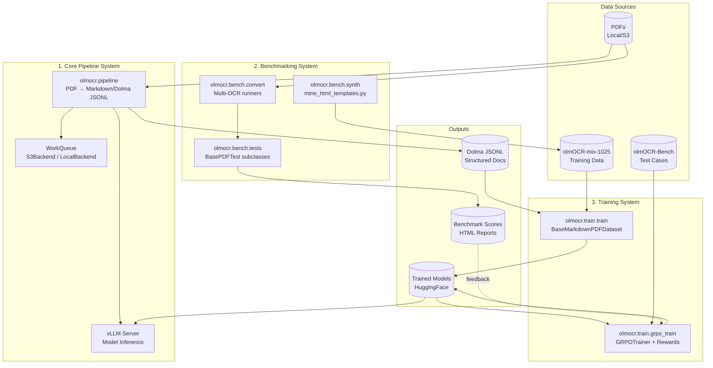
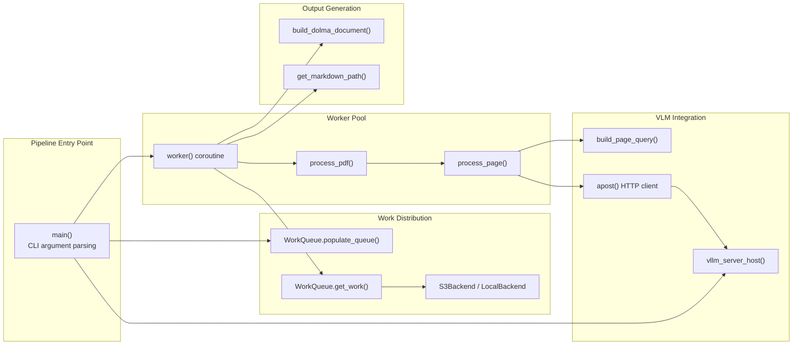
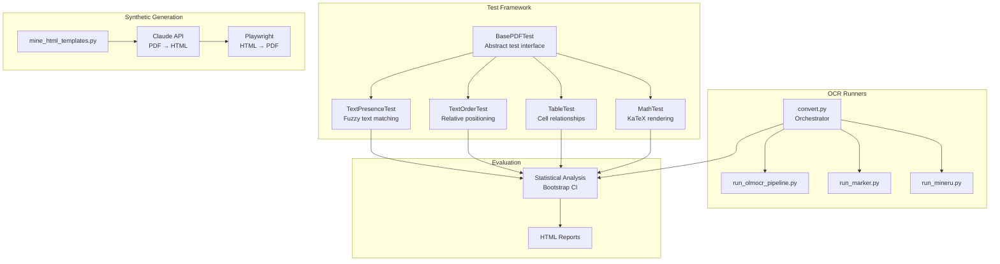
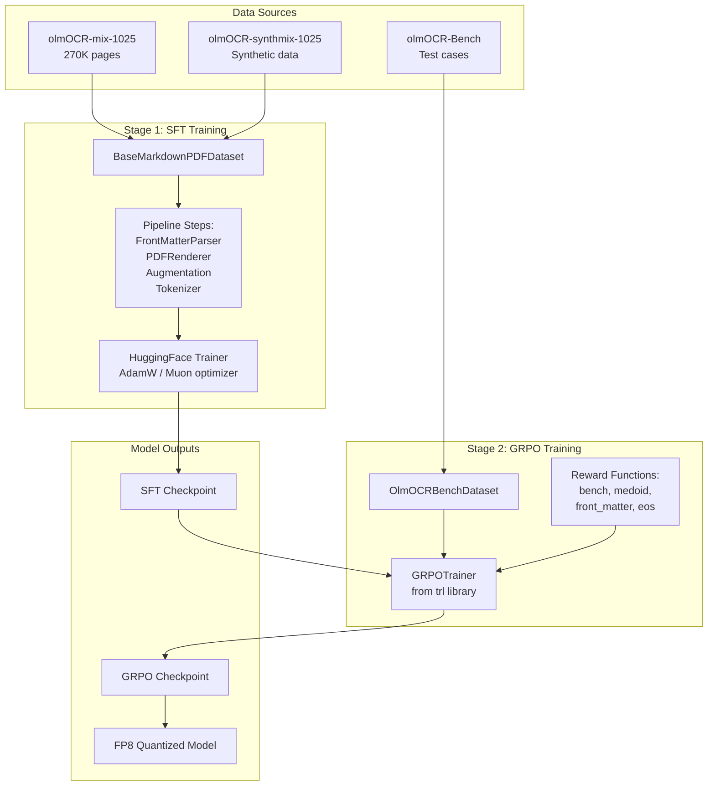
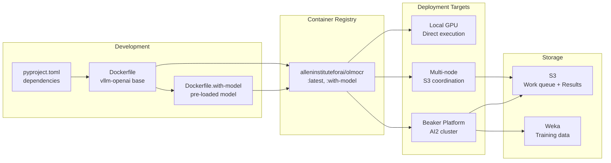
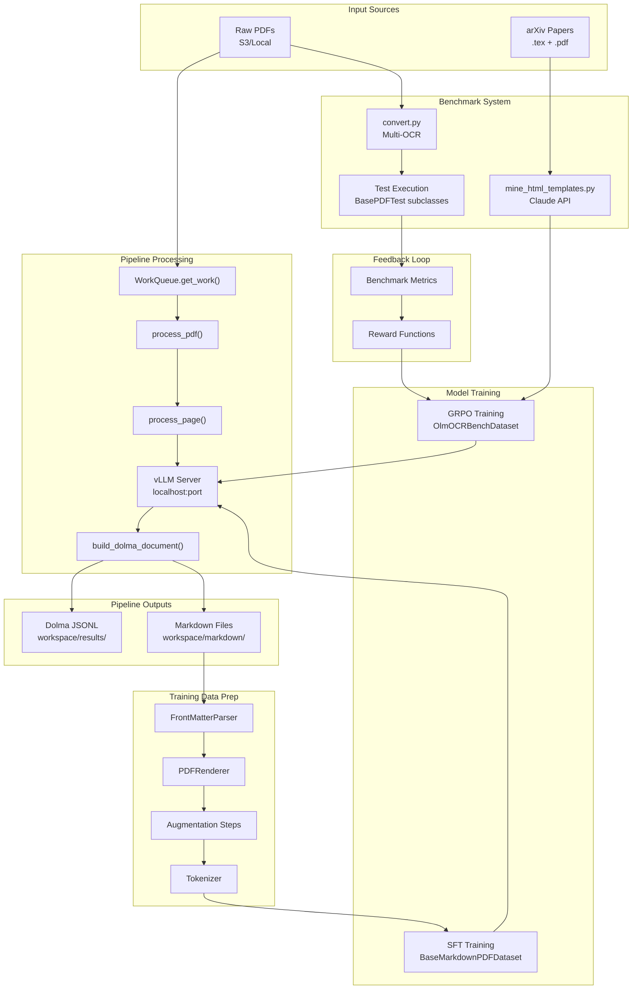

<!-- source: DeepWiki mcp.deepwiki.com · repo allenai/olmocr · page 1 Overview · fetched 2026-10-26 -->

# Overview

<details>
<summary>Relevant source files</summary>

The following files were used as context for generating this wiki page:

- [CHANGELOG.md](CHANGELOG.md)
- [README.md](README.md)
- [olmocr/bench/README.md](olmocr/bench/README.md)
- [olmocr/bench/runners/run_nanonetsocr.py](olmocr/bench/runners/run_nanonetsocr.py)
- [olmocr/bench/runners/run_olmocr_pipeline.py](olmocr/bench/runners/run_olmocr_pipeline.py)
- [olmocr/pipeline.py](olmocr/pipeline.py)
- [olmocr/train/README.md](olmocr/train/README.md)
- [olmocr/version.py](olmocr/version.py)
- [olmocr/work_queue.py](olmocr/work_queue.py)
- [scripts/release.sh](scripts/release.sh)
- [scripts/run_mineru_benchmark.sh](scripts/run_mineru_benchmark.sh)
- [tests/gnarly_pdfs/edgar_image.pdf](tests/gnarly_pdfs/edgar_image.pdf)
- [tests/test_pipeline.py](tests/test_pipeline.py)
- [tests/test_s3_work_queue.py](tests/test_s3_work_queue.py)

</details>


This document provides an overview of the olmOCR repository, a fast and efficient OCR system powered by vision-language models. It introduces the three main subsystems—pipeline processing, benchmarking, and training—and explains how they interact to convert PDF documents into clean, structured text.

For detailed information about specific subsystems:
- Core pipeline implementation: see [Core OCR Pipeline](#2)
- Evaluation framework: see [Benchmarking System](#4)
- Model training procedures: see [Model Training and Fine-tuning](#5)
- Deployment architecture: see [Infrastructure and Deployment](#6)

## Purpose and Capabilities

olmOCR is a document OCR system designed to convert PDFs, PNGs, and JPEGs into clean markdown and structured text. The system achieves efficient processing at less than $200 USD per million pages by using a fine-tuned 7B parameter vision-language model (`allenai/olmOCR-2-7B-1025-FP8`) based on Qwen2.5-VL.

**Key capabilities:**
- Converts documents to markdown with natural reading order
- Handles equations (LaTeX), tables (HTML/Markdown), handwriting, and complex formatting
- Automatically removes headers and footers
- Manages multi-column layouts, figures, and insets
- Processes at scale using distributed work queues on S3 or local storage
- Supports rotation correction for misoriented pages

**Performance:** The latest model (v0.4.0) achieves an 82.4±1.1 overall score on olmOCR-Bench, a comprehensive evaluation framework covering 7,000+ test cases across 1,400 documents.

Sources: [README.md:1-50](), [olmocr/bench/README.md:1-20](), [olmocr/version.py:1-12]()

## System Architecture

The olmOCR repository comprises three major subsystems that work together in a continuous improvement cycle:



**System Interaction Pattern:**
1. The **Core Pipeline** processes PDFs using the trained model via vLLM
2. The **Benchmarking System** evaluates pipeline outputs and generates synthetic training data
3. The **Training System** uses benchmark feedback to improve models via reinforcement learning
4. Improved models are deployed back to the pipeline

Sources: [olmocr/pipeline.py:1-100](), [olmocr/bench/README.md:1-50](), [olmocr/train/README.md:1-30]()

## Core Pipeline System

The core pipeline, implemented in `olmocr.pipeline`, orchestrates large-scale document conversion using a distributed worker architecture.

### Architecture Components



**Key Classes and Functions:**

| Component | Location | Purpose |
|-----------|----------|---------|
| `WorkQueue` | [olmocr/work_queue.py:82-231]() | Manages distributed work items with locking |
| `S3Backend` | [olmocr/work_queue.py:351-432]() | S3-based storage backend for coordination |
| `LocalBackend` | [olmocr/work_queue.py:233-349]() | Local filesystem backend |
| `process_page()` | [olmocr/pipeline.py:288-419]() | Core page processing with retry logic |
| `build_page_query()` | [olmocr/pipeline.py:144-184]() | Constructs VLM inference requests |
| `PageResponse` | [olmocr/prompts.py]() | Structured output with front matter fields |
| `build_dolma_document()` | [olmocr/pipeline.py:544-593]() | Assembles final Dolma JSONL format |

**Processing Flow:**
1. `WorkQueue` distributes PDF paths to parallel workers
2. Each worker calls `process_pdf()` → `process_page()` for each page
3. `process_page()` renders PDFs to images, queries vLLM, and handles retries
4. Results are assembled into Dolma documents and optionally markdown files
5. Workers mark items complete via `WorkQueue.mark_done()`

**Key Features:**
- Automatic rotation correction with cumulative rotation tracking
- Temperature escalation on retries (0.1 → 1.0) to overcome repetition
- Fallback to `pdftotext` after max retries exceeded
- Distributed locking prevents duplicate work across nodes

For detailed pipeline documentation, see [Core OCR Pipeline](#2) and [Work Queue and Distributed Processing](#2.2).

Sources: [olmocr/pipeline.py:288-711](), [olmocr/work_queue.py:82-231](), [tests/test_pipeline.py:204-514]()

## Benchmarking System

The benchmarking system (`olmocr.bench`) provides automated evaluation of OCR quality and synthetic data generation for training.

### Benchmark Architecture



**Test Types:**

| Test Class | Location | Purpose |
|------------|----------|---------|
| `TextPresenceTest` | [olmocr/bench/tests/]() | Verifies text appears with fuzzy matching |
| `TextOrderTest` | [olmocr/bench/tests/]() | Checks relative text ordering |
| `TableTest` | [olmocr/bench/tests/]() | Validates table structure and cell relationships |
| `MathTest` | [olmocr/bench/tests/]() | Compares LaTeX rendering via KaTeX |
| `BaselineTest` | [olmocr/bench/tests/]() | Basic quality checks |

**Multi-OCR Comparison:**
The `convert.py` orchestrator provides a pluggable architecture supporting 15+ OCR engines including olmOCR, Marker, MinerU, GOT-OCR, and Nanonets. Each runner implements a common interface that processes single PDF pages and returns markdown text.

**Synthetic Data Generation:**
The `mine_html_templates.py` system uses Claude API with multi-step prompting to:
1. Convert arXiv PDFs to semantic HTML templates
2. Render HTML back to PDFs via Playwright
3. Automatically generate test cases in olmOCR-Bench format

This synthetic data (`olmOCR-synthmix-1025`) is used for GRPO reinforcement learning.

For detailed benchmark documentation, see [Benchmarking System](#4) and [Synthetic Data Generation](#4.5).

Sources: [olmocr/bench/README.md:1-100](), [olmocr/bench/runners/run_olmocr_pipeline.py:1-113](), [olmocr/train/README.md:129-157]()

## Training System

The training system implements a two-stage approach: supervised fine-tuning (SFT) followed by GRPO reinforcement learning.

### Training Pipeline Architecture



**Key Components:**

| Component | Location | Purpose |
|-----------|----------|---------|
| `BaseMarkdownPDFDataset` | [olmocr/train/dataloader.py]() | Configurable data pipeline with 7 transformation steps |
| `FrontMatterParser` | [olmocr/train/dataloader.py]() | Parses YAML front matter from markdown |
| `PDFRenderer` | [olmocr/data/renderpdf.py]() | Renders PDF pages to base64 PNG images |
| `GRPOTrainer` | [olmocr/train/grpo_train.py]() | Reinforcement learning with multiple reward functions |
| `OlmOCRBenchDataset` | [olmocr/train/grpo_train.py]() | Loads benchmark data for GRPO training |

**Training Process:**

1. **SFT (Supervised Fine-Tuning):**
   - Loads PDF+markdown pairs from `olmOCR-mix-1025` dataset
   - Applies pipeline steps: parsing → rendering → augmentation → filtering → tokenization
   - Fine-tunes Qwen2.5-VL with LoRA adapters or full model training
   - Training duration: ~24-48 hours on single B200 GPU for 270K pages

2. **GRPO (Group Relative Policy Optimization):**
   - Uses synthetic olmOCR-Bench data (`olmOCR-synthmix-1025`)
   - Reward functions: benchmark score, edit distance (medoid), frontmatter correctness, EOS tokens
   - Runs on 8xH100 setup: 1 GPU for vLLM inference, 7 GPUs for training
   - Multiple seeds are trained and merged via model souping

3. **Post-processing:**
   - Checkpoints are prepared with `prepare_olmocr_checkpoint.py`
   - FP8 quantization reduces model size and improves inference speed by ~12%

For detailed training documentation, see [Model Training and Fine-tuning](#5).

Sources: [olmocr/train/README.md:1-175](), [olmocr/train/train.py](), [olmocr/train/grpo_train.py]()

## Infrastructure and Deployment

The system supports multiple deployment modes: local single-GPU processing, multi-node clusters, Docker containers, and Beaker platform integration.

### Deployment Options



**Deployment Modes:**

1. **Local Processing:**
   ```bash
   python -m olmocr.pipeline ./workspace --markdown --pdfs *.pdf
   ```
   - Spawns local vLLM server automatically
   - Processes PDFs from local filesystem
   - Suitable for testing and small-scale conversion

2. **Multi-node Cluster:**
   ```bash
   python -m olmocr.pipeline s3://bucket/workspace --pdfs s3://bucket/*.pdf
   ```
   - Uses S3-based work queue for coordination
   - Multiple workers grab items from shared queue
   - `S3Backend` handles distributed locking

3. **External Inference Server:**
   ```bash
   python -m olmocr.pipeline ./workspace --server http://remote:8000/v1 \
     --model allenai/olmOCR-2-7B-1025-FP8 --pdfs *.pdf
   ```
   - Connects to external vLLM server or OpenAI-compatible API
   - Supports commercial providers (Cirrascale, DeepInfra, Parasail)

4. **Docker Containers:**
   - Base image: `alleninstituteforai/olmocr:latest` (~2GB)
   - With model: `alleninstituteforai/olmocr:latest-with-model` (~30GB)
   - Includes all dependencies and optional pre-downloaded model

5. **Beaker Platform (AI2):**
   - Automated cluster deployment via `scripts/run_benchmark.sh`
   - Synchronizes Docker images to Beaker registry
   - Manages experiment specs, resource allocation, and job orchestration

For detailed infrastructure documentation, see [Infrastructure and Deployment](#6).

Sources: [README.md:186-418](), [olmocr/pipeline.py:713-863](), [scripts/run_mineru_benchmark.sh:1-284]()

## Data Flow Through the System

This diagram shows how data flows through the complete olmOCR lifecycle:



**Processing Stages:**

1. **Ingestion:** PDFs enter via local filesystem or S3 paths
2. **Distribution:** `WorkQueue` distributes work items to parallel workers
3. **Inference:** Workers send page images to vLLM server for OCR
4. **Assembly:** Pages are combined into Dolma JSONL documents
5. **Output:** Results written to S3 or local storage as JSONL and markdown

**Training Cycle:**

1. **Data Generation:** Pipeline outputs become training data after manual curation
2. **SFT Training:** Models learn from curated PDF+markdown pairs
3. **Synthetic Data:** `mine_html_templates.py` generates additional training data
4. **GRPO Training:** Models improve via reinforcement learning with benchmark rewards
5. **Deployment:** Trained models replace previous versions in pipeline

**Continuous Improvement:**

- Benchmark results identify model weaknesses
- Synthetic data generation creates targeted test cases
- GRPO training optimizes for benchmark performance
- Model souping combines multiple training runs
- Improved models deployed back to production pipeline

Sources: [olmocr/pipeline.py:596-711](), [olmocr/train/README.md:1-175](), [olmocr/bench/README.md:216-270]()

## Key Technologies and Dependencies

**Core Dependencies:**

| Technology | Purpose | Usage |
|------------|---------|-------|
| vLLM | Fast VLM inference | Serves Qwen2.5-VL models with PagedAttention |
| PyTorch | Deep learning | Model training and inference |
| Transformers | Model loading | HuggingFace model integration |
| Qwen2.5-VL | Base VLM | 7B parameter vision-language model |
| Poppler | PDF rendering | Converts PDF pages to images via `pdftoppm` |
| Playwright | Browser automation | Renders HTML and KaTeX for testing |
| Boto3 | AWS SDK | S3 operations for distributed processing |
| TRL | RL training | Provides `GRPOTrainer` for reinforcement learning |

**Data Formats:**

- **Input:** PDF, PNG, JPEG files
- **Intermediate:** Base64-encoded PNG images, YAML front matter
- **Output:** Dolma JSONL (structured documents), Markdown files
- **Training:** PDF+markdown pairs with YAML metadata
- **Benchmark:** JSONL test definitions with assertions

**Distributed Coordination:**

- Work queue state stored in compressed CSV (`work_index_list.csv.zstd`)
- Lock files prevent duplicate processing (`worker_locks/worker_*.lock`)
- Done flags track completed work (`done_flags/done_*.flag`)
- Supports both S3 and local filesystem backends

**Performance Optimizations:**

- FP8 quantization reduces memory usage and inference latency
- Temperature escalation (0.1 → 1.0) overcomes model repetition
- Parallel page processing with bounded semaphores
- Manual HTTP implementation (`apost()`) avoids connection pool deadlocks
- PDF rendering limited by CPU semaphore to prevent overload

Sources: [olmocr/pipeline.py:1-100](), [olmocr/work_queue.py:1-50](), [README.md:186-214]()

---

