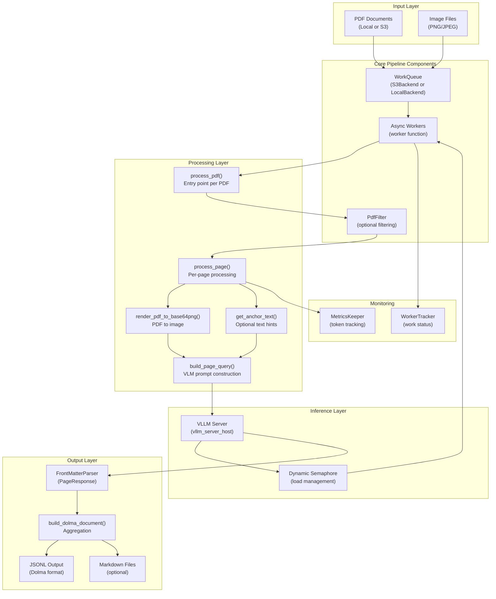
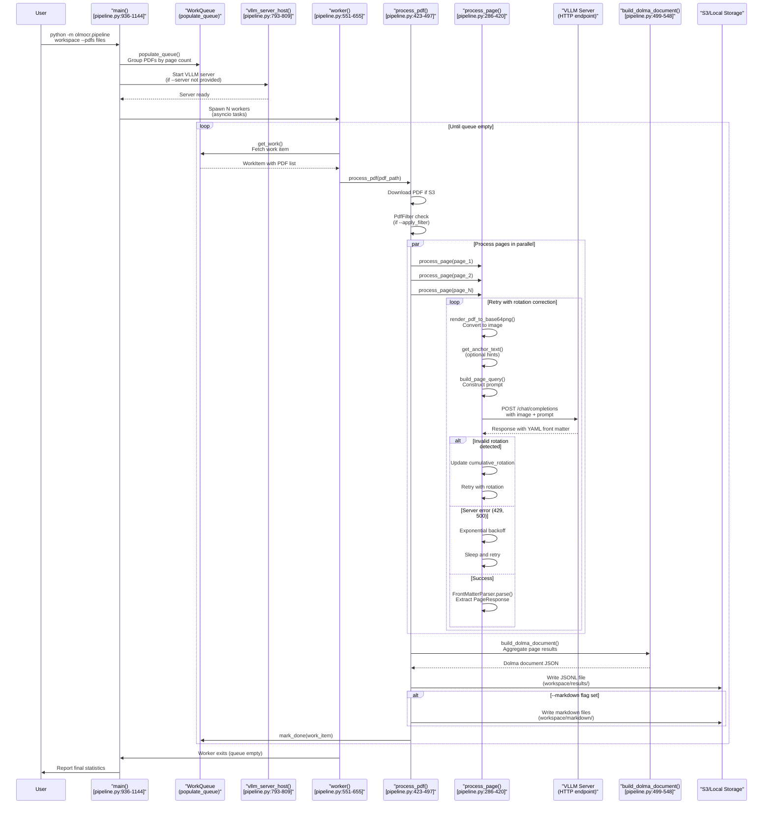
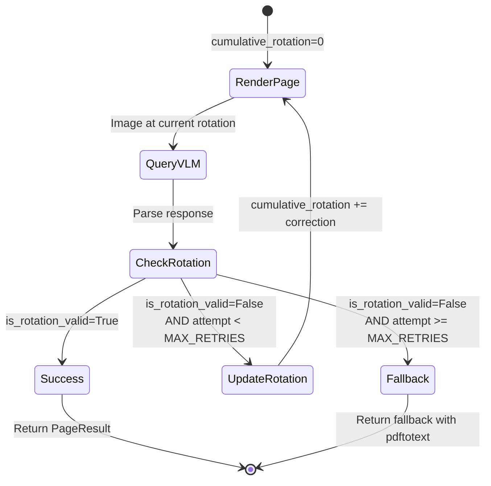

<!-- source: DeepWiki mcp.deepwiki.com · repo allenai/olmocr · page 2 Core OCR Pipeline · fetched 2026-10-26 -->

# Core OCR Pipeline

<details>
<summary>Relevant source files</summary>

The following files were used as context for generating this wiki page:

- [CHANGELOG.md](CHANGELOG.md)
- [olmocr/pipeline.py](olmocr/pipeline.py)
- [olmocr/version.py](olmocr/version.py)
- [olmocr/work_queue.py](olmocr/work_queue.py)
- [scripts/release.sh](scripts/release.sh)
- [tests/gnarly_pdfs/edgar_image.pdf](tests/gnarly_pdfs/edgar_image.pdf)
- [tests/test_pipeline.py](tests/test_pipeline.py)
- [tests/test_s3_work_queue.py](tests/test_s3_work_queue.py)

</details>


## Purpose and Scope

The Core OCR Pipeline is the primary system for converting PDF documents into structured text using vision language models (VLMs). This page provides an overview of the end-to-end conversion process, from input PDFs to structured output in Dolma format or Markdown.

For detailed information about specific subsystems:
- Pipeline internal architecture and orchestration: See [Pipeline Architecture](#2.1)
- Distributed processing and work coordination: See [Work Queue and Distribution](#2.2)
- VLM server lifecycle management: See [VLM Server Integration](#2.3)
- PDF processing utilities: See [Document Processing](#3)

## Architecture Overview

The pipeline consists of three primary subsystems that work together to process documents at scale:



**Key Component Roles:**

| Component | File Location | Primary Responsibility |
|-----------|--------------|------------------------|
| `WorkQueue` | [olmocr/work_queue.py]() | Coordinates work distribution across multiple workers |
| `worker()` | [olmocr/pipeline.py:551-655]() | Main worker loop that processes PDFs from the queue |
| `process_pdf()` | [olmocr/pipeline.py:423-497]() | Handles single PDF: filtering, page splitting, aggregation |
| `process_page()` | [olmocr/pipeline.py:286-420]() | Processes individual pages with retry logic and rotation correction |
| `build_dolma_document()` | [olmocr/pipeline.py:499-548]() | Aggregates page results into final Dolma format |
| `vllm_server_host()` | [olmocr/pipeline.py:793-809]() | Manages VLLM server lifecycle with auto-restart |
| `MetricsKeeper` | [olmocr/metrics.py]() | Tracks token usage and throughput statistics |

Sources: [olmocr/pipeline.py](), [olmocr/work_queue.py](), [README.md]()

## End-to-End Workflow

The following diagram illustrates the complete execution flow from command invocation to final output:



**Workflow Stages:**

1. **Initialization** ([pipeline.py:936-1144]()): Parse arguments, populate work queue, optionally start VLLM server
2. **Work Distribution** ([work_queue.py]()): Coordinate work items across multiple workers using S3 or local backend
3. **PDF Processing** ([pipeline.py:423-497]()): Download PDF, apply optional filtering, split into pages
4. **Page Processing** ([pipeline.py:286-420]()): Render to image, query VLLM, parse response with retry logic
5. **Aggregation** ([pipeline.py:499-548]()): Combine page results into structured Dolma document
6. **Output** ([pipeline.py:586-639]()): Write JSONL results and optional markdown files

Sources: [olmocr/pipeline.py:286-809](), Diagram 2 from high-level architecture

## Key Data Structures

### PageResponse

The VLM returns structured metadata along with extracted text, parsed using the `FrontMatterParser`:

```yaml
---
primary_language: en
is_rotation_valid: True
rotation_correction: 0
is_table: False
is_diagram: False
---
Extracted document text goes here...
```

This structure is defined in [olmocr/prompts/\_\_init\_\_.py]() and parsed in [olmocr/train/dataloader.py]() using the `FrontMatterParser` class.

### PageResult

Internal representation of a processed page:

| Field | Type | Description |
|-------|------|-------------|
| `s3_path` | str | Original PDF path |
| `page_num` | int | Page number (1-indexed) |
| `response` | PageResponse | Parsed VLM output |
| `input_tokens` | int | Tokens sent to VLM |
| `output_tokens` | int | Tokens generated by VLM |
| `is_fallback` | bool | Whether fallback extraction was used |

Defined in [olmocr/pipeline.py:131-140]().

### Dolma Document Format

Final output structure for training data:

```python
{
    "id": "sha1_hash_of_text",
    "text": "concatenated_page_text",
    "source": "olmocr",
    "added": "2025-01-15",
    "created": "2025-01-15",
    "metadata": {
        "Source-File": "s3://bucket/path/to/file.pdf",
        "olmocr-version": "0.4.0",
        "pdf-total-pages": 10,
        "total-input-tokens": 12000,
        "total-output-tokens": 8000,
        "total-fallback-pages": 0
    },
    "attributes": {
        "pdf_page_numbers": [[0, 500, 1], [500, 1200, 2], ...],
        "primary_language": ["en", "en", ...],
        "is_rotation_valid": [True, True, ...],
        "rotation_correction": [0, 0, ...],
        "is_table": [False, True, ...],
        "is_diagram": [False, False, ...]
    }
}
```

This format is compatible with the [Dolma toolkit](https://github.com/allenai/dolma) for large-scale language model training. See [olmocr/pipeline.py:499-548]() for implementation.

Sources: [olmocr/pipeline.py:131-140](), [olmocr/pipeline.py:499-548](), [olmocr/prompts/__init__.py]()

## Processing Features

### Automatic Rotation Correction

The pipeline includes iterative rotation correction when the VLM detects that a page is improperly oriented:



The rotation state is tracked cumulatively across retries to prevent oscillation. See [olmocr/pipeline.py:292-366]() for implementation details.

### Retry and Fallback Mechanisms

| Condition | Action | Max Attempts |
|-----------|--------|--------------|
| Invalid rotation | Update `cumulative_rotation`, retry with new angle | 8 (default) |
| Server error (429, 500) | Exponential backoff, don't increment attempt counter | Unlimited |
| Connection error | Exponential backoff, don't increment attempt counter | Unlimited |
| JSON decode error | Increment attempt counter, retry | 8 (default) |
| Response validation failure | Increment attempt counter, retry with higher temperature | 8 (default) |

If all retries are exhausted, the system falls back to `pdftotext` extraction for that page ([olmocr/pipeline.py:406-420]()).

### Temperature Scaling

Temperature increases with each retry attempt to overcome repetition issues:

```python
TEMPERATURE_BY_ATTEMPT = [0.1, 0.1, 0.2, 0.3, 0.5, 0.8, 0.9, 1.0]
```

This helps the model generate different outputs when previous attempts failed. See [olmocr/pipeline.py:290]().

Sources: [olmocr/pipeline.py:286-420]()

## Execution Modes

### Local Execution

Single-machine processing with local VLLM server:

```bash
python -m olmocr.pipeline ./localworkspace --markdown --pdfs *.pdf
```

**Flow:**
1. `main()` spawns local VLLM server via `vllm_server_host()`
2. Uses `LocalBackend` for work queue
3. Spawns N async workers (default: based on CPU count)
4. Outputs to local filesystem

### Distributed Execution (S3)

Multi-node processing with S3 coordination:

```bash
# Node 1 (initializer)
python -m olmocr.pipeline s3://bucket/workspace --pdfs s3://bucket/pdfs/*.pdf

# Nodes 2-N (workers)
python -m olmocr.pipeline s3://bucket/workspace
```

**Flow:**
1. First invocation populates work queue in S3 using `S3Backend`
2. Each node spawns local VLLM server
3. Workers pull from shared S3 work queue
4. Results written to S3 (`workspace/results/`)

### Beaker Cluster Execution

Automated distributed execution on Beaker:

```bash
python -m olmocr.pipeline s3://bucket/workspace --pdfs s3://bucket/*.pdf \
    --beaker --beaker_gpus 4
```

The `--beaker` flag triggers `submit_beaker_job()` ([pipeline.py:874-936]()) which:
1. Creates Beaker experiment specification
2. Spawns N GPU workers with shared S3 workspace
3. Each worker independently processes PDFs from the queue

Sources: [olmocr/pipeline.py:874-1144](), [README.md:289-313]()

## Output Structure

### Workspace Directory Layout

```
workspace/
├── queue/                    # Work queue state (LocalBackend only)
│   ├── pending/
│   └── done/
├── results/                  # Dolma JSONL outputs
│   ├── output_hash1.jsonl
│   ├── output_hash2.jsonl
│   └── ...
└── markdown/                 # Optional markdown outputs (--markdown flag)
    ├── path/to/doc1.md
    ├── path/to/doc2.md
    └── ...
```

For S3 workspaces, the `queue/` directory is replaced by S3-based coordination using object metadata and atomic operations. See [Work Queue and Distribution](#2.2) for details.

### JSONL Results Format

Each `output_*.jsonl` file contains one Dolma document per line, with each document representing one processed PDF. Files are named using the work item hash to prevent collisions in distributed execution.

Sources: [olmocr/pipeline.py:586-608]()

## Monitoring and Metrics

### MetricsKeeper

Tracks real-time statistics in a sliding time window:

| Metric | Description |
|--------|-------------|
| `server_input_tokens` | Tokens sent to VLLM |
| `server_output_tokens` | Tokens generated by VLLM |
| `completed_pages` | Successfully processed pages |
| `failed_pages` | Pages that exhausted retries |
| `finished_input_tokens` | Tokens from completed documents |
| `finished_output_tokens` | Output tokens from completed documents |

Reported every 10 seconds via `metrics_reporter()` ([pipeline.py:865-871]()).

### WorkerTracker

Monitors active work assignments per worker to detect stalls:

```python
await tracker.track_work(worker_id, "pdf_path-page_num", "started")
await tracker.track_work(worker_id, "pdf_path-page_num", "finished")
```

Generates status tables showing which worker is processing which page. See [olmocr/metrics.py]().

### Debug Logging

Comprehensive debug logs written to `olmocr-pipeline-debug.log` ([pipeline.py:63-75]()):
- All worker activity
- VLLM server output
- Retry decisions
- Error traces

Sources: [olmocr/pipeline.py:85-86](), [olmocr/metrics.py]()

## Command-Line Interface

The pipeline is invoked via `python -m olmocr.pipeline` with extensive configuration options:

### Essential Arguments

| Argument | Description | Default |
|----------|-------------|---------|
| `workspace` | Local or S3 path for coordination | Required |
| `--pdfs` | Glob pattern or file list of PDFs | None (worker mode) |
| `--model` | Model path (HF/S3/local) | `allenai/olmOCR-2-7B-1025-FP8` |
| `--server` | External VLLM server URL | None (spawn local) |
| `--workers` | Number of concurrent workers | CPU count - 2 |
| `--markdown` | Also output markdown files | False |

### Advanced Configuration

| Argument | Description | Default |
|----------|-------------|---------|
| `--pages_per_group` | Pages per work item | 100 |
| `--max_page_retries` | Retry attempts per page | 8 |
| `--max_page_error_rate` | Max fallback pages before discarding | 0.004 (1/250) |
| `--apply_filter` | Filter forms/spam/non-English | False |
| `--guided_decoding` | Enable regex-guided generation | False |
| `--tensor-parallel-size` | VLLM tensor parallelism | 1 |
| `--data-parallel-size` | VLLM data parallelism | 1 |

For complete argument reference, see [README.md:356-418]() or run `python -m olmocr.pipeline --help`.

Sources: [olmocr/pipeline.py:936-1144](), [README.md:216-418]()

## Integration Points

### VLLM Server

The pipeline communicates with VLLM via OpenAI-compatible HTTP API (`/chat/completions` endpoint). The server lifecycle is managed automatically unless `--server` is provided. For details on server management, see [VLM Server Integration](#2.3).

### PDF Processing Utilities

The pipeline depends on several document processing subsystems:
- **Anchor text extraction**: [Anchor Text Extraction](#3.1) - provides optional text hints to the VLM
- **PDF rendering**: [PDF Rendering and Conversion](#3.2) - converts pages to base64-encoded PNG images
- **PDF filtering**: [PDF Filtering and Quality Control](#3.3) - optional quality checks

### Benchmark Integration

The pipeline can be invoked from the benchmark system for testing:

```python
from olmocr.bench.runners.run_olmocr_pipeline import run_olmocr_pipeline

result = await run_olmocr_pipeline(pdf_path="doc.pdf", page_num=1)
```

See [olmocr/bench/runners/run_olmocr_pipeline.py]() for the integration wrapper.

Sources: [olmocr/pipeline.py:7-53](), [olmocr/bench/runners/run_olmocr_pipeline.py]()

---

