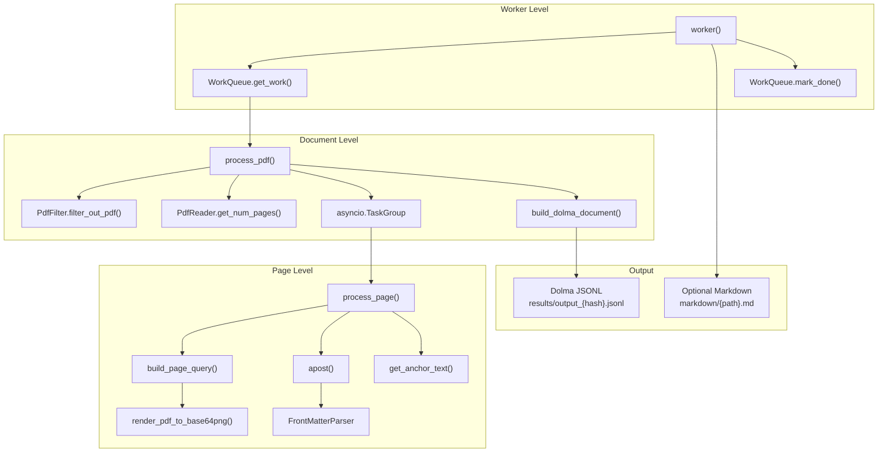
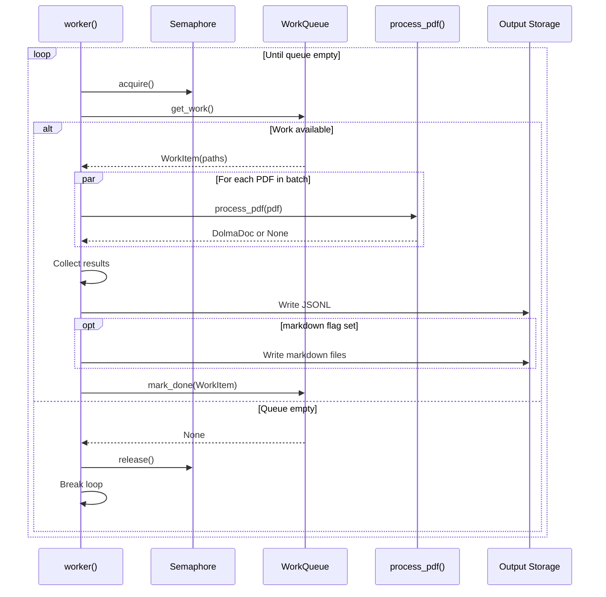
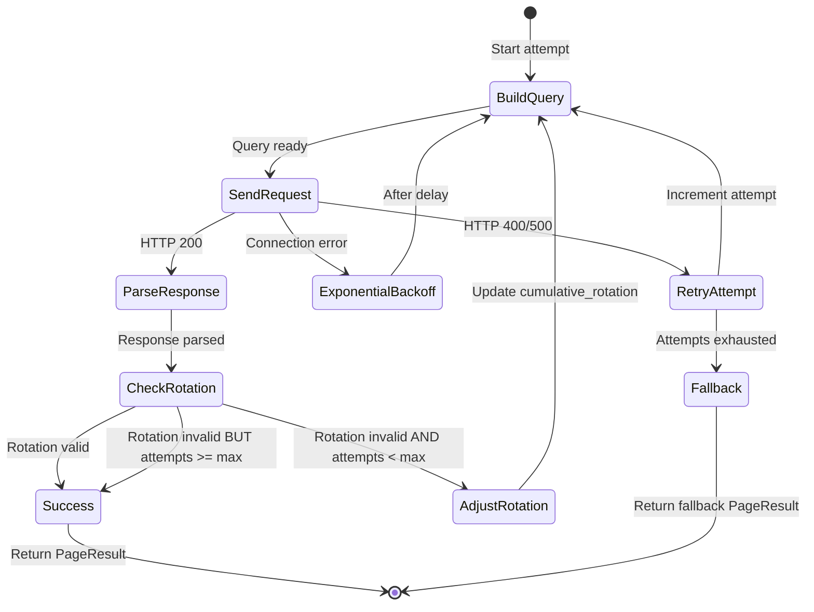
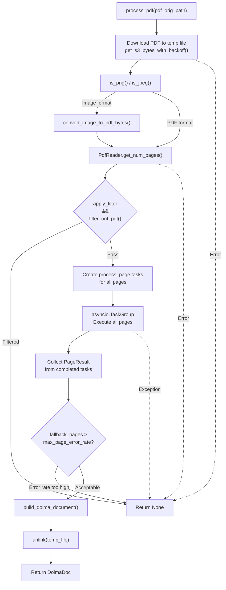
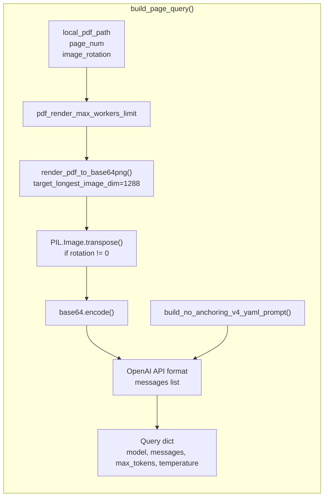
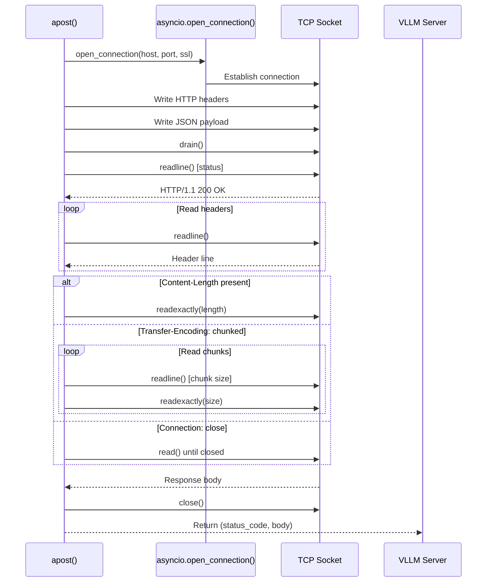
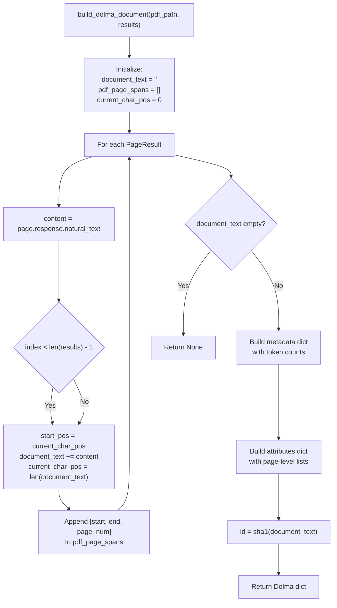

<!-- source: DeepWiki mcp.deepwiki.com · repo allenai/olmocr · page 2.1 Pipeline Architecture and Workflow · fetched 2026-10-26 -->

# Pipeline Architecture

<details>
<summary>Relevant source files</summary>

The following files were used as context for generating this wiki page:

- [CHANGELOG.md](CHANGELOG.md)
- [olmocr/pipeline.py](olmocr/pipeline.py)
- [olmocr/version.py](olmocr/version.py)
- [olmocr/work_queue.py](olmocr/work_queue.py)
- [scripts/release.sh](scripts/release.sh)
- [tests/gnarly_pdfs/edgar_image.pdf](tests/gnarly_pdfs/edgar_image.pdf)
- [tests/test_pipeline.py](tests/test_pipeline.py)
- [tests/test_s3_work_queue.py](tests/test_s3_work_queue.py)

</details>


## Purpose and Scope

This document details the internal architecture of the `olmocr.pipeline` module, which implements the core PDF-to-text conversion orchestration. It covers the main processing loop, page-level inference coordination, retry logic, and result aggregation into Dolma format. For information about distributed work coordination across multiple workers, see [Work Queue and Distribution](#2.2). For details on VLLM server lifecycle management, see [VLM Server Integration](#2.3).

The pipeline architecture handles:
- Orchestration of PDF processing from input to structured output
- Page-level image rendering and query construction  
- Iterative rotation correction based on VLM feedback
- Retry logic with exponential backoff for failures
- Result aggregation into Dolma JSONL format
- Optional markdown file output

Sources: [olmocr/pipeline.py:1-1936]()

---

## Architecture Overview

The pipeline follows a hierarchical processing model with three main levels: worker coordination, document processing, and page processing. Each level handles specific responsibilities in transforming PDFs into structured text output.



**Pipeline Processing Hierarchy**

The architecture separates concerns across three levels, with each level managing a specific scope of work and coordinating the level below it through asynchronous task groups.

Sources: [olmocr/pipeline.py:551-655](), [olmocr/pipeline.py:423-497](), [olmocr/pipeline.py:286-421]()

---

## Main Orchestration Flow

The `worker` function implements the top-level orchestration loop that processes work items from the queue. Each worker acquires a semaphore permit before retrieving work, processes a batch of PDFs concurrently, writes results to storage, and optionally generates markdown files.

### Worker Function

The worker operates in an infinite loop, bounded by queue availability and semaphore constraints:



**Worker Processing Sequence**

Key implementation details in [olmocr/pipeline.py:551-655]():

- **Semaphore Management**: Workers acquire a semaphore permit (line 554) to control concurrent processing load. The semaphore is released either when the queue is empty (line 560) or after each work item if using an external server (line 654).

- **Concurrent PDF Processing**: Uses `asyncio.TaskGroup` (line 567) to process multiple PDFs in parallel within a single work item. All tasks must complete before proceeding.

- **Result Collection**: Iterates through completed tasks (line 574-582), handling exceptions gracefully. Failed PDF conversions return `None` and are excluded from output.

- **Output Persistence**: Results are written to temporary files first, then uploaded to S3 or copied locally (lines 587-608). This ensures atomic writes and proper cleanup.

- **Markdown Generation**: When `--markdown` flag is set, each document's natural text is written to a separate markdown file preserving the input directory structure (lines 611-639).

Sources: [olmocr/pipeline.py:551-655](), [olmocr/pipeline.py:95-128]()

---

## Page Processing Logic

The `process_page` function is the core inference coordination unit that manages VLM requests, retry logic, rotation correction, and fallback handling for individual PDF pages.

### Page Processing State Machine



**Page Processing State Transitions**

### Key Processing Components

**Retry Loop Structure** [olmocr/pipeline.py:286-421]():

The function implements a sophisticated retry mechanism with multiple failure modes:

1. **Attempt Counter**: Tracks content-related retries (line 293), separate from connection retries
2. **Exponential Backoff**: Used for connection errors (lines 384-387), doesn't increment attempt counter
3. **Temperature Scaling**: Increases sampling temperature with each attempt (lines 290, 307) using the array `[0.1, 0.1, 0.2, 0.3, 0.5, 0.8, 0.9, 1.0]`
4. **Priority Boosting**: Assigns higher priority to retries (line 311) to clear the queue faster

**Rotation Correction Mechanism** [olmocr/pipeline.py:292, 359-366]():

The pipeline maintains cumulative rotation state across retries:
- `cumulative_rotation` variable tracks total rotation applied (initialized at line 292)
- When VLM indicates invalid rotation (`is_rotation_valid: False`), the correction is added to cumulative value
- Image is rotated by `cumulative_rotation` degrees before next inference attempt (lines 150-167 in `build_page_query`)
- Rotation values are modulo 360: `(cumulative_rotation + rotation_correction) % 360`

**Response Validation** [olmocr/pipeline.py:340-357]():

Multiple validation checks ensure response quality:
- HTTP status code verification (lines 331-338)
- Token count constraint check against `MODEL_MAX_CONTEXT` of 16384 (lines 342-343)
- Finish reason must be `"stop"` (lines 345-346)
- YAML front matter must parse successfully via `FrontMatterParser` (lines 355-357)

**Fallback Handling** [olmocr/pipeline.py:402-420]():

When all retries fail, the pipeline falls back to anchor text extraction:
- Returns `PageResult` with `is_fallback=True` flag (line 419)
- Uses `get_anchor_text()` with `pdftotext` engine (line 410)
- Sets default metadata values (no rotation, not a table/diagram)
- Zero token counts since no VLM inference occurred

Sources: [olmocr/pipeline.py:286-421](), [olmocr/pipeline.py:142-183]()

---

## Document Processing Orchestration

The `process_pdf` function coordinates page-level processing for an entire PDF, managing temporary file lifecycle, filtering, parallel page tasks, and error rate validation.

### PDF Processing Flow



**PDF Processing Decision Flow**

### Implementation Details

**Temporary File Management** [olmocr/pipeline.py:424-440]():

PDFs are downloaded to temporary files for processing:
- Uses `tempfile.NamedTemporaryFile` with `delete=False` (line 424)
- Downloads from S3 using `get_s3_bytes_with_backoff()` for retry resilience (line 426)
- Handles `NoSuchKey` exceptions gracefully (lines 429-432)
- Converts image formats (PNG/JPEG) to PDF if needed (lines 436-440)
- Cleanup guaranteed via `finally` block (lines 494-496)

**Filtering Application** [olmocr/pipeline.py:452-454]():

Optional PDF filtering using cached `PdfFilter` instance:
- Only applied when `--apply_filter` flag is set
- Filters based on language (English only), form detection, and spam detection
- Uses `get_pdf_filter()` cached function to avoid reloading filter on each call
- Filtered PDFs return `None` immediately, skipping inference

**Parallel Page Processing** [olmocr/pipeline.py:456-467]():

All pages processed concurrently using `asyncio.TaskGroup`:
- Creates tasks for pages 1 through `num_pages` (1-indexed)
- TaskGroup ensures all tasks complete or propagates first exception
- Results collected only after entire group finishes
- `BrokenProcessPool` exceptions cause immediate exit (lines 484-488)

**Error Rate Validation** [olmocr/pipeline.py:469-479]():

Documents with excessive fallback pages are rejected:
- Calculates `num_fallback_pages / num_pages` ratio (line 471)
- Default threshold is `max_page_error_rate=0.004` (1 in 250 pages)
- Logs warning for documents with some fallbacks that pass threshold
- Returns `None` for documents exceeding threshold, discarding all pages

Sources: [olmocr/pipeline.py:423-497](), [olmocr/filter/filter.py:1-200]()

---

## Query Construction and Image Processing

The `build_page_query` function constructs the inference request payload by rendering PDFs to images, applying rotation, and formatting the prompt with the image data.

### Query Building Components



**Query Construction Pipeline**

### Key Implementation Details

**Semaphore-Bounded Rendering** [olmocr/pipeline.py:147-148]():

PDF rendering is CPU-intensive and bounded by semaphore:
- `pdf_render_max_workers_limit` initialized to CPU count minus 2 (line 88)
- Can be overridden via `BEAKER_ASSIGNED_CPU_COUNT` environment variable
- Rendering executed via `asyncio.to_thread()` to avoid blocking event loop
- Prevents system overload when processing many pages concurrently

**Image Rotation Application** [olmocr/pipeline.py:150-167]():

Rotation applied using PIL Image operations:
- Supports 90°, 180°, 270° rotations only (validated at line 144)
- Decodes base64 image to bytes, opens with PIL (lines 151-152)
- Maps rotation degrees to `Image.Transpose` enum values (lines 153-158)
- Re-encodes rotated image to PNG format in memory (lines 163-164)
- Returns new base64 string (line 167)

**Prompt Construction** [olmocr/pipeline.py:169-182]():

Query formatted for OpenAI-compatible chat completion API:
- Uses `build_no_anchoring_v4_yaml_prompt()` for system instructions (line 175)
- Image embedded as data URL with base64 PNG content (line 176)
- Model name configurable via `--model` argument, defaults to "olmocr" (line 170)
- Max tokens set to 8000 (line 143)
- Temperature and priority set by caller during retry logic

**Configuration Parameters**:
- `target_longest_image_dim`: Default 1288 pixels for longest dimension (configurable via CLI)
- `MAX_TOKENS`: 8000 token output limit
- Image format: Always PNG with base64 encoding

Sources: [olmocr/pipeline.py:142-183](), [olmocr/data/renderpdf.py:1-100]()

---

## Custom HTTP Implementation

The pipeline implements a custom asynchronous HTTP client in the `apost` function to avoid deadlock issues observed with standard HTTP libraries at scale.

### HTTP Client Architecture



**Custom HTTP Request-Response Flow**

### Implementation Rationale

**Design Motivation** [olmocr/pipeline.py:185-188]():

The custom implementation was introduced to avoid deadlock issues:
- Standard libraries like `httpx` and `aiohttp` have complex session pooling
- At 100M+ request scale, lock contention in connection pools causes deadlocks
- Custom implementation uses simple socket operations without pooling
- No shared state between requests eliminates lock contention

**Key Features** [olmocr/pipeline.py:189-283]():

1. **SSL Support** (lines 193-207): Handles both HTTPS and HTTP connections with proper SSL context
2. **Authorization Header** (lines 218-219): Optional Bearer token for external API authentication  
3. **Connection Close** (line 221): Each request uses a new connection, no keep-alive
4. **Multiple Body Encodings** (lines 245-270):
   - Content-Length: Read exact byte count
   - Transfer-Encoding: chunked: Parse chunk sizes and read incrementally
   - Connection: close: Read until connection closes
5. **Error Propagation** (lines 273-283): Exceptions passed through, socket cleanup in `finally` block

**Usage in Pipeline** [olmocr/pipeline.py:328-329]():

Called within semaphore-bounded context:
- `max_concurrent_requests_limit` controls concurrent inference requests (line 328)
- Semaphore initialized to 1 by default, increased based on VLLM capacity (line 89)
- API key passed for external servers, None for local VLLM (lines 323-326)

Sources: [olmocr/pipeline.py:185-283](), [olmocr/pipeline.py:328-329]()

---

## Result Aggregation and Dolma Format

The `build_dolma_document` function aggregates page results into a single structured document in Dolma JSONL format, calculating character offsets and embedding page-level metadata.

### Dolma Document Structure

The Dolma format is a standardized JSON Lines format used for training language models. Each line represents a single document with text, metadata, and attributes.

**Document Schema** [olmocr/pipeline.py:499-548]():

```python
{
    "id": "sha1_hash_of_text",
    "text": "full_document_text",
    "source": "olmocr",
    "added": "YYYY-MM-DD",
    "created": "YYYY-MM-DD",
    "metadata": {
        "Source-File": "s3://bucket/path/to/file.pdf",
        "olmocr-version": "0.4.0",
        "pdf-total-pages": 10,
        "total-input-tokens": 12345,
        "total-output-tokens": 6789,
        "total-fallback-pages": 0
    },
    "attributes": {
        "pdf_page_numbers": [[0, 150, 1], [150, 300, 2], ...],
        "primary_language": ["en", "en", ...],
        "is_rotation_valid": [true, true, ...],
        "rotation_correction": [0, 0, ...],
        "is_table": [false, true, ...],
        "is_diagram": [false, false, ...]
    }
}
```

### Aggregation Process



**Document Aggregation Flow**

### Implementation Details

**Text Concatenation** [olmocr/pipeline.py:500-514]():

Pages concatenated with newline separators:
- Iterates through `PageResult` objects in order (line 505)
- Handles `None` natural_text by using empty string (lines 506-509)
- Adds newline between pages except after last page (line 507)
- Tracks character positions for span calculation

**Page Span Tracking** [olmocr/pipeline.py:511-514]():

Each span is a 3-element list `[start, end, page_num]`:
- `start_pos`: Character position where page begins in document text
- `current_char_pos`: Character position where page ends (line 513)
- `page_num`: 1-indexed page number from original PDF
- Enables mapping any character position back to source page

**Metadata Aggregation** [olmocr/pipeline.py:521-528]():

Metadata includes pipeline version and processing statistics:
- `olmocr-version`: Imported from `olmocr.version.VERSION` (line 52)
- Token counts summed across all pages (lines 525-526)
- Fallback page count tracked for quality monitoring (line 527)
- Source file preserved as S3 or local path (line 522)

**Attribute Arrays** [olmocr/pipeline.py:539-546]():

Per-page attributes stored as parallel arrays:
- All arrays have length equal to `len(page_results)`
- List comprehensions extract values from `PageResponse` objects (lines 541-545)
- Includes language, rotation validity, table/diagram flags
- Arrays indexed by page number minus one (0-indexed in arrays)

**Empty Document Handling** [olmocr/pipeline.py:516-518]():

Returns `None` if no text extracted:
- Prevents creation of empty Dolma documents
- Logs info message for debugging
- Worker filters out `None` results before writing

Sources: [olmocr/pipeline.py:499-548](), [olmocr/version.py:1-10]()

---

## Metrics and Progress Tracking

The pipeline maintains comprehensive metrics and work tracking for monitoring processing status, throughput, and worker health.

### Metrics Collection

**MetricsKeeper Class** [olmocr/metrics.py:1-100]():

Tracks time-windowed statistics:
- Initialized with 5-minute rolling window (line 85)
- Collects server input/output tokens, completed pages, failures
- Provides formatted string output for logging (line 869)
- Thread-safe for concurrent updates from multiple workers

**WorkerTracker Class** [olmocr/metrics.py:1-100]():

Monitors individual worker progress:
- Tracks current work item being processed per worker
- Records work item state: started, finished, cancelled, errored
- Generates status table showing all active workers (line 870)
- Used for debugging stuck workers or identifying slow pages

### Metric Recording Points

**Page Completion** [olmocr/pipeline.py:348-351, 368]():

Records successful page processing:
- Server token usage from VLLM response (lines 348-351)
- Completed page count increment (line 368)
- Finished attempt counter (e.g., `finished_on_attempt_0`) for retry analysis

**Page Failure** [olmocr/pipeline.py:403]():

Increments failed page counter when all retries exhausted.

**Document Completion** [olmocr/pipeline.py:642-645]():

Records finished token totals from successful Dolma documents:
- Only counts tokens from documents that passed error rate threshold
- Provides accurate throughput measurement excluding failed conversions

**Periodic Reporting** [olmocr/pipeline.py:865-871]():

The `metrics_reporter` coroutine logs status every 10 seconds:
- Queue size remaining
- Metrics table with token throughput
- Worker status table showing current tasks
- Runs concurrently with worker tasks

Sources: [olmocr/pipeline.py:85-86](), [olmocr/metrics.py:1-200](), [olmocr/pipeline.py:865-871]()

---

