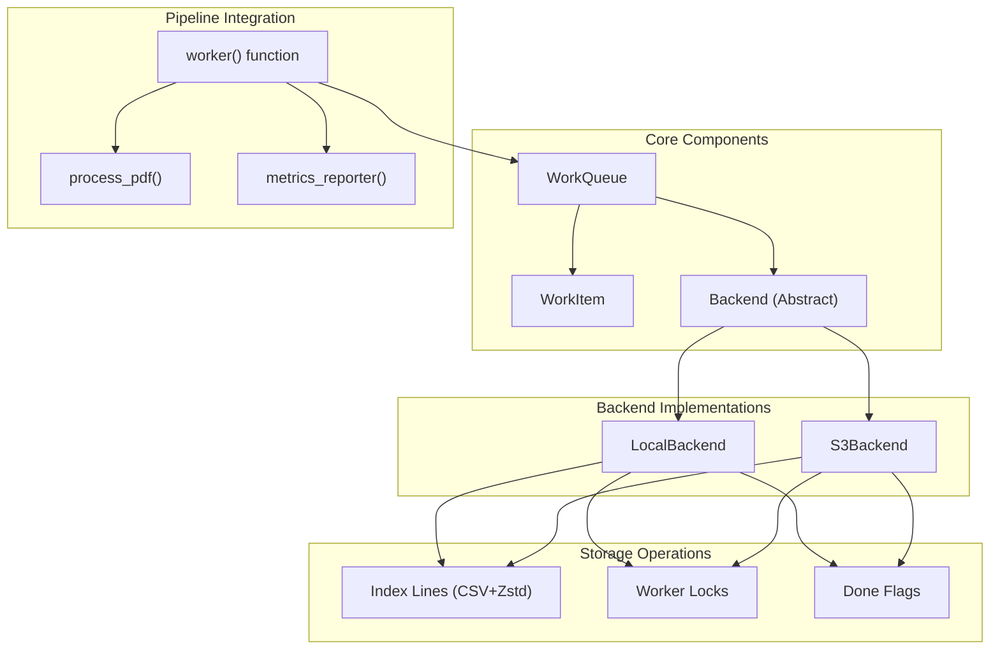
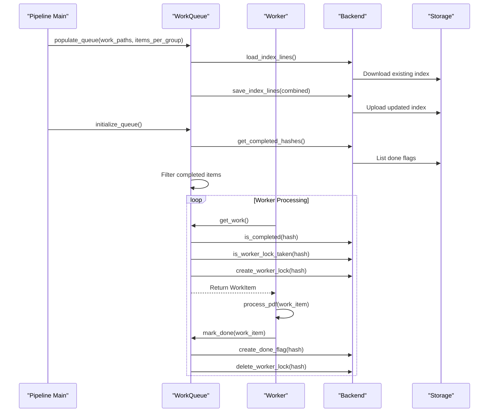
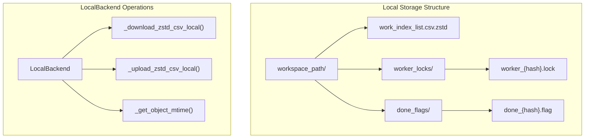
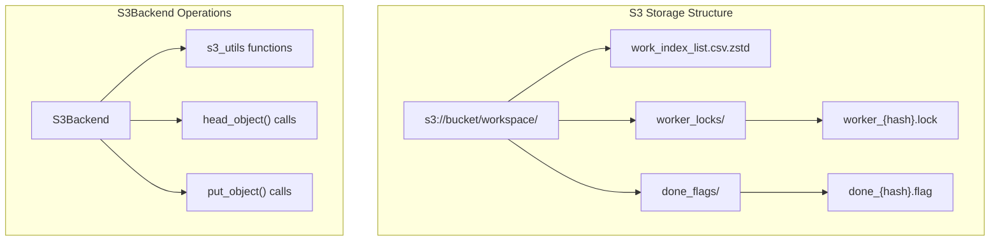
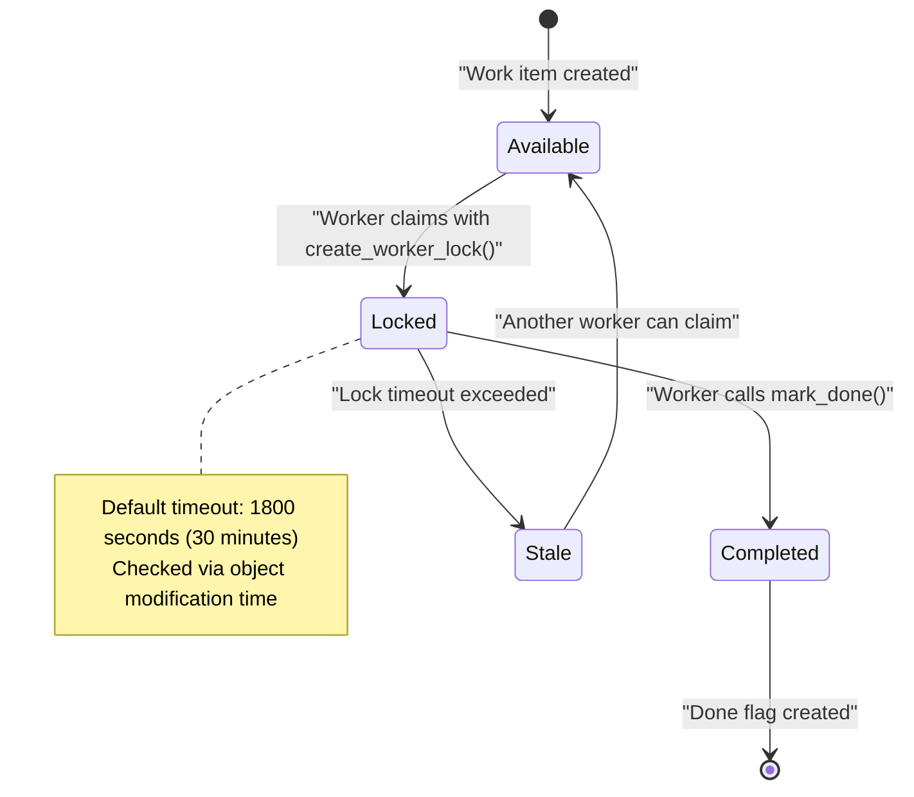

<!-- source: DeepWiki mcp.deepwiki.com · repo allenai/olmocr · page 2.2 Work Queue and Distributed Processing · fetched 2026-10-26 -->

# Work Queue and Distribution

<details>
<summary>Relevant source files</summary>

The following files were used as context for generating this wiki page:

- [CHANGELOG.md](CHANGELOG.md)
- [olmocr/pipeline.py](olmocr/pipeline.py)
- [olmocr/version.py](olmocr/version.py)
- [olmocr/work_queue.py](olmocr/work_queue.py)
- [scripts/release.sh](scripts/release.sh)
- [tests/gnarly_pdfs/edgar_image.pdf](tests/gnarly_pdfs/edgar_image.pdf)
- [tests/test_pipeline.py](tests/test_pipeline.py)
- [tests/test_s3_work_queue.py](tests/test_s3_work_queue.py)

</details>


This document covers the distributed task management system that enables scalable document processing across multiple workers and storage backends. The work queue system coordinates the distribution of PDF processing tasks, handles worker synchronization, and tracks completion status across both local and cloud storage environments.

For information about the main document processing pipeline that uses this work queue system, see [Pipeline Architecture](#2.1). For details about VLM server integration and model inference, see [VLM Server Integration](#2.3).

## Architecture Overview

The work queue system provides a pluggable architecture for distributed task management with support for different storage backends. It ensures that work items are processed exactly once across multiple workers while providing fault tolerance and recovery mechanisms.

### Work Queue System Architecture



Sources: [olmocr/work_queue.py:82-231](), [olmocr/pipeline.py:465-581]()

### Work Distribution Flow



Sources: [olmocr/work_queue.py:127-151](), [olmocr/work_queue.py:153-172](), [olmocr/work_queue.py:174-214](), [olmocr/work_queue.py:216-225]()

## Core Work Queue Components

### WorkItem and WorkQueue Classes

The `WorkItem` dataclass represents a single unit of work containing a hash identifier and list of file paths to process:

```python
@dataclass
class WorkItem:
    hash: str
    work_paths: List[str]
```

The `WorkQueue` class manages the queue operations and coordinates with pluggable storage backends:

| Method | Purpose |
|--------|---------|
| `populate_queue()` | Add new work items to the queue index |
| `initialize_queue()` | Load queue and filter completed items |
| `get_work()` | Retrieve next available work item with locking |
| `mark_done()` | Mark work item as completed |

Sources: [olmocr/work_queue.py:30-36](), [olmocr/work_queue.py:82-231]()

### Work Item Grouping and Hashing

Work items are grouped together to optimize processing efficiency. The system computes deterministic hashes for work groups:

```python
@staticmethod
def _compute_workgroup_hash(work_paths: List[str]) -> str:
    sha1 = hashlib.sha1()
    for path in sorted(work_paths):
        sha1.update(path.encode("utf-8"))
    return sha1.hexdigest()
```

CSV encoding handles paths with special characters safely using proper escaping.

Sources: [olmocr/work_queue.py:105-111](), [olmocr/work_queue.py:93-103]()

## Backend Implementations

### Backend Abstract Interface

The `Backend` abstract class defines the storage interface that both local and S3 implementations must provide:

| Method | Purpose |
|--------|---------|
| `load_index_lines()` | Load work queue index from storage |
| `save_index_lines()` | Save work queue index to storage |
| `get_completed_hashes()` | Get set of completed work items |
| `is_worker_lock_taken()` | Check if work is locked by another worker |
| `create_worker_lock()` | Create worker lock for coordination |
| `create_done_flag()` | Mark work item as completed |

Sources: [olmocr/work_queue.py:38-80]()

### LocalBackend Implementation

The `LocalBackend` uses the local filesystem for storage operations:



The local backend uses zstandard compression for the work index and file modification times for staleness detection.

Sources: [olmocr/work_queue.py:233-348]()

### S3Backend Implementation

The `S3Backend` provides distributed storage using AWS S3:



The S3 backend leverages utility functions from `s3_utils` module and uses S3 object metadata for timestamp tracking.

Sources: [olmocr/work_queue.py:351-432](), [olmocr/s3_utils.py:16-21]()

## Pipeline Integration

### Worker Coordination

The main pipeline creates multiple async workers that coordinate through the work queue system:

```python
async def worker(args, work_queue: WorkQueue, semaphore, worker_id):
    while True:
        await semaphore.acquire()
        work_item = await work_queue.get_work()
        if work_item is None:
            break
        
        # Process PDFs in work item
        dolma_tasks = [process_pdf(args, worker_id, pdf) for pdf in work_item.work_paths]
        # ... handle results and output
        
        await work_queue.mark_done(work_item)
        semaphore.release()
```

Workers use semaphores for rate limiting and coordinate through the shared work queue to avoid duplicate processing.

Sources: [olmocr/pipeline.py:465-581]()

### Work Queue Initialization in Pipeline

The pipeline sets up work queues based on workspace type:

| Workspace Type | Backend Used |
|----------------|--------------|
| `s3://` prefix | `S3Backend` with boto3 client |
| Local path | `LocalBackend` with filesystem |

The pipeline populates the queue from PDF paths and initializes workers:

```python
if args.workspace.startswith("s3://"):
    backend = S3Backend(workspace_s3, args.workspace)
else:
    backend = LocalBackend(args.workspace)

work_queue = WorkQueue(backend)
```

Sources: [olmocr/pipeline.py:52](), [olmocr/pipeline.py:1020-1030]()

## Worker Lock Management

### Lock Lifecycle and Staleness Detection

The work queue system prevents duplicate processing through worker locks with configurable timeouts:



Lock staleness is determined by comparing the lock file's modification time with the current time and a configurable timeout period.

Sources: [olmocr/work_queue.py:174-214](), [olmocr/work_queue.py:304-313](), [olmocr/work_queue.py:400-409]()

### Completion Tracking and Caching

The system maintains completion state through done flags and uses local caching for performance:

- **Done flags**: Empty files named `done_{hash}.flag` indicate completed work
- **Completion cache**: Local set cache reduces repeated storage queries
- **Cache refresh**: Automatic refresh when too many items are already completed

The completion cache is refreshed when more than 3 consecutive queue items are found to be already completed, indicating the cache may be stale.

Sources: [olmocr/work_queue.py:187-196](), [olmocr/work_queue.py:221](), [olmocr/work_queue.py:278-283](), [olmocr/work_queue.py:366-375]()

## Usage Patterns

### Beaker Integration

The work queue system integrates with the Beaker distributed computing platform for large-scale processing:

```python
def submit_beaker_job(args):
    # Remove --pdfs argument since queue is populated locally
    args_list = [arg for arg in sys.argv[1:] if not arg.startswith("--pdfs")]
    
    # Submit job with proper environment and secrets
    experiment_spec = ExperimentSpec(
        tasks=[TaskSpec(
            command=["python", "-m", "olmocr.pipeline"] + args_list,
            replicas=args.beaker_gpus,
        )]
    )
```

Each Beaker replica runs the same pipeline code but coordinates through the shared work queue to avoid duplicate work.

Sources: [olmocr/pipeline.py:771-876]()

### Statistics and Monitoring

The system provides comprehensive statistics about queue processing:

```python
def print_stats(args, root_work_queue):
    # Get total work items and completed items
    work_queue_lines = download_zstd_csv(workspace_s3, index_file_s3_path)
    done_work_items = expand_s3_glob(workspace_s3, output_glob)
    
    total_items = len(work_queue)
    completed_items = len(done_work_items)
```

Statistics include completion rates, token counts, processing times, and error rates across the distributed processing pipeline.

Sources: [olmocr/pipeline.py:878-1004]()

---

